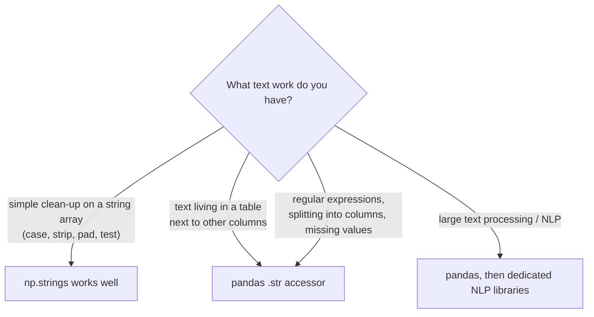

# Binary and String Functions: The Complete Guide

> 📚 **Before you start**
>
> - [Data Types and Array Attributes](data-types-and-array-attributes.md), for unsigned integers, string dtypes and `StringDType`
> - [Array Manipulation and Arithmetic](array-manipulation-and-arithmetic.md), for ufuncs and element-wise operations
> - [Python Fundamentals › Strings and Data Structures](../../python-fundamentals/course.md#m5), for Python's string methods (`upper`, `strip`, `replace`, `find`)

## Introduction

Two very different kinds of data hide inside most real systems. The first is **bits**. A food delivery app might store a restaurant's features as one small integer where each bit means something: bit 0 "pure veg", bit 1 "open late", bit 2 "free delivery". A photo stores every pixel as 8 bits per colour. Network addresses, file permissions and feature flags are all bit patterns. The second is **text**: names, cities, product codes, phone numbers, all needing the same clean-up (trimming spaces, fixing case, checking formats) applied to thousands of values at once.

NumPy has vectorised tools for both. **Binary (bitwise) functions** operate on the individual bits of integers across a whole array. **String functions**, in the `np.strings` module added in NumPy 2, apply Python-style string methods to every element of a string array without a loop.

This lesson covers both. You will learn the bitwise operators and how to set, clear and test flags; how to see and pack bits; and the full set of vectorised string operations: case, trimming, padding, searching, testing, replacing, splitting and joining. You will also see when NumPy's string support is the right tool and when pandas (module 4) is better.

> 💡 **Key Insight**
>
> Bitwise functions treat an integer as a **row of yes/no switches**, so one `uint8` can store eight flags and one array can test millions of flags in a single operation. String functions are NumPy's ufunc machinery applied to text: same element-wise, broadcasting behaviour, just with words instead of numbers.

---

## Core Explanation

### 1. Integers as bits

Every integer is stored in binary. `np.binary_repr` shows the bits of a single number, padded to a width; `np.base_repr` shows any base up to 36.

```python
import numpy as np

for n in [5, 12, 255]:
    print(n, np.binary_repr(n, width=8), np.base_repr(n, base=16))
print(np.binary_repr(-5, width=8))    # negative numbers use two's complement
```

Output:

```
5 00000101 5
12 00001100 C
255 11111111 FF
11111011
```

Bits are numbered from the right, starting at 0. In `00000101`, bits 0 and 2 are on, so the value is 2⁰ + 2² = 1 + 4 = 5. Negative numbers use **two's complement**: invert all bits of the positive value and add one. You rarely need to compute it, but it explains why `~5` is `-6`, as you will see.

### 2. The bitwise operations

| Operator | Function | Rule per bit | `12 op 10` (`1100` op `1010`) |
|---|---|---|---|
| `a & b` | `np.bitwise_and` | 1 if both are 1 | `1000` = 8 |
| `a \| b` | `np.bitwise_or` | 1 if either is 1 | `1110` = 14 |
| `a ^ b` | `np.bitwise_xor` | 1 if exactly one is 1 | `0110` = 6 |
| `~a` | `np.invert` (`np.bitwise_not`) | flips every bit | `~12` = -13 for signed ints |
| `a << n` | `np.left_shift` | shift bits left by n (multiply by 2ⁿ) | `12 << 1` = 24 |
| `a >> n` | `np.right_shift` | shift bits right by n (floor divide by 2ⁿ) | `12 >> 2` = 3 |

```python
a = np.array([12, 5, 255])
b = np.array([10, 3, 15])
print(a & b, np.bitwise_and(a, b))
print(a | b)
print(a ^ b)
print(~np.array([12, 5], dtype=np.int64))
print(~np.array([12, 5], dtype=np.uint8))       # unsigned: 255 - value
print(a << 1, a >> 2)
```

Output:

```
[ 8  1 15] [ 8  1 15]
[ 14   7 255]
[  6   6 240]
[-13  -6]
[243 250]
[ 24  10 510] [ 3  1 63]
```

Two things to notice. First, `~` depends on the dtype: for signed integers `~x` equals `-x - 1` (two's complement), while for `uint8` it equals `255 - x`. Second, these operators only work on **integers and booleans**. On boolean arrays they are the logical operators you already used for masks: `&` is "and", `|` is "or", `~` is "not". That is no coincidence: a boolean is a one-bit flag.

NumPy 2 also provides the array-API names `np.bitwise_left_shift`, `np.bitwise_right_shift` and `np.bitwise_invert`, which are aliases of the functions above.

### 3. Flags: set, clear, toggle and test

Store several yes/no facts in one integer by giving each fact its own bit. Build the bit values with shifts so they are easy to read:

```python
PURE_VEG      = 1 << 0     # 1
OPEN_LATE     = 1 << 1     # 2
FREE_DELIVERY = 1 << 2     # 4
ACCEPTS_UPI   = 1 << 3     # 8

restaurants = np.array(["Annapurna", "Biryani Bros", "Chai Point", "Dosa Hut"])
flags = np.array([
    PURE_VEG | ACCEPTS_UPI,
    OPEN_LATE | FREE_DELIVERY | ACCEPTS_UPI,
    PURE_VEG | OPEN_LATE | ACCEPTS_UPI,
    PURE_VEG | FREE_DELIVERY,
], dtype=np.uint8)
print(flags)
print([np.binary_repr(f, width=4) for f in flags])
```

Output:

```
[ 9 14 11  5]
['1001', '1110', '1011', '0101']
```

The four standard operations on flags:

```python
# test: is a bit on? (non-zero after AND)
veg = (flags & PURE_VEG) != 0
print(restaurants[veg])

# test several bits at once: veg AND open late
want = PURE_VEG | OPEN_LATE
print(restaurants[(flags & want) == want])

# set a bit (OR): everyone now accepts UPI
print(flags | ACCEPTS_UPI)

# clear a bit (AND with the inverse): stop free delivery
print(flags & ~np.uint8(FREE_DELIVERY))

# toggle a bit (XOR)
print(flags ^ OPEN_LATE)
```

Output:

```
['Annapurna' 'Chai Point' 'Dosa Hut']
['Chai Point']
[ 9 14 11 13]
[ 9 10 11  1]
[11 12  9  7]
```

Clearing uses `~np.uint8(FREE_DELIVERY)` rather than `~FREE_DELIVERY` because Python's `~4` is the negative integer `-5`, which cannot be combined with a `uint8` array under NumPy 2's rules. Making the mask a `uint8` first keeps everything in the same type.

To count how many flags each restaurant has, NumPy 2 added `np.bitwise_count`, which counts the 1-bits (often called the "population count"):

```python
print(np.bitwise_count(flags))
```

Output:

```
[2 3 3 2]
```

### 4. Packing and unpacking bits

`np.unpackbits` expands each `uint8` into its 8 bits (most significant first); `np.packbits` does the reverse, squeezing an array of 0/1 values into bytes. This saves eight times the memory when storing large boolean data:

```python
print(np.unpackbits(np.array([5, 255], dtype=np.uint8)))
print(np.unpackbits(flags[:, np.newaxis], axis=1)[:, -4:])   # last 4 bits per restaurant

attendance = np.array([1, 1, 0, 1, 1, 1, 0, 1, 1, 0], dtype=bool)   # 10 days
packed = np.packbits(attendance)
print(packed, packed.nbytes, "bytes instead of", attendance.nbytes)
print(np.unpackbits(packed)[:attendance.size].astype(bool))
```

Output:

```
[0 0 0 0 0 1 0 1 1 1 1 1 1 1 1 1]
[[1 0 0 1]
 [1 1 1 0]
 [1 0 1 1]
 [0 1 0 1]]
[221 128] 2 bytes instead of 10
[ True  True False  True  True  True False  True  True False]
```

Ten days fit in two bytes; the last byte is padded with zeros, so slice back to the original length after unpacking.

### 5. A real use: subnet masks

Network engineers check whether an IP address belongs to a network by AND-ing it with a mask. With each address as a 32-bit integer:

```python
def ip_to_int(ip):
    a, b, c, d = (int(p) for p in ip.split("."))
    return (a << 24) | (b << 16) | (c << 8) | d

ips = np.array([ip_to_int(ip) for ip in
                ["192.168.1.10", "192.168.1.200", "192.168.2.5", "10.0.0.1"]], dtype=np.uint32)
network = np.uint32(ip_to_int("192.168.1.0"))
mask = np.uint32(0xFFFFFF00)                    # /24: first 24 bits must match
print((ips & mask) == network)
```

Output:

```
[ True  True False False]
```

One AND per address, all done at once, which is how firewalls and log analysers filter millions of addresses quickly.

### 6. String arrays and the `np.strings` module

Now text. NumPy string arrays use one of three dtypes you met in the dtypes lesson: fixed-width Unicode (`<U`), fixed-width bytes (`S`) and the variable-width `StringDType` (NumPy 2). The vectorised string functions live in **`np.strings`**, a module added in NumPy 2.0. They are real ufuncs: they work element-wise and broadcast. The older **`np.char`** module offers mostly the same functions and still works, but the NumPy docs point new code to `np.strings`.

```python
from numpy.dtypes import StringDType

cities = np.array(["  mumbai", "Delhi ", "BENGALURU", " chennai  ", "Kolkata"],
                  dtype=StringDType())

clean = np.strings.title(np.strings.strip(cities))
print(clean)
print(np.strings.upper(clean))
print(np.strings.lower(clean))
print(np.strings.swapcase(np.array(["ChAi"])), np.strings.capitalize(np.array(["masala chai"])))
```

Output:

```
['Mumbai' 'Delhi' 'Bengaluru' 'Chennai' 'Kolkata']
['MUMBAI' 'DELHI' 'BENGALURU' 'CHENNAI' 'KOLKATA']
['mumbai' 'delhi' 'bengaluru' 'chennai' 'kolkata']
['cHaI'] ['Masala chai']
```

`strip` removes whitespace from both ends (`lstrip` and `rstrip` do one end). Pass characters to strip something else: `np.strings.strip(a, "*#")`.

Strings also support the `+` and `*` operators in NumPy 2, mapped to `np.strings.add` and `np.strings.multiply`, and comparisons such as `==` and `<` work element-wise:

```python
codes = np.array(["MUM", "DEL", "BLR"])
print(codes + "-" + np.array(["01", "02", "03"]))
print(np.strings.multiply(np.array(["-"]), 10))
print(codes == "DEL", codes < "CAT")
```

Output:

```
['MUM-01' 'DEL-02' 'BLR-03']
['----------']
[False  True False] [False False  True]
```

### 7. Length, padding and alignment

```python
print(np.strings.str_len(clean))
print(np.strings.center(np.array(["chai"]), 10, "*"))
print(np.strings.ljust(clean[:3], 10, "."))
print(np.strings.rjust(np.array(["7", "42", "365"]), 5))
print(np.strings.zfill(np.array(["7", "42", "365"]), 4))       # zero padding for codes
```

Output:

```
[6 5 9 7 7]
['***chai***']
['Mumbai....' 'Delhi.....' 'Bengaluru.']
['    7' '   42' '  365']
['0007' '0042' '0365']
```

`zfill` is handy for fixing ids that lost their leading zeros when someone opened a CSV in a spreadsheet, such as PIN codes or employee numbers.

### 8. Searching and testing

| Function | Returns |
|---|---|
| `find(a, sub)` / `rfind` | first / last position of `sub`, or -1 |
| `index(a, sub)` / `rindex` | like `find`, but raises if missing |
| `count(a, sub)` | how many non-overlapping occurrences |
| `startswith(a, p)` / `endswith(a, s)` | booleans |
| `isalpha`, `isdigit`, `isnumeric`, `isdecimal`, `isalnum` | booleans about the characters |
| `isspace`, `islower`, `isupper`, `istitle` | booleans |

```python
phones = np.array(["9876543210", "+91 98200 12345", "022-24567890", "98765abc10", "8000000000"])
print(np.strings.isdigit(phones))
print(np.strings.startswith(phones, "+91"))
print(np.strings.find(phones, "-"))
print(np.strings.count(phones, "0"))

valid_mobile = np.strings.isdigit(phones) & (np.strings.str_len(phones) == 10)
print(phones[valid_mobile])
```

Output:

```
[ True False False False  True]
[False  True False False False]
[-1 -1  3 -1 -1]
[1 2 2 1 9]
['9876543210' '8000000000']
```

The test functions return boolean arrays, so they combine with `&`, `|` and `~` and work as masks, exactly like numeric comparisons.

### 9. Replacing, slicing, partitioning and translating

```python
print(np.strings.replace(phones, " ", ""))
print(np.strings.replace(np.array(["a-b-c-d"]), "-", "/", count=2))
print(np.strings.slice(phones, 0, 4))                 # characters 0 to 3 of each string

head, sep, tail = np.strings.partition(np.array(["022-24567890", "080-41234567"]), "-")
print(head, tail)

table = str.maketrans("aeiou", "AEIOU")
print(np.strings.translate(np.array(["samosa", "idli"]), table))
```

Output:

```
['9876543210' '+919820012345' '022-24567890' '98765abc10' '8000000000']
['a/b/c-d']
['9876' '+91 ' '022-' '9876' '8000']
['022' '080'] ['24567890' '41234567']
['sAmOsA' 'IdlI']
```

`partition` splits each string at the **first** occurrence of a separator into three arrays (before, separator, after); `rpartition` uses the last occurrence. `np.strings.slice` (added in NumPy 2.3) slices every string the way `s[start:stop]` slices one.

### 10. Splitting and joining (the `np.char` exceptions)

Splitting a string into a **variable number** of pieces cannot produce a regular array, so `np.strings` has no `split`. The legacy `np.char.split` still exists and returns an **object array of Python lists**; `np.char.join` inserts a separator between the characters of each string:

```python
words = np.char.split(np.array(["masala chai", "cutting chai special"]))
print(words)
print([len(w) for w in words])
print(np.char.join("-", np.array(["abc", "xy"])))
```

Output:

```
[list(['masala', 'chai']) list(['cutting', 'chai', 'special'])]
[2, 3]
['a-b-c' 'x-y']
```

Object arrays of lists are slow and awkward. If you are splitting text into words or columns, that is a sign the job belongs in pandas, whose `.str.split(expand=True)` turns the pieces straight into columns ([Working with Text Data](../04-text-dates-and-categories-in-pandas/working-with-text-data.md)).

### 11. Encoding, decoding and formatting

`encode` turns text (`str`) into bytes using a character encoding such as UTF-8, and `decode` turns bytes back into text. You need them when reading legacy files or binary formats:

```python
raw = np.strings.encode(np.array(["chai", "₹20"]), "utf-8")
print(raw, raw.dtype)
print(np.strings.decode(raw, "utf-8"))
print(np.strings.mod(np.array(["%.1f km", "%.1f km"]), np.array([3.14159, 12.0])))
```

Output:

```
[b'chai' b'\xe2\x82\xb920'] |S5
['chai' '₹20']
['3.1 km' '12.0 km']
```

The rupee sign takes 3 bytes in UTF-8, which is why the bytes array is `S5` while the text was only 3 characters. `np.strings.mod` applies old-style `%` formatting element-wise.

### 12. NumPy strings or pandas strings?



NumPy's string functions are fast and handy when you already have a string array (for example, labels returned by another library). pandas adds regular expressions, missing-value handling and splitting into columns, so most real text cleaning happens there.

---

## Try It Yourself

1. Permission bits: READ = 4, WRITE = 2, EXECUTE = 1. Given `perms = np.array([7, 5, 6, 4, 0])`, find which entries can write, and give everyone read access.
2. Count how many 1-bits each value in `np.array([0, 1, 7, 8, 255], dtype=np.uint8)` has, and show the bit pattern of 7 as 8 characters.
3. Clean `names = np.array(["  asha ", "RAVI", "meera  k", " kabir"])` into title case with no outer spaces, then keep only names longer than 4 characters.
4. Given vehicle numbers `np.array(["MH12AB1234", "KA01-XY-9999", "DL3C 4567", "MH14CD0001"])`, remove spaces and dashes, then select the Maharashtra (`MH`) ones.

<details>
<summary>Show answers</summary>

```python
READ, WRITE, EXECUTE = 4, 2, 1
perms = np.array([7, 5, 6, 4, 0])
print((perms & WRITE) != 0)
print(perms | READ)

v = np.array([0, 1, 7, 8, 255], dtype=np.uint8)
print(np.bitwise_count(v), np.binary_repr(7, width=8))

names = np.array(["  asha ", "RAVI", "meera  k", " kabir"])
tidy = np.strings.title(np.strings.strip(names))
print(tidy, tidy[np.strings.str_len(tidy) > 4])

plates = np.array(["MH12AB1234", "KA01-XY-9999", "DL3C 4567", "MH14CD0001"])
plain = np.strings.replace(np.strings.replace(plates, " ", ""), "-", "")
print(plain[np.strings.startswith(plain, "MH")])
```

Output:

```
[ True False  True False False]
[7 5 6 4 4]
[0 1 3 1 8] 00000111
['Asha' 'Ravi' 'Meera  K' 'Kabir'] ['Meera  K' 'Kabir']
['MH12AB1234' 'MH14CD0001']
```

**3.** `strip` only removes outer spaces, so "Meera  K" keeps its double space. Collapsing inner spaces needs a regular expression, which pandas' `.str.replace(r"\s+", " ", regex=True)` handles.

</details>

---

## Real-World Examples

### Example 1: Feature flags and permissions

Unix file permissions (`chmod 755`) are three groups of read/write/execute bits. Many products store user permissions or feature toggles as bit fields in a database column and test them with AND, exactly as in section 3.

### Example 2: Compact boolean storage

Genomics and recommendation systems store huge yes/no matrices (did user *i* watch movie *j*?) packed into bits with `packbits`, cutting memory by a factor of eight before analysis.

### Example 3: Cleaning label arrays

Machine learning datasets often arrive with labels like `" Spam"`, `"spam "` and `"SPAM"`. A one-line `np.strings.lower(np.strings.strip(labels))` normalises them before encoding with `np.unique(..., return_inverse=True)`.

---

## Common Misconceptions

### Misconception 1: "`~x` gives `-x`" or "`~x` is the same for every dtype"

For signed integers `~x` is `-x - 1`; for `uint8` it is `255 - x`. It flips bits, it does not negate.

### Misconception 2: "`&` and `and` are interchangeable"

`&` is bitwise and works element by element; `and` needs a single truth value and fails on arrays.

### Misconception 3: "`np.char` is the modern string API"

It is the legacy module. NumPy 2 added `np.strings`, whose functions are true ufuncs and support `StringDType`. Use `np.char` only for the few things `np.strings` lacks, such as `split`.

### Misconception 4: "NumPy is the best place to clean text"

It handles simple vectorised operations well, but pandas offers regular expressions, missing values and column splitting, and is where most text cleaning should happen.

---

## Interview Relevance

- *"How would you store and query many boolean flags efficiently?"* Bit fields with AND/OR/XOR, or `packbits` for large boolean arrays.
- *"How do you check whether bit k is set?"* `(x >> k) & 1` or `(x & (1 << k)) != 0`.
- *"What is two's complement?"* The signed-integer encoding where `-x` is `~x + 1`; it explains why `~5 == -6`.
- *"How do you apply a string operation to every element of an array without a loop?"* `np.strings` ufuncs (or pandas `.str` for Series).
- *"Why is there no vectorised `split` returning a normal array?"* The number of pieces varies, so results are ragged; use pandas `str.split(expand=True)` for tables.

---

## Key Takeaways

- **Bitwise functions** (`&`, `|`, `^`, `~`, `<<`, `>>`) work on the bits of integers, element by element.
- **Flags**: test with `x & FLAG`, set with `|`, clear with `& ~FLAG`, toggle with `^`; count bits with `np.bitwise_count`.
- **`binary_repr`, `packbits` and `unpackbits`** let you see and store bits compactly.
- **`np.strings`** (NumPy 2) is the modern vectorised string module: case, strip, pad, find, count, test, replace, slice, partition, encode and decode.
- **`np.char`** is the legacy module, still useful for `split` and `join`.
- **For text in tables, use pandas**, covered in module 4.

---

**Up next:** [The Matrix Library, Copies and Views](the-matrix-library-copies-and-views.md)
