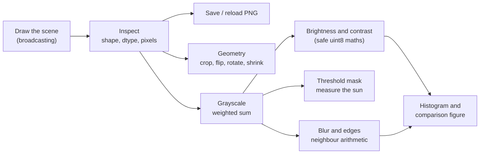

# Lab: Image as a NumPy Array

> 📚 **Before you start**
>
> This lab uses everything from the NumPy Essentials module:
> - [Creating, Indexing and Slicing Arrays](creating-indexing-and-slicing-arrays.md) and [Broadcasting and Iterating over Arrays](broadcasting-and-iterating-over-arrays.md)
> - [Data Types and Array Attributes](data-types-and-array-attributes.md), especially `uint8` overflow
> - [Array Manipulation and Arithmetic](array-manipulation-and-arithmetic.md) and [Statistical, Sorting, Searching and Counting Functions](statistical-sorting-searching-and-counting-functions.md)
> - [The Matrix Library, Copies and Views](the-matrix-library-copies-and-views.md)

## What You'll Build

A tiny photo editor written in pure NumPy. You will **draw** a small sunset picture from scratch (no image files to download), then treat it the way every photo app does under the hood:

1. **Inspect** the image: its shape, dtype and pixel values.
2. **Save and reload** it as a PNG with Matplotlib, and notice what changes.
3. **Crop, flip, rotate and downsample** it with slicing.
4. Convert it to **grayscale** with a weighted sum.
5. Adjust **brightness and contrast** safely, and see the `uint8` overflow bug happen.
6. **Threshold** it into a mask and measure the sun.
7. Apply a **blur** and an **edge detector** with vectorised neighbour arithmetic.
8. Build a **histogram** and save a comparison figure.



> 💡 **Key Insight**
>
> A colour image is just a 3-D array of shape **(height, width, 3)** holding `uint8` values from 0 to 255. Every photo filter you have ever used is array arithmetic: slicing for geometry, broadcasting for colour changes, and reductions for statistics. The one rule that keeps you safe is **do the maths in a wider type, then clip back to 0 to 255**.

Run the blocks in order in one file or notebook. You need NumPy and Matplotlib (`pip install numpy matplotlib`).

---

## Step 1: Draw a Sunset

We build a 96 × 128 image (height × width). First a sky that fades from deep orange at the top to pale yellow near the horizon, using broadcasting to combine a column of row positions with a row of colours.

```python
import numpy as np

H, W = 96, 128
img = np.zeros((H, W, 3), dtype=np.uint8)

# Sky: blend from top colour to horizon colour, row by row
top = np.array([200, 60, 30], dtype=float)        # deep orange (R, G, B)
horizon = np.array([255, 210, 120], dtype=float)  # pale yellow
t = np.linspace(0, 1, 64)[:, np.newaxis]          # shape (64, 1): one weight per row
sky = (1 - t) * top + t * horizon                 # (64, 1) with (3,) -> (64, 3)
img[:64] = sky[:, np.newaxis, :].astype(np.uint8) # broadcast across all 128 columns

# Ground: dark green for the bottom 32 rows
img[64:] = [30, 90, 40]

print(img.shape, img.dtype)
print("top-left pixel   :", img[0, 0])
print("horizon pixel    :", img[63, 0])
print("ground pixel     :", img[80, 0])
```

Output:

```
(96, 128, 3) uint8
top-left pixel   : [200  60  30]
horizon pixel    : [255 210 120]
ground pixel     : [30 90 40]
```

Now a sun: a filled circle. A pixel belongs to the circle when its distance from the centre is at most the radius. We compute every pixel's distance at once using `np.ogrid`, which returns a column of row numbers and a row of column numbers that broadcast into a full grid.

```python
rows, cols = np.ogrid[:H, :W]               # shapes (96, 1) and (1, 128)
print(rows.shape, cols.shape)

cy, cx, radius = 50, 64, 18
dist = np.sqrt((rows - cy) ** 2 + (cols - cx) ** 2)   # broadcasts to (96, 128)
sun = (dist <= radius) & (rows < 64)        # only the part above the horizon
img[sun] = [255, 240, 180]

print("sun pixels:", sun.sum())
print("sun centre colour:", img[cy, cx])
```

Output:

```
(96, 1) (1, 128)
sun pixels: 938
sun centre colour: [255 240 180]
```

Boolean indexing on the first two axes selected whole pixels, and the 3-value colour broadcast into each of them. Finally, a few "stars" placed with a seeded random generator and fancy indexing:

```python
rng = np.random.default_rng(7)
star_r = rng.integers(0, 20, size=12)
star_c = rng.integers(0, W, size=12)
img[star_r, star_c] = 255                   # every channel -> white
print("white pixels in the top 20 rows:", (img[:20] == 255).all(axis=2).sum())
```

Output:

```
white pixels in the top 20 rows: 12
```

---

## Step 2: Inspect the Image

Treat the picture like any other dataset. What range do the values cover, and how bright is each channel on average?

```python
print("min / max     :", img.min(), img.max())
print("mean per channel (R, G, B):", img.mean(axis=(0, 1)).round(1))
print("memory        :", img.nbytes, "bytes")

red, green, blue = img[..., 0], img[..., 1], img[..., 2]
print("red channel shape:", red.shape, "| is a view:", np.shares_memory(img, red))
print("brightest red row:", red.mean(axis=1).argmax())
```

Output:

```
min / max     : 30 255
mean per channel (R, G, B): [162.4 124.8  69.4]
memory        : 36864 bytes
red channel shape: (96, 128) | is a view: True
brightest red row: 63
```

`axis=(0, 1)` averages over height and width together, leaving one number per channel. The scene is warm: lots of red, little blue. Each channel is a 2-D view into the same memory, so no data was copied.

---

## Step 3: Save and Reload as PNG

Matplotlib can write an array straight to an image file with `plt.imsave` and read it back with `plt.imread`. We use a temporary folder so nothing is left behind, and we do not print the path because it differs on every machine.

```python
import os
import tempfile

import matplotlib
matplotlib.use("Agg")                       # draw without opening a window
import matplotlib.pyplot as plt

tmpdir = tempfile.mkdtemp()
path = os.path.join(tmpdir, "sunset.png")
plt.imsave(path, img)

loaded = plt.imread(path)
print("file written:", os.path.exists(path))
print(loaded.shape, loaded.dtype, loaded.min(), loaded.max())
```

Output:

```
file written: True
(96, 128, 4) float32 0.11764706 1.0
```

Two surprises, both worth knowing:

- The shape gained a **fourth channel**. PNG files saved this way include **alpha** (transparency), so you get RGBA.
- The dtype is **`float32` from 0.0 to 1.0**, not `uint8` from 0 to 255. Matplotlib converts PNG data to floats on reading.

Convert back to our format and check nothing was lost:

```python
back = np.round(loaded[..., :3] * 255).astype(np.uint8)
print(back.shape, back.dtype, "identical:", np.array_equal(back, img))
```

Output:

```
(96, 128, 3) uint8 identical: True
```

Always check shape and dtype after loading an image. Different libraries return different layouts (RGB vs BGR, uint8 vs float, with or without alpha).

---

## Step 4: Crop, Flip, Rotate and Shrink

Geometry is just indexing, and every result here is a **view**, so it is instant even for huge photos.

```python
crop = img[25:75, 40:90]                # a 50 x 50 window around the sun
mirror = img[:, ::-1]                   # flip left-right
upside_down = img[::-1]                 # flip top-bottom
rotated = np.rot90(img)                 # 90 degrees anticlockwise
small = img[::2, ::2]                   # keep every second row and column

for name, a in [("crop", crop), ("mirror", mirror), ("upside_down", upside_down),
                ("rotated", rotated), ("small", small)]:
    print(f"{name:12} {str(a.shape):14} view: {np.shares_memory(img, a)}")
```

Output:

```
crop         (50, 50, 3)    view: True
mirror       (96, 128, 3)   view: True
upside_down  (96, 128, 3)   view: True
rotated      (128, 96, 3)   view: True
small        (48, 64, 3)    view: True
```

Skipping pixels is a crude way to shrink. A better one averages each 2 × 2 block. Reshape splits each axis into (blocks, pixels in block), then `mean` over the in-block axes:

```python
blocks = img.reshape(H // 2, 2, W // 2, 2, 3)
smooth_small = blocks.mean(axis=(1, 3)).astype(np.uint8)
print(smooth_small.shape)
print("skip   pixel at sun edge:", small[25, 41])
print("average pixel at sun edge:", smooth_small[25, 41])
```

Output:

```
(48, 64, 3)
skip   pixel at sun edge: [255 240 180]
average pixel at sun edge: [246 195 121]
```

Averaging blends neighbouring pixels, which avoids the jagged edges of skipping.

Because these are views, writing into one changes the original. Make a copy before editing a crop:

```python
patch = img[0:10, 0:10].copy()
patch[:] = 0
print("original untouched:", img[0, 0])
```

Output:

```
original untouched: [200  60  30]
```

---

## Step 5: Convert to Grayscale

Human eyes are most sensitive to green and least to blue, so a good grayscale image is a **weighted sum** of the channels, not a plain average. The widely used weights (from the ITU-R BT.601 standard) are 0.299 for red, 0.587 for green and 0.114 for blue. A matrix product along the last axis computes it for every pixel at once:

```python
weights = np.array([0.299, 0.587, 0.114])
gray = img @ weights                     # (96, 128, 3) @ (3,) -> (96, 128)
print(gray.shape, gray.dtype)
gray = np.round(gray).astype(np.uint8)
print("sky top / horizon / ground / sun:", gray[0, 0], gray[63, 0], gray[80, 0], gray[cy, cx])

plain_avg = img.mean(axis=2).round().astype(np.uint8)
print("plain average at the same points:", plain_avg[0, 0], plain_avg[63, 0], plain_avg[80, 0])
```

Output:

```
(96, 128) float64
sky top / horizon / ground / sun: 98 213 66 238
plain average at the same points: 97 195 53
```

The two methods disagree most on the green ground and the yellow horizon, exactly where the eye's sensitivity matters.

---

## Step 6: Brightness and Contrast (and the Overflow Trap)

First the **wrong** way. Add 60 to brighten:

```python
wrong = gray + 60                        # uint8 + Python int stays uint8
print("horizon before / after:", gray[63, 0], wrong[63, 0])
print("sun before / after    :", gray[cy, cx], wrong[cy, cx])
```

Output:

```
horizon before / after: 213 17
sun before / after    : 238 42
```

The brightest pixels became nearly black: 213 + 60 = 273 wrapped round to 273 − 256 = 17. NumPy did not warn you. The **right** way widens the type, does the maths, clips to the valid range and converts back:

```python
def adjust(image, brightness=0, contrast=1.0):
    """Scale around mid-grey (128) for contrast, then shift for brightness."""
    out = (image.astype(np.float64) - 128) * contrast + 128 + brightness
    return np.clip(out, 0, 255).round().astype(np.uint8)

bright = adjust(gray, brightness=60)
punchy = adjust(gray, contrast=1.5)
print("brighter horizon / sun:", bright[63, 0], bright[cy, cx])
print("contrast ground / sky :", gray[80, 0], "->", punchy[80, 0], "|", gray[63, 0], "->", punchy[63, 0])
print("std before / after contrast:", gray.std().round(1), punchy.std().round(1))
```

Output:

```
brighter horizon / sun: 255 255
contrast ground / sky : 66 -> 35 | 213 -> 255
std before / after contrast: 56.5 79.4
```

Bright pixels now saturate at 255 instead of wrapping. Higher contrast pushes dark pixels darker and bright pixels brighter, which increases the standard deviation of the pixel values.

A **negative** (inverted) image is a one-liner, and safe because 255 − x never leaves the range:

```python
negative = 255 - img
print(img[80, 0], "->", negative[80, 0])
```

Output:

```
[30 90 40] -> [225 165 215]
```

---

## Step 7: Threshold and Measure the Sun

A **threshold** turns a grayscale image into a yes/no mask: is this pixel brighter than some level? Then counting and searching functions measure what the mask found.

```python
mask = gray > 225
print("bright pixels:", mask.sum(), "| fraction of image:", mask.mean().round(4))

ys, xs = np.nonzero(mask)
print("bounding box rows:", ys.min(), "to", ys.max(), "| cols:", xs.min(), "to", xs.max())
print("centre of brightness:", ys.mean().round(1), xs.mean().round(1))
```

Output:

```
bright pixels: 950 | fraction of image: 0.0773
bounding box rows: 1 to 63 | cols: 0 to 116
centre of brightness: 48.4 63.9
```

The bounding box is far too big: it starts at row 1 and spans columns 0 to 116. The **stars** are also brighter than 225, and they stretch the box. Restrict the search to the area below the star band (rows 20 and down), the same way you would ignore a known noisy region in real data:

```python
sun_mask = mask.copy()
sun_mask[:20] = False
ys, xs = np.nonzero(sun_mask)
height = ys.max() - ys.min() + 1
width = xs.max() - xs.min() + 1
print("sun box: rows", ys.min(), "to", ys.max(), "| cols", xs.min(), "to", xs.max())
print("measured width:", width, "| expected diameter:", 2 * radius + 1)
print("measured area :", sun_mask.sum())
```

Output:

```
sun box: rows 32 to 63 | cols 46 to 82
measured width: 37 | expected diameter: 37
measured area : 938
```

The width matches the circle we drew, and the area equals the 938 sun pixels from Step 1. Computer vision code locates objects in exactly this way, just with smarter thresholds.

---

## Step 8: Blur and Edges with Neighbour Arithmetic

A **box blur** replaces each pixel with the average of itself and its 8 neighbours. Instead of looping over pixels, pad the image by one pixel on every side and add up nine **shifted slices**:

```python
def box_blur(g):
    p = np.pad(g.astype(np.float64), 1, mode="edge")    # repeat edge pixels outward
    total = np.zeros(g.shape)
    for dy in range(3):
        for dx in range(3):
            total += p[dy:dy + g.shape[0], dx:dx + g.shape[1]]
    return np.round(total / 9).astype(np.uint8)

blurred = box_blur(gray)
row = 50                                         # through the middle of the sun
print("sharp  :", gray[row, 42:50])
print("blurred:", blurred[row, 42:50])
```

Output:

```
sharp  : [189 189 189 189 238 238 238 238]
blurred: [189 189 189 194 211 227 238 238]
```

The loop runs only 9 times (once per neighbour offset), and each step processes the whole image. The sharp jump from 189 (sky) to 238 (sun) at the sun's edge became a smooth ramp.

**Edges** are where brightness changes quickly. `np.diff` along each axis measures the change between neighbours; combining both directions gives the edge strength:

```python
g = gray.astype(np.float64)
dx = np.abs(np.diff(g, axis=1))[:-1, :]        # left-right change, trimmed to match
dy = np.abs(np.diff(g, axis=0))[:, :-1]        # up-down change
edges = np.hypot(dx, dy)
print(edges.shape)
strong = edges > 20
print("edge pixels:", strong.sum())
per_row = strong.sum(axis=1)
top_rows = np.argsort(-per_row, kind="stable")[:3]      # stable: ties keep row order
print("rows with most edge pixels:", top_rows, "| counts:", per_row[top_rows])
```

Output:

```
(95, 127)
edge pixels: 256
rows with most edge pixels: [63 32 33] | counts: [127  11   7]
```

Sorting `-per_row` puts the largest counts first, and `kind="stable"` makes rows with equal counts come out in row order, so the answer is the same on every computer. Row 63 (the horizon, where sky meets ground) has the most strong edges. Next come rows 32 and 33, the flat top of the sun's circle, where many edge pixels line up in one row. Stars and the rest of the sun's outline add a few edge pixels to many other rows.

---

## Step 9: Histogram and a Comparison Figure

A **histogram** of pixel brightness shows how light or dark an image is overall. Photo apps show the same chart.

```python
counts, edges_ = np.histogram(gray, bins=8, range=(0, 256))
for lo, c in zip(edges_[:-1].astype(int), counts):
    print(f"{lo:3d}-{lo + 31:3d} {'#' * (c // 150)} {c}")
```

Output:

```
  0- 31  0
 32- 63  0
 64- 95 ########################### 4096
 96-127 ############## 2167
128-159 ############## 2161
160-191 ########### 1758
192-223 ####### 1156
224-255 ###### 950
```

The empty low bins say the picture has no deep shadows. Finally, save a side-by-side figure of the results to the temporary folder:

```python
fig, axes = plt.subplots(2, 3, figsize=(9, 5))
panels = [(img, "original"), (gray, "grayscale"), (punchy, "contrast x1.5"),
          (sun_mask, "sun mask"), (blurred, "box blur"), (strong, "edges")]
for ax, (picture, title) in zip(axes.ravel(), panels):
    ax.imshow(picture, cmap=None if picture.ndim == 3 else "gray")
    ax.set_title(title)
    ax.axis("off")
fig.tight_layout()
figure_path = os.path.join(tmpdir, "sunset_edits.png")
fig.savefig(figure_path)
plt.close(fig)
print("figure saved:", os.path.exists(figure_path))
```

Output:

```
figure saved: True
```

Open the file (print `figure_path` on your own machine to find it) to see all six versions together.

---

## Try It Yourself

1. **Sepia filter.** Sepia multiplies each pixel's (R, G, B) by a 3 × 3 matrix: new = pixel @ `S.T` with `S = [[0.393, 0.769, 0.189], [0.349, 0.686, 0.168], [0.272, 0.534, 0.131]]`. Apply it safely and print the new colour of the ground pixel `img[80, 0]`.
2. **Channel swap.** Many libraries (such as OpenCV) store images as BGR. Convert `img` to BGR with one indexing expression and check the ground pixel.
3. **Vignette.** Darken the corners: multiply every pixel by `1 - 0.6 * (dist_from_centre / max_dist)`, computed with `np.ogrid`. Print the top-left pixel before and after.
4. **Overflow hunt.** Without running it, predict `np.array([250], dtype=np.uint8) * 2`. Then check.

<details>
<summary>Show answers</summary>

```python
S = np.array([[0.393, 0.769, 0.189], [0.349, 0.686, 0.168], [0.272, 0.534, 0.131]])
sepia = np.clip(img.astype(np.float64) @ S.T, 0, 255).round().astype(np.uint8)
print("sepia ground:", sepia[80, 0])

bgr = img[..., ::-1]
print("BGR ground:", bgr[80, 0])

r, c = np.ogrid[:H, :W]
d = np.sqrt((r - H / 2) ** 2 + (c - W / 2) ** 2)
factor = 1 - 0.6 * d / d.max()
vignette = (img * factor[..., np.newaxis]).round().astype(np.uint8)
print("top-left before / after:", img[0, 0], vignette[0, 0])

print(np.array([250], dtype=np.uint8) * 2)
```

Output:

```
sepia ground: [89 79 61]
BGR ground: [40 90 30]
top-left before / after: [200  60  30] [80 24 12]
[244]
```

**3.** `factor` has shape `(96, 128)`; adding `np.newaxis` makes it `(96, 128, 1)` so it broadcasts across the 3 channels. **4.** 500 wraps to 500 − 256 = 244.

</details>

---

## What You've Learned

- **An image is a `(height, width, channels)` array**, usually `uint8`, and every photo edit is array arithmetic.
- **Broadcasting and `np.ogrid`** draw gradients and shapes without loops.
- **Loading libraries differ**: Matplotlib reads PNGs as `float32` in 0 to 1 and may add an alpha channel, so always check shape and dtype.
- **Slicing gives instant views** for crop, flip, rotate and downsampling; `reshape` + `mean` gives proper block averaging.
- **Weighted sums with `@`** convert colour to grayscale, and **safe maths** (widen, compute, clip, convert back) avoids `uint8` overflow.
- **Masks, `nonzero`, shifted slices, `diff` and `histogram`** measure objects, blur, find edges and summarise brightness.

---

**Up next:** [Series, DataFrames (and the Retired Panel)](../03-pandas-core/series-dataframes-and-the-retired-panel.md)
