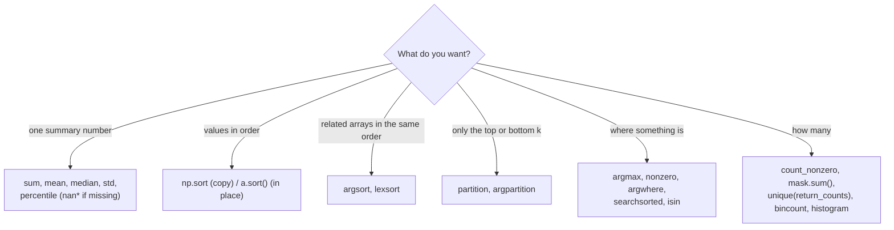

# Statistical, Sorting, Searching and Counting Functions: The Complete Guide

> 📚 **Before you start**
>
> - [What is a NumPy Array?](what-is-a-numpy-array.md), for axes and how reductions collapse them
> - [Creating, Indexing and Slicing Arrays](creating-indexing-and-slicing-arrays.md), for boolean masks and fancy indexing
> - [Array Manipulation and Arithmetic](array-manipulation-and-arithmetic.md), for `cumsum` and ufunc reductions

## Introduction

At the end of every IPL season the same questions get asked. Who scored the most runs? What was the average first-innings total, and the median? Which five bowlers had the best economy? On how many days did it rain? Which venues hosted more than seven matches? Where would a new score of 210 rank among all totals?

Every one of those questions falls into one of four families: **statistics** (summarise many numbers into a few), **sorting** (put values in order), **searching** (find where something is), and **counting** (how many of each). NumPy has fast, vectorised functions for all four, and together they answer most of the questions you will ever ask of a numeric dataset.

This lesson is a tour of those functions with clear examples. You will learn which function to reach for, how the `axis` argument shapes the result, how to deal with missing values (`nan`), the difference between sorting values and sorting **positions** (`argsort`), how to find the top k items without sorting everything, and how to count unique values in one call.

> 💡 **Key Insight**
>
> Many of these functions come in pairs: one returns **values** (`max`, `sort`) and one returns **positions** (`argmax`, `argsort`). Positions are more powerful, because you can use them to index **other** arrays: the name of the top scorer, the dates of the hottest days, the rows in sorted order.

---

## Core Explanation

### 1. Summary statistics

Our dataset: first-innings totals from ten matches, and the team that batted first.

```python
import numpy as np

totals = np.array([182, 165, 210, 145, 199, 176, 158, 223, 190, 171])
teams = np.array(["MI", "CSK", "RCB", "KKR", "MI", "SRH", "CSK", "RCB", "GT", "KKR"])

print("sum   :", totals.sum())
print("min   :", totals.min(), " max:", totals.max())
print("range :", np.ptp(totals))                   # peak to peak: max - min
print("mean  :", totals.mean())
print("median:", np.median(totals))
print("std   :", totals.std().round(2))
print("var   :", totals.var().round(2))
```

Output:

```
sum   : 1819
min   : 145  max: 223
range : 78
mean  : 181.9
median: 179.0
std   : 22.82
var   : 520.89
```

- The **mean** is the arithmetic average; the **median** is the middle value after sorting (the average of the two middle values when the count is even). The median is not pulled around by one extreme score, which makes it a better "typical value" for skewed data such as salaries.
- The **variance** is the average squared distance from the mean, and the **standard deviation** (`std`) is its square root, in the original units (runs).

Most of these exist both as functions (`np.mean(a)`) and as methods (`a.mean()`). `median` and `percentile` exist only as functions.

**Population or sample?** By default `std` and `var` divide by *n*, which is the **population** formula. When your data is a **sample** from a bigger population (almost always, in statistics), divide by *n − 1* by passing `ddof=1` ("delta degrees of freedom"). pandas uses `ddof=1` by default, so NumPy and pandas give different answers unless you set it:

```python
print(totals.std(ddof=0).round(3), totals.std(ddof=1).round(3))
```

Output:

```
22.823 24.058
```

The [Statistics Foundations](../../statistics-foundations/course.md) course explains why *n − 1* is used.

**Weighted averages** use `np.average` with `weights`. A batter's average across seasons with different numbers of innings:

```python
season_avg = np.array([38.5, 52.0, 29.4])
innings = np.array([14, 6, 16])
print(np.average(season_avg, weights=innings).round(2), season_avg.mean().round(2))
```

Output:

```
36.71 39.97
```

### 2. Percentiles and quantiles

A **percentile** is the value below which a given percentage of the data falls. The 50th percentile is the median; the 25th and 75th are the **quartiles**. `np.percentile` takes percentages (0 to 100) and `np.quantile` takes fractions (0 to 1):

```python
print(np.percentile(totals, [25, 50, 75]))
print(np.quantile(totals, [0.25, 0.5, 0.75]))
q1, q3 = np.percentile(totals, [25, 75])
print("IQR:", q3 - q1)
```

Output:

```
[166.5  179.   196.75]
[166.5  179.   196.75]
IQR: 30.25
```

The **interquartile range** (IQR, Q3 − Q1) measures the spread of the middle half and is the basis of the standard outlier rule (below Q1 − 1.5 × IQR or above Q3 + 1.5 × IQR). When a percentile falls between two data points, NumPy interpolates linearly by default. The `method` argument chooses another rule, such as `"lower"`, `"higher"`, `"nearest"` or `"midpoint"`:

```python
print(np.percentile(totals, 25, method="lower"), np.percentile(totals, 25, method="nearest"))
```

Output:

```
165 165
```

### 3. Statistics along an axis

Every statistic takes an `axis` argument. Runs per over for three batting teams (rows) across six powerplay overs (columns):

```python
powerplay = np.array([
    [8, 12, 6, 10, 15, 9],
    [5, 7, 11, 4, 9, 13],
    [14, 6, 8, 12, 7, 10],
])
print("per team  :", powerplay.sum(axis=1))
print("per over  :", powerplay.mean(axis=0).round(2))
print("best over :", powerplay.max(axis=1))
print("keepdims  :", powerplay.mean(axis=1, keepdims=True).shape)
```

Output:

```
per team  : [60 49 57]
per over  : [ 9.    8.33  8.33  8.67 10.33 10.67]
best over : [15 13 14]
keepdims  : (3, 1)
```

Remember the rule from the first lesson: the axis you name disappears.

### 4. Handling missing values: the `nan` functions

If even one value is `nan`, ordinary statistics return `nan`, because "a number plus unknown" is unknown. The `nan`-prefixed versions ignore missing values:

```python
rain_mm = np.array([12.0, np.nan, 0.0, 33.5, np.nan, 4.0])
print(rain_mm.mean(), rain_mm.max())
print(np.nanmean(rain_mm), np.nanmax(rain_mm), np.nansum(rain_mm))
print(np.nanmedian(rain_mm), np.nanstd(rain_mm).round(3))
print("missing:", np.isnan(rain_mm).sum())
```

Output:

```
nan nan
12.375 33.5 49.5
8.0 12.939
missing: 2
```

The full family: `nansum`, `nanprod`, `nanmean`, `nanmedian`, `nanstd`, `nanvar`, `nanmin`, `nanmax`, `nanargmin`, `nanargmax`, `nanpercentile`, `nanquantile`, `nancumsum` and `nancumprod`. Always count the missing values too; ignoring them silently can hide a data problem.

### 5. Relationships, differences and histograms

**Correlation** measures how strongly two variables move together, from −1 to 1. `np.corrcoef` returns a matrix of correlations between each pair of inputs; `np.cov` returns covariances.

```python
temp_c = np.array([24, 28, 31, 35, 38, 41])
chai_cups = np.array([310, 280, 250, 205, 180, 150])
cold_drinks = np.array([90, 120, 160, 210, 260, 300])
print(np.corrcoef(temp_c, chai_cups).round(3))
print(np.corrcoef([temp_c, chai_cups, cold_drinks]).round(2)[0])
```

Output:

```
[[ 1.    -0.998]
 [-0.998  1.   ]]
[ 1.   -1.    0.99]
```

As it gets hotter, chai sales fall and cold drink sales rise, both almost perfectly. (`round(2)` makes −0.998 print as −1.)

**Differences** between neighbours come from `np.diff`, and the inverse operation is `np.cumsum`:

```python
cumulative_runs = np.array([0, 12, 20, 29, 43, 50, 66])
print(np.diff(cumulative_runs))              # runs in each over
print(np.diff(cumulative_runs, n=2))         # change in runs per over
```

Output:

```
[12  8  9 14  7 16]
[-4  1  5 -7  9]
```

A **histogram** counts how many values fall into each range (bin). `np.histogram` returns the counts and the bin edges; `np.digitize` tells you which bin each value falls into:

```python
counts, edges = np.histogram(totals, bins=[140, 160, 180, 200, 230])
print(counts)
print(edges)
print(np.digitize(totals, [160, 180, 200]))    # 0: <160, 1: 160-179, 2: 180-199, 3: 200+
```

Output:

```
[2 3 3 2]
[140 160 180 200 230]
[2 1 3 0 2 1 0 3 2 1]
```

### 6. Sorting values

There are two ways to sort, and they differ in an important way:

- **`np.sort(a)`** returns a **sorted copy**; `a` is unchanged.
- **`a.sort()`** sorts **in place** and returns `None`.

```python
print(np.sort(totals))
print(np.sort(totals)[::-1])                 # descending: reverse the sorted copy
print(np.sort(totals, descending=True))      # NumPy 2.5+ can do it directly

copy = totals.copy()
result = copy.sort()
print(result, copy[:3])
```

Output:

```
[145 158 165 171 176 182 190 199 210 223]
[223 210 199 190 182 176 171 165 158 145]
[223 210 199 190 182 176 171 165 158 145]
None [145 158 165]
```

`descending=True` was added in NumPy 2.5. On older versions, reverse with `[::-1]`. Writing `totals = totals.sort()` is a classic bug that replaces your data with `None`.

On 2-D arrays, `sort` works along the **last axis** by default (each row sorted independently). Use `axis=0` to sort each column, or `axis=None` to flatten and sort everything:

```python
print(np.sort(powerplay))              # each team's overs sorted
print(np.sort(powerplay, axis=0))      # each over's values sorted across teams
```

Output:

```
[[ 6  8  9 10 12 15]
 [ 4  5  7  9 11 13]
 [ 6  7  8 10 12 14]]
[[ 5  6  6  4  7  9]
 [ 8  7  8 10  9 10]
 [14 12 11 12 15 13]]
```

Note that sorting each row independently breaks the link between columns: the first column is no longer "over 1". To reorder **whole rows** you need `argsort`.

Strings sort alphabetically (by Unicode code point, so capitals come before lowercase), and `nan` always goes to the end. The `kind` argument picks the algorithm (`"quicksort"`, the default; `"stable"`; `"mergesort"`; `"heapsort"`). A **stable** sort keeps equal elements in their original order, which matters when sorting by one key after another; pass `stable=True` to request one.

### 7. Sorting positions: `argsort` and `lexsort`

`np.argsort(a)` returns the **positions** that would sort `a`. Use those positions to sort other, related arrays in the same order:

```python
order = np.argsort(totals)
print(order)
print(totals[order])
print(teams[order])                       # teams in order of their totals

top3 = np.argsort(totals)[::-1][:3]
for t, s in zip(teams[top3], totals[top3]):
    print(t, s)
```

Output:

```
[3 6 1 9 5 0 8 4 2 7]
[145 158 165 171 176 182 190 199 210 223]
['KKR' 'CSK' 'CSK' 'KKR' 'SRH' 'MI' 'GT' 'MI' 'RCB' 'RCB']
RCB 223
RCB 210
MI 199
```

To reorder the rows of a table by one column, argsort that column and index the rows:

```python
table = np.column_stack([np.arange(1, 6), np.array([45, 102, 8, 67, 33])])   # player id, runs
print(table[np.argsort(table[:, 1])[::-1]])         # rows by runs, high to low
```

Output:

```
[[  2 102]
 [  4  67]
 [  1  45]
 [  5  33]
 [  3   8]]
```

**`np.lexsort`** sorts by several keys. It takes a sequence of keys and sorts by the **last** one first, using earlier keys to break ties (this backwards order trips everyone up):

```python
runs = np.array([45, 67, 45, 30, 67])
balls = np.array([30, 40, 25, 20, 45])
idx = np.lexsort((balls, -runs))    # primary: runs descending, tie-break: fewer balls first
print(idx)
print(runs[idx], balls[idx])
```

Output:

```
[1 4 2 0 3]
[67 67 45 45 30] [40 45 25 30 20]
```

Negating a numeric key (`-runs`) is the usual trick for "descending" inside `lexsort`.

### 8. Top k without sorting everything: `partition`

To find the 3 smallest values of a million, a full sort is wasted work. `np.partition(a, k)` rearranges the array so the element at position `k` is the one that would be there after sorting, everything before it is smaller or equal, and everything after is larger or equal. The two sides are **not** sorted internally.

```python
p = np.partition(totals, 3)
print(p[3])                                      # exactly the 4th-smallest total
print(np.sort(p[:3]))                            # the 3 smallest (sorted for display)
print((p[:3] <= p[3]).all(), (p[4:] >= p[3]).all())

best = np.argpartition(totals, -3)[-3:]          # positions of the 3 largest, any order
best = best[np.argsort(totals[best])[::-1]]      # sort just those 3, high to low
print(teams[best], totals[best])
```

Output:

```
171
[145 158 165]
True True
['RCB' 'RCB' 'MI'] [223 210 199]
```

`argpartition` does the same with positions. Both run in roughly linear time, which matters when you need the top 10 of ten million search results.

Never rely on the order **within** each side. NumPy picks the algorithm by array size and by what your CPU supports, so on a small array like this one the result may even come out fully sorted on one machine and jumbled on another. That is why the code above only prints what `partition` guarantees, and sorts the chosen few itself.

### 9. Searching

| Question | Function |
|---|---|
| Position of the largest / smallest value | `argmax`, `argmin` (`nanargmax`, `nanargmin`) |
| Positions where a condition is true | `np.nonzero(mask)`, `np.where(mask)`, `np.flatnonzero(mask)` |
| Positions as coordinate rows | `np.argwhere(mask)` |
| Values where a condition is true | `a[mask]` or `np.extract(mask, a)` |
| Where a value would go in a sorted array | `np.searchsorted(sorted_a, v)` |
| Is each value in a set? | `np.isin(a, values)` |

```python
print(totals.argmax(), teams[totals.argmax()])
print(powerplay.argmax(axis=1))                 # best over number (0-based) per team

hot = np.array([31, 36, 29, 41, 38, 27, 44])
print(np.nonzero(hot > 37))                     # a tuple, one array per axis
print(np.flatnonzero(hot > 37))
print(np.argwhere(powerplay >= 14))             # (row, col) pairs
```

Output:

```
7 RCB
[4 5 0]
(array([3, 4, 6]),)
[3 4 6]
[[0 4]
 [2 0]]
```

On a 2-D array, `argmax()` without an axis returns a position in the flattened array. `np.unravel_index` converts it back to a (row, column) pair:

```python
flat = powerplay.argmax()
print(flat, np.unravel_index(flat, powerplay.shape))
```

Output:

```
4 (np.int64(0), np.int64(4))
```

**`np.searchsorted`** uses binary search on an already sorted array to find where new values would be inserted to keep it sorted. It answers "how many are below this?" and "which band is this in?" very quickly:

```python
sorted_totals = np.sort(totals)
new = np.array([150, 200, 230])
pos = np.searchsorted(sorted_totals, new)
print(pos)                                          # how many existing totals are smaller
print(np.searchsorted([0, 250000, 500000, 1000000], 620000, side="right") - 1)   # tax slab index
```

Output:

```
[ 1  8 10]
2
```

So a total of 200 would beat 8 of the 10 recorded totals. `side="left"` (default) puts equal values before existing ones; `side="right"` after.

### 10. Counting

```python
print(np.count_nonzero(totals > 180))            # how many matches over 180
print((totals > 180).sum(), (totals > 180).mean())   # count and fraction

values, counts = np.unique(teams, return_counts=True)
print(values)
print(counts)
print("batted first most often:", values[counts == counts.max()])   # a 4-way tie
```

Output:

```
5
5 0.5
['CSK' 'GT' 'KKR' 'MI' 'RCB' 'SRH']
[2 1 2 2 2 1]
batted first most often: ['CSK' 'KKR' 'MI' 'RCB']
```

`np.unique` returns the sorted distinct values. Optional extras:

- `return_counts=True`: how often each appears.
- `return_index=True`: the first position of each.
- `return_inverse=True`: for each original element, the position of its value in the unique array. This **encodes** labels as integers, the basis of categorical data.

```python
codes_values, codes = np.unique(teams, return_inverse=True)
print(codes)
print(codes_values[codes][:4])                  # decode back
print(np.unique_counts(teams).counts)           # NumPy 2 named-result version
```

Output:

```
[3 0 4 2 3 5 0 4 1 2]
['MI' 'CSK' 'RCB' 'KKR']
[2 1 2 2 2 1]
```

NumPy 2 added `np.unique_values`, `np.unique_counts`, `np.unique_inverse` and `np.unique_all`, which return named results (from the Python array API standard).

For **small non-negative integers**, `np.bincount` counts every value from 0 to the maximum in one fast pass, and with `weights` it sums another array per group:

```python
match_day = np.array([0, 1, 1, 2, 4, 4, 4])          # day-of-week codes (Mon = 0)
print(np.bincount(match_day))                         # matches per weekday
print(np.bincount(match_day, minlength=7))
spend = np.array([200, 150, 300, 120, 500, 250, 80])
print(np.bincount(match_day, weights=spend, minlength=7))   # spend per weekday
```

Output:

```
[1 2 1 0 3]
[1 2 1 0 3 0 0]
[200. 450. 120.   0. 830.   0.   0.]
```

That last line is a "group by and sum" in one call, the same operation pandas' `groupby` performs on a much larger scale.

### 11. Choosing the right function



---

## Try It Yourself

1. Daily AQI readings for a fortnight are `[156, 201, 178, np.nan, 245, 310, 289, 190, np.nan, 132, 168, 222, 275, 199]`. Find the mean, median and number of "poor" days (AQI above 200), ignoring missing readings.
2. Given `names = np.array(["Asha", "Ravi", "Meera", "Kabir", "Zoya"])` and `marks = np.array([78, 91, 85, 91, 66])`, print the names ranked by marks (highest first), breaking ties alphabetically.
3. Find the two largest values in `np.array([5, 17, 3, 22, 9, 14])` using `argpartition`, and print them in descending order.
4. A tea stall records the size of each order: `sizes = np.array(["S", "M", "M", "L", "S", "M", "L", "M"])`. Which size is most popular, and what fraction of orders is it?

<details>
<summary>Show answers</summary>

```python
aqi = np.array([156, 201, 178, np.nan, 245, 310, 289, 190, np.nan, 132, 168, 222, 275, 199])
print(np.nanmean(aqi).round(1), np.nanmedian(aqi), (aqi > 200).sum())

names = np.array(["Asha", "Ravi", "Meera", "Kabir", "Zoya"])
marks = np.array([78, 91, 85, 91, 66])
print(names[np.lexsort((names, -marks))])

v = np.array([5, 17, 3, 22, 9, 14])
two = v[np.argpartition(v, -2)[-2:]]
print(np.sort(two)[::-1])

sizes = np.array(["S", "M", "M", "L", "S", "M", "L", "M"])
vals, cnt = np.unique(sizes, return_counts=True)
print(vals[cnt.argmax()], cnt.max() / sizes.size)
```

Output:

```
213.8 200.0 6
['Kabir' 'Ravi' 'Meera' 'Asha' 'Zoya']
[22 17]
M 0.5
```

**1.** `nan > 200` is `False`, so missing days are not counted as poor, which is what we want here. **2.** `lexsort` sorts by the last key (`-marks`) first, then by name to break the tie between Kabir and Ravi.

</details>

---

## Real-World Examples

### Example 1: Leaderboards and recommendations

Search engines and recommenders score millions of items and show the top 10. They use partial selection (the idea behind `argpartition`), not a full sort, because only the top few positions matter.

### Example 2: Exam result processing

A results portal computes mean, median and percentiles of marks per subject (`axis=0`), ranks students with `argsort`, and assigns grade bands with `np.digitize` against cut-off marks.

### Example 3: Sensor monitoring

A factory logs temperature from hundreds of sensors with occasional dropouts. Engineers use `nanmean`, `nanpercentile(…, 99)` and `argwhere(readings > limit)` to summarise each shift and locate which sensor overheated and when.

---

## Common Misconceptions

### Misconception 1: "`a.sort()` returns the sorted array"

It sorts in place and returns `None`. Use `np.sort(a)` for a sorted copy.

### Misconception 2: "`std` gives the sample standard deviation"

NumPy's default is the population formula (`ddof=0`). Pass `ddof=1` for the sample version, which pandas uses by default.

### Misconception 3: "`np.mean` skips missing values"

One `nan` makes the result `nan`. Use `np.nanmean` and friends, and count the missing values explicitly.

### Misconception 4: "`lexsort` sorts by the first key"

It sorts by the **last** key in the sequence, using earlier keys as tie-breakers.

### Misconception 5: "`partition` sorts the array"

It only guarantees the k-th element is in place and the two sides are split correctly. Each side can be in any order.

---

## Interview Relevance

- *"Mean vs median: when would you prefer the median?"* Skewed data or outliers (incomes, house prices, delivery times).
- *"How do you get the indices of the top k elements efficiently?"* `np.argpartition(a, -k)[-k:]`, then sort those k if order matters. O(n) instead of O(n log n).
- *"How do you sort one array by the values of another?"* `b[np.argsort(a)]`.
- *"Difference between `np.where(cond)` and `np.where(cond, x, y)`?"* Positions vs element-wise choice.
- *"How do you count occurrences of each value?"* `np.unique(..., return_counts=True)` or `np.bincount` for small non-negative integers.
- *"What is ddof?"* The divisor is n − ddof; `ddof=1` gives the unbiased sample variance.

---

## Key Takeaways

- **Statistics** (`sum`, `mean`, `median`, `std`, `var`, `percentile`, `average`) all take `axis` and `keepdims`; use the **`nan*` versions** when data has gaps, and **`ddof=1`** for sample statistics.
- **`np.sort` copies, `a.sort()` sorts in place**; NumPy 2.5 adds `descending=True`.
- **`argsort` and `lexsort` return positions**, so you can reorder related arrays and whole table rows.
- **`partition`/`argpartition`** find the top or bottom k in linear time.
- **Search** with `argmax`, `nonzero`, `argwhere`, `searchsorted` and `isin`.
- **Count** with `count_nonzero`, `mask.sum()`, `unique(return_counts=True)`, `bincount` and `histogram`.

---

**Up next:** [Binary and String Functions](binary-and-string-functions.md)
