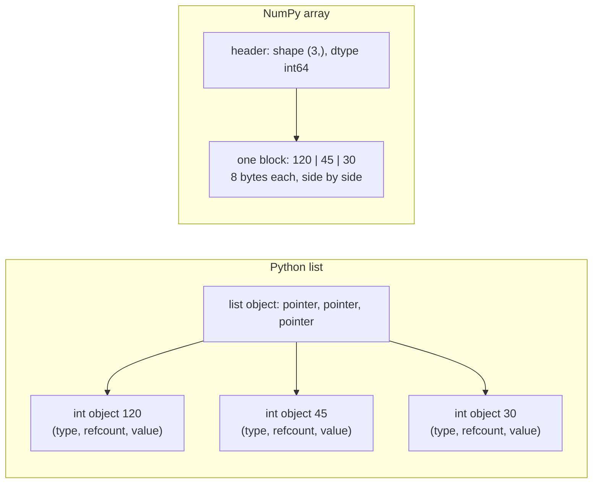
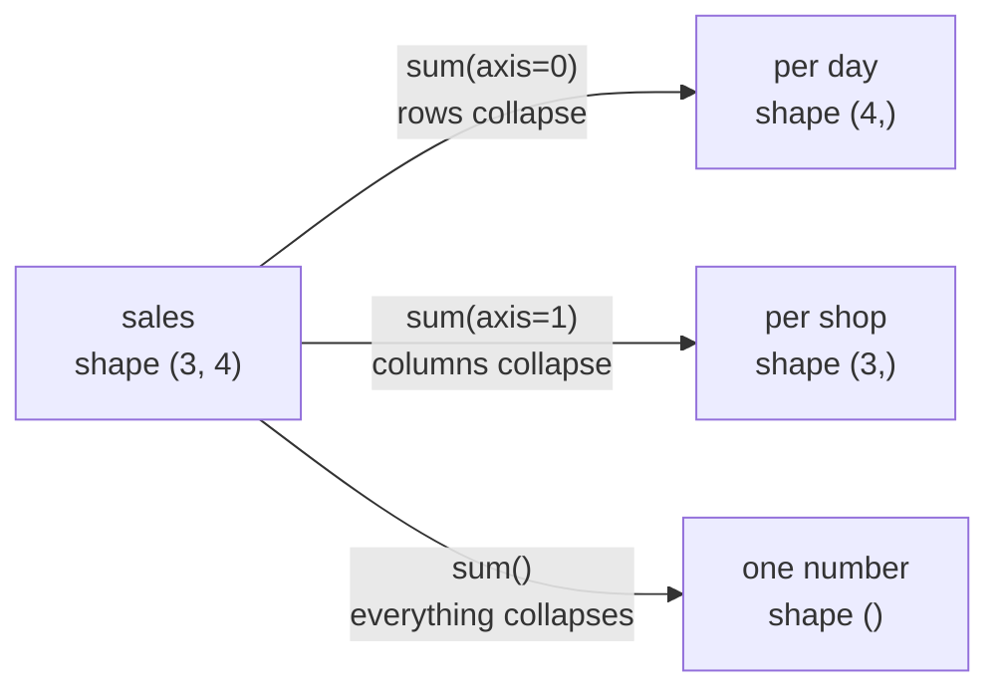

# What is a NumPy Array? The Complete Guide

> 📚 **Before you start**
>
> This is the first technical lesson of the course. You need comfortable basic Python, especially lists and loops:
> - [Python Fundamentals › Strings and Data Structures](../../python-fundamentals/course.md#m5), for lists, tuples and slicing
> - [Python Fundamentals › Control Flow](../../python-fundamentals/course.md#m4), for `for` loops
> - [How This Course Works](../01-start-here/how-this-course-works.md), for the versions and setup

## Introduction

Imagine you run an online chai and snacks shop, and the government changes GST from 5% to 12% on some items. You have the base prices of 200,000 products in a Python list and you need the new prices. In plain Python you write a loop, or a list comprehension, that visits every number one at a time. It works, but it is slow, and it gets slower as the list grows. Now imagine you need to do this for every price, every day, for five years of history. Plain Python lists were never designed for that kind of work.

NumPy (short for **Numerical Python**) was designed for exactly that kind of work. Its central object, the **array**, stores a block of numbers of one type side by side in memory and lets you apply an operation to all of them in a single expression: `prices * 1.12`. Under the hood that one line runs a tight loop written in C, which is often 10 to 100 times faster than the equivalent Python loop.

This article explains what a NumPy array really is, how it differs from a Python list, what "dimensions" and "axes" mean, why vectorised code is so fast, and the small set of attributes you will check on every array you ever work with. By the end you will be able to create arrays, reason about their shape, and replace simple loops with whole-array expressions.

> 💡 **Key Insight**
>
> A NumPy array is **one block of memory holding values of one type**, plus a small description of how to read that block as a grid (its `shape` and `dtype`). Because every value has the same type and size, NumPy can run one fast compiled loop over the whole block instead of making Python inspect each value separately.

---

## Core Explanation

### 1. Your first array

Install NumPy (`python -m pip install numpy`) and import it under its standard name, `np`. The function `np.array()` turns a Python list (or tuple) into an array.

```python
import numpy as np

prices = np.array([120, 45, 30, 250, 15])   # rupees
print(prices)
print(type(prices))
```

Output:

```
[120  45  30 250  15]
<class 'numpy.ndarray'>
```

Two things to notice:

- The printed form has **no commas**. That is how you tell an array from a list at a glance.
- The type is `numpy.ndarray`, short for **N-dimensional array**. `np.array()` is just a convenient function that builds one; you will almost never call `np.ndarray(...)` directly.

Now apply the new GST rate to every price at once:

```python
with_gst = prices * 1.12
print(with_gst)
print(with_gst.dtype)          # the result is float, the input was int
```

Output:

```
[134.4  50.4  33.6 280.   16.8]
float64
```

No loop, no list comprehension. `prices * 1.12` multiplies **every element** by 1.12 and returns a new array. This style is called **vectorised** code: you describe the operation for the whole array and NumPy handles the looping.

Compare that with a Python list, where `*` means something completely different:

```python
price_list = [120, 45, 30, 250, 15]
print(price_list * 2)                         # repeats the list
print([p * 1.12 for p in price_list][:2])     # you have to loop yourself
print(prices * 2)                             # the array doubles each value
```

Output:

```
[120, 45, 30, 250, 15, 120, 45, 30, 250, 15]
[134.4, 50.400000000000006]
[240  90  60 500  30]
```

(The `50.400000000000006` is ordinary floating-point rounding, which affects arrays too. NumPy just prints fewer digits by default.)

### 2. Why lists are slow for numbers

A Python list does not store numbers. It stores **pointers** (memory addresses) to separate Python objects, and each object carries its own type information, a reference count and the value itself. The objects can live anywhere in memory and can be of different types: a list can hold an `int`, a `str` and another list side by side.

A NumPy array stores the raw values themselves, packed one after another in one contiguous block, all of the same type.



That layout difference has three consequences:

| | Python list | NumPy array |
|---|---|---|
| **Element types** | Anything, mixed freely | One type for every element (the `dtype`) |
| **Memory** | Pointer plus a full object per value | Just the raw bytes of each value |
| **Speed of maths** | Python checks each element's type at every step | One compiled C loop runs over the block |
| **Size** | Grows and shrinks cheaply (`append`) | Fixed size; "growing" makes a new array |
| **`+` and `*`** | Concatenate and repeat | Element-wise arithmetic |

You can see the memory difference directly. `sys.getsizeof` reports the bytes used by a Python object, and an array's `nbytes` attribute reports the bytes used by its data:

```python
import sys

n = 1_000
as_list = list(range(n))
as_array = np.arange(n)            # like range(), but returns an array

list_bytes = sys.getsizeof(as_list) + sum(sys.getsizeof(x) for x in as_list)
print("list :", list_bytes, "bytes")
print("array:", as_array.nbytes, "bytes of data")
```

Output:

```
list : 36056 bytes
array: 8000 bytes of data
```

Each `int` in the array takes exactly 8 bytes (64 bits). In the list, each number costs a pointer plus a whole Python object. (The exact list figure depends on your Python version; the gap does not.)

### 3. Why vectorised code is fast

When you write a Python loop such as `[p * 1.12 for p in prices]`, the interpreter does a lot of work for each element: fetch the object, check its type, find the right multiplication routine, create a new float object, store a pointer to it. When you write `prices * 1.12`, NumPy checks the types **once**, then hands the whole memory block to a compiled loop that multiplies raw numbers, often using CPU instructions that process several numbers at once (called **SIMD**, single instruction multiple data).

You can measure the difference on your own machine. Timings vary from computer to computer, so this block is not part of the tested output:

```python
# not-run: timings differ on every machine
import time
big = np.random.default_rng(0).uniform(10, 500, size=1_000_000)
big_list = big.tolist()

t0 = time.perf_counter(); [p * 1.12 for p in big_list]; t1 = time.perf_counter()
big * 1.12; t2 = time.perf_counter()
print(f"list comprehension: {t1 - t0:.4f} s")
print(f"numpy             : {t2 - t1:.4f} s")
```

Example output:

```
list comprehension: 0.0412 s
numpy             : 0.0011 s
```

A speed-up of 20 to 50 times on simple arithmetic is typical, and it grows for heavier operations such as square roots or exponentials.

> 💡 **Key Insight**
>
> "Vectorise" means: **move the loop out of Python and into NumPy**. Whenever you are about to write a `for` loop over numbers, first ask whether there is a whole-array expression that does the same job.

### 4. Dimensions, shape and axes

An array can have any number of **dimensions** (also called **axes**). The number of dimensions is `ndim`; the length along each one is the `shape`, a tuple.

| Dimensions | Common name | Example | Shape |
|---|---|---|---|
| 0 | scalar | one temperature reading | `()` |
| 1 | vector | a week of daily chai sales | `(7,)` |
| 2 | matrix | sales for 3 shops over 7 days | `(3, 7)` |
| 3 | 3-D array (tensor) | a colour photo: height × width × 3 colours | `(480, 640, 3)` |

You create a 2-D array from a list of lists, where each inner list is a row:

```python
# cups of chai sold: 3 shops (rows) x 4 days (columns)
sales = np.array([
    [52, 61, 47, 70],
    [33, 29, 41, 38],
    [80, 85, 79, 92],
])
print(sales)
print("ndim :", sales.ndim)
print("shape:", sales.shape)
print("size :", sales.size)
```

Output:

```
[[52 61 47 70]
 [33 29 41 38]
 [80 85 79 92]]
ndim : 2
shape: (3, 4)
size : 12
```

`size` is the total number of elements: the product of the shape, here 3 × 4 = 12.

**Axes are numbered from the outside in.** For a 2-D array, **axis 0 runs down the rows** and **axis 1 runs across the columns**. This matters because many functions take an `axis` argument that says which direction to work along:

```python
print("total cups        :", sales.sum())
print("per day  (axis=0) :", sales.sum(axis=0))   # collapse the rows -> one value per column
print("per shop (axis=1) :", sales.sum(axis=1))   # collapse the columns -> one value per row
```

Output:

```
total cups        : 707
per day  (axis=0) : [165 175 167 200]
per shop (axis=1) : [230 141 336]
```

A reliable way to remember it: **the axis you name is the axis that disappears**. `sales` has shape `(3, 4)`; summing over axis 0 leaves shape `(4,)`, and summing over axis 1 leaves shape `(3,)`.



A 3-D array is a stack of 2-D arrays. With two weeks of data you would have shape `(2, 3, 4)`: 2 weeks, 3 shops, 4 days.

```python
two_weeks = np.array([sales, sales + 5])
print(two_weeks.shape)
print(two_weeks.ndim)
print(two_weeks.sum(axis=0))   # add week 1 and week 2 together
```

Output:

```
(2, 3, 4)
3
[[109 127  99 145]
 [ 71  63  87  81]
 [165 175 163 189]]
```

### 5. The four attributes you will check constantly

Every array carries a small header describing its data. These attributes cost nothing to read and answer most "why did that happen?" questions:

```python
print("shape   :", sales.shape)     # length along each axis
print("ndim    :", sales.ndim)      # number of axes
print("dtype   :", sales.dtype)     # type of every element
print("size    :", sales.size)      # total elements
print("itemsize:", sales.itemsize)  # bytes per element
print("nbytes  :", sales.nbytes)    # size * itemsize
```

Output:

```
shape   : (3, 4)
ndim    : 2
dtype   : int64
size    : 12
itemsize: 8
nbytes  : 96
```

`dtype` (data type) is the most important one. `int64` means a 64-bit signed integer. The [Data Types and Array Attributes](data-types-and-array-attributes.md) lesson covers every dtype in detail. (On Windows with NumPy 2, the default integer is also `int64`; in NumPy 1.x it was `int32` there, which caused many cross-platform surprises.)

### 6. One type for every element: upcasting

Because all elements share one dtype, NumPy has to pick a type that can hold everything you give it. It picks the "widest" type needed. This is called **upcasting**.

```python
print(np.array([1, 2, 3]).dtype)          # all ints
print(np.array([1, 2, 3.5]).dtype)        # one float makes everything float
print(np.array([1, 2.5, True]).dtype)     # bools become numbers
print(np.array([1, 2.5, "3"]))            # one string makes everything text
print(np.array([1, 2.5, "3"]).dtype)
```

Output:

```
int64
float64
float64
['1' '2.5' '3']
<U32
```

The last one is a classic trap: one stray string in your data and the whole array becomes text (`<U32` means Unicode strings up to 32 characters), so arithmetic fails. When numbers arrive as strings, convert them deliberately with `.astype(float)`, covered in the dtypes lesson.

If you really put unrelated Python objects in one array, NumPy falls back to `dtype=object`, which stores pointers like a list and loses the speed advantage:

```python
mixed = np.array([1, "chai", [2, 3]], dtype=object)
print(mixed.dtype, mixed.shape)
```

Output:

```
object (3,)
```

Ragged nested lists (rows of different lengths) are **not** turned into object arrays automatically any more; NumPy raises an error unless you ask for `dtype=object`:

```python
try:
    np.array([[1, 2, 3], [4, 5]])
except ValueError as err:
    print("ValueError:", str(err)[:60], "...")
```

Output:

```
ValueError: setting an array element with a sequence. The requested arra ...
```

### 7. Element-wise operations and universal functions

Arithmetic operators (`+ - * / // % **`) and comparisons (`< > == !=`) work **element by element** between two arrays of the same shape, or between an array and a single number:

```python
morning = np.array([30, 25, 40, 35])
evening = np.array([45, 50, 38, 60])

print(morning + evening)       # total per day
print(evening - morning)       # difference per day
print(evening / morning)       # ratio per day (always float)
print(evening > morning)       # comparison gives a boolean array
```

Output:

```
[75 75 78 95]
[15 25 -2 25]
[1.5        2.         0.95       1.71428571]
[ True  True False  True]
```

Behind every one of these operators is a **universal function**, or **ufunc**: a NumPy function that works element-wise on arrays of any shape. `+` calls `np.add`, `>` calls `np.greater`, and there are ufuncs for maths that has no operator:

```python
print(np.add(morning, evening))
print(np.sqrt(np.array([4, 9, 16])))
print(np.round(np.log10(np.array([10, 100, 1000, 5000])), 3))
print(np.maximum(morning, evening))      # element-wise max of two arrays
```

Output:

```
[75 75 78 95]
[2. 3. 4.]
[1.    2.    3.    3.699]
[45 50 40 60]
```

Use `np.sqrt`, `np.log` and friends on arrays, never `math.sqrt` (from the standard library), which only accepts one number at a time.

Combining a comparison with indexing gives you filtering in one line. This is called a **boolean mask**, and the next lesson covers it fully:

```python
print(evening[evening > 45])     # only the busy evenings
print((evening > 45).sum())      # how many busy evenings (True counts as 1)
```

Output:

```
[50 60]
2
```

### 8. Converting back and forth

`np.array()` copies Python data into a new array. `np.asarray()` does the same but **skips the copy** if the input is already a suitable array. `.tolist()` converts back to ordinary Python lists and numbers, which you need when sending data to code that expects plain Python (for example `json.dumps`).

```python
a = np.array([1, 2, 3])
b = np.asarray(a)          # no copy made
c = np.array(a)            # a fresh copy
print(b is a, c is a)
print(a.tolist(), type(a.tolist()[0]))
```

Output:

```
True False
[1, 2, 3] <class 'int'>
```

### 9. A NumPy 2 detail: how scalars print

When you pull a single element out of an array, you get a **NumPy scalar** such as `np.int64`, not a Python `int`. NumPy 2 shows this in its `repr` (what the REPL and lists display), while `print` still shows the plain value:

```python
x = sales[0, 0]
print(x)               # str() form
print(repr(x))         # repr() form, what a notebook cell shows
print([x, sales.max()])
print(type(x))
```

Output:

```
52
np.int64(52)
[np.int64(52), np.int64(92)]
<class 'numpy.int64'>
```

If you see `np.float64(3.5)` in a notebook, nothing is wrong; it is NumPy 2 being explicit. Call `.item()` or `int()`/`float()` when you need a real Python number.

---

## Try It Yourself

1. Create an array of the five daily temperatures `[31.5, 33.0, 29.8, 35.2, 34.1]` (°C). Convert all of them to Fahrenheit (F = C × 9/5 + 32) in one expression, rounded to one decimal.
2. Build the 2 × 3 array `[[10, 20, 30], [40, 50, 60]]`. Predict, then check, the shape of `.sum(axis=0)` and `.sum(axis=1)`, and their values.
3. What is the dtype of `np.array([1, 2, 3]) / 1`? And of `np.array([1, 2, 3]) // 1`? Explain the difference.
4. Given cricket scores `runs = np.array([45, 102, 8, 67, 0, 120, 33])`, count the centuries and find the average of the innings that were at least 30, without a loop.

<details>
<summary>Show answers</summary>

```python
temps_c = np.array([31.5, 33.0, 29.8, 35.2, 34.1])
print((temps_c * 9 / 5 + 32).round(1))

grid = np.array([[10, 20, 30], [40, 50, 60]])
print(grid.sum(axis=0), grid.sum(axis=0).shape)
print(grid.sum(axis=1), grid.sum(axis=1).shape)

print((np.array([1, 2, 3]) / 1).dtype, (np.array([1, 2, 3]) // 1).dtype)

runs = np.array([45, 102, 8, 67, 0, 120, 33])
print("centuries:", (runs >= 100).sum())
print("average of 30+ innings:", runs[runs >= 30].mean())
```

Output:

```
[88.7 91.4 85.6 95.4 93.4]
[50 70 90] (3,)
[ 60 150] (2,)
float64 int64
centuries: 2
average of 30+ innings: 73.4
```

**3.** True division `/` always produces floats, even when the result is a whole number. Floor division `//` between integers stays integer.

</details>

---

## Real-World Examples

### Example 1: Every machine learning library speaks NumPy

When you call `model.fit(X, y)` in scikit-learn, `X` is converted to a 2-D NumPy array of shape `(n_samples, n_features)`. Rows are examples (say, one row per house) and columns are features (area, bedrooms, distance to the station). Knowing that axis 0 is "samples" and axis 1 is "features" is the foundation for everything in machine learning.

### Example 2: Images and audio are arrays

A photo from your phone, once loaded, is an array of shape `(height, width, 3)` with one number per red, green and blue channel. A 10-second audio clip at 44,100 samples per second is a 1-D array of 441,000 numbers. Brightening a photo is `image * 1.2`; lowering the volume is `audio * 0.5`. The lab at the end of this module edits an image this way.

### Example 3: pandas is NumPy with labels

Each column of a pandas DataFrame stores its values in an array (a NumPy array for numbers, and a similar specialised array for text and dates). When you compute `df["price"] * 1.12`, the same vectorised machinery you just learned does the work.

---

## Common Misconceptions

### Misconception 1: "An array is just a faster list"

It is a different kind of object. Arrays have a fixed type and size, `+` means addition rather than concatenation, and appending is expensive because it creates a new array. Use lists for collecting things of varying type and length; use arrays for numbers you compute on.

### Misconception 2: "axis=0 means 'per row'"

For a 2-D array, `axis=0` collapses the rows and gives you one result **per column**. Remember: the axis you name disappears.

### Misconception 3: "NumPy is fast whatever I write"

NumPy is fast only when the loop runs inside NumPy. Looping over an array with a Python `for` loop and doing arithmetic on each element is often **slower** than doing the same with a list, because each element is converted to a NumPy scalar object. Vectorise first.

### Misconception 4: "np.array guesses the best type for messy data"

It picks the narrowest type that fits **all** values, which means one string turns everything into text. Always check `.dtype` after loading data.

---

## Interview Relevance

Questions on this topic are common in data analyst, data scientist and ML engineer screens:

- *"Why is NumPy faster than Python lists?"* A strong answer mentions contiguous memory of one fixed type, no per-element type checks, compiled C loops and SIMD instructions, and lower memory use.
- *"What does vectorisation mean?"* Expressing an operation on whole arrays so the loop runs in compiled code instead of the Python interpreter.
- *"What is the difference between shape, size and ndim?"* Tuple of lengths per axis; total element count; number of axes.
- *"What does `axis=0` mean in `arr.sum(axis=0)`?"* Reduce along the first axis: for a 2-D array, one result per column.
- *"What happens when you put an int, a float and a string in one array?"* Upcasting to the common type, here a Unicode string dtype.

---

## Key Takeaways

- **A NumPy array** (`ndarray`) is a fixed-size block of values of **one dtype**, plus a `shape` describing how to read it as a grid.
- **Vectorised expressions** like `prices * 1.12` run one compiled loop over the whole block, usually 10 to 100 times faster than a Python loop.
- **Shape, ndim, dtype and size** are the first things to check on any array.
- **Axes are numbered from the outside**: for 2-D data, axis 0 is down the rows and axis 1 is across the columns. The axis you reduce over disappears.
- **Arithmetic and comparisons are element-wise** and are backed by **ufuncs** such as `np.add` and `np.sqrt`.
- **Mixed inputs are upcast** to one common type, so always check `dtype` after creating an array from messy data.

---

**Up next:** [Creating, Indexing and Slicing Arrays](creating-indexing-and-slicing-arrays.md)
