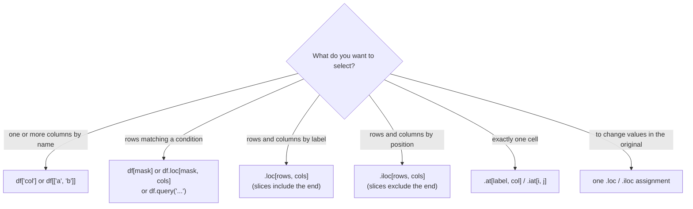

# Selecting, Sorting and Indexing Data: The Complete Guide

> 📚 **Before you start**
>
> - [Series, DataFrames (and the Retired Panel)](series-dataframes-and-the-retired-panel.md), for the index, columns, dtypes and Copy-on-Write
> - [Creating, Indexing and Slicing Arrays](../02-numpy-essentials/creating-indexing-and-slicing-arrays.md), for slices and boolean masks, which pandas reuses
> - [Statistical, Sorting, Searching and Counting Functions](../02-numpy-essentials/statistical-sorting-searching-and-counting-functions.md), for sorting and `argsort`

## Introduction

Picture a cricket selector with a spreadsheet of every player in the league. Within minutes she asks: show me only the bowlers; show me players from Mumbai with a strike rate above 140; who are the top five run scorers; sort by wickets, then by economy; what are Virat's runs; give me everyone between the ages of 22 and 26. Every one of those is a **selection** (pick some rows and columns) or a **sort** (put rows in order), and they make up most of the pandas code you will ever write.

pandas gives you several ways to select, and they are easy to mix up: square brackets, `.loc`, `.iloc`, `.at`, `.iat`, `query`, `isin`, `where`. Each has a clear job, and once you see the rule behind them (labels versus positions) they stop being confusing. The **index** (the row labels) ties it all together: you can choose which column becomes the index, use several columns at once (a MultiIndex), and sort by it.

By the end of this article you will be able to select any rows and columns by label, position or condition, filter with readable expressions, sort by one or many columns, find the top n rows, rank values, and set, reset and use indexes, including multi-level ones.

> 💡 **Key Insight**
>
> **`.loc` uses labels, `.iloc` uses positions.** Both take `[rows, columns]`. Learn those two and use plain square brackets only for picking columns (`df["col"]`, `df[["a", "b"]]`) and for boolean filters (`df[mask]`). Every other selection reads more clearly with `.loc`.

---

## Core Explanation

### 1. The dataset

```python
import numpy as np
import pandas as pd

players = pd.DataFrame({
    "player": ["Virat", "Rohit", "Bumrah", "Jadeja", "Gill", "Siraj", "Pant", "Ashwin"],
    "team":   ["RCB", "MI", "MI", "CSK", "GT", "RCB", "DC", "RR"],
    "role":   ["bat", "bat", "bowl", "all", "bat", "bowl", "wk", "all"],
    "age":    [37, 39, 32, 37, 27, 32, 29, 40],
    "runs":   [741, 417, 12, 267, 890, 5, 446, 98],
    "wickets": [0, 0, 20, 8, 0, 15, 0, 9],
    "strike_rate": [154.7, 150.0, 85.7, 140.5, 155.9, 71.4, 158.2, 120.9],
})
print(players)
```

Output:

```
   player team  role  age  runs  wickets  strike_rate
0   Virat  RCB   bat   37   741        0        154.7
1   Rohit   MI   bat   39   417        0        150.0
2  Bumrah   MI  bowl   32    12       20         85.7
3  Jadeja  CSK   all   37   267        8        140.5
4    Gill   GT   bat   27   890        0        155.9
5   Siraj  RCB  bowl   32     5       15         71.4
6    Pant   DC    wk   29   446        0        158.2
7  Ashwin   RR   all   40    98        9        120.9
```

(The numbers are made up for practice.)

### 2. Selecting columns

```python
print(players["runs"].head(3))                    # one column -> Series
print(players[["player", "runs"]].head(3))        # list of columns -> DataFrame
print(players.select_dtypes("number").columns.tolist())
print(players.filter(like="ket").columns.tolist())   # columns whose name contains "ket"
```

Output:

```
0    741
1    417
2     12
Name: runs, dtype: int64
   player  runs
0   Virat   741
1   Rohit   417
2  Bumrah    12
['age', 'runs', 'wickets', 'strike_rate']
['wickets']
```

You can also write `players.runs` (attribute access), which is handy in a notebook, but it fails for names with spaces, names that clash with methods (a column called `count` or `sum`), and it cannot create new columns. Use brackets in code you keep.

`select_dtypes` picks columns by type: `"number"`, `"str"` (or `"string"`), `"bool"`, `"datetime"`, `"category"`, and you can `exclude=` types too. `filter` picks by name with `like=` (substring), `regex=` or `items=` (an exact list).

### 3. Two kinds of label: what square brackets do

Square brackets on a DataFrame have three meanings, decided by what you put inside:

| You write | pandas returns |
|---|---|
| `df["col"]` | the column `col` (Series) |
| `df[["a", "b"]]` | those columns (DataFrame) |
| `df[boolean_series]` | the rows where the mask is `True` |
| `df[2:5]` | rows by **position** 2 to 4 (a row slice) |

The last form, slicing rows with plain brackets, is a historical shortcut. It is legal, but because brackets otherwise mean columns, it confuses readers. Prefer `.iloc[2:5]`.

### 4. `.loc`: select by label

`.loc[rows, columns]` takes **labels**. Each part can be a single label, a list of labels, a slice of labels, a boolean mask or a function. Let's make the player names the index so the labels are meaningful:

```python
p = players.set_index("player")

print(p.loc["Gill"])                             # one row -> Series
print(p.loc["Gill", "runs"])                     # one cell
print(p.loc[["Virat", "Pant"], ["team", "runs"]])
```

Output:

```
team              GT
role             bat
age               27
runs             890
wickets            0
strike_rate    155.9
Name: Gill, dtype: object
890
       team  runs
player           
Virat   RCB   741
Pant     DC   446
```

The single row came back as a Series with dtype `object`, because it mixes text and numbers.

**Label slices include both ends.** This is the biggest difference from Python and NumPy slicing, and it is deliberate: with labels, "the label after the end" is not obvious.

```python
print(p.loc["Bumrah":"Gill", "runs":"wickets"])
print(p.loc[:"Rohit", ["age"]])
```

Output:

```
        runs  wickets
player               
Bumrah    12       20
Jadeja   267        8
Gill     890        0
        age
player     
Virat    37
Rohit    39
```

Boolean masks and functions also work inside `.loc`, and are the cleanest way to filter rows and pick columns in one step:

```python
print(p.loc[p["runs"] > 400, ["team", "runs"]])
print(p.loc[lambda d: d["wickets"] >= 10, "wickets"])   # a function receives the frame
```

Output:

```
       team  runs
player           
Virat   RCB   741
Rohit    MI   417
Gill     GT   890
Pant     DC   446
player
Bumrah    20
Siraj     15
Name: wickets, dtype: int64
```

The function form (a **callable**) is useful in method chains, where the intermediate DataFrame has no variable name.

### 5. `.iloc`: select by position

`.iloc[rows, columns]` takes **integer positions**, starting at 0. Slices **exclude** the end, exactly like Python and NumPy.

```python
print(p.iloc[0])                     # first row
print(p.iloc[0, 3])                  # first row, fourth column
print(p.iloc[-2:, :2])               # last two rows, first two columns
print(p.iloc[[1, 4], [0, 3]])
```

Output:

```
team             RCB
role             bat
age               37
runs             741
wickets            0
strike_rate    154.7
Name: Virat, dtype: object
741
       team role
player          
Pant     DC   wk
Ashwin   RR  all
       team  runs
player           
Rohit    MI   417
Gill     GT   890
```

`.iloc` also accepts a boolean mask of the same length, for example `p.iloc[(p["age"] > 35).to_numpy()]`, but conditions read more naturally with `.loc`, which is where the rest of this lesson uses them.

### 6. `.at` and `.iat`: one cell, fast

When you need exactly one value, `.at[row_label, col_label]` and `.iat[row_pos, col_pos]` are faster than `.loc`/`.iloc` because they skip all the general-purpose machinery:

```python
print(p.at["Siraj", "wickets"], p.iat[5, 4])
```

Output:

```
15 15
```

### 7. Filtering rows with conditions

A comparison on a column gives a boolean Series; indexing with it keeps the `True` rows. Combine conditions with `&`, `|` and `~`, with parentheses around each, just as in NumPy:

```python
mumbai_or_rcb = players[(players["team"] == "MI") | (players["team"] == "RCB")]
print(mumbai_or_rcb[["player", "team"]])

fast_young = players[(players["strike_rate"] > 150) & (players["age"] < 35)]
print(fast_young["player"].tolist())

not_batters = players[~(players["role"] == "bat")]
print(not_batters["player"].tolist())
```

Output:

```
   player team
0   Virat  RCB
1   Rohit   MI
2  Bumrah   MI
5   Siraj  RCB
['Gill', 'Pant']
['Bumrah', 'Jadeja', 'Siraj', 'Pant', 'Ashwin']
```

Helper methods make common conditions shorter and clearer:

```python
print(players[players["team"].isin(["MI", "RCB"])]["player"].tolist())
print(players[players["age"].between(30, 37)]["player"].tolist())     # inclusive both ends
print(players[players["player"].str.startswith("S")]["player"].tolist())
```

Output:

```
['Virat', 'Rohit', 'Bumrah', 'Siraj']
['Virat', 'Bumrah', 'Jadeja', 'Siraj']
['Siraj']
```

`isna()` and `notna()` build masks for missing values, and the `.str` accessor (module 4) adds text tests such as `contains`.

**`query`** lets you write the condition as a string, which reads like English and avoids repeating the DataFrame name. Refer to Python variables with `@`:

```python
min_runs = 400
print(players.query("runs > @min_runs and role == 'bat'")[["player", "runs"]])
print(players.query("team in ['MI', 'CSK'] and not wickets == 0")["player"].tolist())
```

Output:

```
  player  runs
0  Virat   741
1  Rohit   417
4   Gill   890
['Bumrah', 'Jadeja']
```

Inside `query` you can use `and`, `or`, `not`, `in` and comparisons. Column names with spaces need backticks: ``query("`strike rate` > 150")``.

**`where` and `mask`** keep the shape and replace values instead of dropping rows. `where(cond, other)` keeps values where the condition is true; `mask(cond, other)` replaces them where it is true:

```python
print(players["runs"].where(players["runs"] >= 100, 0).tolist())
print(players["runs"].mask(players["role"] == "bowl").tolist())   # default other is NaN
```

Output:

```
[741, 417, 0, 267, 890, 0, 446, 0]
[741.0, 417.0, nan, 267.0, 890.0, nan, 446.0, 98.0]
```

### 8. Changing values through a selection

Because of Copy-on-Write (previous lesson), you change the original DataFrame by selecting and assigning in **one** `.loc` or `.iloc` step:

```python
squad = players.copy()
squad.loc[squad["player"] == "Bumrah", "wickets"] = 22          # one cell by condition
squad.loc[squad["role"] == "bowl", "strike_rate"] = np.nan      # many cells
squad.loc[8] = ["Kuldeep", "DC", "bowl", 31, 20, 18, 95.0]      # a new label adds a row
print(squad.tail(4))
```

Output:

```
    player team  role  age  runs  wickets  strike_rate
5    Siraj  RCB  bowl   32     5       15          NaN
6     Pant   DC    wk   29   446        0        158.2
7   Ashwin   RR   all   40    98        9        120.9
8  Kuldeep   DC  bowl   31    20       18         95.0
```

Assigning to a label that does not exist yet ("setting with enlargement") appends a row. It is fine for the odd row, but for many rows build a list and use `pd.concat` once.

### 9. Sorting

`sort_values` sorts rows by one or more columns and returns a new DataFrame:

```python
print(players.sort_values("runs", ascending=False)[["player", "runs"]].head(3))
print(players.sort_values(["team", "runs"], ascending=[True, False])[["team", "player", "runs"]])
```

Output:

```
  player  runs
4   Gill   890
0  Virat   741
6   Pant   446
  team  player  runs
3  CSK  Jadeja   267
6   DC    Pant   446
4   GT    Gill   890
1   MI   Rohit   417
2   MI  Bumrah    12
0  RCB   Virat   741
5  RCB   Siraj     5
7   RR  Ashwin    98
```

With several columns, the first is the main key and later ones break ties; `ascending` can be a list to set the direction per key. Other useful options:

- `na_position="first"` or `"last"` (default) controls where missing values go.
- `kind="stable"` keeps tied rows in their existing order.
- `key=` transforms values before comparing, for example case-insensitive sorting with `key=lambda s: s.str.lower()`.
- `ignore_index=True` renumbers the result 0, 1, 2, ...

`sort_index()` sorts by the row labels (or by column labels with `axis=1`):

```python
print(p.sort_index().index.tolist())
print(p.sort_index(axis=1).columns.tolist())
```

Output:

```
['Ashwin', 'Bumrah', 'Gill', 'Jadeja', 'Pant', 'Rohit', 'Siraj', 'Virat']
['age', 'role', 'runs', 'strike_rate', 'team', 'wickets']
```

### 10. Top n and ranking

`nlargest(n, col)` and `nsmallest(n, col)` return the top or bottom n rows without sorting everything, which is faster on big data and reads clearly:

```python
print(players.nlargest(3, "strike_rate")[["player", "strike_rate"]])
print(players.nsmallest(2, "age")[["player", "age"]])
```

Output:

```
  player  strike_rate
6   Pant        158.2
4   Gill        155.9
0  Virat        154.7
  player  age
4   Gill   27
6   Pant   29
```

`rank` gives each value its position in the sorted order. Ties need a rule, chosen with `method`:

```python
ages = players.set_index("player")["age"]
print(pd.DataFrame({
    "age": ages,
    "average": ages.rank(),                     # ties share the mean rank
    "min": ages.rank(method="min"),             # ties share the lowest rank (sports style)
    "dense": ages.rank(method="dense"),         # no gaps after ties
    "first": ages.rank(method="first"),         # ties broken by order of appearance
}))
```

Output:

```
        age  average  min  dense  first
player                                 
Virat    37      5.5  5.0    4.0    5.0
Rohit    39      7.0  7.0    5.0    7.0
Bumrah   32      3.5  3.0    3.0    3.0
Jadeja   37      5.5  5.0    4.0    6.0
Gill     27      1.0  1.0    1.0    1.0
Siraj    32      3.5  3.0    3.0    4.0
Pant     29      2.0  2.0    2.0    2.0
Ashwin   40      8.0  8.0    6.0    8.0
```

Add `ascending=False` to rank the largest as 1, and `pct=True` to get percentile ranks between 0 and 1.

### 11. Setting and resetting the index

The index should hold whatever you look rows up by. `set_index` moves a column into the index; `reset_index` moves the index back into a column (or drops it with `drop=True`):

```python
by_name = players.set_index("player")
print(by_name.index.name, by_name.index.is_unique)
back = by_name.reset_index()
print(back.columns.tolist()[:3])

filtered = players[players["runs"] > 400]
print(filtered.index.tolist())                          # gaps after filtering
print(filtered.reset_index(drop=True).index.tolist())   # renumbered
```

Output:

```
player True
['player', 'team', 'role']
[0, 1, 4, 6]
[0, 1, 2, 3]
```

After filtering, the index labels keep their old values (0, 1, 4, 6). That is correct and useful (you can trace rows back), but if you then use `.loc[2]` expecting the third row, you will get a `KeyError`. Either use `.iloc[2]` or reset the index.

An index can contain **duplicate labels**. `.loc` then returns all matching rows, which can surprise code that expects one. Check `df.index.is_unique` when it matters, and `df.index.duplicated()` finds the repeats.

Index objects support set operations, which are handy for comparing two datasets:

```python
squad_a = pd.Index(["Virat", "Rohit", "Gill", "Pant"])
squad_b = pd.Index(["Gill", "Pant", "Bumrah"])
print(squad_a.intersection(squad_b).tolist())
print(squad_a.union(squad_b).tolist())
print(squad_a.difference(squad_b).tolist())
```

Output:

```
['Gill', 'Pant']
['Bumrah', 'Gill', 'Pant', 'Rohit', 'Virat']
['Rohit', 'Virat']
```

### 12. MultiIndex: several levels of labels

Set more than one column as the index to get a **MultiIndex**, where each row label is a tuple. It is the modern way to hold the multi-dimensional data that the old Panel was meant for.

```python
mi = players.set_index(["team", "player"]).sort_index()
print(mi[["role", "runs"]])
```

Output:

```
             role  runs
team player            
CSK  Jadeja   all   267
DC   Pant      wk   446
GT   Gill     bat   890
MI   Bumrah  bowl    12
     Rohit    bat   417
RCB  Siraj   bowl     5
     Virat    bat   741
RR   Ashwin   all    98
```

Sorting the index (`sort_index()`) makes MultiIndex selection faster and allows slicing. Select with the outer level alone, with a full tuple, or with `xs` to pick from an inner level:

```python
print(mi.loc["MI", "runs"])                     # all players of one team
print(mi.loc[("RCB", "Virat"), "runs"])         # one exact row
print(mi.xs("Gill", level="player")["runs"])    # by the inner level
idx = pd.IndexSlice
print(mi.loc[idx["MI":"RCB", :], "wickets"])    # slice the outer level
```

Output:

```
player
Bumrah     12
Rohit     417
Name: runs, dtype: int64
741
team
GT    890
Name: runs, dtype: int64
team  player
MI    Bumrah    20
      Rohit      0
RCB   Siraj     15
      Virat      0
Name: wickets, dtype: int64
```

`pd.IndexSlice` lets you write slices for each level inside `.loc`. Other MultiIndex tools you will use: `swaplevel` (swap two levels), `droplevel` (remove one), `reset_index(level=...)` (move one level back to a column) and `unstack` (turn an inner level into columns), which the next lesson and the sales lab use.

### 13. Which selector should I use?



---

## Try It Yourself

Use the `players` DataFrame from section 1.

1. Select the `team` and `strike_rate` of the all-rounders (`role == "all"`) using a single `.loc` call.
2. List the players older than 30 who have taken at least one wicket, sorted by wickets (most first). Write it once with a boolean mask and once with `query`.
3. Using `.iloc`, select every second row and the last three columns.
4. Give each player a "runs rank" where the highest scorer is 1, with ties sharing the lowest rank, and show the top three.

<details>
<summary>Show answers</summary>

```python
print(players.loc[players["role"] == "all", ["team", "strike_rate"]])

mask = (players["age"] > 30) & (players["wickets"] >= 1)
print(players[mask].sort_values("wickets", ascending=False)["player"].tolist())
print(players.query("age > 30 and wickets >= 1")
             .sort_values("wickets", ascending=False)["player"].tolist())

print(players.iloc[::2, -3:])

ranked = players.assign(runs_rank=players["runs"].rank(ascending=False, method="min"))
print(ranked.nsmallest(3, "runs_rank")[["player", "runs", "runs_rank"]])
```

Output:

```
  team  strike_rate
3  CSK        140.5
7   RR        120.9
['Bumrah', 'Siraj', 'Ashwin', 'Jadeja']
['Bumrah', 'Siraj', 'Ashwin', 'Jadeja']
   runs  wickets  strike_rate
0   741        0        154.7
2    12       20         85.7
4   890        0        155.9
6   446        0        158.2
  player  runs  runs_rank
4   Gill   890        1.0
0  Virat   741        2.0
6   Pant   446        3.0
```

</details>

---

## Real-World Examples

### Example 1: Dashboards filter, sort and take the top n

A sales dashboard showing "top 10 products this week in Maharashtra" is a boolean filter on region and date, followed by `nlargest(10, "revenue")`. The same three steps power leaderboards, "trending" lists and alert reports.

### Example 2: Indexing by a natural key

Customer tables are usually indexed by customer id (`set_index("customer_id")`) so lookups are `df.loc[cid]` and joins line up by label. Choosing a good index early makes later code shorter and faster.

### Example 3: Hierarchical reports

Finance teams keep monthly figures indexed by `(region, branch, month)`. `df.loc["West"]`, `df.xs("2026-09", level="month")` and `unstack("month")` give regional, monthly and branch-by-month views of the same table.

---

## Common Misconceptions

### Misconception 1: "`.loc` slices exclude the end, like Python"

Label slices with `.loc` **include** both ends. Only `.iloc` (positions) excludes the end.

### Misconception 2: "`df[0]` gives the first row"

Square brackets with a single value select a **column**. `df[0]` looks for a column named 0. Use `df.iloc[0]` for the first row.

### Misconception 3: "After filtering, `.loc[0]` is the first remaining row"

Labels survive filtering. Use `.iloc[0]`, or `reset_index(drop=True)` first.

### Misconception 4: "`and`/`or` work in boolean filters"

Outside `query`, you need `&`, `|`, `~` and parentheses. Inside a `query` string, `and`, `or` and `not` are correct.

### Misconception 5: "`df[mask]["col"] = value` updates df"

That is chained assignment and, under Copy-on-Write, never modifies `df`. Use `df.loc[mask, "col"] = value`.

---

## Interview Relevance

- *"Difference between `loc` and `iloc`?"* Labels vs positions; `loc` slices include the end; `loc` accepts boolean Series and callables.
- *"How do you filter rows on multiple conditions?"* Masks with `&`/`|`/`~` and parentheses, `isin`, `between`, or `query`.
- *"How do you get the top 5 rows by a column efficiently?"* `nlargest(5, col)` rather than a full sort plus `head`.
- *"What does `reset_index` do and when do you need it?"* Moves the index back to a column or drops it; after filtering, before positional assumptions or exporting.
- *"What is a MultiIndex and how do you select from it?"* Tuple labels; `loc` with the outer level or tuples, `xs` for inner levels, `IndexSlice` for slices; sort the index first.
- *"Explain the different `rank` methods."* average, min, max, dense, first.

---

## Key Takeaways

- **Brackets** pick columns (`df["a"]`, `df[["a", "b"]]`) and filter rows (`df[mask]`); use **`.loc`** for labels and **`.iloc`** for positions everywhere else.
- **`.loc` slices include the end; `.iloc` slices exclude it.** `.at`/`.iat` fetch one cell quickly.
- **Filter** with masks (`&`, `|`, `~`), `isin`, `between`, `query`, and keep the shape with `where`/`mask`.
- **Change data with a single `.loc`/`.iloc` assignment** under Copy-on-Write.
- **Sort** with `sort_values` (many keys, per-key direction, `key=`) and `sort_index`; get top rows with `nlargest`/`nsmallest`; `rank` handles ties by method.
- **`set_index`/`reset_index`** control the row labels, and a **MultiIndex** (with `xs` and `IndexSlice`) handles multi-level data.

---

**Up next:** [Reindexing and Iteration](reindexing-and-iteration.md)
