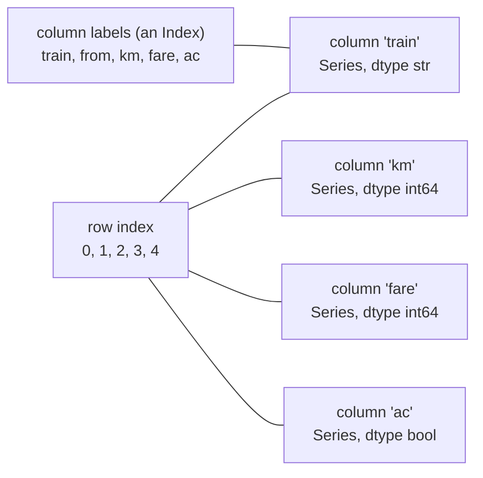

# Series, DataFrames (and the Retired Panel): The Complete Guide

> 📚 **Before you start**
>
> - [What is a NumPy Array?](../02-numpy-essentials/what-is-a-numpy-array.md), for vectorised operations, shape and axes
> - [Data Types and Array Attributes](../02-numpy-essentials/data-types-and-array-attributes.md), for dtypes and `nan`
> - [The Matrix Library, Copies and Views](../02-numpy-essentials/the-matrix-library-copies-and-views.md), for views and copies, which pandas 3 handles differently
> - [Python Fundamentals › Strings and Data Structures](../../python-fundamentals/course.md#m5), for dictionaries and lists of dictionaries

## Introduction

Open any spreadsheet of real data (a kirana shop's daily sales, a college's admission list, your bank statement) and you see the same structure: **named columns**, each holding one kind of value, and **rows** that each describe one thing. The column called "amount" holds numbers, "date" holds dates, "description" holds text. You refer to things by name: "the amount on 3 March", not "row 47, column 3".

NumPy arrays are fast, but they have no names. Rows and columns are just positions, and every element must have the same type. Real tables mix numbers, text and dates, and real analysis is all about names. **pandas** fills that gap. It gives you two labelled data structures built on NumPy-style arrays: the **Series** (one labelled column) and the **DataFrame** (a table of labelled columns). They are the most used data structures in Python data work.

This article explains both from the ground up: what they are made of, every common way to create them, how labels make arithmetic "line up", the data types pandas uses (including the new default string type in pandas 3), what **Copy-on-Write** means for your code, and how to read data from text. It also explains the **Panel**, a third structure that older tutorials still mention, which was removed from pandas years ago, and what to use instead.

> 💡 **Key Insight**
>
> A **Series** is a 1-D array of values plus an **index** of labels. A **DataFrame** is a collection of Series that **share one index**, one Series per column. Almost everything pandas does, including its arithmetic, uses the labels, not the positions: values with the same label line up automatically.

---

## Core Explanation

### 1. Where pandas came from (and why it matters)

pandas was started in 2008 by Wes McKinney, who needed better tools for financial data analysis, and was released as open source in 2009. The name comes from **"panel data"**, an economics term for measurements of several subjects over several time periods (for example, the sales of ten shops over five years). It is also a nod to "Python data analysis". That history is why pandas once had a structure literally called `Panel`, which section 9 covers.

Install and import it with its standard alias:

```python
import numpy as np
import pandas as pd

print(pd.__version__.split(".")[0])
```

Output:

```
3
```

### 2. The Series: values with labels

A Series holds a 1-D sequence of values, an **index** (one label per value), an optional **name** and a **dtype**.

```python
chai_sales = pd.Series([52, 61, 47, 70, 66],
                       index=["Mon", "Tue", "Wed", "Thu", "Fri"],
                       name="cups")
print(chai_sales)
```

Output:

```
Mon    52
Tue    61
Wed    47
Thu    70
Fri    66
Name: cups, dtype: int64
```

The left column is the index, the right column the values. You access values by label, and many NumPy-style operations work directly:

```python
print(chai_sales["Wed"])
print(chai_sales[["Mon", "Fri"]].tolist())
print(chai_sales.index.tolist())
print(chai_sales.values, type(chai_sales.values).__name__)
print(chai_sales.mean(), chai_sales.max(), chai_sales.idxmax())
print((chai_sales * 15).head(2))        # revenue at ₹15 a cup
```

Output:

```
47
[52, 66]
['Mon', 'Tue', 'Wed', 'Thu', 'Fri']
[52 61 47 70 66] ndarray
59.2 70 Thu
Mon    780
Tue    915
Name: cups, dtype: int64
```

`idxmax()` returns the **label** of the largest value, the Series equivalent of NumPy's `argmax`. To get the raw data out, prefer `.to_numpy()` (always a NumPy array) or `.array` (pandas' own array type) over the older `.values`.

### 3. Creating a Series

```python
# from a dict: keys become the index
fares = pd.Series({"Pune": 120, "Lonavala": 75, "Mumbai": 165})
print(fares)

# from a scalar: repeated for every label
flat = pd.Series(10, index=["a", "b", "c"])
print(flat.tolist())

# from a NumPy array, with the default index 0, 1, 2, ...
default = pd.Series(np.array([3.5, 4.0, 2.5]))
print(default)
```

Output:

```
Pune        120
Lonavala     75
Mumbai      165
dtype: int64
[10, 10, 10]
0    3.5
1    4.0
2    2.5
dtype: float64
```

When you do not give an index, pandas uses a **RangeIndex** (0, 1, 2, ...), which looks like positions but is still a set of labels. That difference matters as soon as you filter or sort, and pandas 3 makes it explicit: **square brackets on a Series always mean labels.** For positions, use `.iloc`:

```python
cities = pd.Series([120, 75, 165], index=["Pune", "Lonavala", "Mumbai"])
print(cities.iloc[0])            # by position
print(cities["Pune"])            # by label
try:
    cities[0]                    # pandas 3: 0 is treated as a label, and there is no label 0
except KeyError as err:
    print("KeyError:", err)
```

Output:

```
120
120
KeyError: 0
```

Older pandas guessed that `cities[0]` meant "position 0" and printed a deprecation warning; pandas 3 no longer guesses. The next lesson covers `.loc` and `.iloc` in full.

### 4. Index alignment: arithmetic by label

When you combine two Series, pandas matches values by **label**, not by position. Labels present in only one of them produce a missing value, shown as `NaN`.

```python
monday = pd.Series({"chai": 52, "samosa": 30, "poha": 12})
tuesday = pd.Series({"samosa": 28, "chai": 61, "lassi": 9})
print(monday + tuesday)
print(monday.add(tuesday, fill_value=0))
```

Output:

```
chai      113.0
lassi       NaN
poha        NaN
samosa     58.0
dtype: float64
chai      113.0
lassi       9.0
poha       12.0
samosa     58.0
dtype: float64
```

Notice three things in the first result. The order of labels did not matter: chai was added to chai. Labels missing from one side (`lassi`, `poha`) became `NaN`, which also turned the dtype into `float64` because `NaN` is a float. The second result shows the method form `add(..., fill_value=0)`, which treats a missing label as 0. Every operator has a method form (`add`, `sub`, `mul`, `div`, `floordiv`, `mod`, `pow`) with a `fill_value` option.

Alignment is pandas' superpower. It means you can combine data from different sources without first making sure the rows are in the same order.

### 5. The DataFrame: a table of Series

A DataFrame is a 2-D table with a **row index** and **column labels**. Each column is a Series, and all columns share the same row index. Columns can have different dtypes.

```python
trains = pd.DataFrame({
    "train": ["Deccan Queen", "Shatabdi", "Rajdhani", "Duronto", "Garib Rath"],
    "from": ["Pune", "Mumbai", "Delhi", "Mumbai", "Delhi"],
    "km": [192, 492, 1384, 1347, 1450],
    "fare": [175, 1150, 3060, 2400, 1015],
    "ac": [False, True, True, True, True],
})
print(trains)
```

Output:

```
          train    from    km  fare     ac
0  Deccan Queen    Pune   192   175  False
1      Shatabdi  Mumbai   492  1150   True
2      Rajdhani   Delhi  1384  3060   True
3       Duronto  Mumbai  1347  2400   True
4    Garib Rath   Delhi  1450  1015   True
```



The first things to check on any DataFrame:

```python
print(trains.shape)            # (rows, columns)
print(trains.columns.tolist())
print(trains.index)
print(trains.dtypes)
```

Output:

```
(5, 5)
['train', 'from', 'km', 'fare', 'ac']
RangeIndex(start=0, stop=5, step=1)
train      str
from       str
km       int64
fare     int64
ac        bool
dtype: object
```

`info()` prints a compact summary, including how many non-missing values each column has, which is the fastest way to spot gaps in a new dataset:

```python
trains.info()
```

Output:

```
<class 'pandas.DataFrame'>
RangeIndex: 5 entries, 0 to 4
Data columns (total 5 columns):
 #   Column  Non-Null Count  Dtype
---  ------  --------------  -----
 0   train   5 non-null      str  
 1   from    5 non-null      str  
 2   km      5 non-null      int64
 3   fare    5 non-null      int64
 4   ac      5 non-null      bool 
dtypes: bool(1), int64(2), str(2)
memory usage: 297.0 bytes
```

(The memory figure depends on how text is stored; it will be different if you have the optional `pyarrow` package installed.)

`head(n)` and `tail(n)` show the first and last `n` rows (5 by default), and `sample(n, random_state=...)` shows random rows. `describe()` summarises the numeric columns; module 5 covers it in depth.

```python
print(trains.head(2))
print(trains.describe().round(1))
```

Output:

```
          train    from   km  fare     ac
0  Deccan Queen    Pune  192   175  False
1      Shatabdi  Mumbai  492  1150   True
           km    fare
count     5.0     5.0
mean    973.0  1560.0
std     586.9  1155.3
min     192.0   175.0
25%     492.0  1015.0
50%    1347.0  1150.0
75%    1384.0  2400.0
max    1450.0  3060.0
```

### 6. Every common way to build a DataFrame

```python
# 1. list of dicts: one dict per row (very common with JSON data)
rows = [{"name": "Asha", "runs": 45}, {"name": "Ravi", "runs": 102, "balls": 70}]
print(pd.DataFrame(rows))

# 2. 2-D NumPy array plus labels
grid = pd.DataFrame(np.arange(6).reshape(2, 3), columns=["a", "b", "c"], index=["x", "y"])
print(grid)

# 3. dict of Series: aligned on their indexes
temps = pd.DataFrame({
    "Pune": pd.Series({"Mon": 31, "Tue": 33}),
    "Delhi": pd.Series({"Tue": 38, "Wed": 40}),
})
print(temps)

# 4. list of lists with column names
print(pd.DataFrame([["chai", 15], ["coffee", 25]], columns=["item", "price"]))
```

Output:

```
   name  runs  balls
0  Asha    45    NaN
1  Ravi   102   70.0
   a  b  c
x  0  1  2
y  3  4  5
     Pune  Delhi
Mon  31.0    NaN
Tue  33.0   38.0
Wed   NaN   40.0
     item  price
0    chai     15
1  coffee     25
```

Missing keys and non-matching labels become `NaN`, the same alignment rule as for Series. `pd.DataFrame.from_records` and `pd.DataFrame.from_dict(d, orient="index")` cover a few more shapes of input.

### 7. Adding, changing and removing columns

```python
trains["fare_per_km"] = (trains["fare"] / trains["km"]).round(2)   # new column
trains = trains.assign(long_haul=trains["km"] > 1000)              # assign returns a new frame
trains.insert(1, "code", ["12124", "12027", "12951", "12263", "12909"])   # at a position
print(trains.head(3))

slim = trains.drop(columns=["code", "long_haul"])                   # returns a new frame
slim = slim.rename(columns={"fare_per_km": "rs_per_km"})
print(slim.columns.tolist())
```

Output:

```
          train   code    from    km  fare     ac  fare_per_km  long_haul
0  Deccan Queen  12124    Pune   192   175  False         0.91      False
1      Shatabdi  12027  Mumbai   492  1150   True         2.34      False
2      Rajdhani  12951   Delhi  1384  3060   True         2.21       True
['train', 'from', 'km', 'fare', 'ac', 'rs_per_km']
```

Arithmetic between columns is vectorised and aligned on the row index, exactly like Series arithmetic. Most methods (`drop`, `rename`, `assign`, `sort_values`) return a **new** DataFrame and leave the original alone, so assign the result back if you want to keep it. Many of them also accept `inplace=True`, but it rarely saves memory and makes chaining impossible; the pandas developers recommend avoiding it.

Selecting one column with `df["col"]` gives a **Series**; a list of columns, `df[["a", "b"]]`, gives a **DataFrame**:

```python
print(type(trains["km"]).__name__, type(trains[["km"]]).__name__)
```

Output:

```
Series DataFrame
```

### 8. Data types in pandas 3

pandas uses NumPy dtypes for numbers and booleans, and adds its own **extension dtypes** where NumPy falls short.

| dtype | Holds | Missing value |
|---|---|---|
| `int64`, `float64`, `bool` | NumPy numbers and booleans | `NaN` (forces ints to float) |
| `str` | text (**the default for text in pandas 3**) | `NaN` |
| `object` | arbitrary Python objects, mixed types | `None` or `NaN` |
| `category` | a fixed set of repeated values | `NaN` |
| `datetime64[us]` and other units, `timedelta64[...]` | dates and durations | `NaT` ("not a time") |
| `Int64`, `Float64`, `boolean` (capitalised) | nullable numbers and booleans | `pd.NA` |
| `string` | the older opt-in string type | `pd.NA` |

The big change in pandas 3 is the **`str` dtype**. Earlier versions stored text in `object` columns, which could hold anything (a number, a list, `None`) and were slow. pandas 3 infers a dedicated string dtype for text, which only holds strings or missing values. It uses the `pyarrow` library for speed when it is installed and falls back to a pure Python implementation otherwise. Either way it displays as `str`.

```python
names = pd.Series(["Asha", "Ravi", None])
print(names.dtype)
print(names)
print(pd.Series(["Asha", 7]).dtype)       # mixed types fall back to object
```

Output:

```
str
0    Asha
1    Ravi
2     NaN
dtype: str
object
```

Code that checks `if df["name"].dtype == object` breaks under pandas 3; check with `pd.api.types.is_string_dtype(df["name"])` instead.

Integers have a long-standing problem: a NumPy `int64` cannot hold `NaN`, so one missing value turns a whole integer column into floats. The capitalised **nullable** dtypes fix this using `pd.NA`:

```python
print(pd.Series([3, None, 5]))
print(pd.Series([3, None, 5], dtype="Int64"))
```

Output:

```
0    3.0
1    NaN
2    5.0
dtype: float64
0       3
1    <NA>
2       5
dtype: Int64
```

Convert between dtypes with `astype`, exactly as in NumPy (`df["km"].astype("int32")`, `df["code"].astype(int)`), and let pandas pick the best nullable types with `df.convert_dtypes()`.

### 9. Copy-on-Write: the pandas 3 rule for copies and views

In the NumPy module you learned that slices are **views**: changing them changes the original. Older pandas inherited a confusing mix of this: sometimes a selection was a view, sometimes a copy, and the infamous `SettingWithCopyWarning` tried to warn you when you could not tell.

pandas 3 replaces all of that with one rule called **Copy-on-Write (CoW)**: **any DataFrame or Series you get from another one behaves as a copy.** Modifying it never changes the original. Internally, pandas still shares memory until the moment one of them is modified; only then is the data actually copied ("copy on write"), so selections stay cheap.

```python
original = pd.DataFrame({"item": ["chai", "samosa"], "price": [15, 20]})

subset = original[original["price"] > 10]
subset.loc[0, "price"] = 99          # modifies only subset
print(original["price"].tolist(), subset["price"].tolist())

col = original["price"]
col.iloc[0] = 0                      # also only modifies col
print(original["price"].tolist())
```

Output:

```
[15, 20] [99, 20]
[15, 20]
```

No warning, no surprise: the original is untouched. The flip side is **chained assignment**, where you index twice and assign, which can never work under CoW:

```python
# not-run: shows a ChainedAssignmentError warning and changes nothing
original["price"][0] = 18            # step 1 makes a new Series, step 2 changes only that
```

To change the original, do it in **one** step with `.loc` (or `.iloc`):

```python
original.loc[0, "price"] = 18
print(original)
```

Output:

```
     item  price
0    chai     18
1  samosa     20
```

`df.copy()` still exists when you want an explicit independent copy, but under CoW you rarely need it for safety. The option `pd.options.mode.copy_on_write` that existed in pandas 2 to turn CoW on no longer does anything, because it is always on.

### 10. Reading and writing data

Real data usually arrives as a file. `pd.read_csv` reads comma-separated text from a path, a URL or any file-like object; `df.to_csv` writes it. Here the "file" is a string, so the lesson needs no downloads:

```python
import io

csv_text = """date,item,qty,price
2026-10-01,chai,52,15
2026-10-01,samosa,30,20
2026-10-02,chai,61,15
2026-10-02,samosa,,20
"""
sales = pd.read_csv(io.StringIO(csv_text), parse_dates=["date"])
print(sales)
print(sales.dtypes)
print(sales.to_csv(index=False).splitlines()[1])
```

Output:

```
        date    item   qty  price
0 2026-10-01    chai  52.0     15
1 2026-10-01  samosa  30.0     20
2 2026-10-02    chai  61.0     15
3 2026-10-02  samosa   NaN     20
date     datetime64[us]
item                str
qty             float64
price             int64
dtype: object
2026-10-01,chai,52.0,15
```

The empty `qty` became `NaN`, so the column is `float64`; dates were parsed into a `datetime64` column (pandas 3 uses microsecond resolution, `[us]`, by default). Other readers follow the same pattern: `read_excel`, `read_json`, `read_parquet`, `read_sql`, `read_html` and their `to_*` counterparts. The [Lab: Explore a sales dataset](lab-explore-a-sales-dataset.md) uses `read_csv` on a bigger table.

### 11. The retired Panel, and what replaced it

Older tutorials and the original pandas documentation describe **three** structures: Series (1-D), DataFrame (2-D) and **Panel** (3-D). A Panel was a container of DataFrames with three axes: `items` (one DataFrame per item), `major_axis` (the rows of each DataFrame, often dates) and `minor_axis` (the columns). The classic example was stock data: for each stock (item), a table of dates by price fields.

Panel was **deprecated in pandas 0.20 (2017)** and **removed entirely in pandas 0.25 (2019)**. In any modern pandas, it simply does not exist:

```python
try:
    pd.Panel
except AttributeError as err:
    print("AttributeError:", err)
```

Output:

```
AttributeError: module 'pandas' has no attribute 'Panel'
```

It was removed because it was rarely used, poorly tested and awkward, while two better options existed:

1. **A DataFrame with a MultiIndex** (several levels of row labels). This "long" or "tidy" form handles any number of dimensions inside the ordinary 2-D DataFrame machinery that everyone already knows.
2. **xarray**, a separate library built for labelled N-dimensional arrays (common in climate science and physics).

Here is panel-shaped data (two shops × three days × two measures) built the modern way. Start with one DataFrame per shop, exactly what a Panel used to hold, and combine them with `pd.concat` and `keys`:

```python
days = pd.Index(["Mon", "Tue", "Wed"], name="day")
shop_a = pd.DataFrame({"chai": [52, 61, 47], "samosa": [30, 28, 35]}, index=days)
shop_b = pd.DataFrame({"chai": [33, 29, 41], "samosa": [18, 22, 20]}, index=days)

panel_like = pd.concat({"Andheri": shop_a, "Bandra": shop_b}, names=["shop"])
print(panel_like)
print(panel_like.index.nlevels, panel_like.shape)
```

Output:

```
             chai  samosa
shop    day              
Andheri Mon    52      30
        Tue    61      28
        Wed    47      35
Bandra  Mon    33      18
        Tue    29      22
        Wed    41      20
2 (6, 2)
```

Every Panel operation has a MultiIndex equivalent:

```python
print(panel_like.loc["Bandra"])                       # one "item": a normal DataFrame
print(panel_like.xs("Tue", level="day"))              # one date across all shops
print(panel_like.groupby(level="shop").sum())         # reduce over the day axis
print(panel_like["chai"].unstack("day"))              # one field as a shop x day table
```

Output:

```
     chai  samosa
day              
Mon    33      18
Tue    29      22
Wed    41      20
         chai  samosa
shop                 
Andheri    61      28
Bandra     29      22
         chai  samosa
shop                 
Andheri   160      93
Bandra    103      60
day      Mon  Tue  Wed
shop                  
Andheri   52   61   47
Bandra    33   29   41
```

A fully "long" version, with one row per shop, day and item, is often even easier to filter and group. `stack()` moves the column labels into the row index:

```python
long = panel_like.stack().rename("qty").reset_index()
long.columns = ["shop", "day", "item", "qty"]
print(long.head(4))
print(long.shape)
```

Output:

```
      shop  day    item  qty
0  Andheri  Mon    chai   52
1  Andheri  Mon  samosa   30
2  Andheri  Tue    chai   61
3  Andheri  Tue  samosa   28
(12, 4)
```

If you truly need N-dimensional labelled arithmetic, xarray converts directly from a MultiIndex DataFrame (it is not installed in this course's environment):

```python
# not-run: needs the xarray package (pip install xarray)
ds = panel_like.to_xarray()       # a Dataset with dims (shop, day), variables chai and samosa
print(ds["chai"].sel(shop="Bandra").values)
```

Example output:

```
[33 29 41]
```

### 12. Old code you will meet, and the modern replacement

| Old (removed or discouraged) | Modern pandas 3 |
|---|---|
| `pd.Panel(...)` | MultiIndex DataFrame, or xarray |
| `df.append(other)` (removed in 2.0) | `pd.concat([df, other])` |
| `df.applymap(f)` (removed in 3.0) | `df.map(f)` |
| `series[0]` on a labelled index | `series.iloc[0]` |
| `df["col"][0] = x` (chained assignment) | `df.loc[0, "col"] = x` |
| `fillna(method="ffill")` | `df.ffill()` |
| text columns as `object` | the default `str` dtype |
| `pd.options.mode.copy_on_write = True` | not needed: CoW is always on |
| frequency strings `"H"`, `"T"`, `"M"`, `"Y"` | `"h"`, `"min"`, `"ME"`, `"YE"` (dates lesson) |

```python
a = pd.DataFrame({"x": [1, 2]})
b = pd.DataFrame({"x": [3]})
print(pd.concat([a, b], ignore_index=True))
print(hasattr(pd.DataFrame, "append"), hasattr(pd.DataFrame, "applymap"))
print(a.map(lambda v: v * 10))
```

Output:

```
   x
0  1
1  2
2  3
False False
    x
0  10
1  20
```

---

## Try It Yourself

1. Build a Series of the runs scored by five batters, indexed by name. Print the top scorer's name with `idxmax`, and the runs of the third batter by **position**.
2. Two Series hold rainfall in mm: `june = {"Pune": 140, "Mumbai": 520, "Nagpur": 170}` and `july = {"Mumbai": 840, "Pune": 190, "Nashik": 110}`. Add them so missing months count as 0. What dtype is the result, and why?
3. Build a DataFrame of four products with columns `name`, `price` and `stock`. Add a `value` column (price × stock), then drop `stock`, without using `inplace`.
4. Under pandas 3, does this change `df`? `top = df[df["price"] > 100]; top["price"] = 0`. How would you set the price of all rows above ₹100 to 0 in `df` itself?

<details>
<summary>Show answers</summary>

```python
runs = pd.Series([45, 102, 8, 67, 33], index=["Rohit", "Virat", "Gill", "Iyer", "Pant"])
print(runs.idxmax(), runs.iloc[2])

june = pd.Series({"Pune": 140, "Mumbai": 520, "Nagpur": 170})
july = pd.Series({"Mumbai": 840, "Pune": 190, "Nashik": 110})
total = june.add(july, fill_value=0)
print(total)

df = pd.DataFrame({"name": ["pen", "bag", "lamp", "mug"],
                   "price": [20, 650, 1200, 150], "stock": [100, 8, 3, 25]})
df = df.assign(value=df["price"] * df["stock"]).drop(columns="stock")
print(df)

top = df[df["price"] > 100]
top["price"] = 0
print(df["price"].tolist())
df.loc[df["price"] > 100, "price"] = 0
print(df["price"].tolist())
```

Output:

```
Virat 8
Mumbai    1360.0
Nagpur     170.0
Nashik     110.0
Pune       330.0
dtype: float64
   name  price  value
0   pen     20   2000
1   bag    650   5200
2  lamp   1200   3600
3   mug    150   3750
[20, 650, 1200, 150]
[20, 0, 0, 0]
```

**2.** `float64`: during alignment, labels missing on one side become `NaN` before `fill_value` replaces them, and `NaN` needs a float column. **4.** No: `top` is a separate object under Copy-on-Write. Use a single `.loc` call with the condition and the column.

</details>

---

## Real-World Examples

### Example 1: Every data team's first step

Whether the data comes from a CSV export, a SQL query or an API, analysts load it into a DataFrame and run `shape`, `dtypes`, `info()` and `head()` before anything else. Those four calls catch wrong types, missing values and unexpected columns in seconds.

### Example 2: Joining sources by label

A retailer has one Series of last month's sales per store and one of this month's, from different systems with stores in different orders, and some stores new or closed. `this_month.sub(last_month, fill_value=0)` gives the change per store correctly, thanks to alignment.

### Example 3: Panel data without Panel

Economists studying state-wise GDP over 20 years store it as a DataFrame indexed by `(state, year)`. Group by state for trends, cross-section by year for comparisons, and unstack for a state × year table, all of which the old Panel tried to do in a separate structure.

---

## Common Misconceptions

### Misconception 1: "The index is just row numbers"

The index is a set of **labels** that drives alignment, selection and joins. After filtering or sorting, labels no longer match positions. Use `.iloc` for positions.

### Misconception 2: "Text columns are `object` dtype"

That was true before pandas 3. Now text is inferred as `str`, and `object` appears only for genuinely mixed data.

### Misconception 3: "I need `df.copy()` everywhere to avoid SettingWithCopyWarning"

Under Copy-on-Write that warning is gone. Derived objects already behave as copies. Use `.loc` for single-step assignment to the original.

### Misconception 4: "pandas has three structures: Series, DataFrame and Panel"

Panel was removed in 2019 (pandas 0.25). Use a MultiIndex DataFrame or xarray.

### Misconception 5: "`df.append` is how you add rows"

It was removed in pandas 2.0. Collect rows in a list and call `pd.concat` once (or build the DataFrame from a list of dicts).

---

## Interview Relevance

- *"What is the difference between a Series and a DataFrame?"* 1-D labelled array vs 2-D table of Series sharing a row index; columns can have different dtypes.
- *"What is index alignment?"* Operations match values by label; unmatched labels give `NaN` unless you use `fill_value`.
- *"Why does an integer column with a missing value become float, and how do you avoid it?"* NumPy ints cannot hold `NaN`; use nullable `Int64`.
- *"What changed in pandas 3?"* Copy-on-Write always on (no `SettingWithCopyWarning`, chained assignment never works), default `str` dtype, many removed deprecated APIs.
- *"What was a Panel and what replaced it?"* 3-D container removed in 0.25; MultiIndex DataFrames or xarray.
- *"`.values` vs `.to_numpy()` vs `.array`?"* `.to_numpy()` is the explicit NumPy conversion; `.array` returns the pandas extension array; `.values` is the older, ambiguous attribute.

---

## Key Takeaways

- **A Series is values plus an index of labels; a DataFrame is a set of Series sharing one row index**, with one dtype per column.
- **Arithmetic aligns on labels**; missing matches become `NaN` unless you use `fill_value`.
- **pandas 3 defaults**: text is the `str` dtype, `series[...]` means labels (use `.iloc` for positions), and nullable dtypes such as `Int64` keep integers with missing values.
- **Copy-on-Write**: anything derived from a DataFrame behaves as a copy; change the original in one step with `.loc`/`.iloc`.
- **Check every new DataFrame** with `shape`, `dtypes`, `info()` and `head()`.
- **Panel is gone** (since 0.25); use a MultiIndex DataFrame (`pd.concat` with keys, `xs`, `groupby(level=...)`, `unstack`) or xarray.

---

**Up next:** [Selecting, Sorting and Indexing Data](selecting-sorting-and-indexing-data.md)
