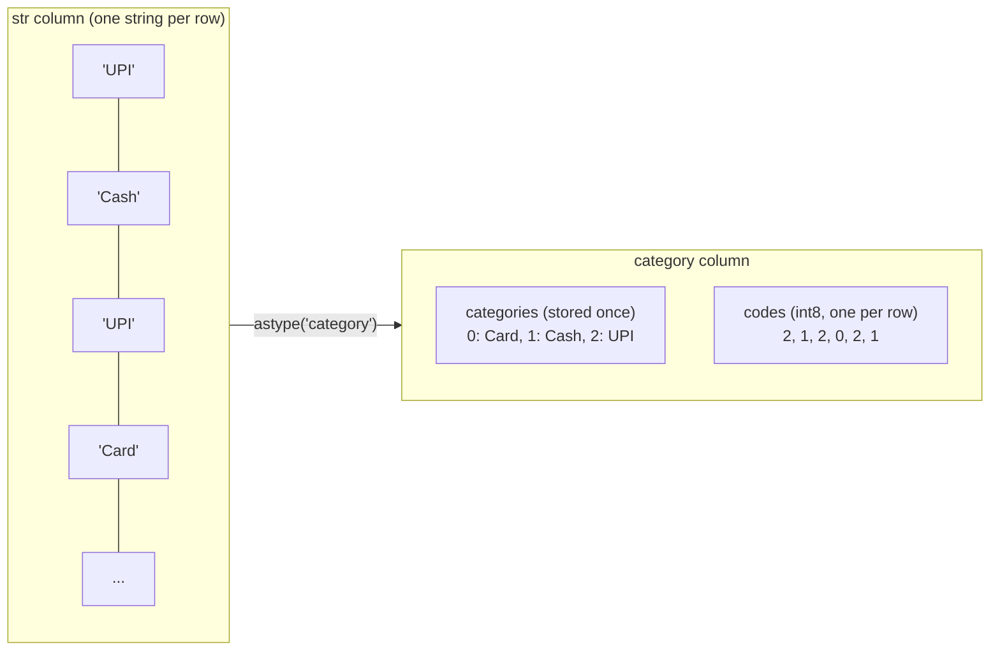
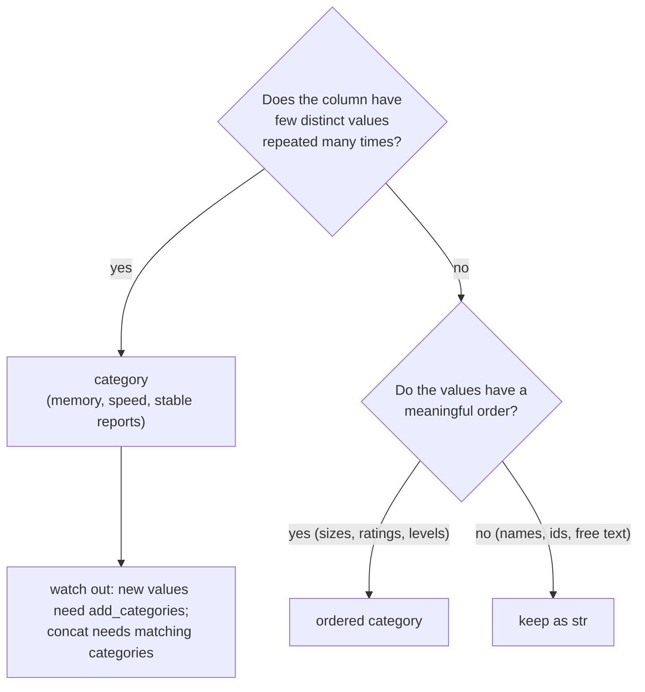

# Categorical Data: The Complete Guide

> 📚 **Before you start**
>
> - [Series, DataFrames (and the Retired Panel)](../03-pandas-core/series-dataframes-and-the-retired-panel.md), for dtypes
> - [Selecting, Sorting and Indexing Data](../03-pandas-core/selecting-sorting-and-indexing-data.md), for sorting and filtering
> - [Statistical, Sorting, Searching and Counting Functions](../02-numpy-essentials/statistical-sorting-searching-and-counting-functions.md), for `np.unique(..., return_inverse=True)`, the idea behind categories
> - [Working with Text Data](working-with-text-data.md), for cleaning text before turning it into categories

## Introduction

A national exam has two million candidates. The `state` column holds one of 36 names, repeated over and over: "Uttar Pradesh" appears hundreds of thousands of times. The `result` column holds only "Pass" or "Fail". The `grade` column holds "A+", "A", "B", "C" or "D", and those have a natural order: A+ is better than B. Storing each of those values as a separate string wastes memory, sorts grades alphabetically (so "A" comes before "A+" and "D" after "C" for the wrong reason), and lets typos like "Uttar Pardesh" slip in unnoticed.

pandas has a dtype for exactly this kind of column: **`category`**. A categorical column stores the list of allowed values once, and each row stores only a small integer code pointing into that list. That makes it compact and fast, lets you define a meaningful **order** (S < M < L, Fail < Pass, Low < Medium < High), rejects values that are not allowed, and keeps categories with zero rows visible in counts and reports.

This lesson covers what categoricals are, how to create them, the `.cat` accessor for managing categories, ordered categories, binning numbers into categories with `pd.cut` and `pd.qcut`, how categoricals behave in grouping and joining, and when **not** to use them.

> 💡 **Key Insight**
>
> A categorical column is two things: a short list of **categories** (the allowed values, optionally ordered) and an array of integer **codes**, one per row. Use it when a column has **few distinct values repeated many times**, or when the values have a **meaningful order**.

---

## Core Explanation

### 1. Codes and categories

Convert a column with `astype("category")`:

```python
import numpy as np
import pandas as pd

payments = pd.Series(["UPI", "Cash", "UPI", "Card", "UPI", "Cash"])
cat = payments.astype("category")
print(cat)
print(cat.cat.categories)
print(cat.cat.codes.tolist())
```

Output:

```
0     UPI
1    Cash
2     UPI
3    Card
4     UPI
5    Cash
dtype: category
Categories (3, str): ['Card', 'Cash', 'UPI']
Index(['Card', 'Cash', 'UPI'], dtype='str')
[2, 1, 2, 0, 2, 1]
```

The values look the same, but underneath, `cat.cat.categories` holds the three distinct strings (sorted) and `cat.cat.codes` holds one small integer per row: 0 for Card, 1 for Cash, 2 for UPI. This is the same "codes plus labels" idea you saw with `np.unique(return_inverse=True)` in NumPy.



### 2. Why it saves memory

With few distinct values, the codes fit in `int8` (one byte each, up to 127 categories), while each string costs much more. Here are one million payment records:

```python
rng = np.random.default_rng(0)
many = pd.Series(rng.choice(["UPI", "Cash", "Card", "Wallet"], size=1_000_000))
as_cat = many.astype("category")

print(as_cat.cat.codes.dtype, as_cat.cat.codes.nbytes, "bytes of codes")
text_bytes = many.memory_usage(deep=True)
cat_bytes = as_cat.memory_usage(deep=True)
print("category is smaller:", cat_bytes < text_bytes)
print("roughly", round(text_bytes / cat_bytes), "times smaller")
```

Output:

```
int8 1000000 bytes of codes
category is smaller: True
roughly 53 times smaller
```

The exact ratio depends on how text is stored (it is smaller with the optional `pyarrow` package installed), but the saving is large either way. Operations such as `groupby`, `value_counts` and sorting also get faster, because they work on small integers instead of strings.

### 3. Creating categoricals with chosen categories

`astype("category")` infers the categories from the data. To **fix the allowed values** (and their order) up front, use `pd.Categorical` or a `CategoricalDtype`:

```python
sizes = pd.Categorical(["M", "S", "XL", "M"], categories=["S", "M", "L", "XL"])
print(sizes)
print(sizes.codes)

size_type = pd.CategoricalDtype(["S", "M", "L", "XL"], ordered=True)
orders = pd.Series(["M", "S", "XL", "M", "L"], dtype=size_type)
print(orders.dtype)
```

Output:

```
['M', 'S', 'XL', 'M']
Categories (4, str): ['S', 'M', 'L', 'XL']
[1 0 3 1]
category
```

Note that `L` is a category even though no row has it yet. A `CategoricalDtype` object can be reused for several columns or passed when reading files: `pd.read_csv(..., dtype={"size": size_type})`.

Assigning a value that is not one of the categories **raises an error**, which makes a categorical a built-in data check:

```python
try:
    orders[0] = "XXL"
except TypeError as err:
    print("TypeError:", err)
```

Output:

```
TypeError: Cannot setitem on a Categorical with a new category (XXL), set the categories first
```

What about **creating** a categorical from data that contains unknown values? For now pandas turns them into missing values, but pandas 3 emits a `Pandas4Warning` saying this is deprecated and will raise an error in a future version. Do it explicitly instead: keep only the allowed values with `where` and `isin`, then convert. That makes the intent clear and keeps working in future versions:

```python
raw_sizes = pd.Series(["S", "M", "XXL"])
known = raw_sizes.where(raw_sizes.isin(size_type.categories))   # unknown -> NaN
print(known.astype(size_type).tolist())
print("unknown values:", raw_sizes[~raw_sizes.isin(size_type.categories)].tolist())
```

Output:

```
['S', 'M', nan]
unknown values: ['XXL']
```

### 4. Ordered categories

With `ordered=True`, the order of the categories is meaningful. Sorting follows it, and comparisons, `min` and `max` work:

```python
print(orders.sort_values().tolist())
print(orders.min(), orders.max())
print((orders >= "L").tolist())
print(orders[orders > "S"].tolist())
```

Output:

```
['S', 'M', 'M', 'L', 'XL']
S XL
[False, False, True, False, True]
['M', 'XL', 'M', 'L']
```

Compare that with plain strings, where "XL" sorts before "S" alphabetically and `>` compares letters:

```python
plain = pd.Series(["M", "S", "XL", "M", "L"])
print(plain.sort_values().tolist())
```

Output:

```
['L', 'M', 'M', 'S', 'XL']
```

Unordered categoricals can be tested for equality (`==`, `isin`) but not compared with `<` or `>`; pandas raises a `TypeError`. Turn order on or off with `.cat.as_ordered()` and `.cat.as_unordered()`.

A classic use: survey answers on a **Likert scale**.

```python
scale = pd.CategoricalDtype(["Very poor", "Poor", "Okay", "Good", "Excellent"], ordered=True)
feedback = pd.Series(["Good", "Okay", "Excellent", "Poor", "Good", "Good"], dtype=scale)
print(feedback.value_counts(sort=False))
print("median answer:", feedback.cat.categories[int(feedback.cat.codes.median())])
print("share Good or better:", (feedback >= "Good").mean().round(2))
```

Output:

```
Very poor    0
Poor         1
Okay         1
Good         3
Excellent    1
Name: count, dtype: int64
median answer: Good
share Good or better: 0.67
```

`value_counts(sort=False)` lists categories in their defined order and **includes "Very poor" with 0**: categories with no rows still appear, which is exactly what a report needs.

### 5. Managing categories with `.cat`

| Method | What it does |
|---|---|
| `.cat.categories`, `.cat.codes`, `.cat.ordered` | inspect |
| `.cat.rename_categories(...)` | rename labels (list, dict or function); codes stay |
| `.cat.add_categories([...])` | allow new values |
| `.cat.remove_categories([...])` | disallow values (existing ones become missing) |
| `.cat.remove_unused_categories()` | drop categories with no rows |
| `.cat.set_categories([...], ordered=...)` | replace the whole list (values not in it become missing) |
| `.cat.reorder_categories([...])` | same categories, new order |
| `.cat.as_ordered()`, `.cat.as_unordered()` | switch ordering on or off |

```python
pay = payments.astype("category")
print(pay.cat.rename_categories({"UPI": "UPI (BHIM etc.)"}).cat.categories.tolist())

pay2 = pay.cat.add_categories(["Wallet"])
pay2[0] = "Wallet"                                   # allowed now
print(pay2.tolist(), pay2.cat.categories.tolist())

print(pay.cat.remove_categories(["Card"]).tolist())  # Card rows become missing
print(pay.cat.reorder_categories(["UPI", "Card", "Cash"], ordered=True).sort_values().tolist())
```

Output:

```
['Card', 'Cash', 'UPI (BHIM etc.)']
['Wallet', 'Cash', 'UPI', 'Card', 'UPI', 'Cash'] ['Card', 'Cash', 'UPI', 'Wallet']
['UPI', 'Cash', 'UPI', nan, 'UPI', 'Cash']
['UPI', 'UPI', 'UPI', 'Card', 'Cash', 'Cash']
```

After filtering a large table, unused categories remain in the dtype; call `remove_unused_categories()` if you don't want them in later counts and plots.

### 6. Binning numbers into categories: `cut` and `qcut`

Turning a continuous number into ranges is called **binning**. `pd.cut` uses bin edges you choose (or equal-width bins); `pd.qcut` uses **quantiles**, so each bin gets roughly the same number of rows. Both return an ordered categorical.

```python
ages = pd.Series([4, 15, 22, 37, 45, 61, 70, 18])
groups = pd.cut(ages, bins=[0, 12, 19, 59, 120], labels=["child", "teen", "adult", "senior"])
print(pd.DataFrame({"age": ages, "group": groups}).T)
print(groups.value_counts(sort=False))
```

Output:

```
           0     1      2      3      4       5       6     7
age        4    15     22     37     45      61      70    18
group  child  teen  adult  adult  adult  senior  senior  teen
child     1
teen      2
adult     3
senior    2
Name: count, dtype: int64
```

By default bins include the **right** edge and exclude the left: `(12, 19]` holds 13 to 19. Pass `right=False` for `[12, 19)`. Without `labels`, the categories are **intervals** such as `(12, 19]`.

`qcut` splits by rank, which is how you build "quartiles of income" or "top 25% of customers":

```python
monthly_spend = pd.Series([450, 1200, 3300, 800, 5200, 2100, 950, 15000])
quartile = pd.qcut(monthly_spend, q=4, labels=["Q1 low", "Q2", "Q3", "Q4 high"])
print(pd.DataFrame({"spend": monthly_spend, "quartile": quartile}).sort_values("spend").to_string(index=False))
print(pd.qcut(monthly_spend, q=4).cat.categories)
```

Output:

```
 spend quartile
   450   Q1 low
   800   Q1 low
   950       Q2
  1200       Q2
  2100       Q3
  3300       Q3
  5200  Q4 high
 15000  Q4 high
IntervalIndex([(449.999, 912.5], (912.5, 1650.0], (1650.0, 3775.0],
               (3775.0, 15000.0]],
              dtype='interval[float64, right]')
```

Each quartile holds exactly two of the eight customers, even though the ranges have very different widths.

### 7. Categoricals in groupby and value_counts

Because a categorical knows all its possible values, it can report on categories with **no rows**. In pandas 3, `groupby` shows only the categories that actually occur (`observed=True` is the default; it was `False` before 3.0). Pass `observed=False` to include empty categories:

```python
reviews = pd.DataFrame({
    "rating": pd.Series(["Good", "Okay", "Good", "Excellent"], dtype=scale),
    "stars": [4, 3, 4, 5],
})
print(reviews.groupby("rating")["stars"].count())
print(reviews.groupby("rating", observed=False)["stars"].count())
```

Output:

```
rating
Okay         1
Good         2
Excellent    1
Name: stars, dtype: int64
rating
Very poor    0
Poor         0
Okay         1
Good         2
Excellent    1
Name: stars, dtype: int64
```

Notice that the groups come out in **category order** (Okay, Good, Excellent), not alphabetical order. For reports that must always list every category (every state, every grade), `observed=False` keeps the table shape stable from month to month.

### 8. Combining categoricals

When you concatenate two categorical Series, the result stays categorical **only if both have exactly the same categories**. Otherwise pandas falls back to an ordinary dtype:

```python
north = pd.Series(["Delhi", "Jaipur"], dtype="category")
south = pd.Series(["Chennai", "Kochi"], dtype="category")
print(pd.concat([north, south]).dtype)

from pandas.api.types import union_categoricals
combined = union_categoricals([north, south])
print(combined)
```

Output:

```
str
['Delhi', 'Jaipur', 'Chennai', 'Kochi']
Categories (4, str): ['Delhi', 'Jaipur', 'Chennai', 'Kochi']
```

`union_categoricals` merges the category lists. The same rule applies to merges and joins: key columns join most efficiently when both sides share one `CategoricalDtype`, so define it once and reuse it.

### 9. Categories and machine learning

Models need numbers. Three standard conversions:

```python
city = pd.Series(["Pune", "Delhi", "Pune", "Chennai"], dtype="category")
print(city.cat.codes.tolist())                        # label encoding via codes
print(pd.get_dummies(city, prefix="city", dtype=int))  # one-hot encoding
codes, uniques = pd.factorize(pd.Series(["b", "a", "b", "c"]))
print(codes, uniques.tolist())                         # codes in order of appearance
```

Output:

```
[2, 1, 2, 0]
   city_Chennai  city_Delhi  city_Pune
0             0           0          1
1             0           1          0
2             0           0          1
3             1           0          0
[0 1 0 2] ['b', 'a', 'c']
```

Integer codes imply an order, which suits ordered categories (sizes, ratings) but misleads many models for unordered ones (cities); one-hot encoding avoids that. The [Feature Engineering and EDA](../../feature-engineering-and-eda/course.md) course covers encoding choices in depth.

### 10. When to use categoricals (and when not)



Good candidates: state, city, gender, payment method, product category, ratings, sizes, yes/no answers, binned ages. Poor candidates: names, email addresses, order ids, free-text comments (almost every value is unique, so you save nothing and pay for the overhead), and columns where new values arrive constantly.

---

## Try It Yourself

1. Convert `pd.Series(["Low", "High", "Medium", "Low", "High"])` into an ordered categorical with Low < Medium < High, then select the rows above Low.
2. A Series holds exam marks `[35, 48, 62, 71, 88, 93, 55, 40]`. Bin them into grades with edges 0, 40, 60, 75, 90, 100 and labels F, C, B, A, A+, where 40 itself counts as a C. Then count students per grade in grade order.
3. After filtering `orders` (from section 3) to sizes S and M only, the size column still lists L and XL as categories. Remove them.
4. Why does `pd.concat([pd.Series(["a"], dtype="category"), pd.Series(["a"], dtype="category")]).dtype` stay `category`, while the north/south example did not?

<details>
<summary>Show answers</summary>

```python
level = pd.Series(["Low", "High", "Medium", "Low", "High"],
                  dtype=pd.CategoricalDtype(["Low", "Medium", "High"], ordered=True))
print(level[level > "Low"].tolist())

marks = pd.Series([35, 48, 62, 71, 88, 93, 55, 40])
grade = pd.cut(marks, bins=[0, 40, 60, 75, 90, 100], labels=["F", "C", "B", "A", "A+"], right=False)
print(grade.tolist())
print(grade.value_counts(sort=False).to_dict())

small = orders[orders.isin(["S", "M"])]
print(small.cat.categories.tolist(), "->", small.cat.remove_unused_categories().cat.categories.tolist())

print(pd.concat([pd.Series(["a"], dtype="category"), pd.Series(["a"], dtype="category")]).dtype)
```

Output:

```
['High', 'Medium', 'High']
['F', 'C', 'B', 'B', 'A', 'A+', 'C', 'C']
{'F': 1, 'C': 3, 'B': 2, 'A': 1, 'A+': 1}
['S', 'M', 'L', 'XL'] -> ['S', 'M']
category
```

**2.** `right=False` makes bins `[40, 60)`, so exactly 40 is a C; the last bin `[90, 100)` would exclude a perfect 100, so in real use set the last edge to 101. **4.** Both inputs have identical categories (`['a']`), so pandas can keep the categorical dtype; with different category lists it cannot.

</details>

---

## Real-World Examples

### Example 1: Shrinking large datasets

Census, election and e-commerce datasets have columns like state, district, gender and category with millions of rows but few distinct values. Converting them to `category` routinely cuts memory several-fold and speeds up `groupby`, which can be the difference between fitting in a laptop's RAM or not.

### Example 2: Survey and rating analysis

Market research teams store answers like "Strongly disagree" to "Strongly agree" as ordered categoricals, so charts and tables always show the scale in the right order and empty answer options still appear with zero.

### Example 3: Customer segmentation

Marketing teams use `pd.qcut` on spend to label customers as quartiles or deciles, then compare behaviour across segments with `groupby`. Because the segments are ordered categoricals, reports list them from lowest to highest automatically.

---

## Common Misconceptions

### Misconception 1: "Categorical is just a string column with a different label"

It stores integer codes plus a list of categories. That changes memory use, speed, sorting (category order, not alphabetical) and what values are allowed.

### Misconception 2: "Any text column should be a category"

Only columns with few distinct values repeated often benefit. For mostly unique text (names, ids, comments), a category adds overhead.

### Misconception 3: "`groupby` on a categorical shows every category"

Since pandas 3 the default is `observed=True`, which shows only categories that occur. Pass `observed=False` to include empty ones.

### Misconception 4: "I can assign any value to a categorical column"

New values must be added with `.cat.add_categories` first; otherwise pandas raises a `TypeError`.

### Misconception 5: "`cut` and `qcut` are the same"

`cut` uses fixed edges (equal-width or your own); `qcut` uses quantiles so bins hold equal numbers of rows.

---

## Interview Relevance

- *"What is the category dtype and why use it?"* Codes plus categories; memory and speed for low-cardinality columns; ordering; validation.
- *"How do you create an ordered categorical?"* `pd.CategoricalDtype([...], ordered=True)` or `pd.Categorical(..., ordered=True)`; then comparisons and sorting follow the order.
- *"Difference between `pd.cut` and `pd.qcut`?"* Fixed bin edges vs quantile-based bins.
- *"What does `observed` do in groupby?"* Whether unobserved categories appear; default `True` since pandas 3.
- *"How would you encode a categorical feature for a model?"* Codes for ordered categories, one-hot (`get_dummies`) for unordered ones; mention high cardinality concerns.

---

## Key Takeaways

- **A categorical stores categories once and an integer code per row**, saving memory and speeding up grouping and sorting for repeated values.
- **Fix the allowed values and order** with `pd.Categorical` or `pd.CategoricalDtype(..., ordered=True)`; invalid values raise on assignment, and should be filtered out explicitly before creation (silently turning them into missing values is deprecated in pandas 3).
- **Ordered categoricals** sort, compare and take `min`/`max` by meaning, not alphabet.
- **`.cat`** renames, adds, removes, reorders and cleans up categories.
- **`pd.cut`** (fixed edges) and **`pd.qcut`** (quantiles) bin numbers into ordered categories.
- **In pandas 3, `groupby` uses `observed=True` by default**; `value_counts` and `observed=False` show empty categories.

---

**Up next:** [Descriptive Statistics in pandas](../05-statistics-and-plots-in-pandas/descriptive-statistics-in-pandas.md)
