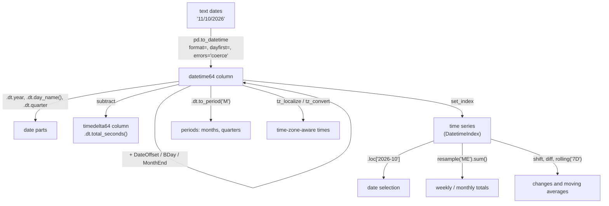

# Dates, Times and Timedeltas: The Complete Guide

> 📚 **Before you start**
>
> - [Data Types and Array Attributes](../02-numpy-essentials/data-types-and-array-attributes.md), for NumPy's `datetime64` and `timedelta64`
> - [Selecting, Sorting and Indexing Data](../03-pandas-core/selecting-sorting-and-indexing-data.md), for `.loc` and setting an index
> - [Reindexing and Iteration](../03-pandas-core/reindexing-and-iteration.md), for `date_range` and reindexing onto every day
> - [Working with Text Data](working-with-text-data.md), for cleaning the strings dates usually arrive as

## Introduction

Is 03/04/2026 the 3rd of April or the 4th of March? An Indian user means April; an American app would read March. How long was a train late if it was due at 23:40 and arrived at 01:15 the next day? What is "one month after 31 January"? Which UPI transactions happened in the last 7 days, and how much was spent per week? How do you compare a server log in UTC with a shop's receipt in Indian Standard Time?

Dates and times look simple and are full of traps: formats, months of different lengths, leap years, weekends, time zones. pandas has a complete toolkit for them, built on NumPy's `datetime64`: **Timestamps** (moments in time), **Timedeltas** (durations), **Periods** (spans such as "October 2026") and **DateOffsets** (calendar-aware steps such as "one month" or "next business day"), plus the `.dt` accessor, date ranges, resampling and rolling windows.

By the end of this article you will be able to parse dates in any format reliably, pull out parts such as weekday and quarter, do arithmetic with durations and calendar offsets, select by date ranges, aggregate by week or month with `resample`, compute rolling averages, handle time zones correctly, and know what pandas 3 changed about date resolution and frequency names.

> 💡 **Key Insight**
>
> Convert date strings to real datetime values **as early as possible** (with `pd.to_datetime` or `parse_dates`). Once a column is `datetime64`, every calendar operation (weekday, month, differences, resampling, ranges) becomes a one-liner. While it is still text, none of them work.

---

## Core Explanation

### 1. The four time concepts in pandas

| Concept | Meaning | Scalar | Array / Index | Example |
|---|---|---|---|---|
| Moment | a point in time | `pd.Timestamp` | `DatetimeIndex`, `datetime64` column | 11 Oct 2026, 09:30 |
| Duration | an exact length of time | `pd.Timedelta` | `TimedeltaIndex`, `timedelta64` column | 2 hours 15 minutes |
| Span | a calendar period | `pd.Period` | `PeriodIndex`, `period` column | October 2026, 2026 Q4 |
| Calendar step | a rule for moving along the calendar | `pd.DateOffset` and friends | (used as `freq`) | "one month", "month end", "business day" |

```python
import numpy as np
import pandas as pd

moment = pd.Timestamp("2026-10-11 09:30")
duration = pd.Timedelta(hours=2, minutes=15)
span = pd.Period("2026-10", freq="M")
print(moment, "|", duration, "|", span)
print(moment + duration)
print(span.start_time, "to", span.end_time)
```

Output:

```
2026-10-11 09:30:00 | 0 days 02:15:00 | 2026-10
2026-10-11 11:45:00
2026-10-01 00:00:00 to 2026-10-31 23:59:59.999999
```

### 2. Parsing dates with `to_datetime`

`pd.to_datetime` converts strings, numbers or Python `datetime` objects into pandas timestamps. On a list or Series it returns datetime values with dtype `datetime64[...]`.

```python
print(pd.to_datetime("2026-10-11"))
s = pd.Series(["2026-10-01", "2026-10-15", "2026-11-02"])
dates = pd.to_datetime(s)
print(dates)
```

Output:

```
2026-10-11 00:00:00
0   2026-10-01
1   2026-10-15
2   2026-11-02
dtype: datetime64[us]
```

**Resolution.** The `[us]` means the values are stored as microseconds since 1 January 1970. pandas 3 picks the resolution from the input: strings and Python datetimes become microseconds (`us`), while numbers keep the unit you give. Older pandas always used nanoseconds (`ns`), which limited dates to roughly the years 1677 to 2262. With microseconds, historical and far-future dates just work:

```python
print(pd.Timestamp("1526-04-21").unit, pd.Timestamp("1526-04-21").year)    # Battle of Panipat
print(pd.to_datetime([1_760_000_000], unit="s"))                           # Unix seconds
print(dates.dt.as_unit("ns").dtype)                                        # convert if a library needs ns
```

Output:

```
us 1526
DatetimeIndex(['2025-10-09 08:53:20'], dtype='datetime64[s]', freq=None)
datetime64[ns]
```

**Day-first dates.** Indian and British data writes the day first. By default pandas reads `03/04/2026` month-first; tell it otherwise:

```python
ambiguous = ["03/04/2026", "15/04/2026"]
print(pd.to_datetime(ambiguous, dayfirst=True))
print(pd.to_datetime(ambiguous, format="%d/%m/%Y"))
```

Output:

```
DatetimeIndex(['2026-04-03', '2026-04-15'], dtype='datetime64[us]', freq=None)
DatetimeIndex(['2026-04-03', '2026-04-15'], dtype='datetime64[us]', freq=None)
```

Passing an explicit `format` is the most reliable choice: it is fast, unambiguous and raises an error if any value does not fit. The common codes:

| Code | Meaning | Example |
|---|---|---|
| `%Y` / `%y` | 4-digit / 2-digit year | 2026 / 26 |
| `%m` | month number | 04 |
| `%d` | day of month | 15 |
| `%b` / `%B` | month name short / full | Apr / April |
| `%a` / `%A` | weekday short / full | Wed / Wednesday |
| `%H`, `%I`, `%M`, `%S` | hour (24h), hour (12h), minute, second | 18, 06, 30, 05 |
| `%p` | AM/PM | PM |

**Consistent formats.** pandas works out the format from the first value and then expects every value to follow it. Mixed formats raise an error that tells you what to do:

```python
mixed = ["2026-10-11", "11 Oct 2026", "Oct 12, 2026"]
try:
    pd.to_datetime(mixed)
except ValueError as err:
    print("ValueError:", str(err).splitlines()[0])
print(pd.to_datetime(mixed, format="mixed"))
```

Output:

```
ValueError: time data "11 Oct 2026" doesn't match format "%Y-%m-%d". You might want to try:
DatetimeIndex(['2026-10-11', '2026-10-11', '2026-10-12'], dtype='datetime64[us]', freq=None)
```

`format="mixed"` parses each value separately (slower, and only use it when you trust the data). Be careful combining it with `dayfirst=True`: the per-value parser then also swaps day and month in ISO dates such as `2026-07-03`, reading it as 7 March. Parse ISO values first with `format="ISO8601"` and `errors="coerce"`, then the rest; the [Lab: Clean and summarise a messy CSV](../05-statistics-and-plots-in-pandas/lab-clean-and-summarise-a-messy-csv.md) walks through it. For dirty data, **`errors="coerce"`** turns anything unparseable into **`NaT`** ("Not a Time", the datetime version of `NaN`):

```python
dirty = pd.Series(["2026-10-11", "tomorrow", None, "2026-13-01", "2026-10-12"])
parsed = pd.to_datetime(dirty, errors="coerce")
print(parsed)
print("bad or missing:", parsed.isna().sum())
```

Output:

```
0   2026-10-11
1          NaT
2          NaT
3          NaT
4   2026-10-12
dtype: datetime64[us]
bad or missing: 3
```

Always count the `NaT`s after coercing; they are the rows you need to look at.

Dates spread across columns combine directly: `pd.to_datetime(df[["year", "month", "day"]])`. And when reading CSV files, `pd.read_csv(..., parse_dates=["col"])` parses on load (add `date_format="%d/%m/%Y"` for a known format).

### 3. The `.dt` accessor: parts of dates

A datetime column has a `.dt` accessor, the date equivalent of `.str`:

```python
trips = pd.DataFrame({"departure": pd.to_datetime([
    "2026-10-09 22:15", "2026-10-10 06:40", "2026-10-11 13:05", "2026-12-31 23:50"])})
d = trips["departure"]
parts = pd.DataFrame({
    "date": d.dt.date,
    "year": d.dt.year,
    "month": d.dt.month,
    "month_name": d.dt.month_name(),
    "day": d.dt.day,
    "weekday": d.dt.day_name(),
    "dow": d.dt.dayofweek,          # Monday = 0 ... Sunday = 6
    "hour": d.dt.hour,
    "quarter": d.dt.quarter,
    "weekend": d.dt.dayofweek >= 5,
})
print(parts.to_string())
```

Output:

```
         date  year  month month_name  day   weekday  dow  hour  quarter  weekend
0  2026-10-09  2026     10    October    9    Friday    4    22        4    False
1  2026-10-10  2026     10    October   10  Saturday    5     6        4     True
2  2026-10-11  2026     10    October   11    Sunday    6    13        4     True
3  2026-12-31  2026     12   December   31  Thursday    3    23        4    False
```

Other useful attributes and methods:

```python
print(d.dt.isocalendar().week.tolist())                 # ISO week numbers
print(d.dt.dayofyear.tolist(), d.dt.days_in_month.tolist())
print(d.dt.is_month_end.tolist(), d.dt.is_year_end.tolist())
print(d.dt.strftime("%d %b %Y, %I:%M %p").tolist())     # back to formatted text
print(d.dt.floor("h").tolist()[0], "|", d.dt.normalize().tolist()[0])
```

Output:

```
[41, 41, 41, 53]
[282, 283, 284, 365] [31, 31, 31, 31]
[False, False, False, True] [False, False, False, True]
['09 Oct 2026, 10:15 PM', '10 Oct 2026, 06:40 AM', '11 Oct 2026, 01:05 PM', '31 Dec 2026, 11:50 PM']
2026-10-09 22:00:00 | 2026-10-09 00:00:00
```

`floor`, `ceil` and `round` snap times to a frequency (`"h"`, `"15min"`, `"D"`); `normalize` sets the time to midnight. 31 December 2026 falls in ISO week 53, a reminder that week numbers have their own rules.

### 4. Timedeltas: exact durations

Subtracting two timestamps gives a **Timedelta**. You can also create them from text or keywords:

```python
due = pd.Timestamp("2026-10-10 23:40")
arrived = pd.Timestamp("2026-10-11 01:15")
late = arrived - due
print(late, "|", late.total_seconds() / 60, "minutes")
print(pd.Timedelta("1 day 2h 30min"), pd.Timedelta(weeks=2), pd.Timedelta(minutes=90))
print(pd.Timedelta(hours=36).components)
```

Output:

```
0 days 01:35:00 | 95.0 minutes
1 days 02:30:00 14 days 00:00:00 0 days 01:30:00
Components(days=1, hours=12, minutes=0, seconds=0, milliseconds=0, microseconds=0, nanoseconds=0)
```

Columns of durations have their own `.dt` accessor with `days`, `seconds` (the remainder within the day) and `total_seconds()`:

```python
journeys = pd.DataFrame({
    "train": ["Deccan Queen", "Shatabdi", "Rajdhani"],
    "depart": pd.to_datetime(["2026-10-11 07:15", "2026-10-11 06:00", "2026-10-11 16:55"]),
    "arrive": pd.to_datetime(["2026-10-11 10:25", "2026-10-11 14:30", "2026-10-12 08:35"]),
})
journeys["duration"] = journeys["arrive"] - journeys["depart"]
journeys["hours"] = (journeys["duration"].dt.total_seconds() / 3600).round(2)
print(journeys[["train", "duration", "hours"]])
print(journeys["duration"].dtype, journeys["duration"].mean())
print(pd.to_timedelta(["90min", "2h", "1 days"]).tolist())
```

Output:

```
          train        duration  hours
0  Deccan Queen 0 days 03:10:00   3.17
1      Shatabdi 0 days 08:30:00   8.50
2      Rajdhani 0 days 15:40:00  15.67
timedelta64[us] 0 days 09:06:40
[Timedelta('0 days 01:30:00'), Timedelta('0 days 02:00:00'), Timedelta('1 days 00:00:00')]
```

Timedeltas support arithmetic: add them to timestamps, multiply or divide by numbers, divide two timedeltas to get a ratio, and compare them (`journeys["duration"] > pd.Timedelta(hours=8)`).

### 5. DateOffsets: calendar-aware steps

A Timedelta of 30 days is always exactly 30 × 24 hours. "One month" is not a fixed duration, and neither is "next business day". For calendar logic, use **DateOffsets**:

```python
jan31 = pd.Timestamp("2026-01-31")
print(jan31 + pd.Timedelta(days=30))           # fixed duration
print(jan31 + pd.DateOffset(months=1))         # calendar month, clipped to Feb 28
print(jan31 + pd.offsets.MonthEnd(1))          # next month end
print(pd.Timestamp("2026-10-09") + pd.offsets.BDay(1))    # Friday + 1 business day
print(pd.Timestamp("2026-10-11") - pd.offsets.Week(weekday=0))   # previous Monday
```

Output:

```
2026-03-02 00:00:00
2026-02-28 00:00:00
2026-02-28 00:00:00
2026-10-12 00:00:00
2026-10-05 00:00:00
```

Business days (`BDay`) skip Saturdays and Sundays but know nothing about public holidays. For Diwali or Republic Day, build a `pd.offsets.CustomBusinessDay(holidays=[...])` with your own holiday list.

### 6. Date ranges and frequency strings

`pd.date_range` creates evenly spaced timestamps from a start, an end and/or a number of periods, at a **frequency** given by a short string:

```python
print(pd.date_range("2026-10-01", periods=4, freq="D"))
print(pd.date_range("2026-10-01", "2026-10-31", freq="W-MON"))      # every Monday
print(pd.date_range("2026-01-01", periods=4, freq="ME").strftime("%d %b").tolist())   # month ends
print(pd.date_range("2026-10-11 09:00", periods=3, freq="90min").time.tolist())
print(pd.bdate_range("2026-10-09", periods=3).day_name().tolist())  # business days only
```

Output:

```
DatetimeIndex(['2026-10-01', '2026-10-02', '2026-10-03', '2026-10-04'], dtype='datetime64[us]', freq='D')
DatetimeIndex(['2026-10-05', '2026-10-12', '2026-10-19', '2026-10-26'], dtype='datetime64[us]', freq='W-MON')
['31 Jan', '28 Feb', '31 Mar', '30 Apr']
[datetime.time(9, 0), datetime.time(10, 30), datetime.time(12, 0)]
['Friday', 'Monday', 'Tuesday']
```

The frequency strings you need, with the pandas 3 spellings:

| Alias | Meaning | Old alias (removed) |
|---|---|---|
| `D` | calendar day | |
| `B` | business day | |
| `W`, `W-MON` | weekly (Sunday by default), or anchored on a weekday | |
| `ME`, `MS` | month end, month start | `M` |
| `QE`, `QS` | quarter end, quarter start | `Q` |
| `YE`, `YS` | year end, year start | `Y`, `A` |
| `h` | hour | `H` |
| `min` | minute | `T` |
| `s`, `ms`, `us` | second, millisecond, microsecond | `S`, `L`, `U` |

pandas 2.2 deprecated the old aliases and pandas 3 removed them, so old tutorials using `freq="M"` or `"H"` now fail:

```python
try:
    pd.date_range("2026-01-01", periods=2, freq="H")
except ValueError as err:
    print("ValueError:", str(err).split(".")[0])
```

Output:

```
ValueError: Invalid frequency: H
```

(For **Periods**, `"M"`, `"Q"` and `"Y"` are still correct, because a period is the whole month, not its end point.)

### 7. Time series: a DatetimeIndex

Put timestamps in the index and pandas unlocks time-based selection and aggregation. Here are two months of daily UPI spending, generated with a seeded random generator:

```python
rng = np.random.default_rng(11)
days = pd.date_range("2026-09-01", "2026-10-31", freq="D")
spend = pd.Series(rng.integers(150, 1200, len(days)), index=days, name="spend")
spend[spend.index.dayofweek >= 5] += 600                 # weekends cost more
print(spend.head(3))
print(spend.index.freq, len(spend))
```

Output:

```
2026-09-01    290
2026-09-02    284
2026-09-03    986
Freq: D, Name: spend, dtype: int64
<Day> 61
```

**Partial string indexing** selects by any part of a date, and slices include both ends:

```python
print(spend.loc["2026-10"].sum())                    # all of October
print(spend.loc["2026-10-05":"2026-10-07"])          # an inclusive range
print(spend.loc["2026-09-28":].shape)                # from 28 Sept onwards
```

Output:

```
30488
2026-10-05     631
2026-10-06     688
2026-10-07    1138
Freq: D, Name: spend, dtype: int64
(34,)
```

Filtering on a column (rather than the index) works with ordinary comparisons, which accept date strings: `df[df["date"] >= "2026-10-01"]`, or `df["date"].between("2026-10-01", "2026-10-07")`.

### 8. Resampling: aggregate by week, month or quarter

**`resample`** groups a time series into regular time buckets and aggregates each one. It is `groupby` for time.

```python
print(spend.resample("ME").sum())
print(spend.resample("W-SUN").agg(["sum", "mean", "max"]).head(3).round(1))
```

Output:

```
2026-09-30    25362
2026-10-31    30488
Freq: ME, Name: spend, dtype: int64
             sum   mean   max
2026-09-06  4984  830.7  1381
2026-09-13  5661  808.7  1724
2026-09-20  6495  927.9  1778
```

Each weekly bucket is labelled by its last day (the Sunday). `resample` can also **upsample** to a finer frequency, creating gaps you fill with `ffill()`, `bfill()` or `interpolate()`, and `asfreq("D")` simply conforms to a frequency without aggregating.

### 9. Shifting, differences and rolling windows

```python
week = spend.loc["2026-10-01":"2026-10-08"]
compare = pd.DataFrame({
    "spend": week,
    "yesterday": week.shift(1),               # move values down one step
    "change": week.diff(),                    # today minus yesterday
    "pct": (week.pct_change() * 100).round(1),
    "avg_3d": week.rolling(3).mean().round(1),   # mean of the last 3 days
})
print(compare)
```

Output:

```
            spend  yesterday  change   pct  avg_3d
2026-10-01    515        NaN     NaN   NaN     NaN
2026-10-02    977      515.0   462.0  89.7     NaN
2026-10-03   1010      977.0    33.0   3.4   834.0
2026-10-04   1453     1010.0   443.0  43.9  1146.7
2026-10-05    631     1453.0  -822.0 -56.6  1031.3
2026-10-06    688      631.0    57.0   9.0   924.0
2026-10-07   1138      688.0   450.0  65.4   819.0
2026-10-08   1007     1138.0  -131.0 -11.5   944.3
```

- `shift(n)` moves values by n rows (positive = later), for comparing with earlier periods.
- `diff()` and `pct_change()` give absolute and relative changes.
- `rolling(window)` aggregates a moving window; the first rows are `NaN` until the window is full (use `min_periods` to relax that). A window can also be a duration such as `rolling("7D")`, which works even with gaps in the dates.
- `expanding()` aggregates everything up to each row, such as a running maximum.

A 7-day rolling average is the standard way to smooth daily data with a weekly pattern, like this weekend-heavy spending:

```python
smooth = spend.rolling("7D").mean()
print(smooth.loc["2026-10-25":].round(1))
```

Output:

```
2026-10-25     981.6
2026-10-26     954.4
2026-10-27    1034.6
2026-10-28    1025.4
2026-10-29    1081.7
2026-10-30     993.0
2026-10-31    1074.4
Freq: D, Name: spend, dtype: float64
```

### 10. Time zones

Timestamps are **naive** (no time zone) by default. `tz_localize` attaches a zone to naive times; `tz_convert` converts aware times to another zone. Indian Standard Time is `"Asia/Kolkata"` (UTC+05:30).

```python
shop_receipt = pd.Timestamp("2026-10-11 09:30").tz_localize("Asia/Kolkata")
server_log = pd.Timestamp("2026-10-11 04:00", tz="UTC")
print(shop_receipt, "|", shop_receipt.tz_convert("UTC"))
print(server_log.tz_convert("Asia/Kolkata"))
print(shop_receipt == server_log)        # same instant, different zones

times = pd.Series(pd.to_datetime(["2026-10-11 09:30", "2026-10-11 18:45"]))
print(times.dt.tz_localize("Asia/Kolkata").dt.tz_convert("Europe/London").tolist())
```

Output:

```
2026-10-11 09:30:00+05:30 | 2026-10-11 04:00:00+00:00
2026-10-11 09:30:00+05:30
True
[Timestamp('2026-10-11 05:00:00+0100', tz='Europe/London'), Timestamp('2026-10-11 14:15:00+0100', tz='Europe/London')]
```

London is on summer time (UTC+1) in October, which the time zone database handles for you. A good rule for systems: **store times in UTC, convert to local time only for display**. You cannot compare or subtract a naive timestamp and an aware one; pandas raises a `TypeError` to stop you mixing them by accident.

### 11. Periods: whole months and quarters

A **Period** represents a span, which is often what reporting needs: "sales in 2026 Q3", not "sales at the instant 2026-09-30 00:00".

```python
p = pd.Period("2026-10", freq="M")
print(p + 1, p - 3, p.asfreq("Q"))
print(pd.period_range("2026-07", "2026-10", freq="M").tolist())

daily = spend.loc["2026-09-25":"2026-10-04"]
print(daily.groupby(daily.index.to_period("M")).sum())
print(pd.Series(pd.to_datetime(["2026-02-14", "2026-08-15"])).dt.to_period("Q").tolist())
```

Output:

```
2026-11 2026-07 2026Q4
[Period('2026-07', 'M'), Period('2026-08', 'M'), Period('2026-09', 'M'), Period('2026-10', 'M')]
2026-09    5635
2026-10    3955
Freq: M, Name: spend, dtype: int64
[Period('2026Q1', 'Q-DEC'), Period('2026Q3', 'Q-DEC')]
```

India's financial year runs from April to March. A quarterly period with a year ending in March handles that: `pd.Period("2026-10-11", freq="Q-MAR")` is quarter 3 of the financial year ending March 2027.

```python
fq = pd.Period("2026-10-11", freq="Q-MAR")
print(fq, fq.quarter, fq.qyear, fq.start_time.date(), fq.end_time.date())
```

Output:

```
2027Q3 3 2027 2026-10-01 2026-12-31
```

### 12. A map of the toolkit



---

## Try It Yourself

1. Parse `["15-08-2026", "26/01/2027", "2 Oct 2026"]` into dates. The first two are day-first. Which approach parses all three?
2. A food order was placed at `2026-10-11 20:47` and delivered at `2026-10-11 21:31`. How many minutes did it take? Was it within the 40-minute promise?
3. Using the `spend` series, which weekday has the highest **average** spend?
4. Create the list of every **second Saturday** of each month from October to December 2026 (many Indian banks are closed then). Hint: `pd.date_range(..., freq="WOM-2SAT")`.

<details>
<summary>Show answers</summary>

```python
raw = ["15-08-2026", "26/01/2027", "2 Oct 2026"]
print(pd.to_datetime(raw, format="mixed", dayfirst=True).strftime("%Y-%m-%d").tolist())

taken = pd.Timestamp("2026-10-11 21:31") - pd.Timestamp("2026-10-11 20:47")
minutes = taken.total_seconds() / 60
print(minutes, minutes <= 40)

print(spend.groupby(spend.index.day_name()).mean().round(1).sort_values(ascending=False).head(2))

print(pd.date_range("2026-10-01", "2026-12-31", freq="WOM-2SAT").strftime("%d %b").tolist())
```

Output:

```
['2026-08-15', '2027-01-26', '2026-10-02']
44.0 False
Sunday      1470.5
Saturday    1425.7
Name: spend, dtype: float64
['10 Oct', '14 Nov', '12 Dec']
```

**1.** The values use three different formats, so `format="mixed"` is needed, with `dayfirst=True` for the numeric ones. **4.** `WOM-2SAT` means "week of month: the 2nd Saturday".

</details>

---

## Real-World Examples

### Example 1: Business reporting

Finance teams resample transaction data to monthly or quarterly totals (`resample("ME")`, `to_period("Q-MAR")` for India's financial year) and compare each period with the previous one using `pct_change`.

### Example 2: Delivery and transport analytics

Food-delivery and railway analysts subtract timestamps to get delivery times and delays as Timedeltas, then report averages and the share of trips over a threshold, broken down by hour of day with `.dt.hour`.

### Example 3: Monitoring and dashboards

Website traffic, server load and app sign-ups are shown as 7-day rolling averages so weekend dips do not look like problems. Logs are stored in UTC and converted to `Asia/Kolkata` only for the Indian team's dashboard.

---

## Common Misconceptions

### Misconception 1: "pandas will guess my date format correctly"

`03/04/2026` is ambiguous. Pass `dayfirst=True` or, better, an explicit `format`. pandas also infers one format from the first value and expects all others to match.

### Misconception 2: "Adding 30 days is the same as adding a month"

A Timedelta is a fixed duration; use `pd.DateOffset(months=1)` or `MonthEnd` for calendar months.

### Misconception 3: "`freq='M'` means monthly"

In pandas 3, `"M"` is no longer valid for date ranges and resampling. Use `"ME"` (month end) or `"MS"` (month start). Similarly `"H"` became `"h"` and `"T"` became `"min"`.

### Misconception 4: "pandas dates are always nanoseconds"

pandas 3 infers resolution: strings and Python datetimes become microseconds, which also removes the old 1677 to 2262 date range limit.

### Misconception 5: "A timestamp without a time zone is in my local time"

A naive timestamp has no zone at all. Localise it explicitly with `tz_localize`, ideally store UTC, and convert for display.

---

## Interview Relevance

- *"How do you convert a string column to dates, handling bad values?"* `pd.to_datetime(col, format=..., errors="coerce")`, then count `NaT`.
- *"Difference between Timedelta and DateOffset?"* Fixed duration vs calendar-aware step (months, business days, month ends).
- *"How do you compute monthly totals from daily data?"* Set a DatetimeIndex and `resample("ME").sum()`, or group by `.dt.to_period("M")`.
- *"How would you calculate a 7-day moving average?"* `rolling(7).mean()` on regular data, or `rolling("7D")` on a DatetimeIndex with gaps.
- *"How do you handle time zones?"* `tz_localize` naive times, `tz_convert` between zones, store in UTC.
- *"What changed in pandas 3 for dates?"* Inferred resolution (microseconds for strings), removed old frequency aliases (`M`, `H`, `T`...).

---

## Key Takeaways

- **Parse early** with `pd.to_datetime` (`format=`, `dayfirst=`, `errors="coerce"`, `format="mixed"`) or `read_csv(parse_dates=...)`.
- **`.dt`** extracts parts (year, month, day name, quarter, hour), formats with `strftime` and snaps with `floor`/`round`.
- **Timedeltas** are exact durations; **DateOffsets** (`DateOffset`, `MonthEnd`, `BDay`) follow the calendar.
- **Frequencies** use the pandas 3 spellings: `D`, `B`, `W-MON`, `ME`, `MS`, `QE`, `YE`, `h`, `min`, `s`.
- **With a DatetimeIndex**: select with `.loc["2026-10"]`, aggregate with `resample`, compare with `shift`/`diff`/`pct_change`, smooth with `rolling`.
- **Time zones**: `tz_localize`, `tz_convert`, store UTC; **Periods** represent whole months and quarters, including `Q-MAR` for India's financial year.

---

**Up next:** [Categorical Data](categorical-data.md)
