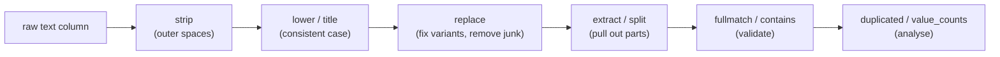

# Working with Text Data: The Complete Guide

> 📚 **Before you start**
>
> - [Series, DataFrames (and the Retired Panel)](../03-pandas-core/series-dataframes-and-the-retired-panel.md), for the pandas 3 `str` dtype
> - [Selecting, Sorting and Indexing Data](../03-pandas-core/selecting-sorting-and-indexing-data.md), for boolean filters
> - [Binary and String Functions](../02-numpy-essentials/binary-and-string-functions.md), for vectorised string operations in NumPy
> - [Python Fundamentals › Strings and Data Structures](../../python-fundamentals/course.md#m5), for Python's string methods

## Introduction

Every sign-up form in India collects the same few things: name, phone, email, city, PIN code. And every exported sign-up list looks like a mess. "  RAHUL sharma", "rahul.sharma@GMAIL.com ", "+91-98200 12345", "bangalore", "Bengaluru", "BLR", "560 034". Before you can count users per city, deduplicate customers or send an SMS campaign, the text needs cleaning. Doing it by hand is impossible for 50,000 rows; doing it with a Python loop is slow and error-prone.

pandas gives every text column a **`.str` accessor**: a collection of vectorised string methods that work on the whole column at once and skip missing values safely. It mirrors Python's own string methods (`lower`, `strip`, `replace`, `split`) and adds powerful **regular expression** tools for searching, extracting and splitting text into new columns.

In this lesson you will learn how pandas 3 stores text (the new default `str` dtype), every important `.str` method, enough regular expressions to extract phone numbers, emails and codes, how to split text into columns and combine columns into text, and how to clean column names. By the end you will be able to take a messy sign-up list and produce a clean, analysable table.

> 💡 **Key Insight**
>
> `df["col"].str.method()` applies a string method to **every value at once**, and missing values stay missing instead of crashing your code. Chain methods (`.str.strip().str.lower()`) to build a cleaning pipeline in one readable line.

---

## Core Explanation

### 1. How pandas 3 stores text

Since pandas 3.0, a column of text gets the dedicated **`str`** dtype by default. Earlier versions used the general `object` dtype, which could hold anything.

```python
import numpy as np
import pandas as pd

cities = pd.Series(["Pune", "Mumbai", None, "Nagpur"])
print(cities.dtype)
print(cities)
print(cities.isna().tolist())
```

Output:

```
str
0      Pune
1    Mumbai
2       NaN
3    Nagpur
dtype: str
[False, False, True, False]
```

The `str` dtype only accepts strings and missing values (shown as `NaN`), which catches mistakes early:

```python
try:
    cities[0] = 411001
except TypeError as err:
    print("TypeError:", err)
```

Output:

```
TypeError: Invalid value '411001' for dtype 'str'. Value should be a string or missing value, got 'int' instead.
```

pandas has three ways to hold text, and you will meet all of them in real code:

| dtype | Created by | Missing value | Boolean results from `.str` |
|---|---|---|---|
| `str` | default in pandas 3 | `NaN` | plain `bool` (missing → `False`) |
| `string` | `astype("string")`, opt-in since pandas 1.0 | `pd.NA` | nullable `boolean` (missing → `<NA>`) |
| `object` | older pandas, or mixed types | `None`/`NaN` | `object` or `bool` |

```python
print(repr(cities.dtype))
print(repr(cities.astype("string").dtype))
print(cities.astype("string").str.startswith("N").tolist())
print(cities.str.startswith("N").tolist())
```

Output:

```
<StringDtype(storage='python', na_value=nan)>
<StringDtype(storage='python', na_value=<NA>)>
[False, False, <NA>, True]
[False, False, False, True]
```

Both are `StringDtype`; they differ in how they represent missing values. `storage='python'` means plain Python strings are used; with the optional `pyarrow` package installed, pandas uses `storage='pyarrow'`, which is faster and uses less memory but behaves the same. For most work, simply use the default `str`.

### 2. The `.str` accessor basics

Each `.str` method returns a new Series (or DataFrame), leaving the original alone. Missing values pass through as missing.

```python
raw = pd.Series(["  rahul SHARMA ", "Priya iyer", None, "  ANIL kumar"])
print(raw.str.strip().tolist())
print(raw.str.strip().str.title().tolist())
print(raw.str.upper().str.strip().tolist())
print(raw.str.len().tolist())
```

Output:

```
['rahul SHARMA', 'Priya iyer', nan, 'ANIL kumar']
['Rahul Sharma', 'Priya Iyer', nan, 'Anil Kumar']
['RAHUL SHARMA', 'PRIYA IYER', nan, 'ANIL KUMAR']
[15.0, 10.0, nan, 12.0]
```

`str.len()` returns floats here only because the missing value forces `NaN` into the result.

| Group | Methods |
|---|---|
| Case | `lower`, `upper`, `title`, `capitalize`, `swapcase`, `casefold` |
| Whitespace | `strip`, `lstrip`, `rstrip` (optionally with characters to remove) |
| Padding | `pad`, `center`, `ljust`, `rjust`, `zfill` |
| Testing | `startswith`, `endswith`, `contains`, `match`, `fullmatch`, `isalpha`, `isdigit`, `isnumeric`, `isalnum`, `isspace`, `islower`, `isupper`, `istitle` |
| Finding | `find`, `rfind`, `index`, `count`, `len` |
| Changing | `replace`, `slice`, `slice_replace`, `repeat`, `translate`, `removeprefix`, `removesuffix`, `wrap` |
| Splitting | `split`, `rsplit`, `partition`, `rpartition`, `get` |
| Extracting | `extract`, `extractall`, `findall` |
| Combining | `cat`, `join` |
| Other | `get_dummies`, `normalize`, `encode`, `decode` |

You can also index into strings: `s.str[0]` gives first characters and `s.str[-4:]` the last four, the same as `s.str.slice(-4)`.

```python
codes = pd.Series(["MH12AB1234", "KA01XY9999", "DL3C4567"])
print(codes.str[:2].tolist())            # state code
print(codes.str[-4:].tolist())           # last four digits
print(codes.str.zfill(12).tolist())
print(pd.Series(["Mr. Shah", "Ms. Rao"]).str.removeprefix("Mr. ").tolist())
```

Output:

```
['MH', 'KA', 'DL']
['1234', '9999', '4567']
['00MH12AB1234', '00KA01XY9999', '0000DL3C4567']
['Shah', 'Ms. Rao']
```

### 3. Testing and filtering text

Text tests return boolean Series, so they plug straight into filters:

```python
emails = pd.Series(["asha@gmail.com", "RAVI@Yahoo.co.in", "meera@company.in",
                    "kabir.gmail.com", None])
print(emails.str.contains("@").tolist())
print(emails.str.lower().str.endswith((".in", ".co.in")).tolist())
print(emails[emails.str.contains("gmail", case=False)].tolist())
```

Output:

```
[True, True, True, False, False]
[False, True, True, False, False]
['asha@gmail.com', 'kabir.gmail.com']
```

`startswith` and `endswith` accept a tuple of options. `contains` has `case=False` for case-insensitive matching. With the default `str` dtype, a missing value gives `False`, so filters simply skip it; with the older `object` dtype you would pass `na=False` to get the same behaviour.

**`contains` uses regular expressions by default.** Characters such as `.`, `+`, `(`, `?` and `|` have special meaning, which surprises people searching for literal text:

```python
prices = pd.Series(["Rs.150", "Rs 200", "Rs.99"])
print(prices.str.contains(".", regex=False).tolist())    # literal dot
print(prices.str.contains("s.1").tolist())               # regex: '.' matches any character
```

Output:

```
[True, False, True]
[True, False, False]
```

Pass `regex=False` whenever you mean plain text. (In contrast, `str.replace` treats the pattern as **plain text by default** since pandas 2.0; pass `regex=True` to use a regular expression.)

### 4. A short regular expression primer

A **regular expression** (regex) is a pattern language for text. You need only a handful of pieces for most cleaning jobs:

| Pattern | Matches | Example |
|---|---|---|
| `\d` | one digit | `\d\d\d` matches "411" |
| `\w` | letter, digit or underscore | |
| `\s` | whitespace (space, tab, newline) | |
| `.` | any character | |
| `[abc]`, `[A-Z]`, `[^0-9]` | one of a set, a range, or not in a set | |
| `+`, `*`, `?` | one or more, zero or more, optional | `\d+` is a run of digits |
| `{n}`, `{m,n}` | exactly n, between m and n repetitions | `\d{6}` is a PIN code |
| `^`, `$` | start and end of the text | `^\d+$` is "only digits" |
| `( )` | a capture group: the part you want to extract | |
| `(?P<name> )` | a named capture group | becomes a column name |
| `\|` | either / or | `UPI\|Card` |

Write patterns as **raw strings** (`r"\d+"`) so Python does not interpret the backslashes itself.

```python
notes = pd.Series(["Paid 250 via UPI", "Cash 80", "card payment of 1,200", "refund"])
print(notes.str.contains(r"\d").tolist())
print(notes.str.contains(r"upi|card", case=False).tolist())
print(notes.str.fullmatch(r"[A-Za-z]+").tolist())     # the whole string is letters
```

Output:

```
[True, True, True, False]
[True, False, True, False]
[False, False, False, True]
```

`match` checks whether the pattern matches at the **start**; `fullmatch` checks the **whole** string; `contains` checks **anywhere**.

### 5. Replacing text

```python
phones = pd.Series(["+91 98200 12345", "098200-54321", "9876543210", "(022) 2456 7890"])
digits = phones.str.replace(r"\D", "", regex=True)      # \D = any non-digit
print(digits.tolist())
print(digits.str[-10:].tolist())                        # keep the last 10 digits
```

Output:

```
['919820012345', '09820054321', '9876543210', '02224567890']
['9820012345', '9820054321', '9876543210', '2224567890']
```

Removing every non-digit and keeping the last ten digits is a standard way to normalise Indian mobile numbers written with `+91`, a leading `0`, spaces or dashes. (The last one is a Mumbai landline, which a full solution would flag separately.)

`replace` also accepts a function that receives each match, and the DataFrame/Series method `replace` (without `.str`) swaps **whole values** using a dictionary, which is the right tool for fixing spelling variants:

```python
city = pd.Series(["bangalore", "Bengaluru", "BLR", "Bombay", "Mumbai", "pune"])
fixes = {"bangalore": "Bengaluru", "blr": "Bengaluru", "bombay": "Mumbai"}
clean_city = city.str.lower().replace(fixes).str.title()
print(clean_city.tolist())
print(pd.Series(["a1b22"]).str.replace(r"\d+", lambda m: f"<{m.group(0)}>", regex=True).tolist())
```

Output:

```
['Bengaluru', 'Bengaluru', 'Bengaluru', 'Mumbai', 'Mumbai', 'Pune']
['a<1>b<22>']
```

Lowercasing first means the dictionary only needs one spelling per variant.

### 6. Splitting text into columns

`str.split` breaks each string at a separator. On its own it returns lists; with **`expand=True`** it returns a DataFrame with one column per piece. `n` limits the number of splits.

```python
full_names = pd.Series(["Asha Rao", "Ravi Kumar Singh", "Meera"])
print(full_names.str.split().tolist())
parts = full_names.str.split(n=1, expand=True)
parts.columns = ["first", "rest"]
print(parts)
print(full_names.str.rsplit(n=1, expand=True)[1].tolist())   # last word: surname
```

Output:

```
[['Asha', 'Rao'], ['Ravi', 'Kumar', 'Singh'], ['Meera']]
   first         rest
0   Asha          Rao
1   Ravi  Kumar Singh
2  Meera          NaN
['Rao', 'Singh', nan]
```

Shorter strings get `NaN` in the extra columns. `str.get(i)` picks the i-th element of each list, and `partition` splits once into (before, separator, after):

```python
print(full_names.str.split().str.get(-1).tolist())
addresses = pd.Series(["Flat 4, Kothrud, Pune", "12 MG Road, Bengaluru"])
print(addresses.str.rpartition(", ")[2].tolist())        # the part after the last comma
```

Output:

```
['Rao', 'Singh', 'Meera']
['Pune', 'Bengaluru']
```

`rsplit` is worth a closer look. Here is its full result:

```python
print(full_names.str.rsplit(n=1, expand=True))
```

Output:

```
            0      1
0        Asha    Rao
1  Ravi Kumar  Singh
2       Meera    NaN
```

So `rsplit(n=1)` splits once **from the right**, giving "everything before the last word" and "the last word". For single-word names there is nothing to split, and the second column is missing. (That is why `split().str.get(-1)` is often the better way to get a surname: it returns the only word when there is one.)

**`explode`** turns list elements into separate rows, which is the tidy way to handle multi-valued fields such as tags:

```python
orders = pd.DataFrame({"order": [1, 2], "items": ["chai,samosa", "coffee"]})
tidy = orders.assign(item=orders["items"].str.split(",")).explode("item")
print(tidy[["order", "item"]])
```

Output:

```
   order    item
0      1    chai
0      1  samosa
1      2  coffee
```

### 7. Extracting with regular expressions

`str.extract(pattern)` returns the **capture groups** of the first match as columns. Named groups `(?P<name>...)` become column names:

```python
listings = pd.Series([
    "2BHK flat in Kothrud, Pune - Rs 18,500/month",
    "1RK in Andheri West, Mumbai - Rs 21,000/month",
    "3BHK villa in Whitefield, Bengaluru - Rs 55,000/month",
])
info = listings.str.extract(
    r"(?P<bhk>\d)(?:BHK|RK).*?in (?P<area>[\w ]+), (?P<city>\w+) - Rs (?P<rent>[\d,]+)"
)
info["rent"] = info["rent"].str.replace(",", "").astype(int)
print(info)
print(info.dtypes)
```

Output:

```
  bhk          area       city   rent
0   2       Kothrud       Pune  18500
1   1  Andheri West     Mumbai  21000
2   3    Whitefield  Bengaluru  55000
bhk       str
area      str
city      str
rent    int64
dtype: object
```

`(?:...)` is a **non-capturing group**: it groups for the `|` but does not become a column. Extracted pieces are text, so convert numbers with `astype`. When a row does not match, all its columns are `NaN`.

`str.extractall` returns **every** match (one row per match, with an extra index level), and `str.findall` returns a list of all matches per row; `str.count` counts them:

```python
messages = pd.Series(["Call 9820012345 or 9876543210", "No number here", "Office: 9123456789"])
print(messages.str.findall(r"\b\d{10}\b").tolist())
print(messages.str.count(r"\b\d{10}\b").tolist())
print(messages.str.extractall(r"(?P<mobile>\d{10})"))
```

Output:

```
[['9820012345', '9876543210'], [], ['9123456789']]
[2, 0, 1]
             mobile
  match            
0 0      9820012345
  1      9876543210
2 0      9123456789
```

`\b` is a **word boundary**, so `\d{10}` does not match ten digits inside a longer number.

### 8. Combining text

`str.cat` joins strings: with another Series it combines element by element; with no argument it joins the whole column into one string. The `+` operator also works between text columns.

```python
first = pd.Series(["Asha", "Ravi", None])
last = pd.Series(["Rao", "Singh", "Das"])
print((first + " " + last).tolist())
print(first.str.cat(last, sep=" ", na_rep="?").tolist())
print(last.str.cat(sep=", "))
print(pd.Series([["a", "b"], ["c"]]).str.join("-").tolist())
```

Output:

```
['Asha Rao', 'Ravi Singh', nan]
['Asha Rao', 'Ravi Singh', '? Das']
Rao, Singh, Das
['a-b', 'c']
```

With `+`, a missing part makes the whole result missing; `str.cat(na_rep=...)` lets you substitute a placeholder. `str.join` joins the elements of lists stored in each cell.

### 9. One-hot columns from text: `get_dummies`

When a column holds several labels separated by a character (for example, the amenities of a hotel), `str.get_dummies` creates one 0/1 column per label:

```python
amenities = pd.Series(["wifi|ac|parking", "ac", "wifi|breakfast"])
print(amenities.str.get_dummies(sep="|"))
```

Output:

```
   ac  breakfast  parking  wifi
0   1          0        1     1
1   1          0        0     0
2   0          1        0     1
```

Machine learning models need numbers, so this is a common step before training. The Feature Engineering course covers encoding in depth.

### 10. Cleaning column names

Column labels are an `Index` of strings, and an `Index` has the same `.str` accessor. A three-step chain fixes most messy headers from spreadsheets:

```python
df = pd.DataFrame(columns=[" Customer Name", "Phone No.", "PIN Code ", "E-mail"])
df.columns = (df.columns.str.strip()
                        .str.lower()
                        .str.replace(r"[^a-z0-9]+", "_", regex=True)
                        .str.strip("_"))
print(df.columns.tolist())
```

Output:

```
['customer_name', 'phone_no', 'pin_code', 'e_mail']
```

Snake-case names without spaces work with attribute access, `query` and `itertuples`, so clean them right after loading.

### 11. Putting it together: cleaning a sign-up list

```python
signups = pd.DataFrame({
    "name": ["  rahul SHARMA ", "Priya iyer", "ANIL kumar", "priya IYER ", None],
    "email": ["Rahul.Sharma@GMAIL.com ", "priya@company.in", "anil_k@yahoo", "PRIYA@company.in", "x@y.com"],
    "phone": ["+91-98200 12345", "9876543210", "98765 43210", "09876543210", "12345"],
    "city": ["bangalore", "Chennai ", "BLR", "chennai", "Pune"],
})

city_fix = {"bangalore": "bengaluru", "blr": "bengaluru"}
clean = pd.DataFrame({
    "name": signups["name"].str.strip().str.title(),
    "email": signups["email"].str.strip().str.lower(),
    "phone": signups["phone"].str.replace(r"\D", "", regex=True).str[-10:],
    "city": signups["city"].str.strip().str.lower().replace(city_fix).str.title(),
})
clean["email_ok"] = clean["email"].str.fullmatch(r"[\w.]+@[\w-]+(\.[\w-]+)+")
clean["phone_ok"] = clean["phone"].str.fullmatch(r"[6-9]\d{9}")
print(clean.to_string())          # to_string avoids "..." for wide tables
print("duplicate people:", clean.duplicated(subset=["email"]).sum())
print(clean.loc[clean["email_ok"] & clean["phone_ok"]].drop_duplicates("email")["city"].value_counts())
```

Output:

```
           name                   email       phone       city  email_ok  phone_ok
0  Rahul Sharma  rahul.sharma@gmail.com  9820012345  Bengaluru      True      True
1    Priya Iyer        priya@company.in  9876543210    Chennai      True      True
2    Anil Kumar            anil_k@yahoo  9876543210  Bengaluru     False      True
3    Priya Iyer        priya@company.in  9876543210    Chennai      True      True
4           NaN                 x@y.com       12345       Pune      True     False
duplicate people: 1
city
Bengaluru    1
Chennai      1
Name: count, dtype: int64
```

Five messy rows became a clean table with validity flags. Priya signed up twice with different capitalisation; after lowercasing the emails, `duplicated` spots her. Mobile numbers in India start with 6, 7, 8 or 9 and have 10 digits, which is what the `phone_ok` pattern checks.



---

## Try It Yourself

1. From `pd.Series(["PIN: 411038", "pin 560 034", "Pincode-110001", "unknown"])`, extract a clean six-digit PIN code (remove spaces first). Unknown rows should be missing.
2. Split `pd.Series(["Pune|MH|411001", "Kochi|KL|682001"])` into three columns named `city`, `state` and `pin`.
3. Count how many words each review in `pd.Series(["Great chai!", "Too sweet, but nice", None])` has.
4. Given product codes like `"TEA-ASSAM-250G"`, `"TEA-DARJ-100G"`, `"COF-ARAB-500G"`, create columns `category`, `variety` and `grams` (an integer).

<details>
<summary>Show answers</summary>

```python
pins = pd.Series(["PIN: 411038", "pin 560 034", "Pincode-110001", "unknown"])
print(pins.str.replace(" ", "").str.extract(r"(\d{6})")[0].tolist())

places = pd.Series(["Pune|MH|411001", "Kochi|KL|682001"])
print(places.str.split("|", expand=True).set_axis(["city", "state", "pin"], axis=1))

reviews = pd.Series(["Great chai!", "Too sweet, but nice", None])
print(reviews.str.split().str.len().tolist())

products = pd.Series(["TEA-ASSAM-250G", "TEA-DARJ-100G", "COF-ARAB-500G"])
parsed = products.str.extract(r"(?P<category>\w+)-(?P<variety>\w+)-(?P<grams>\d+)G")
parsed["grams"] = parsed["grams"].astype(int)
print(parsed)
```

Output:

```
['411038', '560034', '110001', nan]
    city state     pin
0   Pune    MH  411001
1  Kochi    KL  682001
[2.0, 4.0, nan]
  category variety  grams
0      TEA   ASSAM    250
1      TEA    DARJ    100
2      COF    ARAB    500
```

**2.** `str.split("|")` treats `|` as plain text here because a single-character pattern is not interpreted as a regex; use `regex=False` to be explicit with longer patterns.

</details>

---

## Real-World Examples

### Example 1: Customer deduplication

E-commerce and banking companies merge customer records from apps, websites and stores. Normalising names, emails and phone numbers with `.str` methods before matching is what stops one person from appearing as five customers.

### Example 2: Parsing logs and listings

Property portals, job boards and log analysers pull structured fields (price, location, error code) out of free text with `str.extract` and named groups, then analyse them as normal columns.

### Example 3: Preparing text for machine learning

Before building a spam filter or sentiment model, teams lowercase, strip punctuation with `str.replace`, split into words and count them. The NLP course builds on exactly these steps.

---

## Common Misconceptions

### Misconception 1: "Text columns are `object` dtype"

In pandas 3, text columns are `str` by default. Code that checks `dtype == object` needs updating; use `pd.api.types.is_string_dtype`.

### Misconception 2: "`str.contains('.')` finds full stops"

`contains` uses regular expressions by default, and `.` matches any character. Pass `regex=False` for literal text.

### Misconception 3: "`str.replace` uses regex by default"

Not since pandas 2.0. It treats the pattern as plain text unless you pass `regex=True`.

### Misconception 4: "I need a loop to clean each value"

Chained `.str` methods handle whole columns and skip missing values. Loops are slower and usually forget the missing case.

### Misconception 5: "`split` gives me columns"

Without `expand=True` it gives a column of lists. Add `expand=True` for a DataFrame, or use `explode` for one row per element.

---

## Interview Relevance

- *"How do you clean a messy text column in pandas?"* `.str.strip().str.lower()`, `replace` with a mapping for variants, regex `str.replace` for junk characters, then validate with `fullmatch`.
- *"How do you split a column into multiple columns?"* `str.split(sep, expand=True)` or `str.extract` with named groups.
- *"Difference between `match`, `fullmatch` and `contains`?"* Start of string, entire string, anywhere.
- *"What is the difference between `str`, `string` and `object` dtypes?"* pandas 3 default with `NaN`; opt-in `string` with `pd.NA` and nullable boolean results; general-purpose objects.
- *"How do you count rows mentioning a keyword, ignoring case?"* `s.str.contains("kw", case=False).sum()`.

---

## Key Takeaways

- **pandas 3 stores text as `str`** by default, which accepts only strings and missing values; `string` (with `pd.NA`) and `object` still exist.
- **The `.str` accessor** gives vectorised versions of Python's string methods that skip missing values.
- **`contains` uses regex by default; `replace` does not.** Be explicit with `regex=`.
- **`split(expand=True)`, `extract` with named groups and `explode`** turn text into structured columns and rows.
- **`cat`, `+` and `get_dummies`** combine text and turn label lists into 0/1 columns.
- **Clean column names** with `df.columns.str...` right after loading.

---

**Up next:** [Dates, Times and Timedeltas](dates-times-and-timedeltas.md)
