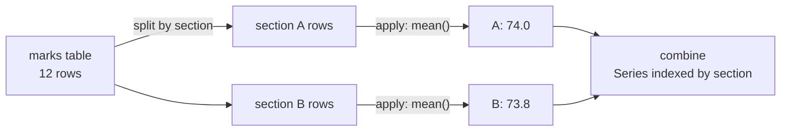

# Descriptive Statistics in pandas: The Complete Guide

> 📚 **Before you start**
>
> - [Statistical, Sorting, Searching and Counting Functions](../02-numpy-essentials/statistical-sorting-searching-and-counting-functions.md), for mean, median, percentiles and `ddof`
> - [Selecting, Sorting and Indexing Data](../03-pandas-core/selecting-sorting-and-indexing-data.md), for filtering and MultiIndex
> - [Categorical Data](../04-text-dates-and-categories-in-pandas/categorical-data.md), for categories in groupby and `observed`
> - [Lab: Explore a sales dataset](../03-pandas-core/lab-explore-a-sales-dataset.md), where you first met `groupby` and `pivot_table`

## Introduction

A school principal receives the board exam results for 300 students and has ten minutes before a parents' meeting. She does not want 300 rows; she wants a handful of numbers. What was the average score, and the middle score? How spread out were the marks? Which subject was hardest? How did the two sections compare? How many students have missing marks? Is maths performance related to science performance?

Those numbers are **descriptive statistics**: summaries that describe a dataset without trying to predict or prove anything. pandas computes all of them in one or two lines, on a whole table, per column, per row or per group. They are always the first step of any analysis, because they show you what the data looks like and where it might be wrong.

This lesson covers `describe`, every individual summary method (with the pandas defaults that differ from NumPy), counting and missing values, correlation, and the most important tool in practical data analysis: **group-wise statistics** with `groupby`, `agg`, `transform`, `crosstab` and `pivot_table`. The [Statistics Foundations](../../statistics-foundations/course.md) course explains the theory behind each measure; this lesson is about computing them correctly and quickly.

> 💡 **Key Insight**
>
> Nearly every question about a dataset has the shape **"statistic of column, per group"**. In pandas that is `df.groupby(group)[column].statistic()`. Master that one pattern and its variants (`agg`, `transform`, `pivot_table`) and you can answer most analysis questions in a single line.

---

## Core Explanation

### 1. The dataset

Marks for 12 students in two sections, with a couple of missing values (absent for the exam):

```python
import numpy as np
import pandas as pd

marks = pd.DataFrame({
    "student": ["Aarav", "Diya", "Kabir", "Meera", "Rohan", "Sara",
                "Tanvi", "Vihaan", "Zoya", "Arjun", "Isha", "Neel"],
    "section": ["A", "A", "A", "A", "A", "A", "B", "B", "B", "B", "B", "B"],
    "gender": ["M", "F", "M", "F", "M", "F", "F", "M", "F", "M", "F", "M"],
    "maths": [78, 92, 45, 88, 67, np.nan, 95, 58, 81, 72, 99, 38],
    "science": [82, 89, 52, 91, 70, 76, 93, 61, 85, 68, 97, np.nan],
    "english": [71, 85, 66, 79, 58, 88, 90, 72, 77, 64, 83, 55],
})
print(marks)
```

Output:

```
   student section gender  maths  science  english
0    Aarav       A      M   78.0     82.0       71
1     Diya       A      F   92.0     89.0       85
2    Kabir       A      M   45.0     52.0       66
3    Meera       A      F   88.0     91.0       79
4    Rohan       A      M   67.0     70.0       58
5     Sara       A      F    NaN     76.0       88
6    Tanvi       B      F   95.0     93.0       90
7   Vihaan       B      M   58.0     61.0       72
8     Zoya       B      F   81.0     85.0       77
9    Arjun       B      M   72.0     68.0       64
10    Isha       B      F   99.0     97.0       83
11    Neel       B      M   38.0      NaN       55
```

### 2. `describe`: the one-call summary

```python
print(marks.describe().round(2))
```

Output:

```
       maths  science  english
count  11.00    11.00    12.00
mean   73.91    78.55    74.00
std    20.24    14.39    11.61
min    38.00    52.00    55.00
25%    62.50    69.00    65.50
50%    78.00    82.00    74.50
75%    90.00    90.00    83.50
max    99.00    97.00    90.00
```

For each numeric column: how many non-missing values (`count`), the mean, the standard deviation, the minimum, the quartiles (25%, 50% = median, 75%) and the maximum. Already you can read a story: maths has the widest spread (std 20.2), the median maths mark (78) is above the mean (73.9) because a few low scores pull the mean down, and maths and science each have one missing value.

Options worth knowing:

```python
print(marks.describe(include="str"))                           # text columns
print(marks["maths"].describe(percentiles=[0.1, 0.9]).round(1))
```

Output:

```
       student section gender
count       12      12     12
unique      12       2      2
top      Aarav       A      M
freq         1       6      6
count    11.0
mean     73.9
std      20.2
min      38.0
10%      45.0
90%      95.0
max      99.0
Name: maths, dtype: float64
```

For text columns, `describe` reports the count, the number of distinct values (`unique`), the most common value (`top`) and how often it appears (`freq`). `include="all"` describes every column together, and `exclude=` leaves types out.

### 3. Individual statistics

Every statistic in `describe` (and many more) is also a method. They work on a Series or column-by-column on a DataFrame:

| Method | Meaning |
|---|---|
| `count()` | non-missing values |
| `sum()`, `prod()` | total, product |
| `mean()`, `median()`, `mode()` | average, middle value, most frequent value(s) |
| `min()`, `max()`, `idxmin()`, `idxmax()` | extremes and their labels |
| `std()`, `var()`, `sem()` | standard deviation, variance, standard error of the mean |
| `quantile(q)` | value below which a fraction q of the data falls |
| `skew()`, `kurt()` | asymmetry and tail heaviness of the distribution |
| `nunique()`, `value_counts()` | distinct values and their frequencies |
| `cumsum()`, `cumprod()`, `cummax()`, `cummin()` | running totals and extremes |
| `abs()`, `pct_change()`, `diff()` | element-wise helpers |

```python
m = marks["maths"]
print("mean  :", round(m.mean(), 2), "| median:", m.median(), "| mode:", m.mode().tolist())
print("std   :", round(m.std(), 2), "| var:", round(m.var(), 2), "| sem:", round(m.sem(), 2))
print("range :", m.max() - m.min(), "| IQR:", m.quantile(0.75) - m.quantile(0.25))
print("skew  :", round(m.skew(), 3), "| kurt:", round(m.kurt(), 3))
print("top scorer:", marks.loc[m.idxmax(), "student"])
```

Output:

```
mean  : 73.91 | median: 78.0 | mode: [38.0, 45.0, 58.0, 67.0, 72.0, 78.0, 81.0, 88.0, 92.0, 95.0, 99.0]
std   : 20.24 | var: 409.69 | sem: 6.1
range : 61.0 | IQR: 27.5
skew  : -0.597 | kurt: -0.703
top scorer: Isha
```

A few things to notice:

- **`mode` returns a Series**, because there can be several modes. Here every mark is unique, so every value ties as the "most frequent". Mode is most useful for categorical data, such as the most common section.
- **The negative skew** confirms what `describe` hinted at: a longer tail of low scores.
- **`std` uses `ddof=1`** (the sample formula, dividing by n − 1) by default in pandas, while NumPy's `np.std` uses `ddof=0`. Pass `ddof=0` to pandas or `ddof=1` to NumPy when you need them to agree.

```python
print(round(m.std(), 4), round(m.std(ddof=0), 4), round(np.std(m.dropna()), 4))
```

Output:

```
20.2408 19.2989 19.2989
```

The old `mad()` method (mean absolute deviation) was removed in pandas 2.0. Write it directly if you need it: `(m - m.mean()).abs().mean()`.

### 4. `skipna`, `axis` and `numeric_only`

**Missing values are skipped by default** (`skipna=True`), unlike NumPy, where one `nan` makes the result `nan`. Pass `skipna=False` to propagate missing values:

```python
print(m.mean(), m.mean(skipna=False), np.mean(m.to_numpy()))
```

Output:

```
73.9090909090909 nan nan
```

**`axis=1`** computes across each row instead of down each column. Here, each student's average over the three subjects:

```python
subjects = ["maths", "science", "english"]
marks["average"] = marks[subjects].mean(axis=1).round(1)
marks["best"] = marks[subjects].idxmax(axis=1)
print(marks[["student", "average", "best"]].head(6))
```

Output:

```
  student  average     best
0   Aarav     77.0  science
1    Diya     88.7    maths
2   Kabir     54.3  english
3   Meera     86.0  science
4   Rohan     65.0  science
5    Sara     82.0  english
```

Sara's average uses her two available marks, because missing values are skipped.

**`numeric_only`**. Calling a statistic on a whole DataFrame that has text columns raises an error in pandas 3, because text has no mean:

```python
try:
    marks.mean()
except TypeError as err:
    print("TypeError:", err)
print(marks.mean(numeric_only=True).round(2))
```

Output:

```
TypeError: Cannot perform reduction 'mean' with string dtype
maths      73.91
science    78.55
english    74.00
average    74.82
dtype: float64
```

Pass `numeric_only=True`, or select the numeric columns first (`marks[subjects]` or `marks.select_dtypes("number")`). Before pandas 2.0, non-numeric columns were silently dropped; now you are asked to be explicit.

### 5. Counting and missing values

```python
print(marks.isna().sum())                      # missing per column
print("rows with any gap:", marks.isna().any(axis=1).sum())
print(marks["section"].value_counts())
print(marks["gender"].value_counts(normalize=True))
print(marks["maths"].value_counts(bins=[0, 40, 60, 75, 90, 100], sort=False))
```

Output:

```
student    0
section    0
gender     0
maths      1
science    1
english    0
average    0
best       0
dtype: int64
rows with any gap: 2
section
A    6
B    6
Name: count, dtype: int64
gender
M    0.5
F    0.5
Name: proportion, dtype: float64
(-0.001, 40.0]    1
(40.0, 60.0]      2
(60.0, 75.0]      2
(75.0, 90.0]      3
(90.0, 100.0]     3
Name: count, dtype: int64
```

`count()` excludes missing values while `size` (or `len`) includes them, so `len(df) - df.count()` is another way to count gaps. `value_counts` drops missing values unless you pass `dropna=False`, and `bins=` groups numbers into ranges on the fly.

What to do with the gaps depends on the question: drop them (`dropna`), fill them with a constant or a statistic (`fillna(m.median())`), or carry neighbouring values (`ffill`, `interpolate`) for time series. The [Lab: Clean and summarise a messy CSV](lab-clean-and-summarise-a-messy-csv.md) practises these choices, and [Feature Engineering and EDA](../../feature-engineering-and-eda/course.md) covers imputation in depth.

### 6. Correlation and covariance

**Correlation** measures how strongly two columns move together, from −1 (perfectly opposite) through 0 (unrelated) to +1 (perfectly together). `corr()` returns the matrix of pairwise correlations:

```python
print(marks[subjects].corr().round(3))
print(round(marks["maths"].corr(marks["science"]), 3))
print(marks[subjects].corr(method="spearman").round(3).loc["maths"])
```

Output:

```
         maths  science  english
maths    1.000    0.982    0.841
science  0.982    1.000    0.691
english  0.841    0.691    1.000
0.982
maths      1.000
science    0.976
english    0.873
Name: maths, dtype: float64
```

Maths and science are very strongly related here (0.98): students good at one tend to be good at the other.

- The default **Pearson** correlation measures a **straight-line** relationship and is sensitive to outliers.
- **Spearman** correlates the **ranks**, so it captures any steadily increasing relationship and resists outliers. **Kendall** is another rank-based measure.
- Pairs with a missing value are skipped pair by pair.
- `cov()` gives covariances, which are in squared units and harder to read; `corrwith(other)` correlates each column with a Series or the matching columns of another DataFrame.

Correlation does not mean causation: maths does not cause science marks; both probably reflect study habits.

### 7. Group-wise statistics with `groupby`

`groupby` follows the **split, apply, combine** pattern: split the rows into groups by one or more keys, apply a calculation to each group, and combine the results into one table.



```python
print(marks.groupby("section")["maths"].mean().round(1))
print(marks.groupby("section")[subjects].mean().round(1))
print(marks.groupby(["section", "gender"])["english"].mean())
```

Output:

```
section
A    74.0
B    73.8
Name: maths, dtype: float64
         maths  science  english
section                         
A         74.0     76.7     74.5
B         73.8     80.8     73.5
section  gender
A        F         84.000000
         M         65.000000
B        F         83.333333
         M         63.666667
Name: english, dtype: float64
```

Grouping by two keys gives a MultiIndex result. Add `as_index=False` to get the keys back as ordinary columns, which is often handier for further work or export.

**Several statistics at once** with `agg`. Pass a list of function names, or use **named aggregation** to choose clear output column names:

```python
print(marks.groupby("section")["maths"].agg(["count", "mean", "median", "min", "max"]).round(1))

summary = marks.groupby("section").agg(
    students=("student", "count"),
    maths_avg=("maths", "mean"),
    science_best=("science", "max"),
    english_spread=("english", "std"),
).round(1)
print(summary)
```

Output:

```
         count  mean  median   min   max
section                                 
A            5  74.0    78.0  45.0  92.0
B            6  73.8    76.5  38.0  99.0
         students  maths_avg  science_best  english_spread
section                                                   
A               6       74.0          91.0            11.6
B               6       73.8          97.0            12.7
```

Section A has 6 students but its maths `count` is 5: Sara's missing mark is excluded. Use `size()` for the number of rows per group regardless of gaps.

### 8. `transform` and `filter`: group statistics back on every row

`agg` reduces each group to one row. **`transform`** returns a result **the same length as the original**, which lets you compare each row with its group:

```python
marks["section_avg_maths"] = marks.groupby("section")["maths"].transform("mean").round(1)
marks["vs_section"] = (marks["maths"] - marks["section_avg_maths"]).round(1)
marks["rank_in_section"] = marks.groupby("section")["maths"].rank(ascending=False)
print(marks[["student", "section", "maths", "section_avg_maths", "vs_section", "rank_in_section"]])
```

Output:

```
   student section  maths  section_avg_maths  vs_section  rank_in_section
0    Aarav       A   78.0               74.0         4.0              3.0
1     Diya       A   92.0               74.0        18.0              1.0
2    Kabir       A   45.0               74.0       -29.0              5.0
3    Meera       A   88.0               74.0        14.0              2.0
4    Rohan       A   67.0               74.0        -7.0              4.0
5     Sara       A    NaN               74.0         NaN              NaN
6    Tanvi       B   95.0               73.8        21.2              2.0
7   Vihaan       B   58.0               73.8       -15.8              5.0
8     Zoya       B   81.0               73.8         7.2              3.0
9    Arjun       B   72.0               73.8        -1.8              4.0
10    Isha       B   99.0               73.8        25.2              1.0
11    Neel       B   38.0               73.8       -35.8              6.0
```

A common use of `transform` is filling missing values with the **group's** statistic rather than the overall one:

```python
filled = marks["maths"].fillna(marks.groupby("section")["maths"].transform("median"))
print(filled.iloc[5], "(Sara gets section A's median)")
```

Output:

```
78.0 (Sara gets section A's median)
```

**`filter`** keeps or drops **whole groups** based on a condition about the group:

```python
strong = marks.groupby("section").filter(lambda g: g["science"].mean() > 80)
print(strong["section"].unique().tolist(), len(strong))
```

Output:

```
['B'] 6
```

### 9. Cross-tabulations and pivot tables

**`pd.crosstab`** counts how often combinations of two categorical variables occur, and with `normalize` gives proportions:

```python
marks["result"] = np.where(marks["maths"] >= 60, "pass", "fail")
print(pd.crosstab(marks["section"], marks["result"], margins=True))
print(pd.crosstab(marks["gender"], marks["result"], normalize="index").round(2))
```

Output:

```
result   fail  pass  All
section                 
A           2     4    6
B           2     4    6
All         4     8   12
result  fail  pass
gender            
F       0.17  0.83
M       0.50  0.50
```

Careful: Sara's missing maths mark counted as "fail", because `NaN >= 60` is `False`. That is a real bug pattern; decide explicitly how missing values should be labelled before categorising (for example `np.select` with an `"absent"` choice for `marks["maths"].isna()`).

**`pivot_table`** generalises this: any aggregation of any value column, with rows and columns from two keys, and optional totals (`margins=True`):

```python
print(marks.pivot_table(index="section", columns="gender", values="science",
                        aggfunc="mean", margins=True).round(1))
```

Output:

```
gender      F     M   All
section                  
A        85.3  68.0  76.7
B        91.7  64.5  80.8
All      88.5  66.6  78.5
```

### 10. A complete summary in one chain

```python
report = (marks
          .groupby("section")
          .agg(students=("student", "size"),
               absent=("maths", lambda s: s.isna().sum()),
               maths_mean=("maths", "mean"),
               maths_median=("maths", "median"),
               pass_rate=("maths", lambda s: (s >= 60).sum() / s.notna().sum()))
          .round(2))
print(report)
```

Output:

```
         students  absent  maths_mean  maths_median  pass_rate
section                                                       
A               6       1       74.00          78.0       0.80
B               6       0       73.83          76.5       0.67
```

Each named aggregation can be a built-in name or your own function (a lambda receives each group's column as a Series). Here the pass rate counts only students who sat the exam, fixing the bug from the crosstab above.

---

## Try It Yourself

1. Which subject has the highest **median** mark, and which has the largest **IQR**?
2. For each section, find the name of the student with the best English mark. (Hint: `idxmax` per group, then `.loc`.)
3. Add a column `english_z` holding each student's English mark as a z-score within their section: (mark − section mean) / section standard deviation.
4. Build a crosstab of `section` against `best` (the subject each student did best in).

<details>
<summary>Show answers</summary>

```python
print(marks[subjects].median().idxmax(), marks[subjects].median().max())
iqr = marks[subjects].quantile(0.75) - marks[subjects].quantile(0.25)
print(iqr.idxmax(), iqr.max())

best_idx = marks.groupby("section")["english"].idxmax()
print(marks.loc[best_idx, ["section", "student", "english"]])

grp = marks.groupby("section")["english"]
marks["english_z"] = ((marks["english"] - grp.transform("mean")) / grp.transform("std")).round(2)
print(marks[["student", "english", "english_z"]].head(3))

print(pd.crosstab(marks["section"], marks["best"]))
```

Output:

```
science 82.0
maths 27.5
  section student  english
5       A    Sara       88
6       B   Tanvi       90
  student  english  english_z
0   Aarav       71      -0.30
1    Diya       85       0.91
2   Kabir       66      -0.73
best     english  maths  science
section                         
A              2      1        3
B              2      3        1
```

</details>

---

## Real-World Examples

### Example 1: The first five minutes of any analysis

Data scientists open a new dataset and run `df.info()`, `df.describe(include="all")`, `df.isna().sum()` and a few `value_counts()`. Odd minimums (negative ages), suspicious maximums (a salary of ₹99,99,99,999) and unexpected missing counts surface immediately.

### Example 2: Business dashboards

Every KPI table ("revenue, orders and average basket per region per month") is a `groupby` with named aggregations or a `pivot_table` with `margins=True`. Analysts write the pandas version first to check the numbers before building the dashboard.

### Example 3: Fair comparisons within groups

Schools, hospitals and sales teams compare individuals with their own group using `transform`: a salesperson's revenue vs their region's average, or a hospital's waiting time vs its district's median, so that easy and hard regions are judged fairly.

---

## Common Misconceptions

### Misconception 1: "pandas and NumPy give the same standard deviation"

pandas defaults to `ddof=1` (sample), NumPy to `ddof=0` (population). Set `ddof` explicitly when comparing.

### Misconception 2: "A missing value makes the mean missing"

In pandas, statistics skip missing values by default. That is convenient but can hide data problems; always count missing values alongside the statistic.

### Misconception 3: "`df.mean()` ignores text columns"

Since pandas 2.0 it raises an error instead of silently dropping them. Use `numeric_only=True` or select numeric columns.

### Misconception 4: "`count` and `size` are the same"

`count` excludes missing values; `size` counts rows. Their difference is the number of gaps.

### Misconception 5: "A strong correlation means one causes the other"

Correlation only measures association. A third factor often drives both.

---

## Interview Relevance

- *"How do you get a quick statistical summary of a DataFrame?"* `describe()` (with `include="all"`), plus `info()` and `isna().sum()`.
- *"Difference between `agg`, `transform` and `apply` in groupby?"* One row per group; same shape as input; flexible but slowest.
- *"How do you compute multiple aggregations with custom names?"* Named aggregation: `agg(new_name=("col", "func"))`.
- *"What does `ddof` do and what are the defaults?"* Divisor n − ddof; pandas 1, NumPy 0.
- *"Pearson vs Spearman correlation?"* Linear vs rank-based (monotonic), sensitivity to outliers.
- *"How would you fill missing values with the group mean?"* `df["x"].fillna(df.groupby("g")["x"].transform("mean"))`.
- *"crosstab vs pivot_table?"* Counts (or normalised counts) of two factors vs any aggregation of any value with margins.

---

## Key Takeaways

- **`describe()`** summarises numeric columns (and text columns with `include`); every statistic also exists as a method.
- **pandas defaults**: skip missing values (`skipna=True`), sample standard deviation (`ddof=1`), and an error for text columns unless `numeric_only=True`.
- **`axis=1`** computes per row; **`value_counts`** (with `normalize`, `bins`, `dropna`) and **`isna().sum()`** count values and gaps.
- **`corr()`** measures association (Pearson by default, Spearman for ranks); it is not causation.
- **`groupby`** with `agg` (named aggregation), `transform` (group stats on every row) and `filter` (keep whole groups) answers "statistic per group" questions.
- **`crosstab`** and **`pivot_table`** build two-way summaries with optional totals.

---

**Up next:** [Quick Visualisation with pandas](quick-visualisation-with-pandas.md)
