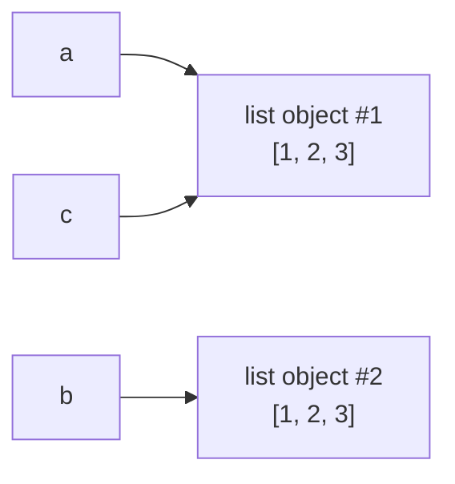
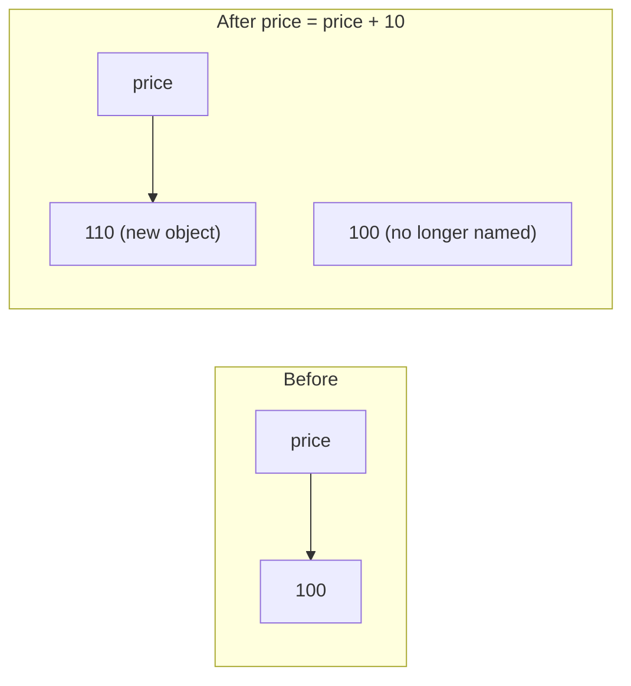
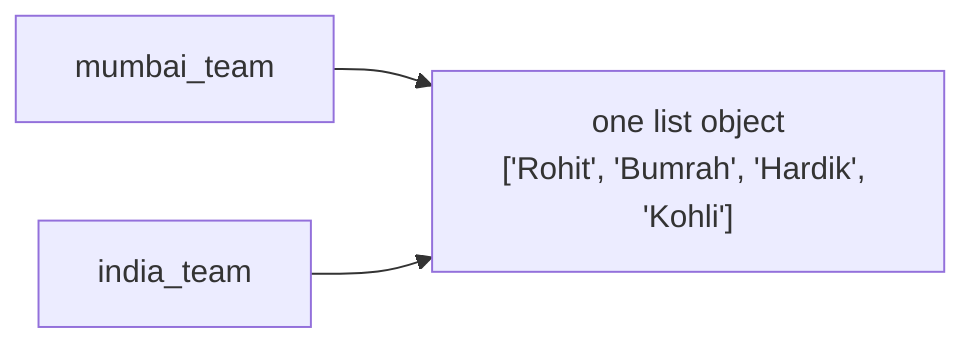
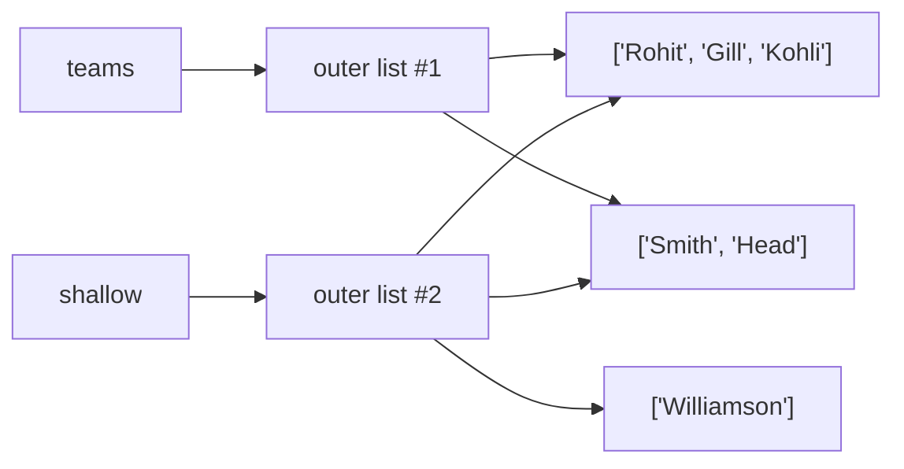

# Containers and Mutability: The Complete Guide

> 📚 **Before you start**
>
> - [Numbers, Booleans and Strings](../02-getting-started-with-python/numbers-booleans-and-strings.md), for variables, types and indexing
> - [Lab: Set up Python and run your first script](../02-getting-started-with-python/lab-set-up-python-and-run-your-first-script.md), so you can run the examples

## Introduction

A cricket team isn't one player, it's eleven. A shopping trip isn't one item, it's a list. A phone's contacts app isn't one number, it's names matched to numbers. Real information comes in **groups**, and Python has four built-in ways to hold a group of values together. These are called **containers** (or **collections**):

- a **list**: an ordered, changeable sequence, like a shopping list,
- a **tuple**: an ordered sequence that can't be changed, like a date of birth,
- a **set**: an unordered bag of unique items, like the distinct cities your customers live in,
- a **dictionary**: keys matched to values, like contacts (name → phone number).

This lesson gives you a working tour of all four, then tackles the idea that confuses more beginners (and causes more real bugs) than anything else in Python: **mutability**, and what really happens when two names point at the same list.

By the end you'll be able to create and use each container, explain the difference between mutable and immutable values, predict when a change through one name shows up through another, and make proper copies (shallow and deep) when you need them.

> 💡 **Key Insight**
>
> In Python, `=` never copies anything. It only attaches a name to an object. If two names are attached to the **same mutable object** (a list, dict or set), a change made through one name is visible through the other, because there was only ever one object. Whenever you want an independent copy, you must ask for one explicitly.

Each container gets a full lesson in module 5. Here you learn enough to use them in the next few lessons, and the deep idea that applies to all of them.

---

## Core Explanation

### 1. Lists: ordered and changeable

A **list** holds values in order, inside square brackets, separated by commas. Values in a list are called **items** or **elements**.

```python
playing_xi = ["Rohit", "Gill", "Kohli", "Iyer", "Pant"]
scores = [45, 112, 8, 67, 31]
mixed = ["chai", 20, True, 3.5]     # items can be any type
empty = []

print(playing_xi)
print(len(scores))
print(playing_xi[0], playing_xi[-1])   # indexes work like strings
print(scores[1:3])                     # so do slices
```

Output:

```
['Rohit', 'Gill', 'Kohli', 'Iyer', 'Pant']
5
Rohit Pant
[112, 8]
```

Lists are **mutable**: you can change them after creating them.

```python
playing_xi.append("Jadeja")      # add to the end
playing_xi[3] = "Rahul"          # replace the item at index 3
playing_xi.remove("Gill")        # remove by value
print(playing_xi)
print("Kohli" in playing_xi)     # membership test
```

Output:

```
['Rohit', 'Kohli', 'Rahul', 'Pant', 'Jadeja']
True
```

### 2. Tuples: ordered and fixed

A **tuple** is like a list that can't be changed once made. Write it with round brackets (or just commas):

```python
dob = (1947, 8, 15)
location = 19.0760, 72.8777      # brackets are optional: commas make the tuple
single = ("Mumbai",)             # a one-item tuple needs a trailing comma
not_a_tuple = ("Mumbai")         # without the comma, this is just a string

print(dob[0], len(dob))
print(type(location), type(single), type(not_a_tuple))
```

Output:

```
1947 3
<class 'tuple'> <class 'tuple'> <class 'str'>
```

Trying to change a tuple fails:

```python
# not-run: shows an error on purpose
dob = (1947, 8, 15)
dob[0] = 1950
```

Running it shows:

```
Traceback (most recent call last):
  File "/home/you/python-practice/example.py", line 3, in <module>
    dob[0] = 1950
    ~~~^^^
TypeError: 'tuple' object does not support item assignment
```

Why have a container you can't change? Because sometimes "can't change" is exactly the guarantee you want: a date, a GPS coordinate, an RGB colour. Tuples are also slightly faster and lighter than lists, and (as you'll see in section 9) they can be used where lists can't, such as dictionary keys.

Tuples support **unpacking**: assigning each item to its own name in one line.

```python
year, month, day = dob
print(day, month, year)

a, b = 1, 2
a, b = b, a           # swap two values without a temporary variable
print(a, b)
```

Output:

```
15 8 1947
2 1
```

### 3. Sets: unique and unordered

A **set** keeps only one copy of each value and has no order. Write it with curly braces:

```python
cities = {"Pune", "Delhi", "Pune", "Chennai", "Delhi"}
print(len(cities))
print(sorted(cities))        # sets have no order, so sort them to print predictably
print("Pune" in cities)

cities.add("Kochi")
cities.discard("Delhi")
print(sorted(cities))
```

Output:

```
3
['Chennai', 'Delhi', 'Pune']
True
['Chennai', 'Kochi', 'Pune']
```

Duplicates vanished automatically. Sets have no indexes (`cities[0]` is a `TypeError`), because there is no "first" item. An empty set is written `set()`, because `{}` means an empty dictionary. Full details are in [Sets](../05-strings-and-data-structures/sets.md).

### 4. Dictionaries: keys and values

A **dictionary** (`dict`) maps **keys** to **values**, like a word to its meaning or a name to a phone number. Write `key: value` pairs in curly braces:

```python
menu = {"chai": 20, "samosa": 15, "vada pav": 25}

print(menu["chai"])            # look up by key, not by position
menu["poha"] = 30              # add a new key
menu["chai"] = 25              # change an existing key's value
del menu["samosa"]             # remove a key
print(menu)
print(len(menu), "poha" in menu)
print(menu.get("dosa", "not on the menu"))
```

Output:

```
20
{'chai': 25, 'vada pav': 25, 'poha': 30}
3 True
not on the menu
```

Keys must be unique; values can repeat. Looking up a key that isn't there with `[]` is a `KeyError`; `.get()` returns a default instead. Dictionaries keep keys in the order they were added. Full details are in [Dictionaries and Dictionary Views](../05-strings-and-data-structures/dictionaries-and-dictionary-views.md).

### 5. The four containers side by side

| | list | tuple | set | dict |
|---|---|---|---|---|
| **Written as** | `[1, 2, 3]` | `(1, 2, 3)` | `{1, 2, 3}` | `{"a": 1, "b": 2}` |
| **Empty** | `[]` | `()` | `set()` | `{}` |
| **Ordered?** | Yes | Yes | No | Yes (insertion order) |
| **Indexed by** | position | position | (no indexing) | key |
| **Duplicates?** | Allowed | Allowed | Removed | Keys unique, values can repeat |
| **Mutable?** | **Yes** | No | **Yes** | **Yes** |
| **Typical use** | A sequence that grows or changes | A fixed record | Uniqueness, fast "is it in here?" | Look things up by name |

Strings behave like an immutable sequence of characters, so they share many features with tuples (indexing, slicing, `len`, `in`).

Converting between containers is done by calling the type's name:

```python
orders = ["Pune", "Delhi", "Pune", "Goa"]
print(sorted(set(orders)))      # sets print in arbitrary order, so sort them
print(tuple(orders))
print(list("chai"))
print(dict([("chai", 20), ("samosa", 15)]))
```

Output:

```
['Delhi', 'Goa', 'Pune']
('Pune', 'Delhi', 'Pune', 'Goa')
['c', 'h', 'a', 'i']
{'chai': 20, 'samosa': 15}
```

### 6. Objects, identity and names

To understand mutability you need one more idea. Every value in Python is an **object**, and every object has three things:

- a **type** (what kind of thing it is), from `type(obj)`,
- a **value** (its contents),
- an **identity**: a unique number for that object while it exists, from `id(obj)`. In CPython it is the object's memory address.

A **name** (variable) is not a box that holds a value. It's a **label attached to an object**. Assignment attaches a label; it never copies the object.

The operator `is` asks "are these the **same object**?" (same identity). The operator `==` asks "do these have **equal values**?". They're different questions:

```python
a = [1, 2, 3]
b = [1, 2, 3]
c = a

print(a == b)    # equal contents?
print(a is b)    # same object?
print(a is c)
```

Output:

```
True
False
True
```



`a` and `b` are two separate lists that happen to contain the same numbers. `c = a` didn't make a new list; it attached a second label to list #1.

### 7. Mutable vs immutable

- An object is **mutable** if its contents can change while it remains the same object (same identity). Lists, dicts and sets are mutable.
- An object is **immutable** if its contents can never change. Numbers (`int`, `float`, `complex`), `bool`, `str`, `tuple`, `frozenset`, `bytes` and `None` are immutable.

Here's the key experiment. We'll record an object's identity, "change" it, and see whether it's still the same object.

```python
cart = ["rice", "dal"]
before = id(cart)
cart.append("ghee")              # changes the list in place
print(cart, id(cart) == before)

price = 100
before = id(price)
price = price + 10               # makes a NEW int object; the name moves to it
print(price, id(price) == before)

word = "chai"
before = id(word)
word = word.upper()              # strings can't change, so upper() returns a new one
print(word, id(word) == before)
```

Output:

```
['rice', 'dal', 'ghee'] True
110 False
CHAI False
```

The list was modified in place and kept its identity. The integer and the string couldn't be modified, so Python created new objects and moved the names to them.



That's why string methods like `upper()`, `replace()` and `strip()` always **return** a new string. Calling `word.upper()` on its own line and ignoring the result does nothing useful:

```python
word = "chai"
word.upper()          # result thrown away
print(word)
word = word.upper()   # keep the new string
print(word)
```

Output:

```
chai
CHAI
```

List methods are the opposite: most change the list in place and return `None`. A classic beginner bug is writing `cart = cart.append("ghee")`, which sets `cart` to `None`:

```python
cart = ["rice", "dal"]
result = cart.append("ghee")
print(result)
print(cart)
```

Output:

```
None
['rice', 'dal', 'ghee']
```

### 8. Aliasing: two names, one object

When two names refer to the same object, they are **aliases**. With immutable objects, aliasing is harmless, since nobody can change the object. With mutable objects, it leads to the single most famous surprise in Python:

```python
mumbai_team = ["Rohit", "Bumrah", "Hardik"]
india_team = mumbai_team          # NOT a copy: a second name for the same list

india_team.append("Kohli")

print(india_team)
print(mumbai_team)                # changed too!
print(india_team is mumbai_team)
```

Output:

```
['Rohit', 'Bumrah', 'Hardik', 'Kohli']
['Rohit', 'Bumrah', 'Hardik', 'Kohli']
True
```



There was only ever one list. Both names see the change because both names point at it. Compare with integers, where "changing" means rebinding a name to a new object:

```python
x = 10
y = x
y = y + 5
print(x, y)
```

Output:

```
10 15
```

`y = y + 5` created a new integer `15` and moved `y` to it. `x` still points at `10`. Nothing was changed in place, because integers can't be.

Aliasing happens in less obvious places too: when you put a list inside another container, and when you pass a list to a function (covered in [Functions and Parameter Passing](../06-functions-and-iterators/functions-and-parameter-passing.md)).

### 9. Making copies: shallow and deep

When you want a separate list, make a copy. These all make a **shallow copy**, a new outer list containing the same items:

```python
original = ["rice", "dal", "ghee"]
copy1 = original.copy()
copy2 = list(original)
copy3 = original[:]               # a slice of everything

copy1.append("salt")
print(original)
print(copy1)
print(copy1 is original, copy2 is original, copy3 is original)
```

Output:

```
['rice', 'dal', 'ghee']
['rice', 'dal', 'ghee', 'salt']
False False False
```

Dictionaries and sets have `.copy()` too, and `dict(d)` / `set(s)` work the same way.

**Shallow** means only the outer container is new. If the items are themselves mutable (a list of lists, say), the copy shares them with the original:

```python
teams = [["Rohit", "Gill"], ["Smith", "Head"]]
shallow = teams.copy()

shallow.append(["Williamson"])       # changes only the new outer list
shallow[0].append("Kohli")           # changes an inner list that BOTH share

print(teams)
print(shallow)
```

Output:

```
[['Rohit', 'Gill', 'Kohli'], ['Smith', 'Head']]
[['Rohit', 'Gill', 'Kohli'], ['Smith', 'Head'], ['Williamson']]
```



For a fully independent copy at every level, use `copy.deepcopy`:

```python
import copy

teams = [["Rohit", "Gill"], ["Smith", "Head"]]
deep = copy.deepcopy(teams)
deep[0].append("Kohli")

print(teams)
print(deep)
print(teams[0] is deep[0])
```

Output:

```
[['Rohit', 'Gill'], ['Smith', 'Head']]
[['Rohit', 'Gill', 'Kohli'], ['Smith', 'Head']]
False
```

| Operation | New outer object? | New inner objects? |
|---|---|---|
| `b = a` | No | No |
| `a.copy()`, `list(a)`, `a[:]`, `copy.copy(a)` | Yes | No (shared) |
| `copy.deepcopy(a)` | Yes | Yes |

### 10. The list-of-lists trap

Multiplying a list repeats its items. If the item is itself a list, you get several references to **one** inner list:

```python
grid = [[0] * 3] * 3       # looks like a 3x3 grid of zeros
grid[0][0] = 9
print(grid)
```

Output:

```
[[9, 0, 0], [9, 0, 0], [9, 0, 0]]
```

All three rows are the same list object. The correct way creates a new inner list for each row, using a loop or a comprehension (you'll learn both soon):

```python
grid = [[0] * 3 for _ in range(3)]
grid[0][0] = 9
print(grid)
```

Output:

```
[[9, 0, 0], [0, 0, 0], [0, 0, 0]]
```

`[0] * 3` on its own is fine, because the items are integers and immutable.

### 11. Immutable containers holding mutable things

A tuple can't change which objects it holds, but if one of those objects is mutable, that object can still change:

```python
order = ("ORD-1042", ["chai", "samosa"])
order[1].append("jalebi")      # allowed: we're changing the list, not the tuple
print(order)
```

Output:

```
('ORD-1042', ['chai', 'samosa', 'jalebi'])
```

The tuple still holds the same two objects; one of them grew. "Immutable" is about the container's own slots, not about everything inside.

### 12. Why mutability matters: hashability

Dictionary keys and set items must be **hashable**: Python computes a number (a **hash**) from the value to find it quickly, and that number must never change. Immutable built-in values are hashable; mutable ones are not.

```python
distances = {("Mumbai", "Pune"): 150, ("Delhi", "Agra"): 233}
print(distances[("Mumbai", "Pune")])
```

Output:

```
150
```

A tuple works as a key. A list does not:

```python
# not-run: shows an error on purpose
distances = {["Mumbai", "Pune"]: 150}
```

Running it shows:

```
Traceback (most recent call last):
  File "/home/you/python-practice/example.py", line 2, in <module>
    distances = {["Mumbai", "Pune"]: 150}
                ^^^^^^^^^^^^^^^^^^^^^^^^^
TypeError: unhashable type: 'list'
```

If a list could be a key and you then appended to it, its hash would change and the dictionary would lose track of it. Python forbids that by refusing mutable keys. (A tuple that contains a list is also unhashable, for the same reason.)

### 13. `+=` behaves differently for mutable and immutable values

`x += y` means "add `y` to `x`". For a list, it **extends the same list in place**. For a tuple, string or number, it **builds a new object** and rebinds the name. Aliases reveal the difference:

```python
basket = ["apple"]
alias = basket
basket += ["mango"]          # in place: alias sees it
print(alias)

name = "Ravi"
alias_name = name
name += " Kumar"             # new string: alias_name doesn't change
print(alias_name, "|", name)

point = (1, 2)
alias_point = point
point += (3,)
print(alias_point, point)
```

Output:

```
['apple', 'mango']
Ravi | Ravi Kumar
(1, 2) (1, 2, 3)
```

But `basket = basket + ["banana"]` (without `+=`) builds a new list and leaves aliases alone:

```python
basket = ["apple"]
alias = basket
basket = basket + ["banana"]
print(alias, basket)
```

Output:

```
['apple'] ['apple', 'banana']
```

---

## Try It Yourself

1. Predict what this prints, then run it: `a = [1, 2]`, `b = a`, `b.append(3)`, `c = a.copy()`, `c.append(4)`, `print(a, b, c)`.
2. Make a dictionary `stock` mapping three fruits to quantities. Make `backup = stock.copy()`, then set one fruit's quantity to 0 in `stock`. Print both. Did `backup` change?
3. Remove the duplicate PIN codes from `["400001", "110001", "400001", "560001"]` and print how many unique ones there are.
4. Which of these can be dictionary keys? `42`, `"UPI"`, `(1, 2)`, `[1, 2]`, `(1, [2])`, `None`. Check each with `hash()` inside your head first, then by trying.

<details>
<summary>Show answers</summary>

```python
a = [1, 2]
b = a
b.append(3)
c = a.copy()
c.append(4)
print(a, b, c)

stock = {"mango": 12, "banana": 30, "guava": 8}
backup = stock.copy()
stock["mango"] = 0
print(stock)
print(backup)

pins = ["400001", "110001", "400001", "560001"]
print(len(set(pins)))

for key in [42, "UPI", (1, 2), None]:
    print(repr(key), "is hashable:", hash(key) is not None)
```

Output:

```
[1, 2, 3] [1, 2, 3] [1, 2, 3, 4]
{'mango': 0, 'banana': 30, 'guava': 8}
{'mango': 12, 'banana': 30, 'guava': 8}
3
42 is hashable: True
'UPI' is hashable: True
(1, 2) is hashable: True
None is hashable: True
```

For exercise 1, `a` and `b` are the same list, so both show the 3; `c` is a separate copy made after the 3 was added. `backup` didn't change: `.copy()` made a separate dictionary, and integers are immutable anyway. `[1, 2]` and `(1, [2])` raise `TypeError: unhashable type: 'list'`. (The `for` loop is explained in [for and while Loops](../04-control-flow/for-and-while-loops.md); `repr()` shows a value the way you'd type it, with quotes for strings.)

</details>

---

## Real-World Examples

### Example 1: The "default settings" bug

An app keeps `DEFAULT_SETTINGS = {"theme": "light", "language": "en"}` and gives each new user `user_settings = DEFAULT_SETTINGS`. The first user who switches to dark mode switches **everyone** to dark mode, because every user's settings are aliases of one dictionary. The fix is `DEFAULT_SETTINGS.copy()`. This exact bug shows up in production code every year.

### Example 2: A seating chart

A cinema booking script builds the seat map with `[["free"] * 20] * 15`. Booking seat A1 marks A1 as booked in every row. Rebuilding the grid with a comprehension (one new list per row) fixes it.

### Example 3: Caching with tuple keys

A delivery app caches route distances in a dictionary keyed by `(from_pincode, to_pincode)` tuples. Tuples are hashable, so lookups are instant. Using a list as the key would raise `TypeError: unhashable type`.

---

## Common Misconceptions

### Misconception 1: "`b = a` copies the list"

It attaches a second name to the same list. Use `a.copy()`, `list(a)` or `a[:]` for a copy.

### Misconception 2: "`.copy()` makes everything independent"

It's shallow: the outer list is new, but inner lists, dicts and sets are shared. Use `copy.deepcopy()` for nested data.

### Misconception 3: "Tuples are completely frozen"

A tuple's slots can't change, but a mutable object inside a tuple (like a list) can still be modified.

### Misconception 4: "`x = x + 1` changes the number"

Integers are immutable. Python creates a new integer and moves the name `x` to it. Other names still refer to the old one.

### Misconception 5: "`is` and `==` are interchangeable"

`==` compares values; `is` compares identity. Use `is` only for `None` (and `True`/`False` in rare cases). Comparing numbers or strings with `is` may appear to work sometimes, because Python reuses some small objects internally, and then fails unexpectedly elsewhere.

---

## Interview Relevance

"Mutable vs immutable" and "shallow vs deep copy" are among the most common Python interview questions, from campus placements to senior roles. A strong answer covers:

- **Definitions with examples:** list, dict, set are mutable; int, float, str, tuple, frozenset are immutable.
- **Names vs objects:** assignment binds a name; it never copies. Explain aliasing with a two-names-one-list example.
- **`is` vs `==`:** identity vs equality, and why `is None` is the idiom.
- **Shallow vs deep copy:** what's shared after `.copy()`, and when `deepcopy` is needed.
- **Hashability:** why dict keys and set items must be immutable.
- **Gotchas:** `[[0]*3]*3`, `cart = cart.append(x)`, a tuple containing a list, `+=` on lists vs tuples.

Common follow-ups:

- *"Why are strings immutable in Python?"* Safety (they can be shared freely and used as dict keys), and the interpreter can cache and reuse them.
- *"Is a tuple containing a list hashable?"* No, because hashing a tuple hashes its items, and the list can't be hashed.

---

## Key Takeaways

- Python's four built-in containers are **list** (ordered, mutable), **tuple** (ordered, immutable), **set** (unique, unordered, mutable) and **dict** (key → value, mutable).
- **Names are labels on objects.** `=` attaches a label; it never copies. `is` checks identity, `==` checks value.
- **Mutable objects change in place**; immutable ones never change, and "modifying" them creates a new object.
- Two names on one mutable object are **aliases**: a change through one is seen through both. Copy with **`.copy()` (shallow)** or **`copy.deepcopy()` (deep)**.
- Only **hashable (immutable) values** can be dictionary keys or set items.

---

**Up next:** [Operators and Precedence](operators-and-precedence.md)
