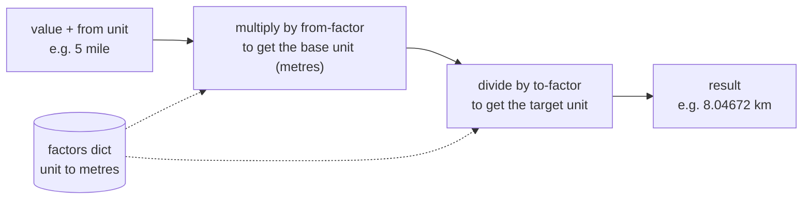
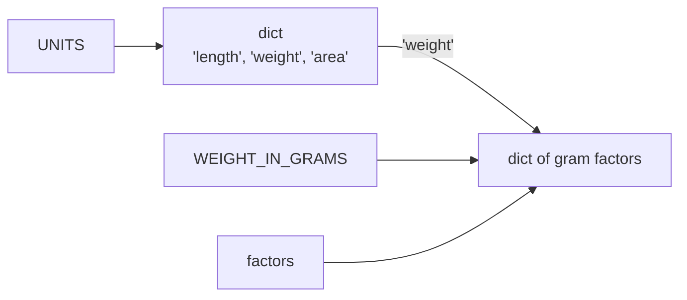

# Lab: Build a Unit Converter

> 📚 **Before you start**
>
> - [Numbers, Booleans and Strings](../02-getting-started-with-python/numbers-booleans-and-strings.md), for floats, rounding and f-strings
> - [Containers and Mutability](containers-and-mutability.md), for dictionaries and tuples
> - [Operators and Precedence](operators-and-precedence.md), for arithmetic and `in`

## What You'll Build

A converter that handles **length**, **weight**, **land area** and **temperature**, including units you'll actually meet in India: a quintal of wheat, a tola of gold, a guntha of farmland. It will:

- convert between any two units of the same kind with **one formula** (no long chain of special cases),
- handle temperature, which needs an offset as well as a multiplier,
- accept messy input like `" KM "` and report unknown units clearly instead of crashing.

You haven't learned `if` or loops yet, and you won't need them: a well-chosen **dictionary** does the work that a beginner would write twenty `if` statements for.



> 💡 **Key Insight**
>
> Don't write a formula for every pair of units. Pick **one base unit** per kind (metres for length, grams for weight) and store each unit's size in that base. Any conversion is then *into the base, out of the base*. With 8 length units that's 8 numbers to store instead of 56 separate formulas, and adding a ninth unit means adding one line.

Create a file `converter.py` and add each step's code to it in order.

---

## Step 1: Length, the Naive Way (and Why It Doesn't Scale)

The obvious first attempt writes one formula per conversion:

```python
km_to_miles = 0.621371
miles_to_km = 1.609344

print(5 * miles_to_km)
print(42.195 * km_to_miles)       # a marathon in miles
```

Output:

```
8.04672
26.218749345
```

That works for two units. For km, m, cm, mm, mile, yard, foot and inch, you'd need 8 × 7 = 56 formulas, and every one is a chance for a typo. Time for a better design.

---

## Step 2: One Base Unit, One Dictionary

Store how many **metres** each unit is. These values are exact by international definition (the mile, yard, foot and inch were fixed in metres in 1959).

```python
LENGTH_IN_METRES = {
    "km": 1000,
    "m": 1,
    "cm": 0.01,
    "mm": 0.001,
    "mile": 1609.344,
    "yard": 0.9144,
    "foot": 0.3048,
    "inch": 0.0254,
}
```

Writing the name in CAPITALS is a Python convention meaning "this is a constant; don't change it while the program runs".

Now any conversion is two steps: into metres, then out of metres.

```python
value = 5
from_unit = "mile"
to_unit = "km"

in_metres = value * LENGTH_IN_METRES[from_unit]
result = in_metres / LENGTH_IN_METRES[to_unit]
print(f"{value} {from_unit} = {result} {to_unit}")
```

Output:

```
5 mile = 8.04672 km
```

Let's try a few more. Each is the same two lines with different units:

```python
height_m = 5 * LENGTH_IN_METRES["foot"] + 8 * LENGTH_IN_METRES["inch"]   # 5 ft 8 in
print(f"5 ft 8 in = {height_m / LENGTH_IN_METRES['cm']:.1f} cm")

pitch = 22 * LENGTH_IN_METRES["yard"]        # a cricket pitch is 22 yards
print(f"Cricket pitch = {pitch:.2f} m")

screen = 6.7 * LENGTH_IN_METRES["inch"] / LENGTH_IN_METRES["cm"]
print(f"A 6.7 inch phone screen = {screen:.2f} cm diagonal")
```

Output:

```
5 ft 8 in = 172.7 cm
Cricket pitch = 20.12 m
A 6.7 inch phone screen = 17.02 cm diagonal
```

Notice the single quotes inside the f-string: `LENGTH_IN_METRES['cm']`. The f-string itself uses double quotes, so the key inside uses single quotes to avoid confusion. (Since Python 3.12 you may reuse the same quotes inside, but mixing them keeps your code readable on older versions too.)

---

## Step 3: Weight, Including Indian Units

Same pattern, base unit **grams**. A **quintal** (100 kg) is how farmers and mandis quote grain prices; a **tola** (about 11.66 g) is still used when buying gold.

```python
WEIGHT_IN_GRAMS = {
    "tonne": 1_000_000,
    "quintal": 100_000,
    "kg": 1000,
    "g": 1,
    "mg": 0.001,
    "pound": 453.59237,
    "ounce": 28.349523125,
    "tola": 11.6638038,
}

wheat_kg = 12 * WEIGHT_IN_GRAMS["quintal"] / WEIGHT_IN_GRAMS["kg"]
print(f"12 quintals of wheat = {wheat_kg:,.0f} kg")

gold_g = 2 * WEIGHT_IN_GRAMS["tola"]
print(f"2 tola of gold = {gold_g:.2f} g")

suitcase_lb = 23 * WEIGHT_IN_GRAMS["kg"] / WEIGHT_IN_GRAMS["pound"]
print(f"23 kg airline limit = {suitcase_lb:.1f} lb")
```

Output:

```
12 quintals of wheat = 1,200 kg
2 tola of gold = 23.33 g
23 kg airline limit = 50.7 lb
```

---

## Step 4: Land Area

Base unit **square metres**. A **guntha** (1,089 sq ft, used in Maharashtra, Karnataka and Gujarat) and an **acre** (40 guntha) come up in every property listing. (Other local units like the *bigha* differ from state to state, so they're left out here.)

```python
AREA_IN_SQ_M = {
    "sq m": 1,
    "sq ft": 0.09290304,
    "sq yard": 0.83612736,
    "guntha": 101.17141056,
    "acre": 4046.8564224,
    "hectare": 10_000,
}

flat = 1150 * AREA_IN_SQ_M["sq ft"]
print(f"A 1,150 sq ft flat = {flat:.1f} sq m")

farm_acres = 30 * AREA_IN_SQ_M["guntha"] / AREA_IN_SQ_M["acre"]
print(f"30 guntha = {farm_acres} acre")

print(f"1 hectare = {AREA_IN_SQ_M['hectare'] / AREA_IN_SQ_M['acre']:.3f} acre")
```

Output:

```
A 1,150 sq ft flat = 106.8 sq m
30 guntha = 0.75 acre
1 hectare = 2.471 acre
```

---

## Step 5: Putting the Kinds Together

We now have three dictionaries. Let's group them in one **dictionary of dictionaries**, so the kind of measurement is just another key:

```python
UNITS = {
    "length": LENGTH_IN_METRES,
    "weight": WEIGHT_IN_GRAMS,
    "area": AREA_IN_SQ_M,
}

kind, value, from_unit, to_unit = "weight", 5, "pound", "kg"

factors = UNITS[kind]
result = value * factors[from_unit] / factors[to_unit]
print(f"{value} {from_unit} = {result:.4f} {to_unit}")
```

Output:

```
5 pound = 2.2680 kg
```

`UNITS[kind]` picks the right inner dictionary; `factors[from_unit]` then picks the number. Nested lookups like this are everywhere in real programs, especially when reading JSON data from websites and APIs.

Here's the memory picture. `factors` is not a copy; it's another name for the same dictionary that `UNITS["weight"]` and `WEIGHT_IN_GRAMS` refer to (recall aliasing from [Containers and Mutability](containers-and-mutability.md)):



```python
print(factors is WEIGHT_IN_GRAMS, UNITS["weight"] is WEIGHT_IN_GRAMS)
```

Output:

```
True True
```

---

## Step 6: Temperature Needs an Offset

Temperature can't use a single multiplier, because 0 °C isn't 0 °F. But each scale is still a **straight line** from Celsius: `reading = celsius × scale + offset`.

| Unit | scale | offset | so 0 °C is | and 100 °C is |
|---|---|---|---|---|
| C | 1 | 0 | 0 | 100 |
| F | 9/5 | 32 | 32 | 212 |
| K | 1 | 273.15 | 273.15 | 373.15 |

Store each as a `(scale, offset)` **tuple**. Tuples suit this well: a scale and offset belong together and should never change.

```python
TEMPERATURE = {
    "C": (1, 0),
    "F": (9 / 5, 32),
    "K": (1, 273.15),
}

value, from_unit, to_unit = 98.6, "F", "C"

from_scale, from_offset = TEMPERATURE[from_unit]   # tuple unpacking
to_scale, to_offset = TEMPERATURE[to_unit]

celsius = (value - from_offset) / from_scale        # undo the from-unit's line
result = celsius * to_scale + to_offset             # apply the to-unit's line
print(f"{value} °{from_unit} = {result:.1f} °{to_unit}")
```

Output:

```
98.6 °F = 37.0 °C
```

The brackets matter: `value - from_offset / from_scale` would divide first and give nonsense (see [Operators and Precedence](operators-and-precedence.md)). A few more checks:

```python
for_check = [(45, "C", "F"), (0, "K", "C"), (-40, "F", "C")]

value, from_unit, to_unit = for_check[0]
s1, o1 = TEMPERATURE[from_unit]
s2, o2 = TEMPERATURE[to_unit]
print(f"{value} °{from_unit} = {(value - o1) / s1 * s2 + o2:.2f} °{to_unit}")

value, from_unit, to_unit = for_check[1]
s1, o1 = TEMPERATURE[from_unit]
s2, o2 = TEMPERATURE[to_unit]
print(f"{value} °{from_unit} = {(value - o1) / s1 * s2 + o2:.2f} °{to_unit}")

value, from_unit, to_unit = for_check[2]
s1, o1 = TEMPERATURE[from_unit]
s2, o2 = TEMPERATURE[to_unit]
print(f"{value} °{from_unit} = {(value - o1) / s1 * s2 + o2:.2f} °{to_unit}")
```

Output:

```
45 °C = 113.00 °F
0 °K = -273.15 °C
-40 °F = -40.00 °C
```

A Delhi summer afternoon is 113 °F; absolute zero is -273.15 °C; and -40 is the one temperature where Celsius and Fahrenheit agree. (Strictly, kelvin is written without the degree sign; we're keeping the code simple.)

Writing the same three lines three times is tedious, and you'd be right to feel it. In module 4 a `for` loop will do it once, and in module 6 you'll wrap the conversion in a **function** you can call by name.

---

## Step 7: Messy Input and Unknown Units

Real users type `" KM "`, `"Km"` or `"kilometre"`. Let's see what happens with an unknown unit:

```python
# not-run: shows an error on purpose
LENGTH_IN_METRES = {"km": 1000, "m": 1}
print(3 * LENGTH_IN_METRES["kilometre"])
```

Running it shows:

```
Traceback (most recent call last):
  File "/home/you/python-practice/example.py", line 3, in <module>
    print(3 * LENGTH_IN_METRES["kilometre"])
              ~~~~~~~~~~~~~~~~^^^^^^^^^^^^^
KeyError: 'kilometre'
```

A `KeyError` means "that key isn't in the dictionary". Three fixes, all from earlier lessons:

1. **Clean the input** with string methods: `.strip()` removes spaces at the ends, `.lower()` makes it lowercase.
2. **Add aliases**: extra keys that mean the same unit.
3. **Check before looking up** with `in`, or use `.get()`, which returns `None` (or a default you choose) instead of crashing.

```python
LENGTH_IN_METRES["kilometre"] = LENGTH_IN_METRES["km"]
LENGTH_IN_METRES["metre"] = LENGTH_IN_METRES["m"]
LENGTH_IN_METRES["feet"] = LENGTH_IN_METRES["foot"]

typed = "  KM "
unit = typed.strip().lower()
print(repr(unit), unit in LENGTH_IN_METRES)

print(LENGTH_IN_METRES.get("furlong"))
print(LENGTH_IN_METRES.get("furlong", "unknown unit"))
print("furlong" in LENGTH_IN_METRES)
```

Output:

```
'km' True
None
unknown unit
False
```

Adding aliases mutated `LENGTH_IN_METRES` in place. Because `UNITS["length"]` is the same dictionary, it sees the new keys too:

```python
print(UNITS["length"]["kilometre"])
print(len(UNITS["length"]))
```

Output:

```
1000
11
```

Once you know `if` (next module), you'll print a friendly message instead of `None` when the unit is unknown.

---

## Step 8: Make It Interactive

Put the pieces together with `input()`. This version runs top to bottom and stops at the end; the full program with menus and repeated questions comes after you learn loops.

```python
# not-run: waits for keyboard input
kind = input("Kind (length/weight/area): ").strip().lower()
value = float(input("Value: "))
from_unit = input("From unit: ").strip().lower()
to_unit = input("To unit: ").strip().lower()

factors = UNITS[kind]
result = value * factors[from_unit] / factors[to_unit]
print(f"{value:g} {from_unit} = {result:.4g} {to_unit}")
```

Example session:

```
Kind (length/weight/area): length
Value: 42.195
From unit: KM
To unit: mile
42.195 km = 26.22 mile
```

Two new format codes: `:g` prints a number in the shortest sensible form (`42.195`, not `42.195000`), and `:.4g` rounds to **4 significant figures**, which suits results that can be tiny or huge.

---

## Try It Yourself

1. **Add a unit.** Add the nautical mile (exactly 1,852 m) to `LENGTH_IN_METRES` and convert 10 nautical miles to km.
2. **Speed.** Convert 120 km/h to m/s and to miles per hour. (Hint: km/h → m/s is metres per km divided by seconds per hour.)
3. **Gold price.** Gold is ₹7,250 per gram (an example price). What do 3 tola cost, rounded to the nearest rupee and printed with thousands separators?
4. **Body temperature in kelvin.** Convert 37 °C to K and to °F using the `TEMPERATURE` table.

<details>
<summary>Show answers</summary>

```python
LENGTH_IN_METRES["nautical mile"] = 1852
print(10 * LENGTH_IN_METRES["nautical mile"] / LENGTH_IN_METRES["km"])

kmh = 120
ms = kmh * LENGTH_IN_METRES["km"] / 3600
mph = kmh * LENGTH_IN_METRES["km"] / LENGTH_IN_METRES["mile"]
print(f"{ms:.2f} m/s, {mph:.1f} mph")

price_per_g = 7250
cost = 3 * WEIGHT_IN_GRAMS["tola"] * price_per_g
print(f"₹{cost:,.0f}")

s, o = TEMPERATURE["K"]
print(37 * s + o)
s, o = TEMPERATURE["F"]
print(round(37 * s + o, 1))
```

Output:

```
18.52
33.33 m/s, 74.6 mph
₹253,688
310.15
98.6
```

Note that the thousands separator gives `253,688` (international grouping), not the Indian `2,53,688`.

</details>

---

## What You've Learned

- **Designing with data:** a dictionary of factors to a **base unit** replaces dozens of formulas.
- **Nested dictionaries** (`UNITS[kind][unit]`) and the aliasing between names that refer to the same dict.
- **Tuples for fixed records** like `(scale, offset)`, and **tuple unpacking**.
- **Linear conversions with an offset** for temperature, and why brackets matter.
- **Defensive lookups:** `.strip().lower()`, aliases, `in` and `.get()` to avoid `KeyError`.
- New f-string format codes: `:g` and `:.4g`.

---

**Up next:** [if, elif and else](../04-control-flow/if-elif-and-else.md)
