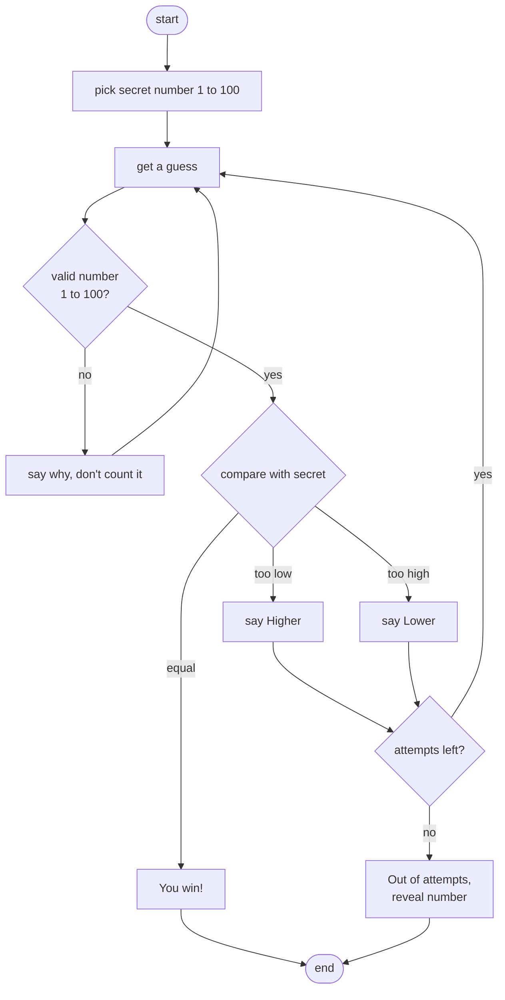

# Lab: Number Guessing Game

> 📚 **Before you start**
>
> - [if, elif and else](if-elif-and-else.md)
> - [for and while Loops](for-and-while-loops.md)
> - [break, continue and range()](break-continue-and-range.md)

## What You'll Build

The classic first game: the computer picks a secret number from 1 to 100, and you guess. After each guess it says "higher" or "lower". You have 7 tries. Along the way you'll add input checking, a "play again" option and a best-score record, and finally you'll flip it around and make **the computer guess your number**, which it will always do in 7 tries or fewer.



> 💡 **Key Insight**
>
> Separate **where the guesses come from** from **what the game does with them**. In this lab, the game logic first runs on a list of pretend guesses, so you can test every path (win, lose, bad input) instantly and get the same result every time. Swapping the list for `input()` at the end changes one line, not the logic.

Run the steps in order in one file, `guess.py`.

---

## Step 1: Pick a Secret Number

Python's standard library has a `random` module. `random.randint(a, b)` returns a random integer between `a` and `b`, **including both ends** (unlike `range`).

```python
import random

random.seed(2026)
secret = random.randint(1, 100)
print("Secret (shown only while testing):", secret)
```

Output:

```
Secret (shown only while testing): 16
```

Computers don't produce truly random numbers; they use a formula that produces numbers that *look* random, starting from a value called the **seed**. `random.seed(2026)` fixes the starting point, so the "random" number is the same on every run. That's perfect for testing: you know the secret is 16. In the real game you'll remove the `seed` line so each game is different.

---

## Step 2: One Guess, Three Outcomes

Before looping, get the comparison right for a single guess:

```python
guess = 50

if guess < secret:
    print(f"{guess} is too low. Go higher!")
elif guess > secret:
    print(f"{guess} is too high. Go lower!")
else:
    print(f"{guess} is correct!")
```

Output:

```
50 is too high. Go lower!
```

Try `guess = 16` and `guess = 3` to see the other two branches.

---

## Step 3: Loop Over Pretend Guesses

Now repeat the comparison for a list of guesses, and `break` when the player wins. `enumerate` counts the attempts for us.

```python
guesses = [50, 25, 12, 18, 15, 16, 70]

for attempt, guess in enumerate(guesses, start=1):
    if guess < secret:
        print(f"Attempt {attempt}: {guess} is too low.")
    elif guess > secret:
        print(f"Attempt {attempt}: {guess} is too high.")
    else:
        print(f"Attempt {attempt}: {guess} is correct! You win.")
        break
```

Output:

```
Attempt 1: 50 is too high.
Attempt 2: 25 is too high.
Attempt 3: 12 is too low.
Attempt 4: 18 is too high.
Attempt 5: 15 is too low.
Attempt 6: 16 is correct! You win.
```

The `70` was never looked at, because `break` stopped the loop at the win.

---

## Step 4: Limit the Attempts, Detect a Loss

The player gets 7 tries. Two changes:

1. Only look at the first 7 guesses: slicing `guesses[:MAX_ATTEMPTS]` does that.
2. Use the loop's `else` to detect "used every attempt without a `break`", which means the player lost.

```python
MAX_ATTEMPTS = 7

separator = "-" * 30   # a line to tell this game apart from the last one

print(separator)
guesses = [50, 75, 90, 60, 30, 20, 10, 16]       # the 16 comes too late
for attempt, guess in enumerate(guesses[:MAX_ATTEMPTS], start=1):
    if guess < secret:
        print(f"Attempt {attempt}: {guess} is too low.")
    elif guess > secret:
        print(f"Attempt {attempt}: {guess} is too high.")
    else:
        print(f"Correct in {attempt} attempts!")
        break
else:
    print(f"Out of attempts. The number was {secret}.")
```

Output:

```
------------------------------
Attempt 1: 50 is too high.
Attempt 2: 75 is too high.
Attempt 3: 90 is too high.
Attempt 4: 60 is too high.
Attempt 5: 30 is too high.
Attempt 6: 20 is too high.
Attempt 7: 10 is too low.
Out of attempts. The number was 16.
```

Constants like `MAX_ATTEMPTS` in capitals make the rules easy to find and change.

---

## Step 5: Handle Bad Input

Real players type `"fifty"`, `"0"`, `"500"` or just press Enter. Guesses from `input()` arrive as **strings**, so let's make the pretend guesses strings too and check them:

- not all digits → reject, and **don't** count it as an attempt,
- outside 1 to 100 → reject, don't count it.

A `for` loop over the guesses can't easily "not count" an item, so this is a natural job for a `while` loop with our own attempt counter. Each `continue` skips back to the top for the next guess.

```python
raw_guesses = ["fifty", "50", "", "500", "25", "12", "18", "15", "16"]

attempts = 0
index = 0                       # position in raw_guesses
won = False

while attempts < MAX_ATTEMPTS and index < len(raw_guesses):
    text = raw_guesses[index].strip()
    index += 1                  # move along BEFORE any continue

    if not text.isdigit():
        print(f"{text!r} isn't a whole number. Try again.")
        continue
    guess = int(text)
    if not 1 <= guess <= 100:
        print(f"{guess} is outside 1-100. Try again.")
        continue

    attempts += 1
    if guess < secret:
        print(f"Attempt {attempts}: {guess} is too low.")
    elif guess > secret:
        print(f"Attempt {attempts}: {guess} is too high.")
    else:
        print(f"Correct in {attempts} attempts!")
        won = True
        break

if not won:
    print(f"Game over. The number was {secret}.")
```

Output:

```
'fifty' isn't a whole number. Try again.
Attempt 1: 50 is too high.
'' isn't a whole number. Try again.
500 is outside 1-100. Try again.
Attempt 2: 25 is too high.
Attempt 3: 12 is too low.
Attempt 4: 18 is too high.
Attempt 5: 15 is too low.
Correct in 6 attempts!
```

Notice `index += 1` comes **before** the `continue` statements. Put it after them and an invalid guess would be read again forever: the `continue` trap from [break, continue and range()](break-continue-and-range.md). The `index < len(raw_guesses)` part of the condition just stops us running past the end of the pretend list; with real `input()` there's always another guess.

`"-5".isdigit()` is `False` (the minus sign isn't a digit), so negative numbers are reported as "not a whole number". That's acceptable for this game.

---

## Step 6: Hints That Get Warmer

Players enjoy a little extra feedback. Use `abs()` (the distance, ignoring direction) to say how close a guess is:

```python
for guess in [90, 40, 25, 19, 16]:
    distance = abs(guess - secret)
    if distance == 0:
        hint = "🎯 Bang on!"
    elif distance <= 3:
        hint = "🔥 Very hot"
    elif distance <= 10:
        hint = "♨️ Warm"
    elif distance <= 25:
        hint = "🌤 Cool"
    else:
        hint = "🥶 Ice cold"
    direction = "" if distance == 0 else ("higher" if guess < secret else "lower")
    print(f"{guess:>3}: {hint} {direction}")
```

Output:

```
 90: 🥶 Ice cold lower
 40: 🌤 Cool lower
 25: ♨️ Warm lower
 19: 🔥 Very hot lower
 16: 🎯 Bang on!
```

The thresholds are checked from smallest distance up, so each guess gets the most specific hint. That's the "order matters" rule from [if, elif and else](if-elif-and-else.md).

---

## Step 7: The Computer Guesses Your Number

Now flip the game. You think of a number; the computer guesses; you say higher or lower. The smart strategy is to **always guess the middle** of the range that's still possible. Each answer throws away half the remaining numbers, so 100 possibilities become 50, 25, 13, 7, 4, 2, 1: never more than 7 guesses. This strategy is called **binary search**, one of the most important ideas in computing.

Here the "player" is simulated by comparing with `my_number`:

```python
my_number = 73
low, high = 1, 100
tries = 0

while low <= high:
    guess = (low + high) // 2
    tries += 1
    if guess < my_number:
        print(f"Try {tries}: {guess}? Player says HIGHER")
        low = guess + 1
    elif guess > my_number:
        print(f"Try {tries}: {guess}? Player says LOWER")
        high = guess - 1
    else:
        print(f"Try {tries}: {guess}? Got it!")
        break
```

Output:

```
Try 1: 50? Player says HIGHER
Try 2: 75? Player says LOWER
Try 3: 62? Player says HIGHER
Try 4: 68? Player says HIGHER
Try 5: 71? Player says HIGHER
Try 6: 73? Got it!
```

Let's check the "never more than 7" claim for **every** possible number, with a loop around the loop:

```python
worst = 0
total_tries = 0
for my_number in range(1, 101):
    low, high, tries = 1, 100, 0
    while low <= high:
        guess = (low + high) // 2
        tries += 1
        if guess < my_number:
            low = guess + 1
        elif guess > my_number:
            high = guess - 1
        else:
            break
    total_tries += tries
    worst = max(worst, tries)

print("Worst case:", worst, "tries")
print("Average:", total_tries / 100, "tries")
```

Output:

```
Worst case: 7 tries
Average: 5.8 tries
```

That's why our human game allows 7 attempts: a perfect player can always win.

---

## Step 8: The Full Interactive Game

Put it all together with `input()`, no seed, a "play again" loop and a best score. Save this as `guess.py` and run it with `python3 guess.py`.

```python
# not-run: waits for keyboard input
import random

MAX_ATTEMPTS = 7
best = None                    # fewest attempts in a win so far

print("🎲 Guess the number between 1 and 100!")

while True:                                    # one pass = one game
    secret = random.randint(1, 100)
    attempts = 0
    won = False

    while attempts < MAX_ATTEMPTS:             # one pass = one guess
        text = input(f"Guess ({MAX_ATTEMPTS - attempts} left): ").strip()
        if not text.isdigit():
            print("Please type a whole number.")
            continue
        guess = int(text)
        if not 1 <= guess <= 100:
            print("Between 1 and 100, please.")
            continue

        attempts += 1
        if guess < secret:
            print("Higher ⬆️")
        elif guess > secret:
            print("Lower ⬇️")
        else:
            print(f"🎉 Correct in {attempts} attempt{'s' if attempts > 1 else ''}!")
            won = True
            break

    if won:
        if best is None or attempts < best:
            best = attempts
            print("🏆 New best score!")
    else:
        print(f"Out of attempts. It was {secret}.")

    if best is not None:
        print(f"Best so far: {best} attempts")

    again = input("Play again? (y/n): ").strip().lower()
    if again != "y":
        print("Thanks for playing!")
        break
```

Example session:

```
🎲 Guess the number between 1 and 100!
Guess (7 left): 50
Lower ⬇️
Guess (6 left): 25
Higher ⬆️
Guess (5 left): forty
Please type a whole number.
Guess (5 left): 37
Lower ⬇️
Guess (4 left): 31
Higher ⬆️
Guess (3 left): 34
🎉 Correct in 5 attempts!
🏆 New best score!
Best so far: 5 attempts
Play again? (y/n): n
Thanks for playing!
```

Your numbers will differ, since there's no seed. Notice how the structure matches what you built step by step: an **outer** `while True` for games (left with `break` when the player says no), an **inner** `while` for guesses (left with `break` on a win, or by running out of attempts), `continue` for bad input, and a flag `won` to tell the two endings apart.

---

## Try It Yourself

1. **Difficulty levels.** Add `level = "hard"` at the top. Easy is 1 to 50 with 8 attempts, normal 1 to 100 with 7, hard 1 to 1000 with 10. Use an `if`/`elif` chain to set `low`, `high` and `max_attempts`. How many attempts does binary search need for 1 to 1000 in the worst case?
2. **Track the range.** In the step 5 loop, keep `low` and `high` variables that narrow with each hint, and print `"(between {low} and {high})"` after every wrong guess.
3. **Count wasted guesses.** A guess is "wasted" if it's outside the range the previous hints already ruled out (for example guessing 60 after being told "lower" at 50). Count them for `[50, 60, 25, 30, 12, 16]` with secret 16.

<details>
<summary>Show answers</summary>

```python
level = "hard"
if level == "easy":
    low, high, max_attempts = 1, 50, 8
elif level == "hard":
    low, high, max_attempts = 1, 1000, 10
else:
    low, high, max_attempts = 1, 100, 7
print(level, low, high, max_attempts)

worst = 0
for target in range(1, 1001):
    lo, hi, tries = 1, 1000, 0
    while lo <= hi:
        mid = (lo + hi) // 2
        tries += 1
        if mid < target:
            lo = mid + 1
        elif mid > target:
            hi = mid - 1
        else:
            break
    worst = max(worst, tries)
print("Worst case for 1-1000:", worst)

secret = 16
low, high = 1, 100
for guess in [50, 25, 12, 18]:
    if guess < secret:
        low = guess + 1
    elif guess > secret:
        high = guess - 1
    else:
        break
    print(f"{guess} wrong (between {low} and {high})")

low, high, wasted = 1, 100, 0
for guess in [50, 60, 25, 30, 12, 16]:
    if not low <= guess <= high:
        wasted += 1
    if guess < secret:
        low = max(low, guess + 1)
    elif guess > secret:
        high = min(high, guess - 1)
    else:
        break
print("Wasted guesses:", wasted)
```

Output:

```
hard 1 1000 10
Worst case for 1-1000: 10
50 wrong (between 1 and 49)
25 wrong (between 1 and 24)
12 wrong (between 13 and 24)
18 wrong (between 13 and 17)
Wasted guesses: 2
```

10 attempts is exactly enough for 1 to 1000, because 2¹⁰ = 1024. The wasted guesses are 60 (after "lower" at 50) and 30 (after "lower" at 25).

</details>

---

## What You've Learned

- **`random.randint`** and **`random.seed`** for reproducible testing.
- **Comparison chains** with `if`/`elif`/`else`, and **order-dependent** hint thresholds.
- **`for` + `break` + loop-`else`** for "win or run out of attempts".
- **`while` + `continue`** for input validation that doesn't use up an attempt, with the counter updated before `continue`.
- **Nested loops** for a play-again game, with flags to tell endings apart.
- **Binary search**: halving the range finds any of 100 numbers in at most 7 guesses, and any of 1,000 in at most 10.

---

**Up next:** [Working with Strings](../05-strings-and-data-structures/working-with-strings.md)
