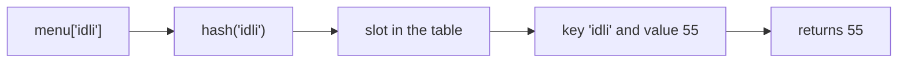
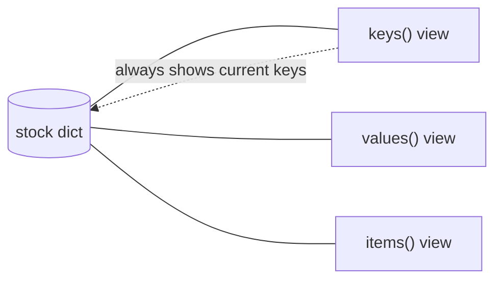

# Dictionaries and Dictionary Views: The Complete Guide

> 📚 **Before you start**
>
> - [Containers and Mutability](../03-core-language-concepts/containers-and-mutability.md), for the first look at dicts, aliasing and hashability
> - [Sets](sets.md), for hashing and set operations, which dictionary views reuse
> - [for and while Loops](../04-control-flow/for-and-while-loops.md), for looping over `.items()`

## Introduction

Your phone's contacts app doesn't make you remember that Amma is contact number 47. You type "Amma" and it finds the number. A railway enquiry system takes a PNR and returns the booking. A restaurant's billing system takes "masala dosa" and returns ₹89. In each case you **look something up by a name** rather than by position.

That's a **dictionary**: a collection of **key → value** pairs, where each unique key leads straight to its value. It's the most important data structure in Python. Settings, JSON data from web APIs, rows from databases, word counts, caches, and even Python's own variables (each module's names are stored in a dict) are all dictionaries.

This lesson covers dicts completely: creating them, reading safely, adding, updating, merging and removing, the rules for keys, how order works, the three **dictionary views** (`keys()`, `values()`, `items()`) and why they're "live", the counting and grouping patterns you'll use constantly, nested dictionaries, and two standard-library helpers, `Counter` and `defaultdict`.

> 💡 **Key Insight**
>
> A dictionary answers **"what goes with this key?"** in roughly the same time whether it holds ten items or ten million, because, like a set, it finds keys by **hashing**. Whenever you catch yourself searching a list for the item whose name matches something, you probably want a dict keyed by that name.

---

## Core Explanation

### 1. Creating dictionaries

```python
menu = {"masala dosa": 89, "idli": 49, "filter coffee": 30}
empty = {}
student = dict(name="Aditi", roll=17, city="Pune")          # keyword style: keys must be valid names
pairs = dict([("NDLS", "New Delhi"), ("CSMT", "Mumbai CSMT")])
zipped = dict(zip(["mon", "tue", "wed"], [3200, 4100, 2800]))
blank_marks = dict.fromkeys(["maths", "science", "english"], 0)

print(menu)
print(student)
print(pairs)
print(zipped)
print(blank_marks)
```

Output:

```
{'masala dosa': 89, 'idli': 49, 'filter coffee': 30}
{'name': 'Aditi', 'roll': 17, 'city': 'Pune'}
{'NDLS': 'New Delhi', 'CSMT': 'Mumbai CSMT'}
{'mon': 3200, 'tue': 4100, 'wed': 2800}
{'maths': 0, 'science': 0, 'english': 0}
```

`dict(zip(keys, values))` is the standard way to pair up two parallel lists.

### 2. Reading values

Square brackets look up a key. If it isn't there, you get a `KeyError`:

```python
print(menu["idli"])
```

Output:

```
49
```

```python
# not-run: shows an error on purpose
menu = {"masala dosa": 89, "idli": 49, "filter coffee": 30}
print(menu["vada"])
```

Running it shows:

```
Traceback (most recent call last):
  File "/home/you/python-practice/example.py", line 3, in <module>
    print(menu["vada"])
          ~~~~^^^^^^^^
KeyError: 'vada'
```

Three ways to handle keys that might be missing:

```python
print("vada" in menu)                  # 1. check first
print(menu.get("vada"))                # 2. get() returns None if missing
print(menu.get("vada", "not served"))  #    ...or the default you give
print(menu.get("idli", "not served"))
```

Output:

```
False
None
not served
49
```

Which to use? `d[key]` when the key **must** exist (a missing key is a bug, and the `KeyError` tells you immediately). `d.get(key, default)` when missing is normal. Note that `in` checks **keys**, never values.

### 3. Adding, changing and merging

Assigning to a key adds it if new, or replaces the value if it exists:

```python
menu["vada"] = 45            # new key
menu["idli"] = 55            # existing key: value replaced
print(menu)
```

Output:

```
{'masala dosa': 89, 'idli': 55, 'filter coffee': 30, 'vada': 45}
```

`update()` adds or replaces several at once, from another dict or from pairs. The `|` operator (Python 3.9+) **merges** into a new dict, and `|=` merges in place. When both sides have a key, the **right-hand** value wins:

```python
weekend_specials = {"pongal": 60, "idli": 50}

merged = menu | weekend_specials
print(merged)
print(menu["idli"])            # menu itself unchanged

menu.update(weekend_specials)  # same as menu |= weekend_specials
print(menu["idli"], len(menu))
```

Output:

```
{'masala dosa': 89, 'idli': 50, 'filter coffee': 30, 'vada': 45, 'pongal': 60}
55
50 5
```

`setdefault(key, default)` returns the value for `key`, inserting `default` first **only if the key is missing**:

```python
stock = {"rice": 10}
print(stock.setdefault("rice", 0))    # exists: returns 10, no change
print(stock.setdefault("dal", 0))     # missing: inserts 0, returns 0
print(stock)
```

Output:

```
10
0
{'rice': 10, 'dal': 0}
```

### 4. Removing

| How | Removes | Returns | If missing |
|---|---|---|---|
| `del d[key]` | that key | (statement) | `KeyError` |
| `d.pop(key)` | that key | its value | `KeyError` |
| `d.pop(key, default)` | that key | its value, or `default` | no error |
| `d.popitem()` | the **last inserted** pair | `(key, value)` | `KeyError` if empty |
| `d.clear()` | everything | `None` | |

```python
cart = {"rice": 2, "dal": 1, "ghee": 1, "salt": 1}
del cart["salt"]
qty = cart.pop("ghee")
print(qty, cart)
print(cart.pop("sugar", 0))           # safe removal
print(cart.popitem(), cart)
```

Output:

```
1 {'rice': 2, 'dal': 1}
0
('dal', 1) {'rice': 2}
```

### 5. Rules for keys

**Keys must be hashable** (immutable built-ins: str, int, float, bool, tuple of hashables, frozenset). Values can be anything at all, including lists and other dicts.

```python
# not-run: shows an error on purpose
seats = {["B2", 34]: "Priya"}
```

Running it shows:

```
Traceback (most recent call last):
  File "/home/you/python-practice/example.py", line 2, in <module>
    seats = {["B2", 34]: "Priya"}
            ^^^^^^^^^^^^^^^^^^^^^
TypeError: unhashable type: 'list'
```

```python
seats = {("B2", 34): "Priya", ("B2", 35): "Arjun"}    # tuples are fine
print(seats[("B2", 35)])
```

Output:

```
Arjun
```

**Keys are unique.** If a literal repeats a key, the last value silently wins. And as with sets, keys that are **equal** are the same key, so `1`, `1.0` and `True` collide:

```python
d = {"a": 1, "b": 2, "a": 3}
print(d)
print({1: "one", True: "yes", 1.0: "float"})
```

Output:

```
{'a': 3, 'b': 2}
{1: 'float'}
```

The key keeps its **first** spelling (`1`) and the value from the **last** assignment.

### 6. Order

Dictionaries remember **insertion order**: looping gives keys in the order they were first added. This has been guaranteed since Python 3.7. Changing an existing key's value doesn't move it; deleting and re-adding moves it to the end.

```python
d = {"x": 1, "y": 2, "z": 3}
d["x"] = 100                  # stays first
print(list(d))
del d["y"]
d["y"] = 2                    # re-added: now last
print(list(d))
```

Output:

```
['x', 'y', 'z']
['x', 'z', 'y']
```

Two dicts are **equal** if they have the same keys and values, regardless of order: `{"a": 1, "b": 2} == {"b": 2, "a": 1}` is `True`.

### 7. How a dictionary finds a key

Internally a dict keeps a hash table, like a set, but each slot holds a key **and** its value. Looking up `menu["idli"]` hashes `"idli"`, jumps to the matching slot, confirms the key is equal, and returns the value. It never scans the other entries.



That's why keys must be hashable and why lookups stay fast as the dict grows. (CPython also keeps a compact array of entries in insertion order, which is how iteration order is preserved.)

### 8. Looping over a dictionary

Looping over a dict directly gives its keys. Use `.values()` for values and `.items()` for `(key, value)` pairs:

```python
prices = {"masala dosa": 89, "idli": 50, "filter coffee": 30, "vada": 45}

for item in prices:
    print(item, end=" | ")
print()

print(sum(prices.values()))

for item, price in prices.items():
    print(f"{item:<14} ₹{price:>3}")
```

Output:

```
masala dosa | idli | filter coffee | vada | 
214
masala dosa    ₹ 89
idli           ₹ 50
filter coffee  ₹ 30
vada           ₹ 45
```

Sorting by key or by value:

```python
for item in sorted(prices):                       # by key, alphabetically
    print(item, end=", ")
print()

for item, price in sorted(prices.items(), key=lambda pair: pair[1]):   # by value
    print(item, price, end=", ")
print()

cheapest = min(prices, key=prices.get)            # the key whose value is smallest
print("Cheapest:", cheapest)
```

Output:

```
filter coffee, idli, masala dosa, vada, 
filter coffee 30, vada 45, idli 50, masala dosa 89, 
Cheapest: filter coffee
```

`min(prices, key=prices.get)` loops over the keys and compares them by `prices.get(key)`: a neat idiom worth remembering.

### 9. Dictionary views: keys(), values(), items()

`.keys()`, `.values()` and `.items()` don't return lists. They return **view objects**: windows onto the dictionary that always show its **current** contents.

```python
stock = {"rice": 10, "dal": 4}
keys = stock.keys()
items = stock.items()
print(keys, items)

stock["ghee"] = 2              # change the dict AFTER making the views
del stock["dal"]
print(keys)                    # the views see the change
print(items)
print(len(keys), "ghee" in keys, ("rice", 10) in items)
```

Output:

```
dict_keys(['rice', 'dal']) dict_items([('rice', 10), ('dal', 4)])
dict_keys(['rice', 'ghee'])
dict_items([('rice', 10), ('ghee', 2)])
2 True True
```



Views support `len()`, `in` and looping. They don't support indexing (`keys[0]` is a `TypeError`); convert with `list(...)` when you need positions or a snapshot that won't change:

```python
snapshot = list(stock.keys())
stock["salt"] = 1
print(snapshot, list(keys))
```

Output:

```
['rice', 'ghee'] ['rice', 'ghee', 'salt']
```

#### Keys and items views behave like sets

Because keys are unique and hashable, a keys view supports set operations directly: `&`, `|`, `-`, `^`, and comparisons. An items view does too, as long as the values are hashable. A values view does **not** (values can repeat and needn't be hashable).

```python
jan = {"rent": 18000, "food": 9000, "travel": 2500}
feb = {"rent": 18000, "food": 9500, "gym": 1500}

print(sorted(jan.keys() & feb.keys()))      # categories in both months
print(sorted(feb.keys() - jan.keys()))      # new this month
print(sorted(jan.keys() ^ feb.keys()))      # in only one month
print(sorted(jan.items() & feb.items()))    # same category AND same amount
```

Output:

```
['food', 'rent']
['gym']
['gym', 'travel']
[('rent', 18000)]
```

Comparing two dicts' contents this way needs no loop at all.

#### Views and changing the dict during a loop

Because a view is live, changing the dictionary's size while looping over it (or over a view) raises `RuntimeError: dictionary changed size during iteration`, as you saw in [for and while Loops](../04-control-flow/for-and-while-loops.md). Loop over a snapshot instead: `for key in list(d):`. Changing the **value** of an existing key during a loop is fine.

```python
prices = {"masala dosa": 89, "idli": 50, "filter coffee": 30}
for item in prices:
    prices[item] = round(prices[item] * 1.05)    # 5% price rise: values only
print(prices)
```

Output:

```
{'masala dosa': 93, 'idli': 52, 'filter coffee': 32}
```

### 10. The counting pattern

Counting how often each thing occurs is one of the most common jobs in programming:

```python
votes = ["dosa", "idli", "dosa", "vada", "dosa", "idli"]

counts = {}
for v in votes:
    counts[v] = counts.get(v, 0) + 1
print(counts)
```

Output:

```
{'dosa': 3, 'idli': 2, 'vada': 1}
```

`counts.get(v, 0)` gives the count so far, or 0 the first time. The standard library's `collections.Counter` does this for you and adds useful extras:

```python
from collections import Counter

tally = Counter(votes)
print(tally)
print(tally["dosa"], tally["pongal"])      # missing items count as 0, no KeyError
print(tally.most_common(2))
```

Output:

```
Counter({'dosa': 3, 'idli': 2, 'vada': 1})
3 0
[('dosa', 3), ('idli', 2)]
```

You'll use `Counter` in the [Word frequency counter lab](lab-word-frequency-counter.md).

### 11. The grouping pattern

Grouping items into lists by some property:

```python
students = [("Aditi", "Pune"), ("Bharat", "Delhi"), ("Chitra", "Pune"), ("Dev", "Delhi"), ("Esha", "Goa")]

by_city = {}
for name, city in students:
    by_city.setdefault(city, []).append(name)
print(by_city)
```

Output:

```
{'Pune': ['Aditi', 'Chitra'], 'Delhi': ['Bharat', 'Dev'], 'Goa': ['Esha']}
```

`setdefault(city, [])` returns the city's existing list, or inserts a new empty one first. `collections.defaultdict` makes this even shorter: it calls a function you choose to create a default value whenever a missing key is accessed:

```python
from collections import defaultdict

by_city = defaultdict(list)          # missing keys start as an empty list
for name, city in students:
    by_city[city].append(name)
print(dict(by_city))

word_lengths = defaultdict(int)      # missing keys start as 0
for word in "to be or not to be".split():
    word_lengths[len(word)] += 1
print(dict(word_lengths))
```

Output:

```
{'Pune': ['Aditi', 'Chitra'], 'Delhi': ['Bharat', 'Dev'], 'Goa': ['Esha']}
{2: 5, 3: 1}
```

### 12. Nested dictionaries

Real data is often dicts inside dicts (and lists), exactly the shape of **JSON**, the format most web APIs use:

```python
order = {
    "id": "ORD-4417",
    "customer": {"name": "Priya Nair", "city": "Kochi"},
    "items": [
        {"name": "Kerala saree", "qty": 1, "price": 3499},
        {"name": "Banana chips", "qty": 3, "price": 120},
    ],
    "paid": True,
}

print(order["customer"]["name"])
print(order["items"][1]["name"])

total = 0
for line in order["items"]:
    total += line["qty"] * line["price"]
print("Total:", total)

coupon = order.get("coupon", {}).get("code", "none")    # safe chain for optional parts
print("Coupon:", coupon)
```

Output:

```
Priya Nair
Banana chips
Total: 3859
Coupon: none
```

The `json` module in the standard library converts between dicts and JSON text, and pretty-prints nested data:

```python
import json
print(json.dumps(order["customer"], indent=2))
```

Output:

```
{
  "name": "Priya Nair",
  "city": "Kochi"
}
```

### 13. Copying dictionaries

Everything from [Containers and Mutability](../03-core-language-concepts/containers-and-mutability.md) applies. `b = a` is an alias; `a.copy()` or `dict(a)` is a shallow copy (nested lists and dicts still shared); `copy.deepcopy(a)` copies every level.

```python
import copy

settings = {"theme": "light", "alerts": ["email"]}
shallow = settings.copy()
deep = copy.deepcopy(settings)

shallow["theme"] = "dark"             # top-level change: original unaffected
shallow["alerts"].append("sms")       # nested change: shared with original!
print(settings)
print(deep)
```

Output:

```
{'theme': 'light', 'alerts': ['email', 'sms']}
{'theme': 'light', 'alerts': ['email']}
```

---

## Try It Yourself

1. Build a dict of three states and their capitals. Add a fourth, change one, delete one, then print each pair as `"State: Capital"` in alphabetical order of state.
2. Count the letters in `"banana"` with the `.get()` pattern, then with `Counter`. Which letter is most common?
3. `marks = {"Aditi": 91, "Bharat": 38, "Chitra": 67, "Dev": 29}`. Print the top scorer using `max(..., key=...)`, and a new dict of only the students who passed (40 or more), using a loop.
4. Two shops' price lists: `a = {"rice": 60, "dal": 120, "oil": 180}` and `b = {"rice": 58, "dal": 120, "sugar": 45}`. Using views, print items both shops sell, and items where both the name and price are identical.

<details>
<summary>Show answers</summary>

```python
capitals = {"Kerala": "Thiruvananthapuram", "Gujarat": "Gandhinagar", "Punjab": "Chandigarh"}
capitals["Odisha"] = "Bhubaneswar"
capitals["Kerala"] = "Thiruvananthapuram (Trivandrum)"
del capitals["Punjab"]
for state in sorted(capitals):
    print(f"{state}: {capitals[state]}")

counts = {}
for ch in "banana":
    counts[ch] = counts.get(ch, 0) + 1
print(counts)
print(Counter("banana").most_common(1))

marks = {"Aditi": 91, "Bharat": 38, "Chitra": 67, "Dev": 29}
print("Top:", max(marks, key=marks.get))
passed = {}
for name, m in marks.items():
    if m >= 40:
        passed[name] = m
print(passed)

a = {"rice": 60, "dal": 120, "oil": 180}
b = {"rice": 58, "dal": 120, "sugar": 45}
print(sorted(a.keys() & b.keys()))
print(sorted(a.items() & b.items()))
```

Output:

```
Gujarat: Gandhinagar
Kerala: Thiruvananthapuram (Trivandrum)
Odisha: Bhubaneswar
{'b': 1, 'a': 3, 'n': 2}
[('a', 3)]
Top: Aditi
{'Aditi': 91, 'Chitra': 67}
['dal', 'rice']
[('dal', 120)]
```

</details>

---

## Real-World Examples

### Example 1: Configuration

Applications load settings into a dict: `config = {"db_host": "localhost", "debug": False, "max_retries": 3}`. Code reads `config.get("timeout", 30)` so a missing setting falls back to a sensible default, and environment-specific overrides are merged with `base | overrides`.

### Example 2: API responses

Ask a weather API about Chennai and you get JSON, which Python turns into nested dicts: `data["current"]["temp_c"]`. Working with web APIs is mostly navigating dicts and lists safely with `.get()`. You'll do this constantly in later courses, from FastAPI to LLM tool calls, whose arguments arrive as dicts.

### Example 3: Caching

A slow calculation (a distance lookup, a database query) is stored in a dict keyed by its inputs: `if key in cache: return cache[key]`. Because lookups are instant, the second request is free. Python's own `functools.lru_cache` works on this principle.

---

## Common Misconceptions

### Misconception 1: "`in` checks values"

`key in d` checks keys only. Use `value in d.values()` for values, which is a slow linear scan.

### Misconception 2: "Dictionaries have no order"

Since Python 3.7 they keep insertion order (sets are the unordered ones).

### Misconception 3: "`.keys()` returns a list"

It returns a live view that reflects later changes, supports set operations, and can't be indexed. Wrap it in `list()` for a snapshot.

### Misconception 4: "`d.get(k)` and `d[k]` are interchangeable"

`d[k]` raises `KeyError` for a missing key; `d.get(k)` returns `None` silently, which can hide bugs if the key should exist.

### Misconception 5: "`dict.fromkeys(keys, [])` gives each key its own list"

All keys share **one** list object (the same aliasing trap as `[[0]*3]*3`). Use a loop, a comprehension, or `defaultdict(list)`.

---

## Interview Relevance

Dictionaries are the single most useful structure in coding interviews. Expect to:

- **Explain how they work:** hash tables, average O(1) get/set/delete, hashable keys, insertion order since 3.7.
- **Use the patterns:** counting (`get` or `Counter`), grouping (`setdefault` or `defaultdict`), lookup tables replacing nested loops (two-sum, anagram grouping), memoisation.
- **Know the API:** `get` vs `[]`, `pop` with default, `setdefault`, `update` and `|`, `popitem`, `fromkeys`.
- **Discuss views:** live, set-like for keys and items, and the "changed size during iteration" error.
- **Solve:** first non-repeating character, group anagrams, two-sum, most frequent element, invert a dictionary (and handle duplicate values), merge two dicts summing values.

---

## Key Takeaways

- A **dict** maps unique, **hashable keys** to any values, with fast average-constant-time lookup thanks to **hashing**, and it keeps **insertion order**.
- Read with **`d[key]`** (errors if missing) or **`d.get(key, default)`**; write with assignment, `update`, `|`/`|=` and `setdefault`; remove with `del`, `pop`, `popitem`.
- **`keys()`, `values()`, `items()` are live views**; keys and items views support **set operations** like `&` and `-`.
- Master the **counting** (`get(k, 0) + 1`, `Counter`) and **grouping** (`setdefault`, `defaultdict(list)`) patterns.
- Nested dicts mirror **JSON**; navigate them with chained `.get()`, and remember that `.copy()` is shallow.

---

**Up next:** [List and Dictionary Comprehensions](list-and-dictionary-comprehensions.md)
