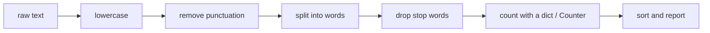

# Lab: Word Frequency Counter

> 📚 **Before you start**
>
> - [Working with Strings](working-with-strings.md)
> - [Sets](sets.md)
> - [Dictionaries and Dictionary Views](dictionaries-and-dictionary-views.md)
> - [List and Dictionary Comprehensions](list-and-dictionary-comprehensions.md)

## What You'll Build

A text analyser that reads a passage and reports:

- the most frequent meaningful words, with a little bar chart drawn in text,
- total words, unique words and vocabulary richness,
- the longest words and the words used only once,
- the most common letters,
- what two passages have in common and what's unique to each.

Word counting is the first step of a surprising amount of real software: search engines, spam filters, keyword extraction for SEO, and the "bag of words" models that were the starting point for natural language processing. You'll meet it again in [NLP for Machine Learning](../../nlp-for-machine-learning/course.md).



> 💡 **Key Insight**
>
> Counting is easy; **deciding what counts as the same word** is the real work. "Rain", "rain," and "RAIN!" must become one word before counting, and words like "the" and "and" must usually be ignored. Most of this lab is that cleaning pipeline, and every step is a string method, a set or a comprehension you already know.

Run all the steps in order in one file, `wordfreq.py`.

---

## Step 1: The Text

We'll analyse a short passage about the Mumbai monsoon. A triple-quoted string keeps the line breaks.

```python
text = """
The monsoon reaches Mumbai in June, and the city changes overnight.
The rain arrives in heavy sheets; the streets fill with water, and the
local trains slow down. Yet Mumbai keeps moving. Office workers wade
through the water, vendors sell hot vada pav and cutting chai under
plastic sheets, and children float paper boats in the puddles.
For farmers across India, the monsoon is not an inconvenience: it is
the season that decides the harvest. A good monsoon means full
reservoirs, green fields and a good year. A weak monsoon means worry.
The rain is loved, feared and discussed, but never ignored.
"""

print(len(text), "characters")
print(len(text.split()), "rough words")
```

Output:

```
602 characters
102 rough words
```

---

## Step 2: Normalise Case and Remove Punctuation

First, lowercase everything so "The" and "the" match. Then deal with punctuation, which otherwise sticks to words: `"June,"`, `"moving."`, `"inconvenience:"`.

The `string` module has a ready-made constant listing ASCII punctuation characters:

```python
import string
print(string.punctuation)
```

Output:

```
!"#$%&'()*+,-./:;<=>?@[\]^_`{|}~
```

To delete all of them in one go, use `str.maketrans` and `str.translate`. `str.maketrans("", "", chars)` builds a translation table that maps each character in `chars` to "delete"; `.translate(table)` applies it to the whole string.

```python
lowered = text.lower()
remove_punct = str.maketrans("", "", string.punctuation)
cleaned = lowered.translate(remove_punct)

print(repr(lowered[:70]))
print(repr(cleaned[:70]))
```

Output:

```
'\nthe monsoon reaches mumbai in june, and the city changes overnight.\nt'
'\nthe monsoon reaches mumbai in june and the city changes overnight\nthe'
```

The `\n` characters are the line breaks from the triple-quoted string. They'll disappear when we split.

A more beginner-friendly but slower way to do the same thing, using a comprehension over characters and `join`, gives an identical result:

```python
cleaned_slow = "".join(ch for ch in lowered if ch not in string.punctuation)
print(cleaned_slow == cleaned)
```

Output:

```
True
```

---

## Step 3: Split into Words and Count

`split()` with no argument splits on any whitespace, including newlines, and ignores runs of spaces:

```python
words = cleaned.split()
print(len(words), "words")
print(words[:12])
```

Output:

```
102 words
['the', 'monsoon', 'reaches', 'mumbai', 'in', 'june', 'and', 'the', 'city', 'changes', 'overnight', 'the']
```

Now count with the dictionary pattern from [Dictionaries and Dictionary Views](dictionaries-and-dictionary-views.md):

```python
counts = {}
for w in words:
    counts[w] = counts.get(w, 0) + 1

print(len(counts), "distinct words")
print("the:", counts["the"], "| monsoon:", counts["monsoon"], "| rain:", counts["rain"])
```

Output:

```
72 distinct words
the: 11 | monsoon: 4 | rain: 2
```

---

## Step 4: Sort by Frequency

To see the most common words, sort the `(word, count)` pairs. We want the **highest count first**, and for equal counts, **alphabetical order**, so the output is the same every time. Sorting by the tuple `(-count, word)` does both: negative counts make bigger numbers sort first, and the word breaks ties.

```python
ranked = sorted(counts.items(), key=lambda pair: (-pair[1], pair[0]))
for word, n in ranked[:8]:
    print(f"{word:<10} {n}")
```

Output:

```
the        11
and        6
monsoon    4
a          3
in         3
is         3
good       2
means      2
```

The top of the list is dominated by "the", "and", "a", "is". They're grammatically essential and tell you nothing about what the passage is about. Time to filter them.

---

## Step 5: Remove Stop Words

Words that are too common to be informative are called **stop words**. A set is the right container: we only need fast "is this a stop word?" checks.

```python
STOP_WORDS = {
    "a", "an", "and", "the", "is", "in", "it", "of", "to", "for", "with",
    "but", "not", "that", "this", "on", "at", "by", "under", "through",
    "across", "yet", "never", "keeps", "means",
}

meaningful = [w for w in words if w not in STOP_WORDS]
print(len(words), "->", len(meaningful), "words after removing stop words")
```

Output:

```
102 -> 61 words after removing stop words
```

Real projects use longer stop-word lists (NLP libraries ship lists of a few hundred words), and often tailor them to the domain. Here we've also dropped "keeps" and "means", which don't carry the topic in this passage.

---

## Step 6: Count with Counter and Draw a Bar Chart

`collections.Counter` does the counting loop for us and has a `most_common(n)` method. Its tie-breaking follows the order words were first seen, so we'll still sort ourselves for fully predictable output.

```python
from collections import Counter

freq = Counter(meaningful)
top = sorted(freq.items(), key=lambda pair: (-pair[1], pair[0]))[:8]

print(f"{'WORD':<10} {'COUNT':>5}  CHART")
for word, n in top:
    bar = "█" * (n * 3)
    print(f"{word:<10} {n:>5}  {bar}")
```

Output:

```
WORD       COUNT  CHART
monsoon        4  ████████████
good           2  ██████
mumbai         2  ██████
rain           2  ██████
sheets         2  ██████
water          2  ██████
arrives        1  ███
boats          1  ███
```

Now the passage's subject jumps out: monsoon, rain, Mumbai, water, sheets. Each `█` block represents a third of a word, so the bars are visible even for small counts; with bigger texts, you'd scale the bar to the largest count instead.

---

## Step 7: Text Statistics

A few more numbers, each one a single expression over the words, the counter, or both:

```python
total = len(words)
unique = len(set(words))
richness = unique / total                         # also called type-token ratio
avg_len = sum(len(w) for w in words) / total
longest = sorted(set(words), key=lambda w: (-len(w), w))[:3]
once = sorted(w for w, n in freq.items() if n == 1)

print(f"Total words:      {total}")
print(f"Unique words:     {unique}")
print(f"Richness:         {richness:.2f}")
print(f"Average length:   {avg_len:.2f} letters")
print(f"Longest words:    {', '.join(longest)}")
print(f"Used once:        {len(once)} meaningful words, e.g. {', '.join(once[:5])}")
```

Output:

```
Total words:      102
Unique words:     72
Richness:         0.71
Average length:   4.72 letters
Longest words:    inconvenience, reservoirs, discussed
Used once:        47 meaningful words, e.g. arrives, boats, chai, changes, children
```

**Richness** (unique words ÷ total words) is a rough measure of vocabulary variety: a child's story might score low, a dense essay higher. It falls as texts get longer, because common words keep repeating, so only compare texts of similar length.

Words that appear only once are called **hapax legomena** by linguists; spotting them is useful for finding typos and rare terms.

---

## Step 8: Letter Frequencies

Counter works on any iterable, including a string, where it counts characters. Keep only letters with `.isalpha()`:

```python
letters = Counter(ch for ch in lowered if ch.isalpha())
total_letters = sum(letters.values())

for ch, n in sorted(letters.items(), key=lambda pair: (-pair[1], pair[0]))[:5]:
    print(f"{ch}: {n:>3}  ({n / total_letters:.1%})")

vowel_share = sum(letters[v] for v in "aeiou") / total_letters
print(f"Vowels make up {vowel_share:.1%} of the letters")
```

Output:

```
e:  62  (12.9%)
a:  42  (8.7%)
n:  42  (8.7%)
s:  40  (8.3%)
o:  37  (7.7%)
Vowels make up 38.0% of the letters
```

In typical English text, "e" and "t" are the most common letters. Letter frequencies like these were the key to breaking simple substitution ciphers for centuries.

---

## Step 9: Compare Two Passages

Let's compare our passage with a second, shorter one about winter in Delhi. Sets answer "which words appear in both?", and Counters can be combined with `&` (minimum of counts) and `-` (subtract counts, dropping anything that reaches zero).

```python
text2 = """
Winter in Delhi brings fog, cold mornings and hot chai on every corner.
Trains run late in the fog, and the city wraps itself in shawls.
"""

words2 = [w for w in text2.lower().translate(remove_punct).split() if w not in STOP_WORDS]
set1, set2 = set(meaningful), set(words2)

print("In both:     ", sorted(set1 & set2))
print("Only Delhi:  ", sorted(set2 - set1))
print("Shared share:", f"{len(set1 & set2) / len(set1 | set2):.1%}")

freq2 = Counter(words2)
print("Counter & :  ", sorted((freq & freq2).items()))
```

Output:

```
In both:      ['chai', 'city', 'hot', 'trains']
Only Delhi:   ['brings', 'cold', 'corner', 'delhi', 'every', 'fog', 'itself', 'late', 'mornings', 'run', 'shawls', 'winter', 'wraps']
Shared share: 6.1%
Counter & :   [('chai', 1), ('city', 1), ('hot', 1), ('trains', 1)]
```

The "shared share" (size of the intersection divided by the size of the union) is called **Jaccard similarity**, a simple and widely used measure of how similar two sets are. Search engines and plagiarism checkers use ideas like this at scale.

The two passages share "trains", but if one had said "train" and the other "trains", they wouldn't match: to Python they're different strings. Reducing words to a base form is called **stemming** or **lemmatisation**, and NLP libraries do it for you.

---

## Step 10: Reading a Real File

To analyse a real document, read its text from a file instead of a string. The rest of the pipeline is unchanged. File handling is covered fully in [Advanced Python Programming](../../advanced-python-programming/course.md#m3); for now, this is all you need:

```python
# not-run: needs a file called speech.txt next to the script
with open("speech.txt", encoding="utf-8") as f:
    text = f.read()
```

Save any article or speech as `speech.txt` (as plain text, UTF-8), put this at the top of `wordfreq.py` instead of the sample string, and run it again.

---

## Try It Yourself

1. **Top-N setting.** Put `TOP_N = 5` at the top and use it everywhere you currently slice `[:8]`. Does the bar chart still work?
2. **Scaled bars.** Make the longest bar exactly 20 blocks wide, scaling the others: `round(n / top_count * 20)`.
3. **Word lengths.** Using a dict comprehension or `Counter`, build a map from word length to how many words have that length, and print it sorted by length.
4. **Bigrams.** A **bigram** is a pair of neighbouring words. Use `zip(words, words[1:])` to make all bigrams from the full word list, count them with `Counter`, and print any that occur more than once.

<details>
<summary>Show answers</summary>

```python
TOP_N = 5
top = sorted(freq.items(), key=lambda pair: (-pair[1], pair[0]))[:TOP_N]
top_count = top[0][1]
for word, n in top:
    print(f"{word:<10} {'█' * round(n / top_count * 20)}")

length_counts = Counter(len(w) for w in words)
print(dict(sorted(length_counts.items())))

bigrams = Counter(zip(words, words[1:]))
print(sorted((pair, n) for pair, n in bigrams.items() if n > 1))
```

Output:

```
monsoon    ████████████████████
good       ██████████
mumbai     ██████████
rain       ██████████
sheets     ██████████
{1: 3, 2: 8, 3: 23, 4: 18, 5: 16, 6: 11, 7: 18, 8: 1, 9: 2, 10: 1, 13: 1}
[(('a', 'good'), 2), (('and', 'the'), 2), (('monsoon', 'means'), 2), (('the', 'monsoon'), 2), (('the', 'rain'), 2)]
```

The repeated bigrams pick out real phrases from the passage: "the monsoon", "monsoon means", "the rain". Bigrams that contain stop words ("and the") are noise, which is why keyword tools usually drop pairs made only of stop words. Counting bigrams and trigrams is how such tools find multi-word phrases.

</details>

---

## What You've Learned

- A **text-cleaning pipeline**: `lower()`, `str.maketrans` + `translate` for punctuation, `split()` for words.
- **Counting** with the `get(w, 0) + 1` pattern and with **`Counter`**, and **sorting** by `(-count, word)` for stable rankings.
- **Stop words** in a **set** for fast filtering with a comprehension.
- **Statistics** with generator expressions: totals, unique counts, averages, longest words, hapaxes.
- **Comparing texts** with set operations and `Counter` arithmetic, and **Jaccard similarity**.

---

**Up next:** [Functions and Parameter Passing](../06-functions-and-iterators/functions-and-parameter-passing.md)
