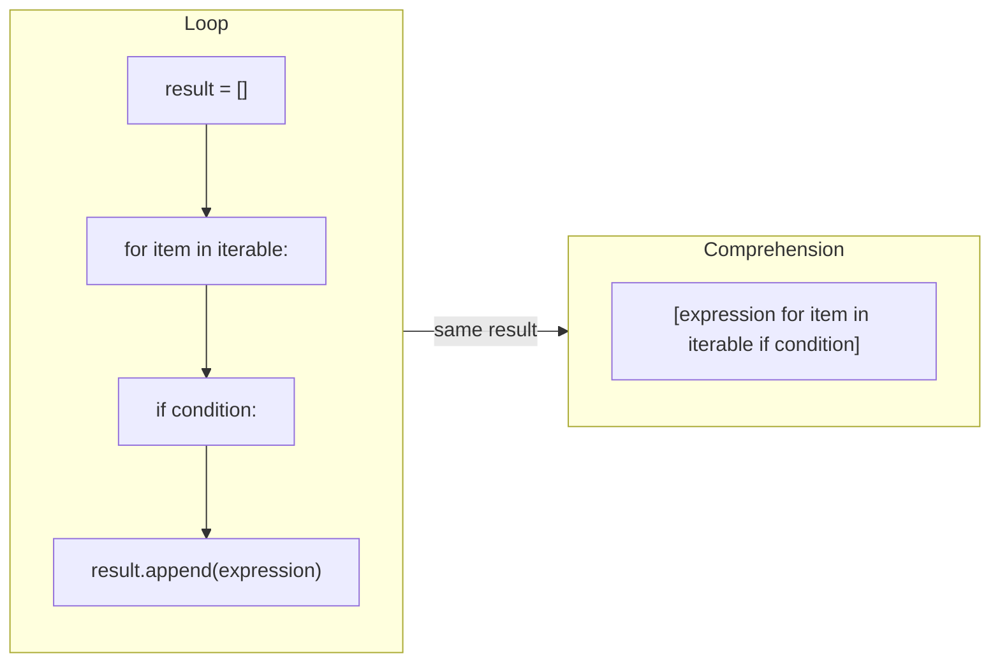

# List and Dictionary Comprehensions: The Complete Guide

> 📚 **Before you start**
>
> - [for and while Loops](../04-control-flow/for-and-while-loops.md), especially the "build a new list" and "filter" patterns
> - [if, elif and else](../04-control-flow/if-elif-and-else.md), for the conditional expression `a if cond else b`
> - [Lists and Tuples](lists-and-tuples.md), [Sets](sets.md) and [Dictionaries and Dictionary Views](dictionaries-and-dictionary-views.md)

## Introduction

You have a list of prices and want the same prices with 18% GST added. You know how to do it:

```python
prices = [100, 250, 80, 1200]
with_gst = []
for p in prices:
    with_gst.append(round(p * 1.18, 2))
print(with_gst)
```

Output:

```
[118.0, 295.0, 94.4, 1416.0]
```

Four lines, and three of them are scaffolding: create an empty list, loop, append. Python has a shorter way that says exactly what you mean, "a list of `round(p * 1.18, 2)` for each `p` in `prices`":

```python
with_gst = [round(p * 1.18, 2) for p in prices]
print(with_gst)
```

Output:

```
[118.0, 295.0, 94.4, 1416.0]
```

That's a **list comprehension**. Python has the same idea for dictionaries, sets, and a lazy version called a **generator expression**. Experienced Python programmers use them all the time, so you need to be able to read them fluently, write them, and also recognise when one is getting too clever and a plain loop would be clearer.

> 💡 **Key Insight**
>
> A comprehension is a **loop that builds a collection**, written in the order you'd describe the result: *what each item looks like*, then *where items come from*, then *which ones to keep*. Every comprehension can be rewritten as a loop with `append` (or `d[k] = v`), and reading it that way is the surest way to understand a complicated one.

---

## Core Explanation

### 1. The anatomy of a list comprehension

```
[ expression   for item in iterable   if condition ]
  └ what to put  └ where items come from  └ optional filter
```

It maps directly onto the loop you already know:



Some straightforward examples:

```python
squares = [n * n for n in range(1, 6)]
upper_names = [name.upper() for name in ["asha", "babu", "charu"]]
lengths = [len(w) for w in "the quick brown fox".split()]
first_letters = [w[0] for w in ["Mumbai", "Delhi", "Chennai"]]

print(squares)
print(upper_names)
print(lengths)
print(first_letters)
```

Output:

```
[1, 4, 9, 16, 25]
['ASHA', 'BABU', 'CHARU']
[3, 5, 5, 3]
['M', 'D', 'C']
```

### 2. Filtering with if

Add `if condition` at the end to keep only some items:

```python
marks = [72, 38, 91, 55, 29, 64]
passed = [m for m in marks if m >= 40]
even_squares = [n * n for n in range(1, 11) if n % 2 == 0]
long_words = [w for w in "a quick brown fox jumped".split() if len(w) > 4]

print(passed)
print(even_squares)
print(long_words)
```

Output:

```
[72, 91, 55, 64]
[4, 16, 36, 64, 100]
['quick', 'brown', 'jumped']
```

Read `[m for m in marks if m >= 40]` as "`m`, for each `m` in `marks`, if `m >= 40`".

### 3. Choosing a value with if/else

To **transform** every item one of two ways (rather than dropping some), put a conditional expression in the **expression** position, at the front:

```python
marks = [72, 38, 91, 55, 29, 64]
results = ["pass" if m >= 40 else "fail" for m in marks]
capped = [min(m, 60) for m in marks]
print(results)
print(capped)
```

Output:

```
['pass', 'fail', 'pass', 'pass', 'fail', 'pass']
[60, 38, 60, 55, 29, 60]
```

The position decides the meaning:

| Where | Syntax | Effect | Output length |
|---|---|---|---|
| At the end | `[x for x in xs if cond]` | **filter**: drop items | can be shorter |
| At the front | `[a if cond else b for x in xs]` | **choose** a value for every item | same length |

Putting `else` at the end is a syntax error, because a filter has no "else":

```python
# not-run: shows an error on purpose
nums = [5, -2, 7]
print([n for n in nums if n > 0 else 0])
```

Running it shows:

```
  File "/home/you/python-practice/example.py", line 3
    print([n for n in nums if n > 0 else 0])
                                    ^^^^
SyntaxError: invalid syntax
```

The fix is `[n if n > 0 else 0 for n in nums]`.

You can use both at once: choose a value **and** filter:

```python
orders = [499, 0, 1299, 89, 0, 2500]
labels = ["big" if o > 1000 else "small" for o in orders if o > 0]
print(labels)
```

Output:

```
['small', 'big', 'small', 'big']
```

### 4. Comprehensions over any iterable

The `for` part can loop over anything: strings, ranges, dict items, `enumerate`, `zip`.

```python
word = "Bengaluru"
vowels = [ch for ch in word.lower() if ch in "aeiou"]
print(vowels)

menu = {"dosa": 89, "idli": 49, "coffee": 30}
expensive = [item for item, price in menu.items() if price > 40]
print(expensive)

players = ["Rohit", "Gill", "Kohli"]
runs = [56, 104, 33]
summary = [f"{p}: {r}" for p, r in zip(players, runs)]
print(summary)

numbered = [f"{i}. {p}" for i, p in enumerate(players, start=1)]
print(numbered)
```

Output:

```
['e', 'a', 'u', 'u']
['dosa', 'idli']
['Rohit: 56', 'Gill: 104', 'Kohli: 33']
['1. Rohit', '2. Gill', '3. Kohli']
```

Converting a list of numbers to strings, which you needed for `join` in [Working with Strings](working-with-strings.md), becomes one line:

```python
amounts = [10, 20, 30]
print(", ".join([str(a) for a in amounts]))
```

Output:

```
10, 20, 30
```

### 5. Nested loops inside a comprehension

A comprehension can have several `for` clauses. They nest **in the same order as you'd write the loops**, left to right = outer to inner:

```python
pairs = [(size, colour) for size in ["S", "M"] for colour in ["red", "blue", "green"]]
print(pairs)
```

Output:

```
[('S', 'red'), ('S', 'blue'), ('S', 'green'), ('M', 'red'), ('M', 'blue'), ('M', 'green')]
```

The same as:

```python
pairs = []
for size in ["S", "M"]:
    for colour in ["red", "blue", "green"]:
        pairs.append((size, colour))
```

A very common use is **flattening** a list of lists:

```python
sections = [["Aditi", "Bharat"], ["Chitra"], ["Dev", "Esha", "Farhan"]]
all_students = [name for section in sections for name in section]
print(all_students)
```

Output:

```
['Aditi', 'Bharat', 'Chitra', 'Dev', 'Esha', 'Farhan']
```

Read it as: "`name`, for each `section` in `sections`, for each `name` in `section`".

A comprehension can also contain **another comprehension** as its expression. This builds a grid correctly (each row is a new list, avoiding the `[[0] * 3] * 3` trap from [Containers and Mutability](../03-core-language-concepts/containers-and-mutability.md)), and transposes a table (rows become columns):

```python
grid = [[0 for col in range(3)] for row in range(2)]
grid[0][0] = 9
print(grid)

table = [[1, 2, 3], [4, 5, 6]]
transposed = [[row[i] for row in table] for i in range(3)]
print(transposed)
```

Output:

```
[[9, 0, 0], [0, 0, 0]]
[[1, 4], [2, 5], [3, 6]]
```

Nested comprehensions are where readability starts to suffer. If you have to read one three times, write the loops instead.

### 6. Dictionary comprehensions

Same idea, with curly braces and a `key: value` expression:

```
{ key_expr: value_expr   for item in iterable   if condition }
```

```python
squares = {n: n * n for n in range(1, 6)}
print(squares)

names = ["asha", "babu", "charu"]
name_lengths = {name: len(name) for name in names}
print(name_lengths)

menu = {"dosa": 89, "idli": 49, "coffee": 30}
with_gst = {item: round(price * 1.05, 2) for item, price in menu.items()}
cheap = {item: price for item, price in menu.items() if price < 50}
print(with_gst)
print(cheap)
```

Output:

```
{1: 1, 2: 4, 3: 9, 4: 16, 5: 25}
{'asha': 4, 'babu': 4, 'charu': 5}
{'dosa': 93.45, 'idli': 51.45, 'coffee': 31.5}
{'idli': 49, 'coffee': 30}
```

Useful dict comprehension idioms:

```python
codes = ["NDLS", "CSMT", "MAS"]
cities = ["New Delhi", "Mumbai", "Chennai"]
lookup = {code: city for code, city in zip(codes, cities)}
print(lookup)

inverted = {city: code for code, city in lookup.items()}      # swap keys and values
print(inverted["Chennai"])

raw = {" Name ": " Priya ", "CITY": "pune "}
clean = {k.strip().lower(): v.strip().title() for k, v in raw.items()}
print(clean)

lists = {k: [] for k in ["todo", "doing", "done"]}           # each key gets its OWN list
lists["todo"].append("buy milk")
print(lists)
```

Output:

```
{'NDLS': 'New Delhi', 'CSMT': 'Mumbai', 'MAS': 'Chennai'}
MAS
{'name': 'Priya', 'city': 'Pune'}
{'todo': ['buy milk'], 'doing': [], 'done': []}
```

That last one is the safe replacement for `dict.fromkeys(keys, [])`, which would make every key share a single list.

When inverting a dict, duplicate values collapse: if two keys have the same value, only the last survives as a key in the inverted dict.

### 7. Set comprehensions

Curly braces with a single expression (no colon) make a **set**:

```python
emails = ["Asha@x.com", "asha@X.com", "babu@y.com"]
unique = {e.lower() for e in emails}
domains = {e.split("@")[1].lower() for e in emails}
print(sorted(unique))
print(sorted(domains))
```

Output:

```
['asha@x.com', 'babu@y.com']
['x.com', 'y.com']
```

### 8. Generator expressions: lazy comprehensions

Swap the square brackets for round ones and you get a **generator expression**. It doesn't build a list; it produces values **one at a time, on demand**. When you only need to feed the values to something like `sum`, `max`, `any` or `join`, that saves memory:

```python
total = sum(p * 1.18 for p in [100, 250, 80])        # the function's brackets are enough
print(round(total, 2))

print(max(len(w) for w in "the quick brown fox".split()))
print(any(m < 40 for m in [72, 38, 91]))
print(", ".join(str(n) for n in range(5)))
```

Output:

```
507.4
5
True
0, 1, 2, 3, 4
```

When a generator expression is the only argument to a function, you can drop its own brackets: `sum(x for x in xs)` instead of `sum((x for x in xs))`.

The memory difference is dramatic for big inputs:

```python
import sys
as_list = [n for n in range(100_000)]
as_gen = (n for n in range(100_000))
print(sys.getsizeof(as_list) > 100 * sys.getsizeof(as_gen))
print(sum(as_gen))
print(sum(as_gen))          # a generator can only be used once
```

Output:

```
True
4999950000
0
```

The list stores all 100,000 references (about 800 KB); the generator object is a couple of hundred bytes, whatever the range. But a generator is **used up** after one pass: the second `sum` got nothing. There's no "tuple comprehension": `(x for x in xs)` is always a generator; use `tuple(x for x in xs)` if you need a tuple. You'll see how generators work inside in [Iterators and Generators](../06-functions-and-iterators/iterators-and-generators.md).

| Brackets | Example | Produces |
|---|---|---|
| `[...]` | `[x * 2 for x in xs]` | list |
| `{...}` with `k: v` | `{x: x * 2 for x in xs}` | dict |
| `{...}` without colon | `{x * 2 for x in xs}` | set |
| `(...)` | `(x * 2 for x in xs)` | generator (lazy, single use) |

### 9. The loop variable stays inside

In a normal `for` loop, the loop variable survives after the loop. In a comprehension it doesn't: comprehensions have their own private scope.

```python
for item in ["a", "b"]:
    pass
print(item)            # the for loop's variable is still around

squares = [n * n for n in range(3)]
print("n" in dir())    # dir() lists the names that exist here
```

Output:

```
b
False
```

So a comprehension never overwrites a variable of the same name outside it. (There's no `n` left over; `print(n)` here would be a `NameError`, unless an earlier `n` already existed outside.)

### 10. When not to use a comprehension

Comprehensions are for **building a collection**. Avoid them when:

- **You don't want the list**, only the side effect. `[print(x) for x in xs]` builds a useless list of `None`s. Use a `for` loop.
- **The logic is complicated.** Several conditions, nested loops and nested conditional expressions in one line become a puzzle. Split it up or use a loop.
- **You need `break`, `try`/`except`, or several statements per item.** Comprehensions can't contain statements.

```python
# Hard to read:
codes = [c.upper() if len(c) == 3 else c.upper()[:3] if c else "UNK" for c in ["del", "mumbai", ""] if c is not None]
print(codes)

# Clearer:
codes = []
for c in ["del", "mumbai", ""]:
    if not c:
        codes.append("UNK")
    else:
        codes.append(c.upper()[:3])
print(codes)
```

Output:

```
['DEL', 'MUM', 'UNK']
['DEL', 'MUM', 'UNK']
```

A good rule of thumb: if it doesn't fit comfortably on one line (or two, neatly broken), use a loop.

Comprehensions are typically somewhat faster than the equivalent loop with `append`, because Python runs them with less overhead. That's a pleasant bonus, but choose them for clarity, not speed.

### 11. A worked example: a class report

```python
students = [
    {"name": "Aditi", "marks": {"maths": 91, "science": 85}},
    {"name": "Bharat", "marks": {"maths": 38, "science": 52}},
    {"name": "Chitra", "marks": {"maths": 74, "science": 39}},
]

totals = {s["name"]: sum(s["marks"].values()) for s in students}
print(totals)

failed_any = [s["name"] for s in students if any(m < 40 for m in s["marks"].values())]
print("Failed a subject:", failed_any)

maths_avg = sum(s["marks"]["maths"] for s in students) / len(students)
print(f"Maths average: {maths_avg:.1f}")

ranking = sorted(totals, key=totals.get, reverse=True)
print({rank: name for rank, name in enumerate(ranking, start=1)})
```

Output:

```
{'Aditi': 176, 'Bharat': 90, 'Chitra': 113}
Failed a subject: ['Bharat', 'Chitra']
Maths average: 67.7
{1: 'Aditi', 2: 'Chitra', 3: 'Bharat'}
```

Every line is one clear transformation of the data. That's the style comprehensions encourage.

---

## Try It Yourself

1. From `temps_c = [31, 35.5, 28, 40]`, build a list of Fahrenheit values rounded to 1 decimal (`c * 9 / 5 + 32`).
2. From the sentence `"Python is easy and Python is powerful"`, build a dict mapping each **distinct** word to its length, and a set of words longer than 3 letters.
3. Rewrite as a comprehension: `result = []`, `for n in range(1, 21):`, `if n % 3 == 0:`, `result.append(n * 10)`.
4. Given `prices = {"pen": 10, "notebook": 45, "bag": 650, "bottle": 299}`, build a new dict with a 10% discount on items over ₹100 and the same price otherwise.
5. Flatten `[[1, 2], [3], [], [4, 5, 6]]` and keep only the even numbers, in one comprehension.

<details>
<summary>Show answers</summary>

```python
temps_c = [31, 35.5, 28, 40]
print([round(c * 9 / 5 + 32, 1) for c in temps_c])

sentence = "Python is easy and Python is powerful"
print({w: len(w) for w in sentence.split()})
print(sorted({w for w in sentence.split() if len(w) > 3}))

print([n * 10 for n in range(1, 21) if n % 3 == 0])

prices = {"pen": 10, "notebook": 45, "bag": 650, "bottle": 299}
print({k: (round(v * 0.9, 2) if v > 100 else v) for k, v in prices.items()})

nested = [[1, 2], [3], [], [4, 5, 6]]
print([x for row in nested for x in row if x % 2 == 0])
```

Output:

```
[87.8, 95.9, 82.4, 104.0]
{'Python': 6, 'is': 2, 'easy': 4, 'and': 3, 'powerful': 8}
['Python', 'easy', 'powerful']
[30, 60, 90, 120, 150, 180]
{'pen': 10, 'notebook': 45, 'bag': 585.0, 'bottle': 269.1}
[2, 4, 6]
```

The dict comprehension handled repeated words automatically: a key assigned twice just keeps one entry.

</details>

---

## Real-World Examples

### Example 1: Cleaning data before analysis

A data analyst receives column names like `" Order ID"`, `"Customer Name "`, `"AMOUNT(₹)"`. One line normalises them: `[c.strip().lower().replace(" ", "_") for c in columns]`. pandas has its own tools, but this pattern shows up in every data-cleaning script.

### Example 2: Building lookup tables

An app loads 5,000 products from a database as a list of dicts and immediately builds `by_sku = {p["sku"]: p for p in products}`. Every later lookup by SKU is instant instead of a search through the list.

### Example 3: Preparing prompts and messages

An AI application turns retrieved documents into a prompt section with `"\n\n".join(f"[{i}] {d['text']}" for i, d in enumerate(docs, 1))`. Generator expressions inside `join` are everywhere in LLM code.

---

## Common Misconceptions

### Misconception 1: "`if` and `if/else` go in the same place"

A filter `if` goes at the end; a value-choosing `if ... else ...` goes at the front, in the expression.

### Misconception 2: "Nested `for` clauses run inner-first"

They run left to right as outer-to-inner, exactly like nested loops written top to bottom.

### Misconception 3: "`(x for x in xs)` is a tuple comprehension"

It's a generator expression: lazy and single-use. Use `tuple(...)` around it for a tuple.

### Misconception 4: "Comprehensions are always better than loops"

They're better for building collections from simple transformations. For side effects, complex logic, or anything with `break`/`try`, a loop is clearer.

### Misconception 5: "`{}` with a comprehension inside always makes a dict"

`{x for x in xs}` is a set; it's a dict only if the expression has a colon: `{x: f(x) for x in xs}`.

---

## Interview Relevance

Interviewers use comprehensions to judge whether you write idiomatic Python. Be ready to:

- **Convert** between loops and comprehensions in both directions, including nested and filtered ones.
- **Explain** the filter vs conditional-expression placement, and the order of nested `for` clauses.
- **Use dict and set comprehensions** for inverting dicts, building lookups, deduplicating.
- **Contrast list comprehensions with generator expressions**: memory, laziness, single use, and when each is right (`sum(x for ...)` vs needing indexing).
- **Know the scope rule**: comprehension variables don't leak.
- **Judge readability**: say when you'd fall back to a loop.

Typical tasks: flatten a matrix, transpose it, square the evens, word-length map, invert a dict, filter a dict by value.

---

## Key Takeaways

- A **list comprehension** `[expr for item in iterable if cond]` is a compact loop that builds a list.
- **Filter** with `if` at the end; **choose values** with `a if cond else b` at the front.
- Multiple `for` clauses nest **left to right = outer to inner**; useful for flattening.
- **Dict** `{k: v for ...}`, **set** `{x for ...}` and **generator** `(x for ...)` comprehensions follow the same pattern; generators are lazy and single-use.
- Comprehension variables **don't leak**. Prefer a plain loop when the comprehension gets hard to read or you only want side effects.

---

**Up next:** [Lab: Word frequency counter](lab-word-frequency-counter.md)
