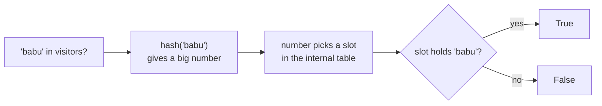
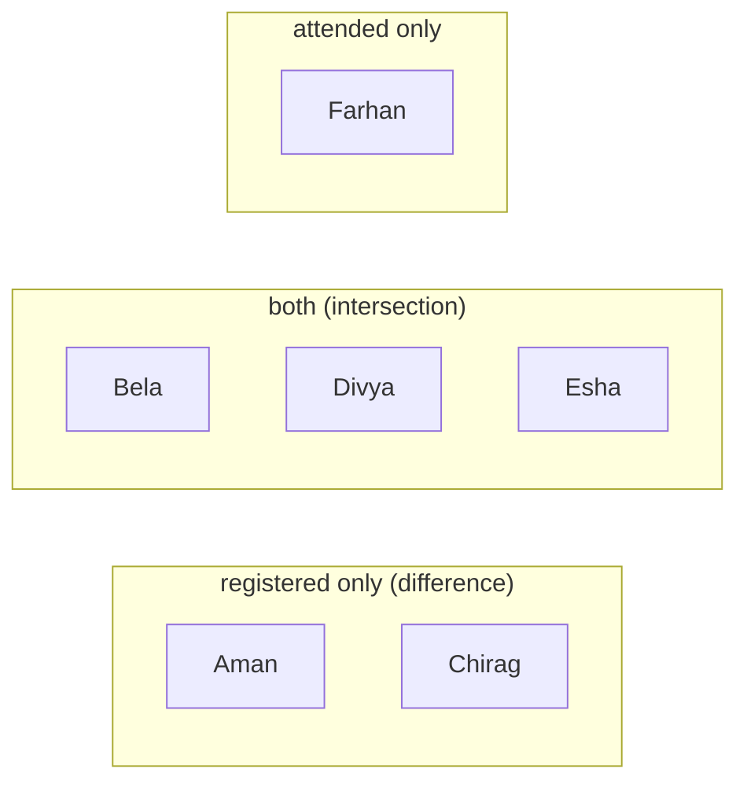

# Sets: The Complete Guide

> 📚 **Before you start**
>
> - [Containers and Mutability](../03-core-language-concepts/containers-and-mutability.md), for hashability and why lists can't be set items
> - [Operators and Precedence](../03-core-language-concepts/operators-and-precedence.md), for `|`, `&`, `^` and `in`
> - [Lists and Tuples](lists-and-tuples.md), for comparison with ordered collections

## Introduction

An e-commerce site gets 50,000 page views in a day. How many **different** people visited? A college has a list of students who registered for the hackathon and a list who actually turned up. Who registered but didn't come? Who came without registering? Two friends compare their contacts: which friends do they have in common?

Each question is about **membership and uniqueness**, not order. "Is this person in the group?" "Which people are in both groups?" "Which are in one but not the other?" That's exactly what a **set** is for. Python's `set` type stores each value at most once, answers "is it in here?" almost instantly however big it gets, and supports the union, intersection and difference operations you may remember from school maths and Venn diagrams.

By the end of this lesson you'll be able to create and modify sets, use all the set operations and comparisons, understand why sets are fast and unordered, know what can and can't go in a set, and use `frozenset` when you need an immutable one.

> 💡 **Key Insight**
>
> A set trades **order** for **speed**. It doesn't remember positions; instead it files each item under its **hash**, a number computed from the item's value. To check membership it computes the hash and looks in one place, instead of scanning every item as a list does. That's why `x in my_set` stays fast for a million items, and why set items must be immutable.

---

## Core Explanation

### 1. Creating sets

```python
visitors = {"asha", "babu", "asha", "charu", "babu"}
print(len(visitors))
print(sorted(visitors))

digits = set([3, 1, 3, 2, 1])      # from a list
letters = set("mississippi")       # from a string: unique characters
print(digits)
print(sorted(letters))
```

Output:

```
3
['asha', 'babu', 'charu']
{1, 2, 3}
['i', 'm', 'p', 's']
```

Duplicates vanish automatically. Passing any iterable to `set()` keeps one copy of each distinct item.

**The empty set** has a trap. `{}` is an empty **dictionary**, because dicts claimed the curly braces first. Use `set()`:

```python
print(type({}), type(set()))
```

Output:

```
<class 'dict'> <class 'set'>
```

### 2. Sets have no order

A set doesn't keep items in the order you added them, and it has no positions, so no indexing or slicing:

```python
# not-run: shows an error on purpose
visitors = {"asha", "babu", "charu"}
print(visitors[0])
```

Running it shows:

```
Traceback (most recent call last):
  File "/home/you/python-practice/example.py", line 3, in <module>
    print(visitors[0])
          ~~~~~~~~^^^
TypeError: 'set' object is not subscriptable
```

"Not subscriptable" means "you can't use square brackets on this". When you print a set of strings, the order can even change **between runs of the same program**: Python deliberately varies string hashes from run to run, a security feature called **hash randomisation**. That's why every example in this course prints sets through `sorted()`. Small integers happen to come out in a stable order, but don't rely on it.

To loop in a predictable order, sort:

```python
for name in sorted(visitors):
    print(name.title())
```

Output:

```
Asha
Babu
Charu
```

### 3. How sets work: hashing

Here's the idea behind the speed. A set keeps an internal table with many slots. To store an item, Python computes `hash(item)`, a large integer, and uses it to pick a slot. To check whether an item is present, it computes the same hash and looks in that one slot (plus, rarely, a few neighbours).



A list has no such shortcut: `x in my_list` compares `x` with each item from the start until it finds a match. For a list of a million items, a miss means a million comparisons. Let's measure it with the standard library's `timeit` module, which runs a piece of code many times and reports the seconds taken:

```python
import timeit

ids_list = list(range(200_000))
ids_set = set(ids_list)

list_time = timeit.timeit(lambda: 199_999 in ids_list, number=200)
set_time = timeit.timeit(lambda: 199_999 in ids_set, number=200)

print("Set lookup faster:", set_time < list_time)
print("Roughly how many times faster:", "thousands" if list_time / set_time > 1000 else "less than 1000")
```

Output:

```
Set lookup faster: True
Roughly how many times faster: thousands
```

(The exact timings vary by computer, so we print a comparison rather than the seconds.) The cost: building a set takes time and extra memory, and you lose order. For a single lookup in a short list, a list is fine. For repeated lookups, convert to a set once.

### 4. What can go in a set

Set items must be **hashable**, which for built-in types means immutable: numbers, strings, tuples (of hashable items), `frozenset`, `None`, `bool`.

```python
routes = {("Mumbai", "Pune"), ("Delhi", "Agra")}
print(("Mumbai", "Pune") in routes)
```

Output:

```
True
```

A list can't go in a set:

```python
# not-run: shows an error on purpose
routes = {["Mumbai", "Pune"]}
```

Running it shows:

```
Traceback (most recent call last):
  File "/home/you/python-practice/example.py", line 2, in <module>
    routes = {["Mumbai", "Pune"]}
             ^^^^^^^^^^^^^^^^^^^^
TypeError: unhashable type: 'list'
```

Convert it to a tuple first: `tuple(["Mumbai", "Pune"])`.

One surprise: values that are **equal** count as the same item, even across types. `1`, `1.0` and `True` are all equal, so a set keeps only the first:

```python
print({1, 1.0, True})
print({0, False, 0.0, ""})
```

Output:

```
{1}
{0, ''}
```

`""` is falsy but not equal to `0`, so it stays.

### 5. Adding and removing

| Method | Effect | If the item is missing / present |
|---|---|---|
| `s.add(x)` | add one item | no effect if already present |
| `s.update(iterable)` | add many items | duplicates ignored |
| `s.remove(x)` | remove an item | `KeyError` if missing |
| `s.discard(x)` | remove an item | silently does nothing if missing |
| `s.pop()` | remove and return an **arbitrary** item | `KeyError` if empty |
| `s.clear()` | remove everything | |

```python
tags = {"python", "beginner"}
tags.add("tutorial")
tags.add("python")                       # already there: no change
tags.update(["india", "free", "python"])
print(sorted(tags))

tags.discard("paid")                     # not there: no error
tags.remove("free")
print(sorted(tags))
```

Output:

```
['beginner', 'free', 'india', 'python', 'tutorial']
['beginner', 'india', 'python', 'tutorial']
```

```python
# not-run: shows an error on purpose
tags = {"python", "beginner"}
tags.remove("paid")
```

Running it shows:

```
Traceback (most recent call last):
  File "/home/you/python-practice/example.py", line 3, in <module>
    tags.remove("paid")
    ~~~~~~~~~~~^^^^^^^^
KeyError: 'paid'
```

Use `remove` when absence would be a bug you want to hear about; use `discard` when absence is fine.

A common slip: `tags.update("java")` adds the **characters** `j`, `a`, `v`, because a string is an iterable of characters. To add one string, use `add`.

### 6. The set operations

These are the reason sets exist. We'll use the hackathon example:

```python
registered = {"Aman", "Bela", "Chirag", "Divya", "Esha"}
attended = {"Bela", "Divya", "Esha", "Farhan"}
```

| Operation | Operator | Method | Meaning |
|---|---|---|---|
| **Union** | `a \| b` | `a.union(b)` | in either |
| **Intersection** | `a & b` | `a.intersection(b)` | in both |
| **Difference** | `a - b` | `a.difference(b)` | in `a` but not `b` |
| **Symmetric difference** | `a ^ b` | `a.symmetric_difference(b)` | in exactly one |

```python
print("Everyone involved:", sorted(registered | attended))
print("Registered and came:", sorted(registered & attended))
print("No-shows:", sorted(registered - attended))
print("Walk-ins:", sorted(attended - registered))
print("Mismatch either way:", sorted(registered ^ attended))
```

Output:

```
Everyone involved: ['Aman', 'Bela', 'Chirag', 'Divya', 'Esha', 'Farhan']
Registered and came: ['Bela', 'Divya', 'Esha']
No-shows: ['Aman', 'Chirag']
Walk-ins: ['Farhan']
Mismatch either way: ['Aman', 'Chirag', 'Farhan']
```

Picture them as two overlapping circles:



The union is all three boxes; the symmetric difference is the two outer boxes.

Note that difference is not symmetric: `registered - attended` and `attended - registered` are different sets.

**Operators vs methods:** the operators need both sides to be sets. The methods accept **any iterable**, which saves a conversion:

```python
print(sorted(registered.intersection(["Aman", "Zoya"])))
print(sorted(registered.union(("Gita",), ["Hari"])))      # methods take several arguments
```

Output:

```
['Aman']
['Aman', 'Bela', 'Chirag', 'Divya', 'Esha', 'Gita', 'Hari']
```

Each operation also has an **in-place** version that updates the left-hand set instead of making a new one: `|=` (`update`), `&=` (`intersection_update`), `-=` (`difference_update`), `^=` (`symmetric_difference_update`).

```python
pending = {"KYC", "PAN", "address proof", "photo"}
submitted_today = {"PAN", "photo"}
pending -= submitted_today
print(sorted(pending))
```

Output:

```
['KYC', 'address proof']
```

### 7. Comparing sets

| Test | Operator | Method | True when |
|---|---|---|---|
| equal | `a == b` | | same items, any order |
| subset | `a <= b` | `a.issubset(b)` | every item of `a` is in `b` |
| proper subset | `a < b` | | subset, and `b` has something extra |
| superset | `a >= b` | `a.issuperset(b)` | `a` contains every item of `b` |
| disjoint | | `a.isdisjoint(b)` | no items in common |

```python
required = {"aadhaar", "pan"}
uploaded = {"pan", "aadhaar", "photo"}

print(required <= uploaded)            # all required docs uploaded?
print(required < uploaded)
print(uploaded >= required)
print({1, 2} == {2, 1})
print({"veg"}.isdisjoint({"egg", "chicken"}))
```

Output:

```
True
True
True
True
True
```

The subset test is a neat one-line replacement for "loop over the required items and check each is present".

### 8. frozenset: an immutable set

A `frozenset` is a set that can't be changed after creation. Because it's immutable, it's hashable, so it can be a dict key or an item of another set:

```python
pair1 = frozenset({"Mumbai", "Pune"})
pair2 = frozenset({"Pune", "Mumbai"})
print(pair1 == pair2)

distance = {pair1: 150}
print(distance[pair2])              # order doesn't matter: same key
```

Output:

```
True
150
```

That's handy for "unordered pairs", where Mumbai–Pune and Pune–Mumbai should be the same thing. A frozenset supports all the read-only operations (`|`, `&`, `in`, `<=`), but not `add` or `remove`.

### 9. Removing duplicates while keeping order

`set(items)` removes duplicates but loses the order. When order matters, a dictionary does the job, because dict keys are unique **and** remember insertion order (you'll study dicts next):

```python
orders = ["Pune", "Delhi", "Pune", "Goa", "Delhi", "Agra"]
print(sorted(set(orders)))              # unique, but order lost
print(list(dict.fromkeys(orders)))      # unique, first-seen order kept
```

Output:

```
['Agra', 'Delhi', 'Goa', 'Pune']
['Pune', 'Delhi', 'Goa', 'Agra']
```

`dict.fromkeys(items)` makes a dict with each item as a key, so duplicates collapse onto the first occurrence.

### 10. Sets in everyday code

**Finding duplicates** in one pass:

```python
transaction_ids = ["T1", "T2", "T3", "T2", "T4", "T1"]
seen = set()
duplicates = set()
for t in transaction_ids:
    if t in seen:
        duplicates.add(t)
    else:
        seen.add(t)
print(sorted(duplicates))
```

Output:

```
['T1', 'T2']
```

**Checking for any duplicates** at all:

```python
print(len(transaction_ids) != len(set(transaction_ids)))
```

Output:

```
True
```

**Vowels in a word**, using a set as a fast "allowed characters" lookup:

```python
VOWELS = set("aeiou")
word = "education"
found = set(word) & VOWELS
print(sorted(found), len(found) == 5)
```

Output:

```
['a', 'e', 'i', 'o', 'u'] True
```

"Education" uses all five vowels.

---

## Try It Yourself

1. Two friends' contact lists: `riya = {"Amit", "Neha", "Sam", "Kabir"}` and `arjun = {"Sam", "Kabir", "Zoya"}`. Print mutual friends, friends only Riya has, and everyone either knows, all sorted.
2. A sentence: `"the cat and the hat and the bat"`. How many distinct words does it have?
3. A recipe needs `{"rice", "dal", "ghee", "salt", "turmeric"}`. The pantry has `["rice", "salt", "oil", "dal"]`. Is the pantry enough (subset test)? What's missing?
4. What does `{"a", "b"} | {"b", "c"} - {"c"}` give? Check the precedence table in [Operators and Precedence](../03-core-language-concepts/operators-and-precedence.md) first.

<details>
<summary>Show answers</summary>

```python
riya = {"Amit", "Neha", "Sam", "Kabir"}
arjun = {"Sam", "Kabir", "Zoya"}
print(sorted(riya & arjun))
print(sorted(riya - arjun))
print(sorted(riya | arjun))

sentence = "the cat and the hat and the bat"
print(len(set(sentence.split())))

recipe = {"rice", "dal", "ghee", "salt", "turmeric"}
pantry = set(["rice", "salt", "oil", "dal"])
print(recipe <= pantry)
print(sorted(recipe - pantry))

print(sorted({"a", "b"} | {"b", "c"} - {"c"}))
```

Output:

```
['Kabir', 'Sam']
['Amit', 'Neha']
['Amit', 'Kabir', 'Neha', 'Sam', 'Zoya']
5
False
['ghee', 'turmeric']
['a', 'b']
```

For 4: `-` binds tighter than `|`, so it's `{"a", "b"} | ({"b", "c"} - {"c"})`, which is `{"a", "b"} | {"b"}`.

</details>

---

## Real-World Examples

### Example 1: Unique visitors

Analytics systems count distinct users per day by adding each visitor's id to a set and taking `len()` at the end. (At internet scale they use clever approximate structures such as HyperLogLog, but the idea is the same.)

### Example 2: Permissions

A user has roles `{"viewer", "editor"}`; an action requires `{"editor"}`. The check `required <= user_roles` is one line, fast, and order-independent.

### Example 3: Data reconciliation

A finance team compares order ids in the sales system with payment ids from the bank: `orders - payments` are unpaid orders, `payments - orders` are payments with no matching order. This kind of set difference is the first step in most reconciliation jobs, and it's often run on millions of ids.

---

## Common Misconceptions

### Misconception 1: "`{}` is an empty set"

It's an empty dict. Use `set()`.

### Misconception 2: "Sets keep insertion order like dicts"

They don't. Printing a set of strings can show a different order on each run. Sort it for display, or use `dict.fromkeys` for an ordered unique list.

### Misconception 3: "`set.update("word")` adds the word"

It adds each character. Use `add("word")` for one item, or `update(["word"])`.

### Misconception 4: "`remove` and `discard` are the same"

`remove` raises `KeyError` for a missing item; `discard` doesn't.

### Misconception 5: "Sets can hold anything a list can"

Only hashable items. Lists, dicts and sets can't go in a set; tuples and frozensets can.

---

## Interview Relevance

Sets are the go-to tool for a whole category of interview problems, and "why is `in` faster on a set?" is a favourite theory question. Be ready to discuss:

- **Hashing**: average O(1) add, remove and membership; why items must be hashable; why there's no order.
- **Set algebra**: union, intersection, difference, symmetric difference, subset/superset, with operator and method forms.
- **Typical problems**: remove duplicates, find the intersection of two arrays, first repeated element, check if all characters are unique, two-sum (with a set of seen values), longest substring without repeating characters.
- **Trade-offs**: memory overhead and loss of order vs speed; converting a list to a set once before many lookups.
- **frozenset** and its use as a dict key.

---

## Key Takeaways

- A **set** holds **unique, hashable** items with **no order** and no indexing. Create with `{...}` or `set(iterable)`; the empty set is `set()`.
- **Membership tests are fast** (average constant time) because sets use **hashing**; lists scan item by item.
- Modify with `add`, `update`, `remove` (errors if missing), `discard` (silent), `pop`, `clear`.
- **Set algebra**: `|` union, `&` intersection, `-` difference, `^` symmetric difference; `<=`, `>=`, `isdisjoint` for comparisons.
- **frozenset** is the immutable, hashable version; **`dict.fromkeys`** removes duplicates while keeping order.

---

**Up next:** [Dictionaries and Dictionary Views](dictionaries-and-dictionary-views.md)
