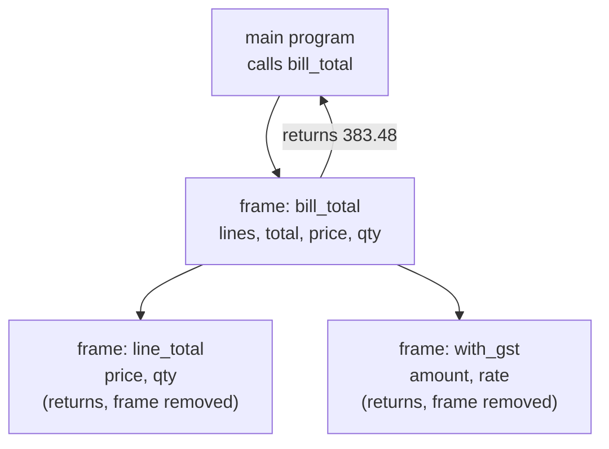
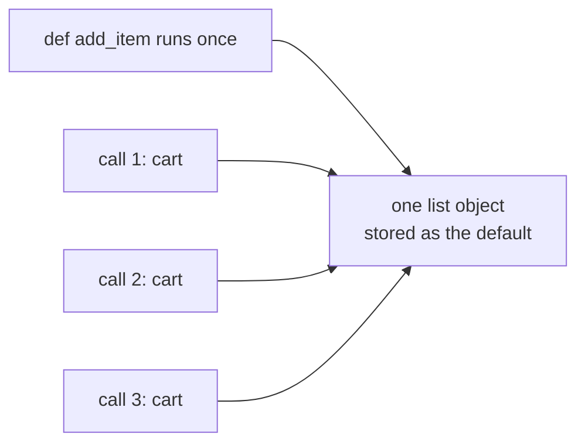
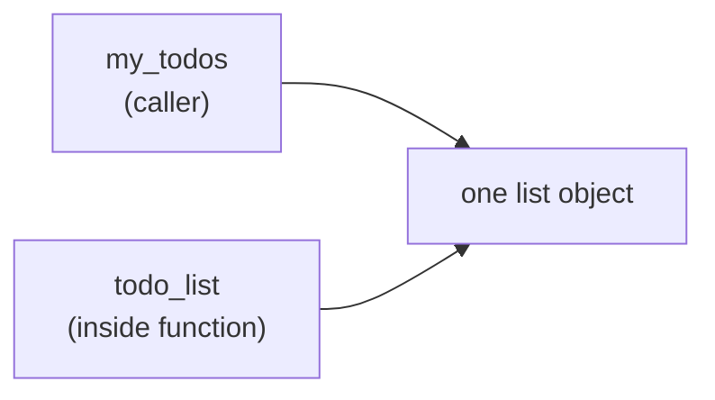
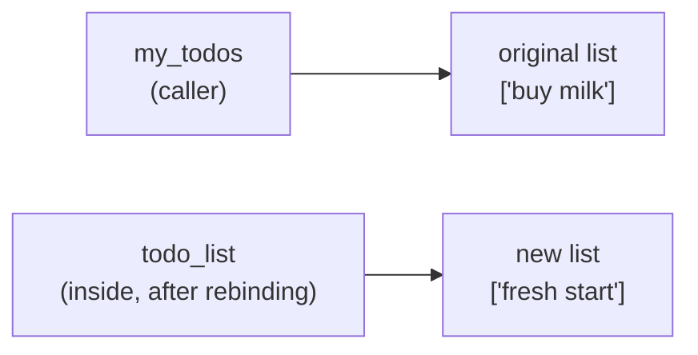
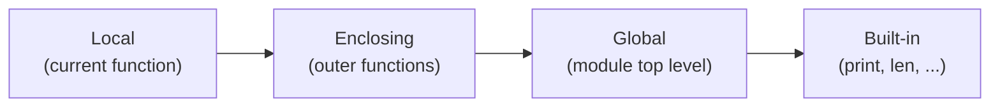

# Functions and Parameter Passing: The Complete Guide

> 📚 **Before you start**
>
> - [Containers and Mutability](../03-core-language-concepts/containers-and-mutability.md), for names, objects and aliasing, which explain how arguments are passed
> - [if, elif and else](../04-control-flow/if-elif-and-else.md) and [for and while Loops](../04-control-flow/for-and-while-loops.md)
> - [Dictionaries and Dictionary Views](../05-strings-and-data-structures/dictionaries-and-dictionary-views.md), for `**kwargs`

## Introduction

In the unit converter lab you wrote the same three temperature-conversion lines three times, and in the guessing game the binary-search loop appeared twice. Each copy was a chance for a typo, and fixing a bug meant fixing it in every copy.

A **function** solves this. It's a named, reusable block of code: you write the steps once, give them a name like `convert_temperature`, and then **call** that name whenever you need the steps, with different inputs each time. You've been calling functions since your first lesson: `print()`, `len()`, `sum()`, `sorted()`, `input()`. Now you'll write your own.

This lesson covers everything a beginner needs about functions: defining and calling them, returning values, every kind of parameter (positional, keyword, default, `*args`, `**kwargs`, keyword-only and positional-only), where variables live (**scope**), the famous mutable-default trap, functions as values, a first look at recursion, and the question that confuses even experienced developers: **when a function changes its argument, does the caller see the change?**

> 💡 **Key Insight**
>
> Python passes arguments by **binding the parameter name to the same object** the caller passed. Nothing is copied. So if the function **mutates** that object (appends to a list, sets a dict key), the caller sees it. If the function merely **rebinds** its own parameter name to a new object (`items = [...]`, `n = n + 1`), the caller sees nothing. Every "why did my list change?" question comes down to mutate vs rebind.

---

## Core Explanation

### 1. Defining and calling a function

```python
def greet():
    print("Namaste!")
    print("Welcome to the course.")

greet()
greet()
```

Output:

```
Namaste!
Welcome to the course.
Namaste!
Welcome to the course.
```

- `def` starts a **function definition**, followed by the function's **name**, round brackets, and a colon.
- The indented block is the **body**. Defining a function does **not** run the body; it just creates the function and gives it a name.
- `greet()` **calls** the function: Python jumps into the body, runs it, and comes back. The brackets are what make it a call. Writing just `greet` refers to the function without running it.

Function names follow the same rules as variable names, in snake_case, and are usually verbs: `calculate_gst`, `send_reminder`, `is_valid_pan`.

### 2. Parameters and arguments

Values can be passed in. The names in the definition are **parameters**; the values you pass in a call are **arguments**.

```python
def greet(name, city):
    print(f"Namaste, {name} from {city}!")

greet("Priya", "Kochi")
greet("Arjun", "Indore")
```

Output:

```
Namaste, Priya from Kochi!
Namaste, Arjun from Indore!
```

When `greet("Priya", "Kochi")` runs, Python binds `name` to `"Priya"` and `city` to `"Kochi"`, then runs the body. Each call gets its own fresh set of parameter names.

### 3. Returning a value

`print` shows something on the screen. `return` **hands a value back** to whoever called the function, so the caller can store it, use it in a calculation, or pass it on. This difference is crucial.

```python
def with_gst(amount, rate=0.18):
    return round(amount * (1 + rate), 2)

price = with_gst(1000)
print(price)
print(with_gst(250) + with_gst(80))
print(max(with_gst(99), 120))
```

Output:

```
1180.0
389.4
120
```

`return` ends the function immediately. A function with no `return` (or a bare `return`) gives back `None`:

```python
def shout(word):
    print(word.upper())        # prints, but returns nothing

result = shout("chai")
print(result)
```

Output:

```
CHAI
None
```

This is the most common beginner function bug: printing inside a function when you meant to return, then trying to use the result.

**Returning several values** is done by returning a tuple, which the caller can unpack:

```python
def split_bill(total, people):
    share = total // people
    leftover = total - share * people
    return share, leftover

each, extra = split_bill(1000, 3)
print(each, extra)
```

Output:

```
333 1
```

### 4. The call stack: what happens during a call

When a function calls another function, Python keeps track of where to return to on the **call stack**. Each call gets a **frame** holding its own local names.

```python
def line_total(price, qty):
    return price * qty

def bill_total(lines):
    total = 0
    for price, qty in lines:
        total += line_total(price, qty)
    return with_gst(total)

print(bill_total([(89, 2), (49, 3)]))
```

Output:

```
383.5
```



Each frame disappears when its function returns. The `price` inside `line_total` and the `price` inside `bill_total` are different names in different frames, which is why functions don't trip over each other's variables.

### 5. Positional and keyword arguments

Arguments can be passed **by position** (matched left to right) or **by keyword** (matched by name). Keywords make calls readable and let you skip remembering the order.

```python
def book_ticket(passenger, train, coach="SL", berth="any"):
    return f"{passenger}: train {train}, coach {coach}, berth {berth}"

print(book_ticket("Priya", 12951))
print(book_ticket("Priya", 12951, "3A"))
print(book_ticket(train=12951, passenger="Arjun", berth="lower"))
print(book_ticket("Meera", 12627, berth="side upper"))
```

Output:

```
Priya: train 12951, coach SL, berth any
Priya: train 12951, coach 3A, berth any
Arjun: train 12951, coach SL, berth lower
Meera: train 12627, coach SL, berth side upper
```

Rules: positional arguments come first, then keyword arguments, and each parameter gets exactly one value.

### 6. Default values

`coach="SL"` gives the parameter a **default value**, used when the caller doesn't supply one. Parameters with defaults must come **after** those without:

```python
# not-run: shows an error on purpose
def book_ticket(coach="SL", passenger):
    pass
```

Running it shows:

```
  File "/home/you/python-practice/example.py", line 2
    def book_ticket(coach="SL", passenger):
                                ^^^^^^^^^
SyntaxError: parameter without a default follows parameter with a default
```

#### The mutable default trap

Default values are created **once**, when the `def` line runs, not each time the function is called. If the default is a mutable object like a list, every call that uses the default shares that same list:

```python
def add_item(item, cart=[]):
    cart.append(item)
    return cart

print(add_item("rice"))
print(add_item("dal"))       # expected ['dal']...
print(add_item("ghee"))
```

Output:

```
['rice']
['rice', 'dal']
['rice', 'dal', 'ghee']
```



The fix is the **`None` sentinel** pattern: use `None` as the default and create a fresh list inside the function.

```python
def add_item(item, cart=None):
    if cart is None:
        cart = []
    cart.append(item)
    return cart

print(add_item("rice"))
print(add_item("dal"))
```

Output:

```
['rice']
['dal']
```

Immutable defaults (numbers, strings, `None`, tuples) are always safe.

### 7. Errors when calling functions

Python checks that every call matches the parameters:

```python
# not-run: shows an error on purpose
def book_ticket(passenger, train, coach="SL"):
    pass

book_ticket("Priya")
```

Running it shows:

```
Traceback (most recent call last):
  File "/home/you/python-practice/example.py", line 5, in <module>
    book_ticket("Priya")
    ~~~~~~~~~~~^^^^^^^^^
TypeError: book_ticket() missing 1 required positional argument: 'train'
```

```python
# not-run: shows an error on purpose
def book_ticket(passenger, train, coach="SL"):
    pass

book_ticket("Priya", 12951, "3A", "lower")
```

Running it shows:

```
Traceback (most recent call last):
  File "/home/you/python-practice/example.py", line 5, in <module>
    book_ticket("Priya", 12951, "3A", "lower")
    ~~~~~~~~~~~^^^^^^^^^^^^^^^^^^^^^^^^^^^^^^^
TypeError: book_ticket() takes from 2 to 3 positional arguments but 4 were given
```

```python
# not-run: shows an error on purpose
def book_ticket(passenger, train, coach="SL"):
    pass

book_ticket("Priya", 12951, seat="lower")
```

Running it shows:

```
Traceback (most recent call last):
  File "/home/you/python-practice/example.py", line 5, in <module>
    book_ticket("Priya", 12951, seat="lower")
    ~~~~~~~~~~~^^^^^^^^^^^^^^^^^^^^^^^^^^^^^^
TypeError: book_ticket() got an unexpected keyword argument 'seat'
```

The message always names the function and the problem; read it, then compare the call with the `def` line.

### 8. *args: any number of positional arguments

A parameter with a single star collects **all extra positional arguments into a tuple**. The name `args` is a convention; the star is what matters.

```python
def total_spent(*amounts):
    print("Received:", amounts)
    return sum(amounts)

print(total_spent(120, 45, 300))
print(total_spent())
```

Output:

```
Received: (120, 45, 300)
465
Received: ()
0
```

That's how `print()` accepts any number of values. You can mix normal parameters with `*args`; the normal ones are filled first:

```python
def announce(train, *stations):
    route = " -> ".join(stations)
    return f"Train {train}: {route}"

print(announce(12951, "Mumbai", "Surat", "Vadodara", "Kota", "New Delhi"))
```

Output:

```
Train 12951: Mumbai -> Surat -> Vadodara -> Kota -> New Delhi
```

### 9. **kwargs: any number of keyword arguments

Two stars collect **all extra keyword arguments into a dict**:

```python
def make_profile(name, **details):
    profile = {"name": name}
    profile.update(details)
    return profile

print(make_profile("Priya", city="Kochi", age=29))
print(make_profile("Arjun", language="Hindi", premium=True, pin="452001"))
```

Output:

```
{'name': 'Priya', 'city': 'Kochi', 'age': 29}
{'name': 'Arjun', 'language': 'Hindi', 'premium': True, 'pin': '452001'}
```

### 10. Unpacking arguments in a call: * and **

The stars work the other way round in a **call**: `*` spreads a list or tuple into positional arguments, and `**` spreads a dict into keyword arguments.

```python
order = ("Priya", 12951)
options = {"coach": "2A", "berth": "lower"}
print(book_ticket(*order, **options))

nums = [3, 9, 4]
print(max(*nums), max(nums))      # max accepts either form
```

Output:

```
Priya: train 12951, coach 2A, berth lower
9 9
```

### 11. Keyword-only and positional-only parameters

Two markers in the parameter list control **how** arguments may be passed:

- Parameters **after a bare `*`** are **keyword-only**: callers must name them. Good for options whose meaning isn't obvious from position.
- Parameters **before a `/`** are **positional-only**: callers can't name them. Useful when the name isn't meaningful to callers, or might change.

```python
def transfer(amount, /, to_account, *, note="", instant=False):
    mode = "IMPS" if instant else "NEFT"
    return f"₹{amount} to {to_account} via {mode} {note}".strip()

print(transfer(5000, "XXXX1234"))
print(transfer(5000, to_account="XXXX1234", instant=True, note="(rent)"))
```

Output:

```
₹5000 to XXXX1234 via NEFT
₹5000 to XXXX1234 via IMPS (rent)
```

```python
# not-run: shows an error on purpose
def transfer(amount, /, to_account, *, note="", instant=False):
    pass

transfer(5000, "XXXX1234", True)
```

Running it shows:

```
Traceback (most recent call last):
  File "/home/you/python-practice/example.py", line 5, in <module>
    transfer(5000, "XXXX1234", True)
    ~~~~~~~~^^^^^^^^^^^^^^^^^^^^^^^^
TypeError: transfer() takes 2 positional arguments but 3 were given
```

A bare `True` at the end of a call is unreadable ("true what?"), so making `instant` keyword-only forces `instant=True`, which documents itself.

The full order of a parameter list is:

```
def f(positional_only, /, normal, *args, keyword_only, **kwargs)
```

You'll rarely need all of them at once. Defaults can be added to any of them, subject to the "defaults after non-defaults" rule for the positional ones.

### 12. How arguments are passed: mutate vs rebind

Now the Key Insight in detail. When you call `f(x)`, Python makes the parameter name inside `f` refer to **the very same object** that `x` refers to. This is sometimes called **pass by object reference** or **call by sharing**. Two cases follow.

**Case 1: the function mutates the object.** The caller sees the change, because there's only one object:

```python
def add_reminder(todo_list):
    todo_list.append("pay electricity bill")

my_todos = ["buy milk"]
add_reminder(my_todos)
print(my_todos)
```

Output:

```
['buy milk', 'pay electricity bill']
```



**Case 2: the function rebinds its parameter.** The parameter name now points somewhere else; the caller's name is untouched:

```python
def reset(todo_list):
    todo_list = []                 # rebinds the LOCAL name only
    todo_list.append("fresh start")

my_todos = ["buy milk"]
reset(my_todos)
print(my_todos)
```

Output:

```
['buy milk']
```



With **immutable** arguments (numbers, strings, tuples) only case 2 is possible, since they can't be mutated. That's why a function can never change the caller's integer:

```python
def add_bonus(salary):
    salary = salary + 5000         # new int object, local name rebound
    return salary

my_salary = 50000
new_salary = add_bonus(my_salary)
print(my_salary, new_salary)
```

Output:

```
50000 55000
```

To change a value the caller holds, **return** the new value and let the caller reassign it: `my_salary = add_bonus(my_salary)`.

**Good practice:** a function should either modify its argument **or** return a new value, and its name and docstring should make clear which. Functions that return new values without touching their inputs are easier to reason about and test. If you need to work on a list without affecting the caller's, copy it first: `items = list(items)`.

### 13. Scope: where names live

A name created inside a function (a parameter, or any assignment in the body) is **local**: it exists only while that call runs and is invisible outside.

```python
def compute():
    secret = 42
    return secret * 2

print(compute())
```

Output:

```
84
```

```python
# not-run: shows an error on purpose
def compute():
    secret = 42
    return secret * 2

compute()
print(secret)
```

Running it shows:

```
Traceback (most recent call last):
  File "/home/you/python-practice/example.py", line 7, in <module>
    print(secret)
          ^^^^^^
NameError: name 'secret' is not defined
```

A function **can read** names defined at the top level of the file (**global** names):

```python
GST_RATE = 0.18

def price_with_gst(amount):
    return amount * (1 + GST_RATE)      # reads the global

print(price_with_gst(100))
```

Output:

```
118.0
```

When Python looks up a name, it searches in this order, called the **LEGB rule**:



The first match wins. That's why naming a variable `list` or `sum` is a bad idea: your global `sum` hides the built-in one.

#### Assigning to a global inside a function

If a function **assigns** to a name anywhere in its body, Python treats that name as local for the **whole** function. Reading it before the assignment then fails:

```python
# not-run: shows an error on purpose
counter = 0

def increment():
    counter = counter + 1

increment()
```

Running it shows:

```
Traceback (most recent call last):
  File "/home/you/python-practice/example.py", line 7, in <module>
    increment()
    ~~~~~~~~~^^
  File "/home/you/python-practice/example.py", line 5, in increment
    counter = counter + 1
              ^^^^^^^
UnboundLocalError: cannot access local variable 'counter' where it is not associated with a value
```

Note the traceback now has **two** entries: the call on line 7, and the failing line 5 inside `increment`. Tracebacks list the call chain from the outermost call to the innermost, so the **last** entry is where the error happened.

You can declare `global counter` inside the function to assign the global, but it's usually better design to pass values in and return results out:

```python
def increment(counter):
    return counter + 1

counter = 0
counter = increment(counter)
counter = increment(counter)
print(counter)
```

Output:

```
2
```

(The `nonlocal` keyword does the same job for a variable in an enclosing function; you'll meet it with closures in [Lambda, map and Functional Style](lambda-map-and-functional-style.md).)

### 14. Docstrings and type hints

A **docstring** is a string written as the first line of the body. It documents what the function does, and tools (`help()`, editors) display it:

```python
def emi(principal: float, annual_rate: float, months: int) -> float:
    """Return the monthly instalment for a loan.

    principal: amount borrowed in rupees
    annual_rate: yearly interest rate as a percentage, e.g. 9.5
    months: number of monthly instalments
    """
    r = annual_rate / 12 / 100
    return principal * r * (1 + r) ** months / ((1 + r) ** months - 1)

print(round(emi(500_000, 9.5, 60), 2))
print(emi.__doc__.splitlines()[0])
```

Output:

```
10500.93
Return the monthly instalment for a loan.
```

`principal: float` and `-> float` are **type hints**: notes saying what types are expected and returned. Python does **not** enforce them when the code runs, but editors and checking tools (like mypy) use them to catch mistakes before you run anything. They're optional; many teams use them on every function.

### 15. Functions are objects

A function is a value like any other. You can store it in a variable, put it in a list or dict, and pass it to another function:

```python
def to_upper(s):
    return s.upper()

def to_title(s):
    return s.title()

shout = to_upper                    # no brackets: refer to the function, don't call it
print(shout("chai"))

formatters = {"upper": to_upper, "title": to_title}
print(formatters["title"]("masala chai"))

def apply_to_all(func, items):
    return [func(x) for x in items]

print(apply_to_all(to_title, ["pune", "new delhi"]))
```

Output:

```
CHAI
Masala Chai
['Pune', 'New Delhi']
```

A dictionary of functions (a **dispatch table**) replaces long `if`/`elif` chains that pick an action by name. Passing functions to other functions is the heart of the functional style in [Lambda, map and Functional Style](lambda-map-and-functional-style.md).

### 16. A first look at recursion

A function can call itself. This is **recursion**, and it suits problems that contain smaller copies of themselves. Every recursive function needs a **base case** that stops the self-calls.

```python
def factorial(n):
    if n <= 1:                 # base case
        return 1
    return n * factorial(n - 1)

print(factorial(5))

def count_down(n):
    if n == 0:
        print("Liftoff!")
        return
    print(n)
    count_down(n - 1)

count_down(3)
```

Output:

```
120
3
2
1
Liftoff!
```

Each recursive call adds a frame to the call stack. Without a base case (or with too many levels), Python stops at its **recursion limit** (1,000 frames by default):

```python
# not-run: shows an error on purpose
def forever(n):
    return forever(n + 1)

forever(0)
```

Running it shows:

```
Traceback (most recent call last):
  File "/home/you/python-practice/example.py", line 5, in <module>
    forever(0)
    ~~~~~~~^^^
  File "/home/you/python-practice/example.py", line 3, in forever
    return forever(n + 1)
  File "/home/you/python-practice/example.py", line 3, in forever
    return forever(n + 1)
  File "/home/you/python-practice/example.py", line 3, in forever
    return forever(n + 1)
  [Previous line repeated 996 more times]
RecursionError: maximum recursion depth exceeded
```

In Python, loops are usually preferred to deep recursion; recursion shines for naturally nested data such as folders inside folders or JSON inside JSON.

### 17. Putting it together: the converter, refactored

Here's the temperature converter from the [unit converter lab](../03-core-language-concepts/lab-build-a-unit-converter.md), now written once as a function and called in a loop:

```python
TEMPERATURE = {"C": (1, 0), "F": (9 / 5, 32), "K": (1, 273.15)}

def convert_temperature(value, from_unit, to_unit, *, digits=2):
    """Convert a temperature between C, F and K."""
    from_unit, to_unit = from_unit.upper(), to_unit.upper()
    if from_unit not in TEMPERATURE or to_unit not in TEMPERATURE:
        return None
    s1, o1 = TEMPERATURE[from_unit]
    s2, o2 = TEMPERATURE[to_unit]
    return round((value - o1) / s1 * s2 + o2, digits)

for value, a, b in [(45, "C", "F"), (0, "K", "C"), (-40, "f", "c"), (10, "C", "X")]:
    print(f"{value} {a} -> {b}: {convert_temperature(value, a, b)}")
```

Output:

```
45 C -> F: 113.0
0 K -> C: -273.15
-40 f -> c: -40.0
10 C -> X: None
```

One definition, tested with four calls, and invalid units handled in one place. In [Advanced Python Programming](../../advanced-python-programming/course.md#m4) you'll learn to raise a proper exception instead of returning `None`.

---

## Try It Yourself

1. Write `is_even(n)` that **returns** `True` or `False`, and use it in a comprehension to keep the even numbers from `range(1, 11)`.
2. Write `average(*nums)` that returns the average of any number of arguments, or `0` if none are given.
3. Write `format_name(first, last, *, upper=False)` returning `"Last, First"`, uppercased when `upper=True`.
4. Predict, then run: what does this print, and why?

   `def double_all(nums): nums = [n * 2 for n in nums]`, then `data = [1, 2, 3]`, `double_all(data)`, `print(data)`.

   Then write `double_in_place(nums)` that really does change the caller's list.

<details>
<summary>Show answers</summary>

```python
def is_even(n):
    return n % 2 == 0

print([n for n in range(1, 11) if is_even(n)])

def average(*nums):
    if not nums:
        return 0
    return sum(nums) / len(nums)

print(average(70, 85, 90), average())

def format_name(first, last, *, upper=False):
    result = f"{last}, {first}"
    return result.upper() if upper else result

print(format_name("Priya", "Nair"), "|", format_name("Priya", "Nair", upper=True))

def double_all(nums):
    nums = [n * 2 for n in nums]

data = [1, 2, 3]
double_all(data)
print(data)

def double_in_place(nums):
    for i in range(len(nums)):
        nums[i] = nums[i] * 2

double_in_place(data)
print(data)
```

Output:

```
[2, 4, 6, 8, 10]
81.66666666666667 0
Nair, Priya | NAIR, PRIYA
[1, 2, 3]
[2, 4, 6]
```

`double_all` only **rebound** its local name `nums` to a new list, so `data` was unaffected (and the new list was thrown away, because nothing was returned). `double_in_place` **mutates** the list through index assignment, so the caller sees it. (`nums[:] = [n * 2 for n in nums]` would also work: slice assignment mutates.)

</details>

---

## Real-World Examples

### Example 1: Business rules in one place

An e-commerce codebase has `calculate_delivery_fee(order_total, distance_km, is_member)`. The checkout page, the cart preview and the mobile app all call it. When the free-delivery threshold changes from ₹199 to ₹249, one line changes, and every screen agrees.

### Example 2: Library APIs with keyword-only options

Popular libraries design functions so the important inputs are positional and options are keyword-only. In pandas you write `df.sort_values("price", ascending=False)`, and Python's own `sorted(items, key=..., reverse=True)` makes `key` and `reverse` keyword-only for exactly this readability reason.

### Example 3: Tools for AI agents

In [Agentic AI Fundamentals](../../agentic-ai-fundamentals/course.md), an agent's "tools" are ordinary Python functions with clear names, parameters, type hints and docstrings. The model reads the name, docstring and parameters to decide when and how to call each tool, and the arguments arrive as a dict that's spread into the call with `**`.

---

## Common Misconceptions

### Misconception 1: "print and return do the same thing"

`print` shows text to a human; `return` gives a value to the calling code. A function that only prints returns `None`.

### Misconception 2: "Python passes by value" / "Python passes by reference"

Neither, in the C++ sense. Python passes object references: the parameter name is bound to the caller's object. Mutations are shared; rebinding is not.

### Misconception 3: "Default values are created on each call"

They're created once, when `def` runs. A mutable default (`[]`, `{}`) is shared across calls. Use `None` and create the object inside.

### Misconception 4: "Variables inside a function can be used outside it"

Local names vanish when the call ends. Return what the caller needs.

### Misconception 5: "Type hints make Python check types"

Hints are documentation for humans and tools. Python ignores them at runtime.

---

## Interview Relevance

Functions underpin every coding interview, and parameter passing is a favourite theory question. Prepare to:

- **Explain argument passing** as "call by object reference/sharing", with a mutate-vs-rebind example.
- **Spot the mutable default argument bug** and fix it with `None`.
- **Describe `*args` and `**kwargs`**, unpacking with `*`/`**` in calls, and keyword-only/positional-only parameters.
- **Explain scope**: LEGB, `UnboundLocalError`, `global` vs `nonlocal`.
- **Discuss design**: small single-purpose functions, pure functions vs side effects, docstrings and type hints.
- **Recursion basics**: base case, call stack, recursion limit, and when iteration is better.

Typical tasks: write a function with defaults and validation, implement `factorial`/`fibonacci` recursively and iteratively, write a variadic `max`, explain the output of a function that modifies a list.

---

## Key Takeaways

- **`def name(params):`** defines a function; **calling** it runs the body. **`return`** hands back a value (a tuple for several); no `return` means `None`.
- Arguments can be **positional or keyword**; parameters can have **defaults** (immutable only, or the `None` pattern), **`*args`** (tuple), **`**kwargs`** (dict), keyword-only (after `*`) and positional-only (before `/`).
- Arguments are passed by **binding to the same object**: **mutating** it is visible to the caller, **rebinding** the parameter is not.
- Names assigned in a function are **local**; lookup follows **LEGB**. Prefer passing values in and returning results over `global`.
- Functions are **objects**: store them, pass them, put them in dicts. Recursion needs a **base case**.

---

**Up next:** [Iterators and Generators](iterators-and-generators.md)
