# How This Course Works

## Introduction

Think about the last time you did something boring and repetitive on a computer. Renaming 200 photos from a wedding. Copying numbers from one Excel sheet to another. Checking a website every morning to see if train tickets for Diwali have opened up. Adding up a month of UPI payments to see where your salary went.

Every one of those jobs can be done by a short program, and **Python** is the language most people learn to write that program in. It is also the language behind most of data science, machine learning and AI engineering today. If you want to work in any of those fields, Python is the front door.

This course assumes you have **never written a line of code**. Not "a little bit at school", not "I know Excel formulas". Zero. Every word that might be new is explained the first time it appears. Every example is short enough to type in a minute and has its real output printed underneath, so you can check your own result against it.

It also doesn't stop at the basics. The first half teaches you to write **scripts that work**: a few dozen lines that read some input, loop over it and print an answer. The second half teaches you to write **programs that keep working** when they grow to thousands of lines, read messy files, hit errors at 3 a.m. and call an AI service hundreds of times. Every later course on this site, from data analysis to LangGraph agents, assumes both halves.

This first article is short. It tells you what you will learn, how the lessons are built, what you need, and how to study so that the ideas actually stick.

> 💡 **Key Insight**
>
> Programming is learned with your fingers, not your eyes. Reading a lesson gives you the feeling of understanding. **Typing the code, running it, and breaking it on purpose** gives you the real thing. Budget twice as long for each lesson as its reading time says, and spend the extra time at the keyboard.

---

## What You Will Learn

By the end of this course you will be able to:

- **Install Python and run programs** from a file and from the interactive prompt, on Windows, macOS or Linux.
- **Work with values**: whole numbers, decimal numbers, `True`/`False`, and text, and convert between them.
- **Store many values together** in lists, tuples, sets and dictionaries, and understand the single most confusing idea for beginners: what happens when two names point at the same list.
- **Make decisions and repeat work** with `if`, `for` and `while`.
- **Process text**: split it, search it, clean it, count words in it.
- **Write your own functions**, understand exactly what happens to the values you pass in, and build lazy pipelines with generators.
- **Design classes** with inheritance, properties and dataclasses, write decorators, and make your own objects behave like built-ins.
- **Read and write files** safely: text and bytes, encodings, CSV, JSON and `pathlib`.
- **Organise a project** into modules and packages, and handle errors like a professional with custom exceptions and context managers.
- **Run work concurrently** with threads, processes and `asyncio`, so a program can call many AI APIs at once.
- **Read error messages** without panic, and fix the most common ones in seconds.

### The course at a glance

The course has two halves. Modules 2 to 6 are the **fundamentals**: everything you need to write a working script. Modules 7 to 10 are about **organising code** so that it stays understandable and safe as it grows.

```mermaid
flowchart LR
  A["Module 1: Start Here"] --> B["Module 2: Getting Started<br/>Install Python, first values"]
  B --> C["Module 3: Core Concepts<br/>Containers, mutability, operators"]
  C --> D["Module 4: Control Flow<br/>if, for, while"]
  D --> E["Module 5: Strings and Data Structures<br/>text, lists, sets, dicts"]
  E --> F["Module 6: Functions and Iterators<br/>reusable code, generators"]
  F --> G["Module 7: Object-Oriented Programming<br/>organise data and behaviour"]
  G --> H["Module 8: File Handling<br/>get data in and out"]
  H --> I["Module 9: Modules and Exceptions<br/>organise code and failure"]
  I --> J["Module 10: Concurrency for AI Apps<br/>organise waiting"]
```



Each module builds on the one before it:

| Module | You learn | You build |
|---|---|---|
| **2. Getting Started** | What Python is, how it compares with other languages, numbers, booleans and strings, and the tools data scientists work in (Anaconda, Jupyter, Colab) | Python installed, your first script |
| **3. Core Language Concepts** | Lists, tuples, sets and dicts at a glance, mutability, every operator | A unit converter (km, miles, kg, °C) |
| **4. Control Flow** | `if`/`elif`/`else`, `for`, `while`, `break`, `continue`, `range()` | A number guessing game |
| **5. Strings and Data Structures** | Every important string method, lists and tuples in depth, sets, dictionaries, comprehensions | A word frequency counter |
| **6. Functions and Iterators** | Functions and how arguments are passed, iterators, generators, `lambda`, `map`, `filter` | A small text-processing toolkit |
| **7. Object-Oriented Programming** | Classes, inheritance, encapsulation, properties, dataclasses, decorators and dunder methods | A library system with books, members, loans and fines |
| **8. File Handling** | Text versus bytes, encodings, CSV, JSON, `pathlib`, buffering, and writing files so a crash never leaves half a file behind | A log file analyser that writes CSV and JSON reports |
| **9. Modules and Exceptions** | Modules, packages and dependencies, `try`/`except`, custom exceptions, context managers, retries and logging | (no lab: the ideas are used straight away in module 10) |
| **10. Concurrency for AI Apps** | Threads, processes and `asyncio`, what the GIL is, and how to call many APIs at once with limits and timeouts | A concurrent client for ten APIs with limits and retries |

Why this order? Modules 2 to 6 give you the raw materials: values, decisions, loops, collections and functions. Module 7 shows how to bundle data and the functions that work on it into classes, and every module after it leans on classes: module 8 wraps files in them, module 9 builds exception hierarchies and context managers from them, and module 10 brings it all together in a program that calls ten (pretend) AI APIs at once.

---

## How Every Lesson Is Built

Every article follows the same shape, so you always know where to look:

| Section | What it gives you |
|---|---|
| **Before you start** | Links to the earlier lessons this one depends on. If a word is unfamiliar, follow the link. |
| **Introduction** | Why the topic matters, using everyday situations. |
| **Key Insight** | The one idea to remember if you remember nothing else. |
| **Core Explanation** | The topic step by step, from the simplest case to the tricky ones, with diagrams and code. |
| **Try It Yourself** | Small exercises. Answers are hidden in a fold: try first, then peek. |
| **Real-World Examples** | Where the idea shows up in real programs. |
| **Common Misconceptions** | Mistakes almost every beginner makes, corrected. |
| **Interview Relevance** | What interviewers ask about the topic and what a strong answer covers. |
| **Key Takeaways** | A one-minute summary to review later. |

**Labs** are different. A lab is a guided build: you start from an empty file and finish with a small working program. Labs are where the ideas join up, so please don't skip them.

### How to read the code examples

Code appears in grey boxes. When a box is followed by the word **Output:**, the second box shows exactly what Python printed when the code was run. Every one of those outputs was produced by really running the code with Python 3.13, so if your output is different, something in your code is different. That is useful information, not a failure.

```python
print("Namaste, Python!")
print(2 + 3)
```

Output:

```
Namaste, Python!
5
```

Inside one lesson, the code boxes build on each other, the same way they would if you typed them one after another into a single file. If a box uses a name like `price` that you don't see defined, it was defined in an earlier box of the same lesson.

Some boxes start with a comment like `# not-run: ...`. Those are examples that need something special, usually typing an answer on the keyboard while the program waits, an error that is shown on purpose, or (in the later modules) an API key or network access. You can still type them in and run them yourself.

Two more habits show up in the second half. Examples that create files write them into a **temporary folder** (made with the `tempfile` module), so running them never clutters your computer. And because real timings change from run to run, the concurrency lessons simulate slow API calls and print things that don't depend on the speed of your machine, such as the order of results.

### Error messages are part of the lessons

Many lessons show code that **fails on purpose**, followed by the exact error Python printed. Beginners often think an error means they did something shameful. Professional programmers see dozens of errors a day. The skill is reading the last line of the error, which tells you what went wrong, and the line number above it, which tells you where. By the end of this course you will read errors like a road sign rather than a warning siren.

---

## What You Need Before Starting

- **A computer** running Windows 10 or 11, macOS, or Linux. A Chromebook with Linux turned on also works. A phone or tablet is not enough for comfortable practice.
- **Python 3.13 or newer.** You install it in [Lab: Set up Python and run your first script](../02-getting-started-with-python/lab-set-up-python-and-run-your-first-script.md). New Python versions come out every October; anything from 3.13 onwards behaves the same for everything in this course.
- **A code editor.** The lab walks you through VS Code, which is free.
- **Basic computer skills**: creating a folder, saving a file, typing. That's all.

You do **not** need maths beyond school arithmetic. You do not need to know what a terminal is yet; the lab shows you the few commands you need. If you want to go deeper into the terminal, [The Command Line and Linux Basics](../../the-command-line-and-linux-basics/course.md#m2) covers it properly and pairs well with this course.

You also don't need to install any third-party packages for the runnable examples: everything uses Python's standard library. A few short snippets in the later modules show how a real library would be used; those are marked as not run.

### Who this course is for

- **Complete beginners** who want to work in data, machine learning or AI: start at module 2 and go straight through.
- **People who already write small scripts** but have never built classes, packages or async code: skim modules 2 to 6, do their labs to check yourself, and slow down from module 7.
- **Anyone heading for the AI engineering courses** on this site. FastAPI services, LangChain apps, LangGraph agents and MCP servers are all built from the classes, decorators, context managers, exceptions and `async def` taught here.

### When to install Python

The first three articles of module 2 can be read without Python installed, but you will learn faster if you can type along. If you want to, jump to the [setup lab](../02-getting-started-with-python/lab-set-up-python-and-run-your-first-script.md) now, do steps 1 to 4, and come back. Nothing in the lab depends on the articles before it.

---

## How to Get the Most Out of It

1. **Type the code, don't paste it.** Typing forces you to notice every bracket, quote and colon. Those small symbols are where most beginner mistakes live.
2. **Predict before you run.** Before you run an example, say out loud what you think it will print. When you are wrong, you've found exactly the thing worth understanding.
3. **Break things on purpose.** Remove a bracket. Misspell a name. Read the error. You'll meet these errors anyway; better to meet them when you know the cause.
4. **Do the Try It Yourself exercises before opening the answers.** Struggling for five minutes is not wasted time. It is the learning.
5. **Follow the "Before you start" links** whenever something feels confusing. Confusion usually means an earlier building block is missing.
6. **Keep a "mistakes I made" note.** One line per error and its fix. After two weeks you'll notice you stopped making most of them.
7. **Mark lessons complete.** The button at the bottom of each lesson saves your progress in your browser, and the course page shows how far you've got.

---

## Common Misconceptions

### Misconception 1: "I'm not a maths person, so programming isn't for me"

Most everyday programming is about organising information and giving precise instructions, not about equations. If you can follow a recipe or explain the route to your house to an auto driver, you can learn to program. The arithmetic in this course stops at multiplying a price by a GST rate.

### Misconception 2: "I need to memorise all the commands"

Nobody memorises everything. Working programmers look things up constantly. What you need is to understand the **ideas** (what a list is, what a loop does, what happens when you pass a value to a function) so that you know what to look up and can read the answer when you find it.

### Misconception 3: "I should learn the 'best' language first"

There is no best language, but there is a best **first** language for most people who want to work with data or AI, and it is Python. Its rules are few, its syntax reads almost like English, and the same skills carry straight into the later courses on this site. The next two lessons explain why in detail.

### Misconception 4: "An error means I broke my computer"

Python errors are messages, not damage. Nothing you type in this course can harm your computer. When Python hits a problem it stops and tells you what went wrong. Read the message, fix the line, run it again.

---

## Key Takeaways

- This course starts from **absolute zero**. Modules 2 to 6 get you writing functions, generators and small useful scripts; modules 7 to 10 turn those scripts into **maintainable programs** with classes, files, modules, exceptions and concurrency.
- Every lesson follows the **same template**; every code example shows its **real output**, produced with Python 3.13.
- You need a computer, **Python 3.13 or newer**, and a free editor. The setup lab at the end of module 2 shows you how.
- **Type, predict, break, fix.** That loop is how programming is learned.

---

**Up next:** [What is Python and Why Use It?](../02-getting-started-with-python/what-is-python-and-why-use-it.md)
