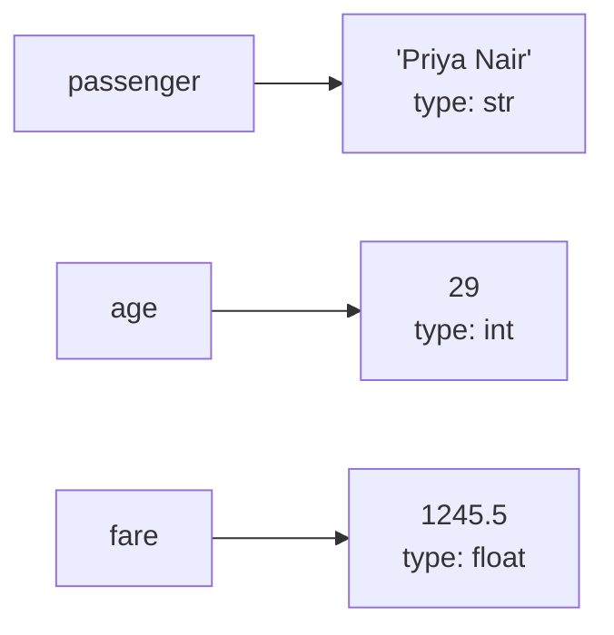

# Numbers, Booleans and Strings: The Complete Guide

> 📚 **Before you start**
>
> - [What is Python and Why Use It?](what-is-python-and-why-use-it.md), for what a program is and how to read a traceback
> - [Python vs Other Languages](python-vs-other-languages.md), for dynamic and strong typing
>
> To type along, you need Python installed. Steps 1 to 4 of [Lab: Set up Python and run your first script](lab-set-up-python-and-run-your-first-script.md) take about 15 minutes.

## Introduction

Look at a train ticket booked on IRCTC. It has a PNR number, a fare of ₹1,245.50, a passenger name, a coach and berth like "B2 / 34", a "Confirmed" or "Waitlisted" status, and a date. Every program in the world works with information like this, and almost all of it comes down to three basic kinds of value:

- **numbers**: the fare, the berth number, the distance in km,
- **true/false answers**: is the ticket confirmed? is the passenger a senior citizen?
- **text**: the name, the station codes, the status message.

In Python these are **numbers** (`int` and `float`), **booleans** (`bool`) and **strings** (`str`). This lesson teaches all three from scratch, along with the things you need to use them: **variables** to give them names, `print()` to see them, **comments** to explain them, and **conversion** to turn one into another.

By the end you will be able to store values in variables, do arithmetic correctly (including the famous `0.1 + 0.2` surprise), compare values, build messages with f-strings, convert between text and numbers safely, and read the five errors beginners hit most often.

> 💡 **Key Insight**
>
> Every value in Python has a **type**, and the type decides what you can do with it. `"7" + "7"` is `"77"` because strings join; `7 + 7` is `14` because integers add. When something behaves strangely, the first question to ask is always: **what type is this value, really?** The function `type()` answers it.

---

## Core Explanation

### 1. Showing things with print()

`print()` displays values on the screen. Put what you want to show inside the round brackets (called **parentheses**). Separate several values with commas, and Python puts a space between them.

```python
print("Namaste")
print(42)
print("Fare:", 1245.5, "rupees")
print()                        # an empty print() prints a blank line
print("Done")
```

Output:

```
Namaste
42
Fare: 1245.5 rupees

Done
```

`print` has two handy options. `sep` changes what goes between values, and `end` changes what goes at the end (normally a new line):

```python
print("NDLS", "BCT", "MAS", sep=" -> ")
print("Loading", end="...")
print("done")
```

Output:

```
NDLS -> BCT -> MAS
Loading...done
```

### 2. Comments

Anything after a `#` on a line is a **comment**. Python ignores it completely. Comments are notes for humans.

```python
# Calculate the fare for a family of four
adult_fare = 1200   # per person, sleeper class
print(adult_fare * 4)
```

Output:

```
4800
```

Good comments explain **why**, not **what**. `# multiply by 4` adds nothing; `# family of four, all adults` does.

### 3. Variables: giving values a name

A **variable** is a name that refers to a value. You create one with `=`, which in Python means **"make this name refer to this value"**, not "is equal to" as in maths.

```python
passenger = "Priya Nair"
age = 29
fare = 1245.50

print(passenger)
print(age)
print(fare)
```

Output:

```
Priya Nair
29
1245.5
```

A useful picture: the value is an object sitting somewhere in memory, and the name is a label tied to it.



You can point a name at a new value at any time. The old value is simply no longer reachable through that name:

```python
age = 29
age = age + 1        # read the current value, add 1, point age at the result
print(age)
```

Output:

```
30
```

`age = age + 1` would be nonsense in maths. In Python it reads naturally: work out the right side first (`29 + 1` is `30`), then make `age` refer to the result.

You can also assign several names at once:

```python
coach, berth = "B2", 34
x = y = 0
print(coach, berth, x, y)
```

Output:

```
B2 34 0 0
```

#### Rules for variable names

- Use letters, digits and underscores (`_`) only. No spaces, no hyphens.
- Don't start with a digit: `berth2` is fine, `2berth` is not.
- Names are **case-sensitive**: `Fare`, `fare` and `FARE` are three different names.
- Don't use Python's **keywords** (reserved words like `if`, `for`, `class`, `True`, `None`, `and`).
- Convention (from PEP 8, Python's style guide): use `lower_case_with_underscores`, called **snake_case**, and choose descriptive names. `total_fare` beats `tf`.

Breaking a rule gives a `SyntaxError`:

```python
# not-run: shows an error on purpose
2nd_class_fare = 450
```

Running it shows:

```
  File "/home/you/python-practice/example.py", line 2
    2nd_class_fare = 450
    ^
SyntaxError: invalid decimal literal
```

Python saw a `2` and expected a number, then hit letters. Using a name that was never assigned, or misspelling one, gives a `NameError`. Python 3.13 even suggests what you might have meant:

```python
# not-run: shows an error on purpose
total_fare = 4800
print(Total_fare)
```

Running it shows:

```
Traceback (most recent call last):
  File "/home/you/python-practice/example.py", line 3, in <module>
    print(Total_fare)
          ^^^^^^^^^^
NameError: name 'Total_fare' is not defined. Did you mean: 'total_fare'?
```

### 4. Integers: whole numbers

An **integer** (`int`) is a whole number, positive, negative or zero, with no decimal point.

```python
berth = 34
temperature = -3
balance = 0
print(type(berth))
```

Output:

```
<class 'int'>
```

Python's basic arithmetic operators:

| Operator | Meaning | Example | Result |
|---|---|---|---|
| `+` | add | `7 + 2` | `9` |
| `-` | subtract | `7 - 2` | `5` |
| `*` | multiply | `7 * 2` | `14` |
| `/` | divide (always gives a float) | `7 / 2` | `3.5` |
| `//` | floor division (round down to a whole number) | `7 // 2` | `3` |
| `%` | modulo (remainder) | `7 % 2` | `1` |
| `**` | power | `7 ** 2` | `49` |

```python
total_minutes = 135
hours = total_minutes // 60
minutes = total_minutes % 60
print(hours, "hours", minutes, "minutes")

print(2 ** 10)
print(17 % 5, 18 % 5, 20 % 5)
```

Output:

```
2 hours 15 minutes
1024
2 3 0
```

`//` and `%` are a famous pair: `//` tells you how many whole groups fit, `%` tells you what's left over. `n % 2` is `0` for even numbers and `1` for odd ones, which you'll use constantly.

The full story of operators, including the order Python evaluates them in, is in [Operators and Precedence](../03-core-language-concepts/operators-and-precedence.md).

Integers can be as big as you like. For readability, you can put underscores inside a number; Python ignores them. That's handy for Indian-style grouping:

```python
one_lakh = 1_00_000
one_crore = 1_00_00_000
print(one_crore // one_lakh)
print(2 ** 80)
```

Output:

```
100
1208925819614629174706176
```

Dividing by zero is not allowed:

```python
# not-run: shows an error on purpose
total_bill = 900
friends = 0
print(total_bill / friends)
```

Running it shows:

```
Traceback (most recent call last):
  File "/home/you/python-practice/example.py", line 4, in <module>
    print(total_bill / friends)
          ~~~~~~~~~~~^~~~~~~~~
ZeroDivisionError: division by zero
```

### 5. Floats: numbers with a decimal point

A **float** (short for "floating-point number") is a number with a decimal point.

```python
fare = 1245.50
pi = 3.14159
print(type(fare))
print(fare * 2)
print(10 / 2)          # / always gives a float, even when the answer is whole
print(3 + 2.0)         # mixing int and float gives a float
```

Output:

```
<class 'float'>
2491.0
5.0
5.0
```

Very large or small floats can be written in **scientific notation**: `1.5e6` means 1.5 × 10⁶.

```python
print(1.5e6)
print(2.5e-3)
```

Output:

```
1500000.0
0.0025
```

#### The 0.1 + 0.2 surprise

```python
print(0.1 + 0.2)
print(0.1 + 0.2 == 0.3)
```

Output:

```
0.30000000000000004
False
```

This isn't a Python bug. Computers store floats in **binary** (base 2). Just as 1/3 can't be written exactly in decimal (0.3333...), most decimal fractions like 0.1 can't be written exactly in binary. The stored value is the closest possible binary number, off by a tiny amount, and occasionally those tiny errors show up. Every mainstream language behaves the same way.

What to do about it:

- **To display** a float nicely, round it: `round(value, 2)`, or format it (see f-strings below).
- **To compare** floats, check whether they're *close*, not exactly equal: `math.isclose(a, b)`.
- **For money**, use the `decimal` module, which does exact decimal arithmetic, or store amounts in **paise** as integers.

```python
import math
from decimal import Decimal

print(round(0.1 + 0.2, 2))
print(math.isclose(0.1 + 0.2, 0.3))
print(Decimal("0.10") + Decimal("0.20"))

price_paise = 124550          # ₹1,245.50 stored as whole paise
print(price_paise * 3 / 100)
```

Output:

```
0.3
True
0.30
3736.5
```

Note `Decimal("0.10")` takes a **string**. `Decimal(0.1)` would copy the already-imprecise float.

#### round() and banker's rounding

`round(x)` rounds to the nearest whole number; `round(x, n)` to `n` decimal places. When a number is exactly halfway, Python rounds to the nearest **even** number. This is called **banker's rounding** and it avoids a bias towards rounding up:

```python
print(round(2.5), round(3.5), round(4.5))
print(round(1245.567, 2))
print(round(1245.567))
```

Output:

```
2 4 4
1245.57
1246
```

Python also has `complex` numbers for engineering maths (`3 + 4j`), but you won't need them in this course.

### 6. Booleans: True and False

A **boolean** (`bool`, named after the mathematician George Boole) has only two possible values: `True` and `False`. Note the capital letters; `true` is just an undefined name.

```python
is_confirmed = True
is_senior = False
print(is_confirmed, type(is_confirmed))
```

Output:

```
True <class 'bool'>
```

You rarely type `True` or `False` directly. Usually they come from **comparisons**:

| Operator | Meaning | Example | Result |
|---|---|---|---|
| `==` | equal to | `5 == 5` | `True` |
| `!=` | not equal to | `5 != 3` | `True` |
| `<` | less than | `3 < 5` | `True` |
| `>` | greater than | `3 > 5` | `False` |
| `<=` | less than or equal | `5 <= 5` | `True` |
| `>=` | greater than or equal | `4 >= 5` | `False` |

```python
age = 61
print(age >= 60)          # senior citizen concession?
print(age == 60)
print("B2" == "b2")       # strings compare exactly, case matters
print(18 <= age <= 60)    # Python lets you chain comparisons
```

Output:

```
True
False
False
False
```

Don't confuse `=` (assign a name) with `==` (compare two values). Using `=` where you meant `==` inside a condition is a `SyntaxError`, which is lucky: Python catches it for you.

Combine booleans with `and`, `or` and `not`:

```python
has_ticket = True
has_id = False
print(has_ticket and has_id)    # True only if both are True
print(has_ticket or has_id)     # True if at least one is True
print(not has_id)               # flips True and False
```

Output:

```
False
True
True
```

Booleans are secretly integers: `True` behaves like `1` and `False` like `0`. That makes counting easy:

```python
print(True + True + False)
print(int(True), int(False))
```

Output:

```
2
1 0
```

#### Truthiness

Python can treat **any** value as true or false when it needs a yes/no answer. `bool(value)` shows how a value is treated. The rule is simple: **empty and zero things are false, everything else is true.**

```python
print(bool(0), bool(0.0), bool(""), bool(None))
print(bool(42), bool(-1), bool("hello"), bool(" "), bool("False"))
```

Output:

```
False False False False
True True True True True
```

Notice `bool(" ")` (a single space) and `bool("False")` (the text "False") are both `True`: they are non-empty strings. You'll use truthiness with `if` in [if, elif and else](../04-control-flow/if-elif-and-else.md).

### 7. None: the value that means "nothing"

`None` is a special value meaning "no value here yet" or "not applicable". Its type is `NoneType`.

```python
coach_assigned = None        # ticket waitlisted, no coach yet
print(coach_assigned)
print(type(coach_assigned))
print(coach_assigned is None)
```

Output:

```
None
<class 'NoneType'>
True
```

To check for `None`, use `is None` rather than `== None`. You'll see why in [Operators and Precedence](../03-core-language-concepts/operators-and-precedence.md).

### 8. Strings: text

A **string** (`str`) is a sequence of characters: letters, digits, spaces, symbols, emoji, Hindi, Tamil, anything. Write a string inside quotes. Single and double quotes mean exactly the same thing; pick whichever lets you avoid escaping:

```python
station = "Chhatrapati Shivaji Maharaj Terminus"
code = 'CSMT'
message = "It's running late"        # double quotes, so the ' inside is fine
quote = 'She said "on time" today'   # single quotes, so the " inside is fine
city_hi = "मुंबई"
print(station, code)
print(message)
print(quote)
print(city_hi)
```

Output:

```
Chhatrapati Shivaji Maharaj Terminus CSMT
It's running late
She said "on time" today
मुंबई
```

#### Escape sequences

A backslash `\` inside a string starts an **escape sequence**, a way to write special characters:

| Sequence | Means |
|---|---|
| `\n` | new line |
| `\t` | tab |
| `\\` | a single backslash |
| `\'` and `\"` | a quote character |

```python
print("Train: 12951\nCoach: B2\tBerth: 34")
print("Path: C:\\Users\\priya")
```

Output:

```
Train: 12951
Coach: B2	Berth: 34
Path: C:\Users\priya
```

Putting `r` before the quotes makes a **raw string**, where backslashes are kept as typed. Raw strings are handy for Windows paths and, later, regular expressions:

```python
print(r"C:\Users\priya\new_folder")
```

Output:

```
C:\Users\priya\new_folder
```

#### Multi-line strings

Triple quotes (`"""` or `'''`) let a string span several lines:

```python
ticket = """PNR: 4521873390
Train: 12951 Mumbai Rajdhani
Status: CNF"""
print(ticket)
```

Output:

```
PNR: 4521873390
Train: 12951 Mumbai Rajdhani
Status: CNF
```

#### Joining, repeating and measuring strings

```python
first = "Priya"
last = "Nair"
full = first + " " + last      # + joins (concatenates) strings
print(full)
print("-" * 20)                # * repeats a string
print(len(full))               # len() counts characters, including the space
```

Output:

```
Priya Nair
--------------------
10
```

#### Picking out characters: indexing

Each character has a position number called an **index**, starting from **0**. Negative indexes count from the end, so `-1` is the last character.

```
 P   r   i   y   a
 0   1   2   3   4
-5  -4  -3  -2  -1
```

```python
name = "Priya"
print(name[0])
print(name[4])
print(name[-1])
print(name[1:4])     # a slice: from index 1 up to (not including) 4
```

Output:

```
P
a
a
riy
```

Asking for a position that doesn't exist is an `IndexError`:

```python
# not-run: shows an error on purpose
name = "Priya"
print(name[5])
```

Running it shows:

```
Traceback (most recent call last):
  File "/home/you/python-practice/example.py", line 3, in <module>
    print(name[5])
          ~~~~^^^
IndexError: string index out of range
```

Strings are **immutable**: once created, they can't be changed in place. `name[0] = "B"` is an error. You make a new string instead. Slicing, string methods and immutability get a full lesson in [Working with Strings](../05-strings-and-data-structures/working-with-strings.md).

#### A first taste of string methods

A **method** is a function that belongs to a value, called with a dot: `value.method()`.

```python
status = "  waitlisted  "
print(status.upper())
print(status.strip())             # remove spaces at both ends
print(status.strip().title())
print("Rajdhani".lower())
print("CSMT-NDLS".replace("-", " to "))
```

Output:

```
  WAITLISTED  
waitlisted
Waitlisted
rajdhani
CSMT to NDLS
```

### 9. f-strings: building messages

Joining strings with `+` gets messy fast, especially with numbers, since `"Fare: " + 1245.5` is a `TypeError`. The modern way is an **f-string**: put `f` before the opening quote and write any expression inside curly braces `{}`.

```python
passenger = "Priya Nair"
berth = 34
fare = 1245.5
print(f"{passenger} has berth {berth}. Fare: ₹{fare}")
print(f"Fare for 3 people: ₹{fare * 3}")
```

Output:

```
Priya Nair has berth 34. Fare: ₹1245.5
Fare for 3 people: ₹3736.5
```

After the expression you can add a colon and a **format spec** to control how it looks:

```python
amount = 1234567.891
print(f"{amount:.2f}")       # 2 decimal places
print(f"{amount:,.2f}")      # thousands separators
print(f"{0.0725:.1%}")       # as a percentage
print(f"[{'CSMT':<8}]")      # left-align in 8 characters
print(f"[{'CSMT':>8}]")      # right-align
print(f"[{34:05d}]")         # pad with zeros to width 5
```

Output:

```
1234567.89
1,234,567.89
7.2%
[CSMT    ]
[    CSMT]
[00034]
```

The `,` separator groups in thousands (international style), not lakhs and crores; Indian grouping needs a little custom code, which makes a nice exercise once you know loops.

A debugging trick: `{name=}` prints the expression **and** its value.

```python
berth = 34
print(f"{berth=}")
print(f"{berth * 2 = }")
```

Output:

```
berth=34
berth * 2 = 68
```

### 10. Checking and converting types

`type(value)` tells you the type. `isinstance(value, type)` asks a yes/no question about it:

```python
print(type(34), type(34.0), type("34"), type(True))
print(isinstance(34, int), isinstance("34", int))
```

Output:

```
<class 'int'> <class 'float'> <class 'str'> <class 'bool'>
True False
```

To convert, call the type's name like a function:

| Call | Does | Example | Result |
|---|---|---|---|
| `int(x)` | to integer (drops the decimal part for floats) | `int("42")`, `int(9.99)` | `42`, `9` |
| `float(x)` | to float | `float("1245.50")` | `1245.5` |
| `str(x)` | to string | `str(34)` | `'34'` |
| `bool(x)` | to boolean (truthiness) | `bool("")` | `False` |

```python
print(int("42") + 8)
print(int(9.99))                  # truncates towards zero, it does not round
print(int(-9.99))
print(float("1245.50") * 2)
print("Berth " + str(34))
print(int(" 7 "))                 # surrounding spaces are allowed
```

Output:

```
50
9
-9
2491.0
Berth 34
7
```

Converting text that doesn't look like the right kind of number is a `ValueError`. The most common trap: `int()` won't accept a string with a decimal point.

```python
# not-run: shows an error on purpose
price_text = "1245.50"
price = int(price_text)
```

Running it shows:

```
Traceback (most recent call last):
  File "/home/you/python-practice/example.py", line 3, in <module>
    price = int(price_text)
ValueError: invalid literal for int() with base 10: '1245.50'
```

The fix is `int(float(price_text))` if you want a whole number, or just `float(price_text)`.

### 11. Reading what the user types: input()

`input()` shows a message, waits for the user to type something and press Enter, and gives back what they typed **as a string, always**.

```python
# not-run: waits for keyboard input
name = input("Your name: ")
age_text = input("Your age: ")
age = int(age_text)               # convert before doing maths
print(f"Hello {name}, next year you'll be {age + 1}")
```

Example session (the user typed `Arjun` and `24`):

```
Your name: Arjun
Your age: 24
Hello Arjun, next year you'll be 25
```

Forgetting the conversion is probably the single most common beginner bug. `input()` gave the string `"24"`, and `"24" + 1` is the same `TypeError` you met in the previous lesson. To make examples checkable, most lessons in this course put sample values in variables instead of calling `input()`; you can always swap one for the other.

---

## Try It Yourself

1. A Rajdhani ticket costs ₹2,875.50 per adult. Store it in a variable and print the total for 3 adults, formatted with 2 decimal places and a thousands separator.
2. A movie runs 167 minutes. Use `//` and `%` to print it as `2h 47m`.
3. Predict each result, then check: `bool("0")`, `bool(0)`, `int("0") == 0`, `"5" * 2`, `5 * 2`.
4. The variable `price_text = "₹499"` came from a website. Get the number out of it and add 18% GST, printing the result rounded to 2 decimals. (Hint: slice off the first character.)

<details>
<summary>Show answers</summary>

```python
fare = 2875.50
print(f"Total: ₹{fare * 3:,.2f}")

runtime = 167
print(f"{runtime // 60}h {runtime % 60}m")

print(bool("0"), bool(0), int("0") == 0, "5" * 2, 5 * 2)

price_text = "₹499"
price = float(price_text[1:])
print(round(price * 1.18, 2))
```

Output:

```
Total: ₹8,626.50
2h 47m
True False True 55 10
588.82
```

`bool("0")` is `True` because `"0"` is a non-empty string. Only the number zero is false.

</details>

---

## Real-World Examples

### Example 1: A billing counter

A restaurant's billing code stores item prices in **paise** as integers (`28000` for ₹280), adds them up exactly, and converts to rupees only when printing: `f"₹{total_paise / 100:,.2f}"`. No floating-point surprises on the bill, ever.

### Example 2: Reading data from a file or form

Everything that comes from a file, a web form or `input()` arrives as text. Real programs are full of lines like `quantity = int(row["qty"])` and `price = float(row["price"])`. Data cleaning in pandas is, in large part, this same conversion done to millions of values at once.

### Example 3: Feature flags

Apps switch features on and off with booleans: `show_new_checkout = True`. A configuration file might store the text `"false"`, and a classic bug is `bool("false")`, which is `True`. Correct code compares the text: `value.lower() == "true"`.

---

## Common Misconceptions

### Misconception 1: "`=` means equals"

`=` means "make this name refer to this value". `==` asks "are these two values equal?". `x = 5` is a command; `x == 5` is a question.

### Misconception 2: "`int(9.99)` rounds to 10"

`int()` chops off the decimal part, giving `9`. Use `round(9.99)` to round.

### Misconception 3: "Python's maths is broken because 0.1 + 0.2 isn't 0.3"

It's how binary floating point works in every language. Round for display, use `math.isclose` for comparison, and use `Decimal` or integer paise for money.

### Misconception 4: "`input()` gives me a number if the user types a number"

It always gives a string. Convert with `int()` or `float()`.

### Misconception 5: "Single and double quotes are different"

They're identical in Python. Use whichever avoids escaping the quotes inside your text.

---

## Interview Relevance

Basic types come up in screening rounds and online assessments, usually as "what does this print?" questions. Be ready to explain:

- **`/` vs `//` vs `%`**, including with negative numbers (`-7 // 2` is `-4`, because floor division rounds towards minus infinity).
- **Why `0.1 + 0.2 != 0.3`** and how you'd handle money (Decimal or integer minor units).
- **Truthiness:** which values are falsy (`0`, `0.0`, `""`, `None`, empty containers, `False`).
- **`bool` is a subclass of `int`**, so `True + True == 2`.
- **Strings are immutable** and indexed from 0, with negative indexes from the end.
- **Conversion errors:** `int("3.5")` raises `ValueError`; `int(3.5)` returns `3`.
- **`round()` uses banker's rounding:** `round(2.5)` is `2`.

---

## Key Takeaways

- **Variables are names that refer to values**; `=` assigns, `==` compares. Names are case-sensitive and use snake_case.
- **`int`** is a whole number of any size; **`float`** has a decimal point and is slightly imprecise; use **`Decimal` or integer paise** for money.
- **`bool`** is `True` or `False`; comparisons produce booleans; **empty and zero values are falsy**, everything else is truthy. **`None`** means "no value".
- **Strings** are immutable text in single, double or triple quotes, indexed from 0. **f-strings** are the clean way to build messages and format numbers.
- **Convert explicitly** with `int()`, `float()`, `str()`; `input()` always returns a string.

---

**Up next:** [Lab: Set up Python and run your first script](lab-set-up-python-and-run-your-first-script.md)
