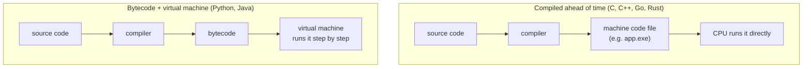

# Python vs Other Languages: The Complete Guide

> 📚 **Before you start**
>
> - [What is Python and Why Use It?](what-is-python-and-why-use-it.md), for what a programming language is, bytecode, and dynamic typing

## Introduction

Getting from Mumbai to Pune, you can take a flight, the Deccan Queen, a Volvo bus, your own car or a bike. None of them is "the best". The flight is fastest but has airport overhead. The train is comfortable and predictable. The car is flexible. The bike is cheap and fun but tiring. You pick based on what matters to you that day.

Programming languages are the same. There are hundreds of them, and a few dozen are in serious daily use. Each one made different trade-offs between **speed of running**, **speed of writing**, **safety**, and **where it can run**. Once you understand those trade-offs, statements like "Python is slow" or "Java is verbose" stop being opinions and start being engineering facts you can reason about.

By the end of this article you will be able to:

- explain the four big ways languages differ: how they run, how they handle types, how they manage memory, and how they look,
- read the same small program in Python, C, Java, JavaScript, Go and Rust and see the trade-offs with your own eyes,
- know which language people reach for in which job, and why Python became the language of data and AI,
- answer the "Python vs X" interview question with substance.

> 💡 **Key Insight**
>
> Python trades **running speed** for **writing speed and readability**. For most real work (data analysis, automation, AI applications, web back-ends) the program spends its time waiting on disks, networks and databases, or inside fast libraries written in C, so the trade is a good one. When it isn't, Python calls out to a faster language rather than being replaced by it.

---

## Core Explanation

### 1. Why are there so many languages?

Each language was built by people solving a particular problem at a particular time:

| Language | Born | Built to solve |
|---|---|---|
| **C** | 1972 | Write an operating system (Unix) that is fast but more portable than assembly |
| **C++** | 1985 | Add classes and bigger-program organisation to C without losing speed |
| **Python** | 1991 | Be a readable, easy language for scripting and general programming |
| **Java** | 1995 | "Write once, run anywhere" for large business software |
| **JavaScript** | 1995 | Make web pages interactive inside the browser |
| **R** | 1993 | Statistics and data analysis for statisticians |
| **Go** | 2009 | Simple, fast-compiling language for large server systems at Google |
| **Rust** | 2015 | C-level speed without C's memory bugs |

None of these replaced the others. They live side by side, often in the same company and even in the same product.

### 2. Difference one: how the code runs

There are two broad strategies to get from your source code to something the processor runs.



- **Compiled ahead of time.** A compiler turns your whole program into machine code once. You ship the result (an `.exe` on Windows, for example). It starts instantly and runs very fast, but you must recompile for each kind of computer, and the compile step can be slow for big projects.
- **Bytecode plus a virtual machine.** Python and Java compile to bytecode, which a virtual machine runs. Java's virtual machine (the JVM) includes a **JIT (just-in-time) compiler** that turns frequently used bytecode into machine code while the program runs, which is a big reason Java is much faster than standard Python. CPython has an experimental JIT since 3.13, but it is off by default and the speed-up so far is modest.
- **JavaScript** engines in browsers (V8 in Chrome, for example) also use aggressive JIT compilation.

What this means in practice: a tight loop doing simple arithmetic a hundred million times might take well under a second in C or Rust and tens of seconds in pure Python. The same job written with NumPy (a Python library implemented in C) is close to C speed. You'll use that trick in [Data Analysis and Visualisation with Python](../../data-analysis-and-visualisation-with-python/course.md).

### 3. Difference two: types

Every value has a type (number, text, list...). Languages differ on **when** types are checked and **how strictly**.

**Static vs dynamic** is about *when*:

- **Statically typed** (C, C++, Java, Go, Rust): you declare types, and the compiler checks them before the program runs. Many mistakes are caught early, but you write more.
- **Dynamically typed** (Python, JavaScript, R, Ruby): types are attached to values and checked while the program runs.

**Strong vs weak** is about *how strict*:

- **Strongly typed** (Python, Java, Rust, Go): mixing incompatible types is an error.
- **Weakly typed** (JavaScript, C in places): the language quietly converts one type to another to make the operation work, sometimes surprisingly.

Python is **dynamic but strong**. Watch what happens when you add a number to a piece of text:

```python
# not-run: shows an error on purpose
wallet = "500"
cashback = 50
print(wallet + cashback)
```

Running it shows:

```
Traceback (most recent call last):
  File "/home/you/python-practice/example.py", line 4, in <module>
    print(wallet + cashback)
          ~~~~~~~^~~~~~~~~~
TypeError: can only concatenate str (not "int") to str
```

Python refuses to guess what you meant. JavaScript, which is weakly typed, guesses:

```javascript
// JavaScript: no error, but probably not what you wanted
let wallet = "500";
let cashback = 50;
console.log(wallet + cashback);   // prints 50050
```

JavaScript turned `50` into text and glued the two strings together. Python makes you say what you mean, by converting explicitly:

```python
wallet = "500"
cashback = 50
print(int(wallet) + cashback)   # treat the text as a number
print(wallet + str(cashback))   # treat the number as text
```

Output:

```
550
50050
```

Here is the same idea in a statically typed language. In Java, you write the type of every variable:

```java
// Java: types are declared and checked before the program runs
int cashback = 50;
String wallet = "500";
int total = wallet + cashback;   // compile error: String cannot be converted to int
```

The Java mistake is caught **before** the program ever runs. The Python mistake is caught **when that line runs**. That's the static/dynamic trade-off in one example.

### 4. Difference three: memory management

Programs constantly create values and need memory to store them. When a value is no longer needed, its memory should be given back.

- **Manual** (C, and C++ by default): you ask for memory and you must free it yourself. Forget to free it and the program slowly eats memory (a **memory leak**). Free it too early and you get crashes or security holes. A large share of serious security bugs in C/C++ software comes from exactly this.
- **Garbage collected** (Python, Java, JavaScript, Go, R): the language tracks which values are still in use and frees the rest automatically. Python mainly uses **reference counting**: every value counts how many names and containers point at it, and when the count drops to zero, the memory is freed immediately. A backup collector cleans up rarer cases where values point at each other in a circle.
- **Ownership** (Rust): the compiler proves at compile time that memory is freed exactly once, giving C-like speed without a garbage collector, at the cost of a steeper learning curve.

In Python you'll almost never think about memory. You'll meet the "names point at values" idea properly in [Containers and Mutability](../03-core-language-concepts/containers-and-mutability.md), because it explains a lot of surprising behaviour.

### 5. Difference four: how the code looks

Let's write the same tiny program in six languages: **add up the UPI payments above ₹500 and print the total.**

**Python:**

```python
payments = [250, 1200, 80, 999, 650]
total = 0
for amount in payments:
    if amount > 500:
        total = total + amount
print("Big payments total:", total)
```

Output:

```
Big payments total: 2849
```

**C:**

```c
#include <stdio.h>

int main(void) {
    int payments[] = {250, 1200, 80, 999, 650};
    int count = sizeof(payments) / sizeof(payments[0]);
    int total = 0;
    for (int i = 0; i < count; i++) {
        if (payments[i] > 500) {
            total = total + payments[i];
        }
    }
    printf("Big payments total: %d\n", total);
    return 0;
}
```

**Java:**

```java
public class Payments {
    public static void main(String[] args) {
        int[] payments = {250, 1200, 80, 999, 650};
        int total = 0;
        for (int amount : payments) {
            if (amount > 500) {
                total = total + amount;
            }
        }
        System.out.println("Big payments total: " + total);
    }
}
```

**JavaScript:**

```javascript
const payments = [250, 1200, 80, 999, 650];
let total = 0;
for (const amount of payments) {
  if (amount > 500) {
    total = total + amount;
  }
}
console.log("Big payments total:", total);
```

**Go:**

```go
package main

import "fmt"

func main() {
    payments := []int{250, 1200, 80, 999, 650}
    total := 0
    for _, amount := range payments {
        if amount > 500 {
            total = total + amount
        }
    }
    fmt.Println("Big payments total:", total)
}
```

**Rust:**

```rust
fn main() {
    let payments = [250, 1200, 80, 999, 650];
    let mut total = 0;
    for amount in payments {
        if amount > 500 {
            total = total + amount;
        }
    }
    println!("Big payments total: {}", total);
}
```

What to notice:

- **Blocks.** Every other language marks "this code belongs inside the `if`" with curly braces `{ }`. Python uses **indentation** (the spaces at the start of a line) instead, and the colon `:` at the end of the `if` line announces that an indented block follows. In other languages indentation is just good manners; in Python it's the law.
- **Semicolons.** C, Java and Rust end statements with `;`. Python, Go and (optionally) JavaScript don't.
- **Ceremony.** C, Java, Go and Rust need a `main` function as the entry point; Java needs a class around it. Python just runs the file top to bottom.
- **Types.** C and Java declare `int`. Go and Rust can usually work types out themselves (`:=`, `let`) but still check them at compile time. Python never declares them.

And in Python you would usually write it even shorter, once you've learned comprehensions in module 5:

```python
print("Big payments total:", sum(a for a in payments if a > 500))
```

Output:

```
Big payments total: 2849
```

### 6. Indentation is part of Python's grammar

Because Python uses indentation for blocks, getting it wrong is an error, not a style issue:

```python
# not-run: shows an error on purpose
payments = [250, 1200]
for amount in payments:
print(amount)
```

Running it shows:

```
  File "/home/you/python-practice/example.py", line 4
    print(amount)
    ^^^^^
IndentationError: expected an indented block after 'for' statement on line 3
```

The convention, used by virtually all Python code and recommended by Python's official style guide (PEP 8), is **4 spaces per level**. Your editor will insert them for you when you press Tab.

### 7. Small behaviours that differ between languages

A few concrete differences beginners coming from (or going to) other languages trip over:

**Integers never overflow in Python.** In C, Java and Go a normal `int` has a fixed size (often 32 or 64 bits) and "wraps around" or overflows if a result is too big. Python integers grow as large as memory allows:

```python
print(2 ** 64)
print(2 ** 100)
```

Output:

```
18446744073709551616
1267650600228229401496703205376
```

`**` means "to the power of". In C or Java, `2` to the power `64` doesn't fit in a 64-bit integer at all.

**Dividing two integers gives a decimal in Python 3.** In C and Java, `7 / 2` between integers gives `3` (the decimal part is thrown away). In Python 3, `/` always gives the true answer, and `//` gives the rounded-down whole-number answer when you want that:

```python
print(7 / 2)
print(7 // 2)
```

Output:

```
3.5
3
```

**Decimal arithmetic is equally imprecise everywhere.** This surprises people, but it's the same in Python, Java, JavaScript and C, because they all store decimal numbers the same way (a standard called IEEE 754):

```python
print(0.1 + 0.2)
```

Output:

```
0.30000000000000004
```

You'll learn why, and what to do about it for money, in [Numbers, Booleans and Strings](numbers-booleans-and-strings.md).

### 8. Which language for which job?

| Job | Usual choice | Where Python fits |
|---|---|---|
| Data analysis, statistics | **Python**, R, SQL | The default; R is popular in academic statistics |
| Machine learning, deep learning, LLM apps | **Python** | Almost every major library is Python-first; the heavy maths runs in C++/CUDA underneath |
| Web front-end (in the browser) | **JavaScript/TypeScript** | Not a natural fit |
| Web back-end, APIs | Python, Java, Go, JavaScript (Node.js), C# | Django, FastAPI, Flask are widely used |
| Android / iOS apps | Kotlin / Swift | Rare |
| Operating systems, drivers, embedded | C, C++, Rust | MicroPython on small boards for hobby use |
| Games (big engines) | C++, C# | Fine for small games and game tooling |
| High-frequency trading, browsers, databases | C++, Rust | Used for research and analysis around them |
| Automation, scripting, glue between systems | **Python**, Bash, PowerShell | One of Python's oldest strengths |
| Querying databases | **SQL** | Python sends SQL to the database and processes the results |

In real jobs you'll use several languages together. A typical data team writes **SQL** to pull data, **Python** to analyse it and train models, a little **Bash** to automate it, and maybe some **JavaScript** for a dashboard.

### 9. Why Python won data and AI

Python wasn't designed for data science. It won through a chain of events:

1. **Readable syntax** attracted scientists who were not professional programmers.
2. Those scientists built **NumPy** (fast arrays, written in C) and **SciPy**, so Python got C-level speed for numerical work while staying easy to write.
3. On top came **pandas** (tables of data), **matplotlib** (charts), **scikit-learn** (machine learning) and **Jupyter** notebooks (interactive documents).
4. When deep learning took off, **TensorFlow** and **PyTorch** chose Python as their main interface.
5. Today LLM tools (the Anthropic and OpenAI SDKs, LangChain, LangGraph) are Python-first because that's where the people already were.

Each step made the next more likely. This is called a **network effect**: a language becomes more useful the more people and libraries it has.

### 10. Summary comparison

| | Python | Java | JavaScript | C/C++ | Go | Rust |
|---|---|---|---|---|---|---|
| **Typing** | Dynamic, strong | Static, strong | Dynamic, weak | Static, weak-ish | Static, strong | Static, strong |
| **Runs as** | Bytecode on a VM | Bytecode on JVM with JIT | JIT in engine | Machine code | Machine code | Machine code |
| **Memory** | Garbage collected | Garbage collected | Garbage collected | Manual | Garbage collected | Ownership |
| **Speed (pure code)** | Slow | Fast | Fast | Fastest | Fast | Fastest |
| **Learning curve** | Gentle | Medium | Gentle start, quirky | Steep | Gentle | Steep |
| **Blocks marked by** | Indentation | Braces | Braces | Braces | Braces | Braces |

---

## Try It Yourself

1. Predict, then check: what does `print("5" * 3)` print in Python? (Hint: `*` with a string and a number is allowed.) And what about `print(int("5") * 3)`?
2. Rewrite the "big payments" program to add up payments **below** ₹500 instead.
3. What does `print(10 / 4)` print, and what does `print(10 // 4)` print?
4. Compute `9 ** 25` in Python. Count the digits with `len(str(9 ** 25))`. Would that number fit in a 64-bit integer (maximum about 9.2 × 10^18)?

<details>
<summary>Show answers</summary>

```python
print("5" * 3)
print(int("5") * 3)

total = 0
for amount in payments:
    if amount < 500:
        total = total + amount
print("Small payments total:", total)

print(10 / 4)
print(10 // 4)

print(9 ** 25)
print(len(str(9 ** 25)))
```

Output:

```
555
15
Small payments total: 330
2.5
2
717897987691852588770249
24
```

`"5" * 3` repeats the text three times. `9 ** 25` has 24 digits, far beyond the 19 digits a 64-bit integer can hold, but Python handles it without fuss.

</details>

---

## Real-World Examples

### Example 1: A food-delivery app

The phone app is written in Kotlin (Android) and Swift (iOS). The website uses JavaScript. The order-routing service that must answer in milliseconds might be in Go or Java. The model that predicts delivery time is trained in Python, and the analysts studying why Friday-night orders are late use Python and SQL. One product, six languages, each where it fits best.

### Example 2: A "slow Python" problem solved without leaving Python

A team's script that scored 5 million transactions looped over them one by one in pure Python and took 40 minutes. Rewriting the core calculation with NumPy arrays (which run in C) brought it to under a minute. They didn't switch languages; they moved the hot loop into a fast library.

### Example 3: A Python library that is mostly not Python

Many popular Python packages (NumPy, pandas, PyTorch, and newer tools such as Polars, written in Rust) are thin Python layers over fast compiled code. You get Python's comfort on top and C/C++/Rust speed underneath. That combination is why "Python is slow" rarely blocks real projects.

---

## Common Misconceptions

### Misconception 1: "Dynamic typing means Python has no types"

Every Python value has a definite type, and Python enforces it strictly (`"500" + 50` is an error). Dynamic only means the **names** don't have fixed types and checks happen at runtime.

### Misconception 2: "Compiled languages are always better"

They run faster, but they're slower to write, slower to change, and often harder to learn. For a one-off data analysis, finishing in 20 minutes of writing plus 2 seconds of running beats 2 hours of writing plus 0.01 seconds of running.

### Misconception 3: "Java and JavaScript are related"

Apart from part of the name (chosen for marketing reasons in 1995), they're completely different languages with different designs and uses.

### Misconception 4: "Indentation in Python is just style"

In most languages, yes. In Python, indentation **is** the syntax that says which lines belong to an `if`, a loop or a function. Wrong indentation either causes an `IndentationError` or, worse, silently changes what your program does.

### Misconception 5: "Learning Python first will make other languages hard"

The core ideas (variables, conditions, loops, functions, data structures) are the same in every mainstream language. Your second language is always much easier than your first, whichever you start with.

---

## Interview Relevance

"Why Python?" or "Python vs Java/Go for this service?" appear in backend, data and ML interviews. A strong answer covers:

- **The trade-off:** Python optimises developer time and readability; compiled languages optimise run time and catch type errors before running.
- **Typing vocabulary used correctly:** Python is dynamically and strongly typed; Java is statically and strongly typed; JavaScript is dynamically and weakly typed.
- **Performance nuance:** CPython interprets bytecode and is slow for CPU-bound pure-Python loops; mention NumPy/C extensions, multiprocessing, and that most services are I/O bound.
- **Memory management:** reference counting plus a cycle-detecting garbage collector.
- **Pragmatism:** real systems mix languages; pick per component.

Common follow-ups:

- *"What's the GIL and does it matter?"* A lock that lets one thread run Python bytecode at a time in standard CPython; matters for CPU-bound threads, not for I/O-bound ones; free-threaded builds exist from 3.13 and are officially supported from 3.14.
- *"How would you speed up slow Python code?"* Measure first, then use better algorithms, vectorised libraries, caching, multiprocessing, or move the hot path to a compiled extension.

---

## Key Takeaways

- **Languages are trade-offs**, not rankings. Python chooses readability and writing speed over raw running speed.
- Languages differ in **how they run** (machine code vs bytecode on a VM), **typing** (Python: dynamic and strong), **memory management** (Python: automatic) and **syntax** (Python: indentation instead of braces).
- Python integers **never overflow**, `/` always gives the true quotient, and decimal arithmetic is imprecise in **every** mainstream language.
- Python dominates data and AI because of **NumPy-style compiled libraries** and the network effect that followed.
- Real products **mix languages**; Python is usually the glue, the analysis tool and the ML layer.

---

**Up next:** [Numbers, Booleans and Strings](numbers-booleans-and-strings.md)
