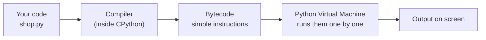

# What is Python and Why Use It? The Complete Guide

> 📚 **Before you start**
>
> No programming knowledge is needed. If you haven't already, skim [How This Course Works](../01-start-here/how-this-course-works.md) so you know how the code examples and their outputs are shown.

## Introduction

Imagine you run a small kirana shop. Every evening you add up the day's sales from a notebook, work out how much GST you owe, and note which items are running low. It takes forty minutes. Now imagine writing those steps down **once**, in precise language, and having the computer do them in under a second, every evening, without a single arithmetic slip.

That written-down list of steps is a **program**. The precise language you write it in is a **programming language**. Python is one of those languages, and today it is the most widely taught and one of the most widely used in the world.

By the end of this article you will know:

- what a program and a programming language actually are,
- what Python is, where it came from, and what happens inside your computer when Python runs your code,
- why Python became the default language for data, AI and automation,
- where Python is **not** the right tool,
- and you will have read (and, if Python is installed, run) your first few lines of Python.

> 💡 **Key Insight**
>
> Python was designed so that **code is read far more often than it is written**. Almost every feature you will meet (the indentation rules, the plain English keywords like `and`, `not`, `in`, the "one obvious way to do it" attitude) exists to make code easy for the next human to understand. That human is usually you, three months later.

---

## Core Explanation

### 1. What is a program?

A computer is extremely fast and extremely literal. It can do billions of tiny operations per second (add two numbers, compare two numbers, copy a number from one place to another), but it has no idea what you *mean*. It only does exactly what it's told.

A **program** is a list of instructions that tells the computer what to do, step by step. A recipe is a good comparison:

| Recipe for masala chai | Program |
|---|---|
| Boil 1 cup water | An instruction |
| If you like it strong, add 2 spoons of tea, else 1 | A decision |
| Stir until it changes colour | A repetition (a loop) |
| "Tea leaves", "ginger", "milk" | Data the steps work on |
| The finished cup | The output |

A recipe written for a human can be vague ("a pinch of salt", "cook until done"). A program can't. Every step has to be spelled out exactly. Learning to program is mostly learning to think that precisely.

### 2. What is a programming language?

Deep down, a computer's processor (CPU) understands only **machine code**: long sequences of numbers, each meaning a tiny operation like "add the number in slot 3 to the number in slot 7". Writing machine code by hand is possible, but painfully slow and error-prone.

A **programming language** is a middle ground: a language precise enough for a computer to follow, but readable enough for a human to write. Some software then translates it into something the processor can execute.

Languages are often described as **low-level** (close to the hardware, more control, more work) or **high-level** (close to human thinking, less control, less work). Python is very high-level. Here is the same idea, "add up three expenses", at three levels:

```
Machine code (what the CPU runs):    10110000 01100001 ...
Assembly (a thin human layer):       mov eax, 120 / add eax, 45 / add eax, 300
Python (high-level):                 total = 120 + 45 + 300
```

### 3. What is Python?

**Python** is a free, open-source, high-level, general-purpose programming language.

- **Free and open source:** anyone can download it, use it for any purpose (including commercial work), and read its source code. It is looked after by the non-profit **Python Software Foundation** (PSF) and a large community of volunteers.
- **High-level:** you think about prices, names and dates, not memory addresses.
- **General-purpose:** it isn't built for one job. People use it for websites, data analysis, machine learning, automation scripts, games, scientific research and teaching.

A little history helps explain its personality:

- **Guido van Rossum**, a Dutch programmer, started writing Python over the Christmas holidays of **1989** and released the first version in **February 1991**.
- The name comes from the British comedy show *Monty Python's Flying Circus*, not the snake. You'll still see snakes in every logo.
- **Python 3.0** arrived in **2008** and cleaned up old design mistakes, which meant some Python 2 code no longer worked. The two lived side by side for over a decade until Python 2 was officially retired on **1 January 2020**. Today "Python" means Python 3. If you find a tutorial using `print "hello"` without brackets, it is Python 2 and out of date.
- A **new version of Python 3 comes out every October** (3.12, 3.13, 3.14, and so on), and each version receives fixes for about five years. This course is checked with Python 3.13 and works on anything newer.

### 4. Your first look at Python code

Here is a complete Python program. Even if you have never programmed, you can probably guess what it does:

```python
shop_name = "Sharma General Store"
sales_today = [120, 45, 300, 85]

total = sum(sales_today)
gst = total * 0.18

print(shop_name)
print("Total sales:", total)
print("GST at 18%:", gst)
```

Output:

```
Sharma General Store
Total sales: 550
GST at 18%: 99.0
```

Line by line:

- `shop_name = "Sharma General Store"` stores a piece of text under the name `shop_name`. Text in quotes is called a **string**.
- `sales_today = [120, 45, 300, 85]` stores four numbers together in a **list** (the square brackets).
- `sum(sales_today)` adds the list up. `sum` is a **function**: a named, ready-made piece of code that does one job. Python comes with dozens of these.
- `total * 0.18` multiplies. The `*` is Python's multiplication sign.
- `print(...)` shows something on the screen.

Every one of these ideas gets its own lesson later. For now, notice how little "noise" there is: no semicolons, no curly braces, no type declarations. That is Python's style.

### 5. How Python runs your code

When you "run" a Python file, a program called the **Python interpreter** reads your code and carries it out. The standard interpreter, the one you download from python.org, is written in the C language and is called **CPython**.

It works in two stages:



1. **Compile to bytecode.** CPython first checks your whole file for grammar mistakes and translates it into **bytecode**, a list of simple instructions for an imaginary computer. This happens in a fraction of a second, every time you run the file. (For modules you import, Python saves the bytecode in a `__pycache__` folder so it can skip this step next time.)
2. **Run the bytecode.** The **Python Virtual Machine** (PVM), a loop inside CPython, reads the bytecode instructions one at a time and performs them.

You can actually look at the bytecode. Python includes a module called `dis` (short for "disassemble") that prints it:

```python
import dis

dis.dis("total = 120 + 45")
```

Output:

```
  0           RESUME                   0

  1           LOAD_CONST               0 (165)
              STORE_NAME               0 (total)
              RETURN_CONST             1 (None)
```

Two interesting things show up even in this tiny example. First, the compiler already worked out `120 + 45 = 165` before running anything (this trick is called **constant folding**). Second, the actual work is just "load the value 165, store it under the name `total`". You never need to read bytecode to write Python, but it's good to know there is no magic: your code turns into small, plain steps.

> The exact bytecode differs a little between Python versions. That's fine: bytecode is an internal detail, and your Python code works the same on every 3.x version from 3.13 on.

### 6. Why people call Python "interpreted"

Because CPython runs your program **instruction by instruction while it runs**, rather than turning it into a finished machine-code program ahead of time, Python is usually called an **interpreted** language. One practical consequence: some mistakes are only discovered when Python actually reaches the line that contains them.

```python
# not-run: shows an error on purpose
print("Step 1: reading sales")
print("Step 2: adding up")
print(totl)
print("Step 4: done")
```

Running it shows:

```
Step 1: reading sales
Step 2: adding up
Traceback (most recent call last):
  File "/home/you/python-practice/example.py", line 4, in <module>
    print(totl)
          ^^^^
NameError: name 'totl' is not defined
```

The first two lines ran perfectly. Then Python reached `print(totl)`, a typo for a name that doesn't exist, and stopped. Step 4 never ran. This message is called a **traceback**, and you'll learn to love it. Read it from the bottom up:

- **Last line:** the kind of error (`NameError`) and a plain-English explanation.
- **Line above:** the exact code that failed, with `^^^^` pointing at the problem.
- **`line 4`:** where in the file it happened.

Grammar mistakes are different: those are caught in stage 1, before anything runs.

```python
# not-run: shows an error on purpose
print("Step 1: reading sales")
print("Step 2: adding up"
```

Running it shows:

```
  File "/home/you/python-practice/example.py", line 3
    print("Step 2: adding up"
         ^
SyntaxError: '(' was never closed
```

Notice that "Step 1" was **not** printed this time. A `SyntaxError` means Python couldn't even understand the file, so it ran none of it.

### 7. Python is dynamically typed

Every value in Python has a **type**: whole number, decimal number, text, list, and so on. In many languages (C, Java, Go) you must declare the type of every variable before using it. In Python you just assign, and Python works out the type from the value. This is called **dynamic typing**.

```python
price = 250
print(type(price))

price = "two hundred fifty"
print(type(price))
```

Output:

```
<class 'int'>
<class 'str'>
```

`int` means integer (whole number); `str` means string (text). The same name, `price`, held a number and then a string. That flexibility makes Python quick to write. The cost is that some type mistakes are only found while the program runs, which is why Python programmers lean heavily on testing and, in bigger projects, on optional **type hints** (covered later in this course, in [Classes and Objects](../07-object-oriented-programming/classes-and-objects.md)).

### 8. "Batteries included": the standard library

Python ships with a large **standard library**: hundreds of ready-made modules for dates, maths, random numbers, files, web requests, zip files, JSON, emails, and much more. You get them all the moment you install Python. People describe this as "batteries included".

```python
import math
import datetime

print(math.sqrt(144))
print(math.ceil(7.2))

independence_day = datetime.date(1947, 8, 15)
print(independence_day.strftime("%d %B %Y"))
print(independence_day.weekday())   # Monday is 0, so 4 means Friday
```

Output:

```
12.0
8
15 August 1947
4
```

`import math` makes the `math` module available; `math.sqrt` is its square root function. You'll use `import` a lot, and it gets its own lesson later in this course, [Importing and Managing Modules](../09-modules-and-exceptions/importing-and-managing-modules.md).

Beyond the standard library there is **PyPI**, the Python Package Index (pypi.org), which hosts more than half a million free packages written by others: `pandas` for tables of data, `numpy` for fast maths, `requests` for the web, `scikit-learn` and `pytorch` for machine learning, `langchain` and `langgraph` for AI agents. You install them with a tool called `pip`. This ecosystem is the single biggest reason Python dominates data and AI.

### 9. Why use Python? The real reasons

| Reason | What it means for you |
|---|---|
| **Readable** | Code looks close to plain English. Easier to learn, easier to debug, easier to read other people's work. |
| **Fast to write** | A task that is 30 lines in Java is often 10 in Python. Great for experiments and automation. |
| **Huge ecosystem** | Whatever you want to do, someone has probably written a package for it. |
| **Data and AI standard** | Nearly every data science, machine learning and LLM library offers Python first. |
| **Runs everywhere** | Windows, macOS, Linux, Raspberry Pi, cloud servers. The same `.py` file runs on all of them. |
| **Big community** | Every error message you'll ever see has been asked about online, usually with a good answer. |
| **Jobs** | Python appears in a large share of job ads for data analyst, data engineer, ML engineer, backend developer and AI engineer roles. |

### 10. Where Python is not the best choice

Being honest about weaknesses makes you a better engineer:

- **Raw speed.** Pure Python loops are much slower than the same loops in C, C++, Rust or Go, often by 10 to 100 times. In practice this matters less than it sounds, because libraries like NumPy and pandas do their heavy work in fast compiled code underneath. Newer versions keep getting faster too.
- **Running many threads at once.** Standard CPython has a **Global Interpreter Lock** (GIL) that lets only one thread run Python code at a time. Python 3.13 introduced an optional "free-threaded" build without the GIL, and Python 3.14 made it officially supported, but most installations still use the default build. You'll learn about threads and async later in this course, in [Threads, Processes and Async](../10-concurrency-for-ai-apps/threads-processes-and-async.md).
- **Mobile apps and browser front-ends.** Phone apps are usually written in Kotlin or Swift; web page interactivity in JavaScript. Python can be squeezed into both but it's not the natural fit.
- **Very low memory devices.** Python uses more memory than C. (There is MicroPython for tiny microcontrollers, but it's a separate, smaller implementation.)

The next lesson, [Python vs Other Languages](python-vs-other-languages.md), compares these trade-offs side by side.

### 11. Where you'll meet Python in the real world

- **Data analysis:** an analyst at an e-commerce company loads a year of orders into pandas, finds which pin codes order most during the Big Billion Days sale, and charts it.
- **Machine learning and AI:** the model that suggests your next song, flags a suspicious card transaction, or powers a chatbot was very likely trained with Python code.
- **Automation:** a script that downloads a bank statement CSV, categorises UPI payments, and emails you a monthly summary.
- **Web back-ends:** frameworks such as Django and FastAPI run the server side of many websites. Instagram is a well-known large Django user.
- **Science and education:** astronomers, biologists and economists use Python for research; schools and colleges across India use it as a first language.

---

## Try It Yourself

If Python isn't installed yet, do steps 1 to 4 of the [setup lab](lab-set-up-python-and-run-your-first-script.md) first, or read the exercises and predict the answers.

1. Change the shop example so the list has five sales: `[120, 45, 300, 85, 950]`. What are the new total and GST?
2. Use `math.sqrt` to find the square root of 2025, and `math.floor` (which rounds **down**) on `9.99`.
3. Make a deliberate `NameError`: write `print(shop)` in a file where no `shop` exists. Read the last line of the traceback aloud.
4. Find out which weekday 26 January 1950 (India's first Republic Day) was, using `datetime.date(...).weekday()`.

<details>
<summary>Show answers</summary>

```python
sales_today = [120, 45, 300, 85, 950]
total = sum(sales_today)
print("Total sales:", total)
print("GST at 18%:", total * 0.18)

print(math.sqrt(2025))
print(math.floor(9.99))

print(datetime.date(1950, 1, 26).weekday())
```

Output:

```
Total sales: 1500
GST at 18%: 270.0
45.0
9
3
```

3 means Thursday (Monday is 0). For exercise 3, the last line reads `NameError: name 'shop' is not defined`.

</details>

---

## Real-World Examples

### Example 1: A finance team's monthly report

Every month an accounts executive downloaded 12 CSV files, pasted them into one Excel sheet and built the same pivot table by hand: about three hours of work. A 40-line Python script using `pandas` now reads the files, merges them, computes the totals and saves a formatted Excel file in eight seconds. Nobody on the team is a "software engineer"; they learned enough Python to automate their own job.

### Example 2: A data scientist's experiment

A data scientist wants to know whether discount coupons increase repeat orders. In a Jupyter notebook (an interactive Python document) she loads the data, tries five ideas in an afternoon, and plots the results. Python's speed of **writing** matters far more here than its speed of **running**.

### Example 3: An AI engineer's agent

An AI engineer builds a customer-support agent with LangGraph. The model calls are made over the internet, the logic around them (which tool to call, when to stop, what to remember) is plain Python. Every course in this site's AI track assumes the Python you learn here.

---

## Common Misconceptions

### Misconception 1: "Python is a beginner's toy language"

Python is easy to **start**, not limited. It runs large production systems at major companies and is the main language of AI research. Its simplicity is a design choice, not a ceiling.

### Misconception 2: "Python is named after the snake"

It's named after Monty Python, the comedy group. The snake came later, through logos and book covers.

### Misconception 3: "Interpreted means Python doesn't compile anything"

CPython does compile your code, into bytecode, before running it. It just doesn't compile all the way to machine code ahead of time. "Interpreted" describes how the bytecode is run, one instruction at a time by a virtual machine.

### Misconception 4: "Python is too slow for real work"

Most real programs spend their time waiting for networks, disks or databases, not crunching numbers. Where number crunching does matter, Python calls into fast compiled libraries. Slowness becomes a real problem only for tight loops over millions of items in pure Python, and you'll learn how to avoid those.

### Misconception 5: "I should learn Python 2 because old tutorials use it"

Python 2 has been retired since 2020 and receives no fixes, not even security fixes. Learn Python 3 only.

---

## Interview Relevance

Even senior interviews sometimes open with "Tell me about Python" or "Why Python for this project?" A strong answer covers:

- **What it is:** high-level, general-purpose, dynamically typed, garbage-collected, with a large standard library.
- **How it runs:** CPython compiles source to bytecode, which the Python Virtual Machine executes. Mention `__pycache__` and `.pyc` files if asked.
- **Strengths:** readability, development speed, the PyPI ecosystem, dominance in data and AI.
- **Weaknesses and mitigations:** CPU-bound speed (use NumPy, vectorised libraries, or C extensions), the GIL (use processes, async for I/O, or the free-threaded build), memory use.
- **Version awareness:** Python 2 is dead; a new 3.x ships every October.

Common follow-ups:

- *"Is Python compiled or interpreted?"* Both, in a sense: compiled to bytecode, then interpreted by the PVM.
- *"What is CPython?"* The reference implementation, written in C. Others include PyPy (with a just-in-time compiler) and MicroPython.
- *"What does dynamically typed mean?"* Types belong to values, not to variable names, and are checked while the program runs.

---

## Key Takeaways

- **A program** is a precise list of instructions; **a programming language** is a readable way to write them.
- **Python** is a free, high-level, general-purpose language created by Guido van Rossum and first released in 1991. Today "Python" means Python 3.
- **CPython compiles your code to bytecode** and the **Python Virtual Machine** runs it step by step. Grammar mistakes stop everything; other errors stop the program when the bad line is reached.
- Python is **dynamically typed** and **batteries included**, with PyPI adding hundreds of thousands of packages on top.
- It is the default choice for **data, AI and automation**, and a weaker choice for raw speed, mobile apps and browser front-ends.

---

**Up next:** [Python vs Other Languages](python-vs-other-languages.md)
