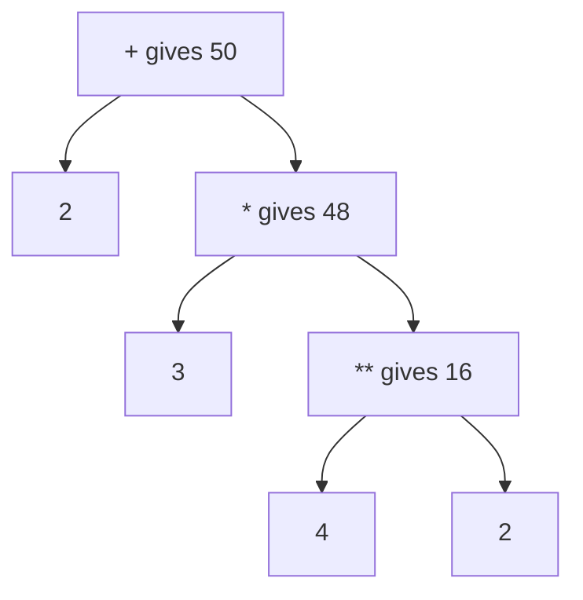

# Operators and Precedence: The Complete Guide

> 📚 **Before you start**
>
> - [Numbers, Booleans and Strings](../02-getting-started-with-python/numbers-booleans-and-strings.md), for `int`, `float`, `bool`, `str` and basic arithmetic
> - [Containers and Mutability](containers-and-mutability.md), for lists, sets, dicts and the difference between `is` and `==`

## Introduction

A shopkeeper in Chandni Chowk tells you: "₹200 per kurta, buy 3, and I'll give 10% off, plus ₹50 for alteration." What do you pay? Is it `200 × 3 − 10% + 50`? Is the 10% taken off before or after the alteration charge? A human asks a clarifying question. A computer can't ask; it follows fixed rules about which operation happens first.

Those rules are called **operator precedence**, and the symbols themselves (`+`, `*`, `==`, `and`, `in`...) are **operators**. You've used a few already. This lesson covers every operator a Python beginner needs, what each does with different types, the order Python applies them in, and the handful of rules that make expressions like `-2 ** 2` or `"" or "Guest"` behave the way they do.

By the end you'll be able to read and write any everyday expression correctly, know when brackets are required, and avoid the classic bugs: the wrong average, the negative-number power, the string-vs-number comparison.

> 💡 **Key Insight**
>
> When in doubt, **add brackets**. Precedence rules exist so Python can always decide, but the people reading your code shouldn't have to memorise a 17-row table. `(price * qty) * (1 - discount)` is clearer than relying on precedence, costs nothing, and prevents a whole class of bugs.

---

## Core Explanation

### 1. The vocabulary

- An **operator** is a symbol or word that performs an operation: `+`, `>`, `and`, `in`.
- An **operand** is a value the operator works on. In `7 + 2`, the operands are `7` and `2`.
- An **expression** is any piece of code that produces a value: `7 + 2`, `price * 3`, `name == "Priya"`, or even just `42`.
- **Evaluating** an expression means working out its value.

Most operators are **binary** (two operands: `a + b`). A few are **unary** (one operand: `-x`, `not done`).

Python's operators fall into seven families:

| Family | Operators |
|---|---|
| Arithmetic | `+` `-` `*` `/` `//` `%` `**` |
| Comparison | `==` `!=` `<` `>` `<=` `>=` |
| Logical | `and` `or` `not` |
| Assignment | `=` `+=` `-=` `*=` `/=` `//=` `%=` `**=` `:=` |
| Identity | `is` `is not` |
| Membership | `in` `not in` |
| Bitwise | `&` `\|` `^` `~` `<<` `>>` |

### 2. Arithmetic operators in depth

```python
a, b = 17, 5
print(a + b, a - b, a * b)
print(a / b)       # true division: always a float
print(a // b)      # floor division: rounds down
print(a % b)       # modulo: the remainder
print(a ** 2)      # power
print(-a)          # unary minus
```

Output:

```
22 12 85
3.4
3
2
289
-17
```

The type of the result follows simple rules:

- `int` with `int` gives `int`, **except** `/`, which always gives a `float`.
- Any `float` involved gives a `float`.
- `bool` counts as `int` (`True + 1` is `2`).

```python
print(6 / 3, type(6 / 3))
print(7 // 2, 7.0 // 2)
print(2 ** -1)          # a negative power gives a float
print(True + 1)
```

Output:

```
2.0 <class 'float'>
3 3.0
0.5
2
```

#### Floor division and modulo with negative numbers

`//` rounds **down** (towards minus infinity), not towards zero. And `%` always has the same sign as the number you divide by. The two are linked by the rule `a == (a // b) * b + (a % b)`.

```python
print(7 // 2, -7 // 2)
print(7 % 3, -7 % 3, 7 % -3)
print(divmod(17, 5))       # both at once: (quotient, remainder)
print(divmod(-17, 5))
```

Output:

```
3 -4
1 2 -2
(3, 2)
(-4, 3)
```

This is handy in practice. "Which day of the week is it 100 days after a Wednesday?" `(2 + 100) % 7` is always between 0 and 6, whatever the numbers:

```python
days = ["Mon", "Tue", "Wed", "Thu", "Fri", "Sat", "Sun"]
today = 2                      # Wednesday
print(days[(today + 100) % 7])
print(days[(today - 10) % 7])  # 10 days ago: the negative number still works
```

Output:

```
Fri
Sun
```

#### Useful arithmetic functions

```python
print(abs(-250))            # absolute value
print(pow(2, 10))           # same as 2 ** 10
print(pow(7, 2, 5))         # (7 ** 2) % 5, computed efficiently
print(max(3, 9, 4), min(3, 9, 4))
print(round(7 / 3, 3))
```

Output:

```
250
1024
4
9 3
2.333
```

### 3. Arithmetic operators on other types

Some arithmetic operators also work on strings, lists and tuples, with a different meaning:

```python
print("chai" + " " + "biscuit")      # + joins sequences
print("ha" * 3)                      # * repeats them
print([1, 2] + [3])
print((0,) * 4)
print([None] * 3)
```

Output:

```
chai biscuit
hahaha
[1, 2, 3]
(0, 0, 0, 0)
[None, None, None]
```

Mixing types that don't go together is a `TypeError`. Note that the message depends on which side the string is on:

```python
# not-run: shows an error on purpose
qty = 3
print("Quantity: " + qty)
```

Running it shows:

```
Traceback (most recent call last):
  File "/home/you/python-practice/example.py", line 3, in <module>
    print("Quantity: " + qty)
          ~~~~~~~~~~~~~^~~~~
TypeError: can only concatenate str (not "int") to str
```

Fix it with an f-string, `f"Quantity: {qty}"`, or with `str(qty)`.

### 4. Comparison operators

Comparisons produce `True` or `False`.

```python
print(5 == 5.0)          # int and float compare by value
print(3 != 3)
print(10 >= 9.99)
print([1, 2] == [1, 2])  # containers compare item by item
print({"a": 1, "b": 2} == {"b": 2, "a": 1})   # dicts: same keys and values, order ignored
```

Output:

```
True
False
True
True
True
```

**Chained comparisons** read like maths. `a < b < c` means `a < b and b < c`:

```python
marks = 72
print(60 <= marks < 75)      # first division, not distinction
print(1 < 3 > 2)             # legal: 1 < 3 and 3 > 2
```

Output:

```
True
True
```

**Strings compare alphabetically**, character by character, using each character's Unicode number. Capital letters come before lowercase ones, and digits before letters:

```python
print("apple" < "banana")
print("Zebra" < "apple")     # 'Z' is 90, 'a' is 97
print("10" < "9")            # compares '1' with '9' as characters
print(ord("A"), ord("a"), ord("0"))
```

Output:

```
True
True
True
65 97 48
```

`ord()` gives a character's Unicode number. Notice `"10" < "9"` is `True`: when numbers are stored as text, they sort wrongly. Convert them first.

**Comparing different kinds of things** with `<` or `>` is an error (`==` is allowed and simply returns `False`):

```python
# not-run: shows an error on purpose
age_text = "25"
print(age_text > 18)
```

Running it shows:

```
Traceback (most recent call last):
  File "/home/you/python-practice/example.py", line 3, in <module>
    print(age_text > 18)
          ^^^^^^^^^^^^^
TypeError: '>' not supported between instances of 'str' and 'int'
```

```python
print("25" == 25)
print(int("25") > 18)
```

Output:

```
False
True
```

### 5. Logical operators: and, or, not

| Expression | Is True when |
|---|---|
| `a and b` | both are true |
| `a or b` | at least one is true |
| `not a` | `a` is false |

```python
age = 67
has_id = True
print(age >= 60 and has_id)          # senior concession allowed?
print(age < 5 or age >= 60)          # free or discounted?
print(not has_id)
```

Output:

```
True
True
False
```

#### Short-circuit evaluation

Python stops evaluating as soon as the answer is certain:

- `a and b`: if `a` is false, the whole thing is false, so `b` is **never evaluated**.
- `a or b`: if `a` is true, the whole thing is true, so `b` is **never evaluated**.

This lets you guard against errors:

```python
friends = 0
bill = 900
print(friends > 0 and bill / friends > 200)   # the division never runs
```

Output:

```
False
```

Without short-circuiting, `bill / friends` would raise `ZeroDivisionError`.

#### and/or return one of their operands

This surprises many people: `and` and `or` don't necessarily return `True` or `False`. They return **one of the operands**, using truthiness (empty and zero things are false):

- `a or b` returns `a` if `a` is truthy, otherwise `b`.
- `a and b` returns `a` if `a` is falsy, otherwise `b`.

```python
print("" or "Guest")
print("Priya" or "Guest")
print(0 or 100)
print(5 and 10)
print(0 and 10)
print(not "")            # not always returns a real bool
```

Output:

```
Guest
Priya
100
10
0
True
```

That gives a common idiom for defaults: `display_name = entered_name or "Guest"`. Be careful: it also replaces legitimate "falsy" values like `0`. If a shop's discount can be `0`, `discount or 10` wrongly turns it into 10.

### 6. Assignment operators

`=` binds a name. The **augmented assignment** operators combine an operation with assignment:

```python
wallet = 1000
wallet -= 250          # same as wallet = wallet - 250
wallet += 50
wallet *= 2
wallet //= 3
print(wallet)

msg = "Order"
msg += " confirmed"
print(msg)
```

Output:

```
533
Order confirmed
```

Recall from [Containers and Mutability](containers-and-mutability.md) that `+=` on a **list** changes the list in place, while on numbers, strings and tuples it creates a new object.

Python has no `++` or `--` operators. `count++` is a `SyntaxError`; write `count += 1`.

#### The walrus operator `:=`

`name := expression` assigns **and** gives back the value, so you can use it inside a bigger expression. It's nicknamed the **walrus operator** because `:=` looks like a walrus's eyes and tusks.

```python
orders = [250, 1200, 80, 999]
if (count := len(orders)) > 3:
    print(f"{count} orders today, that's a busy day")
```

Output:

```
4 orders today, that's a busy day
```

You'll see it most in `while` loops. Use it sparingly; a separate line is often clearer.

Using `=` where Python expects a comparison is caught immediately, and the message even suggests the fix:

```python
# not-run: shows an error on purpose
age = 20
if age = 18:
    print("Just eligible")
```

Running it shows:

```
  File "/home/you/python-practice/example.py", line 3
    if age = 18:
       ^^^^^^^^
SyntaxError: invalid syntax. Maybe you meant '==' or ':=' instead of '='?
```

### 7. Identity operators: is, is not

`is` checks whether two names refer to **the same object**. `is not` is its opposite.

```python
a = [1, 2]
b = [1, 2]
c = a
print(a == b, a is b, a is c, a is not b)

result = None
print(result is None)
```

Output:

```
True False True True
True
```

Use `is` for `None` (there is only ever one `None` object) and `==` for everything else. Comparing numbers or strings with `is` gives unreliable results, and Python warns you:

```python
# not-run: shows a warning on purpose
x = 1000
print(x is 1000)
```

Running it shows:

```
/home/you/python-practice/example.py:3: SyntaxWarning: "is" with 'int' literal. Did you mean "=="?
  print(x is 1000)
True
```

A **warning** isn't an error: the program still ran. But Python is telling you this is almost certainly a bug waiting to happen.

### 8. Membership operators: in, not in

`in` asks "is this item inside that container?"

```python
print("chai" in ["chai", "coffee"])
print("Delhi" not in {"Mumbai", "Pune"})
print("ana" in "Banana")              # substring check for strings
print("chai" in {"chai": 20})         # dicts: checks the KEYS
print(20 in {"chai": 20})             # not the values
print(20 in {"chai": 20}.values())
```

Output:

```
True
True
True
True
False
True
```

For a list or tuple, `in` checks items one by one, which gets slow for very long lists. For sets and dict keys it's nearly instant regardless of size, thanks to hashing. You'll measure this in [Sets](../05-strings-and-data-structures/sets.md).

### 9. Bitwise operators

Bitwise operators work on the individual **bits** (binary digits) of integers. You won't need them often as a beginner, but you'll see them in permission flags, networking and low-level code, and their symbols are reused for sets.

| Operator | Name | Bit rule |
|---|---|---|
| `a & b` | AND | 1 where both bits are 1 |
| `a \| b` | OR | 1 where either bit is 1 |
| `a ^ b` | XOR | 1 where the bits differ |
| `~a` | NOT | flips every bit (`~a` equals `-a - 1`) |
| `a << n` | left shift | moves bits left: multiplies by 2ⁿ |
| `a >> n` | right shift | moves bits right: floor-divides by 2ⁿ |

```python
a, b = 12, 10
print(bin(a), bin(b))          # bin() shows the binary form
print(a & b, bin(a & b))
print(a | b, bin(a | b))
print(a ^ b, bin(a ^ b))
print(~a)
print(1 << 4, 100 >> 2)
```

Output:

```
0b1100 0b1010
8 0b1000
14 0b1110
6 0b110
-13
16 25
```

On **sets**, the same symbols mean union (`|`), intersection (`&`), symmetric difference (`^`), and `-` means difference:

```python
cricket = {"Aman", "Bela", "Chirag"}
football = {"Bela", "Dev"}
print(sorted(cricket | football))
print(sorted(cricket & football))
print(sorted(cricket - football))
```

Output:

```
['Aman', 'Bela', 'Chirag', 'Dev']
['Bela']
['Aman', 'Chirag']
```

A common trap: `^` is **not** "power" in Python. `2 ^ 3` is `1` (XOR), not `8`. Power is `**`.

### 10. Precedence: who goes first

When an expression has several operators, **precedence** decides which is applied first, just like BODMAS in school maths. Higher rows bind more tightly:

| Precedence (high to low) | Operators |
|---|---|
| 1 | `( )` brackets |
| 2 | `**` |
| 3 | unary `+x`, `-x`, `~x` |
| 4 | `*`, `/`, `//`, `%` |
| 5 | `+`, `-` |
| 6 | `<<`, `>>` |
| 7 | `&` |
| 8 | `^` |
| 9 | `\|` |
| 10 | comparisons: `==`, `!=`, `<`, `>`, `<=`, `>=`, `in`, `not in`, `is`, `is not` |
| 11 | `not` |
| 12 | `and` |
| 13 | `or` |
| 14 | `x if condition else y` (conditional expression) |
| 15 | `lambda` |
| 16 | `:=` |

You don't need to memorise all of it. Remember: **brackets, then power, then multiply/divide, then add/subtract, then comparisons, then `not`, `and`, `or`**.

```python
print(2 + 3 * 4)
print((2 + 3) * 4)
print(2 + 3 * 4 ** 2)
print(10 - 4 - 3)          # same level: left to right
print(100 / 10 / 5)
```

Output:

```
14
20
50
3
2.0
```

Here's how Python sees `2 + 3 * 4 ** 2`: the tightest-binding operator is deepest in the tree and is evaluated first.



#### Associativity: left to right, except `**`

When operators have equal precedence, most are evaluated **left to right** (`10 - 4 - 3` is `(10 - 4) - 3`). The exception is `**`, which goes **right to left**:

```python
print(2 ** 3 ** 2)       # 2 ** (3 ** 2) = 2 ** 9
print((2 ** 3) ** 2)
```

Output:

```
512
64
```

#### The negative-power surprise

`**` binds tighter than unary minus, so `-2 ** 2` means `-(2 ** 2)`:

```python
print(-2 ** 2)
print((-2) ** 2)
x = -2
print(x ** 2)            # fine: x already holds -2
```

Output:

```
-4
4
4
```

#### `not` binds looser than comparisons, `and` binds tighter than `or`

```python
print(not 5 == 6)               # not (5 == 6)
print(True or False and False)  # True or (False and False)
print((True or False) and False)
```

Output:

```
True
True
False
```

### 11. Putting it together: the kurta problem

Back to the shopkeeper: ₹200 per kurta, 3 kurtas, 10% off the kurtas, then ₹50 alteration. Here's a wrong version and a right one.

```python
price, qty, discount, alteration = 200, 3, 0.10, 50

wrong = price * qty * 1 - discount + alteration
right = price * qty * (1 - discount) + alteration

print(wrong)
print(right)
```

Output:

```
649.9
590.0
```

The wrong version subtracted `0.10` rupees, because `*` happened before `-`. Another classic is the average:

```python
maths, science = 80, 90
print(maths + science / 2)       # 80 + 45: wrong
print((maths + science) / 2)     # right
```

Output:

```
125.0
85.0
```

### 12. The conditional expression

`value_if_true if condition else value_if_false` picks one of two values in a single expression. It has very low precedence, so it's usually written with brackets or on its own:

```python
age = 15
ticket = "child" if age < 12 else "adult"
print(ticket)
fare = 500 * (0.5 if age < 12 else 1)
print(fare)
```

Output:

```
adult
500
```

You'll use the full `if` statement much more; it's covered in [if, elif and else](../04-control-flow/if-elif-and-else.md).

---

## Try It Yourself

1. Predict, then check: `7 + 3 * 2 ** 2`, `(7 + 3) * 2 ** 2`, `-3 ** 2`, `17 % 5 * 2`.
2. A phone costs ₹15,999 with 18% GST included in that price. Work out the price before GST (`15999 / 1.18`), rounded to 2 decimals.
3. Use `//` and `%` to split 3,725 seconds into hours, minutes and seconds.
4. `name = ""`. Write one expression that gives `"Anonymous"` when `name` is empty and the name otherwise. Test it with `name = "Isha"` too.

<details>
<summary>Show answers</summary>

```python
print(7 + 3 * 2 ** 2, (7 + 3) * 2 ** 2, -3 ** 2, 17 % 5 * 2)

print(round(15999 / 1.18, 2))

seconds = 3725
hours = seconds // 3600
minutes = seconds % 3600 // 60
secs = seconds % 60
print(hours, minutes, secs)

name = ""
print(name or "Anonymous")
name = "Isha"
print(name or "Anonymous")
```

Output:

```
19 40 -9 4
13558.47
1 2 5
Anonymous
Isha
```

In `seconds % 3600 // 60`, `%` and `//` have the same precedence, so they run left to right: first the leftover seconds after whole hours (125), then whole minutes in that (2).

</details>

---

## Real-World Examples

### Example 1: Pagination

A shopping site shows 20 products per page. With 437 products, the number of pages is `(437 + 20 - 1) // 20`, which is 22, a standard trick for "divide and round up" with integers. The page a product at position `i` sits on is `i // 20`, and its slot on that page is `i % 20`.

### Example 2: Even/odd and every-nth logic

`row_number % 2 == 0` colours alternate table rows. `order_id % 10 == 0` sends every tenth order for a quality check. Modulo is everywhere.

### Example 3: Permission flags

Systems often pack yes/no permissions into one integer using bits: `READ = 1`, `WRITE = 2`, `ADMIN = 4`. A user with `perms = READ | WRITE` (3) can be checked with `perms & WRITE` (non-zero means allowed). Linux file permissions (`chmod 755`) work this way.

---

## Common Misconceptions

### Misconception 1: "`^` means power"

In Python `^` is bitwise XOR. Power is `**`. `2 ^ 3` is `1`.

### Misconception 2: "`and` and `or` always return True or False"

They return one of their operands. `"" or "Guest"` is `"Guest"`; `0 and 5` is `0`. Only `not` and comparisons always return real booleans.

### Misconception 3: "`-7 // 2` is -3"

Floor division rounds towards minus infinity, so it's `-4`. Use `int(-7 / 2)` if you want truncation towards zero.

### Misconception 4: "`is` is a faster `==`"

They answer different questions. `is` checks identity. Use it for `None`; use `==` for values.

### Misconception 5: "Python follows BODMAS exactly, so brackets are optional"

Python follows its own precedence table, which is similar but includes many more operators and the right-to-left `**`. Brackets make your intent obvious to both Python and people.

---

## Interview Relevance

Operator questions are a staple of online coding tests and "what does this print?" rounds. Be ready for:

- **`/` vs `//` vs `%`** with negative numbers, and the identity `a == (a // b) * b + a % b`.
- **Short-circuiting** and **`and`/`or` returning operands**, with the `x or default` idiom and its pitfall with `0`.
- **Precedence puzzles:** `-2 ** 2`, `2 ** 3 ** 2`, `not a == b`, `True or False and False`.
- **`is` vs `==`**, and why `is` with literals triggers a `SyntaxWarning`.
- **Membership cost:** `in` on a list is linear; on a set or dict it's constant time on average.
- **Bitwise basics:** checking a flag with `&`, setting it with `|`, and `x & 1` for odd/even.

---

## Key Takeaways

- Python has **arithmetic, comparison, logical, assignment, identity, membership and bitwise** operators; several (`+`, `*`, `|`, `&`, `-`) also work on strings, lists or sets.
- **`/` always returns a float**; `//` floors towards minus infinity; `%` takes the sign of the divisor.
- **`and`/`or` short-circuit and return an operand**; `not` returns a real `bool`.
- **Precedence:** brackets, `**`, unary minus, `* / // %`, `+ -`, comparisons, `not`, `and`, `or`. `**` is right-associative, so `-2 ** 2` is `-4`.
- **Use brackets** whenever an expression mixes several kinds of operator. Clarity beats cleverness.

---

**Up next:** [Lab: Build a unit converter](lab-build-a-unit-converter.md)
