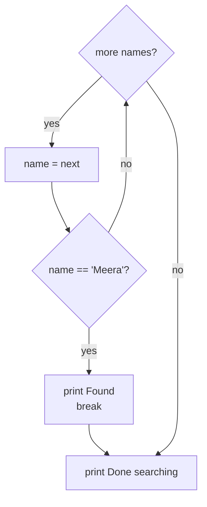

# break, continue and range(): The Complete Guide

> 📚 **Before you start**
>
> - [for and while Loops](for-and-while-loops.md), for how loops run and the basic patterns
> - [if, elif and else](if-elif-and-else.md), since `break` and `continue` almost always sit inside an `if`

## Introduction

You're checking the attendance register for a student called Meera. You go down the list name by name, and on row 7 you find her. Do you keep reading the remaining 53 names? Of course not; you **stop**. Now you're adding up today's sales slips, and one slip is blank. Do you give up on the whole pile? No; you **skip** that one and carry on.

Loops need the same two moves:

- **`break`** stops the loop immediately, even if items remain.
- **`continue`** skips the rest of the current pass and moves straight to the next item.

Python also has a less-known partner, the loop's **`else`** block, which runs only when the loop finished without a `break`: perfect for "searched everything, didn't find it".

And underneath most counting loops sits **`range()`**, which you've used a little. This lesson covers it fully: start, stop, step, counting backwards, and why `range(1_000_000_000)` doesn't use a gigabyte of memory.

> 💡 **Key Insight**
>
> `break` and `continue` let the **data** decide how a loop runs. Without them, a loop always walks the whole collection. With them, a search stops at the first match and a cleaner skips bad records without wrapping everything in extra `if` levels.

---

## Core Explanation

### 1. range() in full

`range()` produces a sequence of evenly spaced integers. It has three forms:

| Call | Produces | Meaning |
|---|---|---|
| `range(stop)` | 0, 1, ..., stop − 1 | count from 0 |
| `range(start, stop)` | start, ..., stop − 1 | count from start |
| `range(start, stop, step)` | start, start + step, ... (before stop) | count by step |

The **stop value is never included**. That's deliberate: `range(n)` gives exactly `n` numbers, and `range(0, 10)` and `range(10, 20)` fit together without overlapping.

```python
print(list(range(5)))
print(list(range(2, 7)))
print(list(range(0, 20, 5)))
print(list(range(1, 10, 2)))      # odd numbers
```

Output:

```
[0, 1, 2, 3, 4]
[2, 3, 4, 5, 6]
[0, 5, 10, 15]
[1, 3, 5, 7, 9]
```

We wrap `range` in `list()` here only to **see** the numbers; in a `for` loop you use the range directly.

**Counting backwards** uses a negative step. The stop is still excluded, so to count down to 1, stop at 0:

```python
print(list(range(10, 0, -1)))
print(list(range(10, 0, -3)))
```

Output:

```
[10, 9, 8, 7, 6, 5, 4, 3, 2, 1]
[10, 7, 4, 1]
```

**Empty ranges** are not errors. If the start is already past the stop in the direction of the step, the range just has no numbers, and a loop over it runs zero times:

```python
print(list(range(5, 2)))         # counting up from 5 never reaches 2
print(list(range(0)))
for i in range(5, 2):
    print("never printed")
print("loop skipped")
```

Output:

```
[]
[]
loop skipped
```

A step of zero is an error, and so are floats:

```python
# not-run: shows an error on purpose
for km in range(0, 2, 0.5):
    print(km)
```

Running it shows:

```
Traceback (most recent call last):
  File "/home/you/python-practice/example.py", line 2, in <module>
    for km in range(0, 2, 0.5):
              ~~~~~^^^^^^^^^^^
TypeError: 'float' object cannot be interpreted as an integer
```

For decimal steps, loop over integers and divide:

```python
for i in range(5):
    print(i * 0.5, end=" ")
print()
```

Output:

```
0.0 0.5 1.0 1.5 2.0
```

#### range is lazy

A `range` doesn't store its numbers. It stores only start, stop and step, and works out each number when asked. That means a huge range costs almost nothing:

```python
import sys

big = range(1_000_000_000)
print(len(big))
print(big[123_456_789])
print(999_999_999 in big)      # answered by arithmetic, not by searching
print(sys.getsizeof(big), "bytes")
```

Output:

```
1000000000
123456789
True
48 bytes
```

`sys.getsizeof` reports how much memory an object itself uses. A list of a billion integers would need many gigabytes; the range needs 48 bytes. This "produce values on demand" idea is called **laziness**, and you'll build your own lazy sequences in [Iterators and Generators](../06-functions-and-iterators/iterators-and-generators.md).

#### Ranges with indexes

`range(len(items))` gives every valid index of a list. It's the right tool when you genuinely need positions, such as comparing each item with the next one:

```python
temps = [31, 33, 32, 36, 35]
for i in range(len(temps) - 1):
    change = temps[i + 1] - temps[i]
    print(f"Day {i + 1} to {i + 2}: {change:+}")
```

Output:

```
Day 1 to 2: +2
Day 2 to 3: -1
Day 3 to 4: +4
Day 4 to 5: -1
```

The `- 1` stops one early, so `temps[i + 1]` never goes past the end. Forgetting it gives an `IndexError` on the last pass, the classic **off-by-one error**.

### 2. break: stop the loop now

`break` exits the **nearest enclosing loop** immediately. Code after the loop then runs.

```python
register = ["Aarav", "Bina", "Chetan", "Meera", "Neel", "Om"]

for position, name in enumerate(register, start=1):
    print("Checking", name)
    if name == "Meera":
        print(f"Found Meera at row {position}")
        break

print("Done searching")
```

Output:

```
Checking Aarav
Checking Bina
Checking Chetan
Checking Meera
Found Meera at row 4
Done searching
```

"Neel" and "Om" were never checked.



#### while True with break

A very common shape: loop "forever" and `break` when a condition is met. It's useful when the stopping check naturally sits in the middle of the body rather than at the top.

```python
balance = 1000
day = 0
spends = [300, 250, 400, 200, 100]

while True:
    spend = spends[day]
    if spend > balance:
        print(f"Day {day + 1}: can't spend ₹{spend}, only ₹{balance} left")
        break
    balance -= spend
    print(f"Day {day + 1}: spent ₹{spend}, balance ₹{balance}")
    day += 1
```

Output:

```
Day 1: spent ₹300, balance ₹700
Day 2: spent ₹250, balance ₹450
Day 3: spent ₹400, balance ₹50
Day 4: can't spend ₹200, only ₹50 left
```

The interactive version of "keep asking until it's valid" is often written this way:

```python
# not-run: waits for keyboard input
while True:
    answer = input("Continue? (y/n): ").strip().lower()
    if answer in ("y", "n"):
        break
    print("Please type y or n")
print("You chose", answer)
```

Example session:

```
Continue? (y/n): maybe
Please type y or n
Continue? (y/n): Y
You chose y
```

#### A retry loop

`for` plus `break` gives "try up to N times":

```python
results = ["timeout", "timeout", "ok"]     # pretend outcomes of a network call

for attempt in range(1, 4):
    outcome = results[attempt - 1]
    print(f"Attempt {attempt}: {outcome}")
    if outcome == "ok":
        break
```

Output:

```
Attempt 1: timeout
Attempt 2: timeout
Attempt 3: ok
```

### 3. continue: skip to the next item

`continue` abandons the **rest of the current pass** and jumps back to the top of the loop for the next item.

```python
slips = ["250", "", "120", "abc", "75"]
total = 0

for slip in slips:
    if not slip.isdigit():
        print(f"Skipping bad slip {slip!r}")
        continue
    total += int(slip)

print("Total:", total)
```

Output:

```
Skipping bad slip ''
Skipping bad slip 'abc'
Total: 445
```

Without `continue` you'd write `if slip.isdigit(): total += int(slip)` with the main work indented inside. For one line that's fine. When the main work is ten lines long, `continue` keeps it at the normal indentation level, and the "reasons to skip" read as a list at the top of the loop:

```python
orders = [
    {"id": 1, "status": "paid", "amount": 499},
    {"id": 2, "status": "cancelled", "amount": 899},
    {"id": 3, "status": "paid", "amount": 0},
    {"id": 4, "status": "paid", "amount": 1299},
]

for order in orders:
    if order["status"] != "paid":
        continue
    if order["amount"] == 0:
        continue
    gst = order["amount"] * 0.18
    print(f"Order {order['id']}: ₹{order['amount']} + GST ₹{gst:.2f}")
```

Output:

```
Order 1: ₹499 + GST ₹89.82
Order 4: ₹1299 + GST ₹233.82
```

#### continue in a while loop: the infinite-loop trap

In a `while` loop, `continue` jumps back to the condition **skipping anything below it, including your counter update**:

```python
# not-run: never stops on purpose
i = 0
while i < 5:
    if i == 2:
        continue        # i stays 2 forever
    print(i)
    i += 1
```

This prints `0`, `1` and then hangs. Update the counter **before** any `continue`:

```python
i = 0
while i < 5:
    i += 1
    if i == 3:
        continue
    print(i)
```

Output:

```
1
2
4
5
```

### 4. break vs continue vs pass

Three short keywords, three very different effects:

| Keyword | What happens |
|---|---|
| `break` | Leave the loop entirely |
| `continue` | Skip the rest of this pass, go to the next one |
| `pass` | Do nothing at all; just a placeholder where a statement is required |

```python
for n in range(1, 6):
    if n == 2:
        pass            # no effect: the print below still runs
    if n == 3:
        continue        # skip printing 3
    if n == 5:
        break           # stop before printing 5
    print(n)
```

Output:

```
1
2
4
```

### 5. The loop else clause

Both `for` and `while` can have an `else` block. It runs **only if the loop finished normally**, meaning it was **not** stopped by `break`. Think of it as "no break".

That's exactly what a search needs: found it (break) or looked everywhere and it wasn't there (else).

```python
register = ["Aarav", "Bina", "Chetan"]
wanted = "Meera"

for name in register:
    if name == wanted:
        print("Present")
        break
else:
    print(f"{wanted} is not in the register")
```

Output:

```
Meera is not in the register
```

Without loop-`else`, you'd need a "found" flag variable:

```python
found = False
for name in register:
    if name == wanted:
        found = True
        break
if not found:
    print(f"{wanted} is not in the register")
```

Output:

```
Meera is not in the register
```

Both are correct; the flag version is more familiar to people from other languages, the `else` version is shorter. A classic use, checking whether a number is prime:

```python
n = 91
for d in range(2, n):
    if n % d == 0:
        print(f"{n} is not prime: {d} x {n // d}")
        break
else:
    print(f"{n} is prime")

n = 97
for d in range(2, n):
    if n % d == 0:
        print(f"{n} is not prime: {d} x {n // d}")
        break
else:
    print(f"{n} is prime")
```

Output:

```
91 is not prime: 7 x 13
97 is prime
```

(Checking divisors only up to the square root of `n` would be much faster; that's a good exercise below.)

### 6. break exits only one loop

In nested loops, `break` leaves only the **innermost** loop it's in. The outer loop carries on:

```python
seats = [
    ["taken", "taken", "free"],
    ["free", "taken", "taken"],
]

for row_no, row in enumerate(seats, start=1):
    for seat_no, status in enumerate(row, start=1):
        if status == "free":
            print(f"First free seat in row {row_no}: seat {seat_no}")
            break
```

Output:

```
First free seat in row 1: seat 3
First free seat in row 2: seat 1
```

It found the first free seat **in each row**, because the `break` only left the inner loop. To stop **everything** at the first free seat, use a flag the outer loop checks (or, once you know functions, `return`):

```python
found = None
for row_no, row in enumerate(seats, start=1):
    for seat_no, status in enumerate(row, start=1):
        if status == "free":
            found = (row_no, seat_no)
            break
    if found:
        break
print("Book row", found[0], "seat", found[1])
```

Output:

```
Book row 1 seat 3
```

### 7. any() and all(): searches without writing the loop

Two built-ins replace the most common "search with break" loops:

- `any(...)` is `True` if **at least one** item is truthy (it stops at the first one).
- `all(...)` is `True` if **every** item is truthy (it stops at the first falsy one).

```python
marks = [72, 38, 91, 55]
print(any(m < 40 for m in marks))      # did anyone fail?
print(all(m >= 35 for m in marks))     # did everyone clear 35?
print(any([]), all([]))                # empty: no item is true / no item is false
```

Output:

```
True
True
False True
```

The `m < 40 for m in marks` inside is a **generator expression**, a compact loop you'll learn in [List and Dictionary Comprehensions](../05-strings-and-data-structures/list-and-dictionary-comprehensions.md). Note that `all([])` is `True`: there's no item that fails.

### 8. Errors and bugs to watch for

**`break` or `continue` outside a loop** is a syntax error:

```python
# not-run: shows an error on purpose
balance = 0
if balance == 0:
    break
```

Running it shows:

```
  File "/home/you/python-practice/example.py", line 4
    break
    ^^^^^
SyntaxError: 'break' outside loop
```

**Off-by-one with range**: `range(1, 10)` stops at 9. If you mean "1 to 10 inclusive", write `range(1, 11)`.

**Misplaced loop-`else`**: indenting `else` to line up with an `if` inside the loop makes it an `if`/`else`, not a loop-`else`. The two look similar but behave completely differently. Check which keyword the `else` lines up with.

---

## Try It Yourself

1. Print the even numbers from 20 down to 2 using one `range` call.
2. From `readings = [32, 34, -999, 35, 31, -999, 30]` (where `-999` means "sensor error"), compute the average of the valid readings using `continue`.
3. Find the first multiple of 7 that's greater than 100, using `while True` and `break`.
4. Faster prime check: test divisors only from 2 up to and including the square root of `n` (use `int(n ** 0.5) + 1` as the stop). Check `n = 7919` with a loop-`else`.

<details>
<summary>Show answers</summary>

```python
print(list(range(20, 0, -2)))

readings = [32, 34, -999, 35, 31, -999, 30]
total = 0
count = 0
for r in readings:
    if r == -999:
        continue
    total += r
    count += 1
print(f"Average: {total / count:.1f}")

n = 101
while True:
    if n % 7 == 0:
        break
    n += 1
print("First multiple of 7 over 100:", n)

n = 7919
for d in range(2, int(n ** 0.5) + 1):
    if n % d == 0:
        print(n, "is not prime")
        break
else:
    print(n, "is prime")
```

Output:

```
[20, 18, 16, 14, 12, 10, 8, 6, 4, 2]
Average: 32.4
First multiple of 7 over 100: 105
7919 is prime
```

The square-root version checks 87 divisors instead of 7,917. If `n` has a divisor bigger than its square root, it must also have one smaller, so stopping there is safe.

</details>

---

## Real-World Examples

### Example 1: Stopping at the first error

A data loader reads a file of 10 lakh rows. If row 52 has a corrupted header, there's no point reading the rest: `break` (or raising an error) stops immediately and reports the row. If individual rows can be bad but the file is fine overall, `continue` skips them and logs a warning instead.

### Example 2: Pagination over an API

Many web APIs return results 100 at a time. A `while True` loop fetches page after page and `break`s when a page comes back empty. You don't know in advance how many pages there are, so a `for` loop over a fixed range would be wrong.

### Example 3: Batch processing with range

To send 25,000 SMS reminders in batches of 500, `for start in range(0, len(numbers), 500): batch = numbers[start:start + 500]` processes each slice. The step argument of `range` does the batching.

---

## Common Misconceptions

### Misconception 1: "`break` exits all the loops"

It exits only the innermost loop containing it. Use a flag, loop-`else`, or a function with `return` to exit several levels.

### Misconception 2: "The loop `else` runs when the loop condition is false"

It runs when the loop **ends without `break`**. That includes a `for` loop over an empty list and a `while` whose condition was false from the start.

### Misconception 3: "`continue` and `pass` do the same thing"

`pass` does nothing and execution continues with the next line. `continue` skips everything below it in the loop body.

### Misconception 4: "`range` creates a list"

In Python 3, `range` is a lazy object that computes values on demand. `list(range(...))` creates the list if you actually need one.

### Misconception 5: "`range(1, 10)` includes 10"

The stop value is always excluded.

---

## Interview Relevance

These keywords show up constantly in coding rounds, and loop-`else` is a favourite "do you really know Python?" question. Be ready to:

- **Explain loop-`else`** precisely ("runs if no `break` occurred") and use it for search.
- **Exit nested loops** cleanly: flag, function + `return`, or restructuring.
- **Use `range` fluently:** reverse ranges, steps, `range(len(x) - 1)` for neighbour comparisons, and know it's lazy (O(1) memory, O(1) `in` checks for integers).
- **Avoid infinite loops:** where `continue` sits relative to the counter update.
- **Prefer `any()`/`all()`** for simple searches.
- **Early termination** as an optimisation: stopping at the first match, checking divisors only up to √n.

---

## Key Takeaways

- **`range(start, stop, step)`** gives integers from start up to but **not including** stop; it's lazy, so even huge ranges cost almost no memory.
- **`break`** leaves the innermost loop immediately; **`continue`** skips to the next pass; **`pass`** does nothing.
- A loop's **`else`** block runs only when the loop finished **without `break`**, ideal for "not found".
- In a `while` loop, put the counter update **before** any `continue`.
- **`any()` and `all()`** replace many hand-written search loops.

---

**Up next:** [Lab: Number guessing game](lab-number-guessing-game.md)
