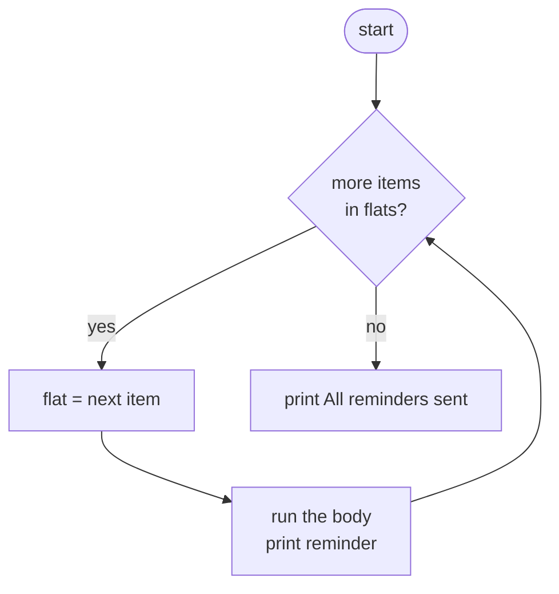
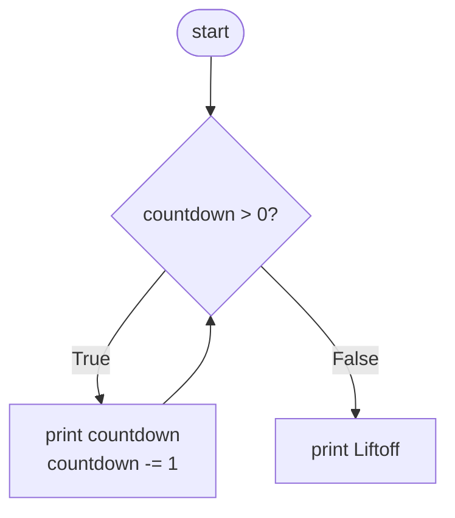

# for and while Loops: The Complete Guide

> 📚 **Before you start**
>
> - [Containers and Mutability](../03-core-language-concepts/containers-and-mutability.md), for lists, tuples, sets and dicts
> - [if, elif and else](if-elif-and-else.md), for conditions and indented blocks

## Introduction

At the end of every month, a society treasurer goes through 120 flats one by one: has this flat paid maintenance? If not, add it to the reminder list. A teacher goes through 45 answer sheets and adds up each student's marks. A delivery partner keeps riding until every parcel in the bag is delivered.

Doing the same steps **for each item** in a collection, or **as long as** something is true, is called **looping** (or **iteration**). It's where computers truly outshine people: a loop over 120 flats or 12 million transactions is the same three lines of code.

Python has two loops:

- **`for`** goes through the items of a collection (or any sequence of values), one at a time.
- **`while`** keeps repeating as long as a condition stays true.

By the end of this lesson you'll be able to loop over every kind of container, use the standard loop patterns (count, sum, find the biggest, build a new list), pair items with `enumerate` and `zip`, write nested loops, use `while` safely without getting stuck forever, and avoid the classic "changing a list while looping over it" bug.

> 💡 **Key Insight**
>
> Use **`for` when you know what you're going through** (a list of flats, the characters of a string, the numbers 1 to 10). Use **`while` when you only know when to stop** (until the balance runs out, until the user types a valid PIN). Most Python loops are `for` loops; reach for `while` only when there's no collection to walk through.

---

## Core Explanation

### 1. Your first for loop

```python
flats = ["A-101", "A-102", "B-201", "B-202"]

for flat in flats:
    print("Sending reminder to", flat)

print("All reminders sent")
```

Output:

```
Sending reminder to A-101
Sending reminder to A-102
Sending reminder to B-201
Sending reminder to B-202
All reminders sent
```

How to read it: "for each `flat` in `flats`, do the indented block". On each **iteration** (each pass through the loop), Python takes the next item from the list and binds the name `flat` to it. When there are no more items, the loop ends and the program continues after the block.

- `flat` is the **loop variable**. You choose its name; make it the singular of the collection's name (`for flat in flats`, `for order in orders`).
- The line ends with a colon, and the body is indented, exactly like `if`.



### 2. Looping over every kind of container

**Strings** give one character at a time:

```python
for ch in "UPI":
    print(ch)
```

Output:

```
U
P
I
```

**Tuples** work like lists. **Sets** have no order, so sort them if you need predictable output:

```python
for city in sorted({"Pune", "Agra", "Kochi"}):
    print(city)
```

Output:

```
Agra
Kochi
Pune
```

**Dictionaries** give their **keys**. Use `.values()` for values and `.items()` for `(key, value)` pairs, unpacking them into two names:

```python
menu = {"chai": 20, "samosa": 15, "vada pav": 25}

for item in menu:
    print(item)

for price in menu.values():
    print(price)

for item, price in menu.items():
    print(f"{item:<10} ₹{price}")
```

Output:

```
chai
samosa
vada pav
20
15
25
chai       ₹20
samosa     ₹15
vada pav   ₹25
```

### 3. range(): looping a number of times

`range()` produces a sequence of whole numbers. It's how you say "do this 5 times" or "for each number from 1 to 10". (It gets a full section in [break, continue and range()](break-continue-and-range.md).)

```python
for i in range(3):          # 0, 1, 2
    print("Attempt", i)

for n in range(1, 6):       # 1 to 5: the end is NOT included
    print(n, "x 7 =", n * 7)
```

Output:

```
Attempt 0
Attempt 1
Attempt 2
1 x 7 = 7
2 x 7 = 14
3 x 7 = 21
4 x 7 = 28
5 x 7 = 35
```

### 4. The core loop patterns

Almost every loop you'll write is one of a few patterns. Learn these and you'll recognise them everywhere.

**Accumulate a total.** Start a variable before the loop, update it inside:

```python
expenses = [120, 45, 300, 85, 950]

total = 0
for amount in expenses:
    total += amount
print("Total:", total)
```

Output:

```
Total: 1500
```

Let's trace it step by step. A **trace table** like this is the best way to understand any loop you're unsure about:

| Iteration | `amount` | `total` after the body |
|---|---|---|
| before the loop | | 0 |
| 1 | 120 | 120 |
| 2 | 45 | 165 |
| 3 | 300 | 465 |
| 4 | 85 | 550 |
| 5 | 950 | 1500 |

**Count the items that match a condition:**

```python
count_big = 0
for amount in expenses:
    if amount > 100:
        count_big += 1
print("Expenses over ₹100:", count_big)
```

Output:

```
Expenses over ₹100: 3
```

**Find the largest (or smallest):**

```python
largest = expenses[0]
for amount in expenses:
    if amount > largest:
        largest = amount
print("Largest:", largest)
```

Output:

```
Largest: 950
```

(Python's built-ins `sum()`, `max()`, `min()` and `len()` do these for you. Writing them by hand once teaches you the pattern, which you'll need for anything the built-ins don't cover.)

```python
print(sum(expenses), max(expenses), min(expenses), len(expenses))
```

Output:

```
1500 950 45 5
```

**Build a new list** from an old one, with `append`:

```python
prices = [100, 250, 80]
with_gst = []
for p in prices:
    with_gst.append(round(p * 1.18, 2))
print(with_gst)
```

Output:

```
[118.0, 295.0, 94.4]
```

**Filter**: keep only some items:

```python
students = {"Aditi": 91, "Bharat": 38, "Chitra": 67, "Dev": 29}
failed = []
for name, marks in students.items():
    if marks < 40:
        failed.append(name)
print("Needs re-test:", failed)
```

Output:

```
Needs re-test: ['Bharat', 'Dev']
```

**Build a string:**

```python
word = "chai"
reversed_word = ""
for ch in word:
    reversed_word = ch + reversed_word
print(reversed_word)
```

Output:

```
iahc
```

In module 5 you'll learn **comprehensions**, a one-line way to write the "build a new list" and "filter" patterns.

### 5. enumerate(): items with their position

Often you need both the item and its position. Don't keep a counter by hand; use `enumerate()`, which gives `(index, item)` pairs:

```python
queue = ["Asha", "Babu", "Charu"]
for position, person in enumerate(queue, start=1):
    print(f"Token {position}: {person}")
```

Output:

```
Token 1: Asha
Token 2: Babu
Token 3: Charu
```

Without `start=1`, counting begins at 0.

### 6. zip(): walking through two lists together

`zip()` pairs up items from several collections, position by position:

```python
players = ["Rohit", "Gill", "Kohli"]
runs = [56, 104, 33]
balls = [41, 98, 30]

for player, r, b in zip(players, runs, balls):
    strike_rate = r / b * 100
    print(f"{player:<6} {r:>4} runs  SR {strike_rate:.1f}")
```

Output:

```
Rohit    56 runs  SR 136.6
Gill    104 runs  SR 106.1
Kohli    33 runs  SR 110.0
```

If the lists have different lengths, `zip` stops at the shortest. Pass `strict=True` to get an error instead, which catches data mistakes early:

```python
print(list(zip([1, 2, 3], ["a", "b"])))
```

Output:

```
[(1, 'a'), (2, 'b')]
```

### 7. sorted() and reversed()

Loop in a different order without changing the original:

```python
scores = [56, 104, 33]
for s in sorted(scores, reverse=True):
    print(s, end=" ")
print()
for s in reversed(scores):
    print(s, end=" ")
print()
print(scores)       # unchanged
```

Output:

```
104 56 33 
33 104 56 
[56, 104, 33]
```

### 8. Nested loops

A loop inside a loop runs the inner loop **completely** for **each** pass of the outer loop:

```python
for row in range(1, 4):
    for col in range(1, 6):
        print(f"{row * col:3}", end="")
    print()          # new line after each row
```

Output:

```
  1  2  3  4  5
  2  4  6  8 10
  3  6  9 12 15
```

The inner body ran 3 × 5 = 15 times. Nested loops multiply: two nested loops over 1,000 items each is a million iterations, which is worth remembering when code gets slow.

A practical example, checking every pair:

```python
teams = ["CSK", "MI", "RCB"]
for i in range(len(teams)):
    for j in range(i + 1, len(teams)):
        print(teams[i], "vs", teams[j])
```

Output:

```
CSK vs MI
CSK vs RCB
MI vs RCB
```

Starting `j` at `i + 1` gives each pair once and never matches a team against itself.

And a pattern of stars, the classic first nested-loop exercise:

```python
for row in range(1, 5):
    print("*" * row)
```

Output:

```
*
**
***
****
```

Python's string repetition removed the need for an inner loop here.

### 9. The while loop

`while` repeats its body **as long as** the condition is true. It checks the condition **before** each pass.

```python
countdown = 5
while countdown > 0:
    print(countdown)
    countdown -= 1
print("Liftoff! 🚀")
```

Output:

```
5
4
3
2
1
Liftoff! 🚀
```



Every `while` loop needs three things: a variable the condition depends on, a condition, and **something in the body that changes that variable** so the condition eventually becomes false.

`while` shines when you don't know how many iterations you need. How many years does a fixed deposit at 7% take to double?

```python
amount = 100_000
years = 0
while amount < 200_000:
    amount *= 1.07
    years += 1
print(f"Doubles in {years} years: ₹{amount:,.0f}")
```

Output:

```
Doubles in 11 years: ₹210,485
```

Another: adding up the digits of a number, peeling one digit off each time with `%` and `//`:

```python
n = 98765
digit_sum = 0
while n > 0:
    digit_sum += n % 10     # last digit
    n //= 10                # drop the last digit
print(digit_sum)
```

Output:

```
35
```

### 10. Infinite loops and how to stop them

If the condition never becomes false, the loop runs forever:

```python
# not-run: never stops on purpose
count = 1
while count <= 5:
    print(count)        # forgot: count += 1
```

This prints `1` endlessly. If it happens, press **Ctrl + C** in the terminal. Python stops the program with a `KeyboardInterrupt` (the line shown depends on where the loop was at that instant):

```
1
1
1
^CTraceback (most recent call last):
  File "/home/you/python-practice/example.py", line 4, in <module>
    print(count)        # forgot: count += 1
    ~~~~~^^^^^^^
KeyboardInterrupt
```

Sometimes an endless loop is intentional: `while True:` with a `break` inside to leave when you're done. That's the subject of the next lesson.

### 11. while with input(): keep asking until valid

A classic use of `while`: keep asking until the answer is acceptable.

```python
# not-run: waits for keyboard input
pin = input("Enter 4-digit PIN: ")
while not (len(pin) == 4 and pin.isdigit()):
    print("PIN must be exactly 4 digits.")
    pin = input("Enter 4-digit PIN: ")
print("PIN accepted")
```

Example session:

```
Enter 4-digit PIN: 12a4
PIN must be exactly 4 digits.
Enter 4-digit PIN: 123
PIN must be exactly 4 digits.
Enter 4-digit PIN: 1234
PIN accepted
```

`.isdigit()` is a string method that is `True` when every character is a digit.

To test loop logic without typing, feed it from a list. Here the same logic runs against pretend answers:

```python
answers = ["12a4", "123", "1234"]
attempt = 0
pin = answers[attempt]
while not (len(pin) == 4 and pin.isdigit()):
    print(f"{pin!r} rejected")
    attempt += 1
    pin = answers[attempt]
print(f"{pin!r} accepted after {attempt + 1} tries")
```

Output:

```
'12a4' rejected
'123' rejected
'1234' accepted after 3 tries
```

`{pin!r}` shows the value with quotes (its `repr`), which makes empty or space-padded strings visible.

### 12. for or while?

| Situation | Use |
|---|---|
| Go through every item of a list, string, dict, file | `for` |
| Repeat exactly N times | `for i in range(N)` |
| Repeat until something happens (balance runs out, valid input, goal reached) | `while` |
| Game loop, menu loop, server loop | `while True:` with `break` |

Any `for` loop can be written as a `while` loop with a counter, but it's longer and easier to get wrong (forgetting to increase the counter, or going one past the end).

### 13. Don't change a list while looping over it

Removing items from a list while a `for` loop walks through it skips items, because the positions shift under the loop's feet:

```python
amounts = [50, 80, 600, 90, 700]
for a in amounts:
    if a < 100:
        amounts.remove(a)
print(amounts)
```

Output:

```
[80, 600, 700]
```

`80` survived, even though it's under 100. When `50` (position 0) was removed, `80` slid into position 0, and the loop moved on to position 1. Safe alternatives: loop over a **copy**, or (better) build a new list:

```python
amounts = [50, 80, 600, 90, 700]
for a in amounts.copy():
    if a < 100:
        amounts.remove(a)
print(amounts)

amounts = [50, 80, 600, 90, 700]
big = []
for a in amounts:
    if a >= 100:
        big.append(a)
print(big)
```

Output:

```
[600, 700]
[600, 700]
```

Dictionaries are stricter: changing their size during a loop is an error.

```python
# not-run: shows an error on purpose
stock = {"chai": 0, "samosa": 12, "poha": 0}
for item in stock:
    if stock[item] == 0:
        del stock[item]
```

Running it shows:

```
Traceback (most recent call last):
  File "/home/you/python-practice/example.py", line 3, in <module>
    for item in stock:
                ^^^^^
RuntimeError: dictionary changed size during iteration
```

Fix: loop over `list(stock)`, a snapshot of the keys.

```python
stock = {"chai": 0, "samosa": 12, "poha": 0}
for item in list(stock):
    if stock[item] == 0:
        del stock[item]
print(stock)
```

Output:

```
{'samosa': 12}
```

### 14. The loop variable lives on

After a `for` loop, the loop variable still holds the **last** value it was given:

```python
for flat in ["A-101", "A-102", "B-201"]:
    pass
print(flat)
```

Output:

```
B-201
```

Occasionally useful, occasionally a source of confusion if you reuse the name later. (If the collection was empty, the name is never created at all.)

---

## Try It Yourself

1. **FizzBuzz.** For numbers 1 to 15, print "Fizz" for multiples of 3, "Buzz" for multiples of 5, "FizzBuzz" for multiples of both, and the number otherwise.
2. **Average marks.** `marks = {"Maths": 78, "Science": 85, "English": 69, "Hindi": 90}`. Loop to compute the total and print the average to 1 decimal place, plus the subject with the highest marks.
3. **Savings goal.** You save ₹2,500 every month and your goal is ₹50,000 for a new phone. Use a `while` loop to find how many months it takes.
4. **Times table and zip.** Print the 9 times table from 9 × 1 to 9 × 10 with `range`. Then, using `zip`, print each of `["Mon", "Tue", "Wed"]` with `[3200, 4100, 2800]` steps walked.

<details>
<summary>Show answers</summary>

```python
for n in range(1, 16):
    if n % 15 == 0:
        print("FizzBuzz")
    elif n % 3 == 0:
        print("Fizz")
    elif n % 5 == 0:
        print("Buzz")
    else:
        print(n)

marks = {"Maths": 78, "Science": 85, "English": 69, "Hindi": 90}
total = 0
best_subject = None
for subject, m in marks.items():
    total += m
    if best_subject is None or m > marks[best_subject]:
        best_subject = subject
print(f"Average: {total / len(marks):.1f}, best: {best_subject}")

saved = 0
months = 0
while saved < 50_000:
    saved += 2_500
    months += 1
print("Months needed:", months)

for n in range(1, 11):
    print(f"9 x {n} = {9 * n}")
for day, steps in zip(["Mon", "Tue", "Wed"], [3200, 4100, 2800]):
    print(day, steps)
```

Output:

```
1
2
Fizz
4
Buzz
Fizz
7
8
Fizz
Buzz
11
Fizz
13
14
FizzBuzz
Average: 80.5, best: Hindi
Months needed: 20
9 x 1 = 9
9 x 2 = 18
9 x 3 = 27
9 x 4 = 36
9 x 5 = 45
9 x 6 = 54
9 x 7 = 63
9 x 8 = 72
9 x 9 = 81
9 x 10 = 90
Mon 3200
Tue 4100
Wed 2800
```

In FizzBuzz, the `% 15` check must come first; otherwise 15 would stop at the `% 3` branch and print "Fizz".

</details>

---

## Real-World Examples

### Example 1: Processing a bank statement

A personal-finance script loops over every row of a downloaded statement: `for row in rows:`. Inside, `if` statements categorise each UPI payment (food, travel, rent) by keywords in the description, and accumulators add up each category. Two hundred lines of statement become a five-line summary.

### Example 2: Retry loops

Network calls fail now and then. Production code wraps them in a loop: try up to 3 times, waiting a little longer each time, and give up after the last attempt. That's a `for attempt in range(3)` loop with an early exit on success, which you'll write in the next lesson.

### Example 3: Game and server loops

A game runs `while game_running:` sixty times a second: read input, update positions, draw the screen. A web server runs `while True:` waiting for requests. These loops are meant to run until something tells them to stop.

---

## Common Misconceptions

### Misconception 1: "`for i in range(1, 10)` includes 10"

The end of a range is excluded. `range(1, 10)` gives 1 to 9. Use `range(1, 11)` for 1 to 10.

### Misconception 2: "I need an index to loop over a list"

`for item in items` gives the items directly. When you need the position too, use `enumerate`. Writing `for i in range(len(items)): item = items[i]` works but is considered un-Pythonic when you don't need `i`.

### Misconception 3: "Looping over a dict gives key-value pairs"

It gives keys only. Use `.items()` for pairs and `.values()` for values.

### Misconception 4: "Removing items inside a for loop is fine"

It skips items in lists and raises `RuntimeError` in dicts. Loop over a copy or build a new collection.

### Misconception 5: "`while` is more powerful, so I should prefer it"

`while` is more general, but `for` is shorter, clearer and can't accidentally run forever over a finite collection. Use `while` only when you genuinely don't have a collection or a count.

---

## Interview Relevance

Loops are the backbone of every coding round. Interviewers check:

- **Choosing the right loop** and explaining why.
- **The standard patterns:** accumulate, count, find max/min, filter, build a new list, and recognising when a built-in (`sum`, `max`, `any`, `all`) replaces them.
- **Pythonic iteration:** `enumerate` instead of manual counters, `zip` for parallel lists, `.items()` for dicts.
- **Complexity awareness:** a loop over n items is O(n); nested loops are O(n²). You'll be asked to spot and reduce nested loops (often with a set or dict).
- **Bugs:** off-by-one errors with `range`, infinite `while` loops, mutating a collection while iterating.
- **Classics:** FizzBuzz, reversing a string, digit sum, counting vowels, finding duplicates.

---

## Key Takeaways

- **`for item in collection:`** runs the body once per item; it works on lists, tuples, strings, sets, dicts (keys) and ranges.
- **`while condition:`** repeats while the condition is true; make sure the body moves it towards false, and use **Ctrl + C** to escape a runaway loop.
- Learn the **patterns**: accumulator, counter, max/min, filter, build-a-list. Use **`enumerate`** for positions and **`zip`** for parallel lists.
- **Nested loops multiply** the work: the inner loop runs fully for each outer pass.
- **Never resize a list or dict while looping over it**; loop over a copy or build a new one.

---

**Up next:** [break, continue and range()](break-continue-and-range.md)
