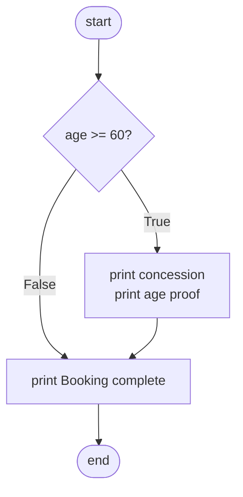
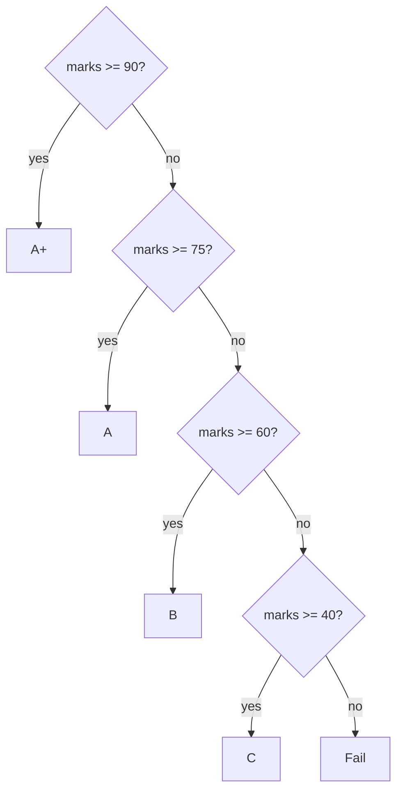

# if, elif and else: The Complete Guide

> 📚 **Before you start**
>
> - [Numbers, Booleans and Strings](../02-getting-started-with-python/numbers-booleans-and-strings.md), for `True`, `False`, `None` and truthiness
> - [Operators and Precedence](../03-core-language-concepts/operators-and-precedence.md), for comparisons, `and`/`or`/`not` and `in`

## Introduction

Every app you use is constantly making decisions. UPI checks: is the PIN correct? Is the balance enough? Is this payment over the daily limit? IRCTC checks: is the passenger 60 or older? Is the train full? Is it Tatkal time yet? Swiggy checks: is the restaurant open? Is the address in range? Is the order above the free-delivery amount?

So far, your programs have run every line from top to bottom, no matter what. That's like a recipe that adds sugar whether or not the guest takes it. To write useful programs, you need code that runs **only when a condition is true**, and picks between alternatives. In Python that's the `if` statement, with its partners `elif` and `else`, plus the newer `match` statement for choosing among many fixed options.

By the end of this lesson you'll be able to write single, two-way and many-way decisions, combine conditions correctly, avoid the most common beginner bugs (like `if x == 1 or 2`), and read every error message that a badly formed `if` produces.

> 💡 **Key Insight**
>
> An `if`/`elif`/`else` chain is checked **top to bottom**, and **only the first** true branch runs. Everything after it is skipped, even if it would also be true. So the order of your conditions is part of your program's logic: put the most specific cases first.

---

## Core Explanation

### 1. The simplest if

```python
age = 64

if age >= 60:
    print("Senior citizen concession applies")
    print("Please carry an age proof")

print("Booking complete")
```

Output:

```
Senior citizen concession applies
Please carry an age proof
Booking complete
```

The anatomy:

- `if` is a **keyword**, followed by a **condition**: any expression Python can treat as true or false.
- The line ends with a **colon** `:`.
- The lines that belong to the `if` are **indented** (4 spaces by convention). This indented group is called a **block** or **body**.
- The block ends when the indentation returns to the `if`'s level. `print("Booking complete")` is not indented, so it runs whatever the condition was.

Change `age` to `30` and only "Booking complete" is printed.



### 2. if ... else: two paths

`else` gives the block to run when the condition is false. Exactly one of the two blocks runs.

```python
balance = 450
amount = 600

if balance >= amount:
    balance = balance - amount
    print("Payment successful")
else:
    print("Insufficient balance")

print("Balance:", balance)
```

Output:

```
Insufficient balance
Balance: 450
```

`else` has no condition of its own, and it lines up with its `if`.

### 3. if ... elif ... else: many paths

`elif` is short for "else if". It lets you test several conditions in turn. Python checks them **top to bottom** and runs the **first** block whose condition is true. `else` at the end catches everything else (it's optional).

```python
marks = 82

if marks >= 90:
    grade = "A+"
elif marks >= 75:
    grade = "A"
elif marks >= 60:
    grade = "B"
elif marks >= 40:
    grade = "C"
else:
    grade = "Fail"

print(f"Marks {marks}: grade {grade}")
```

Output:

```
Marks 82: grade A
```

82 is also `>= 60` and `>= 40`, but those branches were never checked: the chain stopped at the first match.



#### Order matters

Here's the same chain with the conditions in the wrong order:

```python
marks = 95

if marks >= 40:
    grade = "C"
elif marks >= 60:
    grade = "B"
elif marks >= 90:
    grade = "A+"
else:
    grade = "Fail"

print(grade)
```

Output:

```
C
```

A 95 got a C, because `marks >= 40` was checked first and was true. With "at least" thresholds, test from the **highest** down (or the lowest up with `<`).

#### Several ifs vs one chain

Separate `if` statements are **all** checked. An `if`/`elif` chain stops at the first match. Compare:

```python
order_total = 1200

print("-- separate ifs --")
if order_total > 199:
    print("Free delivery")
if order_total > 499:
    print("Free dessert")
if order_total > 999:
    print("10% cashback")

print("-- one chain --")
if order_total > 999:
    print("10% cashback")
elif order_total > 499:
    print("Free dessert")
elif order_total > 199:
    print("Free delivery")
```

Output:

```
-- separate ifs --
Free delivery
Free dessert
10% cashback
-- one chain --
10% cashback
```

Use separate `if`s when the benefits **stack**; use a chain when exactly **one** outcome should apply.

### 4. Writing conditions

Any expression can be a condition. The common kinds:

```python
city = "Pune"
cart = ["rice", "dal"]
coupon = None
age, has_id = 17, True

if city == "Pune" or city == "Mumbai":
    print("Same-day delivery available")

if city in ("Pune", "Mumbai", "Nashik"):     # neater with in
    print("Maharashtra warehouse")

if age >= 18 and has_id:
    print("Can open a bank account alone")
else:
    print("Needs a guardian")

if not cart:
    print("Cart is empty")

if coupon is None:
    print("No coupon applied")
```

Output:

```
Same-day delivery available
Maharashtra warehouse
Needs a guardian
No coupon applied
```

#### Truthiness in conditions

Recall from [Numbers, Booleans and Strings](../02-getting-started-with-python/numbers-booleans-and-strings.md) that empty and zero values are "falsy". Python programmers rely on this to write short, readable checks:

| Instead of | Write |
|---|---|
| `if len(cart) > 0:` | `if cart:` |
| `if len(name) == 0:` | `if not name:` |
| `if is_member == True:` | `if is_member:` |
| `if result == None:` | `if result is None:` |

```python
name = ""
if name:
    print(f"Hello, {name}")
else:
    print("Hello, guest")
```

Output:

```
Hello, guest
```

One caution: `if not value` treats `0` the same as "missing". If `0` is a legitimate value (a zero-rupee balance, a score of 0), test `if value is None` instead.

### 5. The `x == 1 or 2` bug

This is probably the most common logic bug in beginner Python. It looks right in English but means something else:

```python
choice = "tea"

if choice == "coffee" or "Coffee":
    print("Brewing coffee")
else:
    print("Making tea")
```

Output:

```
Brewing coffee
```

Python reads it as `(choice == "coffee") or ("Coffee")`. The first part is `False`, so `or` returns `"Coffee"`, a non-empty string, which is truthy. The `if` is **always** true. Correct versions:

```python
if choice == "coffee" or choice == "Coffee":
    print("Brewing coffee")
elif choice in ("tea", "Tea"):
    print("Making tea")

if choice.lower() == "tea":        # often best: normalise, then compare once
    print("Tea confirmed")
```

Output:

```
Making tea
Tea confirmed
```

### 6. Nested ifs

An `if` can sit inside another `if`'s block. Each level adds 4 more spaces:

```python
is_open = True
distance_km = 6.5
order_total = 350

if is_open:
    if distance_km <= 7:
        if order_total >= 199:
            print("Order accepted, free delivery")
        else:
            print("Order accepted, ₹30 delivery fee")
    else:
        print("Sorry, too far away")
else:
    print("Restaurant is closed")
```

Output:

```
Order accepted, free delivery
```

Deep nesting gets hard to read. Often you can **flatten** it by combining conditions with `and`, or by checking the "no" cases first:

```python
if not is_open:
    print("Restaurant is closed")
elif distance_km > 7:
    print("Sorry, too far away")
elif order_total >= 199:
    print("Order accepted, free delivery")
else:
    print("Order accepted, ₹30 delivery fee")
```

Output:

```
Order accepted, free delivery
```

Same logic, one level of indentation. Reading top to bottom, each line removes one reason to reject the order. When you learn functions, this becomes the **guard clause** style: return early for each bad case.

### 7. The conditional expression (one-line if)

When you only need to **choose a value**, a conditional expression is shorter than a full `if` statement:

```python
age = 8
fare = 0 if age < 5 else (250 if age < 12 else 500)
label = "child" if age < 12 else "adult"
print(label, fare)

stock = 0
print(f"{stock} item{'s' if stock != 1 else ''} left")
stock = 1
print(f"{stock} item{'s' if stock != 1 else ''} left")
```

Output:

```
child 250
0 items left
1 item left
```

Keep it for simple choices. If you're nesting conditional expressions more than once, a normal `if` chain is clearer.

### 8. Comparing floats and strings safely

Two practical traps inside conditions:

```python
import math

total = 0.1 + 0.2
if total == 0.3:
    print("exactly 0.3")
else:
    print("not exactly 0.3")

if math.isclose(total, 0.3):
    print("close enough to 0.3")

answer = "  Yes "
if answer.strip().lower() == "yes":
    print("Confirmed")
```

Output:

```
not exactly 0.3
close enough to 0.3
Confirmed
```

Floats should be compared with `math.isclose` (or a tolerance), and user text should be **normalised** with `.strip().lower()` before comparing.

### 9. `pass`: an empty block

A block can't be empty. If you want to write the structure first and fill it in later, use `pass`, a statement that does nothing:

```python
temperature = 31

if temperature > 40:
    pass          # TODO: send a heat-wave alert
else:
    print("Normal temperature")
```

Output:

```
Normal temperature
```

### 10. match: choosing among many fixed values

Python 3.10 added the `match` statement (**structural pattern matching**). For comparing one value against many fixed options it's cleaner than a long `elif` chain:

```python
signal = "yellow"

match signal:
    case "green":
        action = "Go"
    case "yellow":
        action = "Slow down"
    case "red":
        action = "Stop"
    case _:
        action = "Signal broken, proceed with caution"

print(action)
```

Output:

```
Slow down
```

- Each `case` is checked top to bottom; the first that matches runs, and the rest are skipped.
- `case _:` is the **wildcard**: it matches anything, like `else`.
- `|` means "or" inside a pattern.

`match` can also pull values apart. Here it matches tuples by **shape** and captures the parts into names:

```python
for_testing = [("upi", 500), ("card", 1500), ("cash", 0), ("wallet", 100)]

payment = for_testing[0]
match payment:
    case ("upi" | "wallet", amount):
        print(f"Instant payment of ₹{amount}")
    case ("card", amount) if amount > 1000:
        print(f"Card payment of ₹{amount}: OTP required")
    case ("card", amount):
        print(f"Card payment of ₹{amount}")
    case (method, _):
        print(f"Unsupported method: {method}")

payment = for_testing[1]
match payment:
    case ("upi" | "wallet", amount):
        print(f"Instant payment of ₹{amount}")
    case ("card", amount) if amount > 1000:
        print(f"Card payment of ₹{amount}: OTP required")
    case ("card", amount):
        print(f"Card payment of ₹{amount}")
    case (method, _):
        print(f"Unsupported method: {method}")

payment = for_testing[2]
match payment:
    case ("upi" | "wallet", amount):
        print(f"Instant payment of ₹{amount}")
    case ("card", amount) if amount > 1000:
        print(f"Card payment of ₹{amount}: OTP required")
    case ("card", amount):
        print(f"Card payment of ₹{amount}")
    case (method, _):
        print(f"Unsupported method: {method}")
```

Output:

```
Instant payment of ₹500
Card payment of ₹1500: OTP required
Unsupported method: cash
```

The `if amount > 1000` after a pattern is a **guard**: the case matches only if the pattern fits *and* the guard is true. (Repeating the `match` three times is clumsy; in the next lesson a `for` loop runs it once per payment.)

A bare name in a `case` **captures** anything; it does not compare against an existing variable. `case limit:` would match every value and store it in `limit`. To compare against a value, write the value itself, or use a dotted name like `Signal.RED`.

Use `match` when you're comparing one subject against many shapes or fixed values. For ranges like marks ≥ 75, an `if`/`elif` chain is still the right tool.

### 11. Errors you'll meet

**Forgetting the colon:**

```python
# not-run: shows an error on purpose
age = 20
if age >= 18
    print("Adult")
```

Running it shows:

```
  File "/home/you/python-practice/example.py", line 3
    if age >= 18
                ^
SyntaxError: expected ':'
```

**Forgetting to indent the block:**

```python
# not-run: shows an error on purpose
age = 20
if age >= 18:
print("Adult")
```

Running it shows:

```
  File "/home/you/python-practice/example.py", line 4
    print("Adult")
    ^^^^^
IndentationError: expected an indented block after 'if' statement on line 3
```

**Indenting where you shouldn't:**

```python
# not-run: shows an error on purpose
age = 20
    print(age)
```

Running it shows:

```
  File "/home/you/python-practice/example.py", line 3
    print(age)
IndentationError: unexpected indent
```

**Writing `else if` (from other languages) instead of `elif`:**

```python
# not-run: shows an error on purpose
marks = 70
if marks >= 75:
    print("A")
else if marks >= 60:
    print("B")
```

Running it shows:

```
  File "/home/you/python-practice/example.py", line 5
    else if marks >= 60:
         ^^
SyntaxError: expected ':'
```

Python saw `else`, expected a colon right after it, and found `if`. The fix is `elif marks >= 60:`.

**`elif` or `else` without an `if` above it** (often because the indentation is off):

```python
# not-run: shows an error on purpose
marks = 70
if marks >= 75:
    print("A")
print("checked")
else:
    print("not A")
```

Running it shows:

```
  File "/home/you/python-practice/example.py", line 6
    else:
    ^^^^
SyntaxError: invalid syntax
```

The unindented `print("checked")` ended the `if` statement, so the `else` has nothing to attach to.

Set your editor to insert **spaces** when you press Tab (VS Code does this by default for Python). Mixing real tab characters and spaces in one block causes a `TabError`.

### 12. Getting the condition from the user

With `input()`, remember to convert and normalise:

```python
# not-run: waits for keyboard input
age = int(input("Your age: "))
member = input("Prime member? (yes/no): ").strip().lower() == "yes"

if age >= 60 or member:
    print("You get free delivery")
else:
    print("Delivery fee: ₹40")
```

Example session:

```
Your age: 34
Prime member? (yes/no): YES
You get free delivery
```

---

## Try It Yourself

1. **Electricity bill.** A (made-up) tariff charges ₹3 per unit for the first 100 units, ₹5 per unit for units 101 to 300, and ₹8 per unit above 300. Write code that computes the bill for `units = 350`.
2. **Leap year.** A year is a leap year if it's divisible by 4, except century years, which must be divisible by 400. Check 1900, 2000 and 2024 (set `year` and run your code three times, or read ahead to loops).
3. **Fix the bug.** This prints "Weekend!" for every day. Why, and how do you fix it?
   `day = "Monday"` then `if day == "Saturday" or "Sunday": print("Weekend!")`
4. **match.** Write a `match` on `command` that prints "Starting" for `"start"` or `"go"`, "Stopping" for `"stop"`, and "Unknown command" otherwise. Test with `command = "go"`.

<details>
<summary>Show answers</summary>

```python
units = 350
if units <= 100:
    bill = units * 3
elif units <= 300:
    bill = 100 * 3 + (units - 100) * 5
else:
    bill = 100 * 3 + 200 * 5 + (units - 300) * 8
print("Bill: ₹", bill)

year = 1900
is_leap = (year % 4 == 0 and year % 100 != 0) or year % 400 == 0
print(year, is_leap)
year = 2000
is_leap = (year % 4 == 0 and year % 100 != 0) or year % 400 == 0
print(year, is_leap)
year = 2024
is_leap = (year % 4 == 0 and year % 100 != 0) or year % 400 == 0
print(year, is_leap)

day = "Monday"
if day == "Saturday" or day == "Sunday":
    print("Weekend!")
else:
    print("Weekday")

command = "go"
match command:
    case "start" | "go":
        print("Starting")
    case "stop":
        print("Stopping")
    case _:
        print("Unknown command")
```

Output:

```
Bill: ₹ 1700
1900 False
2000 True
2024 True
Weekday
Starting
```

For 3: `day == "Saturday" or "Sunday"` is `False or "Sunday"`, which is `"Sunday"`, which is truthy. Compare `day` with each value, or use `day in ("Saturday", "Sunday")`.

</details>

---

## Real-World Examples

### Example 1: Fraud checks on payments

A payments service runs a chain of checks on every transaction: is the amount above the user's limit? Is the device new? Is the location unusual? Each check is an `if`; several flags together push the payment to OTP verification or block it. Machine learning models produce a risk score, but the final decision is usually plain `if score > threshold` logic.

### Example 2: Feature rollouts

Apps release features gradually: `if user_id % 100 < 10: show_new_design()` shows the new design to about 10% of users. Changing 10 to 50 rolls it out further, with no new app release.

### Example 3: Input validation in forms

Before a sign-up form is accepted: `if not email: ...`, `elif "@" not in email: ...`, `elif len(password) < 8: ...`. The first failing rule produces the message the user sees. The order of the `elif` chain decides which message appears when several things are wrong.

---

## Common Misconceptions

### Misconception 1: "All true branches in an if/elif chain run"

Only the **first** true branch runs. Use separate `if` statements when you want every matching block to run.

### Misconception 2: "`if x == 1 or 2` checks whether x is 1 or 2"

It means `(x == 1) or 2`, which is always truthy. Write `x == 1 or x == 2`, or `x in (1, 2)`.

### Misconception 3: "Indentation is just for neatness"

In Python, indentation **defines** which lines are inside the `if`. Moving a line left or right changes what your program does.

### Misconception 4: "`else` needs a condition"

`else` runs when nothing above it matched. It never takes a condition. For another condition, use `elif`.

### Misconception 5: "`match` is just a switch statement"

It can do what a switch does, but it also matches shapes (tuples, lists, dicts, objects), captures parts into names and supports guards. And a bare name in a `case` captures; it does not compare.

---

## Interview Relevance

Conditionals appear in nearly every coding question. Interviewers look for:

- **Correct chains:** ordered thresholds, an `else` for unexpected input, and no overlapping or unreachable branches.
- **Pythonic conditions:** truthiness (`if items:`), `is None`, `in` for multiple values, chained comparisons (`0 <= x < 10`).
- **Flattening:** turning deep nesting into early exits or combined conditions.
- **Knowing `match`:** literal patterns, `|`, `_`, guards, and the capture-pattern trap.
- **Classic puzzles:** leap year, FizzBuzz (which you'll write in the next lesson), grade calculators, and the `x == a or b` bug.

A strong candidate also explains *why*: "I check the error cases first so the main logic isn't buried in nesting."

---

## Key Takeaways

- **`if condition:`** runs an indented block only when the condition is truthy; **`else:`** runs otherwise; **`elif`** adds more conditions.
- A chain runs **only the first** true branch, so **order your conditions** from most specific to least.
- Use **truthiness**, **`in`**, **`is None`** and **chained comparisons** for clean conditions, and normalise strings before comparing.
- Prefer **flat chains** to deep nesting; use the **conditional expression** for simple value choices.
- **`match`/`case`** is ideal for comparing one value against many fixed options or shapes, with `_` as the catch-all.

---

**Up next:** [for and while Loops](for-and-while-loops.md)
