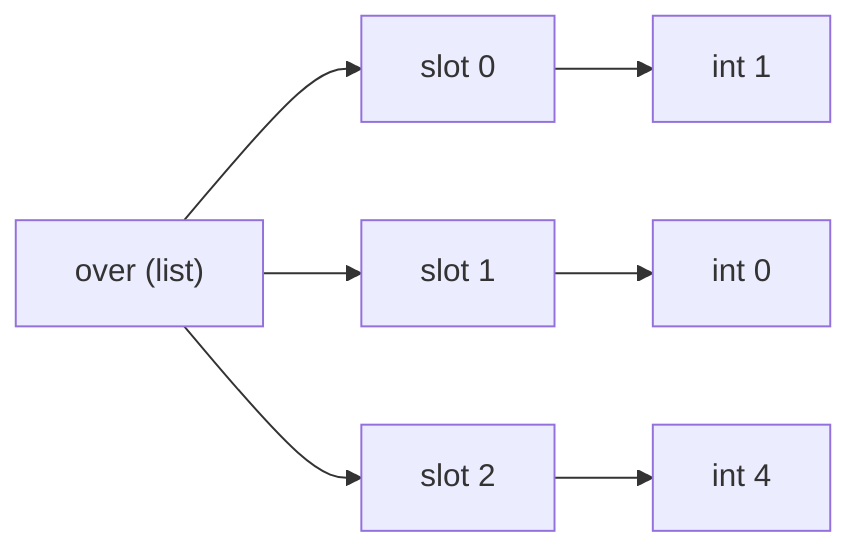

# Lists and Tuples: The Complete Guide

> 📚 **Before you start**
>
> - [Containers and Mutability](../03-core-language-concepts/containers-and-mutability.md), for the first look at lists and tuples, aliasing and copying
> - [for and while Loops](../04-control-flow/for-and-while-loops.md), for looping patterns
> - [Working with Strings](working-with-strings.md), since slicing works the same way on lists

## Introduction

A cricket scorer records every ball of an over: `[1, 0, 4, 0, 6, 1]`. A playlist holds songs in order and lets you add, remove and shuffle them. A to-do app keeps tasks you tick off one by one. All three are **lists**: ordered collections that grow, shrink and change.

Now think of a match result: `("India", "Australia", "2023-11-19", "Ahmedabad")`. Or a GPS point: `(28.6139, 77.2090)`. These are fixed records. Nobody should be able to append a fifth field to a match result or change the latitude of New Delhi halfway through a program. Those are **tuples**.

You've met both briefly. This lesson covers them completely: every list method and when to use it, slicing tricks including slice assignment, sorting with keys, using lists as stacks and queues, unpacking with `*`, tuples as records (and named tuples), and how to choose between the two.

> 💡 **Key Insight**
>
> Choose by **meaning**, not by habit. A **list** is a sequence of *similar things* whose length can change: scores, orders, names. A **tuple** is a *fixed bundle of different things* where position has meaning: (latitude, longitude), (name, age, city). If you'd describe it with "the first one is X, the second is Y", it's a tuple.

---

## Core Explanation

### 1. Creating lists

```python
over = [1, 0, 4, 0, 6, 1]
empty = []
letters = list("chai")                 # from any iterable
evens = list(range(0, 11, 2))
words = "to be or not".split()
matrix = [[1, 2, 3], [4, 5, 6]]        # lists can contain lists

print(over, empty, letters)
print(evens, words)
print(matrix[1][2])                    # row 1, column 2
```

Output:

```
[1, 0, 4, 0, 6, 1] [] ['c', 'h', 'a', 'i']
[0, 2, 4, 6, 8, 10] ['to', 'be', 'or', 'not']
6
```

An **iterable** is anything you can loop over: a string, a range, a list, a set, a dict. `list(iterable)` collects its items into a new list.

A list doesn't contain its items directly; it holds **references** to objects stored elsewhere. That's why a list can hold mixed types and why the same object can appear in two lists:



### 2. Indexing and slicing

Exactly as with strings, with one difference: because lists are mutable, you can **assign** to an index or a slice.

```python
over = [1, 0, 4, 0, 6, 1]
print(over[0], over[-1], over[2:4], over[::-1])

over[1] = 2                  # replace one item
print(over)
```

Output:

```
1 1 [4, 0] [1, 6, 0, 4, 0, 1]
[1, 2, 4, 0, 6, 1]
```

**Slice assignment** replaces a whole section, and the new section can be a different length:

```python
nums = [10, 20, 30, 40, 50]
nums[1:3] = [21, 22, 23, 24]     # replace 2 items with 4
print(nums)
nums[1:5] = []                   # delete a section
print(nums)
nums[1:1] = [15, 16]             # insert without removing anything
print(nums)
```

Output:

```
[10, 21, 22, 23, 24, 40, 50]
[10, 40, 50]
[10, 15, 16, 40, 50]
```

An index past the end is an error (slices, as always, are forgiving):

```python
# not-run: shows an error on purpose
over = [1, 0, 4, 0, 6, 1]
print(over[6])
```

Running it shows:

```
Traceback (most recent call last):
  File "/home/you/python-practice/example.py", line 3, in <module>
    print(over[6])
          ~~~~^^^
IndexError: list index out of range
```

Six items have indexes 0 to 5. The last item is always `over[-1]` or `over[len(over) - 1]`.

### 3. Adding items

| Method | What it does | Example result for `x = [1, 2]` |
|---|---|---|
| `x.append(v)` | add one item at the end | `x.append(3)` → `[1, 2, 3]` |
| `x.extend(iterable)` | add every item from another iterable | `x.extend([3, 4])` → `[1, 2, 3, 4]` |
| `x.insert(i, v)` | insert before position `i` | `x.insert(0, 0)` → `[0, 1, 2]` |
| `x + y` | new list joining both | `x + [3]` → `[1, 2, 3]` (x unchanged) |

The classic mix-up is `append` with a list:

```python
cart = ["rice", "dal"]
cart.append(["salt", "sugar"])     # adds ONE item: a list
print(cart, len(cart))

cart = ["rice", "dal"]
cart.extend(["salt", "sugar"])     # adds each item
print(cart, len(cart))

cart.insert(1, "atta")
print(cart)
```

Output:

```
['rice', 'dal', ['salt', 'sugar']] 3
['rice', 'dal', 'salt', 'sugar'] 4
['rice', 'atta', 'dal', 'salt', 'sugar']
```

### 4. Removing items

| How | Removes | Returns | If missing |
|---|---|---|---|
| `x.remove(v)` | first item **equal to** `v` | `None` | `ValueError` |
| `x.pop()` | last item | the item | `IndexError` if empty |
| `x.pop(i)` | item at position `i` | the item | `IndexError` |
| `del x[i]` or `del x[a:b]` | by position or slice | (statement) | `IndexError` for a bad index |
| `x.clear()` | everything | `None` | |

```python
queue = ["Asha", "Babu", "Charu", "Babu", "Dev"]
queue.remove("Babu")             # only the first Babu
print(queue)

last = queue.pop()
print(last, queue)

first = queue.pop(0)
print(first, queue)

del queue[0]
print(queue)
```

Output:

```
['Asha', 'Charu', 'Babu', 'Dev']
Dev ['Asha', 'Charu', 'Babu']
Asha ['Charu', 'Babu']
['Babu']
```

Removing something that isn't there:

```python
# not-run: shows an error on purpose
queue = ["Asha", "Babu"]
queue.remove("Zoya")
```

Running it shows:

```
Traceback (most recent call last):
  File "/home/you/python-practice/example.py", line 3, in <module>
    queue.remove("Zoya")
    ~~~~~~~~~~~~^^^^^^^^
ValueError: list.remove(x): x not in list
```

Check first with `if "Zoya" in queue:` when absence is normal.

### 5. Finding and counting

```python
over = [1, 0, 4, 0, 6, 1]
print(over.index(4))          # position of the first 4
print(over.count(0))          # how many dot balls
print(6 in over, 5 in over)
print(len(over), sum(over), max(over), min(over))
```

Output:

```
2
2
True False
6 12 6 0
```

`.index()` raises `ValueError` if the item is absent, like `str.index`.

### 6. Sorting

There are two ways, and the difference matters:

- **`x.sort()`** sorts the list **in place** and returns `None`.
- **`sorted(x)`** returns a **new** sorted list and leaves `x` alone. It works on any iterable (tuples, strings, sets, dict keys).

```python
scores = [56, 104, 33, 78]
new_list = sorted(scores)
print(new_list, scores)

scores.sort(reverse=True)
print(scores)

result = scores.sort()        # the classic bug
print(result)
```

Output:

```
[33, 56, 78, 104] [56, 104, 33, 78]
[104, 78, 56, 33]
None
```

#### Sorting with a key

`key=` takes a function that turns each item into the value to sort by. Built-in functions like `len` and `str.lower` work directly:

```python
cities = ["Pune", "delhi", "Kochi", "Ahmedabad", "agra"]
print(sorted(cities))
print(sorted(cities, key=str.lower))
print(sorted(cities, key=len))
```

Output:

```
['Ahmedabad', 'Kochi', 'Pune', 'agra', 'delhi']
['agra', 'Ahmedabad', 'delhi', 'Kochi', 'Pune']
['Pune', 'agra', 'delhi', 'Kochi', 'Ahmedabad']
```

Python's sort is **stable**: items with equal keys keep their original order. That's why `'Pune'` stays before `'agra'` (both have 4 letters) in the last line.

To sort records by a field, give `key` a small function. Here's a preview of `lambda`, a one-line function you'll learn properly in [Lambda, map and Functional Style](../06-functions-and-iterators/lambda-map-and-functional-style.md):

```python
batters = [("Rohit", 56, 41), ("Gill", 104, 98), ("Kohli", 33, 30)]   # (name, runs, balls)
by_runs = sorted(batters, key=lambda b: b[1], reverse=True)
print(by_runs)
by_strike_rate = sorted(batters, key=lambda b: b[1] / b[2], reverse=True)
print(by_strike_rate)
```

Output:

```
[('Gill', 104, 98), ('Rohit', 56, 41), ('Kohli', 33, 30)]
[('Rohit', 56, 41), ('Kohli', 33, 30), ('Gill', 104, 98)]
```

Sorting a list that mixes numbers and strings fails, because Python can't compare them:

```python
# not-run: shows an error on purpose
mixed = [3, "two", 1]
mixed.sort()
```

Running it shows:

```
Traceback (most recent call last):
  File "/home/you/python-practice/example.py", line 3, in <module>
    mixed.sort()
    ~~~~~~~~~~^^
TypeError: '<' not supported between instances of 'str' and 'int'
```

`x.reverse()` reverses in place; `reversed(x)` gives the items in reverse without changing `x`; `x[::-1]` makes a reversed copy.

### 7. Operators on lists

```python
a = [1, 2]
b = [3]
print(a + b)            # new list
print(a * 3)            # repetition
print([1, 2] == [1, 2], [1, 2] == [2, 1])
print([1, 2, 3] < [1, 3])         # compares item by item, like words in a dictionary
print([2] in [[1], [2]])
```

Output:

```
[1, 2, 3]
[1, 2, 1, 2, 1, 2]
True False
True
True
```

### 8. Unpacking, including with *

You can unpack any sequence into names, as long as the counts match:

```python
match = ["India", "Australia", 240, 241]
team1, team2, score1, score2 = match
print(team2, score2)
```

Output:

```
Australia 241
```

A **starred name** collects "everything else" into a list:

```python
first, *middle, last = [10, 20, 30, 40, 50]
print(first, middle, last)

head, *tail = "chai"
print(head, tail)

*_, final_ball = [1, 0, 4, 0, 6, 1]     # _ is a conventional "don't care" name
print(final_ball)
```

Output:

```
10 [20, 30, 40] 50
c ['h', 'a', 'i']
1
```

Mismatched counts are an error:

```python
# not-run: shows an error on purpose
name, age = ["Priya", 29, "Pune"]
```

Running it shows:

```
Traceback (most recent call last):
  File "/home/you/python-practice/example.py", line 2, in <module>
    name, age = ["Priya", 29, "Pune"]
    ^^^^^^^^^
ValueError: too many values to unpack (expected 2)
```

### 9. Lists as stacks and queues

A **stack** is "last in, first out", like a pile of plates: you add and remove at the top. `append` and `pop()` on a list are exactly that, and both are fast:

```python
history = []
history.append("home")
history.append("cart")
history.append("checkout")
print("Back from:", history.pop())
print("Now on:", history[-1])
```

Output:

```
Back from: checkout
Now on: cart
```

A **queue** is "first in, first out", like a ticket counter line. `pop(0)` works but is slow for long lists, because every remaining item shifts left. The standard library's `collections.deque` (pronounced "deck") is built for this:

```python
from collections import deque

counter = deque(["Asha", "Babu"])
counter.append("Charu")            # join the back of the line
print(counter.popleft(), "is served")
print(list(counter))
```

Output:

```
Asha is served
['Babu', 'Charu']
```

### 10. Nested lists

A list of lists is a natural table or grid:

```python
marks = [
    ["Aditi", 78, 91, 85],
    ["Bharat", 64, 70, 58],
    ["Chitra", 88, 79, 94],
]

for name, *subjects in marks:
    print(f"{name:<7} total {sum(subjects):>3}  best {max(subjects)}")

column = []                         # all the first-subject marks
for row in marks:
    column.append(row[1])
print("Subject 1:", column)
```

Output:

```
Aditi   total 254  best 91
Bharat  total 192  best 70
Chitra  total 261  best 94
Subject 1: [78, 64, 88]
```

Remember the `[[0] * 3] * 3` trap and shallow copies from [Containers and Mutability](../03-core-language-concepts/containers-and-mutability.md): nested lists are where aliasing bugs live.

### 11. Tuples in depth

A tuple is an immutable sequence. All the **read-only** list features work on tuples: indexing, slicing, `len`, `in`, `+`, `*`, `count`, `index`, looping, unpacking. Nothing that changes it does.

```python
delhi = (28.6139, 77.2090)
print(delhi[0], len(delhi), delhi + (216,))
print((1, 2, 2, 3).count(2), (1, 2, 3).index(3))
```

Output:

```
28.6139 2 (28.6139, 77.209, 216)
2 2
```

```python
# not-run: shows an error on purpose
delhi = (28.6139, 77.2090)
delhi.append(216)
```

Running it shows:

```
Traceback (most recent call last):
  File "/home/you/python-practice/example.py", line 3, in <module>
    delhi.append(216)
    ^^^^^^^^^^^^
AttributeError: 'tuple' object has no attribute 'append'
```

#### Packing and the comma

It's the **comma** that makes a tuple, not the brackets. Brackets are only needed when the tuple would otherwise be ambiguous (an empty tuple, or inside a function call):

```python
t = 1, 2, 3            # packing
print(t, type(t))
one = (5,)
not_tuple = (5)
print(type(one), type(not_tuple))
print(type(()))
```

Output:

```
(1, 2, 3) <class 'tuple'>
<class 'tuple'> <class 'int'>
<class 'tuple'>
```

You've used tuples without noticing: `a, b = b, a` packs the right side into a tuple and unpacks it on the left; `for name, price in menu.items()` unpacks tuples; `divmod(17, 5)` returns one.

#### Why tuples exist

1. **Safety**: a record that can't be changed by accident.
2. **Hashability**: tuples of immutable values can be dict keys and set items; lists can't.
3. **Meaning**: a tuple signals "fixed structure".
4. **Efficiency**: tuples are a little smaller and faster to create.

```python
import sys
print(sys.getsizeof([1, 2, 3]), sys.getsizeof((1, 2, 3)))
```

Output:

```
88 64
```

(Sizes in bytes on a typical 64-bit system; they can differ slightly between Python versions.)

#### Named tuples: records with field names

`point[0]` and `point[1]` don't say much. `collections.namedtuple` creates a tuple type whose fields also have names:

```python
from collections import namedtuple

Station = namedtuple("Station", ["code", "name", "zone"])
ndls = Station("NDLS", "New Delhi", "NR")
csmt = Station(code="CSMT", name="Mumbai CSMT", zone="CR")

print(ndls.name, csmt.zone)
print(ndls[0])                     # still works by position
print(ndls)
code, name, zone = csmt            # and unpacks like any tuple
print(code)
```

Output:

```
New Delhi CR
NDLS
Station(code='NDLS', name='New Delhi', zone='NR')
CSMT
```

Named tuples are immutable like regular tuples. For richer records with methods, you'll use classes and dataclasses in [Advanced Python Programming](../course.md#m7).

### 12. List or tuple?

| Question | List | Tuple |
|---|---|---|
| Will items be added, removed or changed? | ✅ | |
| Is it a collection of similar things of any length? | ✅ | |
| Is it a fixed record where position has meaning? | | ✅ |
| Must it be a dict key or set item? | | ✅ |
| Should accidental changes be impossible? | | ✅ |

---

## Try It Yourself

1. Given `over = [1, 0, 4, 0, 6, 1]`, print the number of boundaries (4s and 6s) and the total runs, then replace the last ball with a wicket marked `"W"`.
2. A playlist: start with `["Kesariya", "Tum Hi Ho"]`. Add `"Chaiyya Chaiyya"` at the start, add `["Jai Ho", "Naatu Naatu"]` at the end, remove `"Tum Hi Ho"`, and print the final list and its length.
3. Sort `products = [("Mouse", 599), ("Keyboard", 1299), ("Cable", 199)]` by price, highest first, and print just the names.
4. Use star-unpacking to split `"Rahul Kumar Sharma"` into a first name and the rest.

<details>
<summary>Show answers</summary>

```python
over = [1, 0, 4, 0, 6, 1]
boundaries = over.count(4) + over.count(6)
print(boundaries, sum(over))
over[-1] = "W"
print(over)

playlist = ["Kesariya", "Tum Hi Ho"]
playlist.insert(0, "Chaiyya Chaiyya")
playlist.extend(["Jai Ho", "Naatu Naatu"])
playlist.remove("Tum Hi Ho")
print(playlist, len(playlist))

products = [("Mouse", 599), ("Keyboard", 1299), ("Cable", 199)]
for name, price in sorted(products, key=lambda p: p[1], reverse=True):
    print(name)

first, *rest = "Rahul Kumar Sharma".split()
print(first, rest)
```

Output:

```
2 12
[1, 0, 4, 0, 6, 'W']
['Chaiyya Chaiyya', 'Kesariya', 'Jai Ho', 'Naatu Naatu'] 4
Keyboard
Mouse
Cable
Rahul ['Kumar', 'Sharma']
```

</details>

---

## Real-World Examples

### Example 1: An undo button

Text editors keep a stack of previous states: each edit `append`s a snapshot, and Ctrl + Z `pop`s the latest. A second stack holds what you undid, for redo.

### Example 2: Leaderboards

A quiz app keeps `(name, score, time_taken)` tuples and sorts with `key=lambda r: (-r[1], r[2])`: highest score first, and for equal scores, the faster player first. Sorting by a tuple compares the first element, then the second to break ties.

### Example 3: Database rows

When Python reads rows from a database (you'll do this with SQLite and PostgreSQL in [Databases: SQL and NoSQL](../../databases-sql-and-nosql/course.md)), each row typically arrives as a **tuple** and the result set as a **list** of tuples: a fixed record per row, a growable collection of rows.

---

## Common Misconceptions

### Misconception 1: "`x = x.sort()` gives me a sorted list"

`sort()` returns `None`, so `x` becomes `None`. Use `x.sort()` alone, or `x = sorted(x)`.

### Misconception 2: "`append` and `extend` are the same"

`append` adds its argument as **one** item (even if it's a list). `extend` adds each item from the iterable.

### Misconception 3: "`remove(i)` removes the item at index i"

`remove` removes by **value**. To remove by position, use `pop(i)` or `del x[i]`.

### Misconception 4: "Brackets make a tuple"

Commas make a tuple. `(5)` is just the number 5; `(5,)` and `5,` are tuples.

### Misconception 5: "Tuples are just slower-to-use lists"

They're a different tool: fixed, hashable records. Using a tuple communicates intent and prevents accidental modification.

---

## Interview Relevance

Lists are in nearly every coding problem; tuples come up in "list vs tuple" theory questions. Prepare:

- **List vs tuple**: mutability, hashability, use cases, memory.
- **Method behaviour**: `append` vs `extend`, `remove` vs `pop` vs `del`, `sort()` vs `sorted()`, what each returns.
- **Time complexity**: index access and `append`/`pop()` at the end are O(1); `insert(0, x)`, `pop(0)` and `in` are O(n); `sort` is O(n log n). Use `deque` for queues.
- **Slicing** and slice assignment, `[::-1]`, copying with `[:]`.
- **Sorting** with `key`, `reverse`, stability, and multi-key sorts with tuples.
- **Problems:** remove duplicates keeping order, rotate a list, merge two sorted lists, find the second largest, flatten a nested list, move zeros to the end.

---

## Key Takeaways

- **Lists** are mutable ordered sequences: add with `append`/`extend`/`insert`, remove with `remove`/`pop`/`del`, change by index or **slice assignment**.
- **`x.sort()` changes the list and returns `None`; `sorted(x)` returns a new list.** Both accept `key=` and `reverse=`, and sorting is stable.
- **Unpack** sequences into names, with `*rest` to collect the remainder. Use lists as **stacks**; use `deque` for **queues**.
- **Tuples** are immutable, hashable (when their items are), and made by **commas**. Use them for fixed records; use **`namedtuple`** to give fields names.
- **Choose by meaning**: a growing collection of similar things → list; a fixed bundle where position matters → tuple.

---

**Up next:** [Sets](sets.md)
