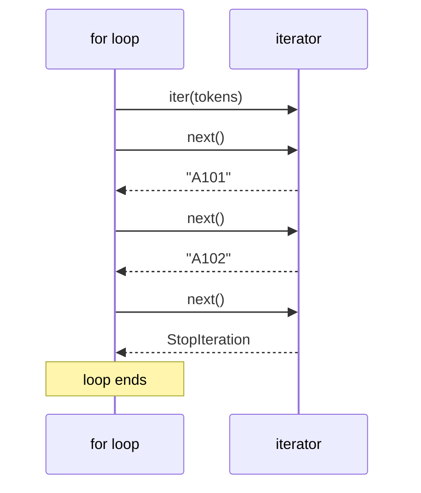
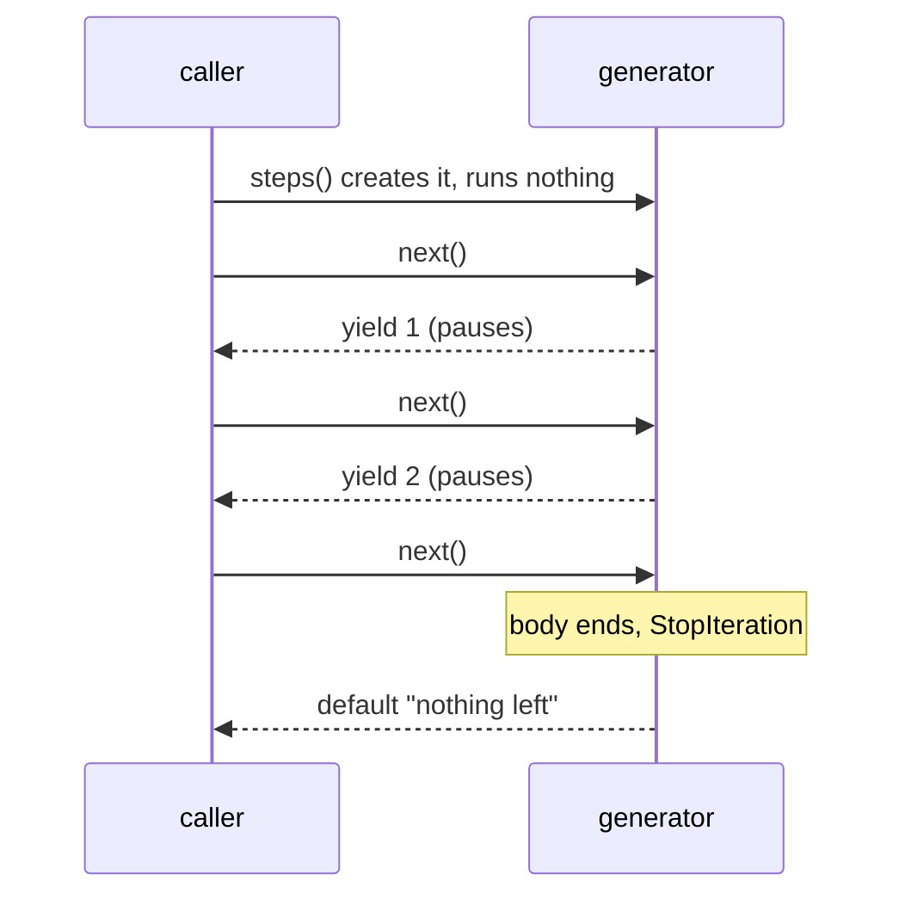
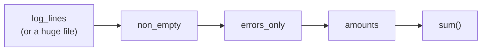

# Iterators and Generators: The Complete Guide

> 📚 **Before you start**
>
> - [Functions and Parameter Passing](functions-and-parameter-passing.md), for `def`, `return` and the call stack
> - [for and while Loops](../04-control-flow/for-and-while-loops.md) and [break, continue and range()](../04-control-flow/break-continue-and-range.md), including why `range` is lazy
> - [List and Dictionary Comprehensions](../05-strings-and-data-structures/list-and-dictionary-comprehensions.md), for generator expressions

## Introduction

At a busy railway station, the token machine at the ticket counter doesn't print all 2,000 tokens for the day at 6 a.m. It prints **one token when the next person presses the button**. It only needs to remember one thing: the last number it gave out. Whether 20 people come or 20,000, the machine is the same size.

Python works the same way whenever you loop. A `for` loop doesn't need the whole collection at once; it asks for **the next item**, again and again, until there are none left. Objects that hand out items one at a time like this are called **iterators**, and the functions that create them most easily are called **generators**.

This matters for two reasons. First, it explains how `for` really works, which demystifies `range`, `zip`, `enumerate`, dict views and files. Second, generators let you process data that's **too big to fit in memory**, or even endless, with almost no memory at all: a 10 GB log file, a stream of sensor readings, every prime number.

By the end of this lesson you'll understand the iteration protocol (`iter` and `next`), the difference between an iterable and an iterator, how to write generator functions with `yield`, how to chain generators into memory-efficient pipelines, and the most useful tools in the `itertools` module.

> 💡 **Key Insight**
>
> A list **stores** all its values. A generator **produces** its values on demand, pausing at each `yield` and resuming exactly where it left off when the next value is requested. So a generator costs the same tiny amount of memory for ten items or ten billion. The price: it can only be walked **once**, forwards, and you can't index it or ask its length.

---

## Core Explanation

### 1. Iterables and iterators

Two words that sound alike but mean different things:

- An **iterable** is anything you can loop over: lists, tuples, strings, sets, dicts, ranges, files. Technically, it's any object you can pass to `iter()` to get an iterator.
- An **iterator** is the object that actually **hands out the items, one at a time**, and remembers where it's up to. You get the next item by calling `next()` on it.

```python
tokens = ["A101", "A102", "A103"]       # an iterable
it = iter(tokens)                        # ask it for an iterator

print(next(it))
print(next(it))
print(next(it))
```

Output:

```
A101
A102
A103
```

When an iterator runs out, `next()` raises `StopIteration`:

```python
# not-run: shows an error on purpose
tokens = ["A101", "A102"]
it = iter(tokens)
next(it)
next(it)
next(it)
```

Running it shows:

```
Traceback (most recent call last):
  File "/home/you/python-practice/example.py", line 6, in <module>
    next(it)
    ~~~~^^^^
StopIteration
```

`next()` can take a default to return instead of raising: `next(it, None)`.

### 2. What a for loop really does

A `for` loop is this protocol, automated:

1. Call `iter()` on the thing you're looping over, to get an iterator.
2. Call `next()` on the iterator, bind the result to the loop variable, run the body.
3. Repeat step 2 until `StopIteration`, which the loop catches quietly and then ends.



Here's the same thing written by hand. It uses `try`/`except`, which catches an error instead of letting it stop the program; you'll learn it properly in [Advanced Python Programming](../course.md#m9), but the idea is readable:

```python
tokens = ["A101", "A102", "A103"]
it = iter(tokens)
while True:
    try:
        token = next(it)
    except StopIteration:
        break
    print("Serving", token)
```

Output:

```
Serving A101
Serving A102
Serving A103
```

That's exactly what `for token in tokens:` does for you.

### 3. Iterators are used up; iterables are not

A list can be looped over again and again, because each `for` loop calls `iter()` and gets a **fresh** iterator starting at the beginning. An **iterator itself** only goes forward once:

```python
nums = [1, 2, 3]
print(sum(nums), sum(nums))       # a list: fine twice

it = iter(nums)
print(sum(it), sum(it))           # an iterator: empty the second time
```

Output:

```
6 6
6 0
```

Several built-ins return **iterators**, not lists, so they behave like `it` above: `zip`, `enumerate`, `map`, `filter`, `reversed`, and generator expressions.

```python
pairs = zip(["a", "b"], [1, 2])
print(list(pairs))
print(list(pairs))                # already used up
```

Output:

```
[('a', 1), ('b', 2)]
[]
```

`range` is different: it's an iterable (like a list, it can make fresh iterators), but lazy (like an iterator, it doesn't store values). If you need to loop over a `zip` or `map` result twice, convert it to a list first.

| Object | Iterable? | Iterator (single-use)? | Stores all items? |
|---|---|---|---|
| list, tuple, str, dict, set | ✅ | | ✅ |
| `range(...)` | ✅ | | (computes them) |
| `zip`, `enumerate`, `map`, `filter`, `reversed` | ✅ | ✅ | |
| generator, generator expression | ✅ | ✅ | |
| open file | ✅ | ✅ | (reads as you go) |

### 4. Generator functions and yield

Writing an iterator by hand is possible (with a class, which you'll learn in [Advanced Python Programming](../course.md#m7)), but there's a much easier way. Any function that contains the keyword **`yield`** is a **generator function**. Calling it doesn't run the body; it returns a **generator object**, which is an iterator.

```python
def token_machine(prefix, start, count):
    number = start
    for _ in range(count):
        yield f"{prefix}{number}"
        number += 1

machine = token_machine("B", 201, 3)
print(type(machine))
print(next(machine))
print(next(machine))
for token in machine:            # continues from where next() left off
    print("Loop got", token)
```

Output:

```
<class 'generator'>
B201
B202
Loop got B203
```

Printing `machine` itself would show something like `<generator object token_machine at 0x7f...>`; the hexadecimal part is a memory address and changes on every run.

What `yield` does:

- It **hands a value out** to whoever called `next()`, like `return`.
- But instead of ending the function, it **pauses** it, keeping all local variables (`number`, the loop position) intact.
- The next `next()` call **resumes** right after the `yield`.
- When the function body finishes (or hits `return`), the generator raises `StopIteration`, and any `for` loop over it ends.

### 5. Watching a generator pause and resume

Print statements make the interleaving visible:

```python
def steps():
    print("  [gen] starting")
    yield 1
    print("  [gen] resumed after 1")
    yield 2
    print("  [gen] resumed after 2, finishing")

gen = steps()
print("created, nothing run yet")
print("got", next(gen))
print("got", next(gen))
print("got", next(gen, "nothing left"))
```

Output:

```
created, nothing run yet
  [gen] starting
got 1
  [gen] resumed after 1
got 2
  [gen] resumed after 2, finishing
got nothing left
```



The body ran **in slices**, one slice per `next()` call. That's the whole trick.

### 6. Laziness and memory

Compare a list-building function with a generator for the same values:

```python
import sys

def squares_list(n):
    result = []
    for i in range(n):
        result.append(i * i)
    return result

def squares_gen(n):
    for i in range(n):
        yield i * i

big_list = squares_list(1_000_000)
big_gen = squares_gen(1_000_000)

print(sys.getsizeof(big_list) > 8_000_000)
print(sys.getsizeof(big_gen) < 1_000)
print(sum(big_list) == sum(big_gen))
```

Output:

```
True
True
True
```

The list holds a million references (about 8 MB just for the list, plus the integer objects). The generator is a few hundred bytes, however large `n` is. Both give the same sum. When you only need to go through the values once, in order, a generator is the better choice.

### 7. Infinite generators

Because a generator only produces values when asked, it can describe an **endless** sequence. The caller decides when to stop:

```python
def fibonacci():
    a, b = 0, 1
    while True:
        yield a
        a, b = b, a + b

for n in fibonacci():
    if n > 100:
        break
    print(n, end=" ")
print()
```

Output:

```
0 1 1 2 3 5 8 13 21 34 55 89
```

`while True` inside a generator is safe, because each `yield` hands control back. Looping over it without a `break` (or calling `list()` on it) would run forever, so infinite generators are always paired with something that limits them, such as `itertools.islice`:

```python
from itertools import islice

print(list(islice(fibonacci(), 10)))          # the first 10 values
print(list(islice(fibonacci(), 10, 15)))      # values 10 to 14
```

Output:

```
[0, 1, 1, 2, 3, 5, 8, 13, 21, 34]
[55, 89, 144, 233, 377]
```

### 8. Generator pipelines

Generators can feed each other, each stage taking an iterable and yielding transformed items. Values flow through the whole pipeline **one at a time**, so the memory used doesn't depend on how much data there is. This is how you'd process a log file of millions of lines.

```python
log_lines = [
    "2026-10-11 09:00:01 INFO  payment ok order=101 amount=499",
    "2026-10-11 09:00:03 ERROR payment failed order=102 amount=1299",
    "",
    "2026-10-11 09:00:07 INFO  payment ok order=103 amount=89",
    "2026-10-11 09:00:09 ERROR payment failed order=104 amount=2500",
]

def non_empty(lines):
    for line in lines:
        if line.strip():
            yield line

def errors_only(lines):
    for line in lines:
        if " ERROR " in line:
            yield line

def amounts(lines):
    for line in lines:
        for part in line.split():
            if part.startswith("amount="):
                yield int(part.removeprefix("amount="))

pipeline = amounts(errors_only(non_empty(log_lines)))
print("Failed payment total:", sum(pipeline))
```

Output:

```
Failed payment total: 3799
```



`sum()` pulls one value from `amounts`, which pulls from `errors_only`, which pulls from `non_empty`, which pulls one line. Nothing is computed until `sum` asks, and no stage ever holds more than one line. Replace `log_lines` with an open file (files are iterators over their lines) and the same pipeline handles gigabytes.

The same pipeline with generator expressions is shorter, and just as lazy:

```python
lines = (l for l in log_lines if l.strip())
errors = (l for l in lines if " ERROR " in l)
values = (int(p.removeprefix("amount=")) for l in errors for p in l.split() if p.startswith("amount="))
print(sum(values))
```

Output:

```
3799
```

Use generator functions when a stage needs several lines of logic; generator expressions for one-liners.

### 9. yield from

`yield from iterable` yields every item from another iterable, a shortcut for `for x in iterable: yield x`. It's handy for flattening and for delegating to another generator:

```python
def all_stations():
    yield from ["Mumbai", "Surat"]
    yield "Vadodara"
    yield from ("Kota", "New Delhi")

print(list(all_stations()))

def flatten(nested):
    for item in nested:
        if isinstance(item, list):
            yield from flatten(item)       # recursion + yield from
        else:
            yield item

print(list(flatten([1, [2, [3, 4]], [], 5])))
```

Output:

```
['Mumbai', 'Surat', 'Vadodara', 'Kota', 'New Delhi']
[1, 2, 3, 4, 5]
```

### 10. return inside a generator

A plain `return` in a generator just ends it early (raising `StopIteration` for the caller). It's a clean way to stop on a condition:

```python
def until_blank(lines):
    for line in lines:
        if not line.strip():
            return                # stop at the first blank line
        yield line

print(list(until_blank(["header", "row 1", "", "footer"])))
```

Output:

```
['header', 'row 1']
```

### 11. Things you can't do with a generator

Generators don't know their length and can't jump to a position:

```python
# not-run: shows an error on purpose
def squares_gen(n):
    for i in range(n):
        yield i * i

gen = squares_gen(5)
print(len(gen))
```

Running it shows:

```
Traceback (most recent call last):
  File "/home/you/python-practice/example.py", line 7, in <module>
    print(len(gen))
          ~~~^^^^^
TypeError: object of type 'generator' has no len()
```

```python
# not-run: shows an error on purpose
def squares_gen(n):
    for i in range(n):
        yield i * i

gen = squares_gen(5)
print(gen[2])
```

Running it shows:

```
Traceback (most recent call last):
  File "/home/you/python-practice/example.py", line 7, in <module>
    print(gen[2])
          ~~~^^^
TypeError: 'generator' object is not subscriptable
```

If you need `len`, indexing or several passes, make a list: `values = list(gen)`. That's the right choice when the data fits comfortably in memory.

### 12. The itertools toolbox

The standard library's `itertools` module has fast, lazy building blocks for working with iterators. The most useful ones:

```python
import itertools as it

print(list(it.islice(it.count(100, 5), 4)))          # count from 100 in steps of 5
print(list(it.islice(it.cycle(["R", "Y", "G"]), 7)))  # repeat a sequence forever
print(list(it.chain([1, 2], (3, 4), "ab")))           # join iterables end to end
print(list(it.accumulate([500, 200, -300, 100])))     # running totals
print(list(it.pairwise([31, 33, 32, 36])))            # neighbouring pairs
print(list(it.batched(range(1, 8), 3)))               # chunks of 3 (Python 3.12+)
```

Output:

```
[100, 105, 110, 115]
['R', 'Y', 'G', 'R', 'Y', 'G', 'R']
[1, 2, 3, 4, 'a', 'b']
[500, 700, 400, 500]
[(31, 33), (33, 32), (32, 36)]
[(1, 2, 3), (4, 5, 6), (7,)]
```

Combinatorics, for "all possible ..." questions:

```python
sizes, colours = ["S", "M"], ["red", "blue"]
print(list(it.product(sizes, colours)))              # every combination, like nested loops
print(list(it.combinations(["CSK", "MI", "RCB"], 2)))  # pairs, order doesn't matter
print(len(list(it.permutations("ABCD", 2))))          # ordered pairs
```

Output:

```
[('S', 'red'), ('S', 'blue'), ('M', 'red'), ('M', 'blue')]
[('CSK', 'MI'), ('CSK', 'RCB'), ('MI', 'RCB')]
12
```

`groupby` groups **consecutive** items with the same key, so sort first:

```python
orders = [("Pune", 499), ("Delhi", 1299), ("Pune", 89), ("Delhi", 250), ("Goa", 999)]
orders.sort(key=lambda o: o[0])
for city, group in it.groupby(orders, key=lambda o: o[0]):
    amounts = [amount for _, amount in group]
    print(city, amounts, sum(amounts))
```

Output:

```
Delhi [1299, 250] 1549
Goa [999] 999
Pune [499, 89] 588
```

| Tool | Gives you |
|---|---|
| `count(start, step)` | endless numbers |
| `cycle(iterable)` | the items, repeated forever |
| `repeat(x, n)` | `x`, `n` times (or forever) |
| `islice(it, stop)` / `islice(it, start, stop)` | a slice of any iterator |
| `chain(a, b, ...)` | items of `a`, then `b`, ... |
| `accumulate(it)` | running totals (or any running operation) |
| `pairwise(it)` | `(x0, x1), (x1, x2), ...` |
| `batched(it, n)` | tuples of up to `n` items (3.12+) |
| `product`, `combinations`, `permutations` | combinatorics |
| `groupby(it, key)` | runs of consecutive items with the same key |

### 13. When to use what

| Situation | Use |
|---|---|
| Small data, need indexing, `len`, several passes | a **list** |
| One pass over large or endless data | a **generator** |
| Simple one-line transformation feeding `sum`/`max`/`join` | a **generator expression** |
| Several-step processing of a stream (files, logs, API pages) | a **pipeline of generator functions** |

---

## Try It Yourself

1. Write a generator `countdown(n)` that yields `n, n-1, ..., 1`. Print `list(countdown(5))`.
2. Write an infinite generator `even_numbers()` and use `islice` to print the first 6 even numbers starting from 0.
3. Create `z = zip("ab", [1, 2])`. Call `list(z)` twice. Explain the second result.
4. Write a generator `read_chunks(items, size)` that yields lists of `size` items at a time (the last chunk may be smaller). Test it on `range(1, 11)` with size 4. Then do the same with `itertools.batched`.

<details>
<summary>Show answers</summary>

```python
def countdown(n):
    while n > 0:
        yield n
        n -= 1

print(list(countdown(5)))

def even_numbers():
    n = 0
    while True:
        yield n
        n += 2

print(list(islice(even_numbers(), 6)))

z = zip("ab", [1, 2])
print(list(z), list(z))

def read_chunks(items, size):
    chunk = []
    for item in items:
        chunk.append(item)
        if len(chunk) == size:
            yield chunk
            chunk = []
    if chunk:
        yield chunk

print(list(read_chunks(range(1, 11), 4)))
print(list(it.batched(range(1, 11), 4)))
```

Output:

```
[5, 4, 3, 2, 1]
[0, 2, 4, 6, 8, 10]
[('a', 1), ('b', 2)] []
[[1, 2, 3, 4], [5, 6, 7, 8], [9, 10]]
[(1, 2, 3, 4), (5, 6, 7, 8), (9, 10)]
```

`zip` returns an iterator, which the first `list()` used up. `batched` yields tuples where our version yields lists.

</details>

---

## Real-World Examples

### Example 1: Processing huge files

A data engineer needs the total of failed payments from a 20 GB log. `sum(amounts(errors_only(open("payments.log"))))` reads one line at a time. Memory use stays at a few kilobytes, and the job finishes on a laptop that has far less than 20 GB of RAM.

### Example 2: Paging through an API

An app fetches orders from an API that returns 100 at a time. A generator function hides the paging: it fetches page 1, `yield`s each order, fetches page 2 when needed, and stops when a page is empty. The rest of the code just writes `for order in all_orders(): ...`.

### Example 3: Streaming AI responses

When a chat app shows an LLM's answer appearing word by word, the client library is giving you a **generator** (or its async cousin) of text chunks. `for chunk in stream: print(chunk, end="")` displays each piece as it arrives instead of waiting for the full answer. You'll use this in [LangChain Complete Guide](../../langchain-complete-guide/course.md).

---

## Common Misconceptions

### Misconception 1: "Calling a generator function runs it"

It only creates a generator object. The body runs, slice by slice, as values are requested.

### Misconception 2: "A generator can be reused"

Once exhausted, it stays empty. Call the generator function again to get a fresh one, or store the values in a list.

### Misconception 3: "range, zip and map are all the same kind of thing"

`range` is a lazy **iterable** you can loop over many times. `zip`, `map`, `enumerate` and `filter` return single-use **iterators**.

### Misconception 4: "Generators are always faster"

They save **memory**. For small data that you'll reuse or index, a list is simpler and often just as fast or faster.

### Misconception 5: "yield is just another return"

`return` ends the function for good. `yield` pauses it, keeping its state, so it can produce many values over time.

---

## Interview Relevance

Iterators and generators are a standard "intermediate Python" interview topic. Be ready to:

- **Define** iterable vs iterator, and describe the protocol: `iter()`, `next()`, `StopIteration`, and how `for` uses them.
- **Explain `yield`**: pausing, preserved state, lazy evaluation, single pass.
- **Compare** list comprehensions with generator expressions in memory and reusability.
- **Write** generators: Fibonacci, chunking a list, reading a big file line by line, a pipeline of filters.
- **Use itertools**: `islice`, `chain`, `groupby` (and why it needs sorted input), `product`, `combinations`.
- **Know the pitfalls**: exhausted iterators returning nothing, no `len()`/indexing on generators.

---

## Key Takeaways

- An **iterable** can produce an iterator with `iter()`; an **iterator** hands out items with `next()` and raises **`StopIteration`** when done. **`for` loops** use exactly this.
- **Iterators are single-use**: `zip`, `map`, `enumerate`, generators. Lists and ranges can be looped over many times.
- A function with **`yield`** is a **generator function**: calling it returns a generator that **pauses and resumes**, producing values lazily.
- Generators use **tiny, constant memory** and can be **infinite**; chain them into **pipelines** to stream large data.
- **`itertools`** (`islice`, `chain`, `accumulate`, `groupby`, `batched`, `product`...) provides fast building blocks; use a **list** when you need `len`, indexing or several passes.

---

**Up next:** [Lambda, map and Functional Style](lambda-map-and-functional-style.md)
