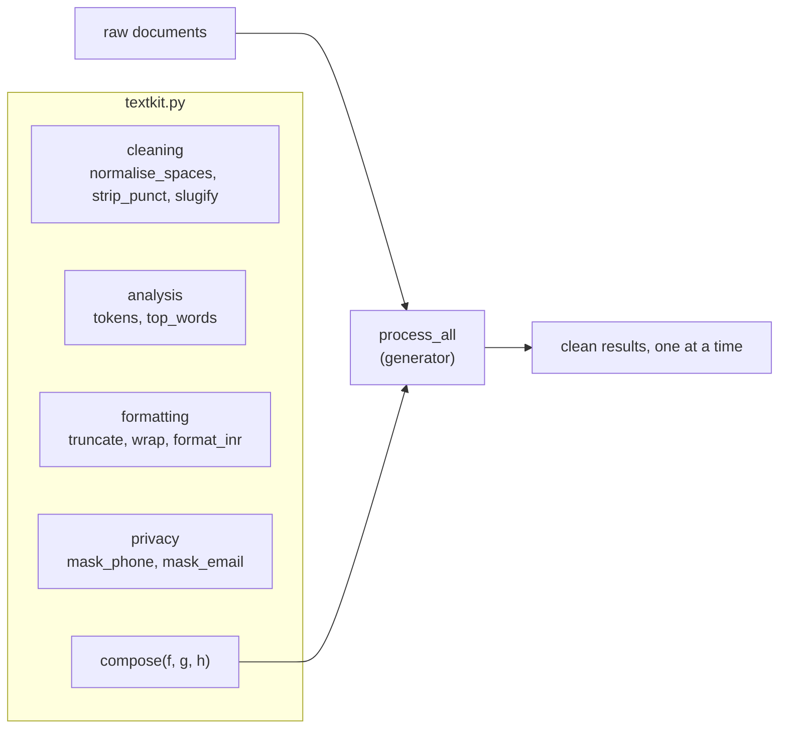

# Lab: Build a Tiny Text-Processing Toolkit

> 📚 **Before you start**
>
> - [Functions and Parameter Passing](functions-and-parameter-passing.md)
> - [Iterators and Generators](iterators-and-generators.md)
> - [Lambda, map and Functional Style](lambda-map-and-functional-style.md)
> - [Working with Strings](../05-strings-and-data-structures/working-with-strings.md) and the [Word frequency counter lab](../05-strings-and-data-structures/lab-word-frequency-counter.md)

## What You'll Build

A small library of reusable text functions, `textkit.py`, the kind of helper module every real project grows. It will:

- **clean** text: collapse whitespace, strip punctuation, make URL slugs,
- **analyse** it: a lazy word tokenizer and a top-words function,
- **format** it: truncate, word-wrap, and write rupee amounts the Indian way (`₹1,23,45,678.50`),
- **protect** it: mask phone numbers and emails,
- **combine** any of the above into **pipelines** with a `compose` function,
- **stream** many documents through a pipeline with a generator,
- and **test itself** with `assert` statements.



> 💡 **Key Insight**
>
> Build **small pure functions** that each do one thing and take a string in and give a string out. Because they all have the same shape, they snap together like Lego: `compose(normalise_spaces, mask_phone, truncate)` is a new tool you didn't have to write. That's the payoff of everything in this module.

Put every step's code in one file, `textkit.py`, in order.

---

## Step 1: Cleaning Functions

Three functions, each with a docstring, each returning a new string and touching nothing else.

```python
import string

def normalise_spaces(text):
    """Collapse runs of whitespace into single spaces and trim the ends."""
    return " ".join(text.split())

def strip_punct(text, keep=""):
    """Remove ASCII punctuation, except any characters listed in keep."""
    to_remove = "".join(ch for ch in string.punctuation if ch not in keep)
    return text.translate(str.maketrans("", "", to_remove))

def slugify(text):
    """Turn a title into a URL-friendly slug: lowercase words joined by hyphens."""
    cleaned = strip_punct(text.lower(), keep="-")
    return "-".join(cleaned.replace("-", " ").split())

print(repr(normalise_spaces("  Namaste \n\t  India  ")))
print(strip_punct("Wow!!! Price: ₹499 (incl. GST)."))
print(strip_punct("It's 9:30 a.m.", keep="':"))
print(slugify("Top 10 Places to Visit in Kerala -- Monsoon Edition!"))
```

Output:

```
'Namaste India'
Wow Price ₹499 incl GST
It's 9:30 am
top-10-places-to-visit-in-kerala-monsoon-edition
```

Notice how `slugify` **reuses** `strip_punct`. Small functions build bigger ones. The `keep` parameter has a default, so most callers never need to think about it.

---

## Step 2: A Lazy Tokenizer and top_words

A **tokenizer** splits text into words (**tokens**). We'll make it a **generator**, so it can process a whole book without building a giant list, and give `top_words` keyword-only options.

```python
from collections import Counter

STOP_WORDS = frozenset({"a", "an", "and", "the", "is", "in", "of", "to", "for", "it", "on"})

def tokens(text, *, lower=True):
    """Yield the words of text one at a time, without punctuation."""
    if lower:
        text = text.lower()
    for word in strip_punct(text, keep="'").split():
        word = word.strip("'")
        if word:
            yield word

def top_words(text, n=3, *, stop_words=STOP_WORDS):
    """Return the n most common words as (word, count) pairs, ties broken alphabetically."""
    counts = Counter(w for w in tokens(text) if w not in stop_words)
    return sorted(counts.items(), key=lambda pair: (-pair[1], pair[0]))[:n]

review = "The dosa was crisp, the chutney was fresh, and the filter coffee was the best in Chennai. Dosa again tomorrow!"
print(list(tokens("Don't stop. 'Quoted' words!")))
print(top_words(review))
print(top_words(review, 2, stop_words=frozenset()))
```

Output:

```
["don't", 'stop', 'quoted', 'words']
[('was', 3), ('dosa', 2), ('again', 1)]
[('the', 4), ('was', 3)]
```

`STOP_WORDS` is a **frozenset**: it's used as a default argument, and an immutable default can never be changed by accident (recall the mutable default trap from [Functions and Parameter Passing](functions-and-parameter-passing.md)).

---

## Step 3: Formatting Functions

### Truncate

```python
def truncate(text, width=30, *, suffix="…"):
    """Shorten text to at most width characters, ending with suffix if cut."""
    if len(text) <= width:
        return text
    cut = text[: width - len(suffix)].rstrip()
    return cut + suffix

headline = "Heavy rain expected across coastal Karnataka and Goa this weekend"
print(truncate(headline))
print(truncate(headline, 45, suffix="..."))
print(truncate("Short title"))
```

Output:

```
Heavy rain expected across co…
Heavy rain expected across coastal Karnata...
Short title
```

### Word wrap

Wrapping means breaking text into lines no longer than a width, without splitting words. A generator that yields one line at a time fits naturally:

```python
def wrap(text, width=40):
    """Yield lines of at most width characters, breaking only between words."""
    line = ""
    for word in text.split():
        if line and len(line) + 1 + len(word) > width:
            yield line
            line = word
        else:
            line = f"{line} {word}" if line else word
    if line:
        yield line

notice = ("Passengers are requested to keep their belongings safe. Platform 4 "
          "will be closed for maintenance from 11 pm to 4 am on Sunday night.")
for line in wrap(notice, 32):
    print(f"| {line:<32} |")
```

Output:

```
| Passengers are requested to keep |
| their belongings safe. Platform  |
| 4 will be closed for maintenance |
| from 11 pm to 4 am on Sunday     |
| night.                           |
```

(Python's standard library has a full-featured `textwrap` module; writing a simple version yourself is a classic exercise in loop logic.)

### Rupees, the Indian way

The f-string `,` separator groups digits in thousands: `12,345,678`. Indian notation groups the **last three** digits, then **every two**: `1,23,45,678` (1 crore, 23 lakh, 45 thousand, 678). Let's write `format_inr`:

```python
def format_inr(amount, *, symbol="₹", decimals=2):
    """Format a number with Indian digit grouping, e.g. 12345678.5 -> ₹1,23,45,678.50."""
    sign = "-" if amount < 0 else ""
    whole, _, fraction = f"{abs(amount):.{decimals}f}".partition(".")
    last_three, rest = whole[-3:], whole[:-3]
    groups = []
    while rest:
        groups.insert(0, rest[-2:])        # take two digits at a time from the right
        rest = rest[:-2]
    grouped = ",".join(groups + [last_three])
    return f"{sign}{symbol}{grouped}" + (f".{fraction}" if decimals else "")

for value in [0, 999, 1000, 100000, 12345678.5, 1_00_00_00_000, -4520.75]:
    print(f"{value!r:>14} -> {format_inr(value)}")
print(format_inr(250000, decimals=0))
```

Output:

```
             0 -> ₹0.00
           999 -> ₹999.00
          1000 -> ₹1,000.00
        100000 -> ₹1,00,000.00
    12345678.5 -> ₹1,23,45,678.50
    1000000000 -> ₹1,00,00,00,000.00
      -4520.75 -> -₹4,520.75
₹2,50,000
```

A few design choices worth noticing: the sign is handled separately so grouping only deals with digits; `partition(".")` splits the formatted number into whole and fraction parts; the `while` loop peels two digits at a time off the remaining part. `decimals` and `symbol` are keyword-only, so a call like `format_inr(5, 0)` can't happen by accident.

---

## Step 4: Privacy Functions

Before logging or sharing text, it's good practice to hide personal details. These work word by word, so they don't need regular expressions (which you'll learn later and which are the more robust tool).

```python
def mask_phone(text):
    """Replace 10-digit Indian mobile numbers (optionally with +91) with a masked form."""
    out = []
    for word in text.split(" "):
        core = word.strip(".,;:!?()")
        digits = core.removeprefix("+91").replace("-", "")
        if len(digits) == 10 and digits.isdigit() and digits[0] in "6789":
            word = word.replace(core, "XXXXXX" + digits[-4:])
        out.append(word)
    return " ".join(out)

def mask_email(text):
    """Hide all but the first letter of the user part of email addresses."""
    out = []
    for word in text.split(" "):
        core = word.strip(".,;:!?()<>")
        user, at, domain = core.partition("@")
        if at and user and "." in domain:
            word = word.replace(core, user[0] + "***@" + domain)
        out.append(word)
    return " ".join(out)

msg = "Call me on +91-98765-43210 or 98765 01234, or mail priya.nair@example.com (urgent)."
print(mask_phone(msg))
print(mask_email(msg))
```

Output:

```
Call me on XXXXXX3210 or 98765 01234, or mail priya.nair@example.com (urgent).
Call me on +91-98765-43210 or 98765 01234, or mail p***@example.com (urgent).
```

Look at the first output: `+91-98765-43210` was masked, but `98765 01234` was **not**, because the space split it into two words, `98765` and `01234,`, and neither on its own is 10 digits. Bugs like this are exactly why Step 7 adds tests. You'll fix it in the exercises.

---

## Step 5: compose: Snapping Functions Together

Every cleaning, formatting and privacy function takes a string and returns a string. So we can chain them. `compose` takes any number of such functions and returns **one new function** that applies them left to right:

```python
from functools import reduce

def compose(*funcs):
    """Return a function that applies funcs in order, left to right."""
    def pipeline(text):
        return reduce(lambda acc, f: f(acc), funcs, text)
    return pipeline

safe_preview = compose(normalise_spaces, mask_email, mask_phone)

raw = "  Booking   confirmed for   Meera.  Contact: meera.k@example.in, 9876501234.  "
print(safe_preview(raw))
```

Output:

```
Booking confirmed for Meera. Contact: m***@example.in, XXXXXX1234.
```

`compose` is a **higher-order function** that returns a **closure**: `pipeline` remembers `funcs`. Inside, `reduce` threads the text through each function in turn.

Functions that need extra settings can be adapted to the one-argument shape with `functools.partial` or a lambda:

```python
from functools import partial

headline_slug = compose(normalise_spaces, partial(truncate, width=40, suffix=""), slugify)
print(headline_slug("  Heavy rain expected across coastal Karnataka and Goa this weekend "))
```

Output:

```
heavy-rain-expected-across-coastal-karna
```

### Pipelines from configuration

A **dispatch table** (a dict of name → function) lets you build a pipeline from a list of names, for example read from a settings file:

```python
TOOLS = {
    "spaces": normalise_spaces,
    "punct": strip_punct,
    "lower": str.lower,
    "slug": slugify,
    "short": truncate,
    "phones": mask_phone,
    "emails": mask_email,
}

def build_pipeline(names):
    """Build a pipeline from tool names, rejecting unknown ones."""
    unknown = [n for n in names if n not in TOOLS]
    if unknown:
        raise ValueError(f"Unknown tools: {unknown}")
    return compose(*(TOOLS[n] for n in names))

clean_for_search = build_pipeline(["spaces", "lower", "punct"])
print(clean_for_search("  Best   VADA PAV in Mumbai?!  "))
```

Output:

```
best vada pav in mumbai
```

`raise ValueError(...)` stops the program with an error message of your choosing. You'll learn to raise and catch errors properly in [Advanced Python Programming](../course.md#m9); for now, it's the right way to refuse bad input loudly instead of silently ignoring it:

```python
# not-run: shows an error on purpose (paste after the toolkit code)
build_pipeline(["spaces", "uppercase"])
```

Example output (the last lines of the traceback; line numbers depend on your file):

```
  File "textkit.py", line ..., in build_pipeline
    raise ValueError(f"Unknown tools: {unknown}")
ValueError: Unknown tools: ['uppercase']
```

---

## Step 6: Streaming Many Documents

Real inputs are many documents: lines of a file, rows from a database, messages from an API. A generator applies a pipeline to each one **lazily**, so you can process a million messages with constant memory and stop whenever you like.

```python
def process_all(docs, pipeline, *, skip_empty=True):
    """Yield (number, result) for each document after running the pipeline."""
    for number, doc in enumerate(docs, start=1):
        result = pipeline(doc)
        if skip_empty and not result:
            continue
        yield number, result

inbox = [
    "Order #4417 shipped!   Track at 9876543210.",
    "     ",
    "Refund   of ₹1,299 initiated to rahul.sharma@example.com",
    "Your OTP is 482913. Do not share it with anyone, including our staff.",
]

for number, cleaned in process_all(inbox, safe_preview):
    print(f"{number}: {cleaned}")
```

Output:

```
1: Order #4417 shipped! Track at XXXXXX3210.
3: Refund of ₹1,299 initiated to r***@example.com
4: Your OTP is 482913. Do not share it with anyone, including our staff.
```

Message 2 became empty after `normalise_spaces`, so it was skipped. Because `process_all` is a generator, you can also take just the first result or count results without storing them:

```python
from itertools import islice

first = next(process_all(inbox, safe_preview))
print(first)
print(sum(1 for _ in process_all(inbox, clean_for_search)))
print(list(islice(process_all(inbox, slugify), 2)))
```

Output:

```
(1, 'Order #4417 shipped! Track at XXXXXX3210.')
3
[(1, 'order-4417-shipped-track-at-9876543210'), (3, 'refund-of-₹1299-initiated-to-rahulsharmaexamplecom')]
```

---

## Step 7: Test Your Toolkit with assert

`assert condition, message` does nothing if the condition is true, and stops the program with an `AssertionError` if it's false. A block of asserts is the simplest possible **test suite**: run the file, and silence means everything works.

```python
assert normalise_spaces("  a   b ") == "a b"
assert slugify("Hello, World!") == "hello-world"
assert truncate("abcdef", 4) == "abc…"
assert truncate("abc", 4) == "abc"
assert list(wrap("aa bb cc", 5)) == ["aa bb", "cc"]
assert format_inr(1234567) == "₹12,34,567.00"
assert format_inr(-50, decimals=0) == "-₹50"
assert top_words("x y x z x y the the the", 2) == [("x", 3), ("y", 2)]
assert mask_email("x@y.com") == "x***@y.com"
assert compose()("unchanged") == "unchanged"
print("All tests passed")
```

Output:

```
All tests passed
```

Now a test that **fails**, for the phone bug found in Step 4:

```python
# not-run: fails on purpose (paste after the toolkit code)
assert mask_phone("Call 98765 43210") == "Call XXXXXX3210", "numbers with a space in the middle are not masked"
```

Example output (the last lines of the traceback; line numbers depend on your file):

```
    assert mask_phone("Call 98765 43210") == "Call XXXXXX3210", "numbers with a space in the middle are not masked"
           ^^^^^^^^^^^^^^^^^^^^^^^^^^^^^^^^^^^^^^^^^^^^^^^^^^^
AssertionError: numbers with a space in the middle are not masked
```

A failing test that describes a known bug is valuable: when you fix the bug, the test proves it, and it stops the bug from quietly returning later. Professional projects use a test runner called **pytest**, which finds and runs functions full of asserts like these; the idea is identical.

---

## Step 8: Make It a Module

Right now, running `textkit.py` prints all the demos. But you want **other** files to be able to `import textkit` and use its functions **without** running the demos. Python sets a special variable, `__name__`, to `"__main__"` when a file is run directly, and to the module's name when it's imported. So put the demo code under this check at the bottom of the file:

```python
if __name__ == "__main__":
    print(format_inr(98765432.1))
    print(slugify("Lab complete: Text Toolkit!"))
```

Output:

```
₹9,87,65,432.10
lab-complete-text-toolkit
```

Now another file in the same folder can do:

```python
# not-run: needs textkit.py saved next to this file
from textkit import format_inr, slugify, compose, mask_phone

print(format_inr(1500000))
```

Example output:

```
₹15,00,000.00
```

Modules and imports are covered fully in [Advanced Python Programming](../course.md#m9).

---

## Try It Yourself

1. **Fix the phone bug.** Write `mask_phone_v2(text)` that walks through the words with an index, and when a 5-digit word is followed by another 5-digit word (ignoring trailing punctuation), joins them before calling `mask_phone`. Check that the failing assert from Step 7 passes for your new function.
2. **A `count_sentences` function.** Count sentences by counting `.`, `!` and `?` characters that are followed by a space or the end of the text. Test it on `"Hi! How are you? Fine. Bye"`.
3. **A `make_censor(words)` factory.** Return a function that replaces each banned word (case-insensitively, whole words only) with `"*"` repeated to the word's length. Use it inside `compose`.
4. **Pipeline stats.** Using `process_all`, compute the average length of the cleaned inbox messages with a generator expression.

<details>
<summary>Show answers</summary>

```python
def mask_phone_v2(text):
    """Like mask_phone, but also handles numbers written as two 5-digit halves."""
    words = text.split(" ")
    out = []
    i = 0
    while i < len(words):
        a = words[i]
        b = words[i + 1] if i + 1 < len(words) else ""
        b_core = b.strip(".,;:!?()")
        if len(a) == 5 and a.isdigit() and len(b_core) == 5 and b_core.isdigit():
            out.append(mask_phone(a + b))
            i += 2
        else:
            out.append(mask_phone(a))
            i += 1
    return " ".join(out)

assert mask_phone_v2("Call 98765 43210") == "Call XXXXXX3210"
print(mask_phone_v2(msg))

def count_sentences(text):
    count = 0
    for i, ch in enumerate(text):
        if ch in ".!?" and (i == len(text) - 1 or text[i + 1] == " "):
            count += 1
    return count

print(count_sentences("Hi! How are you? Fine. Bye"))

def make_censor(banned):
    banned = {w.lower() for w in banned}
    def censor(text):
        out = []
        for word in text.split(" "):
            core = word.strip(".,!?")
            if core.lower() in banned:
                word = word.replace(core, "*" * len(core))
            out.append(word)
        return " ".join(out)
    return censor

polite = compose(normalise_spaces, make_censor(["stupid", "idiot"]))
print(polite("That   was a STUPID   idea, idiot!"))

lengths = [len(text) for _, text in process_all(inbox, safe_preview)]
print(round(sum(lengths) / len(lengths), 1))
```

Output:

```
Call me on XXXXXX3210 or XXXXXX1234, or mail priya.nair@example.com (urgent).
3
That was a ****** idea, *****!
52.0
```

For exercise 1, `mask_phone_v2` reuses `mask_phone` rather than copying its logic, and the assert from Step 7 now passes against it. Once you're happy with it, you'd rename it to `mask_phone` and keep the test, so the bug can never quietly return.

</details>

---

## What You've Learned

- **Designing a toolkit** of small, pure, single-purpose functions with docstrings, sensible **defaults** and **keyword-only** options.
- **Generators** for tokenizing, wrapping and streaming many documents with constant memory.
- **`compose`**, a higher-order function returning a **closure**, built on `reduce`, plus **`partial`** and **lambdas** to adapt functions to a common shape.
- **Dispatch tables** to build pipelines from names, and `raise ValueError` to reject bad input.
- **Testing** with `assert`, including keeping a failing test for a known bug, and the **`if __name__ == "__main__":`** guard that turns a script into an importable module.

You've now covered the whole of Python Fundamentals. Next, [Advanced Python Programming](../course.md) builds on everything here with classes, files, modules and proper error handling.

---

**Up next:** [Advanced Python Programming](../course.md)
