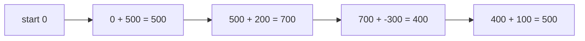
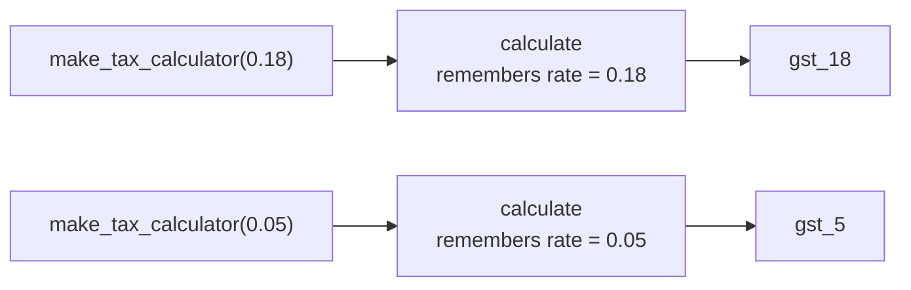

# Lambda, map and Functional Style: The Complete Guide

> 📚 **Before you start**
>
> - [Functions and Parameter Passing](functions-and-parameter-passing.md), especially "functions are objects" and scope
> - [Iterators and Generators](iterators-and-generators.md), since `map` and `filter` return lazy iterators
> - [List and Dictionary Comprehensions](../05-strings-and-data-structures/list-and-dictionary-comprehensions.md)

## Introduction

Think of how a mobile recharge shop works. The shopkeeper doesn't care **who** you are or what you did yesterday. You give a number and an amount; the recharge goes through; you get a receipt. Same inputs, same result, every time, and nothing else in the shop changes. That predictability is what makes it easy to trust.

**Functional style** is a way of writing programs that leans on that idea. Instead of a long list of steps that keep changing shared variables, you build programs out of small functions that **take inputs and return outputs without side effects**, and you combine them: transform every item with one function, keep the items that pass another, sort by a third. Python isn't a purely functional language, but it borrows the best tools from that world:

- **`lambda`**: tiny unnamed functions, written inline,
- **`map`** and **`filter`**: apply a function to every item, or keep the items a function approves,
- **`functools.reduce`**, `partial`, and the `operator` module,
- **closures**: functions that remember values from where they were created.

By the end of this lesson you'll be able to write lambdas, use them as `key=` functions for sorting, use `map` and `filter` and know when a comprehension is clearer, build function factories with closures, avoid the famous "late binding" trap, and explain what makes a function **pure**.

> 💡 **Key Insight**
>
> In Python, functions are values you can pass around. Most of "functional style" is simply **handing a small function to another function** (`sorted(..., key=f)`, `map(f, items)`, `filter(f, items)`) so that *what to do* is separated from *how to loop*. `lambda` is just a convenient way to write that small function on the spot.

---

## Core Explanation

### 1. lambda: a function in one expression

A **lambda** is a small anonymous (unnamed) function written as a single expression:

```
lambda parameters: expression
```

It returns the value of the expression automatically; there's no `return` keyword. These two are equivalent:

```python
def add_gst(price):
    return round(price * 1.18, 2)

add_gst_lambda = lambda price: round(price * 1.18, 2)

print(add_gst(100), add_gst_lambda(100))
print((lambda a, b: a * b)(6, 7))           # define and call immediately
```

Output:

```
118.0 118.0
42
```

Lambdas can take any number of parameters, including defaults:

```python
full_name = lambda first, last, title="": f"{title} {first} {last}".strip()
print(full_name("Priya", "Nair"))
print(full_name("Priya", "Nair", title="Dr."))
```

Output:

```
Priya Nair
Dr. Priya Nair
```

**Limits of lambda:**

- One **expression** only: no statements like `if` blocks, `for` loops, assignments with `=`, or `return`. (A conditional **expression** `a if c else b` is fine.)
- No docstring and no type hints.
- Its name shows up as `<lambda>` in tracebacks, which makes errors harder to trace.

```python
# not-run: shows an error on purpose
check = lambda x: if x > 0: "positive"
```

Running it shows:

```
  File "/home/you/python-practice/example.py", line 2
    check = lambda x: if x > 0: "positive"
                      ^^
SyntaxError: invalid syntax
```

```python
sign = lambda x: "positive" if x > 0 else ("zero" if x == 0 else "negative")
print(sign(5), sign(0), sign(-3))
```

Output:

```
positive zero negative
```

**Style rule:** Python's style guide (PEP 8) advises against assigning a lambda to a name, as in `add_gst_lambda = lambda ...` above. If it deserves a name, use `def`: you get a proper name in tracebacks and room for a docstring. Lambdas are for passing **directly** into another function, which is what the rest of this lesson does.

### 2. key functions: sorting, min and max

The most common place for a lambda is the `key=` argument of `sorted`, `list.sort`, `min` and `max`. The key function is called once per item, and the items are compared by what it returns.

```python
products = [
    {"name": "Mouse", "price": 599, "rating": 4.3},
    {"name": "Keyboard", "price": 1299, "rating": 4.6},
    {"name": "Cable", "price": 199, "rating": 4.6},
    {"name": "Webcam", "price": 2499, "rating": 4.1},
]

cheapest_first = sorted(products, key=lambda p: p["price"])
print([p["name"] for p in cheapest_first])

best = max(products, key=lambda p: p["rating"])
print(best["name"])

# Highest rating first; for equal ratings, cheaper first
ranked = sorted(products, key=lambda p: (-p["rating"], p["price"]))
print([(p["name"], p["rating"], p["price"]) for p in ranked])
```

Output:

```
['Cable', 'Mouse', 'Keyboard', 'Webcam']
Keyboard
[('Cable', 4.6, 199), ('Keyboard', 4.6, 1299), ('Mouse', 4.3, 599), ('Webcam', 4.1, 2499)]
```

Returning a **tuple** from the key sorts by the first element, then breaks ties with the second. The minus sign flips a number's order, so one sort can be descending on one field and ascending on another. `max` returns the **first** of equal maximums, which is why Keyboard (listed before Cable) won.

When an existing function already does the job, pass it directly, no lambda needed:

```python
words = ["banana", "Apple", "cherry"]
print(sorted(words, key=str.lower))
print(sorted(words, key=len))
print(max(["9", "10", "100"], key=int))
```

Output:

```
['Apple', 'banana', 'cherry']
['Apple', 'banana', 'cherry']
100
```

### 3. map: apply a function to every item

`map(function, iterable)` calls the function on each item and yields the results. Like `zip`, it returns a **lazy iterator**, so wrap it in `list()` to see everything at once.

```python
prices = ["499", " 1299 ", "89"]
as_ints = map(int, prices)            # int() ignores surrounding spaces
print(list(as_ints))

print(list(map(str.upper, ["pune", "goa"])))
print(list(map(lambda p: round(p * 1.18, 2), [100, 250])))
```

Output:

```
[499, 1299, 89]
['PUNE', 'GOA']
[118.0, 295.0]
```

With several iterables, `map` passes one item from each, stopping at the shortest, like `zip`:

```python
qty = [2, 1, 3]
price = [49, 899, 15]
print(list(map(lambda q, p: q * p, qty, price)))
```

Output:

```
[98, 899, 45]
```

A `map` object is single-use and has no length or indexing:

```python
# not-run: shows an error on purpose
result = map(int, ["1", "2"])
print(result[0])
```

Running it shows:

```
Traceback (most recent call last):
  File "/home/you/python-practice/example.py", line 3, in <module>
    print(result[0])
          ~~~~~~^^^
TypeError: 'map' object is not subscriptable
```

### 4. filter: keep the items that pass

`filter(function, iterable)` yields the items for which the function returns something truthy:

```python
marks = [72, 38, 91, 55, 29]
print(list(filter(lambda m: m >= 40, marks)))

entries = ["Asha", "", "Babu", None, "Charu", ""]
print(list(filter(None, entries)))         # None means "keep truthy items"

print(list(filter(str.isdigit, ["12", "ab", "7", "3.5"])))
```

Output:

```
[72, 91, 55]
['Asha', 'Babu', 'Charu']
['12', '7']
```

`filter(None, items)` is a handy idiom for dropping empty strings, `None`, zeros and other falsy values.

### 5. map and filter vs comprehensions

Everything `map` and `filter` do, a comprehension can do too:

| Task | map/filter | Comprehension |
|---|---|---|
| transform | `list(map(str.upper, names))` | `[n.upper() for n in names]` |
| transform with lambda | `list(map(lambda p: p * 2, ps))` | `[p * 2 for p in ps]` |
| filter | `list(filter(lambda m: m >= 40, ms))` | `[m for m in ms if m >= 40]` |
| both | `list(map(f, filter(g, xs)))` | `[f(x) for x in xs if g(x)]` |

The usual Python preference:

- If you'd need a **lambda**, a **comprehension** is usually clearer.
- If you already have a **named function** (`int`, `str.strip`, your own `clean_name`), `map(func, items)` reads nicely.
- Both are lazy if you use a generator expression or keep the `map` object unconverted.

```python
raw = [" priya ", "ARJUN", " meera"]
print(list(map(str.strip, raw)))                       # fine: named function
print([name.strip().title() for name in raw])          # clearer than map + lambda
```

Output:

```
['priya', 'ARJUN', 'meera']
['Priya', 'Arjun', 'Meera']
```

### 6. reduce: combining items into one

`functools.reduce(function, iterable, initial)` combines items pairwise from left to right: first `f(initial, item1)`, then `f(that, item2)`, and so on, until one value remains.

```python
from functools import reduce

amounts = [500, 200, -300, 100]
total = reduce(lambda running, x: running + x, amounts, 0)
print(total)
```

Output:

```
500
```



`reduce` is general, but for common cases Python has clearer built-ins, and they're what you should reach for first:

```python
import math

nums = [3, 1, 4, 1, 5]
print(sum(nums), math.prod(nums), max(nums), min(nums))
print(any(n > 4 for n in nums), all(n > 0 for n in nums))
print("-".join(["2026", "10", "11"]))
```

Output:

```
14 60 5 1
True True
2026-10-11
```

Use `reduce` when there's no built-in, for example merging a list of dicts into one:

```python
settings_layers = [{"theme": "light", "lang": "en"}, {"lang": "hi"}, {"font": "large"}]
merged = reduce(lambda acc, d: acc | d, settings_layers, {})
print(merged)
```

Output:

```
{'theme': 'light', 'lang': 'hi', 'font': 'large'}
```

### 7. Higher-order functions

A **higher-order function** takes a function as an argument, returns a function, or both. `sorted`, `map`, `filter` and `reduce` are higher-order functions. You can write your own:

```python
def apply_discount(prices, rule):
    return [rule(p) for p in prices]

festive = lambda p: p * 0.8                       # 20% off
clearance = lambda p: p * 0.5 if p > 1000 else p  # half price on big items

prices = [499, 1299, 2500]
print(apply_discount(prices, festive))
print(apply_discount(prices, clearance))
```

Output:

```
[399.20000000000005, 1039.2, 2000.0]
[499, 649.5, 1250.0]
```

The looping logic is written once; the pricing rule is plugged in. (The long `399.20000000000005` is the floating-point effect from [Numbers, Booleans and Strings](../02-getting-started-with-python/numbers-booleans-and-strings.md); you'd round for display.)

### 8. Closures: functions that remember

A function defined inside another function can use the outer function's variables, **even after the outer function has returned**. The inner function, together with the variables it remembers, is called a **closure**.

```python
def make_tax_calculator(rate):
    def calculate(amount):
        return round(amount * (1 + rate), 2)      # uses rate from the enclosing scope
    return calculate                              # return the function itself

gst_18 = make_tax_calculator(0.18)
gst_5 = make_tax_calculator(0.05)

print(gst_18(1000), gst_5(1000))
print(gst_18.__name__)
```

Output:

```
1180.0 1050.0
calculate
```

`make_tax_calculator` is a **function factory**: each call builds a new function with its own remembered `rate`.



A closure can also keep **changing** state if it declares the variable **`nonlocal`** (the enclosing-function version of `global` from [Functions and Parameter Passing](functions-and-parameter-passing.md)):

```python
def make_token_counter(prefix):
    count = 0
    def next_token():
        nonlocal count
        count += 1
        return f"{prefix}-{count:03d}"
    return next_token

counter_a = make_token_counter("A")
counter_b = make_token_counter("B")
print(counter_a(), counter_a(), counter_b(), counter_a())
```

Output:

```
A-001 A-002 B-001 A-003
```

Each counter has its own private `count` that nothing else can touch. Without `nonlocal`, `count += 1` would raise `UnboundLocalError`, just like the global case.

Closures are the basis of **decorators**, a powerful Python feature that wraps functions with extra behaviour, covered later in this course, in [Decorators, classmethod and staticmethod](../07-object-oriented-programming/decorators-classmethod-and-staticmethod.md).

### 9. The late-binding trap

Closures remember **variables**, not values. A lambda created in a loop looks up the loop variable when it's **called**, by which time the loop has finished:

```python
multipliers = []
for n in [1, 2, 3]:
    multipliers.append(lambda x: x * n)

print([m(10) for m in multipliers])
```

Output:

```
[30, 30, 30]
```

All three lambdas share the one variable `n`, which is `3` after the loop. The standard fix is to capture the current value as a **default argument**, because defaults are evaluated when the function is created:

```python
multipliers = []
for n in [1, 2, 3]:
    multipliers.append(lambda x, n=n: x * n)

print([m(10) for m in multipliers])
```

Output:

```
[10, 20, 30]
```

### 10. functools.partial and the operator module

`functools.partial` creates a new function with some arguments **pre-filled**:

```python
from functools import partial

def convert(value, factor, unit):
    return f"{value * factor:.2f} {unit}"

km_to_miles = partial(convert, factor=0.621371, unit="miles")
kg_to_lb = partial(convert, factor=2.20462, unit="lb")
print(km_to_miles(42.195), "|", kg_to_lb(23))

parse_binary = partial(int, base=2)
print(parse_binary("101101"))
```

Output:

```
26.22 miles | 50.71 lb
45
```

The **`operator`** module provides ready-made functions for Python's operators, which often replace simple lambdas:

```python
import operator

print(reduce(operator.mul, [1, 2, 3, 4, 5]))           # instead of lambda a, b: a * b
batters = [("Rohit", 56), ("Gill", 104), ("Kohli", 33)]
print(sorted(batters, key=operator.itemgetter(1), reverse=True))
get_name_and_runs = operator.itemgetter(0, 1)
print(get_name_and_runs(("Gill", 104, 98)))
```

Output:

```
120
[('Gill', 104), ('Rohit', 56), ('Kohli', 33)]
('Gill', 104)
```

`itemgetter(1)` builds a function equivalent to `lambda item: item[1]`. It works for dict keys too: `itemgetter("price")`.

### 11. Pure functions and side effects

A **pure function**:

1. returns a result that depends **only on its arguments**, and
2. has **no side effects**: it doesn't print, change global variables, mutate its arguments, write files, or call the network.

```python
# Pure: same input, same output, nothing else touched
def total_with_gst(prices):
    return round(sum(prices) * 1.18, 2)

# Impure: mutates its argument and depends on a global
DISCOUNT = 0.1
def apply_discount_in_place(prices):
    for i in range(len(prices)):
        prices[i] = prices[i] * (1 - DISCOUNT)

cart = [100, 200]
print(total_with_gst(cart), total_with_gst(cart))     # always the same
apply_discount_in_place(cart)
print(cart)                                           # cart was changed
```

Output:

```
354.0 354.0
[90.0, 180.0]
```

Pure functions are easy to test (call with inputs, check outputs), easy to reuse, safe to run in parallel, and easy to cache. Real programs need side effects (printing, saving, sending), so the usual advice is: **keep the core logic pure, and push side effects to the edges** of your program.

### 12. A functional pipeline end to end

Here's a small report built only from pure transformations and higher-order functions:

```python
orders = [
    {"id": 1, "city": "Pune", "amount": 499, "status": "paid"},
    {"id": 2, "city": "Delhi", "amount": 1299, "status": "cancelled"},
    {"id": 3, "city": "Pune", "amount": 2500, "status": "paid"},
    {"id": 4, "city": "Goa", "amount": 89, "status": "paid"},
    {"id": 5, "city": "Delhi", "amount": 999, "status": "paid"},
]

is_paid = lambda o: o["status"] == "paid"
with_gst = lambda o: o | {"total": round(o["amount"] * 1.18, 2)}   # new dict, original untouched

paid = filter(is_paid, orders)
priced = map(with_gst, paid)
top = sorted(priced, key=operator.itemgetter("total"), reverse=True)[:3]

for o in top:
    print(f"#{o['id']} {o['city']:<6} ₹{o['total']:>8,.2f}")
print("Original order 3 unchanged:", "total" not in orders[2])
```

Output:

```
#3 Pune   ₹2,950.00
#5 Delhi  ₹1,178.82
#1 Pune   ₹  588.82
Original order 3 unchanged: True
```

`filter` and `map` stayed lazy until `sorted` consumed them, and `o | {...}` built new dicts, so the original data was never modified.

---

## Try It Yourself

1. Sort `cities = ["Thiruvananthapuram", "Goa", "Pune", "Bengaluru"]` by length (longest first) using a lambda.
2. Use `map` to convert `["12.5", "3", "7.25"]` to floats, and `filter` to keep only those greater than 5.
3. Write `make_multiplier(n)` that returns a function multiplying its argument by `n`. Use it to make `double` and `triple`.
4. Use `reduce` to find the longest word in `["chai", "samosa", "jalebi", "pakoda"]` (if two tie, keep the first). Then do it with `max(..., key=len)`.

<details>
<summary>Show answers</summary>

```python
cities = ["Thiruvananthapuram", "Goa", "Pune", "Bengaluru"]
print(sorted(cities, key=lambda c: len(c), reverse=True))

values = list(map(float, ["12.5", "3", "7.25"]))
print(values, list(filter(lambda v: v > 5, values)))

def make_multiplier(n):
    return lambda x: x * n

double, triple = make_multiplier(2), make_multiplier(3)
print(double(21), triple(7))

words = ["chai", "samosa", "jalebi", "pakoda"]
print(reduce(lambda a, b: b if len(b) > len(a) else a, words))
print(max(words, key=len))
```

Output:

```
['Thiruvananthapuram', 'Bengaluru', 'Pune', 'Goa']
[12.5, 3.0, 7.25] [12.5, 7.25]
42 21
samosa
samosa
```

`key=lambda c: len(c)` could simply be `key=len`. In `make_multiplier`, each returned lambda is a closure over its own `n`, so there's no late-binding problem: each call to `make_multiplier` creates a separate `n`.

</details>

---

## Real-World Examples

### Example 1: Sorting in every app

Every "sort by price", "sort by rating", "newest first" button in a shopping or food app ends up as a key function. Python code behind such features is full of `sorted(items, key=lambda x: (...))` and `itemgetter`.

### Example 2: Data transformations in pandas

In [Data Analysis and Visualisation with Python](../../data-analysis-and-visualisation-with-python/course.md) you'll write `df["name"].map(str.title)` and `df["price"].apply(lambda p: p * 1.18)`. Same idea as `map`: a function applied to every value of a column.

### Example 3: Configurable behaviour with closures

A web framework lets you write `make_rate_limiter(per_minute=60)` and attach the returned function to an API route. Each limiter is a closure remembering its own limit and counters. Callback functions in GUIs, retry policies and event handlers follow the same pattern.

---

## Common Misconceptions

### Misconception 1: "lambda is faster than def"

They create the same kind of function object. Choose by readability: `def` for anything named or more than a short expression.

### Misconception 2: "map and filter return lists"

In Python 3 they return lazy, single-use iterators. Wrap them in `list()` when you need a list.

### Misconception 3: "Functional style means never using loops"

Python is multi-paradigm. Use comprehensions, built-ins and higher-order functions where they're clearer, and plain loops where they're clearer. Readability wins.

### Misconception 4: "A lambda in a loop captures the current loop value"

It captures the **variable**, which is read when the lambda runs. Use a default argument (`n=n`) or a factory function to capture the value.

### Misconception 5: "reduce is the functional way to sum"

`sum`, `math.prod`, `max`, `min`, `any`, `all` and `str.join` are clearer and faster for their jobs. Use `reduce` only when no built-in fits.

---

## Interview Relevance

Expect questions such as:

- **"What is a lambda, and what are its limits?"** Single expression, anonymous, no statements; prefer `def` when you'd name it.
- **"map/filter vs list comprehension?"** Laziness, readability, when each is idiomatic.
- **"Explain closures."** Inner function plus captured variables; function factories; `nonlocal`.
- **"What does this print?"** The late-binding loop-lambda puzzle, and its `n=n` fix.
- **"What is a pure function and why does it matter?"** Testability, caching, concurrency.
- **Practical:** sort records by multiple keys, implement `compose(f, g)`, use `reduce` to flatten or merge, write a memoising wrapper with a closure (a first step towards decorators).

---

## Key Takeaways

- **`lambda args: expression`** creates a small anonymous function; use it inline (especially as a **`key=`**), and use `def` for anything you'd name.
- **`map(f, xs)`** transforms and **`filter(f, xs)`** selects, lazily; a **comprehension** is often clearer when you'd need a lambda.
- **`reduce`** folds items into one value, but prefer `sum`, `math.prod`, `max`, `join` when they fit. **`partial`** and **`operator.itemgetter`** replace many lambdas.
- **Closures** remember variables from their enclosing function, enabling function factories; **`nonlocal`** lets them update that state. Watch for **late binding** in loops.
- **Pure functions** (no side effects, output depends only on input) are the easiest code to test and reuse; keep side effects at the edges.

---

**Up next:** [Lab: Build a tiny text-processing toolkit](lab-build-a-tiny-text-processing-toolkit.md)
