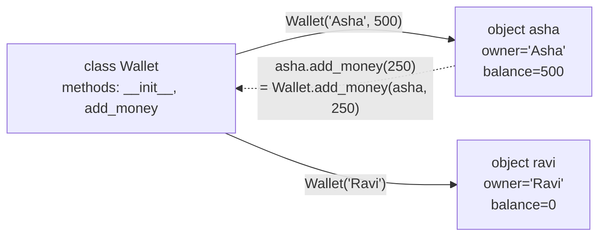
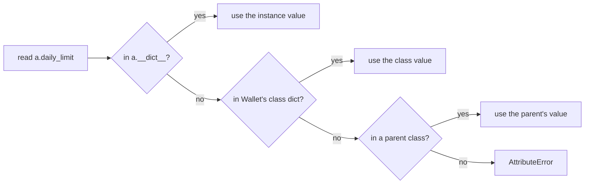

# Classes and Objects: The Complete Guide

> 📚 **Before you start**
>
> This lesson assumes you can write functions and work with dictionaries and lists:
> - [Functions and Parameter Passing](../course.md#m6) (Python Fundamentals › Functions and Iterators)
> - [Containers and Mutability](../course.md#m3) (Python Fundamentals › Core Language Concepts)
> - [Dictionaries and Dictionary Views](../course.md#m5) (Python Fundamentals › Strings and Data Structures)

## Introduction

Imagine you are writing the software for a small UPI wallet app. Each user has a name, a phone number and a balance. Users can add money, pay someone, and see their history. With what you know from Python Fundamentals, you would probably store each wallet as a dictionary and write functions like `pay(wallet, amount)`.

That works for a week. Then someone writes `wallet["balence"] = 500` (a typo that silently creates a new key), someone else passes a phone number where a wallet was expected, and a third person sets the balance to a negative number directly. Nothing in the code says "a wallet is *this* shape and can only be changed in *these* ways."

**Classes** solve that. A class lets you define a new kind of thing: what data it holds and what it can do. Python itself is built this way: `str`, `list`, `dict` and `int` are all classes, and every value you have ever used is an object made from one.

By the end of this lesson you will be able to write your own classes, explain exactly what `self` is, tell instance attributes from class attributes (and avoid the bug that confuses them), inspect objects, and use **dataclasses** to write data-holding classes in a few lines.

> 💡 **Key Insight**
>
> A **class** is a blueprint; an **object** (or **instance**) is one thing built from that blueprint. The class holds the shared behaviour (methods); each object holds its own data (attributes). `self` is simply the particular object a method is working on right now.

---

## Core Explanation

### 1. Classes, Objects and Why They Exist

Think of Indian Railways. There is one *design* for a 3-tier AC coach: how many berths, where the doors are, how the charging points work. From that design, thousands of real coaches are built. Each coach has its own number, its own passengers and its own state (clean or dirty, on time or late), but they all *work* the same way.

- The design is the **class**.
- Each real coach is an **object**, also called an **instance** of the class.
- Data stored on each object (coach number, passengers) is held in **attributes**.
- Things every object can do (lock doors, add passenger) are **methods**: functions defined inside the class.

**Object-oriented programming (OOP)** means organising a program around these objects: bundling data with the functions that work on that data. The bundle has two big benefits:

- **One place for the rules.** If only the `Wallet` class can change a balance, the "no negative balance" rule lives in one method instead of being repeated (or forgotten) in twenty places.
- **A vocabulary for your domain.** Code that says `wallet.pay(shop, 120)` reads like the problem you are solving.

You have used objects all along:

```python
name = "Asha"
print(type(name))
print(name.upper())          # a method of the str class
print(str.upper(name))       # the same call, written through the class
print(isinstance(name, str))
```

Output:

```
<class 'str'>
ASHA
ASHA
True
```

Notice the third line. `name.upper()` is shorthand for `str.upper(name)`: Python finds the function on the class and passes the object in as the first argument. Keep that in mind; it is the whole secret behind `self`.

### 2. Your First Class

```python
class Wallet:
    """A simple UPI-style wallet."""

    def __init__(self, owner, balance=0):
        self.owner = owner          # instance attribute
        self.balance = balance      # instance attribute

    def add_money(self, amount):
        self.balance += amount
        return self.balance


asha = Wallet("Asha", 500)
ravi = Wallet("Ravi")

asha.add_money(250)
print(asha.owner, asha.balance)
print(ravi.owner, ravi.balance)
```

Output:

```
Asha 750
Ravi 0
```

Line by line:

- **`class Wallet:`** creates a new class called `Wallet`. By convention class names use `CapWords` (also called PascalCase), while functions and variables use `snake_case`.
- The string under the class line is a **docstring**, shown by `help(Wallet)` and by editors.
- **`__init__`** is the **initialiser**. Python calls it automatically right after creating a new, empty object, so you can fill in its starting data. The double underscores mark it as a special ("dunder") method that Python calls for you; you will meet many more in [Dunder Methods](dunder-methods.md).
- **`Wallet("Asha", 500)`** *calls the class*. Python creates a fresh object, then runs `Wallet.__init__(new_object, "Asha", 500)`, then gives you the object.
- **`self.owner = owner`** stores a value *on that particular object*. Each object has its own `owner` and `balance`.
- **`asha.add_money(250)`** is turned into `Wallet.add_money(asha, 250)`. Inside the method, `self` is `asha`.



### 3. What `self` Really Is

`self` is not a keyword. It is just the name everyone agrees to use for the first parameter of a method, and it always receives the object the method was called on. You can prove it:

```python
print(Wallet.add_money(ravi, 100))   # call through the class, pass the object yourself
print(ravi.balance)

method = asha.add_money              # a "bound method": the function with asha already filled in
print(type(method).__name__)
print(method.__self__ is asha)
print(method.__func__ is Wallet.add_money)
print(method(50), asha.balance)      # calling it passes asha as self
```

Output:

```
100
100
method
True
True
800 800
```

If you `print(asha)` directly you get something like `<__main__.Wallet object at 0x7f3a...>`, with a memory address that changes on every run. In [Dunder Methods](dunder-methods.md) you will give your classes a readable printout instead.

A **bound method** is a small object that remembers two things: the function (`__func__`) and the object (`__self__`). Calling it calls the function with the object as the first argument.

Two classic mistakes with `self`:

- **Forgetting `self` in the definition.** `def add_money(amount):` means the object lands in `amount`, and calling `asha.add_money(250)` raises `TypeError: Wallet.add_money() takes 1 positional argument but 2 were given`. That "2 were given" is the hidden `self` plus your `250`.
- **Forgetting `self.` when using an attribute.** Inside a method, plain `balance` is a local variable, not the object's balance. Always write `self.balance`.

### 4. Methods That Use and Protect the Object's Data

Methods are where the rules of your domain live. Let's add payments with a check:

```python
class Wallet:
    def __init__(self, owner, balance=0):
        if balance < 0:
            raise ValueError("opening balance cannot be negative")
        self.owner = owner
        self.balance = balance
        self.history = []                      # each wallet gets its OWN list

    def add_money(self, amount):
        self.balance += amount
        self.history.append(("added", amount))

    def pay(self, other, amount):
        if amount > self.balance:
            raise ValueError(f"{self.owner} has only ₹{self.balance}")
        self.balance -= amount
        other.balance += amount
        self.history.append(("paid", other.owner, amount))
        other.history.append(("received", self.owner, amount))


asha = Wallet("Asha", 500)
chai_stall = Wallet("Sharma Chai")
asha.pay(chai_stall, 40)
asha.add_money(100)
print(asha.balance, chai_stall.balance)
print(asha.history)
print(chai_stall.history)

try:
    chai_stall.pay(asha, 1000)
except ValueError as err:
    print("Refused:", err)
```

Output:

```
560 40
[('paid', 'Sharma Chai', 40), ('added', 100)]
[('received', 'Asha', 40)]
Refused: Sharma Chai has only ₹40
```

Notice that `pay` changes *two* objects. Methods can freely work with other objects, including other instances of the same class.

`raise ValueError(...)` stops the method and reports a problem; you will learn everything about raising and catching errors in [try/except and Custom Exceptions](../09-modules-and-exceptions/try-except-and-custom-exceptions.md). For now, the important idea is that the class **refuses to get into a bad state**.

### 5. Instance Attributes vs Class Attributes

An attribute assigned on `self` belongs to one object. An attribute assigned directly in the class body belongs to the **class** and is shared by every instance:

```python
class Wallet:
    currency = "INR"           # class attribute: shared
    daily_limit = 100_000      # class attribute: shared

    def __init__(self, owner):
        self.owner = owner     # instance attribute: per object
        self.balance = 0


a, b = Wallet("Asha"), Wallet("Ravi")
print(a.currency, b.currency, Wallet.currency)

Wallet.daily_limit = 200_000         # change it on the class...
print(a.daily_limit, b.daily_limit)  # ...every instance sees the change

a.daily_limit = 5_000                # assigning through an instance creates an instance attribute
print(a.daily_limit, b.daily_limit, Wallet.daily_limit)
print(a.__dict__)
print(b.__dict__)
```

Output:

```
INR INR INR
200000 200000
5000 200000 200000
{'owner': 'Asha', 'balance': 0, 'daily_limit': 5000}
{'owner': 'Ravi', 'balance': 0}
```

Every object keeps its own attributes in a dictionary called `__dict__`. When you read `a.daily_limit`, Python looks in this order:



(Parent classes are the subject of [Inheritance and Polymorphism](inheritance-and-polymorphism.md).) **Writing** `a.daily_limit = ...` always writes into `a.__dict__`. It never changes the class, which is why `b` was unaffected.

Use class attributes for **constants and defaults shared by all instances** (a currency code, a tax rate, a counter of how many objects exist). Use instance attributes for everything that differs per object.

### 6. The Shared Mutable Class Attribute Bug

This is one of the most famous Python bugs. Put a *mutable* object such as a list in a class attribute, then modify it through an instance:

```python
class BuggyWallet:
    history = []                       # ONE list, shared by every wallet

    def __init__(self, owner):
        self.owner = owner

    def add_money(self, amount):
        self.history.append(amount)    # no assignment, so this mutates the shared list


x, y = BuggyWallet("Asha"), BuggyWallet("Ravi")
x.add_money(100)
y.add_money(5)
print(x.history)
print(y.history)
print(x.history is y.history)
```

Output:

```
[100, 5]
[100, 5]
True
```

`self.history.append(...)` *reads* `self.history` (found on the class, because the instance has none) and then mutates that one list. Everyone shares it. The fix is to create the list in `__init__`, as we did earlier with `self.history = []`. It is the same root cause as the mutable default argument trap from [Functions and Parameter Passing](../course.md#m6): a mutable object created once and shared by every call.

### 7. Objects Are Just Objects: Inspecting Them

Python lets you look inside any object, which is very useful for debugging and exploring unfamiliar libraries:

```python
w = Wallet("Meera")
print(type(w).__name__)            # the class name
print(isinstance(w, Wallet))
print(hasattr(w, "balance"), hasattr(w, "pin"))
print(getattr(w, "balance"))       # read an attribute by name
setattr(w, "balance", 250)         # set an attribute by name
print(w.balance)
print(getattr(w, "pin", "not set"))  # default instead of AttributeError
print([name for name in dir(w) if not name.startswith("_")])
```

Output:

```
Wallet
True
True False
0
250
not set
['balance', 'currency', 'daily_limit', 'owner']
```

- `type(obj)` gives the class; `isinstance(obj, Cls)` checks it (and also returns `True` for subclasses).
- `getattr`, `setattr` and `hasattr` work with attribute names held in strings. Frameworks use them a lot, for example to look up a handler method by name.
- `dir(obj)` lists all attribute names, including inherited and special ones. Filtering out names starting with `_` leaves the "public" ones.

Two objects with the same data are still two objects. By default, `==` between instances of your class compares **identity** (are they the very same object?), not content:

```python
p = Wallet("Asha")
q = Wallet("Asha")
print(p == q, p is q, p is p)
```

Output:

```
False False True
```

You can change what `==` means by writing an `__eq__` method, which dataclasses (next section) do for you.

### 8. Dataclasses: Classes for Holding Data, Without the Boilerplate

Many classes exist mainly to **hold data**: a train ticket, an order, a chat message, an API response. Writing `__init__` that copies every argument onto `self`, plus a readable printout, plus equality, gets tedious. The `dataclasses` module (standard library) writes those methods for you from type-annotated fields:

```python
from dataclasses import dataclass, field

@dataclass
class TrainTicket:
    pnr: str
    passenger: str
    train_no: int
    coach: str = "B1"            # a default value
    fare: float = 0.0


t1 = TrainTicket("4521873690", "Asha", 12951, fare=1450.0)
t2 = TrainTicket("4521873690", "Asha", 12951, fare=1450.0)
print(t1)
print(t1 == t2)        # compares field by field
print(t1.coach)
```

Output:

```
TrainTicket(pnr='4521873690', passenger='Asha', train_no=12951, coach='B1', fare=1450.0)
True
B1
```

`@dataclass` is a **decorator** (a function that takes the class and returns an improved one; decorators get a full lesson in [Decorators, classmethod and staticmethod](decorators-classmethod-and-staticmethod.md)). From the annotated class attributes (`pnr: str` and so on) it generated:

| Generated method | What it does |
|---|---|
| `__init__` | Takes the fields as parameters, in order, and stores them on `self` |
| `__repr__` | A readable printout like `TrainTicket(pnr=..., ...)` |
| `__eq__` | Two tickets are equal if all fields are equal |

The annotations (`: str`, `: int`) document the expected types, and editors and type checkers such as mypy use them. Python itself does **not** check them at runtime: `TrainTicket(123, None, "x")` would be accepted. If you need runtime validation, check values in `__post_init__` (below) or use a validation library such as Pydantic, which you will meet in the FastAPI course.

#### Mutable defaults need `field(default_factory=...)`

Dataclasses protect you from the shared-list bug of section 6. Writing `stations: list = []` raises `ValueError: mutable default <class 'list'> for field stations is not allowed: use default_factory`. Instead, give a function that builds a fresh default for each object:

```python
@dataclass
class Journey:
    train_no: int
    stations: list[str] = field(default_factory=list)   # new list per object
    seats_left: dict[str, int] = field(default_factory=dict)


j1, j2 = Journey(12951), Journey(12002)
j1.stations.append("Mumbai Central")
print(j1.stations, j2.stations)
```

Output:

```
['Mumbai Central'] []
```

#### Validation and derived values with `__post_init__`

The generated `__init__` calls `__post_init__` (if you define one) after setting the fields. Use it to validate or to compute extra attributes:

```python
@dataclass
class Order:
    item: str
    quantity: int
    unit_price: float
    total: float = field(init=False)       # not a parameter; computed below

    def __post_init__(self):
        if self.quantity <= 0:
            raise ValueError("quantity must be positive")
        self.total = round(self.quantity * self.unit_price, 2)


print(Order("masala chai", 3, 15.0))
try:
    Order("samosa", 0, 20.0)
except ValueError as err:
    print("Invalid order:", err)
```

Output:

```
Order(item='masala chai', quantity=3, unit_price=15.0, total=45.0)
Invalid order: quantity must be positive
```

#### Frozen, ordered, keyword-only and slotted dataclasses

The decorator takes options that change what is generated:

```python
from dataclasses import asdict, astuple, replace, FrozenInstanceError

@dataclass(frozen=True, order=True)
class Score:
    runs: int
    balls: int
    batter: str = field(compare=False)    # ignored by ==, < and friends


innings = [Score(45, 30, "Gill"), Score(82, 51, "Kohli"), Score(45, 28, "Rahul")]
print(sorted(innings))                 # compares (runs, balls) like tuples
print(max(innings).batter)

s = innings[0]
try:
    s.runs = 100
except FrozenInstanceError as err:
    print("Frozen:", err)

print(replace(s, runs=50))             # a modified COPY; the original is unchanged
print(asdict(s))
print(astuple(s))
print(hash(s) == hash(Score(45, 30, "anyone")))
```

Output:

```
[Score(runs=45, balls=28, batter='Rahul'), Score(runs=45, balls=30, batter='Gill'), Score(runs=82, balls=51, batter='Kohli')]
Kohli
Frozen: cannot assign to field 'runs'
Score(runs=50, balls=30, batter='Gill')
{'runs': 45, 'balls': 30, 'batter': 'Gill'}
(45, 30, 'Gill')
True
```

| Option | Effect |
|---|---|
| `frozen=True` | Fields can't be reassigned after creation, and instances become **hashable**, so they can go in sets and be dict keys |
| `order=True` | Generates `<`, `<=`, `>`, `>=`, comparing fields in order like a tuple |
| `field(compare=False)` | Leave this field out of equality and ordering |
| `kw_only=True` | All fields must be passed by keyword: `Score(runs=45, balls=30, batter="Gill")` |
| `slots=True` | Uses `__slots__` (next section): less memory, faster attribute access, no new attributes allowed |
| `field(repr=False)` | Hide a field from the printout, useful for secrets such as API keys |

Helpers: `asdict()` and `astuple()` convert an instance (recursively) into plain data, handy before writing JSON. `dataclasses.replace(obj, **changes)` returns a copy with some fields changed; since Python 3.13 the general-purpose `copy.replace()` does the same for dataclasses and several built-in types.

`kw_only` and `slots` together are a great default for configuration objects:

```python
@dataclass(kw_only=True, slots=True)
class LLMConfig:
    model: str = "claude-opus-5-5"
    temperature: float = 0.2
    max_tokens: int = 1024
    api_key: str = field(default="", repr=False)


cfg = LLMConfig(temperature=0.0, api_key="sk-secret")
print(cfg)
try:
    cfg.temprature = 1.0              # typo! slots refuse unknown attributes
except AttributeError as err:
    print("AttributeError:", err)
```

Output:

```
LLMConfig(model='claude-opus-5-5', temperature=0.0, max_tokens=1024)
AttributeError: 'LLMConfig' object has no attribute 'temprature' and no __dict__ for setting new attributes
```

That last line is exactly the "`balence` typo" problem from the introduction, now caught immediately. And the API key never appears in logs because of `repr=False`.

### 9. `__slots__`: Fixed Attributes and Less Memory

A normal object stores attributes in its own `__dict__`, which is flexible (you can add attributes any time) but uses memory. If you will create millions of small objects (for example, one per log line or per token), declaring `__slots__` tells Python the exact attribute names up front. Python then stores them in a compact fixed layout with no `__dict__`:

```python
import sys

class PointDict:
    def __init__(self, x, y):
        self.x, self.y = x, y

class PointSlots:
    __slots__ = ("x", "y")
    def __init__(self, x, y):
        self.x, self.y = x, y


a, b = PointDict(1, 2), PointSlots(1, 2)
print(hasattr(a, "__dict__"), hasattr(b, "__dict__"))
print(sys.getsizeof(b) < sys.getsizeof(a) + sys.getsizeof(a.__dict__))
```

Output:

```
True False
True
```

Use slots when you have many instances or want to forbid accidental new attributes. Skip them for ordinary classes; the flexibility of `__dict__` is usually worth more.

### 10. Choosing How to Represent Data

| You need | Use |
|---|---|
| A quick, throwaway record inside one function | `dict` or `tuple` |
| A small immutable record with named fields | `collections.namedtuple` or a frozen dataclass |
| A record with defaults, validation, nice printing | `@dataclass` |
| Data **plus rules** that protect it (invariants) and real behaviour | A regular class (possibly a dataclass with methods) |
| Validation of untrusted input such as JSON from an API or an LLM | Pydantic models (covered in the FastAPI course) |

Dataclasses and regular classes are not different things: a dataclass **is** a regular class with some methods written for you, and you can add any methods you like.

---

## Try It Yourself

1. Write a class `ChaiStall` with a class attribute `price_per_cup = 15`, instance attributes `name` and `cups_sold` (starting at 0), and a method `sell(cups)` that adds to `cups_sold` and returns the amount to charge. Sell 3 cups then 2 cups and print the total revenue `cups_sold * price_per_cup`.
2. Predict the output, then run it:
   ```python
   class Counter:
       count = 0
       def increment(self):
           self.count += 1

   c1, c2 = Counter(), Counter()
   c1.increment(); c1.increment(); c2.increment()
   print(c1.count, c2.count, Counter.count)
   ```
3. Write a frozen dataclass `Money` with fields `amount: int` (in paise) and `currency: str = "INR"`. Put three `Money` objects (two of them equal) in a set and print the set's length.
4. Turn the `Wallet` from section 4 into a dataclass with `owner: str`, `balance: int = 0` and `history: list = field(default_factory=list)`, keeping the `pay` method. Check that two wallets created without a history don't share the list.

<details>
<summary>Show answers</summary>

**1.**

```python
class ChaiStall:
    price_per_cup = 15

    def __init__(self, name):
        self.name = name
        self.cups_sold = 0

    def sell(self, cups):
        self.cups_sold += cups
        return cups * self.price_per_cup


stall = ChaiStall("Sharma Chai")
print(stall.sell(3), stall.sell(2))
print("Revenue:", stall.cups_sold * stall.price_per_cup)
```

Output:

```
45 30
Revenue: 75
```

**2.** `self.count += 1` means `self.count = self.count + 1`: it *reads* the class value (0) the first time, then *writes* an instance attribute. Integers are immutable, so the class attribute is never changed.

```python
class Counter:
    count = 0
    def increment(self):
        self.count += 1

c1, c2 = Counter(), Counter()
c1.increment(); c1.increment(); c2.increment()
print(c1.count, c2.count, Counter.count)
```

Output:

```
2 1 0
```

**3.**

```python
@dataclass(frozen=True)
class Money:
    amount: int
    currency: str = "INR"


wallet_items = {Money(1500), Money(1500), Money(200, "USD")}
print(len(wallet_items))
```

Output:

```
2
```

**4.**

```python
@dataclass
class DataWallet:
    owner: str
    balance: int = 0
    history: list = field(default_factory=list)

    def pay(self, other, amount):
        if amount > self.balance:
            raise ValueError(f"{self.owner} has only ₹{self.balance}")
        self.balance -= amount
        other.balance += amount
        self.history.append(("paid", other.owner, amount))


a, b = DataWallet("Asha", 300), DataWallet("Ravi")
a.pay(b, 100)
print(a)
print(b)
print(a.history is b.history)
```

Output:

```
DataWallet(owner='Asha', balance=200, history=[('paid', 'Ravi', 100)])
DataWallet(owner='Ravi', balance=100, history=[])
False
```

</details>

---

## Real-World Examples

### Example 1: Every value in Python

`3`, `"hello"`, `[1, 2]`, `None`, functions, modules and even classes themselves are objects. `(3).bit_length()` calls a method on an `int` object. Learning classes is learning how Python itself works.

### Example 2: pandas DataFrames

`df = pd.read_csv("sales.csv")` returns an instance of the `DataFrame` class. `df.shape` is an attribute, `df.groupby("city")` is a method, and every DataFrame carries its own data while sharing the behaviour defined once in the class. In the NumPy and pandas course, you will use this pattern constantly.

### Example 3: Messages in LLM apps

LangChain represents chat messages as objects (`HumanMessage`, `AIMessage`) with a `content` attribute. The Anthropic and OpenAI Python SDKs return response objects whose fields you read as attributes (`response.content`, `response.usage`). These are data-holding classes, the same idea as the dataclasses in this lesson (many are built on Pydantic).

### Example 4: Configuration objects

Applications often load settings into a single frozen dataclass (`Settings(model=..., timeout=..., max_retries=...)`) created once at start-up and passed around. Freezing it means no part of the program can quietly change the settings for everyone else.

---

## Common Misconceptions

### Misconception 1: "`self` is a special keyword"

`self` is an ordinary parameter name. Python passes the object as the first argument of every method call made through an instance. You *could* name it `this` or `me`, but every Python programmer expects `self`, so always use it.

### Misconception 2: "`__init__` creates the object"

The object already exists when `__init__` runs; `__init__` *initialises* it by filling in attributes. The actual creation happens in a different dunder method, `__new__`, which you rarely need to touch (it is mostly used for immutable types and some advanced patterns).

### Misconception 3: "Class attributes are like static variables that instances can't change"

Instances *can* shadow them by assigning (which creates an instance attribute), and they can *mutate* them if the value is mutable, affecting everyone. Know which of the two you are doing.

### Misconception 4: "Type hints in a dataclass are enforced"

They are documentation plus input for static checkers. Python never checks them at runtime. Validate in `__post_init__` or use Pydantic when data comes from outside your program.

### Misconception 5: "Everything should be a class"

A function that takes inputs and returns an output does not need a class around it. Reach for a class when you have **state that persists between calls** and **rules that protect that state**, or when you need many objects of the same shape.

---

## Interview Relevance

Classes are asked about in almost every Python interview, often through small coding tasks ("design a parking lot", "model a bank account"). A strong answer covers:

- **Class versus instance**, and what `self` is (the instance, passed automatically as the first argument).
- **`__init__`** as the initialiser, and the fact that `obj.method(x)` is `Cls.method(obj, x)`.
- **Instance versus class attributes**, the lookup order, and the shared-mutable-class-attribute bug.
- **Dataclasses:** what they generate, `field(default_factory=...)`, `frozen`, `order`, `__post_init__`, and when you'd use one.
- **`__slots__`** and why it saves memory.

Common follow-ups:

- *"Why is `def f(x=[])` a bug, and how is it related to class attributes?"* Both create one mutable object at definition time that every call or instance then shares.
- *"How do you make an object usable as a dictionary key?"* It must be hashable and its hash must not change: a frozen dataclass is the easiest way.
- *"Dataclass or Pydantic?"* Dataclasses for internal data you trust; Pydantic when you must parse and validate external data.

---

## Key Takeaways

- **A class is a blueprint and an object is one instance of it**: the class holds shared methods, each object holds its own attributes in `__dict__`.
- **`self` is the instance a method was called on**; `obj.method(x)` is just `Cls.method(obj, x)`.
- **Class attributes are shared by all instances**; never keep per-object mutable data (lists, dicts) in one. Create it in `__init__`.
- **`@dataclass` writes `__init__`, `__repr__` and `__eq__` for you**; use `default_factory` for mutable defaults and `__post_init__` for validation.
- **`frozen=True`, `order=True`, `kw_only=True` and `slots=True`** give you immutable, sortable, explicit and compact records with one line each.

---

**Up next:** [Inheritance and Polymorphism](inheritance-and-polymorphism.md)
