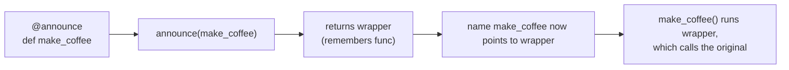

# Decorators, classmethod and staticmethod: The Complete Guide

> 📚 **Before you start**
>
> - [Functions and Parameter Passing](../06-functions-and-iterators/functions-and-parameter-passing.md) and [Lambda, map and Functional Style](../06-functions-and-iterators/lambda-map-and-functional-style.md): `*args`, `**kwargs`, functions as values
> - [Classes and Objects](classes-and-objects.md) and [Encapsulation and Abstraction](encapsulation-and-abstraction.md): methods, `@dataclass` and `@property`

## Introduction

You have already used decorators without writing one: `@dataclass`, `@property`, `@abstractmethod`. In real projects they are everywhere. FastAPI routes are declared with `@app.get("/orders")`. pytest fixtures with `@pytest.fixture`. LangChain tools with `@tool`. Retry logic for flaky APIs often comes from a `@retry(...)` decorator. A decorator is a one-line way of saying "wrap this function with extra behaviour".

Imagine a ticket-booking backend where 30 functions call external services. Your manager asks you to log every call, retry the ones that fail with a network error, and record how many times each is called. Editing 30 functions by hand means 30 copies of the same code. With a decorator you write the behaviour once and add one line above each function.

The second half of this lesson covers the two decorators that change how *methods* work: `@classmethod`, used for alternative constructors such as `Ticket.from_string(...)`, and `@staticmethod`, used for helper functions that live inside a class.

By the end you will be able to write decorators (with and without arguments), keep the wrapped function's name and docstring with `functools.wraps`, use the standard library's caching decorators, write class decorators, and choose correctly between instance methods, class methods and static methods.

> 💡 **Key Insight**
>
> `@decorator` above `def f` is exactly the same as writing `f = decorator(f)` after it. A decorator is just a function that takes a function and returns a (usually wrapped) function. Everything else in this lesson follows from that one rule.

---

## Core Explanation

### 1. Functions Are Objects

Decorators work because functions in Python are ordinary objects. You can store them in variables, put them in lists, pass them to other functions and return them from functions:

```python
def greet(name):
    return f"Namaste, {name}!"

say_hello = greet                    # no brackets: the function itself, not a call
print(say_hello("Asha"))
print(say_hello is greet, say_hello.__name__)

def apply_twice(func, value):        # a function that takes a function
    return func(func(value))

print(apply_twice(str.upper, "chai"), apply_twice(lambda n: n * 10, 3))
```

Output:

```
Namaste, Asha!
True greet
CHAI 300
```

A function that takes or returns another function is called a **higher-order function**. `map`, `sorted(key=...)` and `apply_twice` are all higher-order functions.

### 2. Inner Functions and Closures

A function can be defined inside another function. The inner function can use the outer function's variables, *even after the outer function has returned*. Such an inner function is called a **closure**, because it "closes over" those variables:

```python
def make_discount(percent):
    def apply(price):
        return round(price * (1 - percent / 100), 2)   # uses percent from the outer call
    return apply                                       # return the function, don't call it

diwali_sale = make_discount(20)
clearance = make_discount(50)
print(diwali_sale(1000), clearance(1000))
print(diwali_sale.__closure__[0].cell_contents)        # where percent is kept
```

Output:

```
800.0 500.0
20
```

Each call to `make_discount` creates a new `apply` function with its own remembered `percent`. To *reassign* (not just read) an outer variable inside a closure, declare it `nonlocal`:

```python
def make_counter():
    count = 0
    def increment():
        nonlocal count               # without this, count += 1 raises UnboundLocalError
        count += 1
        return count
    return increment

next_token = make_counter()
print(next_token(), next_token(), next_token())
```

Output:

```
1 2 3
```

Decorators are built from exactly these two ingredients: a function that takes a function, and a closure that remembers it.

### 3. Your First Decorator

A decorator takes a function and returns a new function (the **wrapper**) that does something extra around a call to the original:

```python
def announce(func):
    def wrapper():
        print(f"-> calling {func.__name__}")
        result = func()
        print(f"<- {func.__name__} finished")
        return result
    return wrapper

def make_chai():
    print("   boiling water, adding tea leaves, milk, sugar")
    return "chai"

make_chai = announce(make_chai)      # decorate by hand
print(make_chai())
```

Output:

```
-> calling make_chai
   boiling water, adding tea leaves, milk, sugar
<- make_chai finished
chai
```

The `@` syntax does the same reassignment for you, right after the function is defined:

```python
@announce                            # same as: make_coffee = announce(make_coffee)
def make_coffee():
    print("   brewing filter coffee")
    return "coffee"

print(make_coffee())
```

Output:

```
-> calling make_coffee
   brewing filter coffee
<- make_coffee finished
coffee
```



Important: the decorator itself runs **once, when the function is defined** (usually at import time). The wrapper runs **every time** the function is called.

### 4. Wrappers That Accept Any Arguments

`announce` only works for functions with no parameters. To wrap *any* function, the wrapper takes `*args` and `**kwargs` and passes them straight through:

```python
def log_call(func):
    def wrapper(*args, **kwargs):
        arg_text = ", ".join([repr(a) for a in args] + [f"{k}={v!r}" for k, v in kwargs.items()])
        result = func(*args, **kwargs)
        print(f"{func.__name__}({arg_text}) -> {result!r}")
        return result
    return wrapper

@log_call
def fare(distance_km, coach="SL", tatkal=False):
    base = distance_km * {"SL": 0.5, "3A": 1.3}[coach]
    return round(base * (1.3 if tatkal else 1))

fare(1384)
fare(1384, coach="3A", tatkal=True)
```

Output:

```
fare(1384) -> 692
fare(1384, coach='3A', tatkal=True) -> 2339
```

Always **return the result** from the wrapper. Forgetting `return result` is the most common decorator bug: the decorated function silently starts returning `None`.

### 5. `functools.wraps`: Keep the Function's Identity

There is a hidden problem. After decorating, the name `fare` points to `wrapper`, so the function's name, docstring and signature are lost. That breaks `help()`, error messages, logging and frameworks that look at function names (FastAPI reads signatures to build an API):

```python
import functools

def plain(func):
    def wrapper(*args, **kwargs):
        return func(*args, **kwargs)
    return wrapper

def proper(func):
    @functools.wraps(func)                 # copy name, docstring, etc. onto wrapper
    def wrapper(*args, **kwargs):
        return func(*args, **kwargs)
    return wrapper

@plain
def book_ticket(pnr):
    """Book a ticket for the given PNR."""

@proper
def cancel_ticket(pnr):
    """Cancel the ticket for the given PNR."""

print(book_ticket.__name__, "|", book_ticket.__doc__)
print(cancel_ticket.__name__, "|", cancel_ticket.__doc__)
print(cancel_ticket.__wrapped__.__name__)  # wraps also keeps a link to the original
```

Output:

```
wrapper | None
cancel_ticket | Cancel the ticket for the given PNR.
cancel_ticket
```

**Rule: every decorator you write should use `@functools.wraps(func)` on its wrapper.** It copies `__name__`, `__qualname__`, `__doc__`, `__module__` and `__dict__`, and sets `__wrapped__` so tools like `inspect.signature` can see the original parameters.

### 6. Practical Decorators: Counting, Timing and Retrying

**Counting calls**, with state stored as an attribute on the wrapper:

```python
def count_calls(func):
    @functools.wraps(func)
    def wrapper(*args, **kwargs):
        wrapper.calls += 1
        return func(*args, **kwargs)
    wrapper.calls = 0
    return wrapper

@count_calls
def check_pnr(pnr):
    return "CONFIRMED"

for pnr in ["4521873690", "4521873691", "4521873692"]:
    check_pnr(pnr)
print("check_pnr was called", check_pnr.calls, "times")
```

Output:

```
check_pnr was called 3 times
```

**Timing** uses `time.perf_counter()`, the clock meant for measuring short durations. The timing decorator below records durations instead of printing them, because real timings change on every run:

```python
import time

def timed(func):
    @functools.wraps(func)
    def wrapper(*args, **kwargs):
        start = time.perf_counter()
        try:
            return func(*args, **kwargs)
        finally:                                  # record the time even if func raises
            wrapper.durations.append(time.perf_counter() - start)
    wrapper.durations = []
    return wrapper

@timed
def slow_square(n):
    time.sleep(0.01)
    return n * n

print([slow_square(n) for n in range(3)])
print(len(slow_square.durations), "timings recorded; all at least 10 ms:",
      all(d >= 0.01 for d in slow_square.durations))
```

Output:

```
[0, 1, 4]
3 timings recorded; all at least 10 ms: True
```

**Retrying** a flaky operation. Below, a pretend weather API fails twice and then succeeds:

```python
def retry(func):
    @functools.wraps(func)
    def wrapper(*args, **kwargs):
        for attempt in range(1, 4):
            try:
                return func(*args, **kwargs)
            except ConnectionError as err:
                print(f"  attempt {attempt} failed: {err}")
        raise ConnectionError(f"{func.__name__} failed after 3 attempts")
    return wrapper

responses = iter([ConnectionError("timeout"), ConnectionError("reset"), "28°C, humid"])

@retry
def get_weather(city):
    r = next(responses)
    if isinstance(r, Exception):
        raise r
    return f"{city}: {r}"

print(get_weather("Mumbai"))
```

Output:

```
  attempt 1 failed: timeout
  attempt 2 failed: reset
Mumbai: 28°C, humid
```

That retry count of 3 is hard-coded. To make it configurable we need a decorator that takes arguments.

### 7. Decorators With Arguments

`@retry(times=5)` first *calls* `retry(times=5)`, and whatever that returns is used as the decorator. So a decorator with arguments is a function that **returns a decorator**: three levels of nesting.

```python
def retry(times=3, on=(ConnectionError,)):
    def decorator(func):
        @functools.wraps(func)
        def wrapper(*args, **kwargs):
            for attempt in range(1, times + 1):
                try:
                    return func(*args, **kwargs)
                except on as err:
                    print(f"  {func.__name__}: attempt {attempt}/{times} failed ({err})")
                    if attempt == times:
                        raise
        return wrapper
    return decorator

flaky = iter([TimeoutError("slow"), TimeoutError("slow"), TimeoutError("slow"), "ok"])

@retry(times=4, on=(TimeoutError,))       # same as: call_llm = retry(times=4, ...)(call_llm)
def call_llm(prompt):
    r = next(flaky)
    if isinstance(r, Exception):
        raise r
    return f"{r}: answered {prompt!r}"

print(call_llm("Summarise the match"))
```

Output:

```
  call_llm: attempt 1/4 failed (slow)
  call_llm: attempt 2/4 failed (slow)
  call_llm: attempt 3/4 failed (slow)
ok: answered 'Summarise the match'
```

The three levels are: `retry` (receives the settings) → `decorator` (receives the function) → `wrapper` (receives each call's arguments). Real retry decorators also wait between attempts, usually longer each time (**exponential backoff**). You will build one in [Error Handling Best Practices](../09-modules-and-exceptions/error-handling-best-practices.md), and an async version in [async and await for API Calls](../10-concurrency-for-ai-apps/async-and-await-for-api-calls.md). Libraries such as `tenacity` provide production-ready versions.

### 8. Stacking Decorators

You can put several decorators on one function. They are applied **bottom-up** (the one nearest `def` wraps first), so when called, the **top** one runs first:

```python
def tag(label):
    def decorator(func):
        @functools.wraps(func)
        def wrapper(*args, **kwargs):
            return f"<{label}>{func(*args, **kwargs)}</{label}>"
        return wrapper
    return decorator

@tag("b")          # applied second, runs first (outermost)
@tag("i")          # applied first, sits next to the function
def headline(text):
    return text

print(headline("India win the series"))   # same as tag("b")(tag("i")(headline))
```

Output:

```
<b><i>India win the series</i></b>
```

Order matters in practice. `@app.get(...)` must be on top of an authentication decorator so the *authenticated* function is what gets registered, and a `@timed` placed above `@retry` measures all attempts together while placing it below measures each attempt separately.

### 9. Standard Library Decorators Worth Knowing

**`functools.cache` and `functools.lru_cache`** remember results for arguments they have seen (called **memoisation**). The classic demonstration is Fibonacci, which is painfully slow without it:

```python
@functools.cache
def fib(n):
    return n if n < 2 else fib(n - 1) + fib(n - 2)

print(fib(80))
print(fib.cache_info())

@functools.lru_cache(maxsize=2)       # keep only the 2 most recently used results
def lookup_station(code):
    return {"NDLS": "New Delhi", "CSMT": "Mumbai CSMT", "MAS": "Chennai Central"}[code]

for code in ["NDLS", "CSMT", "NDLS", "MAS", "CSMT"]:
    lookup_station(code)
print(lookup_station.cache_info())
```

Output:

```
23416728348467685
CacheInfo(hits=78, misses=81, maxsize=None, currsize=81)
CacheInfo(hits=1, misses=4, maxsize=2, currsize=2)
```

Rules for caching: arguments must be **hashable** (no lists or dicts), the function should be **pure** (same input, same output, no side effects), and an unbounded `cache` grows forever, so prefer `lru_cache(maxsize=...)` for long-running servers. Never cache calls whose answers change, such as "current price" or a non-deterministic LLM response, unless that staleness is acceptable.

Other built-in decorators you'll meet:

| Decorator | What it does | Lesson |
|---|---|---|
| `@property`, `@x.setter` | Attribute syntax with method logic | [Encapsulation and Abstraction](encapsulation-and-abstraction.md) |
| `@functools.cached_property` | Compute an attribute once per object | [Encapsulation and Abstraction](encapsulation-and-abstraction.md) |
| `@dataclass` | Generate `__init__`, `__repr__`, `__eq__` | [Classes and Objects](classes-and-objects.md) |
| `@abstractmethod` | Require subclasses to implement a method | [Encapsulation and Abstraction](encapsulation-and-abstraction.md) |
| `@functools.total_ordering` | Fill in all comparisons from `__eq__` and one of `<`, `>` | [Dunder Methods](dunder-methods.md) |
| `@contextlib.contextmanager` | Turn a generator into a `with`-statement helper | [Error Handling Best Practices](../09-modules-and-exceptions/error-handling-best-practices.md) |
| `@functools.singledispatch` | Pick an implementation based on the first argument's type | below |

`singledispatch` gives you type-based overloading for plain functions:

```python
@functools.singledispatch
def to_rupees(amount):
    raise TypeError(f"unsupported type {type(amount).__name__}")

@to_rupees.register
def _(amount: int):
    return f"₹{amount:,}"

@to_rupees.register
def _(amount: float):
    return f"₹{amount:,.2f}"

print(to_rupees(1500000), to_rupees(99.5))
```

Output:

```
₹1,500,000 ₹99.50
```

### 10. Class Decorators and the Registry Pattern

A decorator can also take a **class**. `@dataclass` is one. A common pattern is a **registry**: a decorator that records classes or functions in a dictionary so they can be looked up by name later. This is how plug-in systems, command-line subcommands and agent tool lists are often built:

```python
TOOLS = {}

def register_tool(name):
    def decorator(func):
        TOOLS[name] = func
        return func                      # return the original: we only wanted to record it
    return decorator

@register_tool("weather")
def weather(city):
    return f"Sunny in {city}"

@register_tool("calculator")
def calculator(expression):
    a, op, b = expression.split()
    return {"+": int(a) + int(b), "*": int(a) * int(b)}[op]

print(sorted(TOOLS))
print(TOOLS["calculator"]("12 * 7"), "|", TOOLS["weather"]("Goa"))
```

Output:

```
['calculator', 'weather']
84 | Sunny in Goa
```

This is very close to how agent frameworks turn plain functions into tools that a model can choose from. A class decorator works the same way and can also add methods or attributes to the class before returning it:

```python
def with_slug(cls):
    def slug(self):
        return self.name.lower().replace(" ", "-")
    cls.slug = slug                      # add a method to the class
    return cls

@with_slug
class Restaurant:
    def __init__(self, name):
        self.name = name

print(Restaurant("Paradise Biryani House").slug())
```

Output:

```
paradise-biryani-house
```

### 11. Decorators Written as Classes

Any object with a `__call__` method can be called like a function (more on that in [Dunder Methods](dunder-methods.md)). So a class can act as a decorator, which is handy when the decorator holds a lot of state:

```python
class RateLimit:
    """Allow at most max_calls calls; refuse the rest."""

    def __init__(self, max_calls):
        self.max_calls = max_calls

    def __call__(self, func):                         # called once, with the function
        @functools.wraps(func)
        def wrapper(*args, **kwargs):
            if wrapper.used >= self.max_calls:
                return f"rate limited ({self.max_calls} calls max)"
            wrapper.used += 1
            return func(*args, **kwargs)
        wrapper.used = 0
        return wrapper

@RateLimit(max_calls=2)
def send_otp(phone):
    return f"OTP sent to {phone}"

for _ in range(3):
    print(send_otp("98xxxxxx01"))
```

Output:

```
OTP sent to 98xxxxxx01
OTP sent to 98xxxxxx01
rate limited (2 calls max)
```

### 12. Decorating Methods and Async Functions

A decorator written with `*args, **kwargs` works on methods unchanged, because `self` simply arrives as the first positional argument:

```python
class Booking:
    def __init__(self, pnr):
        self.pnr = pnr

    def __repr__(self):                  # a readable printout; see the Dunder Methods lesson
        return f"Booking({self.pnr!r})"

    @log_call
    def confirm(self, seat):
        return f"seat {seat} confirmed"

Booking("4521873690").confirm("B2-34")
```

Output:

```
confirm(Booking('4521873690'), 'B2-34') -> 'seat B2-34 confirmed'
```

Notice `self` showing up as the first argument in the log. Without the `__repr__` method it would print as something like `<__main__.Booking object at 0x7f...>`, which is why classes you log should define one (see [Dunder Methods](dunder-methods.md)).

An `async def` function returns a coroutine when called, so a decorator for it needs an `async` wrapper that `await`s the original. You will learn `async`/`await` in Module 10; here is the shape for reference:

```python
import asyncio

def async_log(func):
    @functools.wraps(func)
    async def wrapper(*args, **kwargs):
        result = await func(*args, **kwargs)
        print(f"{func.__name__} -> {result!r}")
        return result
    return wrapper

@async_log
async def fetch_score(match_id):
    await asyncio.sleep(0.01)            # pretend network delay
    return "IND 287/4"

asyncio.run(fetch_score(42))
```

Output:

```
fetch_score -> 'IND 287/4'
```

### 13. Instance Methods, Class Methods and Static Methods

Now to the two method decorators. A normal method receives the **instance** as `self`. `@classmethod` makes a method receive the **class** as `cls` instead. `@staticmethod` makes a method receive **neither**; it is a plain function that happens to live in the class's namespace.

```python
class Ticket:
    gst_rate = 0.05                           # class attribute
    issued = 0                                # class-level counter

    def __init__(self, pnr, passenger, fare):
        self.pnr, self.passenger, self.fare = pnr, passenger, fare
        Ticket.issued += 1

    # instance method: works with one ticket's data
    def total(self):
        return round(self.fare * (1 + self.gst_rate), 2)

    # class method: an alternative constructor
    @classmethod
    def from_string(cls, text):
        pnr, passenger, fare = text.split("|")
        return cls(pnr, passenger, float(fare))   # cls, not Ticket: see below

    # class method: works with class-level data
    @classmethod
    def set_gst(cls, rate):
        cls.gst_rate = rate

    # static method: a helper that needs neither the instance nor the class
    @staticmethod
    def is_valid_pnr(pnr):
        return len(pnr) == 10 and pnr.isdigit()


t = Ticket.from_string("4521873690|Asha|1200")
print(t.passenger, t.total())
print(Ticket.is_valid_pnr("4521873690"), Ticket.is_valid_pnr("12AB"))
Ticket.set_gst(0.12)
print(t.total(), Ticket.issued)
```

Output:

```
Asha 1260.0
True False
1344.0 1
```

Note that `set_gst` changed the class attribute, so the existing ticket `t` picks up the new 12% rate the next time `total()` reads `self.gst_rate`.

#### Why `cls` matters: class methods and subclasses

The great advantage of a class method is that `cls` is **whatever class it was called on**, including subclasses. An alternative constructor written with `cls(...)` automatically builds the right type:

```python
class TatkalTicket(Ticket):
    surcharge = 400
    def total(self):
        return round((self.fare + self.surcharge) * (1 + self.gst_rate), 2)

tt = TatkalTicket.from_string("4521873691|Ravi|1200")    # inherited classmethod
print(type(tt).__name__, tt.total())
```

Output:

```
TatkalTicket 1792.0
```

Had `from_string` used `Ticket(...)` instead of `cls(...)`, `TatkalTicket.from_string` would quietly return a plain `Ticket`. The standard library uses this pattern widely: `dict.fromkeys(...)`, `datetime.fromisoformat(...)`, `datetime.now()` and `Path.home()` are all class methods that act as alternative constructors.

#### Choosing between them

| Kind | First argument | Can read/change | Typical use |
|---|---|---|---|
| Instance method | `self` (the object) | the object's data and the class's | Almost everything: behaviour of one object |
| `@classmethod` | `cls` (the class) | class-level data; can create instances | Alternative constructors (`from_json`, `from_env`), class-wide settings, factories that respect subclasses |
| `@staticmethod` | nothing | only its arguments | A helper that logically belongs with the class (validation, conversion) but needs no state |

A static method is no different from a module-level function except for where it lives. If a helper is useful outside the class too, a plain function in the module is often simpler. Use `@staticmethod` when you want the helper to be found as part of the class (`Ticket.is_valid_pnr`) or overridden by subclasses.

All three can be called on an instance too (`t.is_valid_pnr(...)` and `t.from_string(...)` work), but call class and static methods through the class to make your intent clear.

---

## Try It Yourself

1. Write a decorator `uppercase` that upper-cases the string a function returns. Use `functools.wraps`, apply it to `def welcome(name): return f"welcome, {name}"`, and print both the result and `welcome.__name__`.
2. Write a decorator factory `repeat(n)` that calls the decorated function `n` times and returns a list of the results. Decorate a function that returns `"Jai Hind"` with `@repeat(3)`.
3. Add a class method `from_dict(cls, data)` to `Ticket` that builds a ticket from `{"pnr": ..., "passenger": ..., "fare": ...}`. Call it on `TatkalTicket` and print the type of the result.
4. Predict the output, then check:
   ```python
   @tag("p")
   @tag("span")
   def hi(): return "hi"
   print(hi())
   ```

<details>
<summary>Show answers</summary>

**1.**

```python
def uppercase(func):
    @functools.wraps(func)
    def wrapper(*args, **kwargs):
        return func(*args, **kwargs).upper()
    return wrapper

@uppercase
def welcome(name):
    return f"welcome, {name}"

print(welcome("Meera"), welcome.__name__)
```

Output:

```
WELCOME, MEERA welcome
```

**2.**

```python
def repeat(n):
    def decorator(func):
        @functools.wraps(func)
        def wrapper(*args, **kwargs):
            return [func(*args, **kwargs) for _ in range(n)]
        return wrapper
    return decorator

@repeat(3)
def slogan():
    return "Jai Hind"

print(slogan())
```

Output:

```
['Jai Hind', 'Jai Hind', 'Jai Hind']
```

**3.**

```python
def from_dict(cls, data):
    return cls(data["pnr"], data["passenger"], data["fare"])

Ticket.from_dict = classmethod(from_dict)     # same as writing @classmethod inside the class

t2 = TatkalTicket.from_dict({"pnr": "4521873692", "passenger": "Kiran", "fare": 900})
print(type(t2).__name__, t2.passenger)
```

Output:

```
TatkalTicket Kiran
```

(Normally you would write it inside the class body with `@classmethod`; attaching it afterwards shows that `@classmethod` is just a function call.)

**4.** The top decorator is outermost:

```python
@tag("p")
@tag("span")
def hi(): return "hi"
print(hi())
```

Output:

```
<p><span>hi</span></p>
```

</details>

---

## Real-World Examples

### Example 1: Web frameworks

In FastAPI, `@app.get("/trains/{train_no}")` is a decorator with arguments. It registers your function in the app's routing table (the registry pattern) and returns it. FastAPI then reads the function's signature, which is why decorators in that world must preserve it with `functools.wraps`.

### Example 2: Agent tools

LangChain's `@tool` decorator turns a plain function into a tool object, using the function's name, docstring and type hints to describe it to the model. The Model Context Protocol Python SDK uses `@mcp.tool()` the same way. When you understand registries and `wraps`, these APIs stop looking magical.

### Example 3: Resilience for API calls

Production code calling LLM APIs wraps them with retry decorators (often from the `tenacity` library) that retry on rate-limit and timeout errors with exponential backoff, and with caching decorators that avoid paying twice for identical prompts during development.

### Example 4: Alternative constructors everywhere

`pd.DataFrame.from_dict(...)`, `datetime.fromtimestamp(...)`, `int.from_bytes(...)` and Pydantic's `Model.model_validate(...)` are class methods. Whenever you see `SomeClass.from_something(...)`, think "classmethod returning `cls(...)`".

---

## Common Misconceptions

### Misconception 1: "Decorators run every time the function is called"

The decorator runs **once**, when the `def` statement executes. The *wrapper* it returns runs on every call. That's why registries fill up at import time.

### Misconception 2: "`functools.wraps` is optional polish"

Without it, every decorated function reports itself as `wrapper`, loses its docstring and signature, and confuses debuggers, logs, documentation tools and frameworks. Always use it.

### Misconception 3: "Static methods and class methods are interchangeable"

A class method receives the class and respects subclasses, so it is right for constructors and class-wide state. A static method receives nothing and can't know which class it was called on.

### Misconception 4: "`@lru_cache` is a free speed-up"

It only helps for pure functions with hashable arguments, it holds references to arguments and results (memory), and on methods it can keep `self` objects alive. Cache deliberately.

---

## Interview Relevance

Decorators are a favourite Python interview topic because they test closures, first-class functions and `*args/**kwargs` at once. A strong answer covers:

- **The equivalence** `@d def f` ⇔ `f = d(f)`, and that it runs at definition time.
- **Writing one live:** wrapper with `*args, **kwargs`, returning the result, `functools.wraps`.
- **Decorators with arguments** as a three-level factory.
- **Stacking order:** applied bottom-up, executed top-down.
- **classmethod vs staticmethod vs instance method**, with alternative constructors as the key classmethod use case.

Common follow-ups:

- *"Write a decorator that times a function"* or *"that retries on exception"*: use `perf_counter` and `try/finally`, or a loop with `try/except` and a re-raise.
- *"Why use `cls(...)` rather than the class name in a classmethod?"* So subclasses get instances of themselves.
- *"What is a closure?"* An inner function that remembers variables from the scope it was created in.

---

## Key Takeaways

- **`@decorator` is `func = decorator(func)`**: a function taking a function and returning a wrapper, built from closures.
- **Wrappers take `*args, **kwargs`, return the result, and use `functools.wraps`.**
- **Decorators with arguments are factories** that return the real decorator; stacked decorators apply bottom-up and run top-down.
- **Use `functools.cache`/`lru_cache` for pure, hashable-argument functions**, and registries to collect plug-ins or tools.
- **Instance methods get `self`, class methods get `cls` (ideal for alternative constructors), static methods get nothing.**

---

**Up next:** [Dunder Methods](dunder-methods.md)
