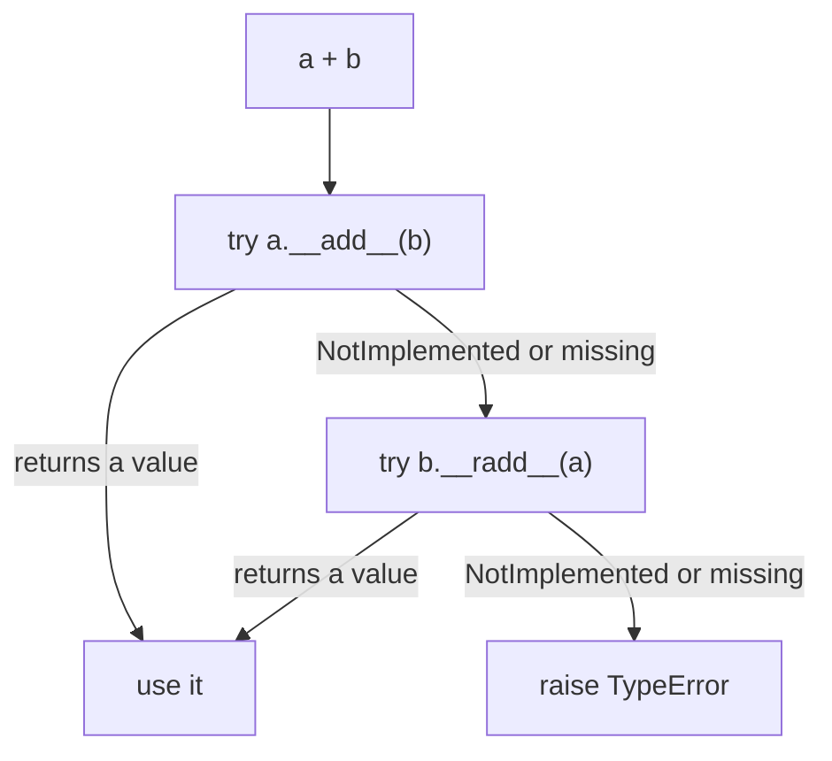

# Dunder Methods: The Complete Guide

> 📚 **Before you start**
>
> - [Classes and Objects](classes-and-objects.md) and [Inheritance and Polymorphism](inheritance-and-polymorphism.md)
> - [Decorators, classmethod and staticmethod](decorators-classmethod-and-staticmethod.md), for `@functools.total_ordering` and class methods
> - [Iterators and Generators](../06-functions-and-iterators/iterators-and-generators.md), for the iteration protocol

## Introduction

Why does `len(my_list)` work but `len(my_wallet)` raise `TypeError`? Why can you write `price_a + price_b` for numbers but not for your own `Money` class? Why does printing your object show `<__main__.Order object at 0x7f3a9c...>` instead of something useful?

Because Python's built-in operations are not magic. `len(x)` calls `x.__len__()`. `a + b` calls `a.__add__(b)`. `print(x)` calls `x.__str__()`. `for item in x` calls `x.__iter__()`. `with x:` calls `x.__enter__()` and `x.__exit__()`. These methods, whose names start and end with two underscores, are called **dunder methods** ("double underscore"), also known as **special methods** or **magic methods**. The full set of them is described in the "data model" chapter of the Python reference.

When you define dunder methods on your class, your objects plug straight into the language: they print nicely, compare and sort, do arithmetic, behave like containers, can be called like functions and work in `with` blocks. This is why a pandas DataFrame supports `df["col"]`, `df + 1` and `len(df)`, and why a NumPy array supports `a @ b`.

By the end of this lesson you will be able to implement all the important dunder methods correctly, including the subtle rules around equality and hashing, reflected arithmetic and `NotImplemented`.

> 💡 **Key Insight**
>
> You almost never *call* a dunder method yourself. You define it, and **Python calls it** when someone uses the matching syntax or built-in function. Defining dunders is how you teach Python's syntax to understand your objects.

---

## Core Explanation

### 1. How Syntax Maps to Dunder Methods

```python
text = "chai"
print(len(text), text.__len__())
print(text + "!", text.__add__("!"))
print("ha" in text, text.__contains__("ha"))
print(text[1], text.__getitem__(1))
```

Output:

```
4 4
chai! chai!
True True
h h
```

Each pair is the same operation. Python looks the dunder up on the object's **class** (not on the instance), then calls it. Here is a map of the ones covered in this lesson:

| You write | Python calls | Section |
|---|---|---|
| `repr(x)`, `str(x)`, `f"{x:spec}"` | `__repr__`, `__str__`, `__format__` | 2 |
| `x == y`, `hash(x)` | `__eq__`, `__hash__` | 3 |
| `x < y`, `sorted(xs)` | `__lt__` (and friends) | 4 |
| `x + y`, `y + x`, `x += y`, `-x` | `__add__`, `__radd__`, `__iadd__`, `__neg__` | 5 |
| `bool(x)`, `if x:`, `len(x)` | `__bool__`, `__len__` | 6 |
| `x[i]`, `x[i] = v`, `item in x`, `for i in x` | `__getitem__`, `__setitem__`, `__contains__`, `__iter__` | 7 |
| `x(args)` | `__call__` | 8 |
| `with x:` | `__enter__`, `__exit__` | 9 |
| `x.missing_attribute` | `__getattr__` | 10 |
| `Cls(args)` | `__new__`, then `__init__` | 11 |

### 2. Representing Objects: `__repr__`, `__str__` and `__format__`

```python
class Money:
    def __init__(self, paise):
        self.paise = paise                    # store money as whole paise to avoid float errors

    def __repr__(self):                       # for developers: unambiguous, ideally valid code
        return f"Money({self.paise})"

    def __str__(self):                        # for users: friendly
        return f"₹{self.paise / 100:,.2f}"


price = Money(125050)
print(price)                 # print uses str()
print(repr(price))
print([price, Money(500)])   # containers show their items with repr()
print(f"{price} | {price!r}")
```

Output:

```
₹1,250.50
Money(125050)
[Money(125050), Money(500)]
₹1,250.50 | Money(125050)
```

- **`__repr__`** is for developers: debugging, logs, the interactive prompt, and items inside lists. A good `__repr__` is unambiguous and, where possible, looks like the code that would recreate the object.
- **`__str__`** is for end users. If you don't define it, Python falls back to `__repr__`. So **always define `__repr__`**; add `__str__` only when you want a different, friendlier form.
- In an f-string, `!r` forces `repr()` and `!s` forces `str()`.

`__format__` lets your object understand format specifications after the colon, like `{value:.2f}` does for floats:

```python
class Money(Money):                          # extend the previous version
    def __format__(self, spec):
        if spec == "words":
            rupees, paise = divmod(self.paise, 100)
            return f"{rupees} rupees and {paise} paise"
        return format(self.paise / 100, spec or ",.2f")

price = Money(125050)
print(f"{price:words}")
print(f"{price:>12,.1f}|")
print(f"{price}")                            # empty spec: uses our default
```

Output:

```
1250 rupees and 50 paise
     1,250.5|
1,250.50
```

Note the last line: once `__format__` is defined, an f-string with no spec uses `__format__("")`, not `__str__`. Keep the two consistent in real code.

### 3. Equality and Hashing: `__eq__` and `__hash__`

By default, `==` checks identity. To compare by value, define `__eq__`:

```python
class Money:
    def __init__(self, paise):
        self.paise = paise
    def __repr__(self):
        return f"Money({self.paise})"
    def __eq__(self, other):
        if not isinstance(other, Money):
            return NotImplemented             # "I don't know how to compare with that"
        return self.paise == other.paise


print(Money(500) == Money(500), Money(500) == Money(700))
print(Money(500) == 500)                      # falls back to identity: False, no error
try:
    {Money(500)}
except TypeError as err:
    print("TypeError:", err)
```

Output:

```
True False
False
TypeError: unhashable type: 'Money'
```

Two important details:

**`NotImplemented`** (a special built-in value, not the exception `NotImplementedError`) tells Python "this method can't handle that type". Python then tries the reflected operation on the other object (`other.__eq__(self)`), and if that also gives up, `==` falls back to identity and returns `False`. Returning `NotImplemented` instead of `False` lets *other* classes define how they compare with yours.

**Defining `__eq__` sets `__hash__` to `None`**, making your objects unhashable: they can't go in sets or be dictionary keys. Python does this on purpose. Sets and dicts rely on the rule:

> If `a == b`, then `hash(a) == hash(b)` must be true.

If you changed equality but kept the default identity-based hash, two equal objects would land in different buckets and a set could contain "duplicates". To be hashable, define a `__hash__` built from the same fields `__eq__` compares, and only do so if those fields **never change** after creation (otherwise the object gets "lost" inside a set when it mutates):

```python
class Money:
    __slots__ = ("_paise",)                       # no other attributes allowed

    def __init__(self, paise):
        object.__setattr__(self, "_paise", paise)

    @property
    def paise(self):
        return self._paise

    def __setattr__(self, name, value):           # make instances immutable
        raise AttributeError("Money is immutable")

    def __repr__(self):
        return f"Money({self._paise})"

    def __eq__(self, other):
        if not isinstance(other, Money):
            return NotImplemented
        return self._paise == other._paise

    def __hash__(self):
        return hash(self._paise)                  # same field as __eq__


wallet = {Money(500), Money(500), Money(1000)}
print(sorted(m.paise for m in wallet))
print({Money(500): "five rupees"}[Money(500)])
```

Output:

```
[500, 1000]
five rupees
```

That is a lot of code for an immutable value. In practice, `@dataclass(frozen=True)` writes `__eq__` and `__hash__` correctly for you, which is why it is the recommended way to build value objects (see [Classes and Objects](classes-and-objects.md)). Writing it by hand once shows you what the dataclass is doing.

### 4. Ordering: `__lt__`, `__le__`, `__gt__`, `__ge__`

`sorted()`, `min()`, `max()` and `<` need ordering methods. You could write all four, but `functools.total_ordering` fills in the rest from `__eq__` plus one of them:

```python
import functools

@functools.total_ordering
class Over:
    """A cricket over, written like 12.4 (12 overs and 4 balls)."""

    def __init__(self, text):
        overs, balls = text.split(".")
        self.balls_bowled = int(overs) * 6 + int(balls)
        self.text = text

    def __repr__(self):
        return f"Over({self.text!r})"

    def __eq__(self, other):
        if not isinstance(other, Over):
            return NotImplemented
        return self.balls_bowled == other.balls_bowled

    def __lt__(self, other):
        if not isinstance(other, Over):
            return NotImplemented
        return self.balls_bowled < other.balls_bowled

    __hash__ = None                          # mutable, compared by value: explicitly unhashable


overs = [Over("19.5"), Over("3.2"), Over("19.1"), Over("10.0")]
print(sorted(overs))
print(Over("12.4") >= Over("12.3"), Over("5.0") <= Over("4.5"), max(overs))
```

Output:

```
[Over('3.2'), Over('10.0'), Over('19.1'), Over('19.5')]
True False Over('19.5')
```

For **sorting** alone you don't need any dunders at all: `sorted(items, key=lambda o: o.balls_bowled)` works on any object. Define ordering dunders when the type has one natural order that people will expect `<` to use.

### 5. Arithmetic: `__add__`, `__radd__`, `__iadd__` and Friends

```python
@functools.total_ordering
class Money:
    def __init__(self, paise):
        self.paise = int(paise)

    def __repr__(self):
        return f"Money({self.paise})"

    def __str__(self):
        return f"₹{self.paise / 100:,.2f}"

    def __eq__(self, other):
        return self.paise == other.paise if isinstance(other, Money) else NotImplemented

    def __lt__(self, other):
        return self.paise < other.paise if isinstance(other, Money) else NotImplemented

    def __hash__(self):
        return hash(self.paise)

    def __add__(self, other):                     # Money + Money
        if isinstance(other, Money):
            return Money(self.paise + other.paise)
        return NotImplemented

    def __radd__(self, other):                    # 0 + Money (needed by sum())
        if other == 0:
            return self
        return self.__add__(other)

    def __sub__(self, other):
        if isinstance(other, Money):
            return Money(self.paise - other.paise)
        return NotImplemented

    def __mul__(self, factor):                    # Money * number
        if isinstance(factor, (int, float)):
            return Money(round(self.paise * factor))
        return NotImplemented

    __rmul__ = __mul__                            # number * Money

    def __neg__(self):
        return Money(-self.paise)

    def __abs__(self):
        return Money(abs(self.paise))

    def __bool__(self):
        return self.paise != 0


chai, samosa = Money(1500), Money(2000)
bill = chai * 2 + samosa * 3
print(bill, repr(bill))
print(3 * chai, -chai, abs(Money(-250)))
print(sum([chai, samosa, Money(1000)]))
print(max(chai, samosa), bool(Money(0)))
try:
    chai + 15
except TypeError as err:
    print("TypeError:", err)
```

Output:

```
₹90.00 Money(9000)
₹45.00 ₹-15.00 ₹2.50
₹45.00
₹20.00 False
TypeError: unsupported operand type(s) for +: 'Money' and 'int'
```

How Python evaluates `a + b`:



- **Reflected methods** (`__radd__`, `__rmul__`, ...) handle the case where *your* object is on the right. `3 * chai` calls `int.__mul__(3, chai)`, which returns `NotImplemented`, so Python tries `chai.__rmul__(3)`.
- **`sum()` starts from `0`**, so it computes `0 + chai` first. Without `__radd__` accepting `0`, `sum()` on Money objects fails.
- **In-place operators** (`+=`) call `__iadd__` if defined; otherwise Python falls back to `a = a + b`. Mutable types like `list` define `__iadd__` to modify in place; immutable ones like our `Money` simply don't define it.

The full family: `__add__ __sub__ __mul__ __truediv__ (/) __floordiv__ (//) __mod__ (%) __pow__ (**) __matmul__ (@)`, each with an `r` and an `i` version, plus unary `__neg__ __pos__ __abs__ __invert__ (~)`.

### 6. Truthiness and Size: `__bool__` and `__len__`

`if x:` asks `bool(x)`, which calls `__bool__`. If there is no `__bool__`, Python uses `__len__` (zero length is false). If neither exists, every object is true. Our `Money` defined `__bool__`, so a zero amount is falsy, just like `0`.

### 7. Behaving Like a Container: `__len__`, `__getitem__`, `__contains__`, `__iter__`

Here is a shopping cart that supports `len`, indexing, slicing, `in`, `for`, item assignment and deletion:

```python
class Cart:
    def __init__(self, items=None):
        self._items = list(items or [])

    def __repr__(self):
        return f"Cart({self._items!r})"

    def __len__(self):
        return len(self._items)

    def __getitem__(self, index):                 # cart[0], cart[-1], cart[1:3]
        result = self._items[index]
        return Cart(result) if isinstance(index, slice) else result

    def __setitem__(self, index, value):          # cart[0] = "tea"
        self._items[index] = value

    def __delitem__(self, index):                 # del cart[0]
        del self._items[index]

    def __contains__(self, item):                 # "tea" in cart
        return item in self._items

    def __iter__(self):                           # for item in cart
        yield from self._items

    def __reversed__(self):                       # reversed(cart)
        return reversed(self._items)


cart = Cart(["rice", "dal", "ghee", "jaggery"])
print(len(cart), cart[0], cart[-1], cart[1:3])
cart[1] = "toor dal"
del cart[2]
print(cart, "ghee" in cart, "rice" in cart)
print([item.upper() for item in cart], list(reversed(cart)))
print(bool(Cart()), sorted(cart), ", ".join(cart))
```

Output:

```
4 rice jaggery Cart(['dal', 'ghee'])
Cart(['rice', 'toor dal', 'jaggery']) False True
['RICE', 'TOOR DAL', 'JAGGERY'] ['jaggery', 'toor dal', 'rice']
False ['jaggery', 'rice', 'toor dal'] rice, toor dal, jaggery
```

Notes:

- `__getitem__` receives either an integer or a **`slice` object** (`cart[1:3]` passes `slice(1, 3, None)`). Checking for `slice` lets slicing return a new `Cart` instead of a plain list.
- `__iter__` written as a **generator** (using `yield`) is the simplest way to make an object iterable. `sorted`, `list`, `", ".join`, unpacking and comprehensions all work once `__iter__` exists.
- If you define only `__getitem__` (with integer indexes starting at 0), Python can still iterate and use `in` by trying indexes 0, 1, 2, ... until `IndexError`. Defining `__iter__` and `__contains__` is clearer and faster.
- For a full list-like or dict-like class, inherit from `collections.abc.MutableSequence` or `MutableMapping` and implement the few abstract methods: you get the rest for free (see [Encapsulation and Abstraction](encapsulation-and-abstraction.md)).

### 8. Callable Objects: `__call__`

An object with `__call__` can be called like a function. This is useful for functions that need configuration or memory:

```python
class GSTCalculator:
    def __init__(self, rate_percent):
        self.rate = rate_percent
        self.calls = 0

    def __call__(self, amount):
        self.calls += 1
        return round(amount * (1 + self.rate / 100), 2)


gst_18 = GSTCalculator(18)
print(gst_18(1000), gst_18(250), "calls:", gst_18.calls)
print(callable(gst_18), callable(42))
print(list(map(GSTCalculator(5), [100, 200])))
```

Output:

```
1180.0 295.0 calls: 2
True False
[105.0, 210.0]
```

PyTorch models are the most famous example: `model(x)` calls `nn.Module.__call__`, which runs hooks and then your `forward` method. LangChain runnables, scikit-learn transformers in pipelines and class-based decorators (see the previous lesson) rely on the same idea.

### 9. Context Managers: `__enter__` and `__exit__`

The `with` statement guarantees clean-up. `with obj as x:` calls `obj.__enter__()` (its return value becomes `x`), runs the block, and then **always** calls `obj.__exit__(exc_type, exc_value, traceback)`, even if the block raised an exception:

```python
class ChaiBreak:
    def __init__(self, person):
        self.person = person

    def __enter__(self):
        print(f"{self.person} leaves the desk")
        return self                                  # bound to the name after 'as'

    def __exit__(self, exc_type, exc_value, tb):
        print(f"{self.person} is back at the desk")
        if exc_type is not None:
            print(f"   (break ended early: {exc_value})")
        return False                                 # False: don't swallow the exception


with ChaiBreak("Asha") as brk:
    print(f"   {brk.person} drinks chai")

try:
    with ChaiBreak("Ravi"):
        raise RuntimeError("manager called")
except RuntimeError:
    print("exception still reached the caller")
```

Output:

```
Asha leaves the desk
   Asha drinks chai
Asha is back at the desk
Ravi leaves the desk
Ravi is back at the desk
   (break ended early: manager called)
exception still reached the caller
```

If `__exit__` returns `True`, the exception is suppressed. Do that only deliberately. Files, locks, database connections and HTTP clients are all context managers. You will use them throughout [Reading and Writing Files](../08-file-handling/reading-and-writing-files.md), and write them the easy way with `contextlib` in [Error Handling Best Practices](../09-modules-and-exceptions/error-handling-best-practices.md). The async equivalents, `__aenter__` and `__aexit__`, power `async with` in Module 10.

### 10. Attribute Access: `__getattr__`

`__getattr__` is called **only when normal lookup fails**. It is a neat way to build flexible objects, for example a config object that allows dotted access to a dictionary, or a wrapper that forwards (delegates) unknown attributes to another object:

```python
class Config:
    def __init__(self, data):
        self._data = data

    def __getattr__(self, name):                  # only for attributes not found normally
        try:
            value = self._data[name]
        except KeyError:
            raise AttributeError(f"config has no setting {name!r}") from None
        return Config(value) if isinstance(value, dict) else value


cfg = Config({"model": "claude-opus-5-5", "retry": {"attempts": 3, "backoff": 2.0}})
print(cfg.model, cfg.retry.attempts, cfg.retry.backoff)
print(getattr(cfg, "timeout", 30))                # AttributeError lets getattr's default work
```

Output:

```
claude-opus-5-5 3 2.0
30
```

Always raise `AttributeError` (not `KeyError`) from `__getattr__`, or `hasattr` and `getattr` with a default will break. Its stronger cousin `__getattribute__` runs on *every* attribute access and is rarely needed; `__setattr__` and `__delattr__` intercept assignment and deletion (you saw `__setattr__` used for immutability in section 3).

### 11. Creation and Class-Level Hooks: `__new__`, `__init_subclass__`, `__del__`

- **`__new__(cls, ...)`** actually creates the object and returns it; `__init__` then initialises it. You need `__new__` mainly when subclassing immutable types like `int`, `str` or `tuple`, because by the time `__init__` runs their value is already fixed:

```python
class Percentage(float):
    def __new__(cls, value):
        if not 0 <= value <= 100:
            raise ValueError("percentage must be 0-100")
        return super().__new__(cls, value)

    def __repr__(self):
        return f"{float(self):g}%"


print(Percentage(87.5), Percentage(87.5) + 2)      # still a float underneath
```

Output:

```
87.5% 89.5
```

- **`__init_subclass__(cls, **kwargs)`** runs on the *parent* whenever a subclass is defined. It is a lightweight way to build registries or check subclasses, without the decorator from the previous lesson:

```python
class Plugin:
    registry = {}

    def __init_subclass__(cls, name, **kwargs):
        super().__init_subclass__(**kwargs)
        Plugin.registry[name] = cls

class PDFExporter(Plugin, name="pdf"):
    pass

class CSVExporter(Plugin, name="csv"):
    pass

print({k: v.__name__ for k, v in sorted(Plugin.registry.items())})
```

Output:

```
{'csv': 'CSVExporter', 'pdf': 'PDFExporter'}
```

- **`__del__`** runs when an object is about to be destroyed by the garbage collector. *When* that happens isn't guaranteed, so never rely on it for important clean-up such as closing files. Use a context manager instead.

### 12. Dataclasses Write Dunders for You

Now you can see exactly what `@dataclass` generates: `__init__`, `__repr__` and `__eq__` by default; `__lt__`, `__le__`, `__gt__` and `__ge__` with `order=True`; `__hash__` with `frozen=True` (plus a `__setattr__` that refuses changes). You can still add your own dunders to a dataclass:

```python
from dataclasses import dataclass

@dataclass(frozen=True, order=True)
class Rupees:
    paise: int

    def __str__(self):
        return f"₹{self.paise / 100:,.2f}"

    def __add__(self, other):
        return Rupees(self.paise + other.paise) if isinstance(other, Rupees) else NotImplemented


a, b = Rupees(9900), Rupees(4950)
print(a + b, repr(a + b), sorted([a, b])[0], len({a, Rupees(9900)}))
```

Output:

```
₹148.50 Rupees(paise=14850) ₹49.50 1
```

A sensible default: **start with a dataclass**, then add only the dunders the dataclass can't write for you.

---

## Try It Yourself

1. Write a `Vector2D` class with `x` and `y`, a `__repr__` like `Vector2D(1, 2)`, `__add__`, `__mul__` by a number (with `__rmul__`), `__abs__` returning the length (`math.hypot`), and `__eq__`. Print `Vector2D(1, 2) + Vector2D(3, 4)`, `2 * Vector2D(1, 1)` and `abs(Vector2D(3, 4))`.
2. Make a `Playlist` class whose `__len__` returns the number of songs and whose `__getitem__` supports indexing. Check that `for song in playlist` works even though you didn't write `__iter__`.
3. What does this print, and why?
   ```python
   class Point:
       def __init__(self, x): self.x = x
       def __eq__(self, other): return self.x == other.x
   print(Point(1) == Point(1), Point.__hash__)
   ```
4. Add `__len__` and `__bool__` to a class `Inbox` (holding a list of messages) such that `if inbox:` is true only when there are **unread** messages, while `len(inbox)` counts all messages.

<details>
<summary>Show answers</summary>

**1.**

```python
import math

class Vector2D:
    def __init__(self, x, y):
        self.x, self.y = x, y
    def __repr__(self):
        return f"Vector2D({self.x}, {self.y})"
    def __add__(self, other):
        if not isinstance(other, Vector2D):
            return NotImplemented
        return Vector2D(self.x + other.x, self.y + other.y)
    def __mul__(self, k):
        if not isinstance(k, (int, float)):
            return NotImplemented
        return Vector2D(self.x * k, self.y * k)
    __rmul__ = __mul__
    def __abs__(self):
        return math.hypot(self.x, self.y)
    def __eq__(self, other):
        if not isinstance(other, Vector2D):
            return NotImplemented
        return (self.x, self.y) == (other.x, other.y)

print(Vector2D(1, 2) + Vector2D(3, 4), 2 * Vector2D(1, 1), abs(Vector2D(3, 4)))
```

Output:

```
Vector2D(4, 6) Vector2D(2, 2) 5.0
```

**2.** With only `__getitem__`, Python iterates by trying index 0, 1, 2... until `IndexError`.

```python
class Playlist:
    def __init__(self, songs):
        self.songs = songs
    def __len__(self):
        return len(self.songs)
    def __getitem__(self, i):
        return self.songs[i]

pl = Playlist(["Kesariya", "Tum Hi Ho", "Chaiyya Chaiyya"])
print(len(pl), pl[1], [song for song in pl])
```

Output:

```
3 Tum Hi Ho ['Kesariya', 'Tum Hi Ho', 'Chaiyya Chaiyya']
```

**3.** Defining `__eq__` without `__hash__` sets `__hash__` to `None`, so `Point` objects are unhashable.

```python
class Point:
    def __init__(self, x): self.x = x
    def __eq__(self, other): return self.x == other.x
print(Point(1) == Point(1), Point.__hash__)
```

Output:

```
True None
```

**4.**

```python
class Inbox:
    def __init__(self):
        self.messages = []            # list of (text, read) pairs
    def __len__(self):
        return len(self.messages)
    def __bool__(self):
        return any(not read for _, read in self.messages)

inbox = Inbox()
inbox.messages += [("OTP 4821", True), ("Train delayed", True)]
print(len(inbox), bool(inbox))
inbox.messages.append(("Salary credited", False))
print(len(inbox), bool(inbox))
```

Output:

```
2 False
3 True
```

</details>

---

## Real-World Examples

### Example 1: NumPy and pandas

`array_a + array_b`, `array * 2`, `a @ b` (matrix multiply), `df["price"]`, `df[df["city"] == "Pune"]` and `len(df)` are all dunder methods (`__add__`, `__mul__`, `__matmul__`, `__getitem__`, `__eq__`, `__len__`). Note how pandas' `__eq__` returns a whole column of booleans instead of a single `True`/`False`: dunders can return anything that makes sense for the type.

### Example 2: `pathlib.Path`

`Path("data") / "2026" / "sales.csv"` works because `Path` defines `__truediv__` to join paths. You will use it constantly from [Reading and Writing Files](../08-file-handling/reading-and-writing-files.md) on.

### Example 3: LangChain's pipe operator

LangChain composes steps with `prompt | model | parser`. That `|` is `__or__` (and `__ror__`), returning a new runnable sequence. Once you know dunders, this syntax is easy to read.

### Example 4: Callable models

`model(inputs)` in PyTorch and `pipeline(text)` in Hugging Face Transformers both call `__call__`, which wraps the real work with hooks, batching and pre- and post-processing.

---

## Common Misconceptions

### Misconception 1: "`__str__` is enough"

Containers, logs, debuggers and the REPL use `__repr__`. Define `__repr__` first; `__str__` falls back to it.

### Misconception 2: "Return `False` from `__eq__` for other types"

Return `NotImplemented`, which lets Python try the other object's method. It is also what makes `==` across types fall back cleanly.

### Misconception 3: "My class with `__eq__` can still go in a set"

Defining `__eq__` removes the default `__hash__`. Add a `__hash__` based on the same, immutable fields, or use `@dataclass(frozen=True)`.

### Misconception 4: "`NotImplemented` and `NotImplementedError` are the same"

`NotImplemented` is a value returned from binary dunder methods to say "try something else". `NotImplementedError` is an exception raised by a method that a subclass was supposed to override.

### Misconception 5: "`__del__` is a destructor I can use for clean-up"

Its timing isn't guaranteed and errors in it are ignored. Use `with` and `__exit__`.

---

## Interview Relevance

Interviewers use dunders to check whether you understand how Python really works. A strong answer covers:

- **The mapping** from syntax to methods (`len` → `__len__`, `+` → `__add__`, `with` → `__enter__`/`__exit__`).
- **`__repr__` vs `__str__`** and which one containers use.
- **The `__eq__`/`__hash__` contract**: equal objects must have equal hashes; defining `__eq__` makes a class unhashable unless you add `__hash__`; only hash immutable data.
- **Reflected operators and `NotImplemented`**, including why `sum()` needs `__radd__`.
- **Iteration and container protocols:** `__iter__`, `__getitem__` with slices, `__contains__`.

Common follow-ups:

- *"How do you make a class usable in a `with` statement?"* `__enter__` and `__exit__`, or `@contextlib.contextmanager`.
- *"What's the difference between `__getattr__` and `__getattribute__`?"* The first runs only when lookup fails; the second on every access.
- *"When do you need `__new__`?"* Subclassing immutable types, singletons, and controlling instance creation.

---

## Key Takeaways

- **Dunder methods connect your classes to Python syntax**: you define them, Python calls them.
- **Always write a `__repr__`**; add `__str__` and `__format__` for user-facing output.
- **`__eq__` and `__hash__` go together**: equal objects need equal hashes, and only immutable objects should be hashable.
- **Return `NotImplemented` for unsupported types** so Python can try reflected methods like `__radd__`.
- **Container, callable and context-manager protocols** (`__len__`/`__getitem__`/`__iter__`, `__call__`, `__enter__`/`__exit__`) make objects feel built-in; dataclasses generate the common ones for you.

---

**Up next:** [Lab: Model a library system with classes](lab-model-a-library-system-with-classes.md)
