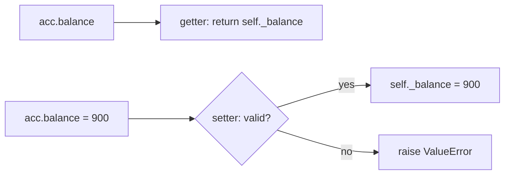

# Encapsulation and Abstraction: The Complete Guide

> 📚 **Before you start**
>
> - [Classes and Objects](classes-and-objects.md): attributes, methods and dataclasses
> - [Inheritance and Polymorphism](inheritance-and-polymorphism.md): subclasses, overriding, duck typing and `Protocol`

## Introduction

When you drive a car you use a steering wheel, two or three pedals and a gear lever. You do not touch the fuel injectors, and you could not set the engine temperature directly even if you wanted to. The car **hides** its internals behind a small set of controls (encapsulation), and every car **presents the same kind of controls** whatever engine is underneath, petrol, diesel or electric (abstraction). Because of that, you can drive a car you have never seen before.

Code needs the same two properties. A bank account class should not let any line of code write `account.balance = -5000`. A program that sends notifications should depend on "something that can send", not on the details of the SMS gateway. When internals are hidden and interfaces are clear, you can change the inside of a class without breaking the hundred places that use it.

Python handles this differently from Java or C++. It has no `private` keyword. Instead it has naming conventions, name mangling, **properties** and **abstract base classes**. By the end of this lesson you will know all four, plus descriptors (the mechanism behind properties) and how to choose between ABCs and Protocols.

> 💡 **Key Insight**
>
> **Encapsulation** is about protecting an object's state: callers go through methods and properties that enforce the rules. **Abstraction** is about defining *what* something does without saying *how*: an abstract base class lists the methods every implementation must provide. Python trusts programmers ("we're all consenting adults"), so it uses conventions and checks rather than hard locks.

---

## Core Explanation

### 1. Encapsulation: Public, Internal and Name-Mangled Attributes

Python has three naming levels:

| Name | Meaning | Enforced? |
|---|---|---|
| `balance` | **Public.** Part of the class's interface; anyone may use it. | n/a |
| `_balance` | **Internal** ("protected" by convention). Don't touch it from outside the class or its subclasses. | No, it is a convention every Python developer respects. Tools like linters warn about it. `from module import *` skips such names. |
| `__balance` | **Name-mangled.** Python renames it to `_ClassName__balance` inside the class. | Partly: it prevents accidental clashes, not determined access |

```python
class Account:
    def __init__(self, owner, balance):
        self.owner = owner            # public
        self._balance = balance       # internal: please use the methods
        self.__pin = "4321"           # mangled to _Account__pin

    def check_pin(self, pin):
        return pin == self.__pin      # inside the class the short name works


acc = Account("Asha", 1000)
print(acc.owner, acc._balance)        # works, but _balance is a hint: "don't"
print(acc.check_pin("4321"))
try:
    print(acc.__pin)
except AttributeError as err:
    print("AttributeError:", err)
print(acc._Account__pin)             # the mangled name is still reachable
print([k for k in vars(acc)])
```

Output:

```
Asha 1000
True
AttributeError: 'Account' object has no attribute '__pin'
4321
['owner', '_balance', '_Account__pin']
```

`vars(obj)` is the same as `obj.__dict__`. It shows the real stored name, `_Account__pin`.

Name mangling's real purpose is **avoiding name clashes in subclasses**. If a parent and a child both use `self.__cache`, mangling turns them into `_Parent__cache` and `_Child__cache`, so they don't overwrite each other:

```python
class Parent:
    def __init__(self):
        self.__cache = "parent's"
    def parent_cache(self):
        return self.__cache

class Child(Parent):
    def __init__(self):
        super().__init__()
        self.__cache = "child's"       # a different attribute: _Child__cache
    def child_cache(self):
        return self.__cache

c = Child()
print(c.parent_cache(), "|", c.child_cache())
```

Output:

```
parent's | child's
```

In everyday code, a single underscore is enough. Use double underscores only when you are writing a class that others will subclass and you need to avoid collisions. And note: names that both *start and end* with double underscores, such as `__init__`, are **not** mangled. Those are special methods.

### 2. The Problem Properties Solve

Suppose `Account` started with a public `balance` attribute, and 50 places in the code read and write `acc.balance`. Now the business adds a rule: the balance can never go negative. With a plain attribute, nothing stops `acc.balance = -500`.

In Java you would have started with `getBalance()` and `setBalance()` "just in case". Python doesn't need that ceremony: you can start with a plain attribute and later turn it into a **property**, which looks like an attribute to callers but runs your methods behind the scenes. Callers keep writing `acc.balance` and never notice the change.

### 3. Properties: Getters, Setters and Deleters

```python
class Account:
    def __init__(self, owner, balance=0):
        self.owner = owner
        self.balance = balance            # goes through the setter below, so it is validated too

    @property
    def balance(self):                    # getter: runs on  acc.balance
        return self._balance

    @balance.setter
    def balance(self, value):             # setter: runs on  acc.balance = value
        if not isinstance(value, (int, float)):
            raise TypeError("balance must be a number")
        if value < 0:
            raise ValueError("balance cannot be negative")
        self._balance = value

    @balance.deleter
    def balance(self):                    # deleter: runs on  del acc.balance
        raise AttributeError("an account's balance cannot be deleted")


acc = Account("Ravi", 500)
acc.balance += 250                        # read through the getter, write through the setter
print(acc.balance)

for bad in (-100, "lots"):
    try:
        acc.balance = bad
    except (ValueError, TypeError) as err:
        print(type(err).__name__, "-", err)

try:
    Account("Meera", -1)
except ValueError as err:
    print("Constructor also validated:", err)
```

Output:

```
750
ValueError - balance cannot be negative
TypeError - balance must be a number
Constructor also validated: balance cannot be negative
```

How it fits together:

- `@property` turns the first `balance` method into a **property object** with a getter. The value is actually stored in `self._balance` (with an underscore, so it doesn't clash with the property's name).
- `@balance.setter` adds a setter to that same property. The method must have the **same name**.
- In `__init__`, `self.balance = balance` goes through the setter, so even the opening balance is validated. This is a good habit: one validation path.



A common bug: writing `self.balance = value` *inside the setter* instead of `self._balance = value`. That calls the setter again, which calls it again, until Python raises `RecursionError`.

### 4. Read-Only and Computed Properties

A property with only a getter is **read-only**. It is perfect for values computed from other attributes:

```python
from datetime import date

class Passenger:
    def __init__(self, name, birth_year):
        self.name = name
        self.birth_year = birth_year

    @property
    def age(self):
        return date(2026, 10, 11).year - self.birth_year   # fixed date so output stays the same

    @property
    def is_senior_citizen(self):
        return self.age >= 60                               # the cut-off used in this example


p = Passenger("Ramesh", 1962)
print(p.age, p.is_senior_citizen)
try:
    p.age = 30
except AttributeError as err:
    print("AttributeError:", err)
```

Output:

```
64 True
AttributeError: property 'age' of 'Passenger' object has no setter
```

Computed properties never go stale: change `birth_year` and `age` follows automatically. Keep them **cheap** (no network calls or heavy work), because callers will assume reading an attribute is fast.

### 5. `cached_property`: Compute Once, Then Remember

When a value is expensive to compute and won't change, `functools.cached_property` computes it on first access and stores the result on the instance:

```python
from functools import cached_property

class Document:
    def __init__(self, text):
        self.text = text
        self.computations = 0

    @cached_property
    def word_count(self):
        self.computations += 1             # count how often the "expensive" work runs
        return len(self.text.split())


doc = Document("chai is the fuel of every Indian office")
print(doc.word_count, doc.word_count, doc.word_count)
print("computed", doc.computations, "time(s)")
del doc.word_count                         # clear the cache to force a recompute
print(doc.word_count, "computed", doc.computations, "time(s)")
```

Output:

```
8 8 8
computed 1 time(s)
8 computed 2 time(s)
```

Use it for things like a tokenised version of a document or a parsed configuration. Don't use it when the underlying data can change, because the cached value won't update by itself. (It also needs a normal `__dict__`, so it doesn't work on classes with `__slots__`.)

### 6. How Properties Work: Descriptors

A property is an example of a **descriptor**: an object stored on a *class* that defines `__get__`, `__set__` or `__delete__`. When Python looks up an attribute and finds a descriptor on the class, it calls those methods instead of returning the object. Methods, `classmethod`, `staticmethod` and `property` are all descriptors.

You can write your own descriptor to reuse validation across many attributes and classes, instead of writing the same property again and again:

```python
class Positive:
    """A reusable 'must be a positive number' attribute."""

    def __set_name__(self, owner, name):      # Python tells the descriptor its attribute name
        self.private_name = "_" + name

    def __get__(self, obj, objtype=None):
        if obj is None:                       # accessed on the class itself
            return self
        return getattr(obj, self.private_name)

    def __set__(self, obj, value):
        if value <= 0:
            raise ValueError(f"{self.private_name[1:]} must be positive, got {value}")
        setattr(obj, self.private_name, value)


class Product:
    price = Positive()
    stock = Positive()

    def __init__(self, name, price, stock):
        self.name, self.price, self.stock = name, price, stock


p = Product("Basmati rice 5kg", 699, 40)
print(p.price, p.stock)
try:
    p.stock = 0
except ValueError as err:
    print("ValueError:", err)
```

Output:

```
699 40
ValueError: stock must be positive, got 0
```

You won't write descriptors often, but knowing they exist explains a lot of library "magic": Django model fields, SQLAlchemy columns and Pydantic fields all build on this attribute-lookup hook.

### 7. Abstraction: Abstract Base Classes

**Abstraction** means working with the *idea* of something rather than a specific implementation. "A notifier can `send(to, message)`" is the abstraction; "send it through an SMS gateway" is one implementation.

An **abstract base class (ABC)** writes that abstraction down as a class that can't be used directly. It declares **abstract methods** that every concrete subclass *must* implement. Python enforces this when you try to create an object:

```python
from abc import ABC, abstractmethod

class Notifier(ABC):
    @abstractmethod
    def send(self, to, message):
        """Deliver the message. Return a delivery id."""

    def send_many(self, recipients, message):          # a concrete method every subclass gets
        return [self.send(r, message) for r in recipients]


class SMSNotifier(Notifier):
    def send(self, to, message):
        return f"sms:{to}"


class LazyNotifier(Notifier):
    pass                                               # forgot to implement send


print(SMSNotifier().send_many(["9800000001", "9800000002"], "Your OTP is 4821"))

for cls in (Notifier, LazyNotifier):
    try:
        cls()
    except TypeError as err:
        print("TypeError:", err)
```

Output:

```
['sms:9800000001', 'sms:9800000002']
TypeError: Can't instantiate abstract class Notifier without an implementation for abstract method 'send'
TypeError: Can't instantiate abstract class LazyNotifier without an implementation for abstract method 'send'
```

What you get from an ABC:

- **A clear contract.** Anyone adding a new notifier can read `Notifier` and see exactly what to implement.
- **An early, loud failure.** A subclass that forgets a method fails when an object is *created*, not hours later when the missing method is finally called.
- **Shared code.** Concrete methods such as `send_many` are written once and are built on top of the abstract ones. This is called the **template method pattern**: the base class defines the overall algorithm and subclasses fill in the steps.

#### Abstract properties and partially abstract classes

`@abstractmethod` combines with `@property` (put `@property` on top), and with `@classmethod` and `@staticmethod`:

```python
class LLMProvider(ABC):
    @property
    @abstractmethod
    def model_name(self) -> str: ...

    @abstractmethod
    def generate(self, prompt: str) -> str: ...

    def describe(self):
        return f"{type(self).__name__} using {self.model_name}"


class FakeProvider(LLMProvider):
    @property
    def model_name(self):
        return "claude-opus-5-5 (fake)"

    def generate(self, prompt):
        return f"echo: {prompt}"


llm = FakeProvider()
print(llm.describe())
print(llm.generate("namaste"))
print(isinstance(llm, LLMProvider))
```

Output:

```
FakeProvider using claude-opus-5-5 (fake)
echo: namaste
True
```

This is exactly how you would make an AI app independent of any one model vendor: the rest of the code depends on `LLMProvider`, and tests use `FakeProvider`.

### 8. The Standard Library's ABCs: `collections.abc`

Python ships ABCs for its own container ideas in `collections.abc`: `Iterable`, `Iterator`, `Sized`, `Container`, `Sequence`, `Mapping`, `MutableMapping`, `Callable` and more. They are useful in two ways.

**Checking capabilities with `isinstance`.** Many of these ABCs recognise a class just from its methods, without inheritance:

```python
from collections.abc import Iterable, Mapping, Sized, Callable

class Playlist:
    def __init__(self, songs):
        self.songs = songs
    def __iter__(self):
        return iter(self.songs)
    def __len__(self):
        return len(self.songs)


for value in ([1, 2], {"a": 1}, "chai", 42, Playlist(["Kesariya"]), lambda x: x):
    print(f"{type(value).__name__:<9} iterable={isinstance(value, Iterable)!s:<5} "
          f"sized={isinstance(value, Sized)!s:<5} mapping={isinstance(value, Mapping)!s:<5} "
          f"callable={isinstance(value, Callable)}")
```

Output:

```
list      iterable=True  sized=True  mapping=False callable=False
dict      iterable=True  sized=True  mapping=True  callable=False
str       iterable=True  sized=True  mapping=False callable=False
int       iterable=False sized=False mapping=False callable=False
Playlist  iterable=True  sized=True  mapping=False callable=False
function  iterable=False sized=False mapping=False callable=True
```

`Playlist` never inherited from `Iterable`, but it has `__iter__`, so it counts. (This works through a hook called `__subclasshook__`, which these ABCs define.)

**Getting methods for free by inheriting.** Subclass `Mapping` and implement just three methods (`__getitem__`, `__iter__`, `__len__`), and you get `keys`, `items`, `values`, `get`, `__contains__` and `==` written for you:

```python
from collections.abc import Mapping

class FareTable(Mapping):
    def __init__(self, fares):
        self._fares = dict(fares)
    def __getitem__(self, cls):
        return self._fares[cls.upper()]
    def __iter__(self):
        return iter(self._fares)
    def __len__(self):
        return len(self._fares)


fares = FareTable({"SL": 485, "3A": 1290, "2A": 1840})
print(fares["3a"], "2A" in fares, fares.get("1A", "not available"))
print(sorted(fares.items()))
```

Output:

```
1290 True not available
[('2A', 1840), ('3A', 1290), ('SL', 485)]
```

### 9. ABCs vs Protocols

You met `typing.Protocol` in [Inheritance and Polymorphism](inheritance-and-polymorphism.md). Both describe an interface. The difference is *when* and *how* conformance is checked:

| | Abstract base class | Protocol |
|---|---|---|
| How a class conforms | Inherits from it (**nominal** typing) | Just has the right methods (**structural** typing) |
| Checked at runtime? | Yes: can't instantiate a subclass missing a method | No, unless decorated `@runtime_checkable`, and then `isinstance` only checks method *names* exist |
| Checked by type checkers? | Yes | Yes |
| Can provide shared code? | Yes (concrete methods) | Not usefully; implementations don't inherit it |
| Best for | Your own class hierarchy, plug-in systems, template methods | Accepting third-party objects you can't make inherit from you |

```python
from typing import Protocol, runtime_checkable

@runtime_checkable
class CanSend(Protocol):
    def send(self, to, message): ...

class WhatsAppSender:                      # no inheritance at all
    def send(self, to, message):
        return f"wa:{to}"

print(isinstance(WhatsAppSender(), CanSend), isinstance("text", CanSend))
```

Output:

```
True False
```

### 10. Putting It Together

Encapsulation and abstraction work together. Here is a payment gateway interface (abstraction) whose implementations keep their state behind properties and internal names (encapsulation):

```python
class PaymentGateway(ABC):
    def __init__(self):
        self._transactions = []                    # internal: callers use the property

    @property
    def total_collected(self):
        return sum(self._transactions)

    def collect(self, amount):                     # public interface, with the rules
        if amount <= 0:
            raise ValueError("amount must be positive")
        reference = self._charge(amount)           # the step subclasses provide
        self._transactions.append(amount)
        return reference

    @abstractmethod
    def _charge(self, amount): ...                 # internal + abstract: subclasses implement it


class UPIGateway(PaymentGateway):
    def _charge(self, amount):
        return f"UPI-{len(self._transactions) + 1:04d}"


gw = UPIGateway()
print(gw.collect(120), gw.collect(80))
print(gw.total_collected)
```

Output:

```
UPI-0001 UPI-0002
200
```

Callers can only `collect` and read `total_collected`. The validation and bookkeeping happen in one place, and each gateway only writes the one step that differs.

---

## Try It Yourself

1. Write a `Temperature` class with a `celsius` property that refuses values below −273.15, and a read-only `fahrenheit` property. Set 37 °C and print the Fahrenheit value.
2. Write an ABC `Shape` with an abstract `area()` method and a concrete `describe()` that returns `"<ClassName> with area <area rounded to 2>"`. Implement `Circle(r)` and `Rectangle(w, h)` and print `describe()` for one of each.
3. What gets printed, and why?
   ```python
   class Secret:
       def __init__(self):
           self.__code = 7
   s = Secret()
   s.__code = 99
   print(s.__code, s._Secret__code)
   ```
4. Use the `Positive` descriptor from section 6 to give a `ChaiOrder` class positive `cups` and `price_per_cup` attributes, then show that `ChaiOrder(0, 15)` is rejected.

<details>
<summary>Show answers</summary>

**1.**

```python
class Temperature:
    def __init__(self, celsius):
        self.celsius = celsius

    @property
    def celsius(self):
        return self._celsius

    @celsius.setter
    def celsius(self, value):
        if value < -273.15:
            raise ValueError("below absolute zero")
        self._celsius = value

    @property
    def fahrenheit(self):
        return self._celsius * 9 / 5 + 32


t = Temperature(37)
print(round(t.fahrenheit, 1))
```

Output:

```
98.6
```

**2.**

```python
import math

class Shape(ABC):
    @abstractmethod
    def area(self): ...

    def describe(self):
        return f"{type(self).__name__} with area {round(self.area(), 2)}"

class Circle(Shape):
    def __init__(self, r):
        self.r = r
    def area(self):
        return math.pi * self.r ** 2

class Rectangle(Shape):
    def __init__(self, w, h):
        self.w, self.h = w, h
    def area(self):
        return self.w * self.h

for shape in (Circle(1.5), Rectangle(3, 4)):
    print(shape.describe())
```

Output:

```
Circle with area 7.07
Rectangle with area 12
```

**3.** Outside the class there is no mangling, so `s.__code = 99` creates a brand-new attribute literally named `__code`. The original is still stored as `_Secret__code`.

```python
class Secret:
    def __init__(self):
        self.__code = 7
s = Secret()
s.__code = 99
print(s.__code, s._Secret__code)
```

Output:

```
99 7
```

**4.**

```python
class ChaiOrder:
    cups = Positive()
    price_per_cup = Positive()

    def __init__(self, cups, price_per_cup):
        self.cups, self.price_per_cup = cups, price_per_cup

print(ChaiOrder(2, 15).cups)
try:
    ChaiOrder(0, 15)
except ValueError as err:
    print("ValueError:", err)
```

Output:

```
2
ValueError: cups must be positive, got 0
```

</details>

---

## Real-World Examples

### Example 1: pandas properties

`df.shape`, `df.columns` and `df.T` look like plain attributes but are properties computed on access. Setting `df.columns = [...]` runs a setter that checks you gave the right number of names. That is encapsulation: you use simple attribute syntax while pandas guards its internals.

### Example 2: Python's I/O classes

`io.IOBase` is an abstract base for every file-like object in Python. Real files, `io.StringIO` buffers and network streams all follow the same interface (`read`, `write`, `close`), which is why code that works on one works on all. You will see this in [Buffered I/O and Other File Methods](../08-file-handling/buffered-i-o-and-other-file-methods.md).

### Example 3: Framework base classes

LangChain's `BaseChatModel`, scikit-learn's estimator conventions and PyTorch's `nn.Module` all define what an implementation must provide (`_generate`, `fit`/`predict`, `forward`) and supply everything else (batching, retries, `.to(device)`, callbacks) as shared concrete code. Implementing one method plugs your class into the whole framework.

---

## Common Misconceptions

### Misconception 1: "Double underscore makes an attribute private"

It mangles the name to `_ClassName__name`, which avoids accidental clashes in subclasses. Anyone can still reach it. Python has no truly private attributes.

### Misconception 2: "You should write getters and setters for every attribute"

Start with plain public attributes. If you later need validation or computation, turn the attribute into a property; callers won't need to change. Writing `get_x()`/`set_x()` methods up front is a habit from other languages.

### Misconception 3: "ABCs are needed for polymorphism"

Duck typing works without them. Use an ABC when you want an enforced contract and shared code for a family of classes you control.

### Misconception 4: "Properties are just syntax sugar, so heavy work inside is fine"

Callers expect attribute access to be fast and side-effect free. Put slow work (network, disk, big computation) in a clearly named method like `fetch_balance()`, or cache it with `cached_property`.

---

## Interview Relevance

Expect questions such as "How do you make an attribute private in Python?" and "What is the difference between an abstract class and an interface?" A strong answer covers:

- **The three naming levels** (`x`, `_x`, `__x`), what name mangling does and what it is really for.
- **Properties** for validation and computed values, and why Python doesn't need getters and setters up front.
- **ABCs**: `ABC`, `@abstractmethod`, the instantiation-time `TypeError`, and concrete shared methods.
- **ABC vs Protocol**: nominal versus structural typing, and when each fits.
- **Bonus:** properties are descriptors; mention `__get__`/`__set__` and `__set_name__`.

Common follow-ups:

- *"What's the difference between encapsulation and abstraction?"* Encapsulation hides and protects state; abstraction defines what something does without saying how.
- *"How would you design a plug-in system for multiple LLM providers?"* An ABC (or Protocol) with `generate()`, one class per provider, a factory to pick one from config, and a fake for tests.

---

## Key Takeaways

- **`_name` means internal by convention; `__name` is mangled to avoid subclass clashes**; nothing in Python is truly private.
- **Properties give attribute syntax with method logic**: validate in setters, compute in getters, and store the value in an underscored attribute.
- **`cached_property` computes once per object**; descriptors (`__get__`/`__set__`) are the mechanism behind properties and reusable field validation.
- **Abstract base classes define a contract** and refuse to instantiate subclasses that don't fulfil it, while sharing concrete code.
- **Use ABCs for hierarchies you own and Protocols for "anything with these methods".**

---

**Up next:** [Decorators, classmethod and staticmethod](decorators-classmethod-and-staticmethod.md)
