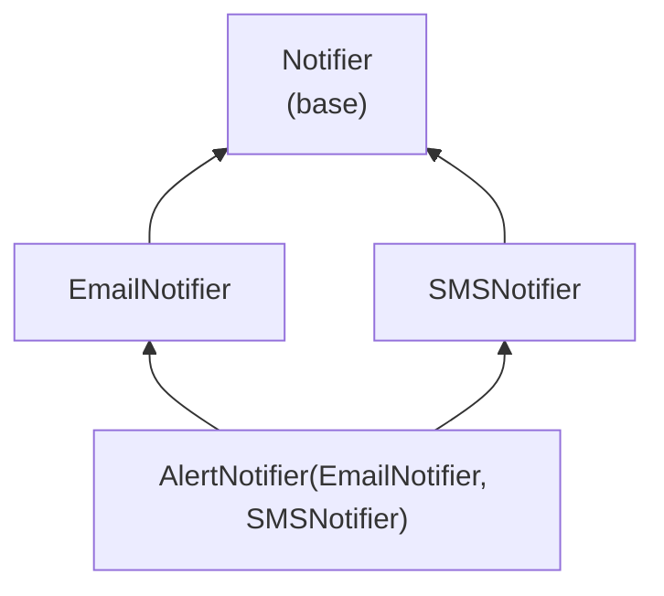

# Inheritance and Polymorphism: The Complete Guide

> 📚 **Before you start**
>
> - [Classes and Objects](classes-and-objects.md): classes, `self`, `__init__`, attribute lookup and dataclasses
> - [Functions and Parameter Passing](../course.md#m6) (Python Fundamentals), for `*args` and `**kwargs`

## Introduction

A food delivery app accepts payment by UPI, credit card, wallet and cash on delivery. Every payment method needs a name, an amount, a way to be charged and a receipt. Most of that is identical. Only the "charge" step is really different: UPI sends a collect request, a card goes through a payment gateway, cash just gets marked as "collect on delivery".

Without inheritance you would copy the shared code into four classes, and when the receipt format changes you would fix it in four places (and forget one). Without polymorphism, the checkout code would be a long `if method == "upi": ... elif method == "card": ...` chain that grows every time a payment method is added.

**Inheritance** lets one class reuse and extend another. **Polymorphism** lets the checkout code say `payment.charge()` without caring which kind of payment it holds. Together they are the main way object-oriented code stays small as features grow.

By the end of this lesson you will be able to build class hierarchies, extend parent methods with `super()`, write polymorphic code (with and without a shared parent class), explain multiple inheritance and the **method resolution order (MRO)**, write mixins, and decide when *not* to use inheritance.

> 💡 **Key Insight**
>
> Inheritance is about **reusing code** along an "is-a" relationship. Polymorphism is about **calling code** that works with any object that has the right methods. In Python, polymorphism doesn't even need inheritance: if it has a `charge()` method, you can charge it. That is called **duck typing**.

---

## Core Explanation

### 1. Inheritance: A Class Built on Another Class

You create a **subclass** (also called a child class or derived class) by naming its **parent** (base class or superclass) in brackets:

```python
class Payment:
    def __init__(self, amount):
        self.amount = amount

    def receipt(self):
        return f"{type(self).__name__}: ₹{self.amount} -> {self.charge()}"

    def charge(self):
        return "charged"


class CashOnDelivery(Payment):
    def charge(self):                     # override the parent's version
        return "collect cash at the door"


class UPIPayment(Payment):
    pass                                  # inherits everything unchanged


print(UPIPayment(250).receipt())
print(CashOnDelivery(480).receipt())
```

Output:

```
UPIPayment: ₹250 -> charged
CashOnDelivery: ₹480 -> collect cash at the door
```

What happened:

- `UPIPayment` has no methods of its own. When you call `.receipt()` or use `__init__`, Python doesn't find them on `UPIPayment`, so it looks on the parent `Payment`, and uses those.
- `CashOnDelivery` defines its own `charge`, which **overrides** the parent's. Notice that `receipt()` is written in the parent but calls `self.charge()`. Because `self` is the `CashOnDelivery` object, Python finds the *child's* `charge`. The parent's code automatically uses the child's behaviour. This is the heart of how frameworks let you customise them.
- `type(self).__name__` is the name of the object's actual class, so the same `receipt` method prints different names.

The relationship is called **is-a**: a cash-on-delivery payment *is a* payment. Python can check it:

```python
cod = CashOnDelivery(480)
print(isinstance(cod, CashOnDelivery), isinstance(cod, Payment))
print(issubclass(CashOnDelivery, Payment), issubclass(Payment, CashOnDelivery))
print(CashOnDelivery.__bases__)
print(isinstance(cod, object))       # every class ultimately inherits from object
```

Output:

```
True True
True False
(<class '__main__.Payment'>,)
True
```

Every class in Python inherits from `object`, even if you don't write it. That is where default behaviour such as the default `__repr__` and `==` (identity) comes from.

### 2. Extending a Parent Method with `super()`

Often you want to *add to* the parent's behaviour rather than replace it. `super()` gives you access to the parent's version of a method:

```python
class CardPayment(Payment):
    def __init__(self, amount, card_last4, fee_percent=2.0):
        super().__init__(amount)              # let Payment set self.amount
        self.card_last4 = card_last4
        self.fee = round(amount * fee_percent / 100, 2)

    def charge(self):
        return f"card ending {self.card_last4} charged ₹{self.amount + self.fee}"

    def receipt(self):
        base = super().receipt()              # reuse the parent's receipt...
        return base + f" (includes ₹{self.fee} fee)"   # ...and extend it


print(CardPayment(1000, "4417").receipt())
```

Output:

```
CardPayment: ₹1000 -> card ending 4417 charged ₹1020.0 (includes ₹20.0 fee)
```

The most common inheritance bug is **forgetting `super().__init__(...)`** in a child's `__init__`. If the child defines `__init__`, the parent's `__init__` is *not* called automatically, so any attributes the parent sets never exist:

```python
class BrokenWallet(Payment):
    def __init__(self, amount, wallet_name):
        self.wallet_name = wallet_name        # forgot super().__init__(amount)!

try:
    print(BrokenWallet(100, "Paytm").receipt())
except AttributeError as err:
    print("AttributeError:", err)
```

Output:

```
AttributeError: 'BrokenWallet' object has no attribute 'amount'
```

Rules of thumb for overriding:

- **Keep the same meaning.** An override should do the same *kind* of job as the parent's method, accept the same arguments, and return the same kind of value. Code written for `Payment` must keep working when handed a `CardPayment`. This idea is called the **Liskov substitution principle**: a subclass object should be usable anywhere a parent object is expected.
- **Call `super()` when you extend**, skip it only when you truly mean to replace the behaviour.

### 3. Polymorphism: One Interface, Many Forms

**Polymorphism** ("many forms") means one piece of code can work with objects of different classes, as long as they offer the same methods. The checkout below doesn't know or care which payment classes exist:

```python
def checkout(payments):
    for p in payments:
        print(p.receipt())                 # each object picks its own behaviour


checkout([UPIPayment(120), CardPayment(899, "1234"), CashOnDelivery(350)])
```

Output:

```
UPIPayment: ₹120 -> charged
CardPayment: ₹899 -> card ending 1234 charged ₹916.98 (includes ₹17.98 fee)
CashOnDelivery: ₹350 -> collect cash at the door
```

Adding a new payment method tomorrow means writing one new class. `checkout` never changes. Compare that with an `if/elif` chain on a `kind` string, which you would have to edit (and re-test) every time.

You have used polymorphism since your first day of Python: `len()` works on strings, lists, dicts and sets; `for` works on anything iterable; `+` adds numbers and joins strings. In [Dunder Methods](dunder-methods.md) you will make your own classes work with these built-ins.

### 4. Duck Typing: Polymorphism Without Inheritance

Python doesn't check an object's class before calling a method. It just tries to call the method. If the object has it, it works. The saying goes: *"If it walks like a duck and quacks like a duck, it's a duck."*

```python
class GiftVoucher:                        # NOT a subclass of Payment
    def __init__(self, code, amount):
        self.code, self.amount = code, amount

    def receipt(self):
        return f"Voucher {self.code}: ₹{self.amount} redeemed"


checkout([UPIPayment(60), GiftVoucher("DIWALI50", 50)])
```

Output:

```
UPIPayment: ₹60 -> charged
Voucher DIWALI50: ₹50 redeemed
```

`checkout` only needs objects with a `receipt()` method. This is why you can pass an `io.StringIO` (an in-memory text buffer) anywhere a file is expected: it has `read()` and `write()`, so it "is" a file as far as the code cares. You will use exactly that trick in [Buffered I/O and Other File Methods](../08-file-handling/buffered-i-o-and-other-file-methods.md).

Duck typing is flexible, but the expected methods are written down nowhere. Two tools make the "shape" explicit:

- **`typing.Protocol`** describes the required methods for type checkers, without requiring inheritance:

```python
from typing import Protocol

class HasReceipt(Protocol):
    def receipt(self) -> str: ...

def checkout_typed(payments: list[HasReceipt]) -> None:
    for p in payments:
        print(p.receipt())

checkout_typed([GiftVoucher("WELCOME", 100)])
```

Output:

```
Voucher WELCOME: ₹100 redeemed
```

A type checker such as mypy or Pyright will now flag a call that passes an object without `receipt()`. At runtime nothing changes.

- **Abstract base classes (ABCs)** force subclasses to implement certain methods and fail at runtime if they don't. They are covered in [Encapsulation and Abstraction](encapsulation-and-abstraction.md).

### 5. Multi-Level Inheritance and Attribute Lookup

Hierarchies can be several levels deep. Python looks for an attribute on the object, then its class, then that class's parent, and so on up to `object`:

```python
class Vehicle:
    wheels = 4
    def describe(self):
        return f"{type(self).__name__} with {self.wheels} wheels"

class Car(Vehicle):
    pass

class AutoRickshaw(Vehicle):
    wheels = 3

class ElectricAuto(AutoRickshaw):
    def describe(self):
        return super().describe() + ", battery powered"


for v in [Car(), AutoRickshaw(), ElectricAuto()]:
    print(v.describe())
print([cls.__name__ for cls in ElectricAuto.__mro__])
```

Output:

```
Car with 4 wheels
AutoRickshaw with 3 wheels
ElectricAuto with 3 wheels, battery powered
['ElectricAuto', 'AutoRickshaw', 'Vehicle', 'object']
```

`ElectricAuto.__mro__` is the **method resolution order**: the exact list of classes Python searches, in order. With single inheritance it is simply the chain up to `object`. With multiple inheritance it becomes more interesting.

### 6. Multiple Inheritance and the MRO

A class can have more than one parent:

```python
class Swimmer:
    def move(self):
        return "swims"
    def skills(self):
        return ["swim"]

class Flyer:
    def move(self):
        return "flies"
    def skills(self):
        return ["fly"]

class Duck(Swimmer, Flyer):
    pass

d = Duck()
print(d.move())
print([c.__name__ for c in Duck.__mro__])
```

Output:

```
swims
['Duck', 'Swimmer', 'Flyer', 'object']
```

Both parents define `move`. Python picks `Swimmer.move` because `Swimmer` is listed first, and the MRO shows that order.

#### The diamond problem

The tricky case is the **diamond**: two parents that share a grandparent.



Which `send` runs, and does the base class run once or twice? Python computes the MRO with an algorithm called **C3 linearisation**. You don't need to memorise the algorithm, just its three guarantees:

1. A class always comes **before its parents**.
2. Parents keep the **left-to-right order** you wrote them in.
3. Every class appears **exactly once**, so a shared grandparent comes after *all* of its children.

```python
class Notifier:
    def send(self, msg):
        return [f"log: {msg}"]

class EmailNotifier(Notifier):
    def send(self, msg):
        return [f"email: {msg}"] + super().send(msg)

class SMSNotifier(Notifier):
    def send(self, msg):
        return [f"sms: {msg}"] + super().send(msg)

class AlertNotifier(EmailNotifier, SMSNotifier):
    def send(self, msg):
        return [f"alert: {msg}"] + super().send(msg)


print([c.__name__ for c in AlertNotifier.__mro__])
for line in AlertNotifier().send("server down"):
    print(line)
```

Output:

```
['AlertNotifier', 'EmailNotifier', 'SMSNotifier', 'Notifier', 'object']
alert: server down
email: server down
sms: server down
log: server down
```

Look closely at `EmailNotifier.send`. It calls `super().send(msg)`, and for an `AlertNotifier` object that goes to **`SMSNotifier`**, not to `Notifier`, even though `EmailNotifier`'s own parent is `Notifier`. That is the most important fact about `super()`:

> `super()` does not mean "my parent". It means **"the next class in the MRO of the object I'm working on"**.

That is how all four methods run exactly once, in a sensible order, with `Notifier` (the shared base) last.

#### Cooperative `super()` with `**kwargs`

Because `super()` may call a class you didn't expect, classes designed for multiple inheritance should pass along arguments they don't use. The usual pattern is for each `__init__` to take its own keyword arguments and forward the rest:

```python
class Base:
    def __init__(self, **kwargs):
        super().__init__(**kwargs)        # object.__init__ takes nothing, so kwargs must be empty here

class Named(Base):
    def __init__(self, name, **kwargs):
        self.name = name
        super().__init__(**kwargs)

class Priced(Base):
    def __init__(self, price, **kwargs):
        self.price = price
        super().__init__(**kwargs)

class MenuItem(Named, Priced):
    pass

item = MenuItem(name="Vada Pav", price=25)
print(item.name, item.price)
print([c.__name__ for c in MenuItem.__mro__])
```

Output:

```
Vada Pav 25
['MenuItem', 'Named', 'Priced', 'Base', 'object']
```

`Named` takes `name` and passes `price=25` on; `Priced` takes `price` and passes nothing on. Each class handles its own piece without knowing who comes next.

#### When no MRO is possible

If your base list contradicts itself, Python refuses to create the class:

```python
class A: pass
class B(A): pass

try:
    class C(A, B):      # asks for A before B, but B is a subclass of A and must come first
        pass
except TypeError as err:
    print("TypeError:", err)
```

Output:

```
TypeError: Cannot create a consistent method resolution order (MRO) for bases A, B
```

### 7. Mixins: Small Reusable Pieces of Behaviour

A **mixin** is a small class that adds one capability and is meant to be combined with other classes through multiple inheritance. It usually has no `__init__` and no data of its own. Mixins are the most common, and safest, use of multiple inheritance:

```python
import json

class JSONMixin:
    def to_json(self):
        return json.dumps(self.__dict__, sort_keys=True)

class ReprMixin:
    def __repr__(self):
        fields = ", ".join(f"{k}={v!r}" for k, v in self.__dict__.items())
        return f"{type(self).__name__}({fields})"

class Customer(JSONMixin, ReprMixin):
    def __init__(self, name, city):
        self.name, self.city = name, city


c = Customer("Asha", "Pune")
print(c)
print(c.to_json())
```

Output:

```
Customer(name='Asha', city='Pune')
{"city": "Pune", "name": "Asha"}
```

Name mixins with a `Mixin` suffix, keep them focused on one job, and list them **before** the main base class (`class Order(JSONMixin, BaseModel)`), so their methods take priority in the MRO. Django's class-based views (`LoginRequiredMixin`) and Python's own `socketserver.ThreadingMixIn` use exactly this pattern.

### 8. Subclassing Built-in Types

You can inherit from `list`, `dict` or `str`. There is a catch: the C implementations of built-ins often don't call your overridden methods internally. For example, `dict.update()` and the `dict(...)` constructor don't go through your `__setitem__`:

```python
from collections import UserDict

class LowerDict(dict):
    def __setitem__(self, key, value):
        super().__setitem__(key.lower(), value)

class LowerUserDict(UserDict):
    def __setitem__(self, key, value):
        super().__setitem__(key.lower(), value)


d1 = LowerDict(); d1["City"] = "Pune"; d1.update({"State": "MH"})
d2 = LowerUserDict(); d2["City"] = "Pune"; d2.update({"State": "MH"})
print(dict(d1))
print(dict(d2))
```

Output:

```
{'city': 'Pune', 'State': 'MH'}
{'city': 'Pune', 'state': 'MH'}
```

`collections.UserDict`, `UserList` and `UserString` are written in Python so that every operation goes through your overrides. Use them when you want to change how a built-in container behaves.

### 9. Composition Over Inheritance

Inheritance is a strong coupling: a subclass depends on the details of its parent, and a deep hierarchy becomes hard to change. **Composition** means an object *has* other objects as attributes and delegates work to them. The guideline "prefer composition over inheritance" means: use inheritance for genuine "is-a" relationships, and composition for "has-a" or "uses-a".

```python
class SMSSender:
    def send(self, to, text):
        return f"SMS to {to}: {text}"

class EmailSender:
    def send(self, to, text):
        return f"Email to {to}: {text}"

class OrderService:
    def __init__(self, notifier):           # has-a notifier, of any kind
        self.notifier = notifier

    def place(self, customer, item):
        return self.notifier.send(customer, f"Your {item} is on the way")


print(OrderService(SMSSender()).place("98xxxxxx01", "biryani"))
print(OrderService(EmailSender()).place("asha@example.com", "biryani"))
```

Output:

```
SMS to 98xxxxxx01: Your biryani is on the way
Email to asha@example.com: Your biryani is on the way
```

An `OrderService` is not a kind of SMS sender, so inheriting from `SMSSender` would be wrong. With composition you can swap the notifier at runtime, and in tests you can pass a fake one. This "pass in the collaborator" style is called **dependency injection**, and FastAPI is built around it.

| Question | If yes |
|---|---|
| Is the new thing truly a *kind of* the existing thing, usable everywhere the parent is? | Inheritance |
| Does it just need to *use* some functionality? | Composition |
| Do you want to add one small capability to many unrelated classes? | A mixin |
| Do you only need to accept "anything with method X"? | Duck typing, documented with a `Protocol` |

---

## Try It Yourself

1. Add a `WalletPayment(Payment)` class whose `__init__` takes `amount` and `wallet_name`, calls `super().__init__`, and whose `charge()` returns `"debited from <wallet_name>"`. Run `checkout` with it.
2. Predict the MRO of `class D(B, C)` where `class B(A)` and `class C(A)`, then print it.
3. Write a `TimestampMixin` with a method `stamp(self)` that returns `f"{type(self).__name__} created"`, and combine it with `Customer`. Print `.stamp()` and the MRO.
4. Why does this print `woof` and not `...`? Fix it so it prints both lines.
   ```python
   class Animal:
       def speak(self): return "..."
   class Dog(Animal):
       def speak(self): return "woof"
   print(Dog().speak())
   ```

<details>
<summary>Show answers</summary>

**1.**

```python
class WalletPayment(Payment):
    def __init__(self, amount, wallet_name):
        super().__init__(amount)
        self.wallet_name = wallet_name

    def charge(self):
        return f"debited from {self.wallet_name}"


checkout([WalletPayment(75, "PhonePe wallet")])
```

Output:

```
WalletPayment: ₹75 -> debited from PhonePe wallet
```

**2.** `D, B, C, A, object`: a class before its parents, parents left to right, the shared `A` after both its children.

```python
class A: pass
class B(A): pass
class C(A): pass
class D(B, C): pass
print([k.__name__ for k in D.__mro__])
```

Output:

```
['D', 'B', 'C', 'A', 'object']
```

**3.**

```python
class TimestampMixin:
    def stamp(self):
        return f"{type(self).__name__} created"

class TrackedCustomer(TimestampMixin, Customer):
    pass

tc = TrackedCustomer("Ravi", "Delhi")
print(tc.stamp(), "|", tc.to_json())
print([k.__name__ for k in TrackedCustomer.__mro__])
```

Output:

```
TrackedCustomer created | {"city": "Delhi", "name": "Ravi"}
['TrackedCustomer', 'TimestampMixin', 'Customer', 'JSONMixin', 'ReprMixin', 'object']
```

**4.** `Dog.speak` overrides `Animal.speak` completely. To use both, call the parent through `super()`:

```python
class Animal:
    def speak(self): return "..."
class Dog(Animal):
    def speak(self): return super().speak() + " woof"
print(Dog().speak())
```

Output:

```
... woof
```

</details>

---

## Real-World Examples

### Example 1: Exceptions

Python's exceptions are one big class hierarchy: `ZeroDivisionError` is an `ArithmeticError`, which is an `Exception`. `except ArithmeticError` catches all its subclasses: polymorphism at work. You will build your own hierarchy in [try/except and Custom Exceptions](../09-modules-and-exceptions/try-except-and-custom-exceptions.md).

### Example 2: Frameworks you customise by subclassing

In PyTorch you write `class MyModel(nn.Module)` and override `forward()`. In Django you subclass `models.Model`. In LangChain you can subclass `BaseTool` or `BaseCallbackHandler`. In each case, the framework's code calls *your* override through `self`, exactly like `Payment.receipt()` calling the child's `charge()`.

### Example 3: Pluggable LLM providers

An AI app that supports several model providers usually defines one interface (`generate(prompt) -> str`) and one class per provider. The rest of the app calls `llm.generate(...)` polymorphically, and switching from one provider to another, or to a fake model in tests, is a one-line change.

---

## Common Misconceptions

### Misconception 1: "`super()` calls the parent class"

It calls the **next class in the MRO** of the current object. In single inheritance that is the parent; in multiple inheritance it may be a sibling class, as the notifier diamond showed.

### Misconception 2: "Multiple inheritance is always bad"

Deep, tangled multiple inheritance is hard to follow. Small, focused mixins are a clean and widely used pattern. Python's C3 MRO makes the order predictable.

### Misconception 3: "Polymorphism requires a common base class"

In Python, any object with the right methods works (duck typing). A base class or a `Protocol` documents and checks the expectation, but it isn't required for the code to run.

### Misconception 4: "The parent's `__init__` runs automatically"

Only if the child does *not* define its own `__init__`. If it does, you must call `super().__init__(...)` yourself.

### Misconception 5: "Inheritance is the main way to reuse code"

Functions, modules and composition are usually simpler. Inheritance is for real "is-a" relationships, where code that expects the parent should work unchanged with the child.

---

## Interview Relevance

Inheritance questions range from basics to tricky MRO puzzles. A strong answer covers:

- **Overriding and extending** with `super()`, and the forgotten `super().__init__()` bug.
- **Polymorphism and duck typing**, with an example such as `len()` or a list of payment objects.
- **The MRO:** what it is, `Cls.__mro__`, C3's guarantees, and that `super()` follows the MRO of the instance.
- **The diamond problem** and how Python solves it (each class once, shared base last).
- **Composition vs inheritance** and when you'd choose each.

Common follow-ups:

- *"Given these classes, what does this print?"* Write out the MRO first, then follow `super()` calls along it.
- *"What is the Liskov substitution principle?"* A subclass must be usable anywhere its parent is, without breaking the calling code.
- *"Why might subclassing `dict` not work as expected?"* Built-in methods like `update` bypass your overrides; use `UserDict`.

---

## Key Takeaways

- **A subclass inherits everything from its parent** and can override or extend methods; call `super().__init__()` when you define your own `__init__`.
- **Parent code that calls `self.method()` uses the child's override**: that is how frameworks let you plug in behaviour.
- **Polymorphism means one interface, many classes**; in Python, duck typing makes it work without a shared base, and `Protocol` documents it.
- **The MRO (C3 linearisation)** orders classes child-first, left-to-right, each once; `super()` moves to the next class in that order.
- **Prefer composition and small mixins** over deep hierarchies.

---

**Up next:** [Encapsulation and Abstraction](encapsulation-and-abstraction.md)
