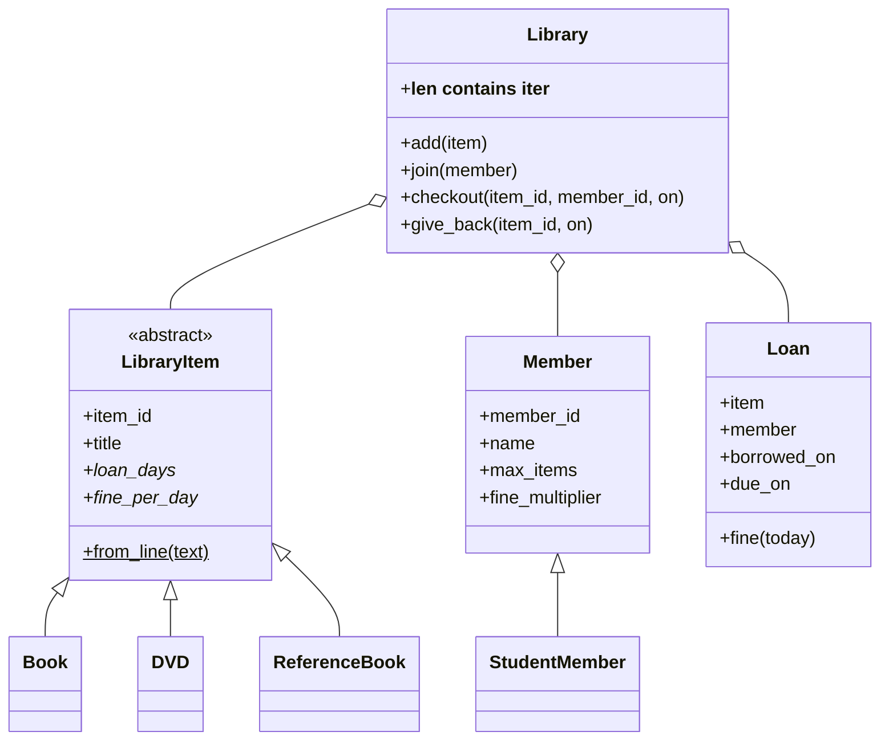

# Lab: Model a Library System with Classes

> 📚 **Before you start**
>
> - [Classes and Objects](classes-and-objects.md)
> - [Inheritance and Polymorphism](inheritance-and-polymorphism.md)
> - [Encapsulation and Abstraction](encapsulation-and-abstraction.md)
> - [Decorators, classmethod and staticmethod](decorators-classmethod-and-staticmethod.md)
> - [Dunder Methods](dunder-methods.md)

## What You'll Build

The software for a small community library in Pune. It will:

1. Hold different kinds of **items** (books, DVDs and reference books) that share an interface but have different loan periods and fines.
2. Register **members** of two types (regular and student) with different borrowing limits and fine discounts.
3. **Check out** and **return** items, enforcing the rules (no borrowing reference books, no going over your limit, no borrowing what's already out).
4. Calculate **overdue fines**, and print a clean report.
5. Load the catalogue from text lines with an **alternative constructor**.

Every OOP idea from this module appears: an abstract base class, inheritance and polymorphism, properties, dataclasses, a class method, a static method, a decorator and dunder methods that make the library behave like a container.



> 💡 **Key Insight**
>
> Put each rule in **exactly one place**, on the class that owns the data the rule is about. Loan periods belong to item types, borrowing limits to member types, fines to loans, and the "who has what" bookkeeping to the library. Then `Library.checkout` reads like a checklist instead of a tangle of special cases.

Run the blocks in order in one file or notebook. Everything uses the standard library. Dates are passed in explicitly (instead of using today's date), so every run gives the same output and the code is easy to test.

---

## Step 1: The Library's Errors

When a rule is broken, the library raises a specific error. A small family of exception classes lets callers catch "any library problem" or one particular problem. (Exceptions get a full lesson in [try/except and Custom Exceptions](../09-modules-and-exceptions/try-except-and-custom-exceptions.md); for now, an exception class is just a class that inherits from `Exception`.)

```python
from abc import ABC, abstractmethod
from dataclasses import dataclass, field
from datetime import date, timedelta
import functools


class LibraryError(Exception):
    """Base class for every library rule violation."""

class NotAvailable(LibraryError):
    """The item is already on loan or can't be borrowed."""

class LimitReached(LibraryError):
    """The member already has the maximum number of items."""

class UnknownId(LibraryError):
    """No item or member with that id."""


print(issubclass(LimitReached, LibraryError), issubclass(LimitReached, Exception))
```

Output:

```
True True
```

---

## Step 2: Items, an Abstract Base Class and Polymorphism

Every item has an id and a title. Each *kind* of item decides its own loan period and daily fine, so those are abstract properties. The base class also provides a **class method** that builds the right subclass from a line of text, using a registry filled by `__init_subclass__`.

```python
class LibraryItem(ABC):
    kinds = {}                                       # "book" -> Book, filled automatically

    def __init_subclass__(cls, kind=None, **kwargs):
        super().__init_subclass__(**kwargs)
        if kind:
            LibraryItem.kinds[kind] = cls

    def __init__(self, item_id, title):
        if not self.is_valid_id(item_id):
            raise ValueError(f"bad item id {item_id!r}")
        self.item_id = item_id
        self.title = title

    @property
    @abstractmethod
    def loan_days(self): ...

    @property
    @abstractmethod
    def fine_per_day(self): ...

    @property
    def can_borrow(self):
        return self.loan_days > 0

    @staticmethod
    def is_valid_id(item_id):
        return len(item_id) == 5 and item_id[0].isalpha() and item_id[1:].isdigit()

    @classmethod
    def from_line(cls, line):
        """Build an item from 'kind | id | title'."""
        kind, item_id, title = (part.strip() for part in line.split("|"))
        return cls.kinds[kind](item_id, title)

    def __repr__(self):
        return f"{type(self).__name__}({self.item_id!r}, {self.title!r})"


class Book(LibraryItem, kind="book"):
    loan_days = 14                                   # a plain class attribute satisfies the abstract property
    fine_per_day = 2


class DVD(LibraryItem, kind="dvd"):
    loan_days = 7
    fine_per_day = 10


class ReferenceBook(LibraryItem, kind="reference"):
    loan_days = 0                                    # read in the library only
    fine_per_day = 0


items = [LibraryItem.from_line(line) for line in [
    "book      | B1001 | Wings of Fire",
    "book      | B1002 | The Guide",
    "dvd       | D2001 | Lagaan",
    "reference | R3001 | Oxford Hindi-English Dictionary",
]]
for item in items:
    print(f"{item!r:<52} loan={item.loan_days:>2}d fine=₹{item.fine_per_day:<2} borrowable={item.can_borrow}")

try:
    LibraryItem("B9999", "Abstract")
except TypeError as err:
    print("TypeError:", err)
```

Output:

```
Book('B1001', 'Wings of Fire')                       loan=14d fine=₹2  borrowable=True
Book('B1002', 'The Guide')                           loan=14d fine=₹2  borrowable=True
DVD('D2001', 'Lagaan')                               loan= 7d fine=₹10 borrowable=True
ReferenceBook('R3001', 'Oxford Hindi-English Dictionary') loan= 0d fine=₹0  borrowable=False
TypeError: Can't instantiate abstract class LibraryItem without an implementation for abstract methods 'fine_per_day', 'loan_days'
```

Things to notice:

- `loan_days = 14` in a subclass **overrides** the abstract property with a plain class attribute. That's allowed: the ABC only checks that the name is no longer abstract.
- `can_borrow` is written once in the base class and works polymorphically for every subclass.
- `from_line` uses `cls.kinds[...]`, so adding a new kind of item (say, `Magazine`) only needs a new subclass with `kind="magazine"`. Nothing else changes.

---

## Step 3: Members with Different Rules

Members are simple data plus two rules, so a dataclass is a good fit. A student member inherits everything and changes two values:

```python
@dataclass
class Member:
    member_id: str
    name: str
    loans: list = field(default_factory=list, repr=False)   # this member's active loans

    max_items = 3                  # no annotation: a class attribute, not a dataclass field
    fine_multiplier = 1.0

    @property
    def can_borrow_more(self):
        return len(self.loans) < self.max_items


@dataclass
class StudentMember(Member):
    max_items = 2
    fine_multiplier = 0.5          # students pay half fines


asha = Member("M01", "Asha Kulkarni")
rohan = StudentMember("S01", "Rohan Patil")
print(asha, asha.max_items, asha.can_borrow_more)
print(rohan, rohan.max_items, rohan.fine_multiplier)
```

Output:

```
Member(member_id='M01', name='Asha Kulkarni') 3 True
StudentMember(member_id='S01', name='Rohan Patil') 2 0.5
```

`max_items` and `fine_multiplier` have no type annotation, so `@dataclass` treats them as ordinary class attributes rather than fields. `loans` uses `default_factory=list` so each member gets their own list, and `repr=False` keeps the printout short.

---

## Step 4: Loans, Due Dates and Fines

A loan connects one item to one member. It computes its own due date and fine. `functools.total_ordering` lets loans be sorted by due date:

```python
@functools.total_ordering
@dataclass(eq=False)
class Loan:
    item: LibraryItem
    member: Member
    borrowed_on: date

    @property
    def due_on(self):
        return self.borrowed_on + timedelta(days=self.item.loan_days)

    def days_overdue(self, today):
        return max(0, (today - self.due_on).days)

    def fine(self, today):
        raw = self.days_overdue(today) * self.item.fine_per_day
        return round(raw * self.member.fine_multiplier)

    def __eq__(self, other):
        return self.due_on == other.due_on if isinstance(other, Loan) else NotImplemented

    def __lt__(self, other):
        return self.due_on < other.due_on if isinstance(other, Loan) else NotImplemented

    __hash__ = None


loan = Loan(items[2], rohan, date(2026, 10, 1))                 # Lagaan, 7-day DVD loan
print(loan.due_on, loan.days_overdue(date(2026, 10, 11)), loan.fine(date(2026, 10, 11)))
```

Output:

```
2026-10-08 3 15
```

The DVD was due on 8 October; on 11 October it is 3 days late: 3 × ₹10 = ₹30, halved for a student = ₹15. Each class contributed one piece: the item knows its loan period and fine rate, the member knows their discount, and the loan does the arithmetic.

---

## Step 5: The Library Itself

The `Library` class holds everything and enforces the rules. Its dunder methods make it behave like a container: `len(library)`, `"B1001" in library` and `for item in library` all work. A small decorator logs every successful operation into the library's activity log.

```python
def logged(action):
    """Record '<action>: <result>' in self.log after a successful call."""
    def decorator(method):
        @functools.wraps(method)
        def wrapper(self, *args, **kwargs):
            result = method(self, *args, **kwargs)
            self.log.append(f"{action}: {result}")
            return result
        return wrapper
    return decorator


class Library:
    def __init__(self, name):
        self.name = name
        self._items = {}            # item_id -> item
        self._members = {}          # member_id -> member
        self._loans = {}            # item_id -> Loan (only items currently out)
        self.log = []

    # ---- container behaviour ----
    def __len__(self):
        return len(self._items)

    def __contains__(self, item_id):
        return item_id in self._items

    def __iter__(self):
        return iter(sorted(self._items.values(), key=lambda i: i.item_id))

    def __repr__(self):
        return f"Library({self.name!r}, items={len(self)}, members={len(self._members)}, out={len(self._loans)})"

    # ---- lookups ----
    def _get(self, table, key, what):
        try:
            return table[key]
        except KeyError:
            raise UnknownId(f"no {what} with id {key!r}") from None

    def is_available(self, item_id):
        return item_id not in self._loans

    # ---- operations ----
    def add(self, *items):
        for item in items:
            self._items[item.item_id] = item

    def join(self, *members):
        for member in members:
            self._members[member.member_id] = member

    @logged("checkout")
    def checkout(self, item_id, member_id, on):
        item = self._get(self._items, item_id, "item")
        member = self._get(self._members, member_id, "member")
        if not item.can_borrow:
            raise NotAvailable(f"{item.title!r} is for reading in the library only")
        if not self.is_available(item_id):
            raise NotAvailable(f"{item.title!r} is already on loan")
        if not member.can_borrow_more:
            raise LimitReached(f"{member.name} already has {member.max_items} items")
        loan = Loan(item, member, on)
        self._loans[item_id] = loan
        member.loans.append(loan)
        return f"{item.title} -> {member.name}, due {loan.due_on}"

    @logged("return")
    def give_back(self, item_id, on):
        loan = self._get(self._loans, item_id, "active loan for item")
        del self._loans[item_id]
        loan.member.loans.remove(loan)
        fine = loan.fine(on)
        return f"{loan.item.title} from {loan.member.name}, fine ₹{fine}"

    def overdue(self, today):
        return [loan for loan in sorted(self._loans.values()) if loan.days_overdue(today)]


library = Library("Kothrud Community Library")
library.add(*items)
library.join(asha, rohan, Member("M02", "Meera Joshi"))
print(library)
print(len(library), "B1001" in library, "X0000" in library)
print([item.title for item in library])
```

Output:

```
Library('Kothrud Community Library', items=4, members=3, out=0)
4 True False
['Wings of Fire', 'The Guide', 'Lagaan', 'Oxford Hindi-English Dictionary']
```

Look at `checkout`. Every rule is a single readable line that asks the right object: `item.can_borrow`, `self.is_available(...)`, `member.can_borrow_more`. None of them contain a `type(...) ==` check or an `if kind == "dvd"` branch. Polymorphism handles the differences.

---

## Step 6: Run a Month at the Library

```python
oct_ = lambda day: date(2026, 10, day)

library.checkout("B1001", "S01", on=oct_(1))
library.checkout("D2001", "S01", on=oct_(2))
library.checkout("B1002", "M01", on=oct_(3))

attempts = [
    ("B1001", "M02"),     # already on loan
    ("R3001", "M01"),     # reference only
    ("B9999", "M01"),     # unknown item
]
for item_id, member_id in attempts:
    try:
        library.checkout(item_id, member_id, on=oct_(5))
    except LibraryError as err:                     # one except catches the whole family
        print(f"{type(err).__name__:<12} {err}")

library.add(Book("B1003", "Malgudi Days"))
try:
    library.checkout("B1003", "S01", on=oct_(5))   # Rohan already has 2 items
except LimitReached as err:
    print(f"{type(err).__name__:<12} {err}")

print()
print("Overdue on 20 Oct:")
for loan in library.overdue(oct_(20)):
    print(f"  {loan.item.title:<14} {loan.member.name:<14} due {loan.due_on}  fine ₹{loan.fine(oct_(20))}")

library.give_back("D2001", on=oct_(20))
library.give_back("B1001", on=oct_(14))
library.checkout("B1003", "S01", on=oct_(20))

print()
print(library)
for line in library.log:
    print(" ", line)
```

Output:

```
NotAvailable 'Wings of Fire' is already on loan
NotAvailable 'Oxford Hindi-English Dictionary' is for reading in the library only
UnknownId    no item with id 'B9999'
LimitReached Rohan Patil already has 2 items

Overdue on 20 Oct:
  Lagaan         Rohan Patil    due 2026-10-09  fine ₹55
  Wings of Fire  Rohan Patil    due 2026-10-15  fine ₹5
  The Guide      Asha Kulkarni  due 2026-10-17  fine ₹6

Library('Kothrud Community Library', items=5, members=3, out=2)
  checkout: Wings of Fire -> Rohan Patil, due 2026-10-15
  checkout: Lagaan -> Rohan Patil, due 2026-10-09
  checkout: The Guide -> Asha Kulkarni, due 2026-10-17
  return: Lagaan from Rohan Patil, fine ₹55
  return: Wings of Fire from Rohan Patil, fine ₹0
  checkout: Malgudi Days -> Rohan Patil, due 2026-11-03
```

The output tells the story: four refused checkouts, each with a specific error class; an overdue report sorted by due date (thanks to `__lt__`); returns with fines calculated per item type and member type; and a log written by the decorator, which only records *successful* operations because a raised exception skips the `self.log.append` line.

---

## Step 7: Check the Rules Hold

Good classes make it hard to get into an invalid state. Quick checks:

```python
checks = {
    "every active loan is in its member's list":
        all(loan in loan.member.loans for loan in library._loans.values()),
    "no member is over their limit":
        all(len(m.loans) <= m.max_items for m in library._members.values()),
    "reference books are never out":
        not any(isinstance(l.item, ReferenceBook) for l in library._loans.values()),
    "bad ids are rejected":
        not LibraryItem.is_valid_id("12345"),
}
for rule, ok in checks.items():
    print("PASS" if ok else "FAIL", rule)
```

Output:

```
PASS every active loan is in its member's list
PASS no member is over their limit
PASS reference books are never out
PASS bad ids are rejected
```

(Reading `library._loans` from outside the class is fine in a test like this one; in application code you'd add a public method instead.)

---

## Try It Yourself

1. **New item type.** Add a `Magazine` with a 3-day loan and a ₹1 daily fine, registered as `kind="magazine"`. Load `"magazine | M4001 | India Today"` with `LibraryItem.from_line` and check it out to Meera.
2. **Senior members.** Add a `SeniorMember` who can borrow 4 items and pays no fines. Which class(es) did you need to change?
3. **Renewals.** Add a method `renew(item_id, on)` to `Library` that replaces the loan's `borrowed_on` with `on` if the loan is not overdue, and raises `NotAvailable` otherwise.
4. **Total fines.** Add a `total_fines(today)` method that sums the fines of all active loans.

<details>
<summary>Show answers</summary>

**1.**

```python
class Magazine(LibraryItem, kind="magazine"):
    loan_days = 3
    fine_per_day = 1

mag = LibraryItem.from_line("magazine | M4001 | India Today")
library.add(mag)
print(library.checkout("M4001", "M02", on=oct_(21)))
```

Output:

```
India Today -> Meera Joshi, due 2026-10-24
```

**2.** Only a new subclass; `Library`, `Loan` and the items don't change.

```python
@dataclass
class SeniorMember(Member):
    max_items = 4
    fine_multiplier = 0.0

library.join(SeniorMember("G01", "Govind Rao"))
print(library.checkout("B1001", "G01", on=oct_(1)))
print(library.give_back("B1001", on=oct_(30)))
```

Output:

```
Wings of Fire -> Govind Rao, due 2026-10-15
Wings of Fire from Govind Rao, fine ₹0
```

**3.**

```python
def renew(self, item_id, on):
    loan = self._get(self._loans, item_id, "active loan for item")
    if loan.days_overdue(on):
        raise NotAvailable(f"{loan.item.title!r} is overdue; return it first")
    loan.borrowed_on = on
    return loan.due_on

Library.renew = renew          # attach to the class (normally you'd write it inside)
print(library.renew("B1003", on=oct_(25)))
try:
    library.renew("B1002", on=oct_(25))
except NotAvailable as err:
    print("NotAvailable:", err)
```

Output:

```
2026-11-08
NotAvailable: 'The Guide' is overdue; return it first
```

**4.**

```python
def total_fines(self, today):
    return sum(loan.fine(today) for loan in self._loans.values())

Library.total_fines = total_fines
print(library.total_fines(oct_(31)))
```

Output:

```
35
```

</details>

---

## What You've Learned

- **Modelling a domain with classes**: each class owns its data and the rules about that data.
- **An abstract base class** with abstract properties, a static validator, and a class method alternative constructor driven by an `__init_subclass__` registry.
- **Polymorphism instead of `if` chains**: loan periods, fines and limits vary by class, and the library code never checks types.
- **Dataclasses with inheritance**, class attributes versus fields, and `default_factory`.
- **Dunder methods** (`__len__`, `__contains__`, `__iter__`, `__repr__`, ordering) that make objects feel built-in, and a **decorator** that adds logging to methods.
- **A small exception hierarchy** so callers can catch one specific error or the whole family.

---

**Up next:** [Reading and Writing Files](../08-file-handling/reading-and-writing-files.md)
