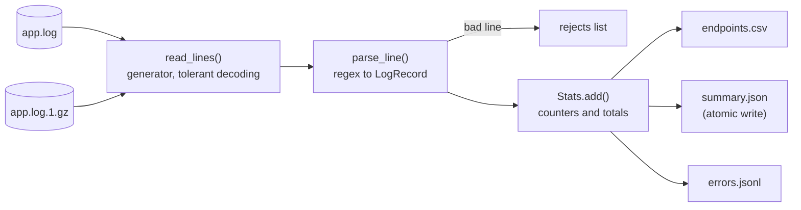

# Lab: Log File Analyser

> 📚 **Before you start**
>
> - [Reading and Writing Files](reading-and-writing-files.md)
> - [Buffered I/O and Other File Methods](buffered-i-o-and-other-file-methods.md)
> - [Iterators and Generators](../06-functions-and-iterators/iterators-and-generators.md)
> - [Classes and Objects](../07-object-oriented-programming/classes-and-objects.md), for dataclasses

## What You'll Build

A command-line tool that reads the access logs of an AI chat service (including old, rotated, gzip-compressed logs), and answers the questions an on-call engineer asks at 2 a.m.:

- How many requests, and how many failed?
- Which endpoints are slowest and which fail most?
- Which hour had the most errors?
- Which lines couldn't be parsed?

It then writes three reports: a **CSV** of per-endpoint statistics, a **JSON** summary (written atomically), and a **JSON Lines** file of every error for later investigation.



> 💡 **Key Insight**
>
> Build file processing as a **pipeline of generators**: one function yields lines, the next turns lines into records, the next aggregates. Only one line is in memory at a time, each stage is testable on its own, and the same code handles a 2 KB sample or a 20 GB production log.

Run the blocks in order in one file or notebook. Everything uses the standard library, and all files go into a temporary directory.

---

## Step 1: Create Sample Logs

Real logs would come from a server. We generate realistic ones with a seeded random generator (so every run produces the same files), and deliberately include problems real logs have: a malformed line, a blank line, and a line containing bytes that aren't valid UTF-8. We also write an older, rotated log compressed with gzip.

```python
import csv
import gzip
import json
import os
import random
import re
import tempfile
from collections import Counter, defaultdict
from dataclasses import dataclass, asdict
from pathlib import Path

tmp = tempfile.TemporaryDirectory()
base = Path(tmp.name)
log_dir = base / "logs"
log_dir.mkdir()

ENDPOINTS = ["/api/chat", "/api/chat", "/api/chat", "/api/embed", "/api/history", "/health"]

def make_line(rng, hour):
    path = rng.choice(ENDPOINTS)
    method = "GET" if path in ("/api/history", "/health") else "POST"
    status = rng.choices([200, 400, 429, 500, 503], weights=[85, 4, 5, 3, 3])[0]
    level = "INFO" if status < 400 else ("WARN" if status < 500 else "ERROR")
    base_ms = {"/api/chat": 900, "/api/embed": 120, "/api/history": 40, "/health": 2}[path]
    ms = int(base_ms * rng.uniform(0.5, 2.5))
    return (f"2026-10-11 {hour:02d}:{rng.randint(0, 59):02d}:{rng.randint(0, 59):02d} "
            f"{level:<5} {method} {path} {status} {ms}ms user=u{rng.randint(1, 40)}")

rng = random.Random(42)
with open(log_dir / "app.log", "w", encoding="utf-8") as f:
    for hour in range(9, 13):
        for _ in range(60):
            print(make_line(rng, hour), file=f)
    print("this line is not in the expected format", file=f)
    print("", file=f)

with open(log_dir / "app.log", "ab") as f:                      # a corrupted line
    f.write(b"2026-10-11 12:59:59 ERROR POST /api/chat 500 1200ms user=\xff\xfe\n")

with gzip.open(log_dir / "app.log.1.gz", "wt", encoding="utf-8") as f:   # yesterday's, compressed
    for _ in range(40):
        print(make_line(rng, 8), file=f)

print(sorted(p.name for p in log_dir.iterdir()))
print((log_dir / "app.log").stat().st_size, "bytes in app.log")
print(open(log_dir / "app.log", encoding="utf-8").readline(), end="")
```

Output:

```
['app.log', 'app.log.1.gz']
14394 bytes in app.log
2026-10-11 09:15:14 INFO  GET /health 200 3ms user=u9
```

`gzip.open(path, "wt", encoding=...)` gives a text file object that compresses as it writes. Everything you know about text files works on it.

---

## Step 2: Read Lines from Any Log File

The first stage of the pipeline is a **generator** that yields lines from one or many files, transparently handling `.gz` files and refusing to crash on bad bytes:

```python
def open_log(path):
    """Open a plain or gzip log as text, replacing undecodable bytes."""
    path = Path(path)
    opener = gzip.open if path.suffix == ".gz" else open
    return opener(path, "rt", encoding="utf-8", errors="replace")

def read_lines(paths):
    """Yield (file name, line number, line) for every line of every file."""
    for path in paths:
        with open_log(path) as f:
            for line_no, line in enumerate(f, start=1):
                yield Path(path).name, line_no, line.rstrip("\n")

log_files = sorted(log_dir.glob("app.log*"), reverse=True)   # oldest (.1.gz) first
print([p.name for p in log_files])

lines = read_lines(log_files)
print(next(lines))
print(sum(1 for _ in lines) + 1, "lines in total")
```

Output:

```
['app.log.1.gz', 'app.log']
('app.log.1.gz', 1, '2026-10-11 08:48:27 INFO  POST /api/embed 200 219ms user=u4')
283 lines in total
```

Notes:

- `errors="replace"` means the corrupt line becomes readable text with `�` markers instead of raising `UnicodeDecodeError` and killing a 20-minute analysis. For logs that's the right trade-off; for financial data you'd rather fail loudly.
- `read_lines` is lazy. Calling it reads nothing; lines are read only as the consumer asks for them, and each file is closed by its `with` block as soon as it's exhausted.
- Picking `opener` with a conditional expression is polymorphism at the function level: `gzip.open` and `open` return objects with the same interface.

---

## Step 3: Parse Lines into Records

A **regular expression** (the `re` module) describes the line format. Named groups like `(?P<status>\d{3})` pull out each field by name. Matching lines become a frozen dataclass; anything else returns `None`:

```python
LINE_RE = re.compile(
    r"(?P<date>\d{4}-\d{2}-\d{2}) (?P<time>\d{2}:\d{2}:\d{2}) (?P<level>[A-Z]+)\s+"
    r"(?P<method>[A-Z]+) (?P<path>/\S*) (?P<status>\d{3}) (?P<ms>\d+)ms user=(?P<user>\w+)"
)

@dataclass(frozen=True, slots=True)
class LogRecord:
    date: str
    time: str
    level: str
    method: str
    path: str
    status: int
    ms: int
    user: str

    @property
    def hour(self):
        return int(self.time[:2])

    @property
    def is_error(self):
        return self.status >= 500

    @classmethod
    def parse(cls, line):
        m = LINE_RE.fullmatch(line)
        if m is None:
            return None
        d = m.groupdict()
        return cls(**{**d, "status": int(d["status"]), "ms": int(d["ms"])})


print(LogRecord.parse("2026-10-11 09:14:03 INFO  POST /api/chat 200 845ms user=u7"))
print(LogRecord.parse("this line is not in the expected format"))
print(LogRecord.parse("2026-10-11 12:59:59 ERROR POST /api/chat 500 1200ms user=��"))
```

Output:

```
LogRecord(date='2026-10-11', time='09:14:03', level='INFO', method='POST', path='/api/chat', status=200, ms=845, user='u7')
None
None
```

`fullmatch` requires the *whole* line to match, so a line with trailing junk is rejected rather than half-parsed. The corrupted line fails because `\w+` doesn't match the replacement characters, which is what we want: it will be reported as a reject rather than counted with a fake user id.

`slots=True` matters here: a big log can produce millions of records, and slotted objects use noticeably less memory.

---

## Step 4: Aggregate Statistics

The `Stats` class consumes records one at a time and keeps only counters and totals, never the records themselves (except the errors we want to export). `collections.Counter` and `defaultdict` do the bookkeeping:

```python
class Stats:
    def __init__(self):
        self.total = 0
        self.by_level = Counter()
        self.by_status = Counter()
        self.errors_by_hour = Counter()
        self.endpoint = defaultdict(lambda: {"requests": 0, "errors": 0, "total_ms": 0, "max_ms": 0})
        self.errors = []
        self.rejects = []

    def add(self, record):
        self.total += 1
        self.by_level[record.level] += 1
        self.by_status[record.status] += 1
        ep = self.endpoint[f"{record.method} {record.path}"]
        ep["requests"] += 1
        ep["total_ms"] += record.ms
        ep["max_ms"] = max(ep["max_ms"], record.ms)
        if record.is_error:
            ep["errors"] += 1
            self.errors_by_hour[record.hour] += 1
            self.errors.append(record)

    def reject(self, source, line_no, line):
        if line.strip():                                   # ignore blank lines quietly
            self.rejects.append({"file": source, "line": line_no, "text": line[:60]})

    def endpoint_rows(self):
        rows = []
        for name, ep in self.endpoint.items():
            rows.append({
                "endpoint": name,
                "requests": ep["requests"],
                "errors": ep["errors"],
                "error_rate_pct": round(100 * ep["errors"] / ep["requests"], 1),
                "avg_ms": round(ep["total_ms"] / ep["requests"]),
                "max_ms": ep["max_ms"],
            })
        return sorted(rows, key=lambda r: r["avg_ms"], reverse=True)


def analyse(paths):
    stats = Stats()
    for source, line_no, line in read_lines(paths):
        record = LogRecord.parse(line)
        if record is None:
            stats.reject(source, line_no, line)
        else:
            stats.add(record)
    return stats


stats = analyse(log_files)
print("requests:", stats.total, "| rejected lines:", len(stats.rejects))
print("levels:  ", dict(sorted(stats.by_level.items())))
print("statuses:", dict(sorted(stats.by_status.items())))
worst_hour, worst_count = stats.errors_by_hour.most_common(1)[0]
print(f"worst hour: {worst_hour:02d}:00 with {worst_count} server errors")
for r in stats.rejects:
    print("reject:", r)
```

Output:

```
requests: 280 | rejected lines: 2
levels:   {'ERROR': 23, 'INFO': 234, 'WARN': 23}
statuses: {200: 234, 400: 14, 429: 9, 500: 9, 503: 14}
worst hour: 10:00 with 7 server errors
reject: {'file': 'app.log', 'line': 241, 'text': 'this line is not in the expected format'}
reject: {'file': 'app.log', 'line': 243, 'text': '2026-10-11 12:59:59 ERROR POST /api/chat 500 1200ms user=��'}
```

---

## Step 5: Print a Readable Report

```python
def print_report(stats):
    print(f"{'endpoint':<20}{'reqs':>6}{'errs':>6}{'err%':>7}{'avg ms':>8}{'max ms':>8}")
    print("-" * 55)
    for r in stats.endpoint_rows():
        print(f"{r['endpoint']:<20}{r['requests']:>6}{r['errors']:>6}"
              f"{r['error_rate_pct']:>7.1f}{r['avg_ms']:>8}{r['max_ms']:>8}")
    rate = 100 * sum(stats.errors_by_hour.values()) / stats.total
    print("-" * 55)
    print(f"overall server error rate: {rate:.1f}%  (429 rate limits: {stats.by_status[429]})")

print_report(stats)
```

Output:

```
endpoint              reqs  errs   err%  avg ms  max ms
-------------------------------------------------------
POST /api/chat         141     9    6.4    1332    2248
POST /api/embed         50     5   10.0     203     299
GET /api/history        41     7   17.1      62      99
GET /health             48     2    4.2       2       4
-------------------------------------------------------
overall server error rate: 8.2%  (429 rate limits: 9)
```

Chat calls dominate latency (they wrap an LLM call), and the rate-limit count is a hint that the service should add request queuing or backoff, a topic you'll handle yourself in Module 10.

---

## Step 6: Write the Reports (CSV, JSON and JSON Lines)

Three output formats for three audiences: a CSV for a spreadsheet, a JSON summary for a dashboard or alerting script, and JSON Lines with one error per line for later digging. The summary is written atomically using the pattern from [Buffered I/O and Other File Methods](buffered-i-o-and-other-file-methods.md), so a dashboard reading it never sees half a file.

```python
def write_json_atomic(path, data):
    fd, tmp_name = tempfile.mkstemp(dir=path.parent, suffix=".tmp")
    try:
        with open(fd, "w", encoding="utf-8") as f:
            json.dump(data, f, indent=2, sort_keys=True)
            f.flush()
            os.fsync(f.fileno())
        os.replace(tmp_name, path)
    except BaseException:
        os.unlink(tmp_name)
        raise

def write_reports(stats, out_dir):
    out_dir = Path(out_dir)
    out_dir.mkdir(parents=True, exist_ok=True)

    rows = stats.endpoint_rows()
    with open(out_dir / "endpoints.csv", "w", encoding="utf-8", newline="") as f:
        writer = csv.DictWriter(f, fieldnames=list(rows[0]))
        writer.writeheader()
        writer.writerows(rows)

    write_json_atomic(out_dir / "summary.json", {
        "requests": stats.total,
        "server_errors": len(stats.errors),
        "by_level": dict(stats.by_level),
        "by_status": {str(k): v for k, v in stats.by_status.items()},   # JSON keys must be strings
        "errors_by_hour": {f"{h:02d}:00": n for h, n in sorted(stats.errors_by_hour.items())},
        "rejected_lines": stats.rejects,
    })

    with open(out_dir / "errors.jsonl", "w", encoding="utf-8") as f:
        for record in stats.errors:
            f.write(json.dumps(asdict(record)) + "\n")

    return sorted(p.name for p in out_dir.iterdir())


report_dir = base / "reports"
print(write_reports(stats, report_dir))
print((report_dir / "endpoints.csv").read_text(encoding="utf-8"), end="")
summary = json.loads((report_dir / "summary.json").read_text(encoding="utf-8"))
print(summary["errors_by_hour"])
with open(report_dir / "errors.jsonl", encoding="utf-8") as f:
    print(f.readline(), end="")
```

Output:

```
['endpoints.csv', 'errors.jsonl', 'summary.json']
endpoint,requests,errors,error_rate_pct,avg_ms,max_ms
POST /api/chat,141,9,6.4,1332,2248
POST /api/embed,50,5,10.0,203,299
GET /api/history,41,7,17.1,62,99
GET /health,48,2,4.2,2,4
{'08:00': 2, '09:00': 2, '10:00': 7, '11:00': 6, '12:00': 6}
{"date": "2026-10-11", "time": "08:39:43", "level": "ERROR", "method": "GET", "path": "/api/history", "status": 503, "ms": 85, "user": "u36"}
```

`asdict()` works on slotted dataclasses too, and `by_status` keys are converted to strings because JSON object keys are always strings. Leaving them as integers would silently turn them into strings anyway, and the round trip would no longer match.

---

## Step 7: A Command-Line Interface

Finally, wrap it in a CLI with `argparse` (standard library), so it can be run as `python log_analyser.py logs/app.log* --out reports --min-errors 1`. The `main` function takes an argument list, which makes it easy to call from tests (and from this lesson):

```python
import argparse

def main(argv=None):
    parser = argparse.ArgumentParser(description="Summarise access logs.")
    parser.add_argument("files", nargs="+", type=Path, help="log files (.log or .gz)")
    parser.add_argument("--out", type=Path, default=Path("reports"), help="report folder")
    parser.add_argument("--min-errors", type=int, default=0,
                        help="exit with status 1 if server errors are at least this many")
    args = parser.parse_args(argv)

    missing = [str(p) for p in args.files if not p.exists()]
    if missing:
        parser.error(f"file(s) not found: {', '.join(missing)}")

    stats = analyse(args.files)
    print_report(stats)
    write_reports(stats, args.out)
    if args.min_errors and len(stats.errors) >= args.min_errors:
        print(f"ALERT: {len(stats.errors)} server errors")
        return 1
    return 0


exit_code = main([str(p) for p in log_files] + ["--out", str(base / "cli_reports"), "--min-errors", "10"])
print("exit code:", exit_code)
```

Output:

```
endpoint              reqs  errs   err%  avg ms  max ms
-------------------------------------------------------
POST /api/chat         141     9    6.4    1332    2248
POST /api/embed         50     5   10.0     203     299
GET /api/history        41     7   17.1      62      99
GET /health             48     2    4.2       2       4
-------------------------------------------------------
overall server error rate: 8.2%  (429 rate limits: 9)
ALERT: 23 server errors
exit code: 1
```

In a real script you'd end with:

```python
# not-run: shows how the script file would end
if __name__ == "__main__":
    raise SystemExit(main())
```

`raise SystemExit(code)` makes the process exit with that status code, so the analyser can fail a CI job or trigger an alert. `if __name__ == "__main__":` is explained in [Importing and Managing Modules](../09-modules-and-exceptions/importing-and-managing-modules.md).

```python
tmp.cleanup()
```

---

## Try It Yourself

1. **Slowest requests.** Add a method `slowest(n)` to `Stats` that returns the `n` slowest records. Keeping every record would defeat the point of streaming: use `heapq.nlargest` with a bounded list, or keep a running list of at most `n`.
2. **Per-user rate limits.** Count 429 responses per user and print the three users who were rate-limited most.
3. **Time filter.** Add `--since HH:MM` to the CLI so only records at or after that time are counted.
4. **Robustness.** What happens if you pass a `.gz` file that is actually plain text? Try it, and make `open_log` raise a clear error message instead.

<details>
<summary>Show answers</summary>

**1.** A heap-based approach keeps memory bounded:

```python
import heapq

def slowest(paths, n=3):
    records = (LogRecord.parse(line) for _, _, line in read_lines(paths))
    return heapq.nlargest(n, (r for r in records if r), key=lambda r: r.ms)

tmp = tempfile.TemporaryDirectory()      # recreate the sample logs for the exercises
base = Path(tmp.name); log_dir = base / "logs"; log_dir.mkdir()
rng = random.Random(7)
with open(log_dir / "app.log", "w", encoding="utf-8") as f:
    for _ in range(200):
        print(make_line(rng, 10), file=f)
files = [log_dir / "app.log"]

for r in slowest(files):
    print(r.time, r.path, r.ms)
```

Output:

```
10:37:04 /api/chat 2247
10:39:53 /api/chat 2223
10:28:10 /api/chat 2222
```

**2.**

```python
limited = Counter(r.user for _, _, line in read_lines(files)
                  if (r := LogRecord.parse(line)) and r.status == 429)
print(limited.most_common(3))
```

Output:

```
[('u12', 1), ('u36', 1), ('u8', 1)]
```

**3.** Times in `HH:MM:SS` format compare correctly as strings:

```python
def analyse_since(paths, since="00:00"):
    stats = Stats()
    for source, line_no, line in read_lines(paths):
        record = LogRecord.parse(line)
        if record is None:
            stats.reject(source, line_no, line)
        elif record.time >= since:
            stats.add(record)
    return stats

print(analyse(files).total, analyse_since(files, "10:30").total)
```

Output:

```
200 92
```

In `main`, add `parser.add_argument("--since", default="00:00")` and call `analyse_since(args.files, args.since)`.

**4.** `gzip` raises `gzip.BadGzipFile` when the first line is read. Catch it and raise a clearer error:

```python
fake_gz = log_dir / "broken.log.gz"
fake_gz.write_text("not compressed\n", encoding="utf-8")

def read_lines_checked(paths):
    try:
        yield from read_lines(paths)
    except gzip.BadGzipFile as err:
        raise ValueError(f"a .gz file is not valid gzip: {err}") from err

try:
    list(read_lines_checked([fake_gz]))
except ValueError as err:
    print("ValueError:", err)
tmp.cleanup()
```

Output:

```
ValueError: a .gz file is not valid gzip: Not a gzipped file (b'no')
```

</details>

---

## What You've Learned

- **Generator pipelines** that stream lines from many files (plain and gzip) with constant memory.
- **Tolerant decoding** with `errors="replace"` and explicit reporting of rejected lines.
- **Parsing with regular expressions** into a slotted, frozen dataclass with an alternative constructor.
- **Aggregating with `Counter` and `defaultdict`** without keeping every record.
- **Writing CSV, JSON (atomically) and JSON Lines** reports for different consumers.
- **A testable command-line interface** with `argparse`, a `main(argv)` function and exit codes.

---

**Up next:** [Importing and Managing Modules](../09-modules-and-exceptions/importing-and-managing-modules.md)
