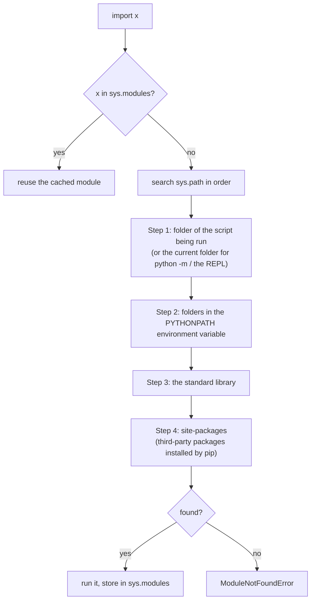

# Importing and Managing Modules: The Complete Guide

> 📚 **Before you start**
>
> - [Functions and Parameter Passing](../06-functions-and-iterators/functions-and-parameter-passing.md)
> - [Reading and Writing Files](../08-file-handling/reading-and-writing-files.md), for `pathlib`, `tempfile` and TOML
> - [Lab: Log file analyser](../08-file-handling/lab-log-file-analyser.md), which ended with `if __name__ == "__main__":`

## Introduction

Your chatbot project started as one file, `bot.py`. Six weeks later it is 2,400 lines long: prompt templates, an API client, retry logic, a database layer, some helper functions and the web app, all mixed together. Two teammates edit it at the same time and every merge is a fight. A bug fix to the retry logic requires scrolling past the database code. Nobody can reuse the API client in the new evaluation script without copying it.

The answer is to split the code into **modules** (files) and **packages** (folders of modules), and to manage the third-party code you depend on (`httpx`, `pydantic`, `anthropic`, `langgraph`) with **virtual environments** and a **`pyproject.toml`** file. This is how every real Python project is organised, and it is the first thing you'll see when you open any repository on GitHub.

By the end of this lesson you will understand exactly what `import` does, how Python finds modules, what `__init__.py` and `if __name__ == "__main__":` are for, how to use absolute and relative imports, how to avoid circular imports, and how to set up a project with a virtual environment, `pip` and `pyproject.toml`.

> 💡 **Key Insight**
>
> `import x` does three things: **find** `x` by searching the folders in `sys.path`, **run** its code once to create a module object, and **cache** that object in `sys.modules` so later imports reuse it. Nearly every import puzzle (shadowed names, code that runs "twice", circular import errors, "module not found" inside a virtual environment) is explained by one of those three steps.

---

## Core Explanation

### 1. What Is a Module?

A **module** is simply a `.py` file. Its name is the file name without `.py`. Everything defined at the top level of the file (functions, classes, variables) becomes an **attribute** of the module object you get when you import it.

The standard library is a large collection of modules that ship with Python:

```python
import math
import json as js                       # import under a different (shorter) name
from datetime import date, timedelta    # pull specific names into this namespace
from collections import Counter as Tally

print(math.sqrt(144), math.pi > 3)
print(js.dumps({"ok": True}))
print(date(2026, 10, 11) + timedelta(days=30))
print(Tally("banana").most_common(1))
print(type(math).__name__, math.__name__)
```

Output:

```
12.0 True
{"ok": true}
2026-11-10
[('a', 3)]
module math
```

The forms of `import`:

| Form | What you get | When to use |
|---|---|---|
| `import json` | the name `json`; use `json.dumps` | Default. The prefix shows where each name comes from |
| `import numpy as np` | a shorter alias | Long names, or community conventions (`np`, `pd`, `plt`) |
| `from pathlib import Path` | just `Path` in your namespace | Names you use a lot and that are clear on their own |
| `from x import a as b` | `a` under the name `b` | Avoiding a clash with one of your own names |
| `from x import *` | every public name in `x` | Almost never: it hides where names came from and can silently overwrite yours |

### 2. Writing and Importing Your Own Module

Let's create a module file in a temporary folder and import it. Python looks for modules in the folders listed in `sys.path`, so we add our folder to it:

```python
import sys
import tempfile
import textwrap
from pathlib import Path

tmp = tempfile.TemporaryDirectory()
project = Path(tmp.name)
sys.path.insert(0, str(project))                  # let Python find modules in this folder

(project / "fares.py").write_text(textwrap.dedent('''
    """Train fare helpers."""

    print("fares module is being executed")

    GST_RATE = 0.05

    def with_gst(amount):
        return round(amount * (1 + GST_RATE), 2)

    def _internal_helper():
        return "not for outside use"
'''), encoding="utf-8")

import fares

print(fares.with_gst(1000), fares.GST_RATE)
print(fares.__name__, fares.__doc__)
print(Path(fares.__file__).name)
print([name for name in dir(fares) if not name.startswith("__")])
```

Output:

```
fares module is being executed
1050.0 0.05
fares Train fare helpers.
fares.py
['GST_RATE', '_internal_helper', 'with_gst']
```

The `print` at the top of `fares.py` ran when we imported it. **Importing a module runs its top-level code.** That's how its functions and variables get defined in the first place. It is also why module files should contain definitions, not actions like "call the API now" or "delete the cache".

### 3. Modules Are Imported Only Once: `sys.modules`

```python
import fares                         # no "being executed" message this time
import fares as f2

print(f2 is fares)
print("fares" in sys.modules, sys.modules["fares"] is fares)
```

Output:

```
True
True True
```

After the first import, the module object is stored in the **`sys.modules`** dictionary. Every later `import fares`, from any file in your program, gets that same object without running the code again. This is why a module works as a natural **singleton**: module-level variables (a configuration dictionary, a shared HTTP client, a cache) are shared across the whole program.

If you edit a module's file while a program (or a Jupyter notebook) is running, `import` won't pick up the change, because the cached module is reused. `importlib.reload()` re-executes the file into the same module object:

```python
import importlib

(project / "fares.py").write_text('GST_RATE = 0.12\ndef with_gst(a):\n    return round(a * (1 + GST_RATE), 2)\n',
                                  encoding="utf-8")
importlib.invalidate_caches()        # tell the import system the folder changed
importlib.reload(fares)
print(fares.with_gst(1000))
```

Output:

```
1120.0
```

`reload` is a development convenience (Jupyter's `%autoreload` extension builds on it). It doesn't update objects that were already created from the old code, so restarting the program is the reliable way to pick up changes.

### 4. `if __name__ == "__main__":`

Every module has a `__name__` attribute. When a file is **imported**, `__name__` is its module name (`"fares"`). When a file is **run directly** (`python fares.py`), Python names it `"__main__"`. Checking it lets one file work both as an importable module and as a script:

```python
import subprocess

(project / "converter.py").write_text(textwrap.dedent('''
    def km_to_miles(km):
        return round(km * 0.621371, 1)

    print("__name__ is", repr(__name__))

    if __name__ == "__main__":          # only when run as a script
        print("Mumbai to Pune:", km_to_miles(150), "miles")
'''), encoding="utf-8")

result = subprocess.run([sys.executable, str(project / "converter.py")],
                        capture_output=True, text=True)
print("run as a script:")
print(result.stdout, end="")

print("imported:")
import converter
print(converter.km_to_miles(42))
```

Output:

```
run as a script:
__name__ is '__main__'
Mumbai to Pune: 93.2 miles
imported:
__name__ is 'converter'
26.1
```

`subprocess.run([sys.executable, ...])` starts a new Python process running the file, exactly as if you typed `python converter.py` in a terminal. (`sys.executable` is the path of the Python interpreter that is running right now.)

Put a script's "do the work" code inside `if __name__ == "__main__":`, usually as a call to a `main()` function. Then tests and other modules can import its functions without triggering the script. This guard is also **required** when using `multiprocessing`, as you'll see in [Threads, Processes and Async](../10-concurrency-for-ai-apps/threads-processes-and-async.md).

You can also run a module by its import name with `python -m`: `python -m json.tool data.json`, `python -m venv .venv`, `python -m pip install httpx`, `python -m http.server`. With `-m`, Python finds the module through `sys.path` like an import, and runs it as `__main__`.

### 5. How Python Finds Modules: `sys.path`

When you `import x`, Python checks `sys.modules` first. If `x` isn't there, it searches the folders in **`sys.path`**, in order, and uses the **first** match:



Because the script's own folder comes **first**, a file of yours with the same name as a standard library or third-party module **shadows** it. This is a classic beginner trap: name your experiment `random.py` or `json.py`, and imports elsewhere break in confusing ways.

```python
shadow = project / "shadow_demo"
shadow.mkdir()
(shadow / "json.py").write_text("print('oops, this is MY json.py')\n", encoding="utf-8")
(shadow / "app.py").write_text("import json\nprint(json.dumps({'a': 1}))\n", encoding="utf-8")

result = subprocess.run([sys.executable, str(shadow / "app.py")], capture_output=True, text=True)
print(result.stdout, end="")
error_line = result.stderr.strip().splitlines()[-1]
print(error_line.split(" (consider")[0])            # the part without the temporary path
print("Python suggests renaming the file:", "consider renaming" in error_line)
```

Output:

```
oops, this is MY json.py
AttributeError: module 'json' has no attribute 'dumps'
Python suggests renaming the file: True
```

Our `json.py` was found first, so `import json` ran it instead of the real module, and `json.dumps` didn't exist. Recent Python versions add a hint to this error: the full message continues with "consider renaming '.../shadow_demo/json.py' since it has the same name as the standard library module named 'json'". **Never name your files after modules you use.**

### 6. Packages: Folders of Modules

A **package** is a folder of modules that you import with dotted names. A folder becomes a **regular package** when it contains an `__init__.py` file (which may be empty). Let's build a small package for an AI app:

```
chatkit/
├── __init__.py          runs on "import chatkit"; defines the public API
├── config.py
├── clients/
│   ├── __init__.py
│   ├── base.py
│   └── fake.py
└── utils/
    ├── __init__.py
    └── text.py
```

```python
def write(rel_path, code):
    path = project / rel_path
    path.parent.mkdir(parents=True, exist_ok=True)
    path.write_text(textwrap.dedent(code).lstrip(), encoding="utf-8")

write("chatkit/config.py", '''
    DEFAULT_MODEL = "claude-opus-5-5"
    MAX_TOKENS = 1024
''')
write("chatkit/utils/__init__.py", "")
write("chatkit/utils/text.py", '''
    def truncate(text, limit=20):
        return text if len(text) <= limit else text[: limit - 3] + "..."
''')
write("chatkit/clients/__init__.py", '''
    from .fake import FakeClient          # re-export so users can write chatkit.clients.FakeClient
''')
write("chatkit/clients/base.py", '''
    from ..config import DEFAULT_MODEL    # relative import: go up one package, then into config

    class BaseClient:
        def __init__(self, model=DEFAULT_MODEL):
            self.model = model
''')
write("chatkit/clients/fake.py", '''
    from .base import BaseClient          # same package
    from chatkit.utils.text import truncate   # absolute import works too

    class FakeClient(BaseClient):
        def complete(self, prompt):
            return f"[{self.model}] echo: {truncate(prompt)}"
''')
write("chatkit/__init__.py", '''
    """chatkit: a tiny toolkit for chat apps."""
    from .clients import FakeClient
    from .config import DEFAULT_MODEL

    __all__ = ["FakeClient", "DEFAULT_MODEL"]
    __version__ = "0.1.0"
''')

import chatkit
from chatkit.utils.text import truncate

client = chatkit.FakeClient()
print(client.complete("Explain the Duckworth-Lewis method simply"))
print(chatkit.__version__, chatkit.__all__)
print(truncate("short"))
print(sorted(name for name in sys.modules if name.startswith("chatkit")))
```

Output:

```
[claude-opus-5-5] echo: Explain the Duckw...
0.1.0 ['FakeClient', 'DEFAULT_MODEL']
short
['chatkit', 'chatkit.clients', 'chatkit.clients.base', 'chatkit.clients.fake', 'chatkit.config', 'chatkit.utils', 'chatkit.utils.text']
```

What to notice:

- **`__init__.py` runs when the package is first imported.** Here it imports `FakeClient` and `DEFAULT_MODEL` from inside the package, so users can write `chatkit.FakeClient` instead of `chatkit.clients.fake.FakeClient`. Designing a short, stable public API in `__init__.py` while keeping the internal layout free to change is standard practice.
- **Importing `chatkit` imported its submodules too** (the `sys.modules` list), because `__init__.py` imported them. Keep `__init__.py` light in big packages, since everything it imports is loaded on every `import`.
- **`__all__`** lists the public names. It controls what `from chatkit import *` imports and tells readers and tools what the API is.
- **`__version__`** is a common convention for a package's version string.

#### Absolute vs relative imports

| Style | Example | Notes |
|---|---|---|
| Absolute | `from chatkit.utils.text import truncate` | Full path from the top-level package. Clear and works everywhere. Recommended by PEP 8 for most code |
| Relative | `from .base import BaseClient`, `from ..config import X` | `.` is the current package, `..` its parent. Short; survives renaming the top-level package. Only works **inside a package** |

Relative imports fail in a file run directly as a script (`python chatkit/clients/fake.py` gives `ImportError: attempted relative import with no known parent package`), because a script is `__main__`, not part of a package. Run package code with `python -m chatkit.clients.fake` instead, from the folder that contains `chatkit`.

**Namespace packages** are folders *without* `__init__.py`. Python can still import from them (it treats them as packages that may be spread over several locations). They're meant for big projects split across multiple distributions; for your own code, include `__init__.py` so the folder is clearly a package.

### 7. Circular Imports

A **circular import** happens when module A imports module B and B imports A. Because a module is put in `sys.modules` *before* its code finishes running, the second import finds a half-initialised module:

```python
write("shop/__init__.py", "")
write("shop/orders.py", '''
    from shop.customers import Customer     # orders needs customers...

    class Order:
        def __init__(self, customer):
            self.customer = customer
''')
write("shop/customers.py", '''
    from shop.orders import Order           # ...and customers needs orders

    class Customer:
        def new_order(self):
            return Order(self)
''')

try:
    import shop.orders
except ImportError as err:
    print("ImportError:", str(err).split(" (")[0])
```

Output:

```
ImportError: cannot import name 'Order' from partially initialized module 'shop.orders'
```

Walk through it: `shop.orders` starts running, its first line imports `shop.customers`, which starts running and asks for `Order` from `shop.orders`. But `shop.orders` has only executed its first line, so `Order` doesn't exist yet.

Fixes, best first:

1. **Restructure.** Circular imports usually mean two modules are really one, or that shared code should move into a third module both can import.
2. **Import the module, not the name**, and look the name up when it's used: `import shop.orders` at the top and `shop.orders.Order(self)` inside the method. By the time the method runs, both modules have finished loading.
3. **Import inside the function** that needs it: `def new_order(self): from shop.orders import Order`.
4. **For type hints only**, put the import under `if typing.TYPE_CHECKING:`, which is `False` at runtime.

```python
write("shop/customers.py", '''
    class Customer:
        def new_order(self):
            from shop.orders import Order      # imported when called, not at load time
            return Order(self)
''')
for name in [n for n in sys.modules if n.startswith("shop")]:
    del sys.modules[name]                      # forget the failed attempt
importlib.invalidate_caches()

import shop.orders, shop.customers
order = shop.customers.Customer().new_order()
print(type(order).__name__, type(order.customer).__name__)
```

Output:

```
Order Customer
```

### 8. Importing Dynamically and Lazily

Sometimes the module to import is only known at runtime, for example a plug-in named in a config file. `importlib.import_module` takes the name as a string:

```python
plugin_name = "chatkit.utils.text"             # could come from a config file
plugin = importlib.import_module(plugin_name)
print(plugin.truncate("Plugins can be chosen at runtime", 16))

try:
    importlib.import_module("chatkit.missing_plugin")
except ModuleNotFoundError as err:
    print("ModuleNotFoundError:", err)
```

Output:

```
Plugins can b...
ModuleNotFoundError: No module named 'chatkit.missing_plugin'
```

**Lazy importing** delays an expensive import until it's needed, which speeds up program start (important for command-line tools). The traditional way is to import inside the function that uses the module. Python 3.15 adds explicit lazy imports (PEP 810): `lazy import json` binds the name immediately but loads the module only on first use. On earlier versions, stick with function-level imports.

### 9. The Standard Library: Check Before You Install

Python's "batteries included" standard library covers a lot. Before adding a dependency, check whether one of these does the job:

| Need | Module |
|---|---|
| Paths and files | `pathlib`, `shutil`, `tempfile`, `os` |
| Data formats | `json`, `csv`, `tomllib`, `sqlite3`, `gzip`, `zipfile` |
| Dates and times | `datetime`, `zoneinfo`, `time` |
| Data structures and tools | `collections`, `itertools`, `functools`, `heapq`, `bisect`, `dataclasses`, `enum` |
| Text | `re`, `string`, `textwrap`, `difflib`, `unicodedata` |
| Command-line programs | `argparse`, `logging`, `subprocess`, `sys`, `os` |
| Concurrency | `threading`, `multiprocessing`, `concurrent.futures`, `asyncio` |
| Networking and web | `urllib.request`, `http.server`, `smtplib`, `email` |
| Testing and quality | `unittest`, `doctest`, `typing`, `pdb`, `timeit`, `cProfile` |
| Security | `secrets`, `hashlib`, `hmac`, `ssl` |

### 10. Third-Party Packages and `pip`

**PyPI** (the Python Package Index, pypi.org) hosts hundreds of thousands of third-party packages. **`pip`** installs them. Always run it as `python -m pip` so it installs into the Python you're actually using:

```bash
python -m pip install httpx                    # latest version
python -m pip install "pydantic>=2.10,<3"      # a version range
python -m pip install --upgrade httpx
python -m pip uninstall httpx
python -m pip list                             # what's installed
python -m pip show httpx                       # details and dependencies of one package
python -m pip freeze > requirements.txt        # exact versions of everything installed
python -m pip install -r requirements.txt      # install from that list
```

Version specifiers you'll see: `==2.13.5` (exactly), `>=2.10` (at least), `~=2.13` (compatible release: at least 2.13 but below 3.0), `<3` (below), combined with commas.

Inside your code you can check which version of an installed package you got:

```python
from importlib.metadata import version, PackageNotFoundError

for package in ["pip", "surely-not-installed-xyz"]:
    try:
        print(package, "is installed:", bool(version(package)))
    except PackageNotFoundError:
        print(package, "is not installed")
```

Output:

```
pip is installed: True
surely-not-installed-xyz is not installed
```

### 11. Virtual Environments

If every project installs packages into one global Python, they fight: project A needs `pydantic` 1.x, project B needs 2.x, and upgrading for one breaks the other. A **virtual environment** ("venv") is a self-contained folder with its own `site-packages`, linked to a base Python. Each project gets its own, and packages installed in one don't affect any other.

```bash
python3 -m venv .venv                 # create (the folder name .venv is the convention)
source .venv/bin/activate             # activate on macOS/Linux
.venv\Scripts\activate                # activate on Windows
python -m pip install httpx           # now installs into .venv only
deactivate                            # leave the environment
```

"Activating" only changes your shell's `PATH` so that `python` and `pip` point into `.venv`. You can skip activation and call `.venv/bin/python` directly. Add `.venv/` to `.gitignore`: environments are rebuilt from your dependency list, never committed.

You can create one from Python too, which shows what a venv really is:

```python
import os
import venv

env_dir = project / ".venv"
venv.create(env_dir, with_pip=False)          # with_pip=False keeps the demo fast and offline
bin_dir = env_dir / ("Scripts" if os.name == "nt" else "bin")
env_python = bin_dir / ("python.exe" if os.name == "nt" else "python")

check = "import sys; print(sys.prefix != sys.base_prefix, sys.prefix.endswith('.venv'))"
print(subprocess.run([str(env_python), "-c", check], capture_output=True, text=True).stdout, end="")
print((env_dir / "pyvenv.cfg").is_file(), env_python.exists())
print((env_dir / "pyvenv.cfg").read_text(encoding="utf-8").splitlines()[0].split(" = ")[0])
```

Output:

```
True True
True True
home
```

Inside the environment, `sys.prefix` points at `.venv` while `sys.base_prefix` still points at the original installation; that difference is how Python (and you) can tell a venv is active. `pyvenv.cfg` records which base Python it was made from.

### 12. `pyproject.toml`: Describing Your Project

Modern Python projects describe themselves in a single **`pyproject.toml`** file at the root: name, version, required Python, dependencies, optional extras, command-line entry points and the **build backend** (the tool that turns your source into an installable package). Here is a realistic one:

```toml
[build-system]
requires = ["hatchling"]
build-backend = "hatchling.build"

[project]
name = "chatkit"
version = "0.1.0"
description = "A tiny toolkit for chat apps"
readme = "README.md"
requires-python = ">=3.13"
dependencies = [
    "httpx>=0.28",
    "pydantic>=2.10,<3",
]

[project.optional-dependencies]
dev = ["pytest>=8", "ruff"]

[project.scripts]
chatkit = "chatkit.cli:main"      # installs a 'chatkit' command that calls chatkit/cli.py:main()
```

And the **src layout** most projects use, which keeps your package from being imported accidentally from the project folder instead of the installed copy:

```
my-project/
├── pyproject.toml
├── README.md
├── src/
│   └── chatkit/
│       ├── __init__.py
│       └── ...
└── tests/
    └── test_clients.py
```

`python -m pip install -e ".[dev]"` installs the project in **editable** mode (code changes take effect without reinstalling) along with the `dev` extras. You can read `pyproject.toml` with `tomllib`, which is how tools see it:

```python
import tomllib

pyproject = textwrap.dedent('''
    [project]
    name = "chatkit"
    version = "0.1.0"
    requires-python = ">=3.13"
    dependencies = ["httpx>=0.28", "pydantic>=2.10,<3"]

    [project.optional-dependencies]
    dev = ["pytest>=8", "ruff"]
''')
meta = tomllib.loads(pyproject)["project"]
print(meta["name"], meta["version"], meta["requires-python"])
print(meta["dependencies"])
print(meta["optional-dependencies"]["dev"])
tmp.cleanup()
```

Output:

```
chatkit 0.1.0 >=3.13
['httpx>=0.28', 'pydantic>=2.10,<3']
['pytest>=8', 'ruff']
```

#### Lock files and modern tools

`dependencies` in `pyproject.toml` lists **ranges** your code is compatible with. For an application you also want a **lock file** recording the *exact* version of every package (including dependencies of dependencies) so every machine and deployment installs the same thing. `pip freeze > requirements.txt` is the classic way. Newer tools manage environments, dependencies and lock files together:

- **uv** (by Astral) is a very fast all-in-one tool: `uv init`, `uv add httpx`, `uv lock`, `uv sync`, and `uv run script.py` (which creates and uses the project's `.venv` automatically). It has become a common default for new projects.
- **Poetry**, **PDM** and **Hatch** are other project managers built around `pyproject.toml`.
- **pipx** installs Python command-line *tools* (like `ruff` or `httpie`) each in its own isolated environment.

Whatever the tool, the ideas are the ones in this lesson: one virtual environment per project, dependencies declared in `pyproject.toml`, exact versions pinned in a lock file.

---

## Try It Yourself

1. Create (in a temporary folder) a module `greetings.py` with a function `hello(name)` and a `__main__` block that prints `hello("World")`. Import it and call `hello("Asha")`; then run it as a script with `subprocess` and print its output.
2. Explain why this prints `1` and not `2`, then make it print `2` without restarting Python:
   ```python
   (folder / "counter.py").write_text("COUNT = 1\n"); import counter
   (folder / "counter.py").write_text("COUNT = 2\n"); import counter
   print(counter.COUNT)
   ```
3. Build a package `calc` with `calc/__init__.py` re-exporting `add` from `calc/ops.py` (which uses a relative import of `ROUND_TO` from `calc/settings.py`). Show `calc.add(0.1, 0.2)` returns `0.3`.
4. Use `importlib.import_module` to load whichever of `"json"` or `"tomllib"` is named in a variable, and print the module's `__name__`.

<details>
<summary>Show answers</summary>

**1.**

```python
import importlib, subprocess, sys, tempfile, textwrap
from pathlib import Path

with tempfile.TemporaryDirectory() as d:
    folder = Path(d)
    (folder / "greetings.py").write_text(textwrap.dedent('''
        def hello(name):
            return f"Hello, {name}!"

        if __name__ == "__main__":
            print(hello("World"))
    '''), encoding="utf-8")
    sys.path.insert(0, d)
    import greetings
    print(greetings.hello("Asha"))
    print(subprocess.run([sys.executable, str(folder / "greetings.py")],
                         capture_output=True, text=True).stdout, end="")
    sys.path.remove(d)
```

Output:

```
Hello, Asha!
Hello, World!
```

**2.** The second `import counter` reuses the cached module from `sys.modules`, so the file isn't read again. `importlib.reload` re-runs it. (One more trap: Python decides whether its cached bytecode in `__pycache__` is stale by the source file's modification time, in whole seconds, and its size. An edit that keeps the same size within the same second can be missed, which is why the edited line below also changes length.)

```python
with tempfile.TemporaryDirectory() as d:
    folder = Path(d)
    sys.path.insert(0, d)
    (folder / "counter.py").write_text("COUNT = 1\n"); import counter
    (folder / "counter.py").write_text("COUNT = 2  # edited\n"); import counter
    print(counter.COUNT)
    importlib.invalidate_caches()
    importlib.reload(counter)
    print(counter.COUNT)
    sys.path.remove(d)
```

Output:

```
1
2
```

**3.**

```python
with tempfile.TemporaryDirectory() as d:
    pkg = Path(d) / "calc"
    pkg.mkdir()
    (pkg / "settings.py").write_text("ROUND_TO = 10\n")
    (pkg / "ops.py").write_text("from .settings import ROUND_TO\n\ndef add(a, b):\n    return round(a + b, ROUND_TO)\n")
    (pkg / "__init__.py").write_text("from .ops import add\n__all__ = ['add']\n")
    sys.path.insert(0, d)
    import calc
    print(calc.add(0.1, 0.2), 0.1 + 0.2)
    sys.path.remove(d)
```

Output:

```
0.3 0.30000000000000004
```

**4.**

```python
choice = "tomllib"
module = importlib.import_module(choice)
print(module.__name__, hasattr(module, "loads"))
```

Output:

```
tomllib True
```

</details>

---

## Real-World Examples

### Example 1: Reading a real repository

Open the LangGraph or FastAPI source on GitHub and you'll see the structure from this lesson: a `pyproject.toml` at the root, the package under `src/` or a top-level folder, an `__init__.py` that re-exports the public API (`from fastapi import FastAPI` works because of it), and `tests/` alongside.

### Example 2: Environment problems in AI projects

"It works on my machine" in AI projects is usually an environment problem: a different `torch` or `transformers` version, or a package installed into the wrong Python. One venv per project, `python -m pip`, and a lock file make the environment reproducible, and Docker images for deployment are built from that same lock file.

### Example 3: Plug-in loading

Tools like pytest load plug-ins by name with `importlib`, and agent frameworks can load tool modules listed in a config file the same way. The registry pattern from [Decorators, classmethod and staticmethod](../07-object-oriented-programming/decorators-classmethod-and-staticmethod.md) usually fills up as those modules are imported.

---

## Common Misconceptions

### Misconception 1: "Importing a module twice runs it twice"

Modules are cached in `sys.modules`; the code runs once per process. Use `importlib.reload` (or restart) to re-run it.

### Misconception 2: "`__init__.py` is just an empty marker file"

It can be empty, but it's real code that runs on import. Packages use it to define their public API, set `__all__` and `__version__`, and sometimes initialise things.

### Misconception 3: "`pip install` installs packages for Python"

It installs packages for **one particular Python environment**: whichever `pip` you ran. `python -m pip` guarantees it matches the `python` you'll run your code with.

### Misconception 4: "`from module import *` saves typing, so it's fine"

It hides where names come from, can overwrite your own names silently, and makes code harder to search and review. Import names explicitly.

### Misconception 5: "Virtual environments are only for big projects"

Even a small script benefits: it stops global installs from piling up and conflicting, and lets you delete a project's dependencies by deleting one folder.

---

## Interview Relevance

Module and packaging questions are common for any Python role. A strong answer covers:

- **What `import` does**: search `sys.path`, execute once, cache in `sys.modules`.
- **`if __name__ == "__main__":`** and why it matters (importable scripts, multiprocessing).
- **Packages and `__init__.py`**, `__all__`, absolute versus relative imports.
- **Circular imports**: why they fail and how to fix them.
- **Environments and dependencies**: venv, `pip`, `pyproject.toml`, lock files, and tools like uv.

Common follow-ups:

- *"Why does `import random` fail with a strange error in my project?"* A local `random.py` shadows the standard library module.
- *"How do you make a package installable?"* A `pyproject.toml` with a `[build-system]` and `[project]` section, then `pip install .` (or `-e .` while developing).
- *"`requirements.txt` vs `pyproject.toml`?"* `pyproject.toml` declares the project and its compatible ranges; a requirements or lock file pins exact versions for reproducible installs.

---

## Key Takeaways

- **A module is a `.py` file; a package is a folder with `__init__.py`**; `import` finds via `sys.path`, runs once, and caches in `sys.modules`.
- **Guard script code with `if __name__ == "__main__":`** so files are both importable and runnable; use `python -m` to run package modules.
- **Don't shadow standard library names**, prefer absolute imports, keep `__init__.py` light, and break circular imports by restructuring.
- **Use one virtual environment per project** and install with `python -m pip`.
- **Describe projects in `pyproject.toml`** and pin exact versions in a lock file; tools like uv automate the workflow.

---

**Up next:** [try/except and Custom Exceptions](try-except-and-custom-exceptions.md)
