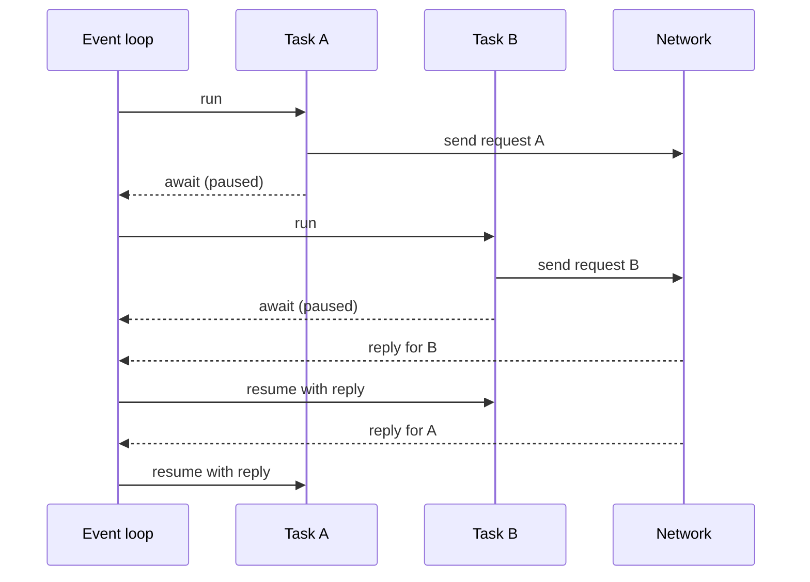

# async and await for API Calls: The Complete Guide

> 📚 **Before you start**
>
> - [Threads, Processes and Async](threads-processes-and-async.md): I/O-bound work, the event loop idea, and why async suits API calls
> - [Iterators and Generators](../06-functions-and-iterators/iterators-and-generators.md): coroutines grew out of generators
> - [try/except and Custom Exceptions](../09-modules-and-exceptions/try-except-and-custom-exceptions.md) and [Error Handling Best Practices](../09-modules-and-exceptions/error-handling-best-practices.md): exception groups, context managers and retries

## Introduction

A research assistant app receives a question, then fans out: it asks an LLM to rewrite the question three ways, sends each version to a search API, fetches the top five pages for each, summarises every page with the LLM, and finally asks the LLM to combine the summaries. That's dozens of network calls per question. Done one by one, the user waits a minute or more. Done concurrently, the same work takes a few seconds, because almost all of it is waiting.

`asyncio` is Python's built-in way to do this. It is also what the modern AI stack is built on: FastAPI endpoints, the async clients of the Anthropic and OpenAI SDKs, `httpx.AsyncClient`, LangChain's `ainvoke`, LangGraph's `astream`. If you write AI applications, you will write `async` code.

But async has sharp edges. Forget one `await` and nothing happens. Await things one after another and you've written slow sequential code with extra syntax. Launch 1,000 calls at once and the API answers with a wall of `429 Too Many Requests`. Call one blocking function and every task freezes.

By the end of this lesson you will understand coroutines and the event loop, and you'll be able to run calls concurrently with `gather`, `TaskGroup` and `as_completed`, limit concurrency with a `Semaphore`, bound waits with timeouts, handle cancellation, retry with backoff, stream responses with async generators, and mix in blocking code safely.

> 💡 **Key Insight**
>
> `await` means "pause **this** coroutine until the result is ready, and let the event loop run others meanwhile". Concurrency only happens when several coroutines are **scheduled at the same time** (as tasks, or through `gather`/`TaskGroup`). Awaiting calls one after another, even inside `async def`, runs them one after another.

All examples simulate API latency with `asyncio.sleep`, so they run offline and instantly. Instead of printing timings (which vary from run to run), they print the order of events and counts, which don't.

---

## Core Explanation

### 1. Coroutines: `async def` and `await`

A function defined with `async def` is a **coroutine function**. Calling it does **not** run its body; it returns a **coroutine object**, a paused computation waiting to be driven:

```python
import asyncio

async def fetch_price(item):
    await asyncio.sleep(0.01)                  # pretend network wait
    return {"chai": 15, "samosa": 20}[item]

coro = fetch_price("chai")
print(type(coro).__name__)                     # nothing has run yet
print(asyncio.run(coro))                       # asyncio.run drives it to completion
```

Output:

```
coroutine
15
```

Three rules:

- **`asyncio.run(coro)`** is the entry point from normal code: it creates an event loop, runs the coroutine until it finishes, and closes the loop. Call it once, at the top of your program.
- **`await` can only be used inside `async def`.** `await something` runs `something` (a coroutine, task or future) and pauses the current coroutine until it produces a result.
- **Async is contagious**: a function that needs to `await` must itself be `async def`, and so must its caller, up to `asyncio.run`.

If you call a coroutine function without awaiting it, the body never runs and Python later warns `RuntimeWarning: coroutine '...' was never awaited`. It's the most common async bug, and the warning is your clue.

(In Jupyter notebooks an event loop is already running, so `asyncio.run` raises an error there. Use `await main()` directly in a cell instead.)

### 2. The Event Loop

The **event loop** is a scheduler. It keeps a list of tasks that are ready to run and a list of tasks waiting for something (a timer, a network reply). It runs one ready task until that task hits an `await` on something not yet ready, then switches to another ready task. When a reply arrives, the waiting task becomes ready again.



Everything runs in **one thread**. Switching happens **only at `await`**, so between two `await`s your code runs without interruption. That makes shared state much easier to reason about than with threads.

### 3. Sequential Awaits vs Concurrent Tasks

Here is a pretend LLM call that logs when it starts and finishes:

```python
events = []

async def fake_llm(prompt, latency):
    events.append(f"start {prompt}")
    await asyncio.sleep(latency)
    events.append(f"end {prompt}")
    return f"answer to {prompt}"

async def sequential():
    a = await fake_llm("A", 0.03)          # waits for A to finish...
    b = await fake_llm("B", 0.01)          # ...before B even starts
    return [a, b]

async def concurrent():
    task_a = asyncio.create_task(fake_llm("A", 0.03))    # scheduled now
    task_b = asyncio.create_task(fake_llm("B", 0.01))    # scheduled now
    return [await task_a, await task_b]

for runner in (sequential, concurrent):
    events.clear()
    print(runner.__name__, asyncio.run(runner()))
    print("   ", events)
```

Output:

```
sequential ['answer to A', 'answer to B']
    ['start A', 'end A', 'start B', 'end B']
concurrent ['answer to A', 'answer to B']
    ['start A', 'start B', 'end B', 'end A']
```

The `sequential` version is perfectly valid async code, and no faster than plain synchronous code: B starts only after A ends. In the `concurrent` version both start immediately, and B (the faster call) finishes first. The total time is roughly the *longest* call instead of the *sum*.

**`asyncio.create_task(coro)`** wraps a coroutine in a **Task** and schedules it to run on the loop as soon as the current coroutine yields. You can later `await` the task to get its result (or its exception). Keep a reference to every task you create: the event loop holds tasks only weakly, so an unreferenced task can be garbage-collected before it finishes.

### 4. `asyncio.gather`: Run Many, Get Results in Order

Creating tasks one by one gets repetitive. `asyncio.gather(*aws)` schedules all the awaitables concurrently, waits for all of them, and returns their results **in the order you passed them**, whatever order they finished in:

```python
async def summarise(review_id, latency):
    await asyncio.sleep(latency)
    return f"summary {review_id}"

async def main():
    latencies = {1: 0.03, 2: 0.01, 3: 0.02}
    return await asyncio.gather(*(summarise(i, lat) for i, lat in latencies.items()))

print(asyncio.run(main()))
```

Output:

```
['summary 1', 'summary 2', 'summary 3']
```

#### What happens when one fails

By default, the **first exception** raised by any of them propagates out of `gather` immediately. The other tasks are **not** cancelled; they keep running in the background, and their results are lost to you. With **`return_exceptions=True`**, exceptions are returned as values in the results list instead, so you can handle each one:

```python
class RateLimitError(Exception):
    pass

async def call_api(n):
    await asyncio.sleep(0.01 * n)
    if n == 2:
        raise RateLimitError(f"429 for request {n}")
    return f"ok {n}"

async def main():
    try:
        await asyncio.gather(*(call_api(n) for n in range(1, 5)))
    except RateLimitError as err:
        print("default gather raised:", err)

    results = await asyncio.gather(*(call_api(n) for n in range(1, 5)), return_exceptions=True)
    for n, r in enumerate(results, start=1):
        print(n, "error:" if isinstance(r, Exception) else "result:", r)

asyncio.run(main())
```

Output:

```
default gather raised: 429 for request 2
1 result: ok 1
2 error: 429 for request 2
3 result: ok 3
4 result: ok 4
```

`return_exceptions=True` is the right choice for **batch jobs** where each call is independent and you want every result you can get, plus a list of failures.

### 5. `TaskGroup`: Structured Concurrency

**`asyncio.TaskGroup`** (Python 3.11+) is the modern, safer way to run a group of tasks that belong together. Tasks are created inside an `async with` block, and the block doesn't exit until all of them are done. If **any task fails, the group cancels all the others** and raises an **`ExceptionGroup`** with every error that occurred. Nothing keeps running in the background unnoticed:

```python
events = []

async def step(name, latency, fail=False):
    try:
        await asyncio.sleep(latency)
        if fail:
            raise ConnectionError(f"{name} failed")
        events.append(f"{name} done")
        return name
    except asyncio.CancelledError:
        events.append(f"{name} cancelled")
        raise                                       # always re-raise CancelledError

async def main():
    async with asyncio.TaskGroup() as tg:
        search = tg.create_task(step("search", 0.01))
        fetch = tg.create_task(step("fetch", 0.02))
    print("both succeeded:", search.result(), fetch.result())

    try:
        async with asyncio.TaskGroup() as tg:
            tg.create_task(step("search", 0.01))
            tg.create_task(step("fetch", 0.02, fail=True))
            tg.create_task(step("summarise", 0.05))    # still running when fetch fails
    except* ConnectionError as group:
        print("failed:", [str(e) for e in group.exceptions])

asyncio.run(main())
print(events)
```

Output:

```
both succeeded: search fetch
failed: ['fetch failed']
['search done', 'fetch done', 'search done', 'summarise cancelled']
```

When `fetch` failed, `summarise` was cancelled automatically, and the error arrived as an `ExceptionGroup`, handled here with `except*` (see [try/except and Custom Exceptions](../09-modules-and-exceptions/try-except-and-custom-exceptions.md)).

**Which to use?**

| | `gather` | `gather(return_exceptions=True)` | `TaskGroup` |
|---|---|---|---|
| On first failure | Raises it; others keep running unseen | Never raises; errors in the list | Cancels the rest; raises `ExceptionGroup` of all errors |
| Best for | Quick scripts | Independent batch items, partial success is fine | Tasks that only make sense together (all-or-nothing) |

### 6. `as_completed`: Handle Results as They Arrive

Sometimes you want to act on each result **as soon as it's ready**, for example to update a progress bar or to show the first answers to the user while others are still coming. `asyncio.as_completed` yields awaitables in **completion order**:

```python
async def main():
    latencies = {"Mumbai": 0.03, "Delhi": 0.01, "Chennai": 0.02}

    async def weather(city):
        await asyncio.sleep(latencies[city])
        return city, "sunny"

    for done, next_result in enumerate(asyncio.as_completed([weather(c) for c in latencies]), start=1):
        city, sky = await next_result
        print(f"[{done}/{len(latencies)}] {city}: {sky}")

asyncio.run(main())
```

Output:

```
[1/3] Delhi: sunny
[2/3] Chennai: sunny
[3/3] Mumbai: sunny
```

(Since Python 3.13 you can also write `async for task in asyncio.as_completed(...)`, which yields the original tasks.)

### 7. Limiting Concurrency with a `Semaphore`

Launching 1,000 API calls at once will hit the provider's rate limit, exhaust connections, or both. An **`asyncio.Semaphore(n)`** is a counter that allows at most `n` holders at a time: a coroutine does `async with sem:` to take a slot, and further coroutines wait until a slot frees up.

The example tracks how many calls are in flight at once, to prove the limit holds:

```python
in_flight = 0
peak = 0

async def limited_call(sem, n):
    global in_flight, peak
    async with sem:                             # wait here if 3 calls are already running
        in_flight += 1
        peak = max(peak, in_flight)
        await asyncio.sleep(0.01)
        in_flight -= 1
        return n * n

async def main(limit):
    sem = asyncio.Semaphore(limit)
    return await asyncio.gather(*(limited_call(sem, n) for n in range(10)))

results = asyncio.run(main(limit=3))
print(results)
print("peak concurrent calls:", peak)
```

Output:

```
[0, 1, 4, 9, 16, 25, 36, 49, 64, 81]
peak concurrent calls: 3
```

All 10 coroutines start, but only 3 are ever inside the `async with` block at once. Updating `in_flight` without a lock is safe here because there's no `await` between the read and the write: no other task can run in between. (With threads, the same code would be a race condition.)

Note what a semaphore limits: the number of **simultaneous** requests. Providers also limit requests **per minute** and tokens per minute. With very fast calls, a concurrency cap of 10 could still exceed a per-minute limit. For that you add a rate limiter (for example, a minimum interval between request starts), use a library like `aiolimiter`, or simply rely on retries with backoff when a `429` arrives.

### 8. Timeouts

An API call that never returns would hang your program forever. Always bound waits. **`asyncio.timeout(seconds)`** (Python 3.11+) is an async context manager that cancels the block if it takes too long and raises **`TimeoutError`**:

```python
async def slow_model(latency):
    await asyncio.sleep(latency)
    return "finally answered"

async def main():
    for latency in (0.01, 0.2):
        try:
            async with asyncio.timeout(0.05):          # this whole block gets 50 ms
                print("got:", await slow_model(latency))
        except TimeoutError:
            print(f"timed out (call needed {latency}s)")

    # the older form, for a single awaitable
    try:
        await asyncio.wait_for(slow_model(0.2), timeout=0.05)
    except TimeoutError:
        print("wait_for also timed out")

asyncio.run(main())
```

Output:

```
got: finally answered
timed out (call needed 0.2s)
wait_for also timed out
```

Use a **per-call** timeout so one slow request doesn't hold a slot forever, and often an **overall** timeout around the whole batch (an `asyncio.timeout` around a `TaskGroup`) so the user gets an answer within a known time. HTTP clients have their own timeout settings too (`httpx.AsyncClient(timeout=30.0)`), and SDKs accept a `timeout` option. Set them all deliberately.

### 9. Cancellation

A timeout works by **cancelling** the task: Python raises `asyncio.CancelledError` *inside* the coroutine at the `await` where it's paused. You can also cancel explicitly with `task.cancel()`. Cancellation is how async code stops work that's no longer needed: the user closed the page, a sibling task failed, the deadline passed.

```python
log = []

async def stream_answer():
    try:
        for i in range(10):
            await asyncio.sleep(0.01)
            log.append(f"token {i}")
    except asyncio.CancelledError:
        log.append("cancelled: closing the connection")
        raise                                  # let the cancellation continue
    finally:
        log.append("cleanup ran")

async def main():
    task = asyncio.create_task(stream_answer())
    while len(log) < 3:                        # the user clicks "Stop" once 3 tokens have arrived
        await asyncio.sleep(0.001)
    task.cancel()
    try:
        await task
    except asyncio.CancelledError:
        print("task was cancelled:", task.cancelled())

asyncio.run(main())
print(log)
```

Output:

```
task was cancelled: True
['token 0', 'token 1', 'token 2', 'cancelled: closing the connection', 'cleanup ran']
```

Rules:

- Use `try`/`finally` (or `async with`) for clean-up; it runs on cancellation too.
- If you catch `CancelledError`, **re-raise it**. Swallowing it breaks timeouts and `TaskGroup`, which rely on cancellation actually stopping the task. (`CancelledError` inherits from `BaseException`, not `Exception`, so a normal `except Exception` doesn't catch it, precisely to avoid this mistake.)

### 10. Retries with Backoff, the Async Way

The retry decorator from [Error Handling Best Practices](../09-modules-and-exceptions/error-handling-best-practices.md) used `time.sleep`, which would freeze the event loop. The async version awaits `asyncio.sleep` and wraps an `async` function:

```python
import functools
import random

class TransientAPIError(Exception):
    pass

def async_retry(attempts=4, base_delay=0.01, rng=None):
    rng = rng or random.Random()
    def decorator(func):
        @functools.wraps(func)
        async def wrapper(*args, **kwargs):
            for attempt in range(1, attempts + 1):
                try:
                    return await func(*args, **kwargs)
                except TransientAPIError as err:
                    if attempt == attempts:
                        raise
                    delay = rng.uniform(0, base_delay * 2 ** (attempt - 1))   # backoff + jitter
                    print(f"  {args[0]}: attempt {attempt} failed ({err}); retrying")
                    await asyncio.sleep(delay)
        return wrapper
    return decorator

failures_left = {"q1": 0, "q2": 2, "q3": 1}

@async_retry(rng=random.Random(0))
async def ask(question_id):
    await asyncio.sleep(0.005)
    if failures_left[question_id] > 0:
        failures_left[question_id] -= 1
        raise TransientAPIError("503 overloaded")
    return f"{question_id} answered"

async def main():
    return await asyncio.gather(*(ask(q) for q in ["q1", "q2", "q3"]))

print(asyncio.run(main()))
```

Output:

```
  q2: attempt 1 failed (503 overloaded); retrying
  q3: attempt 1 failed (503 overloaded); retrying
  q2: attempt 2 failed (503 overloaded); retrying
['q1 answered', 'q2 answered', 'q3 answered']
```

Put the retry **inside** the semaphore-limited call or outside it deliberately: retrying inside the `async with sem:` block holds the slot during the backoff wait (gentler on the API), while retrying outside releases it.

### 11. Blocking Code Inside Async: `asyncio.to_thread`

A blocking call (a synchronous HTTP library, `time.sleep`, heavy computation, some database drivers) inside a coroutine **stops the whole event loop** until it returns. Every other task freezes. This log shows a "heartbeat" task that should tick every 10 ms:

```python
import time

async def heartbeat(log, beats):
    for i in range(beats):
        log.append(f"tick {i}")
        await asyncio.sleep(0.01)

def blocking_sdk_call():
    time.sleep(0.1)                           # e.g. a synchronous HTTP request
    return "sync result"

async def bad(log):
    hb = asyncio.create_task(heartbeat(log, 3))
    await asyncio.sleep(0)                    # let the heartbeat start
    log.append(blocking_sdk_call())           # blocks the loop: no ticks can happen
    await hb

async def good(log):
    hb = asyncio.create_task(heartbeat(log, 3))
    await asyncio.sleep(0)
    log.append(await asyncio.to_thread(blocking_sdk_call))   # runs in a worker thread
    await hb

for version in (bad, good):
    log = []
    asyncio.run(version(log))
    print(f"{version.__name__:<5}", log)
```

Output:

```
bad   ['tick 0', 'sync result', 'tick 1', 'tick 2']
good  ['tick 0', 'tick 1', 'tick 2', 'sync result']
```

In `bad`, the heartbeat managed one tick, then the blocking call held the loop for its whole 100 ms: `tick 1` and `tick 2` could only happen after `sync result`, 100 ms late. In `good`, all three ticks happened on time while the blocking call ran elsewhere, and its result arrived last. With **`asyncio.to_thread(func, *args)`** the blocking function runs in a background thread, and the loop stays free to run other tasks. Use it to call sync-only libraries from async code. For CPU-heavy work, `loop.run_in_executor(process_pool, func, *args)` sends it to a process pool instead.

### 12. Async Context Managers and Async Iterators

Two more pieces of syntax complete the picture:

- **`async with`** uses an object's `__aenter__` and `__aexit__`, which can `await` (for example, to open and close network connections). HTTP clients and DB connections are used this way.
- **`async for`** iterates over an object whose next item must be awaited, via `__aiter__` and `__anext__`. The easiest way to make one is an **async generator**: an `async def` function containing `yield`. Streaming LLM responses, which arrive token by token, are consumed with `async for`.

```python
from contextlib import asynccontextmanager

@asynccontextmanager
async def fake_client():
    print("open connection pool")
    try:
        yield {"model": "claude-opus-5-5"}
    finally:
        await asyncio.sleep(0)                 # e.g. await closing sockets
        print("close connection pool")

async def stream_tokens(client, prompt):
    """An async generator: yields tokens as they 'arrive'."""
    for token in ["Chai ", "is ", "best ", "with ", "pakoras."]:
        await asyncio.sleep(0.005)
        yield token

async def main():
    async with fake_client() as client:
        parts = []
        async for token in stream_tokens(client, "What goes with chai?"):
            parts.append(token)
            print(f"  received {token!r}")
        print("full answer:", "".join(parts))

asyncio.run(main())
```

Output:

```
open connection pool
  received 'Chai '
  received 'is '
  received 'best '
  received 'with '
  received 'pakoras.'
full answer: Chai is best with pakoras.
close connection pool
```

Async comprehensions work too: `[t async for t in stream_tokens(...)]`.

### 13. With Real Libraries

The patterns above map directly onto real clients. With `httpx` (an HTTP library with both sync and async clients):

```python
# not-run: needs network access
import asyncio
import httpx

async def fetch_all(urls, limit=5):
    sem = asyncio.Semaphore(limit)
    async with httpx.AsyncClient(timeout=10.0) as client:      # one shared connection pool
        async def fetch(url):
            async with sem:
                response = await client.get(url)
                response.raise_for_status()
                return url, len(response.text)
        return await asyncio.gather(*(fetch(u) for u in urls), return_exceptions=True)

results = asyncio.run(fetch_all(["https://www.python.org", "https://pypi.org"]))
```

And with the Anthropic SDK's async client, including streaming:

```python
# not-run: needs the anthropic package and an API key
import asyncio
from anthropic import AsyncAnthropic

client = AsyncAnthropic(max_retries=3, timeout=60.0)   # the SDK retries transient errors itself

async def summarise(sem, text):
    async with sem:
        message = await client.messages.create(
            model="claude-opus-5-5",
            max_tokens=300,
            messages=[{"role": "user", "content": f"Summarise in two lines:\n{text}"}],
        )
        return message.content[0].text

async def stream_reply(question):
    async with client.messages.stream(
        model="claude-opus-5-5",
        max_tokens=500,
        messages=[{"role": "user", "content": question}],
    ) as stream:
        async for text in stream.text_stream:
            print(text, end="", flush=True)

async def main(docs):
    sem = asyncio.Semaphore(8)
    async with asyncio.timeout(120):                     # overall deadline for the batch
        return await asyncio.gather(*(summarise(sem, d) for d in docs), return_exceptions=True)
```

Create **one client** and reuse it for all calls: it holds a connection pool, so reusing it avoids repeating connection and TLS setup for every request.

### 14. Common Async Mistakes

| Mistake | Symptom | Fix |
|---|---|---|
| Calling `fetch()` without `await` | Nothing happens; "coroutine was never awaited" warning | `await fetch()` or schedule it as a task |
| `await`ing calls one by one in a loop | No speed-up | `gather`, `TaskGroup` or tasks |
| `time.sleep` or a sync HTTP call in a coroutine | Everything freezes | `await asyncio.sleep`, an async client, or `asyncio.to_thread` |
| Unlimited `gather` over thousands of calls | 429 errors, connection errors | `Semaphore` (and a rate limiter) |
| No timeouts | Hung requests hold slots forever | `asyncio.timeout`, client timeouts |
| Swallowing `CancelledError` | Timeouts and TaskGroups stop working | Re-raise it |
| `create_task` without keeping a reference | Task can vanish before finishing | Store tasks (or use `TaskGroup`) |
| `asyncio.run` inside a running loop (Jupyter, FastAPI) | `RuntimeError` | `await` directly instead |
| A new client per request | Slow, wastes connections | One shared client per app |

---

## Try It Yourself

1. Write `async def get_quote(symbol, latency)` that sleeps for `latency` and returns `f"{symbol}: ok"`. Fetch `RELIANCE` (0.03), `TCS` (0.01) and `INFY` (0.02) with `gather` and print the results, then with `as_completed` and print the order they arrive in.
2. Run 12 calls through a `Semaphore(4)` and confirm the peak number in flight is 4. Then change the limit to 12 and confirm the peak changes.
3. Using a `TaskGroup` inside `asyncio.timeout(0.05)`, run three tasks sleeping 0.01, 0.02 and 0.2 seconds. What exception do you get, and what happened to the slow task?
4. Make an async generator `countdown(n)` that yields `n, n-1, ..., 1` with a short `await asyncio.sleep(0)` between each, and collect it with an async comprehension.

<details>
<summary>Show answers</summary>

**1.**

```python
async def get_quote(symbol, latency):
    await asyncio.sleep(latency)
    return f"{symbol}: ok"

async def main():
    stocks = {"RELIANCE": 0.03, "TCS": 0.01, "INFY": 0.02}
    print(await asyncio.gather(*(get_quote(s, l) for s, l in stocks.items())))
    arrival = [await r for r in asyncio.as_completed([get_quote(s, l) for s, l in stocks.items()])]
    print(arrival)

asyncio.run(main())
```

Output:

```
['RELIANCE: ok', 'TCS: ok', 'INFY: ok']
['TCS: ok', 'INFY: ok', 'RELIANCE: ok']
```

**2.** `limited_call` from section 7 tracks the peak in the global variables `in_flight` and `peak`:

```python
async def run_twelve(limit):
    sem = asyncio.Semaphore(limit)
    return await asyncio.gather(*(limited_call(sem, n) for n in range(12)))

for limit in (4, 12):
    peak = in_flight = 0
    asyncio.run(run_twelve(limit))
    print(limit, "->", peak)
```

Output:

```
4 -> 4
12 -> 12
```

With a limit of 12, all 12 calls run at once.

**3.** The timeout cancels the TaskGroup; the group cancels the slow task, and the block raises `TimeoutError`.

```python
async def nap(name, seconds, done):
    await asyncio.sleep(seconds)
    done.append(name)

async def main():
    done = []
    try:
        async with asyncio.timeout(0.05):
            async with asyncio.TaskGroup() as tg:
                for name, s in [("fast", 0.01), ("medium", 0.02), ("slow", 0.2)]:
                    tg.create_task(nap(name, s, done))
    except TimeoutError:
        print("TimeoutError; finished:", done)

asyncio.run(main())
```

Output:

```
TimeoutError; finished: ['fast', 'medium']
```

**4.**

```python
async def countdown(n):
    while n > 0:
        yield n
        await asyncio.sleep(0)
        n -= 1

async def main():
    return [x async for x in countdown(5)]

print(asyncio.run(main()))
```

Output:

```
[5, 4, 3, 2, 1]
```

</details>

---

## Real-World Examples

### Example 1: FastAPI endpoints calling LLMs

An `async def` FastAPI endpoint awaits an async LLM client and a database query. While one request waits on the model, the same worker process serves hundreds of others. A blocking SDK call in that endpoint would stall every request on the worker, which is why async clients (or `to_thread`) matter.

### Example 2: LangChain and LangGraph

Runnables expose `ainvoke`, `abatch` and `astream`. `abatch` runs inputs concurrently with a `max_concurrency` setting, which is a semaphore underneath. LangGraph runs parallel branches of a graph as concurrent tasks and streams events with `astream`.

### Example 3: Evaluation and data generation jobs

Running an evaluation set of 5,000 prompts against a model is a `gather` over a semaphore, with per-call timeouts, retries on `429`/`5xx`, `return_exceptions=True` so a few failures don't sink the run, and results written to JSON Lines as they complete (`as_completed`).

---

## Common Misconceptions

### Misconception 1: "Writing `async def` makes code concurrent"

Only scheduling several coroutines at once (tasks, `gather`, `TaskGroup`) makes them concurrent. Sequential `await`s are sequential.

### Misconception 2: "Async uses multiple threads"

The event loop runs in a single thread. Concurrency comes from switching at `await` points while operations wait. (`to_thread` explicitly adds a thread for blocking calls.)

### Misconception 3: "A semaphore is a rate limiter"

It limits simultaneous requests, not requests per minute. Fast calls can still exceed per-minute quotas; add rate limiting or backoff on `429`.

### Misconception 4: "`gather` cancels the other tasks when one fails"

Plain `gather` propagates the first error and leaves the others running. `TaskGroup` cancels them.

### Misconception 5: "Catching `Exception` will also catch cancellations"

`CancelledError` is a `BaseException` precisely so that it passes through `except Exception`. If you catch it explicitly, re-raise it.

---

## Interview Relevance

Async questions are routine for backend and AI engineering roles. A strong answer covers:

- **Coroutines and the event loop**: calling returns a coroutine object, `await` yields control, one thread, switching only at `await`.
- **Running concurrently**: `create_task`, `gather` (ordering, `return_exceptions`), `TaskGroup` (cancellation, `ExceptionGroup`), `as_completed`.
- **Production controls**: `Semaphore` for concurrency, rate limits per minute, `asyncio.timeout`, retries with backoff and jitter, one shared client.
- **Cancellation semantics** and why `CancelledError` must propagate.
- **Mixing sync and async**: `to_thread` / `run_in_executor`, and why blocking calls are dangerous.

Common follow-ups:

- *"How would you call an LLM API 10,000 times within its rate limit?"* Semaphore sized to the concurrency limit, a rate limiter or backoff for per-minute limits, timeouts, retries on transient errors, partial-failure handling, and streaming results to disk.
- *"`gather` vs `TaskGroup`?"* Independent results with partial success vs all-or-nothing work with automatic cancellation.
- *"What's an async generator used for?"* Streaming: tokens from an LLM, rows from a database, pages from an API.

---

## Key Takeaways

- **`async def` creates coroutines; `asyncio.run` drives them; `await` pauses one coroutine and lets others run** in a single-threaded event loop.
- **Concurrency needs scheduling**: `create_task`, `gather` (ordered results, `return_exceptions=True` for batches), `TaskGroup` (all-or-nothing with cancellation) and `as_completed` (completion order).
- **Cap concurrency with `Semaphore`, bound waits with `asyncio.timeout`, and retry transient errors with `asyncio.sleep` backoff.**
- **Cancellation raises `CancelledError` inside the task**: clean up in `finally` and always re-raise it.
- **Never block the loop**: use async clients, `asyncio.to_thread` for sync libraries, `async with` for resources and `async for` for streams.

---

**Up next:** [Lab: Call 10 APIs concurrently](lab-call-10-apis-concurrently.md)
