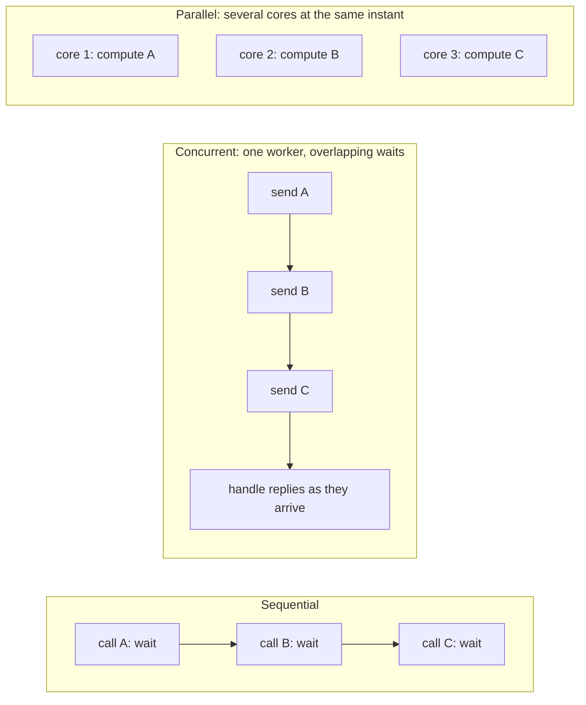
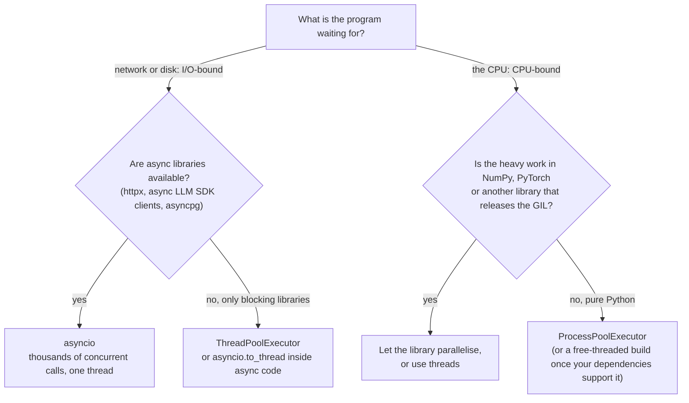

# Threads, Processes and Async: The Complete Guide

> 📚 **Before you start**
>
> - [Functions and Iterators](../course.md#m6) (Python Fundamentals): functions as values, iterators and generators
> - [Importing and Managing Modules](../09-modules-and-exceptions/importing-and-managing-modules.md), for `if __name__ == "__main__":`
> - [Error Handling Best Practices](../09-modules-and-exceptions/error-handling-best-practices.md), for context managers

## Introduction

Your app needs to summarise 100 customer reviews with an LLM. Each API call takes about 2 seconds. Done one after another, that's over 3 minutes, and for almost all of that time your program is doing **nothing**: it has sent a request and is waiting for a reply from a server hundreds of kilometres away. Your CPU sits idle at 1%.

Now picture a chai stall at a railway station when a train pulls in. A single chaiwala who serves one customer completely (boil, brew, pour, take payment) before even looking at the next would empty the platform of customers. A good chaiwala puts three pots on the stove, takes the next order while the water boils, and pours whenever a pot is ready. Same one person, many orders in progress. That's **concurrency**. Hiring three more chaiwalas so four cups are made at the same instant is **parallelism**.

Python gives you three tools for this: **threads**, **processes** and **async** (`asyncio`). Picking the wrong one either gives no speed-up at all or makes code needlessly complex. This lesson explains how each works, what the famous **GIL** is (and what Python's new free-threaded build changes), how to avoid race conditions, and finally which tool to use for calling AI APIs.

> 💡 **Key Insight**
>
> First ask **what your program is waiting for**. If it's waiting on the network or disk (I/O-bound), use **async** or **threads**: they let one CPU core juggle many waits. If it's busy computing (CPU-bound), use **processes** (or a free-threaded build), which put several CPU cores to work at once. Almost every call to an AI API is I/O-bound.

---

## Core Explanation

### 1. Concurrency vs Parallelism

- **Concurrency** means having several tasks *in progress* at the same time, making progress on one while another waits. It's about **structure**: dealing with many things at once. One CPU core can do it by switching between tasks.
- **Parallelism** means several tasks *executing at the same instant* on different CPU cores. It's about **execution**: doing many things at once. It needs multiple cores.



### 2. I/O-Bound vs CPU-Bound Work

| | I/O-bound | CPU-bound |
|---|---|---|
| The program spends its time... | waiting for something outside the CPU | doing calculations |
| Examples | HTTP/LLM API calls, database queries, reading files, downloading | resizing images, parsing huge PDFs, running a local ML model on CPU, hashing, number crunching in pure Python |
| CPU usage while running | low | 100% of a core |
| What speeds it up | overlapping the waits (**concurrency**) | more cores (**parallelism**) |
| Python tool | `asyncio` or threads | processes (or free-threaded Python, or native libraries like NumPy) |

To tell which you have, watch CPU usage while it runs, or time it: if the CPU is mostly idle, you're I/O-bound.

### 3. Processes and Threads: What the Operating System Provides

- A **process** is a running program with its **own memory**. Two processes can't see each other's variables; they communicate by sending data (pipes, queues, files, network). Starting one is relatively expensive (tens of milliseconds).
- A **thread** is a sequence of instructions running **inside** a process. All threads of a process **share its memory**, so they can read and write the same objects. Starting one is cheap. The OS decides when each thread runs and can pause one at almost any moment to run another (**preemptive** scheduling).
- **Async** (`asyncio`) runs many tasks inside **one thread**. Tasks voluntarily pause at `await` points while they wait, and an **event loop** runs whichever task is ready next (**cooperative** scheduling).

```python
import os
import sys
import threading

print("process id is an int:", isinstance(os.getpid(), int))
print("current thread:", threading.current_thread().name)
print("CPU cores available:", (os.cpu_count() or 1) >= 1)
```

Output:

```
process id is an int: True
current thread: MainThread
CPU cores available: True
```

### 4. The GIL (Global Interpreter Lock)

The standard Python interpreter, **CPython**, has a **Global Interpreter Lock**: a lock that a thread must hold to execute Python bytecode. So in a normal CPython process, **only one thread runs Python code at any instant**, even on a 16-core machine.

Why it exists: CPython manages memory with **reference counting** (each object counts how many references point to it and is freed when the count hits zero). Making every count update thread-safe with fine-grained locks would slow down ordinary single-threaded code. One big lock was the simple, fast solution, and it also made writing C extensions easier.

What it means in practice:

- **Threads do not speed up CPU-bound pure-Python code.** Two threads computing take about as long as one doing it all (often slightly longer, due to switching).
- **Threads do speed up I/O-bound code**, because a thread **releases the GIL while it waits** for I/O (sockets, files, `time.sleep`). While one thread waits for an API reply, another can run.
- **Many C extensions release the GIL** during heavy work. NumPy operations, hashing with `hashlib` on large data, compression and many ML libraries run in parallel across threads even with the GIL.

```python
import sysconfig

print("GIL enabled in this interpreter:", sys._is_gil_enabled())
print("free-threaded build:", bool(sysconfig.get_config_var("Py_GIL_DISABLED")))
```

Output:

```
GIL enabled in this interpreter: True
free-threaded build: False
```

(`sys._is_gil_enabled()` was added in Python 3.13. The leading underscore marks it as implementation-specific.)

### 5. Free-Threaded Python: The GIL Becomes Optional

**PEP 703** set out to make the GIL optional. Here is where things stand in October 2026:

- **Python 3.13** (October 2024) shipped an **experimental free-threaded build**, a separate interpreter usually installed as `python3.13t`, in which the GIL is disabled and threads run Python code truly in parallel across cores.
- **Python 3.14** (October 2025) made the free-threaded build **officially supported** (PEP 779), no longer experimental, with a much smaller single-threaded slowdown than 3.13 (in the region of 5–10%, depending on the workload and platform).
- It is still **optional and not the default**. The standard installers give you the normal GIL build; you install the free-threaded one deliberately (for example by ticking an option in the python.org installer, or `uv python install 3.14t`).
- **Extension modules must declare support.** If you import a C extension that hasn't been marked as free-threading-safe, the interpreter **turns the GIL back on** (with a warning) to stay safe. You can force the choice with the `PYTHON_GIL=0`/`1` environment variable or `-X gil=0`/`1`. Support across popular packages (NumPy, and many others) has grown quickly, but check your dependencies.
- **Race conditions matter more.** The GIL never made your code thread-safe (see the next section), but some sloppy code got away with it. Without the GIL, unsynchronised shared state fails more often.

Practical advice: for **I/O-bound** AI work, the free-threaded build changes nothing (async and threads already work well). It matters for **CPU-bound** pure-Python work, where it may eventually replace processes. Until your whole dependency stack supports it, processes remain the reliable choice for CPU parallelism. Python 3.14 also added **subinterpreters** to the standard library (`concurrent.interpreters` and `concurrent.futures.InterpreterPoolExecutor`): several isolated interpreters in one process, each with its own GIL, another route to parallelism with lower overhead than processes.

### 6. Threads with the `threading` Module

A `Thread` runs a function in the background. `start()` launches it; `join()` waits for it to finish:

```python
import time

results = {}

def fetch_weather(city, delay):
    time.sleep(delay)                       # stands in for a network call; releases the GIL
    results[city] = f"{city}: sunny"

cities = {"Mumbai": 0.10, "Delhi": 0.10, "Chennai": 0.10, "Kolkata": 0.10, "Pune": 0.10}

start = time.perf_counter()
threads = [threading.Thread(target=fetch_weather, args=(c, d), name=f"worker-{c}") for c, d in cities.items()]
for t in threads:
    t.start()
for t in threads:
    t.join()                                # wait for every thread
elapsed = time.perf_counter() - start

print(sorted(results.values()))
print("faster than one-by-one (0.5 s):", elapsed < 0.4)
```

Output:

```
['Chennai: sunny', 'Delhi: sunny', 'Kolkata: sunny', 'Mumbai: sunny', 'Pune: sunny']
faster than one-by-one (0.5 s): True
```

Five 0.1-second "calls" finished in about 0.1 seconds total instead of 0.5, because the waits overlapped. We print sorted results and a yes/no timing check rather than exact times, because thread scheduling, and therefore order and timing, varies from run to run.

### 7. Race Conditions and Locks

Shared memory is threads' strength and their danger. A **race condition** happens when the result depends on the unpredictable timing of threads. The classic case is a **read-modify-write**: two threads read the same value, both compute a new one, and both write it back, so one update is lost.

Races are timing-dependent, so they appear randomly. To show one reliably, this demo uses a `threading.Barrier`, which makes both threads wait until both have read the balance before either writes:

```python
balance = 1000
barrier = threading.Barrier(2)

def unsafe_withdraw(amount):
    global balance
    current = balance            # read
    barrier.wait()               # force the worst-case timing: both threads have read
    balance = current - amount   # write: one thread overwrites the other's update

workers = [threading.Thread(target=unsafe_withdraw, args=(a,)) for a in (100, 300)]
for w in workers: w.start()
for w in workers: w.join()
print("expected 600; an update was lost:", balance != 600, "| final balance is 700 or 900:", balance in (700, 900))
```

Output:

```
expected 600; an update was lost: True | final balance is 700 or 900: True
```

Both threads read ₹1000. Whichever writes last wins, so the final balance is either ₹900 (the ₹300 withdrawal was lost) or ₹700 (the ₹100 one was lost), never the correct ₹600. Without the barrier this would happen only occasionally, which is exactly what makes race conditions so painful: tests pass, and production quietly corrupts data.

The fix is a **lock** (`threading.Lock`): only one thread can hold it at a time, so the read-modify-write becomes **atomic** (indivisible). Use it as a context manager so it is always released:

```python
balance = 1000
balance_lock = threading.Lock()

def safe_withdraw(amount):
    global balance
    with balance_lock:                      # only one thread at a time in this block
        current = balance
        time.sleep(0.01)                    # widen the window: still safe
        balance = current - amount

workers = [threading.Thread(target=safe_withdraw, args=(a,)) for a in (100, 300, 50, 50)]
for w in workers: w.start()
for w in workers: w.join()
print("expected 500, got", balance)
```

Output:

```
expected 500, got 500
```

Rules for shared state:

- **Even `counter += 1` is not atomic.** It's a read, an add and a write, and a thread can be paused between them. The GIL doesn't change this.
- **Hold locks briefly**, never while doing slow I/O if you can avoid it, and always via `with`.
- **Taking two locks in different orders in different threads can deadlock** (each waits forever for the other). Take locks in one consistent order, or avoid needing two.
- **Best of all, don't share mutable state.** Give each thread its own data and pass results back through a thread-safe `queue.Queue`, or use an executor that returns results (next section).

Other synchronisation tools in `threading`: `RLock` (a lock the same thread can acquire again), `Semaphore` (allow up to N threads at once, useful for rate limits), `Event` (one thread signals others), `Condition`, and `Barrier`.

### 8. `concurrent.futures`: Thread and Process Pools

Creating threads by hand gets tedious. `concurrent.futures.ThreadPoolExecutor` keeps a **pool** of worker threads and hands them tasks. Each task returns a **`Future`**, an object representing a result that will be available later:

```python
from concurrent.futures import ThreadPoolExecutor, as_completed

def call_llm(prompt):
    time.sleep(0.05)                                    # pretend network latency
    if "fail" in prompt:
        raise ConnectionError(f"timeout for {prompt!r}")
    return f"summary of {prompt!r}"

prompts = ["review 1", "review 2", "please fail", "review 4"]

with ThreadPoolExecutor(max_workers=3) as pool:          # at most 3 calls at once
    # map: results come back in INPUT order (an exception re-raises when you reach it)
    print(list(pool.map(call_llm, ["review A", "review B"])))

    # submit + as_completed: handle each result as soon as it's ready, errors individually
    futures = {pool.submit(call_llm, p): p for p in prompts}
    outcomes = []
    for fut in as_completed(futures):
        prompt = futures[fut]
        try:
            outcomes.append(("ok", prompt, fut.result()))
        except ConnectionError as err:
            outcomes.append(("error", prompt, str(err)))

for outcome in sorted(outcomes):
    print(outcome)
```

Output:

```
["summary of 'review A'", "summary of 'review B'"]
('error', 'please fail', "timeout for 'please fail'")
('ok', 'review 1', "summary of 'review 1'")
('ok', 'review 2', "summary of 'review 2'")
('ok', 'review 4', "summary of 'review 4'")
```

- `max_workers` caps concurrency: a simple way to stay under an API's rate limit.
- `pool.map` is the easy path; `submit` plus `as_completed` gives per-task error handling and handles results in completion order (sorted here for stable output).
- The `with` block waits for all tasks and shuts the pool down at the end.
- `fut.result()` re-raises any exception the task raised, in the thread that asks for the result.

### 9. Processes for CPU-Bound Work

For CPU-bound pure-Python work on a standard (GIL) build, use **processes**. Each process has its own interpreter and its own GIL, so they really run in parallel on separate cores. `ProcessPoolExecutor` has the same interface as the thread pool.

Two requirements come from processes not sharing memory:

1. **Functions and arguments are sent to the workers by pickling** (Python's object serialisation). The function must be importable by name from a module, so it must be defined at the top level of a module, not inside another function, and not as a `lambda`. Arguments and return values must be picklable too, and large ones are slow to send.
2. **The main script must be guarded with `if __name__ == "__main__":`.** On Windows and macOS (and, from Python 3.14, on Linux by default too) worker processes are started fresh and **import your main module**. Without the guard, each worker would run your top-level code again, including the code that creates more workers.

A real script looks like this:

```python
# not-run: a standalone script (primes.py); run it with: python primes.py
from concurrent.futures import ProcessPoolExecutor

def count_primes(limit):
    count = 0
    for n in range(2, limit):
        if all(n % d for d in range(2, int(n ** 0.5) + 1)):
            count += 1
    return count

if __name__ == "__main__":
    limits = [200_000, 210_000, 220_000, 230_000]
    with ProcessPoolExecutor() as pool:            # one worker per CPU core by default
        print(list(pool.map(count_primes, limits)))
```

Because this lesson's code runs like a notebook (where functions aren't importable by worker processes), the runnable version below writes the worker function into its own module first. Putting worker functions in a separate module is a good habit anyway, and is the standard fix for multiprocessing in Jupyter:

```python
import importlib
import tempfile
import textwrap
from concurrent.futures import ProcessPoolExecutor
from pathlib import Path

tmp = tempfile.TemporaryDirectory()
Path(tmp.name, "prime_tools.py").write_text(textwrap.dedent('''
    def count_primes(limit):
        count = 0
        for n in range(2, limit):
            if all(n % d for d in range(2, int(n ** 0.5) + 1)):
                count += 1
        return count
'''), encoding="utf-8")
sys.path.insert(0, tmp.name)
prime_tools = importlib.import_module("prime_tools")

limits = [20_000, 30_000, 40_000, 50_000]
with ProcessPoolExecutor(max_workers=2) as pool:
    print(list(pool.map(prime_tools.count_primes, limits)))
print([prime_tools.count_primes(n) for n in limits])     # same answers, one core

sys.path.remove(tmp.name)
tmp.cleanup()
```

Output:

```
[2262, 3245, 4203, 5133]
[2262, 3245, 4203, 5133]
```

How work is split matters: each task should be big enough to outweigh the cost of starting processes and pickling data. `pool.map(func, items, chunksize=100)` sends items in batches, which helps a lot with many small tasks.

**Start methods.** How a child process begins differs by platform: `fork` (copy the parent process; fast, but unsafe if threads are running), `spawn` (start a fresh interpreter and import the main module; the default on Windows and macOS), and `forkserver` (fork from a clean helper process; the default on Linux since Python 3.14). Code that follows the two rules above works with all three.

### 10. A First Look at `asyncio`

`asyncio` handles many I/O waits in **one thread**. You write **coroutines** with `async def`; inside them, `await` marks the points where the coroutine pauses to wait and lets the **event loop** run other coroutines meanwhile:

```python
import asyncio

async def fetch_score(match):
    await asyncio.sleep(0.1)                # a non-blocking wait: other tasks run meanwhile
    return f"{match}: live score fetched"

async def main():
    matches = ["IND vs AUS", "ENG vs SA", "NZ vs PAK"]
    results = await asyncio.gather(*(fetch_score(m) for m in matches))   # run all three concurrently
    return results

start = time.perf_counter()
results = asyncio.run(main())
print(results)
print("took about 0.1 s, not 0.3:", time.perf_counter() - start < 0.25)
```

Output:

```
['IND vs AUS: live score fetched', 'ENG vs SA: live score fetched', 'NZ vs PAK: live score fetched']
took about 0.1 s, not 0.3: True
```

`asyncio.gather` returns results in the order the coroutines were passed in, whatever order they finish. Everything about async (tasks, `gather`, semaphores, timeouts, cancellation, retries) is the subject of the next lesson, [async and await for API Calls](async-and-await-for-api-calls.md).

Why async instead of threads for I/O? Each thread costs memory (a stack of up to several MB reserved) and OS scheduling overhead, so thousands of threads is impractical. Thousands of async tasks are cheap. And because tasks switch **only at `await`**, there are far fewer places where race conditions can occur. The trade-off: async is "contagious" (only `async def` functions can `await`), and every library you call must be async-aware. A blocking call such as `time.sleep()` or a synchronous HTTP request inside a coroutine **freezes the whole event loop**.

### 11. Choosing the Right Tool



| | Threads | Processes | asyncio |
|---|---|---|---|
| Best for | I/O-bound work with blocking libraries | CPU-bound pure Python | I/O-bound work at high concurrency |
| Parallel on multiple cores? | Not for Python code under the GIL (yes on free-threaded builds) | Yes | No (one thread) |
| Memory | Shared (needs locks) | Separate (data is copied/pickled) | Shared, but switches only at `await` |
| Cost per worker | Moderate (OS thread) | High (whole interpreter) | Very low (an object) |
| Practical scale | Tens to hundreds | About one per core | Thousands to tens of thousands |
| Main pitfalls | Race conditions, deadlocks | Pickling, start-up cost, `__main__` guard | Blocking calls freeze everything; needs async libraries |

### 12. What to Use for AI API Calls

An LLM call is a network request: send a prompt, wait 0.5 to 30 seconds, receive a response. It's the textbook I/O-bound task. So:

- **Default to `asyncio`** for calling LLM, embedding and other web APIs concurrently. The official Anthropic and OpenAI SDKs provide async clients (`AsyncAnthropic`, `AsyncOpenAI`), `httpx` has `AsyncClient`, and frameworks like FastAPI, LangChain and LangGraph are async-first. You get high concurrency with a `Semaphore` to respect rate limits and `asyncio.timeout` to bound waits (next lesson).
- **Use a `ThreadPoolExecutor`** when you are in synchronous code, for example a script or a Streamlit app, or when a library only offers blocking calls. Five to twenty worker threads is plenty for most rate limits. From async code, wrap a blocking call with `await asyncio.to_thread(func, ...)`.
- **Use processes** for the CPU-heavy steps *around* the API calls: parsing thousands of PDFs, chunking huge documents, running a small model locally on the CPU.
- **Don't use multiple processes just to make more API calls.** They add cost and complexity without adding anything that threads or async don't already give you for waiting.
- **Remember the limits are on the other side.** Concurrency speeds you up only until you hit the provider's rate limits (requests and tokens per minute). Beyond that, more concurrency just produces more `429` errors. Cap it.

```python
# not-run: needs the anthropic package and an API key
import asyncio
from anthropic import AsyncAnthropic

client = AsyncAnthropic()            # reads ANTHROPIC_API_KEY from the environment

async def summarise(review):
    message = await client.messages.create(
        model="claude-opus-5-5",
        max_tokens=200,
        messages=[{"role": "user", "content": f"Summarise in one line: {review}"}],
    )
    return message.content[0].text

async def main(reviews):
    return await asyncio.gather(*(summarise(r) for r in reviews))

summaries = asyncio.run(main(["Great chai, slow service.", "Samosas were cold."]))
```

---

## Try It Yourself

1. Use a `ThreadPoolExecutor` with 4 workers to "download" 8 files, where `download(name)` sleeps 0.05 s and returns `f"{name}: done"`. Print the sorted results and check the total time is under 0.3 s (sequential would be 0.4 s).
2. Make the race condition from section 7 safe by adding a lock *without* removing the barrier. (Careful: what happens if a thread waits at the barrier while holding the lock?)
3. Classify each task as I/O-bound or CPU-bound and pick a tool: (a) embedding 5,000 texts through a hosted embeddings API; (b) extracting text from 2,000 local PDFs with a pure-Python parser; (c) a FastAPI endpoint that calls an LLM and a database; (d) resizing 10,000 images with Pillow.
4. Write an `async` function `make_chai(n)` that awaits `asyncio.sleep(0.05)` and returns `f"chai {n} ready"`, and use `asyncio.gather` to make 5 at once. Print the results.

<details>
<summary>Show answers</summary>

**1.**

```python
def download(name):
    time.sleep(0.05)
    return f"{name}: done"

start = time.perf_counter()
with ThreadPoolExecutor(max_workers=4) as pool:
    done = list(pool.map(download, [f"file{i}" for i in range(8)]))
print(sorted(done)[:2], len(done))
print("under 0.3 s:", time.perf_counter() - start < 0.3)
```

Output:

```
['file0: done', 'file1: done'] 8
under 0.3 s: True
```

**2.** If the lock is held while waiting at the barrier, the second thread can never reach the barrier (it's stuck waiting for the lock), and the first waits at the barrier forever: a **deadlock**. Put the whole read-modify-write inside the lock and remove the need for the barrier, or (as here) give the barrier a timeout and treat its failure as proof that the lock serialised the threads:

```python
balance = 1000
lock = threading.Lock()
barrier = threading.Barrier(2, timeout=0.05)

def withdraw(amount):
    global balance
    with lock:
        current = balance
        try:
            barrier.wait()          # the other thread can't arrive: it's waiting for the lock
        except threading.BrokenBarrierError:
            pass
        balance = current - amount

ws = [threading.Thread(target=withdraw, args=(a,)) for a in (100, 300)]
for w in ws: w.start()
for w in ws: w.join()
print(balance)
```

Output:

```
600
```

**3.** (a) I/O-bound: asyncio with a semaphore (or threads), in batches the API allows. (b) CPU-bound pure Python: `ProcessPoolExecutor`. (c) I/O-bound inside an async framework: `async` endpoint with async clients. (d) CPU-bound, but Pillow releases the GIL for much of its image work, so a thread pool often helps; a process pool is the safe choice for maximum speed.

**4.**

```python
async def make_chai(n):
    await asyncio.sleep(0.05)
    return f"chai {n} ready"

async def serve():
    return await asyncio.gather(*(make_chai(i) for i in range(1, 6)))

print(asyncio.run(serve()))
```

Output:

```
['chai 1 ready', 'chai 2 ready', 'chai 3 ready', 'chai 4 ready', 'chai 5 ready']
```

</details>

---

## Real-World Examples

### Example 1: Web servers

FastAPI runs `async def` endpoints on an event loop (via an ASGI server such as Uvicorn) so one process can hold thousands of open connections that are mostly waiting on databases and APIs. For plain `def` endpoints it uses a thread pool automatically. In production, several worker *processes* are started too, one per core, combining all three models.

### Example 2: Data pipelines

A document-ingestion pipeline for RAG typically uses a process pool to parse and chunk thousands of PDFs (CPU-bound), then asyncio with a semaphore to send chunks to an embeddings API (I/O-bound), then a bulk insert into a vector database.

### Example 3: Machine learning libraries

PyTorch and NumPy do their heavy computation in C/C++/CUDA code that releases the GIL, and PyTorch's `DataLoader` uses worker processes to load and augment data in parallel while the GPU trains. That's why Python dominates ML despite the GIL.

---

## Common Misconceptions

### Misconception 1: "Python can't do parallelism because of the GIL"

Processes run in parallel; native libraries release the GIL; Python 3.14 officially supports a free-threaded build and offers subinterpreters. The GIL only prevents *Python bytecode* in one standard-build process from running on several cores at once.

### Misconception 2: "The GIL makes my threaded code thread-safe"

The GIL protects the interpreter's internals, not your logic. `x += 1` and check-then-act sequences can still be interrupted between steps. Use locks or avoid shared mutable state.

### Misconception 3: "Async is faster than threads"

For a handful of I/O tasks they perform about the same. Async shines at very high concurrency and makes switching points explicit; threads shine with blocking libraries. Neither helps CPU-bound code.

### Misconception 4: "More workers is always faster"

For API calls, the provider's rate limits cap your throughput; beyond them you just get errors. For CPU work, more processes than cores adds overhead. Measure and cap.

---

## Interview Relevance

"Explain the GIL" and "threads vs processes vs asyncio" are staples of Python interviews, especially for backend and ML engineering roles. A strong answer covers:

- **Concurrency vs parallelism**, and **I/O-bound vs CPU-bound**.
- **The GIL**: what it is, why it exists (reference counting), that it's released during I/O and by many C extensions, and what it means for each tool.
- **Free-threading**: PEP 703, experimental in 3.13, officially supported but optional in 3.14, extensions must opt in.
- **Race conditions and locks**, with the read-modify-write example.
- **The decision**: asyncio or threads for I/O-bound (like LLM calls), processes for CPU-bound pure Python.

Common follow-ups:

- *"Why does multiprocessing need `if __name__ == '__main__'`?"* Spawned workers import the main module; without the guard they'd re-run the program's top-level code.
- *"How would you call an LLM 1,000 times quickly?"* asyncio with an async client, a semaphore sized to the rate limit, timeouts, and retries with backoff.
- *"What happens if you call `time.sleep` inside a coroutine?"* It blocks the event loop; every other task stalls. Use `await asyncio.sleep` or `asyncio.to_thread`.

---

## Key Takeaways

- **Concurrency overlaps waiting; parallelism uses several cores**: match the tool to whether your work is I/O-bound or CPU-bound.
- **The GIL lets one thread run Python bytecode at a time** in standard CPython; it's released during I/O, so threads help I/O-bound work but not CPU-bound pure Python.
- **Free-threaded CPython is officially supported but optional since 3.14**; processes remain the dependable route to CPU parallelism today.
- **Shared mutable state needs locks** (or no sharing); `concurrent.futures` pools with `map`/`submit` keep thread and process code simple.
- **For AI API calls, use asyncio by default and threads for blocking libraries**, always capping concurrency to the provider's rate limits.

---

**Up next:** [async and await for API Calls](async-and-await-for-api-calls.md)
