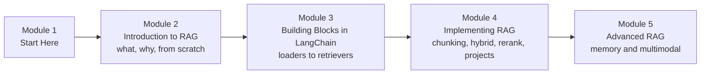

# How This Course Works

## Introduction

Ask a general chatbot *"How many days of leave can I carry forward at my company?"* and it will either say it doesn't know or, worse, confidently invent a number. The model was never shown your company's HR handbook. It cannot know.

Now imagine the same chatbot first **looks up** the right paragraph of your handbook, reads it, and then answers: *"You can carry forward up to 8 unused days (HR Handbook, section 2.1)."* That is **Retrieval-Augmented Generation**, or **RAG**: retrieve the relevant pieces of your own data, put them in front of the model, and let it generate an answer grounded in them.

RAG is the most widely deployed pattern in applied generative AI. Support bots, internal "ask the wiki" tools, legal and medical research assistants, coding assistants that read your repository: under the hood, almost all of them retrieve before they generate. This course teaches you to build RAG systems properly, from a 60-line version with no framework at all to hybrid search, reranking, conversational memory and RAG over images.

> 💡 **Key Insight**
>
> A RAG system is only as good as its **retrieval**. If the right paragraph never reaches the model, no prompt and no model can save the answer. Most of this course is about getting the right text to the model, then checking that it was used faithfully.

---

## What You Will Learn

By the end of this course you will be able to:

- **Explain what RAG is**, when it beats fine-tuning or a long prompt, and when it doesn't.
- **Draw and build the full pipeline**: ingest, chunk, embed, index, retrieve, rerank, generate and evaluate.
- **Build RAG from scratch** in plain Python and NumPy, so you understand every moving part.
- **Use LangChain's RAG building blocks**: document loaders, text splitters, embeddings, vector stores and retrievers, including MMR, multi-query and contextual compression.
- **Choose a chunking strategy**, a retrieval method, hybrid search and a reranker, and measure whether each change helped.
- **Ship two real projects**: chat with a PDF, and chat with any YouTube video.
- **Go beyond text**: conversational memory in RAG and multimodal RAG over images and text.

### The whole system in one picture

This is the pipeline you will build piece by piece. Come back to it whenever you lose your bearings.


*Indexing happens once (and again when documents change). Answering happens for every question. Evaluation wraps both.*

### The course at a glance



| Module | You will be able to |
|---|---|
| **2. Introduction to RAG** | Explain RAG, compare it with fine-tuning and prompting, trace the full pipeline, and build one with only NumPy |
| **3. RAG Building Blocks in LangChain** | Load any document type, split it well, store vectors and wrap them in the right retriever |
| **4. Implementing RAG** | Assemble a LangChain RAG chain, pick chunking and retrieval methods, add hybrid search and reranking, ship two projects |
| **5. Advanced RAG** | Handle follow-up questions with memory, and retrieve over images as well as text |

---

## How Every Lesson Is Built

| Section | What it gives you |
|---|---|
| **Before you start** | Links to the earlier lessons this one depends on |
| **Introduction** | Why the topic matters, with an everyday example |
| **Key Insight** | The one idea to remember |
| **Core Explanation** | The topic step by step, with diagrams, tables and runnable code |
| **Try It Yourself** | Exercises with answers hidden in a fold |
| **Real-World Examples** | Where the idea shows up in real products |
| **Common Misconceptions** | Mistakes almost everyone makes, corrected |
| **Interview Relevance** | What interviewers ask and what a strong answer covers |
| **Key Takeaways** | A one-minute summary |

**Labs** are guided builds. You start from an empty file and finish with something that works. Do them; they are where the ideas stick.

---

## The Running Example

Most lessons use the same small knowledge base so you can compare techniques fairly: the employee handbook of **Tarang Software**, a made-up company in Pune. It has rules about leave, sick days, work from home, travel claims, meal allowances, laptops, holidays and notice periods. Here is a taste:

```text
2.1 Annual leave: Every employee gets 24 days of paid leave per calendar year.
Up to 8 unused days can be carried forward to the next year.

5.2 Meal allowance: On client travel the daily meal allowance is Rs 1,200 in
metro cities and Rs 800 in other cities.
```

Because the handbook is invented, no model could have memorised it. If an answer quotes it correctly, retrieval did its job.

---

## What You Need Before Starting

- **Python** at the level of functions, lists, dictionaries and classes. [Python Fundamentals](../../python-fundamentals/course.md) covers it.
- **What an embedding and a vector database are.** [Vector Databases for AI](../../vector-databases-for-ai/course.md) is the prerequisite course. You'll get a quick refresher here, but the details live there.
- **LangChain basics** (models, prompts, runnables and the `|` pipe). [LangChain Complete Guide](../../langchain-complete-guide/course.md) covers them; Module 4 here leans on [Chains and Runnables](../../langchain-complete-guide/course.md#m6).
- **How LLMs work** at the level of tokens and context windows. See [How LLMs Work](../../generative-ai-and-llm-foundations/course.md#m3).

### Do I need an API key?

No. Every runnable example uses **offline stand-ins**: a small hand-written embedding function, LangChain's in-memory vector store and a pretend LLM. They behave like the real things in every way that matters for learning, and the lessons run in seconds with no cost. Wherever a real model, embedding API or loader package is used, the lesson shows that version too, marked as not run, with the packages it needs.

---

## How to Get the Most Out of It

1. **Type the code and predict the output** before you run it. When you're surprised, you've found something worth understanding.
2. **Do the from-scratch lab in Module 2** before touching LangChain. After it, every LangChain class will look like a tidy wrapper around code you already wrote.
3. **Measure, don't guess.** From Module 4 onwards, each technique comes with a small evaluation. Get into the habit of checking whether a change really helped.
4. **Keep your own documents handy.** Your college notes, a product manual or your company wiki make great practice data for the labs.

---

## Common Misconceptions

### "RAG is just a vector database plus an LLM"

That's the minimum. Real systems also clean and chunk documents carefully, combine keyword and vector search, rerank, refuse when nothing relevant is found, cite sources, and are measured continuously. This course covers all of it.

### "Long context windows made RAG obsolete"

Models can now read hundreds of thousands of tokens, and for a small, stable knowledge base putting everything in the prompt is sometimes the right call (you'll learn exactly when in [RAG vs Fine-Tuning vs Prompting](../02-introduction-to-rag/rag-vs-fine-tuning-vs-prompting.md)). But most organisations have far more text than any window holds, it changes daily, different users may see different documents, and sending everything on every question is slow and expensive. Retrieval remains the way to pick what goes in.

### "I need a GPU and a paid API to learn this"

You need neither. Everything here runs on a laptop, offline.

---

## Key Takeaways

- **RAG = retrieve, then generate**: find the relevant pieces of your data and give them to the model with the question.
- **Retrieval quality decides answer quality**, so most of the craft is in ingesting, chunking, searching and reranking.
- The course goes **from scratch to production techniques**: NumPy first, then LangChain, then hybrid search, reranking, memory and multimodal RAG.
- All code **runs offline**; real-API versions are shown alongside.

---

**Up next:** [What is RAG?](../02-introduction-to-rag/what-is-rag.md)
