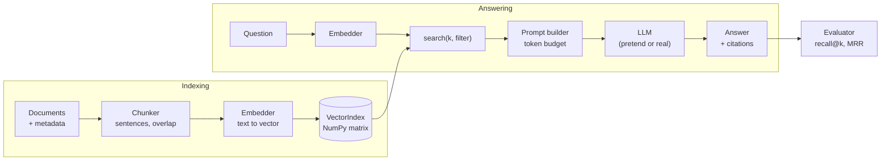

# Lab: RAG from scratch, no framework

> 📚 **Before you start**
>
> - [The RAG Pipeline End to End](the-rag-pipeline-end-to-end.md), for the eight stages you're about to build.
> - [What is RAG?](what-is-rag.md), for the toy embedding idea used here.
> - Comfortable Python: classes, dictionaries, list comprehensions, and basic NumPy arrays ([NumPy](../../data-analysis-and-visualisation-with-python/course.md)).

## What You'll Build

A complete, working RAG engine in about 200 lines of plain Python and NumPy. No LangChain, no vector database, no API key. It will:

- load three documents (an HR handbook, an IT policy and a travel FAQ) with metadata;
- split them into overlapping chunks at sentence boundaries;
- embed every chunk and store the vectors in a small index you write yourself, with metadata filters and save/load;
- retrieve, build a prompt that fits a token budget, and answer with citations, or say "not found";
- evaluate itself with recall@k and MRR, and compare chunk sizes.



Every class you write here has a direct LangChain equivalent, which you'll meet in Module 5. After this lab, those classes will feel familiar rather than magical.

> 💡 **Key Insight**
>
> A RAG framework is a convenience, not a requirement. The core is a **matrix of chunk vectors**, a **dot product** against the question vector, and **string formatting** to build the prompt. Build it once by hand and you'll be able to debug any framework.

---

## Step 1: The documents

Real documents arrive with **metadata**, facts about where they came from. We keep the source, a title and an access group with every document, because citations and permission filters need them later.

```python
import json, re, zlib
import numpy as np

DOCUMENTS = [
    {"source": "hr/handbook-2026.md", "title": "Employee Handbook", "access": "all",
     "text": """Annual leave. Every employee gets 24 days of paid leave per calendar year. Leave is credited at 2 days per month. Up to 8 unused days can be carried forward to the next year. Leave beyond that lapses on 31 December.
Sick leave. Employees get 10 days of sick leave per year. A doctor's note is required for more than 2 sick days in a row. Sick leave cannot be carried forward.
Work from home. Employees may work from home up to 2 days a week with their manager's approval. Hybrid office days are Tuesday, Wednesday and Thursday.
Notice period. The notice period is 60 days. It can be shortened by paying basic salary for the remaining days. Employees on probation have a notice period of 15 days."""},
    {"source": "it/security-policy.md", "title": "IT Security Policy", "access": "all",
     "text": """Laptops. Every employee receives a company laptop. A lost or stolen laptop must be reported to IT within 24 hours. The employee pays 10% of the replacement cost.
Passwords. Passwords must be at least 14 characters and are changed every 90 days. Never share your password, even with IT staff.
Software. Only software from the approved catalogue may be installed. Requests for new software go through the IT helpdesk portal."""},
    {"source": "finance/travel-faq.md", "title": "Travel FAQ", "access": "managers",
     "text": """Booking. Flights and hotels are booked through the Safar travel desk at least 7 days before the trip. Economy class is used for flights under 4 hours.
Meal allowance. On client travel the daily meal allowance is Rs 1,200 in metro cities and Rs 800 in other cities. Alcohol is never reimbursed.
Claims. Submit bills on the Kharcha portal within 30 days of the trip. Approved claims are reimbursed within 15 days."""},
]
for d in DOCUMENTS:
    print(f"{d['source']:<24} {len(d['text'].split()):>3} words  access={d['access']}")
```

Output:

```
hr/handbook-2026.md      128 words  access=all
it/security-policy.md     70 words  access=all
finance/travel-faq.md     72 words  access=managers
```

Each line of a document starts with a short heading ("Annual leave.") followed by sentences. Real files are messier, which is why loaders and cleaners exist ([Document Loaders](../05-rag-building-blocks-in-langchain/document-loaders.md)).

## Step 2: The chunker

We split each document into **sentences**, then group consecutive sentences into chunks of up to `max_words` words, repeating the last `overlap` sentences at the start of the next chunk. Splitting at sentence boundaries means no chunk ever starts or ends mid-sentence.

Each chunk also gets the **heading of its paragraph** prefixed, so a chunk like *"It can be shortened by paying basic salary..."* still says it's about the notice period.

```python
def split_sentences(paragraph):
    return [s.strip() for s in re.split(r"(?<=[.!?])\s+", paragraph) if s.strip()]

def chunk_document(doc, max_words=30, overlap=1):
    chunks = []
    for paragraph in doc["text"].split("\n"):
        heading, _, body = paragraph.partition(". ")
        sentences = split_sentences(body)
        start = 0
        while start < len(sentences):
            end, words_so_far = start, 0
            while end < len(sentences) and (end == start or words_so_far + len(sentences[end].split()) <= max_words):
                words_so_far += len(sentences[end].split())
                end += 1
            chunks.append({
                "id": f"{doc['source']}#{len(chunks)}",
                "text": f"{heading}: " + " ".join(sentences[start:end]),
                "metadata": {"source": doc["source"], "title": doc["title"],
                             "heading": heading, "access": doc["access"]},
            })
            if end >= len(sentences):
                break
            start = max(end - overlap, start + 1)
    return chunks

all_chunks = [c for d in DOCUMENTS for c in chunk_document(d)]
print(len(all_chunks), "chunks")
for c in all_chunks[:4]:
    print(f"{c['id']:<22} {c['text'][:70]}")
```

Output:

```
11 chunks
hr/handbook-2026.md#0  Annual leave: Every employee gets 24 days of paid leave per calendar y
hr/handbook-2026.md#1  Annual leave: Leave is credited at 2 days per month. Up to 8 unused da
hr/handbook-2026.md#2  Sick leave: Employees get 10 days of sick leave per year. A doctor's n
hr/handbook-2026.md#3  Work from home: Employees may work from home up to 2 days a week with
```

Notice the overlap at work: the annual leave paragraph became two chunks, and the sentence about carrying days forward appears in both. A question that matches either chunk still sees it.

## Step 3: The embedder

A real system would call an embedding model here. To stay offline we use the same idea as earlier lessons: each word (after a light normalisation) is mapped to a **concept**, and each concept lights up one slot of a 512-number vector. A real model does this with learned meaning instead of a hand-written dictionary, but the interface is identical: `embed_documents` for chunks, `embed_query` for questions.

```python
STOP = set("a an the is are of to in on for and or i my can do how many much what be it by "
           "with per up get if at as from must may than any".split())

def normalise(w):
    if w.endswith("ied"):
        return w[:-3] + "y"
    if w.endswith("s") and not w.endswith("ss") and len(w) > 3:
        return w[:-1]
    return w

def tokens(text):
    return [normalise(w) for w in re.findall(r"[a-z0-9]+", text.lower()) if w not in STOP]

class ToyEmbedder:
    """Stand-in for an embedding model: same interface, offline and deterministic."""
    CONCEPTS = {
        "vacation": "leave", "pto": "leave", "holiday": "leave", "off": "leave",
        "food": "meal", "lunch": "meal", "dinner": "meal", "budget": "allowance",
        "trip": "travel", "visit": "travel", "customer": "travel", "client": "travel",
        "notebook": "laptop", "computer": "laptop", "stolen": "lost", "missing": "lost",
        "resign": "notice", "quit": "notice", "resignation": "notice",
        "expense": "claim", "reimbursement": "claim", "refund": "claim", "bill": "claim",
        "wfh": "remote", "home": "remote", "remote": "remote",
        "flight": "booking", "hotel": "booking", "ticket": "booking", "book": "booking",
        "app": "software", "install": "software", "password": "password", "login": "password",
        "roll": "carry", "rollover": "carry", "unused": "carry",
    }

    def __init__(self, dim=512):
        self.dim = dim

    def _embed(self, text):
        vec = np.zeros(self.dim)
        for w in tokens(text):
            vec[zlib.crc32(self.CONCEPTS.get(w, w).encode()) % self.dim] += 1.0
        norm = np.linalg.norm(vec)
        return vec / norm if norm else vec

    def embed_documents(self, texts):
        return np.array([self._embed(t) for t in texts])

    def embed_query(self, text):
        return self._embed(text)

embedder = ToyEmbedder()
vectors = embedder.embed_documents([c["text"] for c in all_chunks])
print(vectors.shape, "| every row has length", round(float(np.linalg.norm(vectors[0])), 3))
```

Output:

```
(11, 512) | every row has length 1.0
```

Every row is **unit length** (length 1). That's deliberate: for unit vectors, cosine similarity is just the dot product, so search becomes one matrix multiplication.

The real version is a drop-in replacement. With Voyage AI (Anthropic's recommended embeddings provider) it looks like this:

```python
# not-run: needs the voyageai package and a VOYAGE_API_KEY
import voyageai
import numpy as np

class VoyageEmbedder:
    def __init__(self, model="voyage-4"):
        self.client, self.model = voyageai.Client(), model

    def embed_documents(self, texts):
        result = self.client.embed(texts, model=self.model, input_type="document")
        return np.array(result.embeddings)

    def embed_query(self, text):
        result = self.client.embed([text], model=self.model, input_type="query")
        return np.array(result.embeddings[0])
```

## Step 4: The vector index

The index is a matrix of vectors plus a parallel list of chunk records. `search` computes all similarities with one matrix-vector product, applies an optional metadata filter, and returns the top k. We also add `save` and `load` so indexing can happen once and answering many times.

```python
class VectorIndex:
    def __init__(self, embedder):
        self.embedder = embedder
        self.vectors = np.zeros((0, embedder.dim))
        self.records = []

    def add(self, chunks):
        new = self.embedder.embed_documents([c["text"] for c in chunks])
        self.vectors = np.vstack([self.vectors, new])
        self.records.extend(chunks)

    def search(self, query, k=3, where=None):
        scores = self.vectors @ self.embedder.embed_query(query)
        order = np.argsort(-scores, kind="stable")
        results = []
        for i in order:
            record = self.records[i]
            if where and any(record["metadata"].get(key) not in allowed for key, allowed in where.items()):
                continue
            results.append((record, round(float(scores[i]), 3)))
            if len(results) == k:
                break
        return results

    def save(self, path):
        np.save(path + ".npy", self.vectors)
        with open(path + ".json", "w") as f:
            json.dump(self.records, f)

    @classmethod
    def load(cls, path, embedder):
        index = cls(embedder)
        index.vectors = np.load(path + ".npy")
        with open(path + ".json") as f:
            index.records = json.load(f)
        return index

index = VectorIndex(embedder)
index.add(all_chunks)
for record, score in index.search("What is the food budget when I visit a client?", k=3):
    print(score, record["id"], "|", record["text"][:55])
```

Output:

```
0.561 finance/travel-faq.md#1 | Meal allowance: On client travel the daily meal allowan
0.324 finance/travel-faq.md#0 | Booking: Flights and hotels are booked through the Safa
0.151 finance/travel-faq.md#2 | Claims: Submit bills on the Kharcha portal within 30 da
```

Now the **metadata filter**. The travel FAQ is only for managers. An ordinary employee's search must never see it, whatever the question:

```python
employee_view = {"access": {"all"}}
for record, score in index.search("What is the food budget when I visit a client?", k=3, where=employee_view):
    print(score, record["id"], "|", record["text"][:55])
```

Output:

```
0.0 hr/handbook-2026.md#0 | Annual leave: Every employee gets 24 days of paid leave
0.0 hr/handbook-2026.md#1 | Annual leave: Leave is credited at 2 days per month. Up
0.0 hr/handbook-2026.md#2 | Sick leave: Employees get 10 days of sick leave per yea
```

With the managers-only document filtered out, nothing relevant is left: every score is 0.0, and the "top 3" are just the first three chunks in the index. Vector search always returns k results, relevant or not; Step 7 adds a threshold for exactly this reason. The filter is applied in code, before anything reaches the model. Never rely on a prompt instruction like "don't reveal manager documents"; if a chunk is in the prompt, assume it can leak.

Save and reload, the way an indexing job hands over to a serving process:

```python
import os, tempfile

path = os.path.join(tempfile.mkdtemp(), "tarang-index")
index.save(path)
reloaded = VectorIndex.load(path, embedder)
print(len(reloaded.records), "records reloaded, same results:",
      reloaded.search("lost laptop", k=1)[0][0]["id"] == index.search("lost laptop", k=1)[0][0]["id"])
```

Output:

```
11 records reloaded, same results: True
```

This exact-search index is fine for tens of thousands of chunks. Beyond that you'd switch to an approximate index (HNSW, IVF) in a vector database, which is what [Vector Stores in LangChain](../course.md#m5) wraps.

## Step 5: The prompt builder

The prompt needs instructions, labelled context and the question, and it must fit a **token budget**. We estimate tokens as words times 1.3 (a rough rule for English; real code uses the provider's token counter). Chunks are added best-first until the budget is used up.

```python
INSTRUCTIONS = (
    "You are Tarang Software's policy assistant. Answer ONLY from the numbered context. "
    "Cite sources like [1]. If the context does not answer the question, reply exactly: "
    "\"I couldn't find that in the policies.\""
)

def estimate_tokens(text):
    return int(len(text.split()) * 1.3)

def build_prompt(question, results, budget=200):
    used = estimate_tokens(INSTRUCTIONS) + estimate_tokens(question)
    lines, sources = [], []
    for record, _ in results:
        line = f"[{len(lines) + 1}] ({record['metadata']['title']}) {record['text']}"
        if used + estimate_tokens(line) > budget:
            break
        lines.append(line)
        sources.append(record["id"])
        used += estimate_tokens(line)
    prompt = f"{INSTRUCTIONS}\n\nContext:\n" + "\n".join(lines) + f"\n\nQuestion: {question}"
    return prompt, sources, used

prompt, sources, used = build_prompt("How many sick days do I get?", index.search("How many sick days do I get?", k=4))
print(prompt)
print("\nsources:", sources, "| estimated tokens:", used)
```

Output:

```
You are Tarang Software's policy assistant. Answer ONLY from the numbered context. Cite sources like [1]. If the context does not answer the question, reply exactly: "I couldn't find that in the policies."

Context:
[1] (Employee Handbook) Sick leave: Employees get 10 days of sick leave per year. A doctor's note is required for more than 2 sick days in a row. Sick leave cannot be carried forward.
[2] (Employee Handbook) Notice period: The notice period is 60 days. It can be shortened by paying basic salary for the remaining days. Employees on probation have a notice period of 15 days.
[3] (Employee Handbook) Annual leave: Every employee gets 24 days of paid leave per calendar year. Leave is credited at 2 days per month.

Question: How many sick days do I get?

sources: ['hr/handbook-2026.md#2', 'hr/handbook-2026.md#4', 'hr/handbook-2026.md#0'] | estimated tokens: 168
```

Four chunks were retrieved but only the ones that fit the budget were included. In production the budget is much larger (thousands of tokens), but the principle is the same: **you decide what goes in, best evidence first.**

## Step 6: The generator

Offline, we use a pretend LLM that behaves like a well-instructed model: it reads only the numbered context, picks the sentence that best answers the question, cites its number, and uses the exact refusal text when nothing fits.

```python
def pretend_llm(prompt):
    context = prompt.split("Context:\n")[1].split("\n\nQuestion:")[0]
    question = prompt.split("Question: ")[1]
    q = {ToyEmbedder.CONCEPTS.get(w, w) for w in tokens(question)}
    best, best_score = None, 1
    for line in context.splitlines():
        number = line[1:line.index("]")]
        body = line.split(") ", 1)[1].split(": ", 1)[1]
        for sentence in split_sentences(body):
            s = {ToyEmbedder.CONCEPTS.get(w, w) for w in tokens(sentence)}
            score = len(q & s)
            if score > best_score:
                best, best_score = f"{sentence} [{number}]", score
    return best or "I couldn't find that in the policies."

print(pretend_llm(prompt))
```

Output:

```
Employees get 10 days of sick leave per year. [1]
```

The real version swaps one function. Everything else stays the same:

```python
# not-run: needs the anthropic package and an API key
import anthropic

client = anthropic.Anthropic()

def claude_llm(prompt):
    response = client.messages.create(
        model="claude-opus-5-5",
        max_tokens=1024,
        messages=[{"role": "user", "content": prompt}],
    )
    return "".join(block.text for block in response.content if block.type == "text")
```

## Step 7: The RAG engine

Now wire the pieces into one class. It retrieves, applies a **relevance threshold** (refuse early if even the best chunk is a weak match), builds the prompt, generates, and maps the `[n]` citations back to real source IDs so the caller can show links.

```python
class RAG:
    def __init__(self, index, llm, k=4, min_score=0.25, budget=200):
        self.index, self.llm = index, llm
        self.k, self.min_score, self.budget = k, min_score, budget

    def ask(self, question, user_access=("all",)):
        results = self.index.search(question, k=self.k, where={"access": set(user_access)})
        if not results or results[0][1] < self.min_score:
            return {"answer": "I couldn't find that in the policies.", "citations": [], "retrieved": []}
        prompt, sources, _ = build_prompt(question, results, self.budget)
        text = self.llm(prompt)
        cited = sorted({int(n) for n in re.findall(r"\[(\d+)\]", text)})
        return {"answer": re.sub(r" \[\d+\]", "", text),
                "citations": [sources[n - 1] for n in cited if n <= len(sources)],
                "retrieved": [r["id"] for r, _ in results]}

rag = RAG(index, pretend_llm)
for q in ["Can I carry unused vacation into next year?",
          "How many characters must my password have?",
          "What is the meal allowance in Chennai?",
          "Who won the IPL in 2025?"]:
    out = rag.ask(q)
    print(f"Q: {q}\nA: {out['answer']}  {out['citations']}\n")
```

Output:

```
Q: Can I carry unused vacation into next year?
A: Up to 8 unused days can be carried forward to the next year.  ['hr/handbook-2026.md#1']

Q: How many characters must my password have?
A: Passwords must be at least 14 characters and are changed every 90 days.  ['it/security-policy.md#1']

Q: What is the meal allowance in Chennai?
A: I couldn't find that in the policies.  []

Q: Who won the IPL in 2025?
A: I couldn't find that in the policies.  []
```

Two answers are correct and cited. The IPL question is refused, as it should be. But the meal allowance question was also refused, even though the answer exists. That's the access filter working: the travel FAQ is for managers. Ask as a manager:

```python
out = rag.ask("What is the meal allowance in Chennai?", user_access=("all", "managers"))
print(out)
```

Output:

```
{'answer': 'On client travel the daily meal allowance is Rs 1,200 in metro cities and Rs 800 in other cities.', 'citations': ['finance/travel-faq.md#1'], 'retrieved': ['finance/travel-faq.md#1', 'finance/travel-faq.md#0', 'hr/handbook-2026.md#0', 'hr/handbook-2026.md#1']}
```

## Step 8: Evaluate it

A test set of questions with the source that should be retrieved. We measure **recall@k** (did the expected source appear in the top k?) and **MRR** (how high did it rank?). Questions are phrased the way employees talk, not copied from the documents.

```python
TEST_SET = [
    ("How many paid leave days do I get each year?", "hr/handbook-2026.md", "Annual leave"),
    ("Can I roll over unused leave?", "hr/handbook-2026.md", "Annual leave"),
    ("Do I need a medical certificate for 3 sick days?", "hr/handbook-2026.md", "Sick leave"),
    ("When does my leave balance expire?", "hr/handbook-2026.md", "Annual leave"),
    ("Which days must I come to office?", "hr/handbook-2026.md", "Work from home"),
    ("How much notice do I give if I quit during probation?", "hr/handbook-2026.md", "Notice period"),
    ("My notebook computer is missing, what now?", "it/security-policy.md", "Laptops"),
    ("How often do I change my login password?", "it/security-policy.md", "Passwords"),
    ("Can I share my credentials with the helpdesk?", "it/security-policy.md", "Passwords"),
    ("Can I use my own antivirus tool?", "it/security-policy.md", "Software"),
    ("How early should I book a flight?", "finance/travel-faq.md", "Booking"),
    ("When will my travel expenses be refunded?", "finance/travel-faq.md", "Claims"),
]

def evaluate(index, k):
    hits, reciprocal = 0, 0.0
    for question, source, heading in TEST_SET:
        results = index.search(question, k=k)
        ranks = [i for i, (r, _) in enumerate(results, 1)
                 if r["metadata"]["source"] == source and r["metadata"]["heading"] == heading]
        if ranks:
            hits += 1
            reciprocal += 1 / ranks[0]
    return hits / len(TEST_SET), reciprocal / len(TEST_SET)

for k in (1, 3, 5):
    recall, mrr = evaluate(index, k)
    print(f"k={k}: recall@k={recall:.2f}  MRR={mrr:.2f}")
```

Output:

```
k=1: recall@k=0.83  MRR=0.83
k=3: recall@k=0.92  MRR=0.88
k=5: recall@k=0.92  MRR=0.88
```

Recall rises with k, as it must: a bigger net catches more. MRR tells you whether the right chunk tends to be *first*, which matters because the prompt budget may cut off lower-ranked chunks.

Recall@1 of 0.83 means 10 of 12 questions get the right chunk in first place. Which two fail? Looking at failures is how you find the next improvement:

```python
for question, source, heading in TEST_SET:
    top_record, score = index.search(question, k=1)[0]
    if top_record["metadata"]["heading"] != heading:
        print(f"MISS: {question!r} -> got {top_record['metadata']['heading']!r} ({score}), wanted {heading!r}")
```

Output:

```
MISS: 'Can I share my credentials with the helpdesk?' -> got 'Software' (0.132), wanted 'Passwords'
MISS: 'Can I use my own antivirus tool?' -> got 'Annual leave' (0.102), wanted 'Software'
```

Finally, does chunk size matter? Rebuild the index with different `max_words` and compare:

```python
for max_words in (15, 30, 120):
    chunks = [c for d in DOCUMENTS for c in chunk_document(d, max_words=max_words)]
    trial = VectorIndex(embedder)
    trial.add(chunks)
    recall, mrr = evaluate(trial, k=3)
    print(f"max_words={max_words:>3}: {len(chunks):>2} chunks  recall@3={recall:.2f}  MRR={mrr:.2f}")
```

Output:

```
max_words= 15: 25 chunks  recall@3=0.92  MRR=0.92
max_words= 30: 11 chunks  recall@3=0.92  MRR=0.88
max_words=120: 10 chunks  recall@3=0.92  MRR=0.88
```

Both misses are vocabulary gaps: nothing in the toy embedder links "credentials" to passwords or "antivirus tool" to software. A real embedding model would probably handle these two, but it will have its own gaps with your company's jargon, and you find them exactly this way.

The chunk-size comparison shows tiny 15-word chunks ranking slightly better here (MRR 0.92), because each chunk is about one narrow thing. With documents this small the differences are modest, but the method is the point: **change one setting, re-run the same test set, compare numbers.** You'll use exactly this loop in [Chunking Strategies](../course.md#m6) on bigger documents where the differences are dramatic.

---

## Try It Yourself

1. **Fix a miss.** Pick one question that missed at k=1 and make it hit, by changing either the embedder's `CONCEPTS` or the chunker. Re-run `evaluate`. Did anything else get worse?
2. **Add deletion.** Write `VectorIndex.delete(source)` that removes every chunk from one source (both the rows of `self.vectors` and the records). Delete the travel FAQ and check that a manager's meal allowance question is now refused.
3. **Show the evidence.** Change `RAG.ask` to also return the text of each cited chunk, so a UI can show the quoted evidence next to the answer.

<details>
<summary>Show answers</summary>

**1.** Both misses are vocabulary gaps, so teach the embedder the missing links. Then rebuild the index (vectors made by the old "model" are stale) and re-run the whole test set, because a new synonym can pull *other* questions towards the wrong chunk.

```python
ToyEmbedder.CONCEPTS.update({"credential": "password", "antivirus": "software", "tool": "software"})
index = VectorIndex(embedder)
index.add(all_chunks)
for k in (1, 3):
    recall, mrr = evaluate(index, k)
    print(f"k={k}: recall@k={recall:.2f}  MRR={mrr:.2f}")
```

Output:

```
k=1: recall@k=1.00  MRR=1.00
k=3: recall@k=1.00  MRR=1.00
```

**2.**

```python
def delete(self, source):
    keep = [i for i, r in enumerate(self.records) if r["metadata"]["source"] != source]
    self.vectors = self.vectors[keep]
    self.records = [self.records[i] for i in keep]
    return len(keep)

VectorIndex.delete = delete
print("chunks left:", index.delete("finance/travel-faq.md"))
rag = RAG(index, pretend_llm)
print(rag.ask("What is the meal allowance in Chennai?", user_access=("all", "managers"))["answer"])
```

Output:

```
chunks left: 8
I couldn't find that in the policies.
```

**3.**

```python
def ask_with_evidence(self, question, user_access=("all",)):
    out = RAG.ask(self, question, user_access)
    by_id = {r["id"]: r["text"] for r in self.index.records}
    out["evidence"] = {cid: by_id[cid] for cid in out["citations"]}
    return out

print(ask_with_evidence(rag, "How many characters must my password have?")["evidence"])
```

Output:

```
{'it/security-policy.md#1': 'Passwords: Passwords must be at least 14 characters and are changed every 90 days. Never share your password, even with IT staff.'}
```

</details>

---

## What You've Learned

- A RAG engine is **documents with metadata → chunks → vectors in a matrix → dot-product search → a budgeted prompt → an LLM → cited answers**.
- **Unit-length vectors** make cosine similarity a single matrix multiplication.
- **Metadata filters** enforce access control in code, before anything reaches the model.
- A **relevance threshold** and an exact refusal phrase keep the system honest when nothing fits.
- **Recall@k and MRR on a fixed test set** turn "I think it's better" into a number, and listing the misses tells you what to fix next.
- Every class here (`ToyEmbedder`, `VectorIndex`, `build_prompt`, `RAG`) has a LangChain counterpart, coming up next.

---

**Up next:** [Embeddings and Similarity Search](../course.md#m3)
