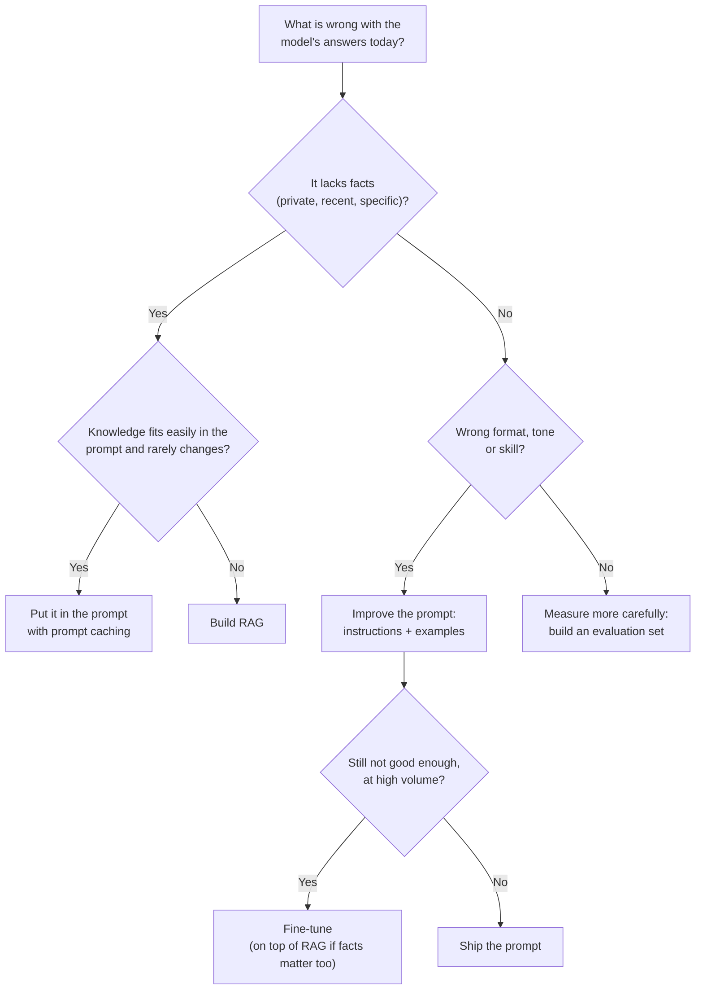

# RAG vs Fine-Tuning vs Prompting: The Complete Guide

> 📚 **Before you start**
>
> - [What is RAG?](what-is-rag.md), for the retrieve, augment, generate idea.
> - [How LLMs Work](../../generative-ai-and-llm-foundations/course.md#m3), for context windows and what model weights are.

## Introduction

A new hire joins a Pune software company. There are three ways to make her useful on day one:

- **Tell her what to do right now** ("For this ticket, reply politely and mention the refund window"). Quick, flexible, forgotten tomorrow.
- **Hand her the handbook and the wiki** and expect her to look things up when a question comes in. She stays up to date as the wiki changes.
- **Send her on a three-month training programme** so the company's way of working becomes second nature. Expensive and slow, but afterwards she writes in the house style without thinking.

These map exactly onto the three ways to adapt an LLM: **prompting** (instructions and examples in the prompt), **RAG** (look things up at question time), and **fine-tuning** (change the model's weights with extra training). Teams waste months picking the wrong one, usually fine-tuning when they needed RAG. By the end of this lesson you'll be able to choose correctly, explain the trade-offs in numbers, and know when to combine them.

> 💡 **Key Insight**
>
> **RAG gives a model knowledge. Fine-tuning gives it behaviour. Prompting gives it instructions.** If the problem is "the model doesn't know our facts", reach for RAG (or, for a small knowledge base, just put it all in the prompt). If the problem is "the model knows enough but answers in the wrong form or style", reach for prompting first and fine-tuning last.

---

## Core Explanation

### 1. The three options side by side

| | Prompting | RAG | Fine-tuning |
|---|---|---|---|
| **What changes** | The text you send | The text you send, chosen automatically per question | The model's weights |
| **Good for** | Instructions, format, tone, a few examples, small reference text | Large, changing or private knowledge; citations | Consistent style or format, narrow skills, shorter prompts, smaller cheaper models |
| **Bad for** | Knowledge larger than the context window | Teaching a new skill or style | Precise, changing facts |
| **Time to first result** | Minutes | Hours to days | Days to weeks |
| **Updating knowledge** | Edit the prompt | Re-index changed documents | Retrain |
| **Citations** | Possible if you paste sources | Natural | No (the model can't say where a weight came from) |
| **Main cost** | Tokens per call | Indexing plus a few thousand extra tokens per call | Data preparation, training runs, evaluation, hosting |

The three are not rivals; they're layers. Almost every production RAG system also relies heavily on prompting (the grounding instructions you saw in the last lesson), and some add fine-tuning on top.

### 2. Prompting: start here, always

**Prompting** means writing better instructions, adding a few examples ("few-shot"), or pasting reference material directly into the prompt. It's free to try and instant to change.

A surprising amount of "we need to fine-tune" disappears with a good prompt:

```text
System: You are Tarang Software's HR assistant.
- Answer in at most 3 sentences.
- Always state the policy section number in brackets.
- If an employee seems upset, start with one sentence of acknowledgement.

Example
Q: My laptop was stolen on the train!
A: That's stressful, sorry to hear it. Report it to IT within 24 hours [6.1].
   You'll pay 10% of the replacement cost [6.1].
```

When the knowledge itself is small, prompting can even replace RAG. If the entire handbook is 30 pages, just put all 30 pages in the system prompt.

### 3. Long context and prompt caching: the "no retrieval" option

Modern models accept very long prompts; current Claude models take up to 1 million tokens. Paired with **prompt caching** (the provider stores the processed prefix of a prompt, so repeating the same long prefix is much cheaper and faster on later calls), "just put everything in the prompt" is a real option for small, stable knowledge bases. Anthropic's own guidance is that if your knowledge base is under about 200,000 tokens (roughly 500 pages), you can often skip retrieval and include it whole with caching. This pattern is sometimes called **cache-augmented generation (CAG)**.

Let's compare the per-question cost of the two approaches with simple arithmetic. Prices change, so treat these as variables; at the time of writing, Claude Opus 5.5 lists input at $4 per million tokens and cached reads at $0.20 per million.

```python
def cost_per_question(prompt_tokens, cached_tokens=0, price_in=4.00, price_cached=0.20):
    """Input cost in US dollars for one call. Prices are per million tokens."""
    fresh = prompt_tokens - cached_tokens
    return (fresh * price_in + cached_tokens * price_cached) / 1_000_000

handbook_tokens = 60_000      # a 150-page handbook
question_tokens = 50
rag_context_tokens = 2_500    # five retrieved chunks of ~500 tokens

options = {
    "whole handbook, no cache": cost_per_question(handbook_tokens + question_tokens),
    "whole handbook, cached":   cost_per_question(handbook_tokens + question_tokens, cached_tokens=handbook_tokens),
    "RAG, 5 chunks":            cost_per_question(rag_context_tokens + question_tokens),
}
for name, dollars in options.items():
    print(f"{name:<26} ${dollars:.4f} per question   ${dollars * 100_000:,.0f} per 100k questions")
```

Output:

```
whole handbook, no cache   $0.2402 per question   $24,020 per 100k questions
whole handbook, cached     $0.0122 per question   $1,220 per 100k questions
RAG, 5 chunks              $0.0102 per question   $1,020 per 100k questions
```

Two lessons hide in these numbers:

- **Caching changes the maths dramatically.** The whole handbook goes from the most expensive option to the same ballpark as RAG.
- **RAG still wins on cost as the corpus grows**, because its prompt size stays flat while "put everything in" grows with every page. Ten handbooks would be 600,000 tokens per call; RAG would still send about 2,500.

Cost isn't the only factor. Long context avoids retrieval misses entirely (the right page is always in there) but models attend less reliably to details buried deep in very long inputs, every user sees every document (no per-user access control), and it stops working the moment the corpus exceeds the window.

### 4. RAG: knowledge on demand

RAG is the right default when **any** of these is true:

- The knowledge is **larger than you can afford to send on every call** (or larger than the window).
- It **changes** often: prices, policies, tickets, inventory, news.
- **Different users may see different documents** (permissions).
- You need **citations** so people can verify answers.
- You need to **delete** information reliably (for example, a customer's data under a privacy request). Deleting from an index is easy; deleting from model weights is not.

### 5. Fine-tuning: behaviour, not facts

**Fine-tuning** continues training a model on your own examples so its weights shift towards your data. The training data is a file of input-output pairs, like this (one JSON object per line, a format called JSONL):

```json
{"messages": [{"role": "user", "content": "Summarise ticket #4411: customer says UPI refund not received after 5 days."}, {"role": "assistant", "content": "Category: Refund delay | Channel: UPI | Days waiting: 5 | Action: escalate to payments team"}]}
{"messages": [{"role": "user", "content": "Summarise ticket #4412: app crashes when uploading Aadhaar photo on Android 14."}, {"role": "assistant", "content": "Category: App crash | Platform: Android 14 | Feature: KYC upload | Action: assign to mobile team"}]}
```

Thousands of these teach the model a **format and a skill** (turning messy tickets into a fixed structure) very reliably. They are a poor way to teach **facts**, for four reasons:

1. **It's lossy.** The model absorbs patterns, not a lookup table. Ask about section 5.2 and a fine-tuned model may produce "Rs 1,000" because it's a plausible blend of what it saw.
2. **It's stale.** Every policy change needs a new training run.
3. **It can't cite.** There's no way to point at the paragraph a weight came from.
4. **It can make things worse.** Training on new facts can increase a model's tendency to state things confidently whether or not it knows them.

Common methods you'll hear about: **full fine-tuning** (update every weight; costly), **LoRA** and other **parameter-efficient fine-tuning (PEFT)** methods (train small add-on matrices while the base model stays frozen; much cheaper), and **preference tuning** (teach the model which of two answers people prefer). Hosted fine-tuning is offered for some models on some platforms; availability varies by provider and changes often, so check before you plan around it.

When fine-tuning genuinely helps:

| Goal | Example |
|---|---|
| A strict output format at high volume | Every support ticket turned into the same 6-field summary |
| A distinctive voice or style | Marketing copy that always sounds like your brand |
| A small, cheap model doing one narrow task well | A classifier-style model routing tickets to 40 queues |
| Shorter prompts | Instructions that would take 3,000 tokens in every prompt get baked in |
| Domain language | Reading heavy medical or legal jargon more fluently |

### 6. A decision procedure



The same logic as code, so you can test it on scenarios:

```python
def recommend(needs_private_facts, knowledge_tokens, changes_often, needs_citations,
              format_problem, prompt_fixed_format):
    steps = []
    if needs_private_facts:
        if knowledge_tokens <= 200_000 and not changes_often and not needs_citations:
            steps.append("put the knowledge in the prompt with caching")
        else:
            steps.append("RAG")
    if format_problem:
        steps.append("better prompt" if not prompt_fixed_format else "fine-tune for format")
    return " + ".join(steps) or "prompting is enough"

scenarios = {
    "HR bot over a 40-page handbook":                    (True, 30_000, False, False, False, False),
    "Support bot over 20,000 changing help articles":     (True, 9_000_000, True, True, False, False),
    "Ticket summariser, wrong format even with examples": (False, 0, False, False, True, True),
    "Legal assistant: citations + strict memo format":    (True, 50_000_000, True, True, True, True),
}
for name, args in scenarios.items():
    print(f"{name:<52} -> {recommend(*args)}")
```

Output:

```
HR bot over a 40-page handbook                       -> put the knowledge in the prompt with caching
Support bot over 20,000 changing help articles       -> RAG
Ticket summariser, wrong format even with examples   -> fine-tune for format
Legal assistant: citations + strict memo format      -> RAG + fine-tune for format
```

### 7. Combining them

The strongest systems layer the three:

- **RAG + prompting** is the standard: retrieval supplies facts, the prompt supplies grounding rules, format and tone.
- **RAG + fine-tuning**: fine-tune the generator to be better at *using* retrieved context (quoting it, ignoring irrelevant chunks, saying "not found"). A 2024 research method called **RAFT** (Retrieval-Augmented Fine-Tuning) trains on examples that include both helpful and distracting documents for exactly this reason.
- **Fine-tuned embedding models**: instead of tuning the generator, tune the *retriever's* embedding model on your domain's question and passage pairs, so "PF withdrawal" lands near "provident fund advance". This often gives a bigger lift than tuning the generator.
- **Long context + RAG**: retrieve generously (say 30 chunks instead of 5) and let a long-context model sort them out. Retrieval narrows millions of tokens down to tens of thousands; the model handles the rest.

### 8. The same question, three ways

Here's how each approach handles *"What is the meal allowance in Mumbai?"* for Tarang Software:

| Approach | What happens | Likely answer |
|---|---|---|
| Plain prompt, no data | Model has never seen the handbook | "Allowances vary by company; please check your HR policy." |
| Fine-tuned on old handbook | Learned a blurry version of the number | "Rs 1,000 per day." (plausible, wrong, no source) |
| RAG | Section 5.2 retrieved and quoted | "Rs 1,200 per day, since Mumbai is a metro city [5.2]." |
| Whole handbook in a cached prompt | Section 5.2 is in context | "Rs 1,200 per day [5.2]." |

The last two are both correct. Which to choose depends on size, change rate, permissions and cost, exactly the questions in the decision procedure.

---

## Try It Yourself

1. **Find the break-even.** Using `cost_per_question`, how many handbook tokens does it take before "whole handbook, cached" costs more per question than "RAG, 5 chunks"?
2. **Classify the scenario.** A bank wants a bot that answers questions about its 300 loan products. Rates change weekly, and the compliance team requires every answer to cite the product document. Run it through `recommend`.
3. **Spot the mistake.** A team fine-tuned a model on their product catalogue, and it now confidently quotes prices that were changed last month. What would you tell them?

<details>
<summary>Show answers</summary>

**1.** Search for the size where the cached whole-handbook cost overtakes RAG.

```python
rag = cost_per_question(rag_context_tokens + question_tokens)
size = 1_000
while cost_per_question(size + question_tokens, cached_tokens=size) <= rag:
    size += 1_000
print(f"Above about {size:,} tokens the cached handbook costs more per question than RAG")
```

Output:

```
Above about 51,000 tokens the cached handbook costs more per question than RAG
```

At these prices, cached reads are 20 times cheaper than fresh input, so the whole knowledge base can be about 20 times bigger than the RAG context before it costs more. Remember this ignores the one-time cost of writing the cache (charged at a premium) and cache expiry, which push the real break-even lower.

**2.**

```python
print(recommend(True, 4_000_000, True, True, False, False))
```

Output:

```
RAG
```

Weekly changes and mandatory citations make RAG the clear choice.

**3.** Facts don't belong in weights. Move the catalogue into a RAG index (re-indexed whenever prices change) and, if the fine-tune was also teaching a useful format or tone, keep it for that while the facts come from retrieval.

</details>

---

## Real-World Examples

- **Enterprise assistants** (HR, IT helpdesk, sales enablement) are almost always RAG plus careful prompting, because policies change and answers must be traceable.
- **Code assistants** combine a model trained on code (a form of large-scale fine-tuning) with retrieval over your repository at question time.
- **High-volume extraction pipelines** (invoices, KYC documents, insurance claims) often fine-tune a smaller model for a fixed output format to cut cost per document.
- **Small, stable knowledge bases** such as a product's 50-page user manual are increasingly served by putting the whole manual into a cached prompt, with no retrieval at all.

---

## Common Misconceptions

### "Fine-tuning is how you teach a model your company's data"

It's how you teach it your company's *style*. For your company's facts, use retrieval or the prompt. Teams that fine-tune for facts end up with a model that sounds confident and is quietly wrong.

### "RAG is a hack until context windows get big enough"

Context windows are already big, and RAG is still everywhere, because cost, latency, permissions, freshness and corpus size all favour sending only what's needed. Long context changes *how much* you retrieve, not *whether*.

### "You have to pick one"

Most real systems use all three layers: retrieval for facts, prompting for rules and format, and sometimes fine-tuning for a narrow skill or a cheaper model.

---

## Interview Relevance

*"When would you use RAG versus fine-tuning?"* is one of the most common generative AI interview questions. A strong answer:

- separates **knowledge** (RAG or long context) from **behaviour** (prompting first, then fine-tuning);
- lists RAG's advantages for facts: freshness, citations, access control, deletability, no training cost;
- lists fine-tuning's real uses: strict formats at volume, style, narrow tasks on smaller models, shorter prompts;
- mentions the **long-context-plus-caching** option for small, stable corpora, with a rough size threshold;
- mentions **combinations**: RAG with a prompt, fine-tuning the generator to use context (RAFT) or fine-tuning the embedding model.

Bonus points for numbers: estimate tokens per call and cost per 100,000 questions for each option, as in this lesson.

---

## Key Takeaways

- **Prompting gives instructions, RAG gives knowledge, fine-tuning gives behaviour.**
- **Start with prompting**, add **RAG** for large, changing, private or citable knowledge, and consider **fine-tuning** only for format, style or cost at scale.
- **Small, stable knowledge bases** can go straight into a **cached prompt** with no retrieval.
- **Fine-tuning is a poor way to store facts**: lossy, stale, uncitable and hard to delete.
- **The layers combine**: real systems use retrieval, prompts and sometimes fine-tuning together.

---

**Up next:** [The RAG Pipeline End to End](the-rag-pipeline-end-to-end.md)
