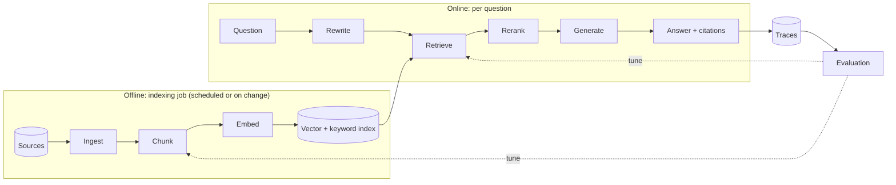

# The RAG Pipeline End to End: The Complete Guide

> 📚 **Before you start**
>
> - [What is RAG?](what-is-rag.md), for the two phases (indexing and answering).
> - [RAG vs Fine-Tuning vs Prompting](rag-vs-fine-tuning-vs-prompting.md), for when RAG is the right tool.
> - The embedding refresher in [What is RAG?](what-is-rag.md). Embeddings and vector indexes get their full treatment in [Embeddings and Vector Databases](../course.md#m3), the next module.

## Introduction

Think of how a big Indian railway station handles parcels. Parcels arrive from everywhere (shops, homes, factories), get **weighed and labelled**, are **sorted** into bags by destination, and the bags are **stacked on numbered racks** so they can be found quickly. When a train comes in, staff don't search the whole godown: they go straight to the right rack, **pick the right bags**, double-check the labels, load them, and log the delivery so mistakes can be traced later.

A RAG pipeline is the same kind of system for text. Documents arrive in many formats, get cleaned and labelled, cut into pieces, turned into vectors and stacked in an index. When a question arrives, the system goes straight to the most promising pieces, double-checks them, hands them to the model, and logs everything so you can measure quality.

The last two lessons explained *what* RAG is and *when* to use it. This one walks through **every stage** of a production pipeline: what goes in, what comes out, which decisions matter, and what typically goes wrong. By the end you'll be able to draw the full architecture from memory, name the key design choice at each stage, and trace a question through a working pipeline in code.

> 💡 **Key Insight**
>
> A RAG pipeline is **eight stages in two loops**: ingest, chunk, embed and index run offline; retrieve, rerank and generate run per question; evaluate wraps both. Every answer quality problem can be traced to one stage, so learn to ask *"which stage failed?"* before changing anything.

---

## Core Explanation

### 1. The whole pipeline in one picture


*Top band: built once and refreshed when documents change. Middle band: runs for every question. Bottom band: how you know whether any of it works.*

| Stage | Input | Output | The key decision |
|---|---|---|---|
| **Ingest** | Files, pages, rows | Clean text + metadata | How to parse each format, what metadata to keep |
| **Chunk** | Clean documents | Passages of a few hundred tokens | Chunk size, overlap, where to split |
| **Embed** | Chunks | One vector per chunk | Which embedding model and dimension |
| **Index** | Vectors + text + metadata | A searchable store | Vector store type, plus a keyword index |
| **Retrieve** | Question | Top candidate chunks with scores | k, filters, vector vs keyword vs hybrid |
| **Rerank** | Candidates | A short, re-ordered list | Whether to rerank and how many to keep |
| **Generate** | Prompt with chunks | Answer with citations | Prompt rules, model, what to do when nothing fits |
| **Evaluate** | Test questions + traces | Scores | Which metrics, how often |

The rest of this lesson takes each stage in turn, then runs all of them in code.

### 2. Ingest: get clean text and good metadata

**Ingestion** means loading raw sources and turning them into clean text with **metadata** (facts *about* the text: source file, page number, section title, date, owner, access group).

| Source | Typical problems |
|---|---|
| PDFs | Text in the wrong order across columns, headers and footers repeated on every page, tables flattened into gibberish, scanned pages with no text at all (needs OCR) |
| Web pages | Navigation menus, cookie banners and footers mixed into the content |
| Word, slides | Speaker notes, comments, hidden text |
| CSV / database rows | Each row needs to become a readable sentence or a structured record |
| Chat and tickets | Signatures, quoted earlier messages, greetings |

Good ingestion **removes boilerplate, keeps structure** (headings, lists, tables) and **attaches metadata**. Metadata is easy to skip and painful to add later. You'll need it for citations ("page 14"), filtering ("only 2026 policies"), access control ("only HR can see this") and debugging ("which file did this wrong chunk come from?").

A cleaned record looks like this:

```json
{
  "doc_id": "tarang-handbook-2026",
  "text": "5.2 Meal allowance: On client travel the daily meal allowance is Rs 1,200 in metro cities and Rs 800 in other cities.",
  "metadata": {"source": "hr/handbook-2026.pdf", "page": 14, "section": "5.2", "updated": "2026-04-01", "access": "all-employees"}
}
```

LangChain calls this a `Document` (text plus a metadata dictionary) and provides **document loaders** for hundreds of formats. That's [Module 5](../05-rag-building-blocks-in-langchain/document-loaders.md).

### 3. Chunk: cut documents into retrievable pieces

**Chunking** splits each document into passages small enough to retrieve precisely and to fit several into a prompt.

- **Too big** (say 3,000 tokens): one chunk covers many topics, its embedding becomes a blurry average, and you waste prompt space on irrelevant text.
- **Too small** (say 30 tokens): a chunk loses context. "It is 60 days." means nothing without the heading "Notice period".
- **A common starting point**: 200 to 800 tokens per chunk with 10 to 20% **overlap** (repeating the end of one chunk at the start of the next so a sentence cut in half still appears whole somewhere).

Better splitters cut at natural boundaries (headings, paragraphs, sentences) rather than at a fixed character count. Advanced strategies add document context to each chunk, or index small chunks but return their larger parent section. All of this is covered in [Text Splitters](../05-rag-building-blocks-in-langchain/text-splitters.md) and [Chunking Strategies](../06-implementing-rag/chunking-strategies.md).

### 4. Embed: turn each chunk into a vector

An **embedding model** maps text to a fixed-length vector. Decisions here:

| Decision | Options and advice |
|---|---|
| **Model** | Hosted APIs (for example Voyage AI, OpenAI, Cohere, Google) or open models you run yourself (for example the sentence-transformers family). Check a current leaderboard such as MTEB for your language and domain, then test on *your* questions. |
| **Dimension** | Typically 256 to 3,072 numbers. More dimensions can capture more nuance but cost more storage and search time. Several modern models let you pick the size. |
| **Query vs document mode** | Many models embed questions and passages slightly differently (for example Voyage's `input_type="query"` or `"document"`). Use the right one for each. |
| **Language** | For Hindi, Tamil or mixed "Hinglish" text, use a multilingual model and test it. |
| **Consistency** | Queries and documents **must** use the same model and version. Changing the model means re-embedding everything. |

Here's what one looks like, with the real API call shown but not run:

```python
# not-run: needs the voyageai package and a VOYAGE_API_KEY
import voyageai

vo = voyageai.Client()
result = vo.embed(
    ["5.2 Meal allowance: On client travel the daily meal allowance is Rs 1,200 in metro cities..."],
    model="voyage-4", input_type="document",
)
vector = result.embeddings[0]
print(len(vector), [round(x, 3) for x in vector[:5]])
```

Example output:

```
1024 [0.021, -0.047, 0.013, 0.062, -0.008]
```

A thousand numbers, none of which means anything on its own. Only distances between vectors carry meaning.

### 5. Index: store vectors so they can be searched fast

The **index** stores each chunk's vector, text and metadata, and answers "which vectors are closest to this one?" quickly.

- **Exact (flat) search** compares the query with every vector. Perfect accuracy, fine up to tens or hundreds of thousands of chunks.
- **Approximate nearest neighbour (ANN)** indexes such as **HNSW** (a graph you hop through towards the nearest neighbours) or **IVF** (cluster vectors, search only the nearest clusters) trade a tiny bit of accuracy for huge speed at millions of vectors.
- **Where it lives**: a library in your process (FAISS), an embedded database (Chroma, LanceDB), a dedicated vector database (Qdrant, Weaviate, Milvus, Pinecone), or a vector extension of a database you already run (Postgres with pgvector, Elasticsearch, OpenSearch).

Production systems usually keep a **keyword index** (BM25) alongside the vector index, because exact terms such as policy codes, error numbers and names are matched far better by keywords. Combining both is **hybrid search** ([Hybrid Search](../06-implementing-rag/hybrid-search.md)). [Storage and Indexing (HNSW, IVF)](../course.md#m3) covers index internals in depth, and [Vector Database Tools](../course.md#m4) tours the products.

### 6. Retrieve: find candidate chunks for the question

At question time:

1. Optionally **rewrite the query**. A follow-up like *"and for Pune?"* becomes *"What is the meal allowance in Pune?"*. Some systems also generate several phrasings (multi-query).
2. **Embed** the (rewritten) question with the same model.
3. **Search** for the top **k** most similar chunks, applying **metadata filters** (only the current handbook version, only documents this user may see).
4. Return chunks with their **scores**.

Choosing k is a trade-off. Retrieve too few and you miss the answer; too many and you add noise and cost. A common pattern is to retrieve generously (k = 20 to 100) and then rerank down to 3 to 10.

### 7. Rerank: put the best evidence first

Embedding search is fast because it compares precomputed vectors, but it never looks at the question and chunk *together*. A **reranker** (usually a **cross-encoder**, a model that reads the question and one chunk side by side and outputs a relevance score) is slower but much more accurate. You run it only on the candidates from retrieval.

Reranking also enables a **relevance guardrail**: if even the best reranked chunk scores below a threshold, the system says "I couldn't find that" instead of letting the model improvise from weak evidence. Details in [Reranking](../06-implementing-rag/reranking.md).

### 8. Generate: build the prompt and call the model

The prompt builder assembles:

- **Instructions**: answer only from the context, cite sources, say "not found" when appropriate, follow a format.
- **Context**: the reranked chunks, each labelled with an ID or source so it can be cited. Put the most relevant chunks first; models tend to use information at the start and end of long contexts more reliably than the middle (the "lost in the middle" effect, documented in a 2023 study).
- **The question** (and, in a chat app, a short conversation history).
- A **token budget**: stop adding chunks before the prompt gets too long.

Some APIs have first-class support for this. With Claude, you can pass retrieved chunks as `search_result` content blocks with citations enabled, and the response comes back with structured citations pointing to the exact source:

```python
# not-run: needs the anthropic package and an API key
import anthropic

client = anthropic.Anthropic()
response = client.messages.create(
    model="claude-opus-5-5",
    max_tokens=1024,
    messages=[{
        "role": "user",
        "content": [
            {"type": "search_result", "source": "hr/handbook-2026.pdf#5.2", "title": "5.2 Meal allowance",
             "content": [{"type": "text", "text": "On client travel the daily meal allowance is Rs 1,200 in metro cities and Rs 800 in other cities."}],
             "citations": {"enabled": True}},
            {"type": "text", "text": "What is the daily meal allowance in Mumbai? Answer only from the search results."},
        ],
    }],
)
for block in response.content:
    if block.type == "text":
        print(block.text, [c.source for c in (block.citations or [])])
```

Example output:

```
Mumbai is a metro city, so the daily meal allowance is Rs 1,200. ['hr/handbook-2026.pdf#5.2']
```

### 9. Evaluate: know whether it works

Without evaluation, every change is a guess. Build a **test set**: 30 to 200 realistic questions, each with the chunk(s) that contain the answer and, ideally, a reference answer. Then measure two layers separately:

| Layer | Metric | Plain meaning |
|---|---|---|
| Retrieval | **Recall@k** (hit rate) | Did the right chunk appear in the top k? |
| Retrieval | **MRR** (mean reciprocal rank) | How high was the first right chunk? 1st place = 1, 2nd = 0.5, 3rd = 0.33 |
| Retrieval | **Context precision** | What fraction of retrieved chunks were actually relevant? |
| Generation | **Faithfulness** (groundedness) | Is every claim in the answer supported by the retrieved context? |
| Generation | **Answer relevance / correctness** | Does it answer the question, and match the reference? |
| Generation | **Citation accuracy** | Do the cited sources actually contain the cited claims? |

Generation metrics are usually scored by an **LLM-as-judge** (a model grading answers against a rubric), with spot checks by people. Open-source frameworks such as **RAGAS** package metrics like faithfulness, answer relevancy, context precision and context recall. Deep coverage lives in [RAG Evaluation](../course.md#m9).

Separate layers matter because the fix depends on the layer: low recall means fix chunking, embeddings or hybrid search; good recall but low faithfulness means fix the prompt or the model.

### 10. The whole pipeline, running

Let's run every stage on the Tarang handbook and print what each stage produces. The embedding is the same toy model as in [What is RAG?](what-is-rag.md), and the "LLM" is a pretend one that answers only from its context.

**Ingest and chunk.** The raw handbook arrives as one text with headings. We split on headings, keep the heading as metadata, and drop a repeated page footer (a typical PDF artefact).

```python
import re, zlib
import numpy as np

RAW = """Tarang Software Employee Handbook 2026 | Confidential
## 2.1 Annual leave
Every employee gets 24 days of paid leave per calendar year. Up to 8 unused days can be carried forward to the next year.
## 2.2 Sick leave
Employees get 10 days of sick leave per year. A doctor's note is required for more than 2 sick days in a row.
Tarang Software Employee Handbook 2026 | Confidential
## 3.1 Work from home
Employees may work from home up to 2 days a week with their manager's approval.
## 5.1 Travel claims
Submit bills on the Kharcha portal within 30 days of the trip. Approved claims are reimbursed within 15 days.
## 5.2 Meal allowance
On client travel the daily meal allowance is Rs 1,200 in metro cities and Rs 800 in other cities.
Tarang Software Employee Handbook 2026 | Confidential
## 6.1 Laptops
A lost or stolen laptop must be reported to IT within 24 hours. The employee pays 10% of the replacement cost.
## 8.1 Notice period
The notice period is 60 days. It can be shortened by paying basic salary for the remaining days."""

FOOTER = "Tarang Software Employee Handbook 2026 | Confidential"

def ingest_and_chunk(raw, source):
    clean = "\n".join(line for line in raw.splitlines() if line.strip() != FOOTER)
    chunks = []
    for block in clean.split("## ")[1:]:
        heading, body = block.split("\n", 1)
        section = heading.split()[0]
        chunks.append({"id": section, "text": f"{heading}: {body.strip()}",
                       "metadata": {"source": source, "section": section}})
    return chunks

chunks = ingest_and_chunk(RAW, "hr/handbook-2026.pdf")
print(len(chunks), "chunks")
print(chunks[4])
```

Output:

```
7 chunks
{'id': '5.2', 'text': '5.2 Meal allowance: On client travel the daily meal allowance is Rs 1,200 in metro cities and Rs 800 in other cities.', 'metadata': {'source': 'hr/handbook-2026.pdf', 'section': '5.2'}}
```

**Embed and index.**

```python
STOP = {"a", "an", "the", "is", "are", "of", "to", "in", "on", "for", "and", "or", "i", "my", "can",
        "do", "how", "many", "much", "what", "be", "it", "by", "with", "per", "up", "get", "if"}
CONCEPTS = {"vacation": "leave", "pto": "leave", "food": "meal", "lunch": "meal", "budget": "allowance",
            "trip": "travel", "visit": "travel", "customer": "travel", "notebook": "laptop",
            "computer": "laptop", "stolen": "lost", "resign": "notice", "quit": "notice",
            "expense": "claim", "reimbursement": "claim", "refund": "claim", "bill": "claim"}

def normalise(w):
    if w.endswith("ied"):
        return w[:-3] + "y"
    if w.endswith("s") and not w.endswith("ss") and len(w) > 3:
        return w[:-1]
    return w

def words(text):
    return {normalise(w) for w in re.findall(r"[a-z0-9]+", text.lower())} - STOP

def embed(text, dim=256):
    vec = np.zeros(dim)
    for w in words(text):
        vec[zlib.crc32(CONCEPTS.get(w, w).encode()) % dim] += 1.0
    norm = np.linalg.norm(vec)
    return vec / norm if norm else vec

index_vectors = np.array([embed(c["text"]) for c in chunks])
print("index shape:", index_vectors.shape)
nonzero = np.flatnonzero(index_vectors[4])
print("chunk 5.2 has", len(nonzero), "non-zero slots, for example:",
      {int(i): round(float(index_vectors[4][i]), 3) for i in nonzero[:4]})
```

Output:

```
index shape: (7, 256)
chunk 5.2 has 13 non-zero slots, for example: {13: 0.5, 32: 0.25, 85: 0.25, 101: 0.25}
```

A real embedding would have almost every entry non-zero; ours is sparse because each word (or concept) lights up one slot. The shape is what matters: one row per chunk.

**Retrieve, rerank and guard.** Retrieval takes the top 4 by cosine similarity. For the reranker we use a stand-in that looks at the question and each chunk *together* and adds a bonus for every word they share exactly; a real cross-encoder does this with a neural network that reads both texts at once. The guardrail refuses when the best score is too low.

```python
def retrieve(question, k=4):
    scores = index_vectors @ embed(question)
    order = np.argsort(-scores)[:k]
    return [(chunks[i], float(scores[i])) for i in order]

def rerank(question, candidates, keep=2):
    q = words(question)
    def joint_score(chunk, vector_score):
        overlap = len(q & words(chunk["text"]))           # looks at both texts together
        return vector_score + 0.1 * overlap
    rescored = [(c, joint_score(c, s)) for c, s in candidates]
    return sorted(rescored, key=lambda pair: -pair[1])[:keep]

MIN_SCORE = 0.3

question = "What food budget do I get when I visit customers in Mumbai?"
candidates = retrieve(question)
print("retrieved:", [(c["id"], round(s, 2)) for c, s in candidates])
top = rerank(question, candidates)
print("reranked: ", [(c["id"], round(s, 2)) for c, s in top])
print("guardrail passes:", top[0][1] >= MIN_SCORE)
```

Output:

```
retrieved: [('5.2', 0.35), ('5.1', 0.32), ('8.1', 0.21), ('2.1', 0.0)]
reranked:  [('5.2', 0.35), ('5.1', 0.32)]
guardrail passes: True
```

Retrieval found the right section first, with the travel-claims section close behind (both are about travel). Here the reranker agrees with that order and trims the list to two; in [Reranking](../06-implementing-rag/reranking.md) you'll see cases where it rescues a chunk that retrieval ranked low.

**Generate.** The prompt builder labels each chunk with its section so the model can cite it. The pretend LLM answers from the best-matching sentence in its context.

```python
def build_prompt(question, top_chunks):
    context = "\n".join(f"[{c['id']}] {c['text']}" for c, _ in top_chunks)
    return ("Answer ONLY from the context and cite the section in brackets. "
            "If the context does not contain the answer, say you couldn't find it.\n\n"
            f"Context:\n{context}\n\nQuestion: {question}")

def pretend_llm(prompt):
    context = prompt.split("Context:\n")[1].split("\n\nQuestion:")[0]
    q = words(prompt.split("Question:")[1])
    q = q | {CONCEPTS.get(w, w) for w in q}
    best, best_score = "I couldn't find that in the handbook.", 1
    for line in context.splitlines():
        sec, text = line[1:].split("] ", 1)
        for sentence in re.split(r"(?<=\.) ", text.split(": ", 1)[1]):
            score = len(q & words(sentence))
            if score > best_score:
                best, best_score = f"{sentence} [{sec}]", score
    return best

prompt = build_prompt(question, top)
print(prompt)
print("\nANSWER:", pretend_llm(prompt))
```

Output:

```
Answer ONLY from the context and cite the section in brackets. If the context does not contain the answer, say you couldn't find it.

Context:
[5.2] 5.2 Meal allowance: On client travel the daily meal allowance is Rs 1,200 in metro cities and Rs 800 in other cities.
[5.1] 5.1 Travel claims: Submit bills on the Kharcha portal within 30 days of the trip. Approved claims are reimbursed within 15 days.

Question: What food budget do I get when I visit customers in Mumbai?

ANSWER: On client travel the daily meal allowance is Rs 1,200 in metro cities and Rs 800 in other cities. [5.2]
```

The pretend model can't infer that Mumbai is a metro city; a real model would add *"Mumbai is a metro, so Rs 1,200"*. Everything else (which evidence it saw, what it cited) works exactly as in a real pipeline.

**Put it together and evaluate.** One function runs the online stages; a small test set measures retrieval (recall@2 and MRR) and a crude faithfulness check (does the answer's text appear in the retrieved context?).

```python
def answer(question):
    top = rerank(question, retrieve(question))
    if top[0][1] < MIN_SCORE:
        return "I couldn't find that in the handbook.", []
    return pretend_llm(build_prompt(question, top)), [c["id"] for c, _ in top]

TEST_SET = [  # question, section that contains the answer (None = not in the handbook)
    ("How many unused leave days can be carried forward?", "2.1"),
    ("Do I need a doctor's note for 3 sick days?", "2.2"),
    ("How soon are travel expenses reimbursed?", "5.1"),
    ("What food budget do I get when I visit customers?", "5.2"),
    ("My notebook computer was stolen, what should I do?", "6.1"),
    ("How long is the notice period if I resign?", "8.1"),
    ("Can I bring my pet to the office?", None),
]

hits, rr, faithful, answered = 0, 0.0, 0, 0
for q, expected in TEST_SET:
    text, sources = answer(q)
    ranked = [c["id"] for c, _ in rerank(q, retrieve(q))]
    if expected:
        hits += expected in ranked
        rr += 1 / (ranked.index(expected) + 1) if expected in ranked else 0
    if sources:
        answered += 1
        context = " ".join(c["text"] for c in chunks if c["id"] in sources)
        faithful += text.split(" [")[0] in context
    print(f"{q[:48]:<48} -> {text[:60]}")

n = sum(1 for _, e in TEST_SET if e)
print(f"\nrecall@2 = {hits / n:.2f}   MRR = {rr / n:.2f}   faithfulness = {faithful}/{answered}")
```

Output:

```
How many unused leave days can be carried forwar -> Up to 8 unused days can be carried forward to the next year.
Do I need a doctor's note for 3 sick days?       -> A doctor's note is required for more than 2 sick days in a r
How soon are travel expenses reimbursed?         -> Approved claims are reimbursed within 15 days. [5.1]
What food budget do I get when I visit customers -> On client travel the daily meal allowance is Rs 1,200 in met
My notebook computer was stolen, what should I d -> A lost or stolen laptop must be reported to IT within 24 hou
How long is the notice period if I resign?       -> The notice period is 60 days. [8.1]
Can I bring my pet to the office?                -> I couldn't find that in the handbook.

recall@2 = 1.00   MRR = 1.00   faithfulness = 6/6
```

That last line is the heartbeat of a RAG project. Every change you make in Modules 5 to 7 (a new splitter, hybrid search, a reranker) should move those numbers, and you should be able to say which.

### 11. Running it in production

The pipeline above fits in one file. A production version adds operational concerns:

| Concern | What teams do |
|---|---|
| **Incremental updates** | Hash each document; re-chunk and re-embed only documents whose hash changed; delete chunks of removed documents. LangChain's indexing API (`langchain_core.indexing.index` with a record manager) automates this. |
| **Versioning** | Store the embedding model name, chunking settings and index version with each chunk; rebuild the index side by side when any of them changes, then switch over. |
| **Access control** | Store permission groups in metadata and filter at query time for each user. Never rely on the prompt to hide documents. |
| **Latency** | A typical budget: query rewrite 200 to 500 ms (if used), embedding 20 to 100 ms, search 10 to 50 ms, rerank 50 to 300 ms, generation 1 to 5 s (stream it). |
| **Observability** | Log the question, rewritten query, retrieved IDs and scores, final prompt size, answer and citations for every request. These traces become new test cases. |
| **Feedback** | Thumbs up/down and "this source was wrong" buttons feed the evaluation set. |



---

## Try It Yourself

1. **Find the failing stage.** Ask `answer("What is the WFH rule?")`. Is the result right? If not, which stage failed, and what would you change?
2. **Watch the guardrail.** Set `MIN_SCORE = 0.9` and rerun the evaluation loop. What happens to recall and to the number of answered questions?
3. **Add a document without rebuilding.** Append a new chunk for section `7.1 Holidays` ("The office is closed on 10 public holidays, including Diwali and Holi.") and update the index by adding only its vector. Then ask *"Is the office open on Diwali?"*.

<details>
<summary>Show answers</summary>

**1.**

```python
print(answer("What is the WFH rule?"))
print([(c["id"], round(s, 2)) for c, s in retrieve("What is the WFH rule?")][:2])
```

Output:

```
("I couldn't find that in the handbook.", [])
[('2.1', 0.0), ('2.2', 0.0)]
```

The **retrieve** stage failed: every score is 0, because the toy embedding doesn't know that "WFH" means "work from home". Abbreviations and internal codes are a classic weakness of embedding search. First, teach the "embedding model" the abbreviation (with a real system: pick a better model or fine-tune it on your jargon):

```python
CONCEPTS.update({"wfh": "remote", "home": "remote", "remote": "remote"})
index_vectors = np.array([embed(c["text"]) for c in chunks])   # re-embed after changing the model
print([(c["id"], round(s, 2)) for c, s in retrieve("What is the WFH rule?")][:2])
print(answer("What is the WFH rule?"))
```

Output:

```
[('3.1', 0.19), ('2.1', 0.0)]
("I couldn't find that in the handbook.", [])
```

Retrieval now ranks 3.1 first, but the score is weak because the question is only two meaningful words long, so the **guardrail** still refuses. Fixing one stage often exposes the next. A **query rewrite** step (usually a small LLM call, here a dictionary) expands the question before retrieval:

```python
EXPANSIONS = {"WFH": "work from home", "PF": "provident fund"}

def rewrite(question):
    for short, full in EXPANSIONS.items():
        question = question.replace(short, full)
    return question

print(rewrite("What is the WFH rule?"))
print(answer(rewrite("What is the WFH rule?")))
```

Output:

```
What is the work from home rule?
("Employees may work from home up to 2 days a week with their manager's approval. [3.1]", ['3.1', '2.1'])
```

**2.**

```python
MIN_SCORE = 0.9
print(sum(1 for q, _ in TEST_SET if answer(q)[1]), "of", len(TEST_SET), "questions answered")
MIN_SCORE = 0.3
```

Output:

```
2 of 7 questions answered
```

Retrieval recall doesn't change (the same chunks are found), but the guardrail now refuses almost everything. A threshold is a trade-off between wrong answers and unhelpful refusals, and you tune it on a test set.

**3.**

```python
new_chunk = {"id": "7.1", "text": "7.1 Holidays: The office is closed on 10 public holidays, including Diwali and Holi.",
             "metadata": {"source": "hr/handbook-2026.pdf", "section": "7.1"}}
chunks.append(new_chunk)
index_vectors = np.vstack([index_vectors, embed(new_chunk["text"])])
print(answer("Is the office open on Diwali?"))
```

Output:

```
('The office is closed on 10 public holidays, including Diwali and Holi. [7.1]', ['7.1', '5.1'])
```

Only one new vector was computed. That's incremental indexing in its simplest form.

</details>

---

## Real-World Examples

- **Internal search assistants** run indexing jobs every few minutes against document systems, re-embedding only changed files, and filter every query by the user's group memberships.
- **Customer support bots** log every retrieval and answer; low-rated answers are reviewed weekly and turned into new evaluation cases.
- **Documentation assistants** for developer tools combine keyword search (for exact API names and error codes) with vector search (for "how do I..." questions), then rerank.
- **Regulated industries** (banking, insurance, healthcare) keep full traces of which documents were shown for each answer, because auditors ask.

---

## Common Misconceptions

### "The LLM is the most important part"

The model matters, but most failures happen earlier: a badly parsed PDF, a chunk cut mid-sentence, an embedding that doesn't know your jargon, or k set too low. Diagnose by stage.

### "Indexing is a one-time job"

Documents change, get deleted and get new versions. Without incremental updates and deletions your index slowly fills with stale and contradictory chunks, and the model faithfully quotes last year's policy.

### "If retrieval returns something, the system should answer"

Vector search *always* returns the k nearest chunks, even when none of them is relevant. That's why a relevance threshold and an explicit "not found" path matter.

### "One overall accuracy number is enough"

You need retrieval metrics and generation metrics separately; otherwise you can't tell whether to fix the retriever or the prompt.

---

## Interview Relevance

*"Walk me through the architecture of a RAG system"* is a staple system-design question. A strong answer:

- splits it into **offline indexing** (ingest with metadata, chunk with overlap, embed, store in a vector index plus a keyword index) and **online answering** (query rewrite, retrieve top-k with filters, rerank, threshold, build a cited prompt, generate, stream);
- names the **key decision at each stage** (chunk size, embedding model, ANN index type, k, reranker, prompt rules);
- covers **evaluation** with retrieval metrics (recall@k, MRR, context precision) and generation metrics (faithfulness, answer relevance), and explains why they're separate;
- covers **operations**: incremental re-indexing, versioning the embedding model, access control in metadata filters, latency budget, tracing and feedback.

Follow-up: *"Answers got worse after a change. How do you debug?"* Re-run the evaluation set, compare retrieval metrics first, inspect traces of failing questions stage by stage.

---

## Key Takeaways

- **Eight stages, two loops**: ingest, chunk, embed, index offline; retrieve, rerank, generate online; evaluate around both.
- **Metadata** captured at ingestion powers citations, filters, access control and debugging.
- **Retrieve generously, rerank down, and refuse when evidence is weak.**
- **Measure retrieval and generation separately** so you know which stage to fix.
- **Production adds operations**: incremental indexing, versioning, permissions, latency budgets and traces.

---

**Up next:** [Lab: RAG from scratch, no framework](lab-rag-from-scratch-no-framework.md)
