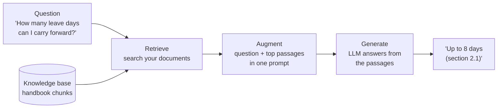
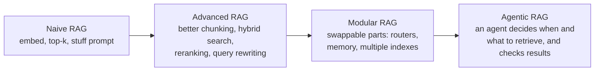

# What is RAG?: The Complete Guide

> 📚 **Before you start**
>
> - [How This Course Works](../01-start-here/how-this-course-works.md), for the running example (the Tarang Software handbook).
> - [How LLMs Work](../../generative-ai-and-llm-foundations/course.md#m3), for tokens, context windows and why a model's knowledge is frozen at training time.
> - [Introduction to Vector Databases](../../vector-databases-for-ai/course.md#m2), for what an embedding is. A short refresher is included below.

## Introduction

Think of a final-year law student sitting an **open-book exam**. She is clever and writes well, but she hasn't memorised every section of every Act. So before answering each question she flips to the right page, reads the exact section, and then writes an answer that quotes it. Her answers are better than a classmate's who relied on memory alone, and the examiner can check every claim against the page she cited.

A large language model (LLM) on its own is the student writing from memory. It learned a huge amount during training, but that knowledge stops at a cutoff date, never included your private documents, and is stored fuzzily enough that the model sometimes fills gaps with plausible inventions (called **hallucinations**). **Retrieval-Augmented Generation (RAG)** turns the exam into an open-book one: before the model answers, your code finds the most relevant passages from your own documents and places them in the prompt.

By the end of this lesson you will be able to:

- define RAG precisely and name its two phases and three core steps;
- see exactly what a RAG prompt looks like, character by character;
- run a tiny RAG system in Python and watch retrieval change the answer;
- explain which problems RAG solves, which it doesn't, and how the idea has evolved from "naive RAG" to agentic RAG.

> 💡 **Key Insight**
>
> RAG doesn't change the model. It changes **what the model reads**. You fetch the right evidence at question time and ask the model to answer *from that evidence*. Fresh, private and citable knowledge, with no retraining.

---

## Core Explanation

### 1. The problem RAG solves

Ask a general-purpose model about the Tarang Software handbook and it has three honest options and one dishonest one:

| The model... | Why |
|---|---|
| says "I don't know" | It never saw the handbook (it's private) |
| gives a generic answer | "Most companies allow 15 to 30 days..." is true in general and useless to you |
| gives an outdated answer | If an old version leaked into training data, the policy may have changed since |
| **invents a confident number** | Language models are trained to produce fluent, likely text; a specific number *looks* likely |

All four have the same root cause: **the information the answer needs is not in the model's context**. The model can only reason about what it reads right now plus what it absorbed in training.

There are three ways to get knowledge into the answer:

1. **Put it in the prompt yourself** (paste the handbook). Works for small, stable documents.
2. **Train it into the weights** (fine-tuning). Slow, costly, hard to update, and bad at precise facts.
3. **Fetch the relevant part automatically and put that in the prompt.** That's RAG.

The next lesson, [RAG vs Fine-Tuning vs Prompting](rag-vs-fine-tuning-vs-prompting.md), compares these in depth. Here we focus on option 3.

### 2. RAG in one sentence, and one picture

> **RAG** is a technique where, for each question, a **retriever** searches an external knowledge source for relevant passages, those passages are **added to the prompt** (the augmentation), and an LLM **generates** an answer grounded in them.

The name lists the steps in an unusual order. Read it as: **R**etrieve, **A**ugment the prompt, then **G**enerate.



The term comes from a 2020 research paper by Patrick Lewis and colleagues at Facebook AI Research, which combined a neural retriever with a text generator. Today "RAG" is used much more broadly for *any* system that retrieves text and puts it in an LLM's prompt, whatever the retriever (vectors, keywords, SQL, web search) and whatever the model.

### 3. Two phases: indexing and answering

A RAG system does work at two different times:

| Phase | When it runs | What happens |
|---|---|---|
| **Indexing** (offline) | Once, and again when documents change | Load documents, split them into small **chunks**, turn each chunk into an **embedding** (a list of numbers that captures its meaning), and store them in an **index** |
| **Answering** (online) | For every question | Embed the question, find the chunks whose embeddings are closest, build a prompt with them, and call the LLM |

Splitting the work this way is what makes RAG fast. The expensive reading and embedding of thousands of pages happens ahead of time; a question only needs one small embedding and a quick search.

A quick refresher on the words used above:

- A **chunk** is a passage of a few sentences to a few paragraphs. You search chunks, not whole documents, because a 200-page PDF can't fit in a prompt and most of it is irrelevant to any one question.
- An **embedding** is a vector, such as `[0.12, -0.40, 0.03, ...]` with hundreds of numbers, produced by an **embedding model**. Texts with similar meaning get vectors that point in similar directions, so "carry forward unused leave" lands near "roll over vacation days" even though they share few words.
- **Similarity** between two vectors is usually measured with **cosine similarity**: 1 means same direction (very similar), 0 means unrelated.
- An **index** is the data structure (often inside a **vector database**) that finds the nearest vectors quickly.

### 4. What the model actually sees

People often imagine RAG as something mysterious happening inside the model. It isn't. Retrieval produces **plain text**, and that text is pasted into the prompt. Here is a real-looking RAG prompt for our running example:

```text
System: You answer questions about the Tarang Software employee handbook.
Use ONLY the context below. If the answer is not in the context, say
"I couldn't find that in the handbook." Cite the section number in brackets.

Context:
[2.1] Annual leave: Every employee gets 24 days of paid leave per calendar
year. Up to 8 unused days can be carried forward to the next year.
[2.2] Sick leave: Employees get 10 days of sick leave per year. A doctor's
note is required for more than 2 sick days in a row.
[3.1] Work from home: Employees may work from home up to 2 days a week with
their manager's approval.

User: How many leave days can I carry forward?
```

And the model's answer:

```text
You can carry forward up to 8 unused days of annual leave to the next year [2.1].
```

Three things to notice:

- The **instructions** tell the model to stay inside the context and to admit when it can't find the answer. This is what keeps it honest.
- The **context** contains three chunks, not the whole handbook. Two of them aren't needed. Retrieval is never perfect, so the model must pick out what's relevant.
- The **citation** `[2.1]` lets a human check the answer. Citations are one of RAG's biggest practical benefits.

### 5. A tiny RAG system you can run

Let's build the smallest honest version. We need three things: some documents, a way to find the relevant ones, and a "model" that answers from them.

First the knowledge base: eight sections of the handbook.

```python
HANDBOOK = {
    "2.1": "Annual leave: Every employee gets 24 days of paid leave per calendar year. Up to 8 unused days can be carried forward to the next year.",
    "2.2": "Sick leave: Employees get 10 days of sick leave per year. A doctor's note is required for more than 2 sick days in a row.",
    "3.1": "Work from home: Employees may work from home up to 2 days a week with their manager's approval.",
    "5.1": "Travel claims: Submit bills on the Kharcha portal within 30 days of the trip. Approved claims are reimbursed within 15 days.",
    "5.2": "Meal allowance: On client travel the daily meal allowance is Rs 1,200 in metro cities and Rs 800 in other cities.",
    "6.1": "Laptops: A lost or stolen laptop must be reported to IT within 24 hours. The employee pays 10% of the replacement cost.",
    "7.1": "Holidays: The office is closed on 10 public holidays, including Republic Day, Holi, Eid, Independence Day and Diwali.",
    "8.1": "Notice period: The notice period is 60 days. It can be shortened by paying basic salary for the remaining days.",
}
print(len(HANDBOOK), "sections")
```

Output:

```
8 sections
```

Next, a retriever. Real systems use embeddings; to keep the very first version transparent we'll start with a crude **word-overlap** score (how many meaningful words the question and the section share). We'll replace it with embeddings in a moment.

```python
import re

STOP = {"a", "an", "the", "is", "are", "of", "to", "in", "on", "for", "and", "or", "i", "my",
        "can", "do", "how", "many", "much", "what", "be", "it", "by", "with", "per", "up", "get"}

def normalise(w):
    """A tiny stemmer: carried -> carry, days -> day."""
    if w.endswith("ied"):
        return w[:-3] + "y"
    if w.endswith("s") and not w.endswith("ss") and len(w) > 3:
        return w[:-1]
    return w

def words(text):
    found = {normalise(w) for w in re.findall(r"[a-z0-9]+", text.lower())}
    return found - STOP

def retrieve(question, k=2):
    q = words(question)
    scored = [(len(q & words(text)), sec) for sec, text in HANDBOOK.items()]
    scored.sort(key=lambda pair: (-pair[0], pair[1]))
    return [sec for score, sec in scored[:k] if score > 0]

print(retrieve("How many leave days can I carry forward?"))
print(retrieve("What is the meal allowance in a metro city?"))
```

Output:

```
['2.1', '2.2']
['5.2']
```

Now the "generator". To run offline, we use a **pretend LLM**: a function that behaves like a well-instructed model. It reads the context in the prompt and answers with the most relevant sentence and its citation, or admits it can't find the answer. Crucially, it only knows what is in the prompt, exactly like a real model with the instructions above.

```python
def pretend_llm(prompt):
    """Answers only from the 'Context:' part of the prompt, like an instructed LLM."""
    context = prompt.split("Context:")[1].split("Question:")[0]
    question = prompt.split("Question:")[1]
    best, best_score = None, 0
    for line in context.strip().splitlines():
        sec, text = line[1:].split("] ", 1)
        text = text.split(": ", 1)[1]                 # drop the section title
        for sentence in re.split(r"(?<=\.) ", text):
            score = len(words(question) & words(sentence))
            if score > best_score:
                best, best_score = f"{sentence} [{sec}]", score
    return best if best_score >= 2 else "I couldn't find that in the handbook."

def build_prompt(question, sections):
    context = "\n".join(f"[{s}] {HANDBOOK[s]}" for s in sections)
    return ("Use ONLY the context. Cite the section.\n"
            f"Context:\n{context}\nQuestion: {question}")

def rag_answer(question):
    sections = retrieve(question)
    return pretend_llm(build_prompt(question, sections))

for q in ["How many leave days can I carry forward?",
          "What is the meal allowance in a metro city?",
          "Can I bring my dog to the office?"]:
    print(q, "->", rag_answer(q))
```

Output:

```
How many leave days can I carry forward? -> Up to 8 unused days can be carried forward to the next year. [2.1]
What is the meal allowance in a metro city? -> On client travel the daily meal allowance is Rs 1,200 in metro cities and Rs 800 in other cities. [5.2]
Can I bring my dog to the office? -> I couldn't find that in the handbook.
```

Compare it with the same "model" when retrieval is switched off, which is what a plain chatbot gets:

```python
print(pretend_llm("Context:\n\nQuestion: How many leave days can I carry forward?"))
```

Output:

```
I couldn't find that in the handbook.
```

Same model, same question. The only difference is what was placed in its context. That is the whole idea of RAG.

### 6. Why word overlap isn't enough: enter embeddings

Our word-overlap retriever has an obvious weakness. People rarely use the same words as the document:

```python
print(retrieve("How much vacation rolls over into next year?"))
print(retrieve("What happens if my notebook computer gets stolen?"))
```

Output:

```
['2.1', '2.2']
['6.1']
```

Both "worked", but only through lucky shared words: the first matched on "next" and "year" (and dragged in the sick-leave section for the same reason), the second on "stolen". Now try two questions phrased the way people actually talk:

```python
print(retrieve("Do I get paid time off?"))
print(retrieve("Is there a food budget when I visit customers?"))
```

Output:

```
['2.1']
[]
```

The first is right only because the word "paid" happens to appear in section 2.1. The second finds nothing at all: the meal allowance section (5.2) is what we wanted, but it says "meal allowance" and "client travel", not "food budget" and "visit customers".

**Embeddings fix this** by comparing meaning rather than spelling. An embedding model has learned that "food" and "meal", or "visiting customers" and "client travel", appear in similar contexts, so it gives them nearby vectors. To keep this lesson offline, here is a toy embedding that captures the idea with a small dictionary of synonyms. Real embedding models learn these relationships from billions of sentences instead of a hand-written list.

```python
import zlib
import numpy as np

CONCEPTS = {  # word (after normalise) -> the concept it means
    "vacation": "leave", "pto": "leave", "off": "leave",
    "food": "meal", "lunch": "meal", "dinner": "meal",
    "budget": "allowance",
    "trip": "travel", "visit": "travel", "customer": "travel", "client": "travel",
    "notebook": "laptop", "computer": "laptop",
    "stolen": "lost", "missing": "lost",
    "roll": "carry", "rollover": "carry",
}

def embed(text, dim=256):
    vec = np.zeros(dim)
    for w in words(text):
        concept = CONCEPTS.get(w, w)
        vec[zlib.crc32(concept.encode()) % dim] += 1.0
    norm = np.linalg.norm(vec)
    return vec / norm if norm else vec

SECTION_IDS = list(HANDBOOK)
SECTION_VECTORS = np.array([embed(HANDBOOK[s]) for s in SECTION_IDS])   # the "index"

def retrieve_by_meaning(question, k=2):
    scores = SECTION_VECTORS @ embed(question)       # cosine similarity (vectors are unit length)
    best = np.argsort(-scores)[:k]
    return [(SECTION_IDS[i], round(float(scores[i]), 2)) for i in best]

print(retrieve_by_meaning("Is there a food budget when I visit customers?"))
print(retrieve_by_meaning("What happens if my notebook computer gets stolen?"))
```

Output:

```
[('5.2', 0.57), ('5.1', 0.37)]
[('6.1', 0.55), ('2.1', 0.2)]
```

Now "food budget when I visit customers" lands on the meal allowance section, because the toy model knows *food* means *meal*, *budget* means *allowance* and *visiting customers* means *travel*. That is semantic search in miniature. You'll build the full version with proper chunking in [Lab: RAG from scratch, no framework](lab-rag-from-scratch-no-framework.md).

### 7. What RAG gives you

| Benefit | Why it happens | Example |
|---|---|---|
| **Fresh knowledge** | Update the index, not the model | HR changes the carry-forward limit; re-index one section and answers change today |
| **Private knowledge** | Your documents never need to be in training data | Internal wikis, contracts, customer tickets |
| **Fewer hallucinations** | The model copies from evidence instead of guessing | "8 days [2.1]" instead of an invented "10 days" |
| **Citations and audit** | You know which chunks were shown | A lawyer clicks the citation to read the source clause |
| **Access control** | Filter what each user can retrieve | An intern's bot never retrieves salary bands |
| **Cheaper than fine-tuning** | No training runs; works with any model | Swap models without re-doing anything |

### 8. What RAG does not fix

RAG is powerful, not magic. Be ready to explain its limits:

- **Bad retrieval means bad answers.** If the right chunk isn't retrieved, the model either says "not found" or, worse, answers from a wrong-but-similar chunk.
- **The model can still ignore or misread the context.** Grounding instructions reduce this but don't eliminate it. You measure it with a **faithfulness** check (does every claim appear in the context?).
- **Questions that need the whole corpus** ("What are the three most common complaints across 50,000 tickets?") aren't answered well by fetching five chunks. They need aggregation, summarisation hierarchies or SQL.
- **Multi-step questions** ("Which policy changed between the 2025 and 2026 handbooks?") may need several retrievals. That's where agentic RAG comes in.
- **Garbage in, garbage out.** Scanned PDFs with broken text, duplicated pages and stale versions all pollute answers.

### 9. How RAG has evolved

The basic recipe has grown into a family of designs. You'll meet each of these in this course or the follow-up [Agentic RAG Systems](../../agentic-rag-systems/course.md):



| Stage | What changes | Where you'll learn it |
|---|---|---|
| **Naive RAG** | Fixed pipeline: embed, take top-k, generate | This module |
| **Advanced RAG** | Smarter steps before retrieval (query rewriting, multi-query) and after it (reranking, compression), plus hybrid keyword and vector search | Modules 3 and 4 |
| **Modular RAG** | Pieces become swappable components: memory, routers, several indexes, multimodal stores | Module 5 |
| **Agentic RAG** | Retrieval becomes a tool an agent calls as many times as needed, grading what it finds | [Agentic RAG Systems](../../agentic-rag-systems/course.md) |

Two current ideas worth knowing by name now:

- **Contextual retrieval** (described by Anthropic in 2024): before indexing, each chunk gets a short LLM-written note about where it sits in its document ("This section is from Tarang's leave policy..."), so isolated chunks keep their meaning. Combined with keyword search and reranking, Anthropic reported a 67% drop in failed retrievals on their tests. You'll implement it in [Chunking Strategies](../course.md#m4).
- **Agentic search**: coding agents often skip embeddings entirely and search files with tools like `grep`, reading what they find and searching again. Retrieval doesn't have to mean vectors.

---

## Try It Yourself

1. **Break the grounding.** Change `pretend_llm` so that when it can't find a good sentence it returns `"You get 30 days."` instead of admitting it doesn't know. Ask *"Can I bring my dog to the office?"*. What has gone wrong, and which line of a real RAG prompt prevents it?
2. **Add knowledge without retraining.** HR adds section `3.2`: *"Hybrid office days are Tuesday, Wednesday and Thursday."* Add it to `HANDBOOK`, and ask *"Which days are hybrid office days?"* using `rag_answer`.
3. **Extend the toy embedding.** Make *"I want to resign. How long must I serve?"* retrieve section 8.1 (notice period) by adding entries to `CONCEPTS`.

<details>
<summary>Show answers</summary>

**1.** The system now invents a confident answer for a question the handbook doesn't cover. That's a hallucination caused by the generator, not the retriever. In a real prompt the line *"If the answer is not in the context, say 'I couldn't find that in the handbook.'"* is what prevents it (and you'd measure how often the model obeys).

```python
def careless_llm(prompt):
    answer = pretend_llm(prompt)
    return "You get 30 days." if answer.startswith("I couldn't") else answer

print(careless_llm(build_prompt("Can I bring my dog to the office?", retrieve("Can I bring my dog to the office?"))))
```

Output:

```
You get 30 days.
```

**2.** Indexing the new section is all it takes. No model changes.

```python
HANDBOOK["3.2"] = "Hybrid office: Hybrid office days are Tuesday, Wednesday and Thursday."
print(rag_answer("Which days are hybrid office days?"))
```

Output:

```
Hybrid office days are Tuesday, Wednesday and Thursday. [3.2]
```

**3.** Before the change, the only word the question shares with the handbook is "must", so the laptop section ("must be reported") wins. That is exactly the kind of wrong-but-similar retrieval that misleads a model. Map the question's words to the concepts used in section 8.1. Remember to rebuild the index after changing the embedding, because the stored vectors were made with the old one.

```python
print("before:", retrieve_by_meaning("I want to resign. How long must I serve?"))
CONCEPTS.update({"resign": "notice", "resignation": "notice", "serve": "notice", "long": "period"})
SECTION_IDS = list(HANDBOOK)
SECTION_VECTORS = np.array([embed(HANDBOOK[s]) for s in SECTION_IDS])
print("after: ", retrieve_by_meaning("I want to resign. How long must I serve?"))
```

Output:

```
before: [('6.1', 0.33), ('7.1', 0.13)]
after:  [('8.1', 0.38), ('5.2', 0.2)]
```

The lesson in the last line is a real one: **if you change the embedding model, you must re-embed every document.** Vectors from different models (or versions) can't be compared.

</details>

---

## Real-World Examples

- **Customer support assistants** at banks, telecoms and e-commerce companies retrieve from help-centre articles and policy documents, answer with links to the source article, and hand off to a human when retrieval finds nothing.
- **Internal knowledge assistants** ("ask the wiki") search Confluence, SharePoint, Google Drive and Slack, respecting each employee's permissions at retrieval time.
- **Legal and compliance research tools** retrieve clauses and judgments and show the exact passages, because lawyers must verify every claim.
- **Coding assistants** retrieve relevant files, functions and documentation from your repository before writing code.
- **Chat-with-your-PDF apps** (you'll build one in Module 4) index a single document on upload and answer questions about it.

---

## Common Misconceptions

### "RAG teaches the model new facts"

Nothing is learned. The model's weights are unchanged. Remove the context and the knowledge disappears. That's a feature: update or delete a document and the system's knowledge changes immediately.

### "RAG eliminates hallucinations"

It reduces them a lot when retrieval is good and the prompt demands grounding. But a model can still misread context, merge two chunks wrongly, or answer from a retrieved chunk that looks relevant but isn't. Measure faithfulness; don't assume it.

### "RAG means vector search"

Vectors are the most common retriever, but keyword search (BM25), SQL queries, knowledge graphs, web search and `grep` are all retrieval. The best systems often combine several.

### "More retrieved chunks is always better"

More chunks raise the chance the right one is included, but also add noise, cost and latency, and models are known to use information in the middle of long contexts less reliably. The craft is getting a *small* set of *right* chunks, which is what reranking (Module 4) is for.

---

## Interview Relevance

*"What is RAG and why would you use it?"* A strong answer defines it as retrieving relevant passages from an external knowledge source at query time and adding them to the LLM's prompt so the answer is grounded in them. It names the two phases (offline indexing: load, chunk, embed, store; online: embed query, retrieve top-k, build prompt, generate) and the benefits (fresh and private knowledge without retraining, fewer hallucinations, citations, access control).

Follow-ups to prepare for:

- *"What are RAG's failure modes?"* Missed retrieval, irrelevant chunks, the model ignoring context, questions needing aggregation over the whole corpus, poor document quality.
- *"How do you reduce hallucinations in RAG?"* Grounding instructions with an explicit "not found" path, better retrieval (hybrid search, reranking), citations, and faithfulness evaluation.
- *"RAG or a long context window?"* Covered in the next lesson.

---

## Key Takeaways

- **RAG = retrieve, augment, generate**: fetch relevant passages for each question and put them in the prompt.
- **Two phases**: offline indexing (load, chunk, embed, store) and online answering (embed the question, search, prompt, generate).
- **Retrieval output is plain text in the prompt**; there's no hidden magic inside the model.
- **Embeddings find meaning, not just matching words**, which is why "food budget" can find "meal allowance".
- **RAG gives fresh, private, citable answers** but doesn't fix bad retrieval or guarantee faithfulness; both must be measured.

---

**Up next:** [RAG vs Fine-Tuning vs Prompting](rag-vs-fine-tuning-vs-prompting.md)
