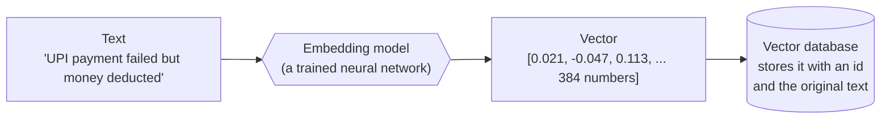
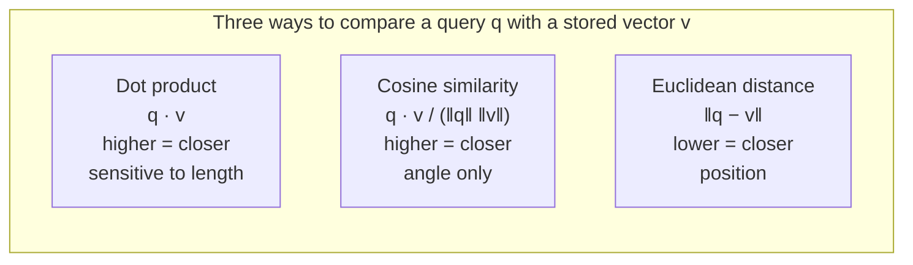

# Embeddings and Similarity Search: The Complete Guide

> 📚 **Before you start**
>
> - [What is RAG?](../course.md#m2), for why a RAG system needs to find the right passages before the model answers. This module builds the "find" part.
> - [NLP for Machine Learning › Word Embeddings](../../nlp-for-machine-learning/course.md#m5), for word vectors and Word2Vec. This lesson recaps the parts you need.
> - [Data Analysis and Visualisation with Python](../../data-analysis-and-visualisation-with-python/course.md), for NumPy arrays and shapes.

## Introduction

Imagine describing every cup of chai in India with just three numbers: how **sweet** it is, how **strong** it is, and how much **ginger** it has, each from 0 to 1. A roadside cutting chai in Mumbai might be `[0.9, 0.8, 0.3]`. A masala chai at a dhaba on the highway might be `[0.7, 0.9, 0.8]`. A weak office-machine tea might be `[0.4, 0.2, 0.0]`.

Once every cup is a list of numbers, a strange and useful thing becomes possible: you can **measure how similar two cups are with arithmetic**. Cups whose numbers are close taste alike. If a friend says "I want something like that dhaba chai", you can look through thousands of recorded cups and find the nearest ones without tasting a single cup.

That is the whole idea behind embeddings and similarity search. An **embedding model** describes a sentence, an image or a product with a list of numbers (hundreds or thousands of them instead of three), arranged so that things with similar *meaning* get similar numbers. **Similarity search** then finds the stored lists that are closest to the list for your question.

By the end of this lesson you will be able to:

- say exactly what an embedding is and what a real one looks like (shape, size, number type);
- compute dot product, cosine similarity and Euclidean distance by hand and with NumPy;
- know which measure to use, and why they often give the same ranking;
- write brute-force similarity search over a matrix of embeddings in a few lines;
- estimate the memory and compute cost of searching millions of vectors, which is why vector databases exist.

> 💡 **Key Insight**
>
> An embedding turns **meaning into position**. Things that mean similar things are placed near each other in a space with hundreds of dimensions. Similarity search is then just geometry: **find the stored points nearest to the query point**. The model does the understanding; the search does the measuring.

---

## Core Explanation

### 1. A vector is just a list of numbers

A **vector** is an ordered list of numbers. The number of entries is its **dimension**. The chai example used 3-dimensional vectors:

| Cup | sweet | strong | ginger |
|---|---|---|---|
| Mumbai cutting chai | 0.9 | 0.8 | 0.3 |
| Highway dhaba masala chai | 0.7 | 0.9 | 0.8 |
| Office machine tea | 0.4 | 0.2 | 0.0 |

Each position (each **dimension**) means the same thing in every vector. That consistency is what makes comparison possible: the first number is always sweetness, so comparing first numbers compares sweetness.

In NumPy a set of vectors is a 2-D array: one **row** per item, one **column** per dimension.

```python
import numpy as np

cups = np.array([
    [0.9, 0.8, 0.3],   # Mumbai cutting chai
    [0.7, 0.9, 0.8],   # Highway dhaba masala chai
    [0.4, 0.2, 0.0],   # Office machine tea
])
print("shape:", cups.shape)          # (number of items, dimensions)
print("dhaba chai vector:", cups[1])
```

Output:

```
shape: (3, 3)
dhaba chai vector: [0.7 0.9 0.8]
```

### 2. What an embedding is

An **embedding** is a vector produced by a trained model so that **similar inputs get nearby vectors**. The word comes from mathematics: the model *embeds* text (or images, audio, products) into a space of numbers.

You may have met **word embeddings** in [Word Embeddings](../../nlp-for-machine-learning/course.md#m5): Word2Vec learns one vector per word, and words used in similar contexts ("chai" and "tea") end up close together. Modern systems mostly use **sentence embeddings** (also called text embeddings): a model reads a whole sentence or paragraph and outputs **one** vector for all of it. Those are what vector databases store.



Three facts about embeddings hold for every model:

1. **Fixed length.** A given model always outputs the same number of dimensions, whether you give it two words or two paragraphs.
2. **Same model, same space.** Vectors are only comparable if they came from the **same model**. A vector from one model compared against a vector from another is meaningless, like comparing a cup's sweetness score to another cup's temperature.
3. **Dimensions are not labelled.** In the chai table, a person chose "sweet", "strong" and "ginger". In a real model, the training process decides what each dimension captures, and individual dimensions rarely mean anything a person can name. Only the **overall position** matters.

### 3. A tiny embedding model you can read

To see how meaning becomes position, here is a deliberately small model with **six named dimensions**. Each known word has a hand-written vector, and a sentence's embedding is the sum of its word vectors, scaled to length 1 (we explain why in section 6). Real models learn millions of weights instead of using a hand-written table, but the output has the same character: a fixed-length list of floats.

```python
import re

DIMS = ["food", "cricket", "money", "travel", "weather", "tech"]
LEXICON = {
    # word:       food cricket money travel weather tech
    "chai":       (0.9, 0,   0,   0,   0.1, 0),
    "tea":        (0.9, 0,   0,   0,   0.1, 0),
    "samosa":     (1.0, 0,   0,   0,   0,   0),
    "biryani":    (1.0, 0,   0,   0,   0,   0),
    "recipe":     (0.9, 0,   0,   0,   0,   0.1),
    "spicy":      (0.8, 0,   0,   0,   0.1, 0),
    "cricket":    (0,   1.0, 0,   0,   0,   0),
    "kohli":      (0,   1.0, 0,   0,   0,   0),
    "century":    (0,   0.9, 0,   0,   0,   0),
    "match":      (0,   0.8, 0,   0,   0,   0.1),
    "wicket":     (0,   1.0, 0,   0,   0,   0),
    "upi":        (0,   0,   0.9, 0,   0,   0.4),
    "payment":    (0,   0,   1.0, 0,   0,   0.1),
    "refund":     (0,   0,   1.0, 0.1, 0,   0),
    "money":      (0,   0,   1.0, 0,   0,   0),
    "rupees":     (0,   0,   1.0, 0,   0,   0),
    "failed":     (0,   0.1, 0.3, 0,   0,   0.3),
    "train":      (0,   0,   0,   1.0, 0,   0),
    "ticket":     (0,   0.1, 0.3, 0.8, 0,   0),
    "irctc":      (0,   0,   0.2, 0.9, 0,   0.2),
    "flight":     (0,   0,   0.1, 1.0, 0,   0),
    "cancelled":  (0,   0.1, 0.2, 0.5, 0.1, 0),
    "rain":       (0,   0.1, 0,   0.1, 0.9, 0),
    "rainy":      (0,   0,   0,   0,   1.0, 0),
    "monsoon":    (0,   0,   0,   0.1, 1.0, 0),
    "umbrella":   (0,   0,   0,   0.1, 0.9, 0),
    "phone":      (0,   0,   0.1, 0,   0,   1.0),
    "app":        (0,   0,   0.1, 0,   0,   1.0),
}

def embed(text):
    """Toy sentence embedding: sum the known word vectors, then scale to length 1."""
    words = re.findall(r"[a-z]+", text.lower())
    vectors = [LEXICON[w] for w in words if w in LEXICON]
    v = np.sum(vectors, axis=0) if vectors else np.zeros(len(DIMS))
    length = np.linalg.norm(v)
    return v / length if length else v

v = embed("UPI payment failed but money deducted")
print(dict(zip(DIMS, np.round(v, 3).tolist())))
```

Output:

```
{'food': 0.0, 'cricket': 0.03, 'money': 0.97, 'travel': 0.0, 'weather': 0.0, 'tech': 0.242}
```

Read that vector like a sentence: mostly **money**, partly **tech**, a sliver of cricket (from the word "failed", which our toy table also links to failed run chases). The words "but" and "deducted" are not in the table, so they contribute nothing. A real model knows every word, and even word order and negation.

### 4. What a real embedding looks like

Here is how you get a real embedding from an open-source model with the `sentence-transformers` library. The model `all-MiniLM-L6-v2` is small (it runs on a laptop CPU) and is the default model that Chroma uses, so you will meet it again in this course.

```python
# not-run: needs the sentence-transformers package and a one-time model download
from sentence_transformers import SentenceTransformer

model = SentenceTransformer("all-MiniLM-L6-v2")
vectors = model.encode([
    "UPI payment failed but money deducted",
    "Amount debited from my account, transaction unsuccessful",
])
print(vectors.shape, vectors.dtype)
print(vectors[0][:5])
```

Example output (the five numbers are the start of a 384-number vector; your exact digits can differ in the last places):

```
(2, 384) float32
[-0.05 0.03 -0.01 ...]
```

What to notice:

| Property | Toy model above | `all-MiniLM-L6-v2` | Large commercial embedding models |
|---|---|---|---|
| Dimensions | 6 | 384 | commonly 768 to 3,072 |
| Number type | float64 | float32 (4 bytes each) | float32, some offer int8 or binary output |
| Can you name a dimension? | Yes | No | No |
| Size of one vector | 48 bytes | 1,536 bytes | 3 KB to 12 KB |

If you call a hosted embedding API instead, the response carries the same thing as JSON: a list of floats per input, plus the model name and token usage. The shape is always "one fixed-length list of numbers per input".

```json
{
  "model": "some-embedding-model",
  "data": [
    {"index": 0, "embedding": [-0.0123, 0.0456, 0.0089, "... 1,533 more numbers ..."]}
  ],
  "usage": {"input_tokens": 9}
}
```

(The numbers in that JSON are shortened and illustrative. The structure is what matters.)

### 5. Measuring similarity: three ways

Given two vectors **a** and **b**, there are three common ways to say how alike they are. Let's use two tiny 2-D vectors so you can check the arithmetic in your head.

**Dot product.** Multiply matching entries and add them up:

`a · b = a1×b1 + a2×b2 + ... + an×bn`

Bigger means more similar, **but** it also grows when the vectors are simply longer.

**Length (norm).** The length of a vector is `‖a‖ = sqrt(a · a)`, the straight-line distance from the origin to the point, by Pythagoras.

**Cosine similarity.** The dot product divided by both lengths:

`cos(a, b) = (a · b) / (‖a‖ × ‖b‖)`

It is the cosine of the **angle** between the two arrows. It ignores length and only asks "do they point the same way?". It ranges from **1** (same direction), through **0** (unrelated, at right angles), to **-1** (opposite).

**Euclidean distance (L2).** The straight-line distance between the two points:

`‖a − b‖ = sqrt((a1−b1)² + (a2−b2)² + ...)`

Smaller means more similar. Zero means identical.

```python
a = np.array([3.0, 4.0])
b = np.array([6.0, 8.0])    # same direction as a, twice as long
c = np.array([4.0, -3.0])   # at a right angle to a

def cosine(x, y):
    return np.dot(x, y) / (np.linalg.norm(x) * np.linalg.norm(y))

for name, other in [("b", b), ("c", c)]:
    print(f"a vs {name}: dot={np.dot(a, other):5.1f}  cosine={cosine(a, other):5.2f}  "
          f"euclidean={np.linalg.norm(a - other):5.2f}")
print("length of a:", np.linalg.norm(a))
```

Output:

```
a vs b: dot= 50.0  cosine= 1.00  euclidean= 5.00
a vs c: dot=  0.0  cosine= 0.00  euclidean= 7.07
length of a: 5.0
```

Look at **a vs b**. By cosine they are identical (same direction). By Euclidean distance they are 5 apart (b is further out). The dot product, 50, mixes both effects. These measures disagree when vector **lengths** differ, which is the subject of the next section.



### 6. Normalise, and the three measures agree

**Normalising** a vector means dividing it by its own length so its length becomes exactly 1. A vector of length 1 is called a **unit vector**. Our toy `embed()` already does this, and many real embedding models do too.

For unit vectors, something convenient happens:

- the lengths in the cosine formula are both 1, so **cosine similarity equals the dot product**;
- squared Euclidean distance becomes `‖a − b‖² = 2 − 2 × cos(a, b)`, so a **higher cosine always means a smaller distance**.

So on normalised vectors, **all three measures rank results in exactly the same order**. Let's prove it on real sentences from the toy model.

```python
docs = [
    "IRCTC train ticket cancelled, refund pending",
    "Kohli scores a century in the cricket match",
    "Masala chai and samosa recipe",
    "UPI app payment failed, rupees not received",
    "Monsoon rain: carry an umbrella",
]
X = np.array([embed(d) for d in docs])            # shape (5, 6)
q = embed("my flight got cancelled, I want my money back")

dot = X @ q                                        # one dot product per row
cos = dot / (np.linalg.norm(X, axis=1) * np.linalg.norm(q))
l2 = np.linalg.norm(X - q, axis=1)

for i in np.argsort(-cos):
    print(f"cos={cos[i]:.3f}  dot={dot[i]:.3f}  l2={l2[i]:.3f}  2-2cos={2 - 2 * cos[i]:.3f}  "
          f"l2^2={l2[i] ** 2:.3f}  {docs[i]}")
```

Output:

```
cos=0.970  dot=0.970  l2=0.244  2-2cos=0.060  l2^2=0.060  IRCTC train ticket cancelled, refund pending
cos=0.575  dot=0.575  l2=0.922  2-2cos=0.851  l2^2=0.851  UPI app payment failed, rupees not received
cos=0.132  dot=0.132  l2=1.318  2-2cos=1.736  l2^2=1.736  Monsoon rain: carry an umbrella
cos=0.050  dot=0.050  l2=1.378  2-2cos=1.900  l2^2=1.900  Kohli scores a century in the cricket match
cos=0.002  dot=0.002  l2=1.413  2-2cos=1.996  l2^2=1.996  Masala chai and samosa recipe
```


Four things to take from this table:

- The query never says "train", "IRCTC", "ticket" or "refund", yet the IRCTC complaint is the top match. The query's vector is mostly **travel** and **money**, and so is that document's vector. That is similarity of **meaning**, not of words.
- The `cos` and `dot` columns are the same, because every vector has length 1.
- `l2^2` equals `2-2cos` on every row, so sorting by smallest distance gives the same order as sorting by highest cosine.
- The UPI complaint comes second: it shares the money part of the meaning but not the travel part. Partial overlap gives a middling score, which is exactly what you want.

### 7. Which measure should you use?

The rule is short: **use the measure the embedding model was trained for.** The model card or API docs say which one. In practice:

| Situation | Use | Why |
|---|---|---|
| Model outputs normalised vectors (most text models) | Cosine or dot product (identical) | Dot product is cheapest: no division |
| Model outputs vectors of varying length, docs say "cosine" | Cosine, or normalise once at insert time then use dot product | Length would otherwise distort scores |
| Model trained with dot product, length carries meaning (some recommendation models) | Dot product, **without** normalising | Length may encode popularity or confidence |
| Classic numeric features, image descriptors, geographic points | Euclidean (L2) | Absolute position matters |

Every vector database asks you to choose this when you create a collection or index. Chroma calls it the collection's **space** (`l2`, `cosine` or `ip` for inner product); Qdrant calls it **distance** (`Cosine`, `Dot`, `Euclid`, `Manhattan`); FAISS picks it through the index class (`IndexFlatL2` vs `IndexFlatIP`). Picking the wrong one is one of the most common reasons search results "look random".

A detail that confuses people: some databases report a **distance** (lower is better) even when you chose cosine. They report `1 − cosine` and call it "cosine distance". A cosine similarity of 0.97 shows up as a cosine distance of 0.03. Always check whether a number is a similarity or a distance before you set a threshold on it.

### 8. Similarity search is "k nearest neighbours"

**Similarity search** means: given a query vector, return the **k** stored vectors that are most similar. This is called **k-nearest-neighbour search**, or **kNN**. The simplest way to do it is to compare the query against **every** stored vector and keep the best k. This is called **brute-force**, **exhaustive**, **exact** or **flat** search, and it always returns the true answer.

With NumPy the whole thing is one matrix multiplication and a sort:

```python
def search(query_vec, matrix, k=3):
    """Exact kNN on unit vectors: highest dot product = most similar."""
    scores = matrix @ query_vec                  # (N,) one score per stored vector
    top = np.argpartition(-scores, k - 1)[:k]    # the k best, in any order (fast)
    top = top[np.argsort(-scores[top])]          # now sorted best first
    return top, scores[top]

library = [
    "IRCTC train ticket cancelled, refund pending",
    "Flight cancelled due to monsoon rain",
    "Kohli scores a century in the cricket match",
    "Rain stops play, match cancelled at the stadium",
    "Masala chai and samosa recipe",
    "Spicy biryani recipe for a rainy day",
    "UPI app payment failed, rupees not received",
    "Refund of money to the UPI app after failed payment",
    "Phone app keeps crashing",
    "Carry an umbrella in the monsoon",
]
M = np.array([embed(t) for t in library])

for question in ["my cricket game got washed out by rain",
                 "how do I get my rupees back after the payment failed",
                 "something spicy to eat in the rain"]:
    ids, scores = search(embed(question), M, k=2)
    print(question)
    for i, s in zip(ids, scores):
        print(f"   {s:.3f}  {library[i]}")
```

Output:

```
my cricket game got washed out by rain
   0.931  Rain stops play, match cancelled at the stadium
   0.772  Kohli scores a century in the cricket match
how do I get my rupees back after the payment failed
   0.975  Refund of money to the UPI app after failed payment
   0.947  UPI app payment failed, rupees not received
something spicy to eat in the rain
   0.867  Spicy biryani recipe for a rainy day
   0.780  Carry an umbrella in the monsoon
```

Two details in `search()` are worth copying into your own code:

- `matrix @ query_vec` computes all N dot products in one call. NumPy hands this to optimised linear-algebra code, which is far faster than a Python loop.
- `np.argpartition` finds the k best **without sorting all N scores**. Sorting a million scores to keep ten is wasted work; partitioning is linear time. Only the k winners are then sorted.

Notice the third question: "something spicy to eat in the rain" found the biryani-for-a-rainy-day recipe first, because that document is the only one that mixes **food** and **weather**. Neither "hot" nor "eat" is even in our toy vocabulary; "rains" is not either (only "rain" is). The match came from the overlap that did exist. A real model, which knows every word, does this far better.

### 9. The whole picture in one diagram


*Store time and search time use the same embedding model. The vector store's only job is to find nearby points fast.*

Two flows meet in the middle:

- **At store time (once per document):** text → embedding model → vector → saved alongside an id and the original text.
- **At search time (once per query):** query text → **the same** embedding model → query vector → nearest stored vectors → their ids, scores and text.

### 10. Why brute force stops being enough

Brute-force search costs **N × d** multiply-and-add operations per query, where N is the number of stored vectors and d is the dimension. It also needs every vector in memory. Let's put real numbers on that.

```python
def brute_force_cost(n_vectors, dims, bytes_per_number=4):
    memory_gb = n_vectors * dims * bytes_per_number / 1e9
    ops = n_vectors * dims                       # multiply-adds per query
    return memory_gb, ops

print(f"{'vectors':>13} {'dims':>5} {'memory (GB)':>12} {'multiply-adds per query':>25}")
for n in [10_000, 1_000_000, 100_000_000]:
    for d in [384, 1536]:
        gb, ops = brute_force_cost(n, d)
        print(f"{n:>13,} {d:>5} {gb:>12,.2f} {ops:>25,}")
```

Output:

```
      vectors  dims  memory (GB)   multiply-adds per query
       10,000   384         0.02                 3,840,000
       10,000  1536         0.06                15,360,000
    1,000,000   384         1.54               384,000,000
    1,000,000  1536         6.14             1,536,000,000
  100,000,000   384       153.60            38,400,000,000
  100,000,000  1536       614.40           153,600,000,000
```

At a million 1,536-dimensional vectors, every single query does about 1.5 billion multiply-adds and touches 6 GB of memory. A modern CPU can do that in a fraction of a second, so for one user it is fine. For a hundred queries per second, or a hundred million vectors, it is not. Three problems appear together:

1. **Speed.** Work grows in a straight line with N. Ten times the data, ten times slower.
2. **Memory.** All vectors must be read for every query, and 600 GB does not fit in one machine's RAM.
3. **Everything else a database does.** Saving to disk, adding and deleting items, filtering by metadata ("only documents from 2026"), serving many users, backups.

Vector databases solve the first two with **approximate nearest neighbour (ANN)** indexes: data structures such as **HNSW**, **IVF** and **PQ** that examine only a small, smart fraction of the vectors and return *almost* the exact answer, often 95 to 99 percent of the true top results, in a few milliseconds. They solve the third by being databases. You will build each index yourself in [Storage and Indexing (HNSW, IVF)](storage-and-indexing-hnsw-ivf.md).

### 11. Measuring quality: recall

Because ANN search is approximate, you need a number for "how approximate". That number is **recall@k**: of the true k nearest neighbours (found by brute force), what fraction did the fast search return?

```python
def recall_at_k(found_ids, true_ids):
    return len(set(found_ids) & set(true_ids)) / len(true_ids)

true_top5 = [12, 7, 33, 2, 91]           # from exact brute-force search
fast_top5 = [12, 7, 2, 91, 40]           # from an approximate index: missed 33, returned 40
print("recall@5 =", recall_at_k(fast_top5, true_top5))
```

Output:

```
recall@5 = 0.8
```

Recall is the main quality number you will tune in every vector database. Every index has a knob (`ef` in HNSW, `nprobe` in IVF) that trades speed for recall.

---

## Try It Yourself

1. **Feel the length problem.** Take `a = [3, 4]` and make `d = [30, 40]` and `e = [4, 3]`. Which is "more similar" to `a` by dot product, and which by cosine? Explain the difference in one sentence.
2. **Cosine without normalising.** Write `cosine_search(query_vec, matrix, k)` that works even when the stored vectors are **not** unit length, without changing the stored matrix. Test it on a matrix where one row is multiplied by 10.
3. **Add a word, change a result.** Add `"washed": (0, 0.3, 0, 0, 0.6, 0)` to the toy `LEXICON` and search again for "my cricket game got washed out by rain". Does the top result change? Do the scores?
4. **Memory budget.** Your company has 20 million support tickets and uses a 768-dimensional model. How much RAM do the raw float32 vectors need? How much if you store them as 1-byte integers instead (a trick called scalar quantization, covered in [Storage and Indexing (HNSW, IVF)](storage-and-indexing-hnsw-ivf.md))?

<details>
<summary>Show answers</summary>

**1.**

```python
a, d, e = np.array([3.0, 4.0]), np.array([30.0, 40.0]), np.array([4.0, 3.0])
print("dot:    a.d =", np.dot(a, d), " a.e =", np.dot(a, e))
print("cosine: a,d =", round(cosine(a, d), 3), " a,e =", round(cosine(a, e), 3))
```

Output:

```
dot:    a.d = 250.0  a.e = 24.0
cosine: a,d = 1.0  a,e = 0.96
```

By dot product `d` wins easily, only because it is ten times longer. By cosine `d` is a perfect match (same direction) and `e` is close but not identical. Dot product mixes direction and length; cosine looks at direction only.

**2.**

```python
def cosine_search(query_vec, matrix, k=3):
    norms = np.linalg.norm(matrix, axis=1) * np.linalg.norm(query_vec)
    scores = (matrix @ query_vec) / np.where(norms == 0, 1, norms)   # avoid dividing by zero
    top = np.argsort(-scores)[:k]
    return top, scores[top]

M_scaled = M.copy()
M_scaled[4] *= 10                       # the chai recipe row is now 10 times longer
q = embed("spicy biryani for a rainy day")
print("dot product picks:", library[int(np.argmax(M_scaled @ q))])
ids, scores = cosine_search(q, M_scaled, k=2)
print("cosine picks:     ", [library[i] for i in ids], np.round(scores, 3))
```

Output:

```
dot product picks: Masala chai and samosa recipe
cosine picks:      ['Spicy biryani recipe for a rainy day', 'Masala chai and samosa recipe'] [0.986 0.871]
```

The query is about biryani, yet raw dot product picks the chai recipe, only because that row was made ten times longer. Cosine divides the length back out, so the scaling has no effect and the biryani recipe wins.

**3.**

```python
LEXICON["washed"] = (0, 0.3, 0, 0, 0.6, 0)
ids, scores = search(embed("my cricket game got washed out by rain"), M, k=2)
for i, s in zip(ids, scores):
    print(f"   {s:.3f}  {library[i]}")
del LEXICON["washed"]                    # put the table back as it was
```

Output:

```
   0.928  Rain stops play, match cancelled at the stadium
   0.731  Carry an umbrella in the monsoon
```

Compare with the earlier run (0.931 and 0.772). Every word in the input nudges the query vector, and every nudge changes every score a little. Here the top result stays the same, but second place changes: the extra weather meaning pulls the query towards rain, so the umbrella document overtakes the cricket-only one. Small vocabulary changes can reorder the lower results, which is why you evaluate search on many queries, not one.

**4.**

```python
for label, bytes_each in [("float32", 4), ("int8", 1)]:
    print(f"{label}: {20_000_000 * 768 * bytes_each / 1e9:.2f} GB")
```

Output:

```
float32: 61.44 GB
int8: 15.36 GB
```

About 61 GB as float32, which needs a large server, and about 15 GB as int8, which fits on a normal one. This four-to-one saving is why quantization is built into most vector databases.

</details>

---

## Real-World Examples

- **Customer support search.** Banks and telecom companies embed past tickets and help articles. A new complaint such as "amount debited, recharge not done" retrieves the right article even when it is worded differently from the article title.
- **E-commerce "similar products".** Product photos and descriptions are embedded; "more like this" is a nearest-neighbour search around the product you are viewing.
- **Duplicate detection.** Question-and-answer sites and job portals flag a new post when its embedding is within a small distance of an existing one.
- **RAG chatbots.** Every "chat with your documents" product embeds document chunks once, then embeds each user question and retrieves the nearest chunks to put in front of the LLM.
- **Music and video recommendations.** Users and items are embedded in the same space; recommendations are the items nearest to a user's vector, usually scored with the dot product.

---

## Common Misconceptions

### "Each dimension of an embedding means something specific"

Only in toy models like ours. In real models, meaning is spread across many dimensions at once. You cannot point at dimension 117 and say "this is the money dimension".

### "Cosine similarity is always the right choice"

Cosine is right for most text models, but the correct choice is whatever the model was trained with. Some recommendation models deliberately use vector length to carry information, and normalising throws that away.

### "A similarity of 0.8 means 80 percent relevant"

Scores are only meaningful **relative to each other, for one model**. One model's typical "good match" might be 0.8 and another's 0.45. Never copy a threshold from one model to another; measure it on your own data.

### "More dimensions are always better"

More dimensions can hold more detail, but cost memory and compute on every query. A well-trained 384-dimensional model often beats a weaker 1,536-dimensional one. Some newer models are also trained so that you can keep only the first few hundred dimensions of a longer vector with little loss, a property called **Matryoshka** embeddings (named after Russian nesting dolls).

### "You can mix embeddings from two models in one index"

Vectors from different models live in different spaces. If you change your embedding model, you must re-embed **everything**, not just new documents.

---

## Interview Relevance

*"What is an embedding, and how do you compare two of them?"* A strong answer says an embedding is a fixed-length float vector produced by a trained model so that semantically similar inputs land close together; explains dot product, cosine similarity and Euclidean distance with their formulas; notes that on unit-normalised vectors all three give the same ranking because `‖a−b‖² = 2 − 2cos`; and adds that you must use the metric the model was trained with.

*"How would you search a million embeddings?"* Start with exact brute force (a matrix multiply plus a partial sort), give its cost (N × d per query, N × d × 4 bytes of memory), then explain when you need an ANN index such as HNSW or IVF, and that you measure the trade-off with **recall@k** against brute-force ground truth.

*"Why might semantic search return bad results?"* Wrong metric for the model, mixing vectors from different models, not normalising when the model expects it, poor chunking of documents, or a model that is not suited to the domain (legal text, code, Hindi or Tamil text) and needs replacing.

---

## Key Takeaways

- **An embedding is a fixed-length list of floats** from a trained model, placed so that similar meaning means nearby position. Only vectors from the same model are comparable.
- **Dot product, cosine and Euclidean distance** are the three similarity measures; on normalised vectors they all rank results identically.
- **Use the metric your embedding model was trained for**, and check whether your database reports a similarity or a distance.
- **Brute-force kNN is one matrix multiply plus a partial sort**: exact, simple, and fine up to roughly hundreds of thousands of vectors.
- **At millions of vectors, memory and compute force approximate indexes**, and recall@k measures what you give up.

---

**Up next:** [Semantic Search Explained](semantic-search-explained.md)
