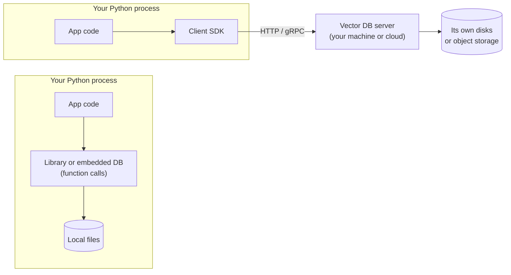
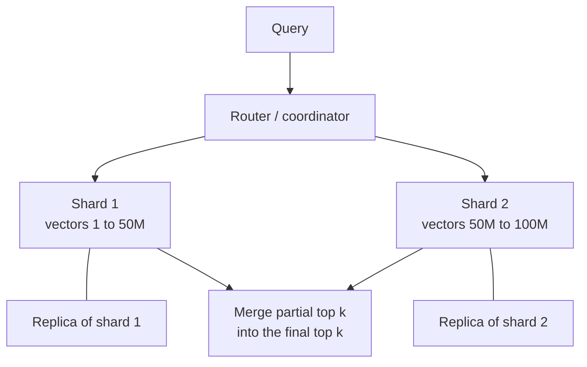
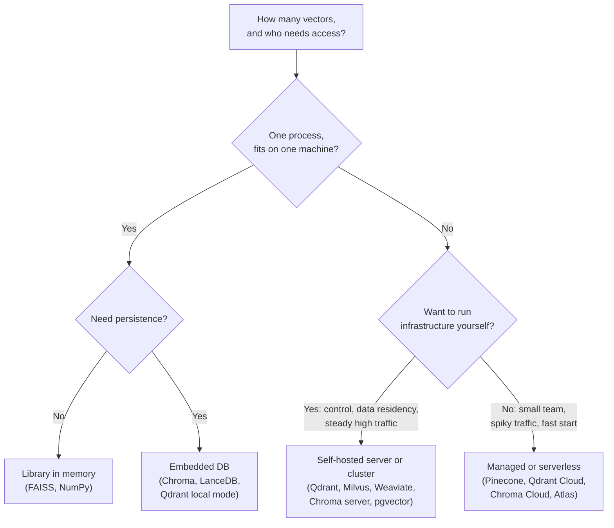

# In-Memory, On-Disk and Cloud Vector DBs: The Complete Guide

> 📚 **Before you start**
>
> - [Storage and Indexing (HNSW, IVF)](storage-and-indexing-hnsw-ivf.md), for ANN indexes, quantization, segments and the write-ahead log.
> - [Vector vs SQL vs NoSQL Databases](vector-vs-sql-vs-nosql-databases.md), for the difference between a vector index and a vector database.

## Introduction

Think about where you keep money. Some cash sits **in your wallet**: instantly available, but limited, and gone if you lose the wallet. More sits **in a locker at home**: safe across days, but you have to walk to it. Most sits **in a bank**: someone else guards it, you reach it through an app or a branch, it scales to any amount, and you pay fees for the service.

Vectors live in the same three kinds of places. **In memory** (RAM) is the wallet: fastest, limited in size, and lost when the process stops unless you save it. **On disk** is the locker: survives restarts, much larger, a little slower. **In the cloud** is the bank: a service run by someone else, reached over the network, scaling far beyond one machine, billed by usage.

This lesson maps every vector tool onto that picture, so that when you meet Chroma, FAISS, Qdrant, Pinecone and LanceDB in [the next module](../course.md#m4), you already know what kind of thing each one is. By the end you will be able to:

- tell apart a vector **library**, an **embedded** vector database, a **self-hosted server** and a **managed cloud** service;
- estimate how much RAM a collection needs, with and without quantization;
- explain how on-disk indexes and memory-mapped files let you search more data than fits in RAM;
- build a tiny embedded vector store that saves to and loads from disk;
- explain sharding, replication and serverless designs, and choose a deployment for a given project.

> 💡 **Key Insight**
>
> The index algorithm (HNSW, IVF, PQ) decides **how** you search. The deployment decides **where the vectors live and who runs the machine**: inside your Python process, in files next to your app, on a server you operate, or in a service someone else operates. Most projects start embedded and move outward only when size, traffic or team needs force them to.

---

## Core Explanation

### 1. Four deployment styles


*From a library inside your Python process to a fully managed service. Moving right adds scale and removes operational work, at the cost of network hops and bills.*

| Style | Where it runs | Persistence | Examples | Best for |
|---|---|---|---|---|
| **Library** | Inside your process | You save and load files yourself | FAISS, hnswlib, scikit-learn's `NearestNeighbors` | Research, batch jobs, building your own system |
| **Embedded database** | Inside your process, data in local files | Automatic | Chroma (`PersistentClient`), LanceDB (local path), Qdrant local mode (`QdrantClient(path=...)`) | Prototypes, notebooks, desktop and edge apps, single-service apps |
| **Self-hosted server** | Its own process or cluster, reached over HTTP or gRPC | Automatic, with WAL and snapshots | Qdrant, Chroma server, Milvus, Weaviate, PostgreSQL + pgvector | Production apps that need several clients, control over data location, predictable cost |
| **Managed cloud** | The provider's infrastructure | Provider's responsibility | Pinecone, Qdrant Cloud, Chroma Cloud, MongoDB Atlas, LanceDB Cloud and others | Teams that want no database operations, elastic scale, quick start |

The same product can sit in several columns. Chroma runs in-memory (`chromadb.Client()`), embedded (`PersistentClient`), as a server (`HttpClient`) and as Chroma Cloud (`CloudClient`), with the same collection API in each. Qdrant runs in local mode inside Python, as a Docker server, and as Qdrant Cloud. That is deliberate: you prototype embedded and move to a server without rewriting your code.



### 2. In memory: fast, and limited by RAM

HNSW and most fast indexes perform best when the vectors **and** the index structure are in RAM, because a search jumps around unpredictably and RAM serves random reads in about a hundred nanoseconds, versus tens to hundreds of microseconds for an SSD.

So the first capacity question for any vector project is: **how much RAM do I need?** A reasonable estimate adds three parts:

- **vectors:** `N × dimensions × bytes per number` (4 for float32, 1 for int8, 1/8 for binary);
- **index overhead:** for HNSW, roughly `N × M × 2 × 4 bytes` for layer-0 links (each node keeps up to 2 × M neighbour ids of 4 bytes each), plus a little for upper layers;
- **metadata and ids:** depends on your payload; a few hundred bytes per item is common for text chunks with a few fields, often kept on disk.

```python
def ram_estimate_gb(n, dims, bytes_per_number=4.0, hnsw_m=16, metadata_bytes=0):
    vectors = n * dims * bytes_per_number
    graph = n * hnsw_m * 2 * 4          # layer-0 neighbour ids, 4 bytes each
    return (vectors + graph + n * metadata_bytes) / 1e9

print(f"{'collection':<38} {'float32':>9} {'int8':>8} {'binary':>8}")
for label, n, dims in [("50k chunks, 384-d (a small help centre)", 50_000, 384),
                       ("5M chunks, 1024-d (a company wiki)", 5_000_000, 1024),
                       ("100M items, 768-d (an e-commerce catalogue)", 100_000_000, 768)]:
    sizes = [ram_estimate_gb(n, dims, b) for b in (4, 1, 1 / 8)]
    print(f"{label:<38} " + " ".join(f"{s:>7.1f}G" for s in sizes))
```

Output:

```
```

A small help centre fits in the RAM of any laptop. A company wiki at float32 needs a big server, but fits comfortably on a normal one with int8 scalar quantization. A hundred-million-item catalogue needs several hundred gigabytes at full precision, which is where quantization, disk-based indexes and multiple machines come in. Notice that at binary precision the **graph links** start to cost more than the vectors themselves.

### 3. On disk: survive restarts, search more than fits in RAM

Disk plays two separate roles, and it helps to keep them apart.

**Role 1: persistence.** Even a fully in-memory index must be saved somewhere so it survives a restart. Libraries like FAISS give you `write_index` and `read_index` functions and leave the rest to you. Databases do it automatically through the write-ahead log and segment files you saw in [Storage and Indexing (HNSW, IVF)](storage-and-indexing-hnsw-ivf.md).

**Role 2: searching data larger than RAM.** Here the operating system helps through **memory mapping**. A memory-mapped file looks like an ordinary array to your program, but the operating system only loads the parts you actually touch into RAM (in chunks called **pages**, usually 4 KB), and keeps recently used pages cached. Many vector databases memory-map their segment files, so hot data stays in RAM automatically and cold data stays on disk.

NumPy can memory-map an array file directly. Here we save 200,000 vectors to disk, open them with `mmap_mode="r"`, and search only one IVF-style cluster, so only a small part of the file is ever read:

```python
import json
import os
import tempfile
import numpy as np

rng = np.random.default_rng(3)
N, D = 200_000, 64
folder = tempfile.mkdtemp()
path = os.path.join(folder, "vectors.npy")

vectors = rng.normal(size=(N, D)).astype(np.float32)
vectors /= np.linalg.norm(vectors, axis=1, keepdims=True)
cluster_of = rng.integers(0, 100, N)             # pretend IVF assignment: 100 lists
order = np.argsort(cluster_of, kind="stable")    # store each list contiguously on disk
np.save(path, vectors[order])
list_bounds = np.searchsorted(cluster_of[order], np.arange(101))
del vectors                                       # nothing left in RAM

on_disk = np.load(path, mmap_mode="r")            # opens instantly, reads nothing yet
print(type(on_disk).__name__, on_disk.shape, f"file size {os.path.getsize(path) / 1e6:.1f} MB")

c = 42                                            # pretend the query's nearest centroid is list 42
start, end = list_bounds[c], list_bounds[c + 1]
block = np.asarray(on_disk[start:end])            # only this slice is read from disk
query = block[0]
best = start + int(np.argmax(block @ query))
print(f"searched list {c}: rows {start} to {end} ({block.nbytes / 1e6:.2f} MB read), best row {best}")
```

Output:

```
```

The file is over 50 MB, but the search read about half a megabyte: one list. This is how disk-based IVF works, and why storing each list **contiguously** matters: one sequential read per probed list instead of thousands of scattered ones. Disk-based **graph** indexes (the DiskANN family) work the same way in spirit: compressed vectors in RAM decide which neighbours to visit, and full-precision vectors are fetched from SSD only for the final re-ranking.

| Storage tier | Typical random-read latency | Cost per GB | Role in a vector database |
|---|---|---|---|
| **RAM** | about 0.1 microseconds | highest | HNSW graphs, quantized vectors, hot segments |
| **Local NVMe SSD** | tens of microseconds | moderate | Full-precision vectors, disk-based indexes, WAL |
| **Object storage** (S3, GCS, Azure Blob) | tens of milliseconds | lowest | Durable home for segment files in cloud and serverless designs |

### 4. Build a tiny embedded vector store

To make "embedded database" concrete, here is a minimal one: a class that keeps vectors, ids and metadata, searches with an optional metadata filter, and **persists to a folder** so a new process can reopen it. Chroma's `PersistentClient`, LanceDB and Qdrant's local mode do far more (indexes, WAL, concurrency), but the shape is the same.

```python
class TinyVectorStore:
    """An embedded vector store: lives in your process, persists to a folder."""

    def __init__(self, folder):
        self.folder = folder
        os.makedirs(folder, exist_ok=True)
        if os.path.exists(self._path("vectors.npy")):          # reopen existing data
            self.vectors = np.load(self._path("vectors.npy"))
            with open(self._path("records.json")) as f:
                self.records = json.load(f)
        else:
            self.vectors, self.records = None, []

    def _path(self, name):
        return os.path.join(self.folder, name)

    def add(self, ids, vectors, metadatas):
        vectors = np.asarray(vectors, dtype=np.float32)
        vectors /= np.linalg.norm(vectors, axis=1, keepdims=True)
        self.vectors = vectors if self.vectors is None else np.vstack([self.vectors, vectors])
        self.records += [{"id": i, **m} for i, m in zip(ids, metadatas)]

    def search(self, query, k=3, where=None):
        query = np.asarray(query, dtype=np.float32)
        scores = self.vectors @ (query / np.linalg.norm(query))
        allowed = [n for n, r in enumerate(self.records)
                   if not where or all(r.get(key) == val for key, val in where.items())]   # pre-filter
        best = sorted(allowed, key=lambda n: -scores[n])[:k]
        return [(self.records[n]["id"], round(float(scores[n]), 3)) for n in best]

    def save(self):
        np.save(self._path("vectors.npy"), self.vectors)
        with open(self._path("records.json"), "w") as f:
            json.dump(self.records, f)

store_dir = os.path.join(folder, "my_store")
store = TinyVectorStore(store_dir)
store.add(ids=["refund-en", "refund-hi", "upi-en", "tatkal-en"],
          vectors=[[0.9, 0.1, 0.3], [0.88, 0.12, 0.33], [0.7, 0.6, 0.0], [0.1, 0.9, 0.4]],
          metadatas=[{"lang": "en"}, {"lang": "hi"}, {"lang": "en"}, {"lang": "en"}])
store.save()

reopened = TinyVectorStore(store_dir)        # imagine this is a new process the next day
print(sorted(os.listdir(store_dir)))
print("all languages:", reopened.search([0.9, 0.1, 0.3], k=2))
print("Hindi only:   ", reopened.search([0.9, 0.1, 0.3], k=2, where={"lang": "hi"}))
```

Output:

```
```

Three things this toy is missing, and which real embedded databases add: an **ANN index** instead of brute force; **incremental, crash-safe writes** (our `save()` rewrites everything, and a crash halfway through would corrupt the files, which is what a write-ahead log prevents); and **safe concurrent access** (two processes writing to the same folder at once would clobber each other). That last point is the main reason teams move from embedded to a server: an embedded store is normally owned by **one** process.

### 5. Self-hosted servers: one database, many clients

A vector database **server** runs as its own process (usually a Docker container) and clients talk to it over the network. Qdrant, for example, listens on port 6333 for its REST API and 6334 for gRPC. What you gain:

- **Many clients:** several app instances, a background indexing worker and a notebook can all use the same data.
- **Operational features:** snapshots and backups, authentication, metrics, and resource limits.
- **Scale-out:** clusters that spread data across machines.

What you take on: running it. Upgrades, monitoring, disk space, backups and on-call duty are now your job. For many Indian startups and enterprises, self-hosting is also about **data residency**: keeping customer data on infrastructure in a specific region, for regulatory or contractual reasons.

### 6. Scaling out: sharding and replication

When one machine is not enough, databases use two techniques, often together:



| Technique | What it does | Solves |
|---|---|---|
| **Sharding** | Splits the collection across machines; each shard holds part of the vectors and its own index. A query goes to **every** shard and the partial top-k lists are merged. | Data too big for one machine |
| **Replication** | Keeps copies of each shard on several machines; queries can go to any copy. | Machine failures, and more queries per second |

Two consequences matter in practice. First, sharded search needs each shard to return its own top k, so total work grows with the number of shards. Second, if you have many customers (**tenants**), sharding or partitioning **by tenant** means a query for one customer touches only that customer's data, which is faster and isolates data cleanly. Most vector databases have a feature for this: namespaces in Pinecone, payload-based or shard-key-based multitenancy in Qdrant, separate collections or databases in Chroma.

### 7. Managed cloud and serverless

A **managed** service runs the database for you. You create an index or collection through an API or web console, get an endpoint and an API key, and pay for what you use. Under the hood, newer **serverless** designs separate **storage** from **compute**:

- Vector data and index files live durably in **object storage** (cheap, effectively unlimited).
- Stateless query workers load the parts they need into memory and local SSD caches.
- You pay mainly for storage plus reads and writes, rather than for servers sitting idle.

The trade-off is that the **first** query against cold data can be slower than later ones (the cache must warm up), and costs scale with traffic, which is wonderful at low volume and worth modelling carefully at high volume.

```python
# Rough monthly cost comparison model. The prices are placeholders, not any provider's
# real prices: plug in current numbers from the pricing pages you are comparing.
def monthly_cost_server(machines, price_per_machine):
    return machines * price_per_machine

def monthly_cost_usage(stored_gb, price_per_gb, queries_millions, price_per_million_queries):
    return stored_gb * price_per_gb + queries_millions * price_per_million_queries

for queries in [1, 10, 100, 1000]:                       # millions of queries per month
    server = monthly_cost_server(machines=2, price_per_machine=300)
    usage = monthly_cost_usage(stored_gb=20, price_per_gb=0.5,
                               queries_millions=queries, price_per_million_queries=8)
    cheaper = "usage-based" if usage < server else "fixed servers"
    print(f"{queries:>5}M queries/month: fixed {server:>6.0f}  usage-based {usage:>7.0f}  -> {cheaper}")
```

Output:

```
```

The exact crossover depends entirely on real prices and your traffic, which is the point of writing the model down: usage-based pricing wins at low and spiky traffic, and fixed capacity wins at high, steady traffic. Always run this calculation with current prices before committing.

### 8. Choosing a deployment



| Question | Leans towards |
|---|---|
| Is this a notebook, prototype, CLI tool or desktop app? | Embedded |
| Do several services need to read and write the same vectors? | Server or managed |
| Must data stay in a particular country or your own cloud account? | Self-hosted (or a managed offering that deploys into your account or region) |
| Is the team small, with no one to run databases? | Managed |
| Is traffic very high and steady, with ops skills in-house? | Self-hosted often costs less |
| Do you already run PostgreSQL or MongoDB? | Their vector features may be enough |

---

## Try It Yourself

1. **Size your own project.** Use `ram_estimate_gb` for 2 million chunks of a 1,536-dimension model with `hnsw_m=32`. How much does the graph add? What if you halve the dimensions using a Matryoshka-style model?
2. **Add delete to the tiny store.** Add a `delete(id)` method to `TinyVectorStore` that removes a record and its vector, then show the item no longer appears in results after a save and reopen.
3. **Measure what the memory map read.** Instead of one list, search the three lists 40, 41 and 42. How many megabytes are read, compared with the file size?

<details>
<summary>Show answers</summary>

**1.**

```python
n = 2_000_000
for dims in (1536, 768):
    total = ram_estimate_gb(n, dims, hnsw_m=32)
    graph_only = ram_estimate_gb(n, 0, hnsw_m=32)
    print(f"{dims}-d: total {total:.1f} GB, of which graph {graph_only:.1f} GB")
```

Output:

```
```

The graph cost depends on N and M, not on the dimension, so it stays the same while the vector part halves.

**2.**

```python
def delete(self, record_id):
    keep = [n for n, r in enumerate(self.records) if r["id"] != record_id]
    self.vectors = self.vectors[keep]
    self.records = [self.records[n] for n in keep]

TinyVectorStore.delete = delete
reopened.delete("refund-hi")
reopened.save()
print(TinyVectorStore(store_dir).search([0.9, 0.1, 0.3], k=3))
```

Output:

```
```

Real databases avoid rewriting everything on each delete: they write a tombstone to the log and clean up during compaction.

**3.**

```python
start, end = list_bounds[40], list_bounds[43]
block = np.asarray(on_disk[start:end])
print(f"read {block.nbytes / 1e6:.2f} MB of {os.path.getsize(path) / 1e6:.1f} MB")
```

Output:

```
```

Because lists 40 to 42 are stored next to each other, this is still one contiguous read of about three lists' worth of data, a small fraction of the file. In a real index the probed lists are usually not neighbours on disk, so each probe is its own read, which is why `nprobe` affects disk-based latency so directly.

</details>

---

## Real-World Examples

- **Local AI assistants and note-taking apps** embed a user's documents into an embedded store on their own laptop, so private data never leaves the device.
- **Startups shipping their first RAG feature** commonly begin with Chroma or LanceDB embedded in the API service, then move to a server or managed service when they add replicas of that service.
- **Banks and government projects** often self-host (Qdrant, Milvus, pgvector) inside their own data centres or cloud accounts for data-residency and audit reasons.
- **SaaS products with thousands of customers** use namespaces or tenant-based partitioning in a managed or self-hosted cluster so that each customer's search touches only their own data.

---

## Common Misconceptions

### "In-memory means the data is lost on restart"

Only for pure libraries if you forget to save. Most "in-memory" vector databases keep the working set in RAM **and** persist everything to disk through a write-ahead log and snapshots.

### "An embedded database is just for toys"

Embedded databases like LanceDB and Chroma handle millions of vectors on one machine. Their limit is not size so much as **sharing**: one process owns the data. When several services need it, move to a server.

### "Managed services are always more expensive"

At low or spiky traffic, usage-based pricing is often far cheaper than keeping servers running. At high, steady traffic, self-hosting can be cheaper if you count staff time honestly. Model it.

### "Disk-based means slow"

Disk-based indexes keep compressed vectors and navigation structures in RAM and touch the SSD only for a small number of reads per query. They are slower than pure RAM, but often by a few milliseconds, not by orders of magnitude, at a fraction of the memory cost.

---

## Interview Relevance

*"FAISS vs a vector database: what is the difference?"* FAISS is a library: in-process, extremely fast, many index types, but you build persistence, updates, filtering, serving and scaling yourself. A vector database wraps an index with a WAL, CRUD by id, metadata filtering, an API, replication and sharding.

*"How would you size a vector database for 50 million 768-dimension embeddings?"* Compute vectors (50M × 768 × 4 bytes, about 154 GB), add HNSW link overhead (about N × 2M × 4 bytes), add metadata, and then discuss options: int8 quantization (4× smaller), PQ or binary with re-ranking, disk-based indexes, and sharding across machines with replication for availability.

*"When would you choose a managed vector database over self-hosting?"* Small team, unpredictable traffic, need to launch fast, or no in-house operations skills. Choose self-hosting for data residency, deep control, or high steady traffic where fixed capacity is cheaper.

---

## Key Takeaways

- **Four deployment styles**: library, embedded database, self-hosted server and managed cloud. Many products offer several with the same API.
- **RAM is the first capacity question**: vectors plus index overhead plus metadata; quantization cuts the vector part 4× to 32×.
- **Disk gives persistence and capacity**; memory mapping and contiguous list storage let you search far more data than fits in RAM.
- **Servers add sharing, operations features and scale-out**; sharding splits data, replication copies it.
- **Serverless designs separate storage (object storage) from compute**, trading cold-start latency for low idle cost.

---

**Up next:** [Chroma](../course.md#m4)
