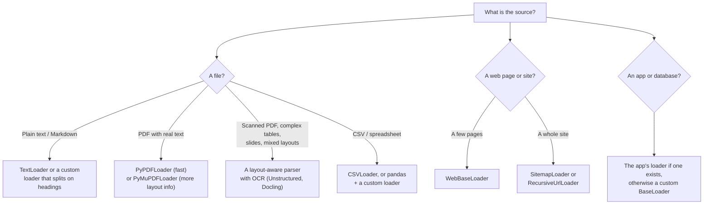

# Document Loaders: The Complete Guide

> 📚 **Before you start**
>
> - [Lab: RAG from scratch, no framework](../02-introduction-to-rag/lab-rag-from-scratch-no-framework.md), where you loaded documents with metadata by hand.
> - [The RAG Pipeline End to End](../02-introduction-to-rag/the-rag-pipeline-end-to-end.md), for why ingestion and metadata matter.
> - [LangChain Foundations](../../langchain-complete-guide/course.md#m2), for installing LangChain and its package layout.

## Introduction

Picture the records room of a district court. Files arrive as bound paper judgments, typed affidavits, photocopies of land records, emails printed out by a clerk. Before anyone can search them, a records officer turns each one into a **standard file card**: the text in the middle, and on top the case number, date, court and page count. Every card looks the same no matter what the original looked like, so the rest of the office can work with cards and forget about formats.

In LangChain, that records officer is a **document loader**, and the standard file card is a **`Document`**. A loader reads some source (a PDF, a web page, a CSV, a Notion workspace, a YouTube transcript) and returns `Document` objects with the text in `page_content` and facts about it in `metadata`. Everything downstream (splitters, embeddings, vector stores, retrievers) only ever sees `Document`s.

By the end of this lesson you'll understand the `Document` object and the loader interface completely, know the main families of loaders and which packages they live in, write your own loader in a dozen lines, and design metadata that will pay off at retrieval time.

> 💡 **Key Insight**
>
> A loader's job is to turn *any* source into a list of `Document(page_content, metadata)`. The text decides what can be **found**; the metadata decides what can be **cited, filtered and trusted**. Spend as much thought on the metadata as on the text.

---

## Core Explanation

### 1. Where loaders sit

![LangChain RAG building blocks. Index row: sources go to a loader such as PyPDFLoader or WebBaseLoader using load or lazy_load, producing Documents with page_content and metadata, then a RecursiveCharacterTextSplitter, then embeddings with embed_documents and embed_query, then a VectorStore with add_documents and similarity_search. Query row: a question goes to a retriever created with as_retriever, optionally wrapped by smarter retrievers for MMR, multi-query or compression, producing a list of Documents for the prompt and LLM](/img/diagrams/retrieval-augmented-generation-rag/langchain-rag-building-blocks.svg)
*This module's map. Loaders are the first blue box; every later box consumes their `Document`s.*

Each box in the top row is a separate LangChain abstraction with one job, and each has a matching piece in the from-scratch lab: the `DOCUMENTS` list became loaders, `chunk_document` becomes a splitter, `ToyEmbedder` becomes an `Embeddings` class, `VectorIndex` becomes a `VectorStore`, and `index.search` becomes a retriever.

### 2. The `Document` object

A `Document` is a tiny data class from `langchain_core`:

```python
from langchain_core.documents import Document

doc = Document(
    page_content="On client travel the daily meal allowance is Rs 1,200 in metro cities and Rs 800 in other cities.",
    metadata={"source": "finance/travel-faq.pdf", "page": 3, "section": "Meal allowance", "access": "managers"},
    id="travel-faq-p3-meal",
)
print(doc.page_content[:40])
print(doc.metadata["source"], "page", doc.metadata["page"])
print(doc.id)
```

Output:

```
On client travel the daily meal allowanc
finance/travel-faq.pdf page 3
travel-faq-p3-meal
```

Three fields:

| Field | Type | What goes in it |
|---|---|---|
| `page_content` | `str` | The text that will be split, embedded and shown to the model |
| `metadata` | `dict` | Anything *about* the text: source, page, title, URL, author, date, permissions, row number. Values should be simple types (strings, numbers, booleans), because many vector stores can only filter on those |
| `id` | `str` or `None` | An optional stable identifier. Vector stores use it to update or delete the right record later |

That's all. There's no hidden structure, which is why you can always build `Document`s by hand when no loader fits.

### 3. The loader interface

Every loader subclasses `BaseLoader` from `langchain_core.document_loaders` and offers the same methods:

| Method | Returns | Use it when |
|---|---|---|
| `lazy_load()` | An **iterator** of `Document`s, produced one at a time | Large sources, streaming into an index, keeping memory flat |
| `load()` | A **list** of all `Document`s | Small sources, notebooks, quick experiments |
| `alazy_load()` | An **async** iterator | Inside async web apps or when loading many sources concurrently |
| `aload()` | An async list | Same, when you want everything at once |

In `langchain_core`, `load()` is literally `list(self.lazy_load())`, so writing a loader only requires implementing `lazy_load`. The difference between the two is important enough to get its own lesson: [load() vs lazy_load()](load-vs-lazy-load.md).

You may also see `load_and_split()` in older tutorials. Its own docstring now says not to rely on it; load first, then use a splitter explicitly ([Text Splitters](text-splitters.md)).

### 4. Writing your own loader

When your data comes from somewhere unusual (an internal API, a database, a strangely formatted export) the cleanest approach is a small custom loader. Let's write one for the Tarang handbook, stored as a Markdown file where each `## ` heading is a section. We want **one `Document` per section** with the section number and title in metadata, because that's how people will cite it.

```python
import os, re, tempfile
from typing import Iterator
from langchain_core.document_loaders import BaseLoader
from langchain_core.documents import Document

HANDBOOK_MD = """# Tarang Software Employee Handbook (2026)

## 2.1 Annual leave
Every employee gets 24 days of paid leave per calendar year. Up to 8 unused days can be carried forward.

## 2.2 Sick leave
Employees get 10 days of sick leave per year. A doctor's note is required for more than 2 sick days in a row.

## 5.2 Meal allowance
On client travel the daily meal allowance is Rs 1,200 in metro cities and Rs 800 in other cities.
"""

folder = tempfile.mkdtemp()
handbook_path = os.path.join(folder, "handbook-2026.md")
with open(handbook_path, "w", encoding="utf-8") as f:
    f.write(HANDBOOK_MD)

class HandbookLoader(BaseLoader):
    """Loads a Markdown handbook as one Document per '## <number> <title>' section."""

    def __init__(self, file_path: str, version: str):
        self.file_path = file_path
        self.version = version

    def lazy_load(self) -> Iterator[Document]:
        with open(self.file_path, encoding="utf-8") as f:
            text = f.read()
        for match in re.finditer(r"^## (\S+) ([^\n]+)\n(.*?)(?=^## |\Z)", text, re.M | re.S):
            number, title, body = match.groups()
            yield Document(
                page_content=f"{number} {title}\n{body.strip()}",
                metadata={"source": os.path.basename(self.file_path), "section": number,
                          "title": title, "version": self.version},
                id=f"handbook-{self.version}-{number}",
            )

docs = HandbookLoader(handbook_path, version="2026").load()
print(len(docs), "documents")
for d in docs:
    print(d.id, "|", d.metadata["title"], "|", repr(d.page_content[:45]))
```

Output:

```
3 documents
handbook-2026-2.1 | Annual leave | '2.1 Annual leave\nEvery employee gets 24 days '
handbook-2026-2.2 | Sick leave | '2.2 Sick leave\nEmployees get 10 days of sick '
handbook-2026-5.2 | Meal allowance | '5.2 Meal allowance\nOn client travel the daily'
```

Three design choices worth copying:

- **Split on the document's own structure.** Sections are natural, citable units. You'll still run a text splitter later for long sections, but starting from meaningful units beats starting from one giant string.
- **Put the heading into `page_content`**, not only metadata. Embeddings only see `page_content`; "2.2 Sick leave" helps the chunk match questions about sick days.
- **Give stable IDs.** `handbook-2026-2.2` will be the same next time you load, so re-indexing can update records in place instead of duplicating them.

Because we implemented `lazy_load`, we also get `load` (and the async versions) for free from `BaseLoader`:

```python
first = next(HandbookLoader(handbook_path, version="2026").lazy_load())
print(type(HandbookLoader(handbook_path, "2026").lazy_load()).__name__, "->", first.id)
```

Output:

```
generator -> handbook-2026-2.1
```

### 5. Designing metadata

Metadata is cheap to capture at load time and expensive to reconstruct later. A practical checklist:

| Metadata | Why you'll need it | Example |
|---|---|---|
| `source` | Citations, debugging, deletion | `"hr/handbook-2026.pdf"`, a URL |
| Location | Pointing the reader to the exact spot | `page`, `section`, `row`, `start_seconds` for video |
| `title` | Showing a readable citation | `"Employee Handbook"` |
| Dates | Freshness filters, preferring the newest version | `"updated": "2026-04-01"` |
| Version | Avoid mixing old and new policies | `"version": "2026"` |
| Permissions | Filtering per user at query time | `"access": "managers"` |
| Type and language | Routing, filters, choosing a splitter | `"doc_type": "policy"`, `"lang": "hi"` |

Loaders fill in some of this automatically (a PDF loader adds the file path and page number), and you add the rest. A common pattern is to enrich `Document`s right after loading:

```python
def enrich(documents, **extra):
    for d in documents:
        d.metadata.update(extra)
    return documents

docs = enrich(docs, doc_type="policy", access="all", updated="2026-04-01")
print(docs[2].metadata)
```

Output:

```
{'source': 'handbook-2026.md', 'section': '5.2', 'title': 'Meal allowance', 'version': '2026', 'doc_type': 'policy', 'access': 'all', 'updated': '2026-04-01'}
```

### 6. Cleaning while you load

Raw text is rarely clean. Typical clean-up steps, best done in or right after the loader:

```python
RAW_PAGE = """Tarang Software | Confidential | Page 14
5.2 Meal allowance
On client travel the daily meal allowance is Rs 1,200 in metro    cities and
Rs 800 in other cities.


Tarang Software | Confidential | Page 14"""

def clean(text):
    lines = [ln for ln in text.splitlines() if not re.match(r"Tarang Software \| Confidential", ln)]
    text = "\n".join(lines)
    text = re.sub(r"(?<![.\n])\n(?!\n)", " ", text.split("\n", 1)[1])   # rejoin wrapped lines
    text = re.sub(r"[ \t]+", " ", text)                                  # squeeze spaces
    return lines[0] + "\n" + text.strip()

print(clean(RAW_PAGE))
```

Output:

```
5.2 Meal allowance
On client travel the daily meal allowance is Rs 1,200 in metro cities and Rs 800 in other cities.
```

The header and footer are gone, the line broken in the middle of a sentence is rejoined, and runs of spaces are squeezed. Small things, but repeated footers on every page otherwise end up in every chunk, making all chunks look similar to the embedding model. Also worth doing at this stage: removing exact duplicate documents (hash `page_content`), dropping near-empty pages, and normalising Unicode (for example, curly quotes and non-breaking spaces).

### 7. The loader ecosystem

LangChain integrates with hundreds of sources. The integrations live in separate packages, not in `langchain_core`:

| Package | What's in it |
|---|---|
| `langchain-community` | Most loaders: `TextLoader`, `PyPDFLoader`, `PyMuPDFLoader`, `CSVLoader`, `JSONLoader`, `DirectoryLoader`, `WebBaseLoader`, `RecursiveUrlLoader`, `SitemapLoader`, `YoutubeLoader`, `WikipediaLoader`, and many app connectors |
| Partner packages | Loaders maintained with a provider, installed separately (for example, a document-parsing service's own `langchain-...` package) |
| Underlying libraries | Many loaders need an extra library: `pypdf` for `PyPDFLoader`, `beautifulsoup4` for `WebBaseLoader`, `youtube-transcript-api` for `YoutubeLoader` |

Grouped by kind of source:

| Kind | Examples | Notes |
|---|---|---|
| **Files** | Text, Markdown, PDF, Word, PowerPoint, CSV, JSON, HTML, email | Format-specific loaders, or a general parser (such as Unstructured or Docling) that handles many formats and keeps layout |
| **Folders** | `DirectoryLoader` | Walks a folder with a glob pattern and applies a loader per file |
| **Web** | `WebBaseLoader`, `RecursiveUrlLoader`, `SitemapLoader` | Fetch and strip HTML; respect robots.txt and rate limits |
| **SaaS apps** | Notion, Google Drive, Confluence, Slack, GitHub | Need API credentials; usually carry rich metadata (author, last edited) |
| **Media** | `YoutubeLoader` (transcripts), audio transcription services | Text comes from captions or speech-to-text |
| **Databases** | SQL tables, MongoDB collections | Often better turned into text with your own query and a custom loader |

Here is what using the ready-made ones looks like. The [next lesson](pdf-web-csv-and-directory-loaders.md) goes through the main four in detail.

```python
# not-run: needs langchain-community plus pypdf, beautifulsoup4 and network access
from langchain_community.document_loaders import PyPDFLoader, WebBaseLoader, CSVLoader, TextLoader

pages = PyPDFLoader("hr/handbook-2026.pdf").load()            # one Document per page
web = WebBaseLoader("https://example.com/careers/benefits").load()
rows = CSVLoader("finance/claims-2026.csv").load()             # one Document per row
notes = TextLoader("notes/onboarding.txt", encoding="utf-8").load()
print(len(pages), pages[0].metadata)
```

Example output:

```
42 {'producer': 'PyPDF', 'creator': 'PyPDF', 'creationdate': '', 'source': 'hr/handbook-2026.pdf', 'total_pages': 42, 'page': 0, 'page_label': '1'}
```

Note that `page` is **0-based** in `PyPDFLoader` output while `page_label` is the label printed on the page. Show users `page_label` (or `page + 1`) in citations.

### 8. Choosing a loader



Rules of thumb:

- **Try the simplest loader first, then look at its output.** Print a few `Document`s before indexing anything. Most RAG bugs are visible right there: jumbled columns, missing tables, footers everywhere.
- **For important PDFs, test more than one parser** on your actual files. Quality varies enormously between parsers and between documents.
- **Write a custom loader** when the source has structure you want to keep (sections, Q&A pairs, ticket fields). It's a dozen lines, as you saw.

---

## Try It Yourself

1. **A FAQ loader.** Write `FAQLoader` that reads text where each entry is `Q: ...` on one line and `A: ...` on the next, and yields one `Document` per pair, with the question in metadata and both question and answer in `page_content`.
2. **Filter by metadata.** From `docs` above, keep only documents whose title contains "leave" (case-insensitive) and print their IDs.
3. **Spot the bug.** A colleague's loader puts the section title only in `metadata` and the body only in `page_content`. Questions like *"What does the sick leave policy say?"* now retrieve poorly. Why?

<details>
<summary>Show answers</summary>

**1.**

```python
FAQ_TEXT = """Q: Is Diwali a holiday?
A: Yes, the office is closed on Diwali.
Q: Can interns work from home?
A: Interns may work from home 1 day a week."""

class FAQLoader(BaseLoader):
    def __init__(self, text, source):
        self.text, self.source = text, source

    def lazy_load(self):
        lines = self.text.strip().splitlines()
        for i in range(0, len(lines), 2):
            question, answer = lines[i][3:], lines[i + 1][3:]
            yield Document(page_content=f"Q: {question}\nA: {answer}",
                           metadata={"source": self.source, "question": question, "entry": i // 2})

for d in FAQLoader(FAQ_TEXT, "hr/faq.txt").load():
    print(d.metadata["entry"], d.metadata["question"])
```

Output:

```
0 Is Diwali a holiday?
1 Can interns work from home?
```

Keeping question and answer together in one `Document` is deliberate: the question's wording helps users' similar questions match, and the answer is what the model needs.

**2.**

```python
print([d.id for d in docs if "leave" in d.metadata["title"].lower()])
```

Output:

```
['handbook-2026-2.1', 'handbook-2026-2.2']
```

**3.** Embedding models only see `page_content`. With the title stripped out, the chunk *"Employees get 10 days... A doctor's note is required..."* never mentions "sick leave policy" as a phrase, so it matches that question less strongly. Keep headings in the text (and in metadata for display).

</details>

---

## Real-World Examples

- **Enterprise search tools** run loaders for Google Drive, SharePoint, Confluence and Slack on a schedule, carrying each file's permissions into metadata for per-user filtering.
- **Legal research products** use layout-aware parsers on judgments so paragraph numbers survive, because lawyers cite "para 23", not "chunk 812".
- **E-commerce support bots** load product catalogues from a database through a custom loader that writes one readable `Document` per product, with SKU and category in metadata for filtering.
- **Developer documentation assistants** load from sitemaps nightly, using the page URL as `source` so every answer links back to the docs page.

---

## Common Misconceptions

### "The loader is a solved problem; just pick any"

Parsing quality is one of the biggest drivers of RAG quality, especially for PDFs with columns, tables or scans. Two loaders can produce wildly different text from the same file. Always inspect output.

### "Metadata is optional"

Without `source` and location you can't cite; without dates and versions you'll mix old and new policies; without permissions you can't safely serve different users. Add metadata at load time.

### "One file should become one Document"

Often it should become many: one per page, section, row, FAQ entry or transcript segment. Natural units make better citations and better chunks.

---

## Interview Relevance

*"How do you ingest documents for a RAG system?"* A strong answer covers: loaders that normalise every source into `Document(page_content, metadata)`; choosing parsers by format and testing them on real files (especially PDFs, tables and scans); cleaning (headers, footers, duplicates, whitespace, Unicode); splitting on natural structure; metadata for citations, filters, freshness and access control; stable IDs for incremental re-indexing; and `lazy_load` for large corpora.

A common follow-up: *"Your RAG answers quote page headers and table fragments. What's wrong?"* The ingestion stage. Inspect loader output, switch to a layout-aware parser, strip boilerplate.

---

## Key Takeaways

- **A loader turns any source into `Document(page_content, metadata, id)`**; everything downstream consumes these.
- **Implement `lazy_load`** to write a loader; `load` and the async methods come free from `BaseLoader`.
- **Metadata powers citations, filters, freshness and permissions**; capture it when loading.
- **Clean as you load**: strip boilerplate, rejoin broken lines, drop duplicates.
- **Integrations live in `langchain-community` and partner packages**, often with an extra parsing library; always inspect what a loader produces.

---

**Up next:** [PDF, Web, CSV and Directory Loaders](pdf-web-csv-and-directory-loaders.md)
