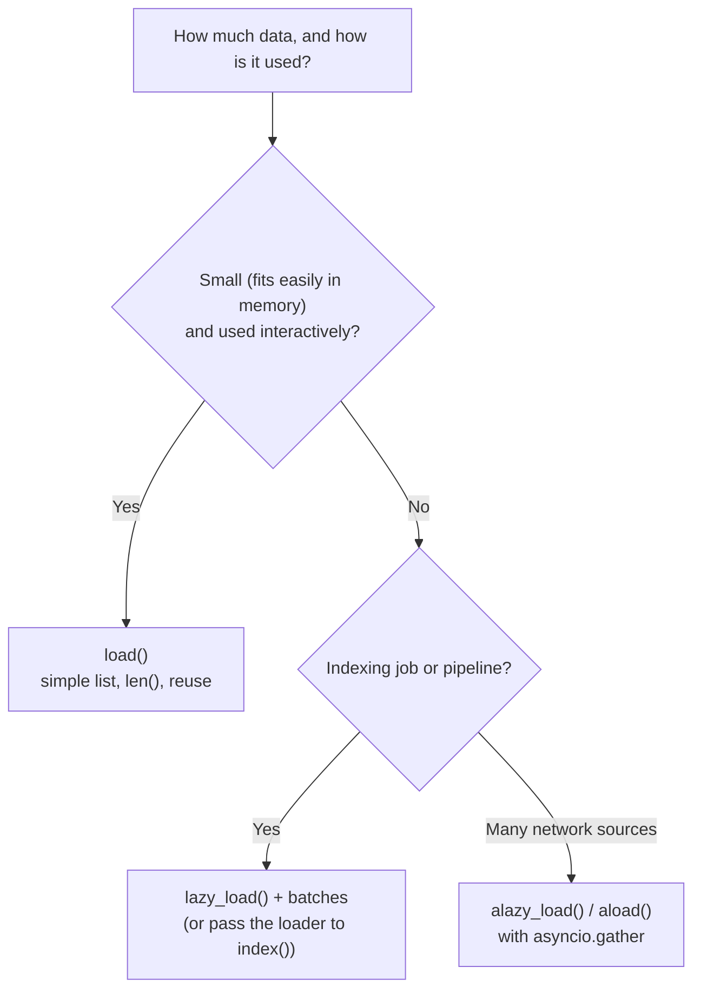

# load() vs lazy_load(): The Complete Guide

> 📚 **Before you start**
>
> - [Document Loaders](document-loaders.md), for `BaseLoader` and how a custom loader implements `lazy_load`.
> - [PDF, Web, CSV and Directory Loaders](pdf-web-csv-and-directory-loaders.md), for the loaders you'll call these methods on.
> - Python generators and `yield` ([Advanced Python Programming](../../advanced-python-programming/course.md)).

## Introduction

Two ways to get 10,000 cartons of mangoes from a farm in Ratnagiri to a market in Mumbai:

- **One giant truck.** Load every carton, drive, unload everything. Simple, but you need a truck big enough for all 10,000 cartons, and nothing reaches the market until the last carton is packed.
- **A conveyor of small tempos.** Each tempo leaves as soon as it's full. The market starts selling within the hour, and you never need space for more than a few tempos' worth at once.

`load()` is the giant truck: it reads **every** document into a Python list and hands you the list. `lazy_load()` is the conveyor: it hands you **one document at a time**, producing the next only when you ask for it. For a 5-page handbook, nobody cares. For 2 million support tickets or a 40 GB folder of PDFs, the choice decides whether your indexing job finishes or runs out of memory.

By the end of this lesson you'll know exactly how the two methods differ, measure the memory difference yourself, stream documents into an index in batches, use the async variant, and use LangChain's indexing API to re-index only what changed.

> 💡 **Key Insight**
>
> `load()` returns a **list** (everything in memory at once); `lazy_load()` returns an **iterator** (one document at a time, on demand). In LangChain, `load()` is literally `list(self.lazy_load())`. Use `load()` for small, interactive work; use `lazy_load()` plus batching for anything large or long-running.

---

## Core Explanation

### 1. The difference in one example

```python
from typing import Iterator
from langchain_core.document_loaders import BaseLoader
from langchain_core.documents import Document

class TicketLoader(BaseLoader):
    """Pretends to read support tickets from a big export, one at a time."""

    def __init__(self, n):
        self.n = n

    def lazy_load(self) -> Iterator[Document]:
        for i in range(self.n):
            print(f"  reading ticket {i}")
            yield Document(page_content=f"Ticket {i}: UPI refund not received.",
                           metadata={"ticket_id": i})

loader = TicketLoader(3)

print("calling load():")
docs = loader.load()
print("got a", type(docs).__name__, "of", len(docs))

print("calling lazy_load():")
stream = loader.lazy_load()
print("got a", type(stream).__name__, "- nothing read yet")
print("first:", next(stream).metadata)
```

Output:

```
calling load():
  reading ticket 0
  reading ticket 1
  reading ticket 2
got a list of 3
calling lazy_load():
got a generator - nothing read yet
  reading ticket 0
first: {'ticket_id': 0}
```

Watch the order of the printed lines:

- `load()` read **all three** tickets before returning anything.
- `lazy_load()` returned instantly, without reading a single ticket. The first ticket was read only when `next()` asked for it.

That's the whole difference. `lazy_load` is a **generator**: a function that `yield`s values one by one and pauses between them.

### 2. How they relate in LangChain

```python
import inspect
print(inspect.getsource(BaseLoader.load).split('"""')[-1].strip())
```

Output:

```
return list(self.lazy_load())
```

So:

| | `load()` | `lazy_load()` |
|---|---|---|
| Returns | `list[Document]` | `Iterator[Document]` |
| When work happens | All at once, before returning | Bit by bit, as you iterate |
| Memory | All documents at once | About one document (plus whatever you keep) |
| Can you `len()` it, index it, loop twice? | Yes | No: it's used up after one pass |
| First document available | After everything is read | Immediately |
| Who implements it | Inherited from `BaseLoader` | The loader author |

Because loaders implement `lazy_load`, every modern LangChain loader supports both. (Very old custom loaders that only override `load` still work with `load`, but `lazy_load` on them falls back to loading everything first.)

### 3. Measuring the memory difference

Let's make the difference concrete. Each fake ticket below is about 20 KB of text (a long email thread), and we'll process 2,000 of them, about 40 MB. Python's `tracemalloc` module reports the peak memory allocated while each approach runs.

```python
import tracemalloc

class BigTicketLoader(BaseLoader):
    def __init__(self, n, size=20_000):
        self.n, self.size = n, size

    def lazy_load(self):
        for i in range(self.n):
            yield Document(page_content="x" * self.size, metadata={"ticket_id": i})

def peak_mb(work):
    tracemalloc.start()
    work()
    _, peak = tracemalloc.get_traced_memory()
    tracemalloc.stop()
    return peak / 1_000_000

def with_load():
    total = 0
    for doc in BigTicketLoader(2_000).load():
        total += len(doc.page_content)

def with_lazy_load():
    total = 0
    for doc in BigTicketLoader(2_000).lazy_load():
        total += len(doc.page_content)

eager, lazy = peak_mb(with_load), peak_mb(with_lazy_load)
print(f"load():      peak about {round(eager, -1):.0f} MB")
print(f"lazy_load(): peak under 1 MB: {lazy < 1}")
```

Output:

```
load():      peak about 40 MB
lazy_load(): peak under 1 MB: True
```

Same work, same result. `load()` needed memory for all 2,000 tickets at once; `lazy_load()` only ever held one. Scale that to millions of documents and `load()` simply crashes the machine.

### 4. Streaming into an index in batches

Real indexing doesn't process one document at a time either: embedding APIs and vector stores are much faster with **batches** (for example 64 or 256 texts per call). The standard pattern is lazy loading plus a small batching helper:

```python
from itertools import islice

def batched(iterable, size):
    it = iter(iterable)
    while batch := list(islice(it, size)):
        yield batch

class FakeVectorStore:
    def __init__(self):
        self.count, self.calls = 0, 0

    def add_documents(self, docs):
        self.calls += 1
        self.count += len(docs)

store = FakeVectorStore()
for batch in batched(TicketLoader(10).lazy_load(), size=4):
    store.add_documents(batch)
    print(f"indexed batch of {len(batch)}; total so far {store.count}")
```

Output:

```
  reading ticket 0
  reading ticket 1
  reading ticket 2
  reading ticket 3
indexed batch of 4; total so far 4
  reading ticket 4
  reading ticket 5
  reading ticket 6
  reading ticket 7
indexed batch of 4; total so far 8
  reading ticket 8
  reading ticket 9
indexed batch of 2; total so far 10
```

The printed "reading ticket" lines show the pipeline breathing: read 4, index 4, read 4, index 4. Memory never holds more than one batch. If the job dies at ticket 9, the first 8 are already indexed (and with stable IDs you can resume, as section 6 shows).

Python 3.12 and newer also ship `itertools.batched`, which does the same thing; the helper above works on older versions too.

### 5. The one-pass trap

An iterator is consumed as you loop over it. This catches everyone once:

```python
stream = TicketLoader(2).lazy_load()
first_pass = [d.metadata["ticket_id"] for d in stream]
second_pass = [d.metadata["ticket_id"] for d in stream]
print("first pass:", first_pass)
print("second pass:", second_pass)
```

Output:

```
  reading ticket 0
  reading ticket 1
first pass: [0, 1]
second pass: []
```

The second loop gets nothing, silently. If you need the documents twice (say, to count them and then index them), either call `lazy_load()` again (re-reading the source) or, if they fit in memory, use `load()`.

Similarly, `len()` doesn't work on a generator. Don't write `len(loader.lazy_load())`.

### 6. Async loading: `alazy_load()`

Network-bound loaders (web pages, APIs, cloud storage) spend most of their time waiting. **Async** loading lets one Python process wait on many requests at once. `BaseLoader` provides `alazy_load()` and `aload()`; loaders with native async support (such as `WebBaseLoader`) override them, and others fall back to running `lazy_load` in a background thread.

```python
import asyncio

class SlowApiLoader(BaseLoader):
    def __init__(self, page_ids):
        self.page_ids = page_ids

    def lazy_load(self):
        for pid in self.page_ids:
            yield Document(page_content=f"page {pid}", metadata={"id": pid})

    async def alazy_load(self):
        for pid in self.page_ids:
            await asyncio.sleep(0.01)        # pretend network wait
            yield Document(page_content=f"page {pid}", metadata={"id": pid})

async def load_many_sources():
    loaders = [SlowApiLoader(["a1", "a2"]), SlowApiLoader(["b1", "b2"]), SlowApiLoader(["c1"])]
    results = await asyncio.gather(*(l.aload() for l in loaders))
    return [d.metadata["id"] for docs in results for d in docs]

print(asyncio.run(load_many_sources()))
```

Output:

```
['a1', 'a2', 'b1', 'b2', 'c1']
```

The three sources load concurrently, so the total time is roughly that of the slowest source rather than the sum. In a notebook or a web framework that already runs an event loop, you'd `await` instead of calling `asyncio.run`.

### 7. Incremental re-indexing with the indexing API

Loading lazily solves memory. The other big indexing problem is **re-running the job**: you don't want to re-embed 2 million unchanged documents every night, and you do want to delete chunks of documents that were removed. LangChain's indexing API in `langchain_core.indexing` handles this. It takes documents (or a loader, which it reads lazily), hashes each one, and uses a **record manager** to remember what's already in the vector store.

```python
from langchain_core.indexing import index, InMemoryRecordManager
from langchain_core.vectorstores import InMemoryVectorStore
from langchain_core.embeddings import DeterministicFakeEmbedding

record_manager = InMemoryRecordManager(namespace="tarang-kb")
record_manager.create_schema()
vector_store = InMemoryVectorStore(DeterministicFakeEmbedding(size=16))

def handbook_docs(meal_allowance="Rs 1,200"):
    return [
        Document(page_content="2.1 Annual leave: 24 days a year.", metadata={"source": "handbook.md"}),
        Document(page_content=f"5.2 Meal allowance: {meal_allowance} in metros.", metadata={"source": "handbook.md"}),
        Document(page_content="6.1 Laptops: report loss within 24 hours.", metadata={"source": "it-policy.md"}),
    ]

def run(docs):
    return index(docs, record_manager, vector_store, cleanup="incremental",
                 source_id_key="source", key_encoder="sha256")

print("first run:   ", run(handbook_docs()))
print("no changes:  ", run(handbook_docs()))
print("one edit:    ", run(handbook_docs(meal_allowance="Rs 1,500")))
```

Output:

```
first run:    {'num_added': 3, 'num_updated': 0, 'num_skipped': 0, 'num_deleted': 0}
no changes:   {'num_added': 0, 'num_updated': 0, 'num_skipped': 3, 'num_deleted': 0}
one edit:     {'num_added': 1, 'num_updated': 0, 'num_skipped': 2, 'num_deleted': 1}
```

Read the three results:

- **First run**: everything is new, so 3 documents are embedded and added.
- **No changes**: every document's hash is already known, so all 3 are **skipped**. No embedding calls, no cost.
- **One edit**: the meal allowance changed, so its hash is new. The new version is **added**, the old version is **deleted** (because `cleanup="incremental"` removes stale documents from sources seen in this run), and the other two are skipped.

`DeterministicFakeEmbedding` is LangChain's test embedding: it produces vectors from a hash of the text, so it's deterministic and offline but carries no meaning. It's perfect for testing plumbing like this. The `InMemoryRecordManager` is for demos too; production uses a persistent one (LangChain provides a SQL-backed record manager in the `langchain-classic` package) so the memory survives restarts.

| `cleanup` mode | What it deletes |
|---|---|
| `None` | Nothing; only adds and skips |
| `"incremental"` | Old versions of documents from the sources present in this batch |
| `"full"` | Everything not present in this run (pass the **whole** corpus or you'll delete the rest) |
| `"scoped_full"` | Like full, but only for sources seen in this run |

### 8. Choosing between them



| Situation | Use |
|---|---|
| Exploring a PDF in a notebook | `load()` |
| Unit tests with a handful of documents | `load()` |
| Nightly indexing of a large folder or export | `lazy_load()` with batches, or the indexing API |
| A web app that ingests a user's upload | `lazy_load()`, streaming progress to the user |
| Hundreds of URLs or API pages | `alazy_load()` / `aload()` with concurrency |

---

## Try It Yourself

1. **Count without loading.** Count how many tickets a `TicketLoader(5)` produces without building a list. (Silence the "reading" prints by using a loader that doesn't print, or just accept them.)
2. **Stop early.** Use `lazy_load()` to find the first ticket whose `ticket_id` is divisible by 3 and greater than 0, reading as few tickets as possible. How many tickets were read?
3. **Delete a source.** Using the indexing API from section 7, run `index` with `cleanup="incremental"` on a list containing only the `it-policy.md` document. What happens to the handbook documents, and why?

<details>
<summary>Show answers</summary>

**1.**

```python
print(sum(1 for _ in TicketLoader(5).lazy_load()))
```

Output:

```
  reading ticket 0
  reading ticket 1
  reading ticket 2
  reading ticket 3
  reading ticket 4
5
```

**2.** Lazy loading lets you stop as soon as you've found what you need; the remaining tickets are never read.

```python
found = next(d for d in TicketLoader(100).lazy_load() if d.metadata["ticket_id"] > 0 and d.metadata["ticket_id"] % 3 == 0)
print("found:", found.metadata["ticket_id"])
```

Output:

```
  reading ticket 0
  reading ticket 1
  reading ticket 2
  reading ticket 3
found: 3
```

Four tickets were read (0 to 3) out of 100. With `load()`, all 100 would have been read first.

**3.**

```python
only_it = [d for d in handbook_docs(meal_allowance="Rs 1,500") if d.metadata["source"] == "it-policy.md"]
print(run(only_it))
```

Output:

```
{'num_added': 0, 'num_updated': 0, 'num_skipped': 1, 'num_deleted': 0}
```

Nothing is deleted. Incremental cleanup only removes stale documents from **sources that appear in the batch**, and `handbook.md` didn't appear. That's what makes incremental mode safe for partial updates. To remove a whole source, you'd use `cleanup="full"` with the complete corpus, or delete its records directly.

</details>

---

## Real-World Examples

- **Support-ticket analytics** pipelines stream millions of tickets from an export with `lazy_load`, embedding them in batches of a few hundred so memory stays flat for hours-long jobs.
- **Document upload features** ("chat with your files") use lazy loading so the first pages can be indexed and searchable while a 500-page PDF is still being processed.
- **Nightly knowledge-base syncs** pass loaders to an indexing API with a persistent record manager, so unchanged pages cost nothing and edited pages replace their old versions.
- **Web crawlers for documentation** use async loading to fetch many pages concurrently within a polite rate limit.

---

## Common Misconceptions

### "lazy_load() is faster"

It isn't faster per document; the same work happens. It's **more memory-efficient** and gets the **first** document to you sooner. Speed gains come from batching and concurrency, which lazy loading makes practical.

### "I can loop over lazy_load() twice"

A generator is used up after one pass. The second loop silently yields nothing.

### "load() is deprecated"

It's fine and convenient for small data. It's simply `list(lazy_load())`; choose based on size and usage.

### "Re-indexing means re-embedding everything"

With document hashes and a record manager (LangChain's indexing API), unchanged documents are skipped and only edits are re-embedded.

---

## Interview Relevance

*"How would you index 10 million documents?"* Interviewers want to hear: stream with `lazy_load` (never materialise everything), batch embedding calls, parallelise or use async for network-bound loading, give documents stable IDs and content hashes, make the job resumable, and use incremental indexing (a record manager) so re-runs only process changes and deletions are handled.

*"What's the difference between `load` and `lazy_load`?"* List versus iterator, eager versus on-demand, memory, single pass, and that `load` is implemented as `list(lazy_load())`.

---

## Key Takeaways

- **`load()` returns a list; `lazy_load()` returns an iterator**, and `load()` is just `list(lazy_load())`.
- **Lazy loading keeps memory flat** and delivers the first document immediately; it's essential for large corpora.
- **Combine `lazy_load()` with batching** for efficient embedding and indexing; beware that iterators are single-pass.
- **`alazy_load()` / `aload()`** let network-bound loaders run concurrently with `asyncio`.
- **The indexing API** (`langchain_core.indexing.index` with a record manager) skips unchanged documents and cleans up stale ones on re-runs.

---

**Up next:** [Text Splitters](text-splitters.md)
