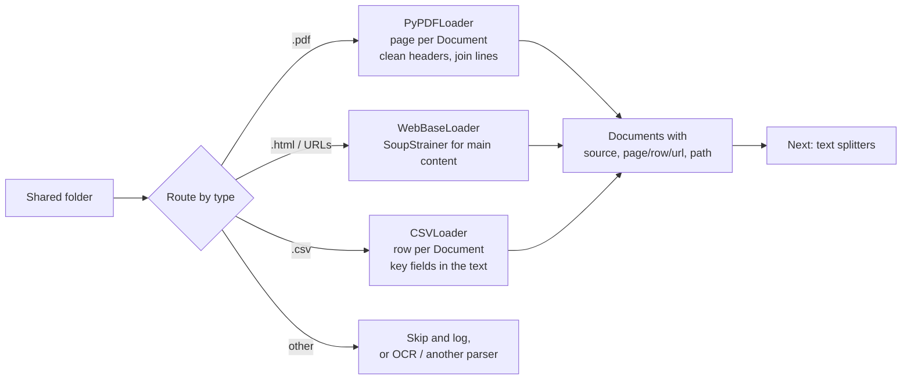

# PDF, Web, CSV and Directory Loaders: The Complete Guide

> 📚 **Before you start**
>
> - [Document Loaders](document-loaders.md), for the `Document` object, `BaseLoader` and metadata design.

## Introduction

When a company says *"build us a chatbot over our documents"*, the documents almost always turn out to be the same four things: a pile of **PDFs** (policies, contracts, manuals), some **web pages** (the help centre, the public website), a few **spreadsheets** exported as CSV (price lists, branch addresses, claim logs), and a **shared folder** where all of these are mixed together.

These four sources cover most first RAG projects, and each has its own traps. PDFs scramble text order. Web pages bury content under menus and cookie banners. CSV rows make poor sentences. Folders contain files you didn't expect. This lesson takes each one in turn: the LangChain loader you'd use, exactly what it produces, what goes wrong, and how to fix it.

All runnable code here uses only the Python standard library and `langchain_core`, so it runs offline. Each section also shows the real `langchain-community` loader, with its actual parameters, in a not-run block.

> 💡 **Key Insight**
>
> Each format needs a different **unit** and different **cleanup**: PDFs → one Document per page, then fix layout; web pages → keep only the main content; CSVs → one Document per row as readable `column: value` lines; folders → route each file to the right loader by type. Get the unit right and the rest of the pipeline gets easier.

---

## Core Explanation

### 1. PDF loaders

#### What a PDF really is

A PDF isn't a text document. It's a set of **drawing instructions**: "put the glyph *R* at x=72, y=640 in Helvetica 11pt; put *s* next to it...". There are no paragraphs, no reading order, sometimes not even spaces. A PDF loader reconstructs text from those instructions, which is why:

- **Two-column layouts** can come out interleaved (line 1 of column A, line 1 of column B, ...).
- **Tables** become runs of numbers with no row or column structure.
- **Headers, footers and page numbers** appear on every page.
- **Scanned PDFs** contain only images of pages, so a plain text extractor returns empty strings. These need **OCR** (optical character recognition).
- **Hyphenated line breaks** split words ("reimburse-\nment").

#### `PyPDFLoader`

The most common starting point, built on the `pypdf` library. By default it returns **one `Document` per page**:

```python
# not-run: needs langchain-community and pypdf, plus a PDF on disk
from langchain_community.document_loaders import PyPDFLoader

loader = PyPDFLoader("hr/handbook-2026.pdf")          # mode="page" is the default
pages = loader.load()
print(len(pages))
print(pages[13].metadata)
print(pages[13].page_content[:120])
```

Example output:

```
42
{'producer': 'PyPDF', 'creator': 'PyPDF', 'creationdate': '', 'source': 'hr/handbook-2026.pdf', 'total_pages': 42, 'page': 13, 'page_label': '14'}
Tarang Software | Confidential | Page 14
5.2 Meal allowance
On client travel the daily meal allowance is Rs 1,200 in metro cities and Rs 800
```

Useful options (all real parameters of `PyPDFLoader` in current `langchain-community`):

| Parameter | What it does |
|---|---|
| `mode="page"` / `mode="single"` | One Document per page (default), or the whole PDF as one Document |
| `password=...` | Open encrypted PDFs |
| `extraction_mode="layout"` | Try to preserve the visual layout (helps some tables and columns) instead of `"plain"` |
| `extract_images=True` with `images_parser=...` | Also extract text from images inside the PDF using an image parser |

Remember that `page` is **0-based** and `page_label` is the number printed on the page. Citations should use the label.

#### Other PDF options

| Loader or tool | Strength |
|---|---|
| `PyMuPDFLoader` | Fast, more layout information, can extract tables (`extract_tables="markdown"`) |
| Layout-aware parsers (for example Unstructured, Docling) | Detect titles, paragraphs, lists and tables as separate elements; run OCR on scans |
| Vision-language models | Read the page image directly, good for complex layouts, charts and forms; slower and costlier |
| Sending the PDF to the LLM | Several model APIs accept PDFs directly (Claude accepts PDF `document` blocks and reads both text and page images). Great for one document per question, not a replacement for indexing a large corpus |

A practical rule: **open your loader's output for the five ugliest PDFs you have** (tables, scans, two columns) before choosing. The best parser is the one that handles your worst files.

#### Fixing common PDF text problems

You'll often post-process page text. Here's a cleanup pass for typical `PyPDFLoader` output, written against a string so it runs offline:

```python
import re

PAGE_TEXT = """Tarang Software | Confidential | Page 14
5.2 Meal allowance
On client travel the daily meal allowance is Rs 1,200 in metro cities and Rs 800
in other cities. Bills for meals above the allowance are not reim-
bursed.
Tarang Software | Confidential | Page 14"""

def clean_pdf_page(text, boilerplate=r"^Tarang Software \| Confidential \| Page \d+$"):
    lines = [ln for ln in text.splitlines() if not re.match(boilerplate, ln.strip())]
    text = "\n".join(lines)
    text = re.sub(r"(\w)-\n(\w)", r"\1\2", text)          # join hyphenated words
    text = re.sub(r"(?<![.:\n])\n(?=[a-z])", " ", text)    # join lines that continue a sentence
    return text.strip()

print(clean_pdf_page(PAGE_TEXT))
```

Output:

```
5.2 Meal allowance
On client travel the daily meal allowance is Rs 1,200 in metro cities and Rs 800 in other cities. Bills for meals above the allowance are not reimbursed.
```

### 2. Web loaders

#### `WebBaseLoader`

Fetches URLs with `requests` and parses HTML with BeautifulSoup. One `Document` per URL.

```python
# not-run: needs langchain-community, beautifulsoup4 and network access
import bs4
from langchain_community.document_loaders import WebBaseLoader

loader = WebBaseLoader(
    web_paths=["https://example.com/help/refunds", "https://example.com/help/shipping"],
    bs_kwargs={"parse_only": bs4.SoupStrainer(["main", "article"])},   # keep only main content
    requests_per_second=1,
)
docs = loader.load()
print(docs[0].metadata)
```

Example output:

```
{'source': 'https://example.com/help/refunds', 'title': 'Refunds | Help Centre', 'description': 'How refunds work', 'language': 'en'}
```

`WebBaseLoader` sets `source` to the URL and, when the page has them, `title`, `description` and `language`. The `bs_kwargs` with a `SoupStrainer` tells BeautifulSoup to parse only the tags you name, which is the simplest way to drop navigation, sidebars and footers. Other parameters worth knowing: `header_template` (custom headers such as a User-Agent), `requests_per_second`, `continue_on_failure` and `raise_for_status`. It also has an async `alazy_load()` for fetching many pages concurrently.

#### What the loader is doing

To see the mechanics, here's a miniature version using only the standard library's `html.parser`. It skips `<nav>`, `<header>`, `<footer>`, `<script>` and `<style>`, keeps text, and builds the same metadata as `WebBaseLoader`:

```python
from html.parser import HTMLParser
from langchain_core.documents import Document

HTML = """<html lang="en"><head><title>Refunds | Kirana Mart Help</title>
<meta name="description" content="How and when refunds are paid"></head>
<body><nav>Home | Orders | Offers | Login</nav>
<main><h1>Refunds</h1>
<p>Refunds for UPI payments reach your account within 3 working days.</p>
<p>Card refunds can take up to 7 working days.</p></main>
<footer>© 2026 Kirana Mart (a made-up shop). All rights reserved.</footer>
<script>trackPageView();</script></body></html>"""

class MainTextParser(HTMLParser):
    SKIP = {"nav", "header", "footer", "script", "style"}

    def __init__(self):
        super().__init__()
        self.skip_depth, self.chunks, self.meta, self._in_title = 0, [], {}, False

    def handle_starttag(self, tag, attrs):
        attrs = dict(attrs)
        if tag in self.SKIP:
            self.skip_depth += 1
        elif tag == "html" and "lang" in attrs:
            self.meta["language"] = attrs["lang"]
        elif tag == "meta" and attrs.get("name") == "description":
            self.meta["description"] = attrs.get("content", "")
        self._in_title = tag == "title"

    def handle_endtag(self, tag):
        if tag in self.SKIP:
            self.skip_depth -= 1
        self._in_title = False

    def handle_data(self, data):
        if self._in_title:
            self.meta["title"] = data.strip()
        elif self.skip_depth == 0 and data.strip():
            self.chunks.append(data.strip())

def load_html(html, url):
    parser = MainTextParser()
    parser.feed(html)
    body = [c for c in parser.chunks if c != parser.meta.get("title")]
    return Document(page_content="\n".join(body), metadata={"source": url, **parser.meta})

page = load_html(HTML, "https://help.kiranamart.example/refunds")
print(page.metadata)
print(page.page_content)
```

Output:

```
{'source': 'https://help.kiranamart.example/refunds', 'language': 'en', 'title': 'Refunds | Kirana Mart Help', 'description': 'How and when refunds are paid'}
Refunds
Refunds for UPI payments reach your account within 3 working days.
Card refunds can take up to 7 working days.
```

The navigation bar, footer and tracking script are gone; only the help content remains. Real sites need site-specific choices (which tags hold the content), which is exactly what `SoupStrainer` in `bs_kwargs` lets you express.

#### Crawling more than one page

| Loader | Use it for |
|---|---|
| `WebBaseLoader(web_paths=[...])` | A known list of URLs |
| `SitemapLoader` | Every page listed in a site's `sitemap.xml`, optionally filtered |
| `RecursiveUrlLoader` | Following links from a root URL to a maximum depth |

Be a good citizen: respect `robots.txt` and the site's terms, rate-limit requests, identify yourself with a User-Agent, and prefer official exports or APIs when they exist. Pages that render their content with JavaScript may come back nearly empty from a plain HTTP fetch and need a headless browser loader.

### 3. CSV loaders

#### `CSVLoader`

`CSVLoader` turns **each row into one `Document`**. The `page_content` is one `column: value` line per column; metadata gets `source` and the 0-based `row` number.

```python
# not-run: needs langchain-community
from langchain_community.document_loaders import CSVLoader

loader = CSVLoader(
    file_path="ops/branches.csv",
    source_column="branch_id",          # use this column as metadata["source"]
    metadata_columns=["city", "state"],  # copied into metadata, removed from the text
    encoding="utf-8",
)
rows = loader.load()
print(rows[0].page_content)
print(rows[0].metadata)
```

Example output:

```
branch_id: PUN-01
address: 4th floor, Baner Road, Pune
phone: 020-5550-0101
open_hours: Mon-Sat 9:30-18:00
{'source': 'PUN-01', 'row': 0, 'city': 'Pune', 'state': 'Maharashtra'}
```

There's also `content_columns=[...]` to choose which columns go into the text, and `csv_args` to pass options such as the delimiter to Python's `csv` module.

Here is the same behaviour built from the standard library, so you can see and tweak it:

```python
import csv, io

BRANCHES_CSV = """branch_id,city,state,address,open_hours
PUN-01,Pune,Maharashtra,"4th floor, Baner Road",Mon-Sat 9:30-18:00
BLR-02,Bengaluru,Karnataka,"12 MG Road",Mon-Fri 10:00-19:00
CHE-01,Chennai,Tamil Nadu,"8 Anna Salai",Mon-Sat 9:00-17:30"""

def load_csv(text, source_column=None, metadata_columns=(), file_name="branches.csv"):
    docs = []
    for i, row in enumerate(csv.DictReader(io.StringIO(text))):
        content = "\n".join(f"{k.strip()}: {v.strip()}" for k, v in row.items() if k not in metadata_columns)
        meta = {"source": row[source_column] if source_column else file_name, "row": i}
        meta.update({k: row[k] for k in metadata_columns})
        docs.append(Document(page_content=content, metadata=meta))
    return docs

rows = load_csv(BRANCHES_CSV, source_column="branch_id", metadata_columns=["city", "state"])
print(rows[1].page_content)
print(rows[1].metadata)
```

Output:

```
branch_id: BLR-02
address: 12 MG Road
open_hours: Mon-Fri 10:00-19:00
{'source': 'BLR-02', 'row': 1, 'city': 'Bengaluru', 'state': 'Karnataka'}
```

#### Making rows retrievable

`column: value` text works, but embeddings match questions better when a row reads like a sentence, and the most important fields are in the text, not hidden in metadata. A small template often helps a lot:

```python
def row_to_sentence(row):
    return (f"The {row['city']} branch ({row['branch_id']}) is at {row['address']}, {row['city']}, "
            f"{row['state']}. Opening hours: {row['open_hours']}.")

table = list(csv.DictReader(io.StringIO(BRANCHES_CSV)))
sentences = [Document(page_content=row_to_sentence(r), metadata={"source": r["branch_id"], "city": r["city"]})
             for r in table]
print(sentences[2].page_content)
```

Output:

```
The Chennai branch (CHE-01) is at 8 Anna Salai, Chennai, Tamil Nadu. Opening hours: Mon-Sat 9:00-17:30.
```

Notice that the earlier `CSVLoader`-style version moved `city` into metadata, so the text no longer said "Chennai". If users ask *"Where is your Chennai office?"*, the city had better be in the text that gets embedded.

#### When not to use RAG for tables

Questions like *"How many branches are in Maharashtra?"* or *"Which claims over Rs 50,000 are pending?"* need **counting, filtering or summing across rows**. Retrieving five similar rows can't answer them. For those, keep the table in a database and let the LLM write SQL (often called **text-to-SQL**), or give an agent a query tool. Use row-level RAG for lookup questions about individual records.

### 4. Directory loaders

#### `DirectoryLoader`

Points at a folder, finds files matching a glob pattern, and loads each with a loader class you choose:

```python
# not-run: needs langchain-community (and the libraries each loader needs)
from langchain_community.document_loaders import DirectoryLoader, TextLoader, PyPDFLoader

md_loader = DirectoryLoader(
    "knowledge-base/",
    glob="**/*.md",               # which files
    loader_cls=TextLoader,         # how to load each one
    loader_kwargs={"encoding": "utf-8"},
    recursive=True,
    show_progress=True,
    use_multithreading=True,
    silent_errors=True,            # log and skip unreadable files instead of stopping
)
pdf_loader = DirectoryLoader("knowledge-base/", glob="**/*.pdf", loader_cls=PyPDFLoader)
docs = md_loader.load() + pdf_loader.load()
```

The default `loader_cls` is `UnstructuredFileLoader`, which needs the `unstructured` package; pass your own `loader_cls` to avoid that dependency. Other parameters include `exclude` (glob patterns to skip), `load_hidden`, `max_concurrency` and `sample_size` (load only a sample, handy for testing on a huge folder).

#### Routing by file type

A real folder has mixed types, so you typically run one `DirectoryLoader` per type (as above) or write a small router. Here's a router built on the pieces from this lesson. It walks a folder, picks a loader by extension, records failures instead of crashing, and stamps every `Document` with its path:

```python
import os, tempfile
from pathlib import Path

kb = Path(tempfile.mkdtemp())
(kb / "hr").mkdir()
(kb / "help").mkdir()
(kb / "hr" / "leave.md").write_text("## 2.1 Annual leave\nEvery employee gets 24 days of paid leave.", encoding="utf-8")
(kb / "help" / "refunds.html").write_text(HTML, encoding="utf-8")
(kb / "branches.csv").write_text(BRANCHES_CSV, encoding="utf-8")
(kb / "logo.png").write_bytes(b"\x89PNG fake image bytes")
(kb / "broken.csv").write_text('id,name\n1,"unclosed quote', encoding="utf-8")

def load_markdown(path):
    return [Document(page_content=path.read_text(encoding="utf-8"), metadata={})]

def load_html_file(path):
    return [load_html(path.read_text(encoding="utf-8"), url=path.name)]

def load_csv_file(path):
    text = path.read_text(encoding="utf-8")
    list(csv.reader(io.StringIO(text), strict=True))      # raises an error on malformed CSV
    return load_csv(text, file_name=path.name)

LOADERS = {".md": load_markdown, ".html": load_html_file, ".csv": load_csv_file}

def load_directory(root):
    docs, skipped, failed = [], [], []
    for path in sorted(Path(root).rglob("*")):
        if not path.is_file():
            continue
        loader = LOADERS.get(path.suffix)
        if loader is None:
            skipped.append(path.name)
            continue
        try:
            for d in loader(path):
                d.metadata["path"] = str(path.relative_to(root))
                docs.append(d)
        except Exception as error:
            failed.append(f"{path.name}: {type(error).__name__}")
    return docs, skipped, failed

docs, skipped, failed = load_directory(kb)
print(len(docs), "documents")
for d in docs:
    print(f"  {d.metadata['path']:<20} {d.page_content[:40]!r}")
print("skipped:", skipped)
print("failed: ", failed)
```

Output:

```
5 documents
  branches.csv         'branch_id: PUN-01\ncity: Pune\nstate: Maha'
  branches.csv         'branch_id: BLR-02\ncity: Bengaluru\nstate:'
  branches.csv         'branch_id: CHE-01\ncity: Chennai\nstate: T'
  help/refunds.html    'Refunds\nRefunds for UPI payments reach y'
  hr/leave.md          '## 2.1 Annual leave\nEvery employee gets '
skipped: ['logo.png']
failed:  ['broken.csv: Error']
```

Three habits shown here matter in production: **know what you skipped** (the image might have needed OCR), **don't let one bad file stop the whole run** (but log it), and **record the path** in metadata so you can trace and delete documents later.

### 5. Putting the four together



| Source | Unit | Must-have metadata | Biggest trap |
|---|---|---|---|
| PDF | Page | `source`, `page` / `page_label` | Layout scrambled, scans with no text, repeated headers |
| Web | Page (URL) | `source` (URL), `title` | Menus and footers mixed into content; JavaScript-only pages |
| CSV | Row | `source`, `row`, key IDs | Important fields hidden in metadata; aggregate questions |
| Folder | File, then the above | `path` | Silent skips and crashes on one bad file |

---

## Try It Yourself

1. **Use the page title.** Modify `load_html` so the page `<title>` (minus the " | site name" part) becomes the first line of `page_content`. Why might that help retrieval?
2. **A better CSV template.** Write `row_to_sentence` for this claims table: `claim_id,employee,amount,status,submitted` with a row like `C-104,Asha Nair,18500,approved,2026-05-03`. Then explain which kinds of questions it can and can't answer through RAG.
3. **Handle the PNG.** Change `load_directory` so skipped image files are returned in a separate `needs_ocr` list instead of `skipped`.

<details>
<summary>Show answers</summary>

**1.** Titles are often the most concentrated statement of what a page is about, and short pages may not repeat the topic in the body, so putting the title in the text helps embeddings match questions. One way:

```python
def load_html_with_title(html, url):
    doc = load_html(html, url)
    title = doc.metadata.get("title", "").split(" | ")[0]
    if title and not doc.page_content.startswith(title):
        doc.page_content = f"{title}\n{doc.page_content}"
    return doc

print(load_html_with_title(HTML, "refunds").page_content.splitlines()[0])
```

Output:

```
Refunds
```

Our sample page already opens with an `<h1>` that matches the title, so nothing is added; on pages whose body never states the topic, the title line is prepended.

**2.**

```python
CLAIMS = """claim_id,employee,amount,status,submitted
C-104,Asha Nair,18500,approved,2026-05-03"""

def claim_sentence(r):
    return (f"Expense claim {r['claim_id']} by {r['employee']} for Rs {int(r['amount']):,} "
            f"was submitted on {r['submitted']} and is {r['status']}.")

for r in csv.DictReader(io.StringIO(CLAIMS)):
    print(claim_sentence(r))
```

Output:

```
Expense claim C-104 by Asha Nair for Rs 18,500 was submitted on 2026-05-03 and is approved.
```

RAG over these sentences answers lookups (*"What's the status of Asha's claim?"*). It can't reliably answer aggregates (*"Total approved claims in May?"*): that needs SQL or pandas over the table.

**3.**

```python
IMAGE_TYPES = {".png", ".jpg", ".jpeg", ".tiff"}

def load_directory_v2(root):
    docs, skipped, failed = load_directory(root)
    needs_ocr = [name for name in skipped if Path(name).suffix in IMAGE_TYPES]
    skipped = [name for name in skipped if Path(name).suffix not in IMAGE_TYPES]
    return docs, skipped, failed, needs_ocr

print(load_directory_v2(kb)[3])
```

Output:

```
['logo.png']
```

</details>

---

## Real-World Examples

- **Insurance companies** run OCR-capable, layout-aware parsers over scanned policy documents and claim forms, because a plain PDF text extractor returns nothing for scans.
- **Help-centre chatbots** load their own help articles from a sitemap every night, keeping only the article body, and cite the article URL.
- **Retail and banking assistants** load branch and product tables as one readable sentence per row for lookups, and route counting questions to SQL.
- **Internal knowledge assistants** start from a shared drive export: a directory walk that routes PDFs, Word files and spreadsheets to different loaders and logs every skipped file for review.

---

## Common Misconceptions

### "PyPDFLoader reads any PDF"

It reads PDFs that contain a text layer. Scanned PDFs need OCR, and complex layouts may need a layout-aware parser. Check output on your worst files.

### "Loading a web page gives you its content"

It gives you its HTML, including menus, footers, cookie banners and scripts. Without filtering, that boilerplate pollutes every chunk.

### "CSV rows are fine as-is for RAG"

They're retrievable, but bare `column: value` text matches questions less well than a sentence, and aggregate questions over many rows need SQL, not retrieval.

---

## Interview Relevance

*"How would you ingest PDFs, web pages and spreadsheets for RAG?"* A strong answer gives the right unit per format (page, page/URL, row), names the typical failure per format (layout and scans; boilerplate and JavaScript rendering; aggregation questions), mentions concrete tools (`PyPDFLoader` vs layout-aware parsers with OCR, `WebBaseLoader` with a `SoupStrainer`, `CSVLoader` with `source_column` and `metadata_columns`, `DirectoryLoader` with `glob` and `loader_cls`), and stresses inspecting output and logging failures.

Follow-up: *"Users ask how many orders were delayed last week, and the bot gets it wrong."* That's an aggregation question; route it to SQL or a tool rather than RAG.

---

## Key Takeaways

- **PDFs**: one Document per page with `PyPDFLoader`; clean headers, footers and hyphenation; use OCR or layout-aware parsers for scans and complex layouts; cite `page_label`.
- **Web**: `WebBaseLoader` with a `SoupStrainer` to keep only the main content; respect sites and rate limits.
- **CSV**: one Document per row; keep the fields people ask about in the text, ideally as a sentence; send aggregate questions to SQL.
- **Folders**: route by file type, record the path, and log skips and failures instead of crashing.

---

**Up next:** [load() vs lazy_load()](load-vs-lazy-load.md)
